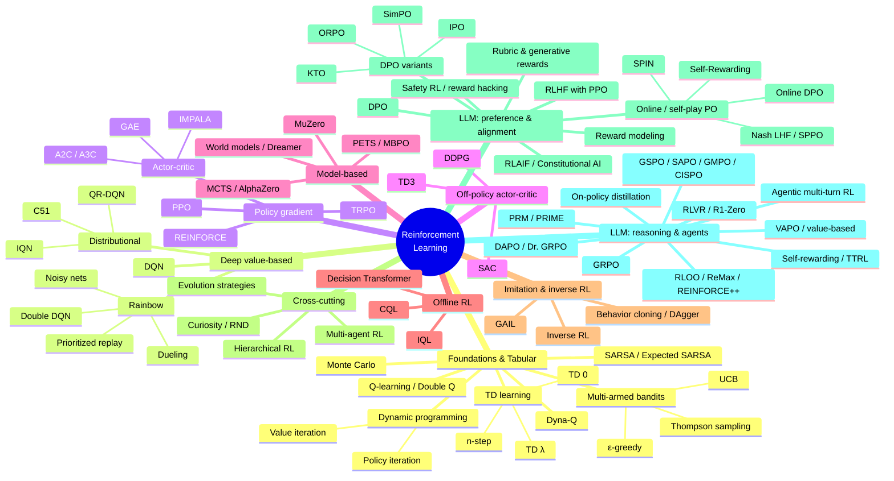
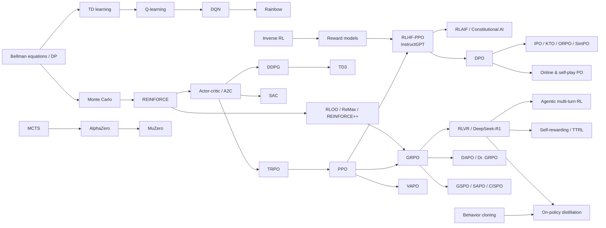
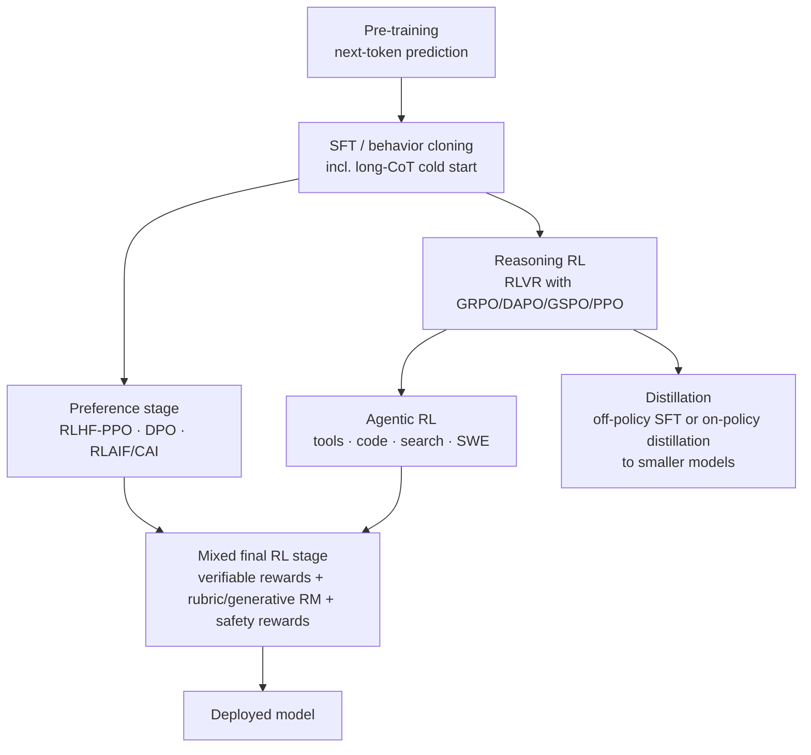
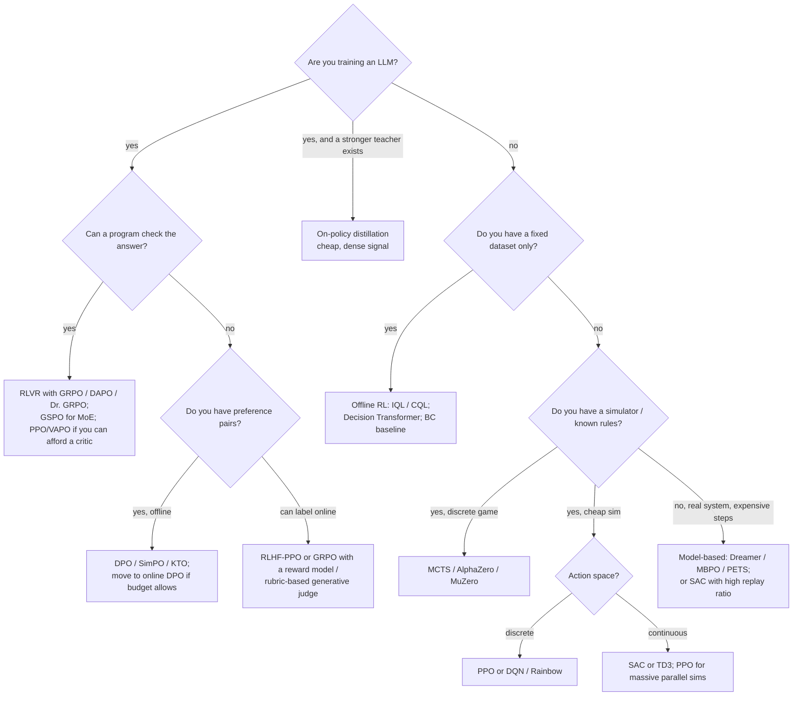

# Reinforcement Learning Methods: The Complete Overview (2026 Edition)

> A single map of the reinforcement learning (RL) field, from the classic tabular methods in Sutton & Barto's book
> to the RL that trains today's large language models (RLHF, DPO, GRPO, RLVR, DAPO, GSPO, on-policy distillation,
> agentic RL and more). Each method below lists **what it is**, **which family it belongs to**, and its **pros and cons**,
> and links to a deep-dive file with the math, Python code, and sections written for business users and for kids.
>
> *Last updated: November 2026.*

---

## Table of contents

1. [What is reinforcement learning?](#1-what-is-reinforcement-learning)
2. [How RL methods are classified (the families)](#2-how-rl-methods-are-classified-the-families)
3. [Mind map of all methods](#3-mind-map-of-all-methods)
4. [Master comparison table](#4-master-comparison-table)
5. [Method-by-method summaries](#5-method-by-method-summaries)
   - [5.1 Foundations & tabular methods](#51-foundations--tabular-methods)
   - [5.2 Deep value-based methods](#52-deep-value-based-methods)
   - [5.3 Policy-gradient methods](#53-policy-gradient-methods)
   - [5.4 Off-policy actor-critic (continuous control)](#54-off-policy-actor-critic-continuous-control)
   - [5.5 Model-based RL & planning](#55-model-based-rl--planning)
   - [5.6 Offline RL](#56-offline-rl)
   - [5.7 Imitation & inverse RL](#57-imitation--inverse-rl)
   - [5.8 Exploration, hierarchy, multi-agent, evolution](#58-exploration-hierarchy-multi-agent-evolution)
   - [5.9 LLM RL I: preference learning & alignment](#59-llm-rl-i-preference-learning--alignment)
   - [5.10 LLM RL II: reasoning, verifiable rewards & agents](#510-llm-rl-ii-reasoning-verifiable-rewards--agents)
6. [How the modern LLM training pipeline fits together](#6-how-the-modern-llm-training-pipeline-fits-together)
7. [Choosing a method: a decision guide](#7-choosing-a-method-a-decision-guide)
8. [Timeline](#8-timeline)
9. [Sources: books, papers, and repositories](#9-sources-books-papers-and-repositories)

See also: [Future directions of RL →](RL_Future_Directions.md)

---

## 1. What is reinforcement learning?

Reinforcement learning studies an **agent** that learns by **trial and error**. At each time step $t$ the agent
sees a **state** $s_t$, takes an **action** $a_t$ chosen by its **policy** $\pi(a\mid s)$, receives a **reward** $r_t$,
and moves to a new state $s_{t+1}$. The goal is to maximize the expected **return** (the discounted sum of future rewards):

$$
J(\pi) = \mathbb{E}_{\pi}\Big[\sum_{t=0}^{\infty}\gamma^t r_t\Big], \qquad 0\le\gamma\le 1.
$$

The formal model is the **Markov Decision Process (MDP)** $(\mathcal{S},\mathcal{A},P,R,\gamma)$. Two functions recur
everywhere:

- **State value** $V^\pi(s)=\mathbb{E}_\pi[G_t\mid s_t=s]$: how good it is to be in $s$.
- **Action value** $Q^\pi(s,a)=\mathbb{E}_\pi[G_t\mid s_t=s,a_t=a]$: how good it is to do $a$ in $s$.

They satisfy the **Bellman equations**, which say that the value of a state is the reward you get now plus the
discounted value of where you land next:

$$
Q^\pi(s,a)=\mathbb{E}\big[r + \gamma\, \mathbb{E}_{a'\sim\pi}Q^\pi(s',a')\big],\qquad
Q^*(s,a)=\mathbb{E}\big[r + \gamma \max_{a'}Q^*(s',a')\big].
$$

Almost every algorithm in this document is a different answer to these questions:

| Question | Options |
|---|---|
| Do we learn a **model** of the world? | Model-free vs. model-based |
| What do we learn? | Values ($V$, $Q$), a policy $\pi$, or both (actor-critic) |
| Whose data do we learn from? | On-policy (the current policy), off-policy (any policy), offline (a fixed dataset) |
| Where does the reward come from? | The environment, a human, a learned reward model, a verifier/program, an AI judge, or the model itself |
| How do we deal with exploration vs. exploitation? | ε-greedy, entropy bonuses, optimism (UCB), curiosity, sampling temperature |

**RL for LLMs** is the same framework with a special shape: the *state* is the prompt plus the tokens generated so far,
the *action* is the next token, an *episode* is one full response (or a multi-turn agent trajectory), and the
*reward* usually arrives only at the end (a preference score, a passing unit test, a correct math answer).

---

## 2. How RL methods are classified (the families)

```text
Reinforcement Learning
├── Model-free
│   ├── Value-based ............ learn Q, act greedily (Q-learning, SARSA, DQN, Rainbow, C51/QR-DQN)
│   ├── Policy-based ........... learn π directly by gradient ascent (REINFORCE, TRPO, PPO)
│   │   └── Critic-free group methods for LLMs (RLOO, ReMax, GRPO, DAPO, GSPO, ...)
│   ├── Actor-critic ........... learn both π and V/Q (A2C/A3C, PPO, DDPG, TD3, SAC, VAPO)
│   └── Black-box search ....... evolution strategies, CEM
├── Model-based ................ learn/use a model P(s'|s,a) (DP, Dyna, MCTS/AlphaZero, MuZero, Dreamer, PETS/MBPO)
├── Offline RL ................. learn from a fixed dataset (CQL, IQL, Decision Transformer)
├── Learning from demonstrations
│   ├── Imitation .............. behavior cloning / SFT, DAgger, GAIL
│   └── Inverse RL ............. infer the reward (MaxEnt IRL) → reward modeling in RLHF
├── Cross-cutting topics ....... exploration (curiosity, RND), hierarchy (options), multi-agent (QMIX, MAPPO, self-play)
└── RL for LLMs
    ├── Preference-based alignment: RLHF-PPO, reward models, RLAIF/Constitutional AI, DPO & variants, online/self-play PO
    ├── Rewards for open-ended tasks: LLM-as-judge, generative RMs, rubrics, safety rewards
    └── Reasoning & agents: RLVR, GRPO family (DAPO, Dr. GRPO, GSPO, SAPO, CISPO), RLOO/REINFORCE++,
        value-based (VAPO), process rewards (PRM, PRIME), on-policy distillation, agentic multi-turn RL, label-free RL (TTRL)
```

**Key distinctions explained**

- **On-policy vs. off-policy.** On-policy methods (SARSA, REINFORCE, PPO, GRPO) learn only from data produced by the
  current policy; they are stable but sample-hungry. Off-policy methods (Q-learning, DQN, SAC) can reuse old data
  from a replay buffer; they are sample-efficient but can be unstable (the "deadly triad" of function approximation,
  bootstrapping, and off-policy data — Sutton & Barto §11.3).
- **Bootstrapping vs. Monte Carlo.** TD methods update a guess from another guess (low variance, some bias);
  Monte Carlo waits for the true return (unbiased, high variance). TD(λ) and GAE interpolate between the two.
- **Critic vs. critic-free.** A critic (value network) reduces variance but costs memory and can be wrong. In LLM RL,
  critic-free methods (GRPO, RLOO) replaced the critic with *group statistics of several sampled answers to the same
  prompt*, which is cheaper and works well when rewards are at the end of the sequence.

---

## 3. Mind map of all methods

> GitHub renders the Mermaid diagram below. A plain-text version follows for other viewers.



<details>
<summary><b>Plain-text mind map</b> (click to expand)</summary>

```text
REINFORCEMENT LEARNING
│
├── 1. FOUNDATIONS & TABULAR (Sutton & Barto, Part I)
│     ├── Multi-armed bandits ............ ε-greedy · UCB · Thompson · gradient bandit · LinUCB
│     ├── Dynamic programming ............ policy evaluation · policy iteration · value iteration · GPI
│     ├── Monte Carlo .................... first/every-visit · exploring starts · importance sampling
│     ├── TD learning .................... TD(0) · n-step TD · TD(λ) / eligibility traces
│     ├── SARSA .......................... SARSA · Expected SARSA · SARSA(λ)
│     ├── Q-learning ..................... Q-learning · Double Q-learning
│     └── Dyna-Q ......................... Dyna-Q · Dyna-Q+ · prioritized sweeping
│
├── 2. DEEP VALUE-BASED
│     ├── DQN ............................ replay buffer · target network
│     ├── Rainbow ........................ Double · Dueling · PER · n-step · Noisy · C51
│     └── Distributional RL .............. C51 · QR-DQN · IQN
│
├── 3. POLICY GRADIENT
│     ├── REINFORCE ...................... baseline · reward-to-go
│     ├── Actor-critic ................... A2C · A3C · GAE · IMPALA/V-trace
│     ├── TRPO ........................... KL trust region · natural gradient
│     └── PPO ............................ clipped surrogate · the RLHF workhorse
│
├── 4. OFF-POLICY ACTOR-CRITIC (continuous control)
│     ├── DDPG ........................... deterministic policy gradient
│     ├── TD3 ............................ twin critics · delayed updates · target smoothing
│     └── SAC ............................ maximum entropy · auto temperature
│
├── 5. MODEL-BASED & PLANNING
│     ├── MCTS / AlphaGo / AlphaZero ..... PUCT · self-play
│     ├── MuZero ......................... learned latent model + MCTS
│     ├── World models / Dreamer ......... RSSM · learning in imagination · DreamerV3
│     └── PETS / MBPO .................... model ensembles · CEM-MPC · short model rollouts
│
├── 6. OFFLINE RL
│     ├── CQL ............................ conservative Q-values
│     ├── IQL ............................ expectile regression · AWR extraction
│     └── Decision Transformer ........... RL as sequence modeling
│
├── 7. IMITATION & INVERSE RL
│     ├── Behavior cloning / DAgger ...... = SFT for LLMs
│     ├── Inverse RL ..................... apprenticeship · MaxEnt IRL
│     └── GAIL / AIRL .................... adversarial imitation
│
├── 8. CROSS-CUTTING
│     ├── Exploration .................... count-based · ICM · RND · Go-Explore
│     ├── Hierarchical RL ................ options · option-critic · feudal / HIRO
│     ├── Multi-agent RL ................. CTDE · MADDPG · QMIX · MAPPO · self-play/league
│     └── Evolution strategies ........... CEM · OpenAI-ES · CMA-ES
│
├── 9. LLM RL — PREFERENCES & ALIGNMENT
│     ├── RLHF (PPO) ..................... SFT → RM → PPO + KL (InstructGPT, Anthropic HH)
│     ├── Reward modeling ................ Bradley–Terry · ensembles · overoptimization
│     ├── RLAIF / Constitutional AI ...... AI feedback from a constitution
│     ├── DPO ............................ closed-form RLHF, no RM, no sampling
│     ├── DPO variants ................... IPO · cDPO · KTO · ORPO · SimPO · R-DPO
│     ├── Online & self-play PO .......... online DPO · Self-Rewarding · SPIN · Nash-LHF · SPPO
│     ├── Rubric / generative rewards .... LLM-as-judge · DeepSeek-GRM · Rubrics-as-Rewards · RFT graders
│     └── Safety RL & reward hacking ..... Safe RLHF · rule-based rewards · deliberative alignment · inoculation prompting
│
└── 10. LLM RL — REASONING, VERIFIERS & AGENTS
      ├── RLVR ........................... verifiable rewards · DeepSeek-R1(-Zero) · o1-style reasoning
      ├── GRPO ........................... group-relative advantages, no critic (DeepSeekMath)
      ├── RLOO / ReMax / REINFORCE++ ..... REINFORCE baselines for LLMs
      ├── DAPO / Dr. GRPO ................ clip-higher · dynamic sampling · token-level loss · unbiased normalization
      ├── GSPO / SAPO / GMPO / CISPO ..... sequence-level ratios · soft gates · geometric mean · IS-weight clipping
      ├── VAPO / VC-PPO .................. critics for long chain-of-thought
      ├── PRM / PRIME .................... step-level (process) rewards · implicit PRMs
      ├── On-policy distillation ......... dense teacher reward on student samples (GKD, self-distillation)
      ├── Agentic multi-turn RL .......... tools · search · code · SWE environments · GiGPO · turn credit
      └── Self-rewarding / TTRL .......... majority vote · self-certainty · Absolute Zero
```
</details>

A lineage view of how the most important ideas flowed into today's LLM training:



---

## 4. Master comparison table

Legend — **On/Off**: on-policy / off-policy / offline. **Act.**: D = discrete, C = continuous, T = tokens (LLM).

| # | Method | Family | On/Off | Act. | Biggest pro | Biggest con | Deep dive |
|---|---|---|---|---|---|---|---|
| 1 | Multi-armed bandits | Foundations (no state) | On | D | Simple, provably good regret | No states or delayed reward | [link](methods/01-foundations-tabular/multi-armed-bandits.md) |
| 2 | Dynamic programming | Model-based, planning | — | D | Exact optimal solution | Needs full model; curse of dimensionality | [link](methods/01-foundations-tabular/dynamic-programming.md) |
| 3 | Monte Carlo | Model-free, value | On/Off | D | Unbiased, no model | High variance; episodic only | [link](methods/01-foundations-tabular/monte-carlo.md) |
| 4 | TD learning / TD(λ) | Model-free, value | On | D | Learns online, low variance | Biased bootstrap | [link](methods/01-foundations-tabular/td-learning.md) |
| 5 | SARSA | Model-free, value | On | D | Safe, conservative policies | Slower to find the optimum | [link](methods/01-foundations-tabular/sarsa.md) |
| 6 | Q-learning | Model-free, value | Off | D | Learns optimal Q from any data | Maximization bias; tabular only | [link](methods/01-foundations-tabular/q-learning.md) |
| 7 | Dyna-Q | Model-based + model-free | Off | D | Much better sample efficiency | Model errors mislead planning | [link](methods/01-foundations-tabular/dyna-q.md) |
| 8 | DQN | Deep value-based | Off | D | Learns from pixels | Unstable, discrete actions only | [link](methods/02-deep-value-based/dqn.md) |
| 9 | Rainbow DQN | Deep value-based | Off | D | Best-in-class Atari sample efficiency | Many moving parts | [link](methods/02-deep-value-based/rainbow-dqn.md) |
| 10 | Distributional RL | Deep value-based | Off | D | Models risk, richer signal | More complex losses | [link](methods/02-deep-value-based/distributional-rl.md) |
| 11 | REINFORCE | Policy gradient | On | D/C/T | Simplest PG; basis of LLM RL | High variance | [link](methods/03-policy-gradient/reinforce.md) |
| 12 | A2C / A3C / GAE | Actor-critic | On | D/C | Lower variance, parallel | Critic bias, tuning | [link](methods/03-policy-gradient/actor-critic-a2c-a3c.md) |
| 13 | TRPO | Policy gradient, trust region | On | D/C | Monotonic-improvement theory | Expensive second-order steps | [link](methods/03-policy-gradient/trpo.md) |
| 14 | PPO | Actor-critic, trust region | On | D/C/T | Robust default; RLHF workhorse | Sample-hungry; many details | [link](methods/03-policy-gradient/ppo.md) |
| 15 | DDPG | Off-policy actor-critic | Off | C | Sample-efficient continuous control | Brittle, Q overestimation | [link](methods/04-off-policy-actor-critic/ddpg.md) |
| 16 | TD3 | Off-policy actor-critic | Off | C | Fixes DDPG overestimation | Deterministic exploration | [link](methods/04-off-policy-actor-critic/td3.md) |
| 17 | SAC | Max-entropy actor-critic | Off | C | Stable, explores well | Continuous-first; temperature tuning | [link](methods/04-off-policy-actor-critic/sac.md) |
| 18 | MCTS / AlphaZero | Model-based planning + self-play | On | D | Superhuman in board games | Needs a simulator; compute-heavy | [link](methods/05-model-based/mcts-alphazero.md) |
| 19 | MuZero | Learned-model planning | Off | D | Plans without known rules | Very complex, expensive | [link](methods/05-model-based/muzero.md) |
| 20 | World models / Dreamer | Model-based, latent imagination | Off | D/C | One config across many domains | Model bias; large engineering | [link](methods/05-model-based/world-models-dreamer.md) |
| 21 | PETS / MBPO | Model-based, ensembles | Off | C | 10–100× fewer env steps | Compounding model error | [link](methods/05-model-based/mbpo-pets.md) |
| 22 | CQL | Offline RL | Offline | D/C | Safe learning from logs | Can be over-conservative | [link](methods/06-offline-rl/cql.md) |
| 23 | IQL | Offline RL | Offline | D/C | Never queries unseen actions | Bounded by dataset support | [link](methods/06-offline-rl/iql.md) |
| 24 | Decision Transformer | Offline RL as sequence modeling | Offline | D/C | Simple supervised training | Weak at stitching sub-optimal data | [link](methods/06-offline-rl/decision-transformer.md) |
| 25 | Behavior cloning / DAgger | Imitation | Offline/interactive | D/C/T | Simple, fast (= SFT) | Compounding errors; capped by expert | [link](methods/07-imitation-inverse-rl/behavior-cloning-dagger.md) |
| 26 | Inverse RL | Learning rewards | — | D/C | Recovers intent, transfers | Ill-posed, expensive | [link](methods/07-imitation-inverse-rl/inverse-rl.md) |
| 27 | GAIL | Adversarial imitation | On | D/C | Beats BC with few demos | GAN instability | [link](methods/07-imitation-inverse-rl/gail.md) |
| 28 | Curiosity / RND | Exploration | Any | D/C | Solves sparse-reward tasks | "Noisy TV" distraction | [link](methods/08-exploration-hierarchical-multiagent/curiosity-icm-rnd.md) |
| 29 | Hierarchical RL | Temporal abstraction | Any | D/C | Long-horizon tasks | Hard to discover good options | [link](methods/08-exploration-hierarchical-multiagent/hierarchical-rl.md) |
| 30 | Multi-agent RL | Game-theoretic RL | Any | D/C | Teams, competition, self-play | Non-stationarity, scaling | [link](methods/08-exploration-hierarchical-multiagent/multi-agent-rl.md) |
| 31 | Evolution strategies | Black-box optimization | — | D/C | Embarrassingly parallel, gradient-free | Poor sample efficiency | [link](methods/08-exploration-hierarchical-multiagent/evolution-strategies.md) |
| 32 | RLHF with PPO | LLM preference RL | On | T | Proven at scale (ChatGPT, Claude) | 4 models, costly, unstable | [link](methods/09-llm-preference-alignment/rlhf-ppo.md) |
| 33 | Reward modeling | LLM reward learning | — | T | Turns preferences into a score | Overoptimization / hacking | [link](methods/09-llm-preference-alignment/reward-modeling.md) |
| 34 | RLAIF / Constitutional AI | LLM AI-feedback RL | On | T | Scales feedback; explicit principles | Inherits AI judge biases | [link](methods/09-llm-preference-alignment/rlaif-constitutional-ai.md) |
| 35 | DPO | Direct preference optimization | Offline | T | No RM, no sampling, simple | Offline; can over-fit & drift | [link](methods/09-llm-preference-alignment/dpo.md) |
| 36 | DPO variants (IPO, KTO, ORPO, SimPO) | Direct preference optimization | Offline | T | Fix DPO failure modes; cheaper | Many choices, mixed evidence | [link](methods/09-llm-preference-alignment/dpo-variants.md) |
| 37 | Online / self-play PO | Online preference optimization | On | T | Fresh on-policy data; self-improving | Judge bias, loop collapse risk | [link](methods/09-llm-preference-alignment/online-iterative-self-play-po.md) |
| 38 | Rubric & generative rewards | Rewards for non-verifiable tasks | On | T | RL beyond math/code | Judge cost, gameability | [link](methods/09-llm-preference-alignment/rubric-generative-rewards.md) |
| 39 | Safety RL & reward hacking | Constrained / safety RL | On | T | Explicit safety control | Trade-offs, hard to measure | [link](methods/09-llm-preference-alignment/safety-rl-reward-hacking.md) |
| 40 | RLVR (R1-Zero / R1) | LLM RL with verifiers | On | T | Hard-to-hack rewards; emergent reasoning | Only checkable domains | [link](methods/10-llm-reasoning-rl/rlvr.md) |
| 41 | GRPO | Critic-free group PG | On | T | No critic → ~half the memory | Needs G samples/prompt; biases | [link](methods/10-llm-reasoning-rl/grpo.md) |
| 42 | RLOO / ReMax / REINFORCE++ | Critic-free REINFORCE | On | T | Simple, unbiased baselines | Variance with small groups | [link](methods/10-llm-reasoning-rl/rloo-remax-reinforcepp.md) |
| 43 | DAPO / Dr. GRPO | GRPO fixes | On | T | Stable long-CoT, no length bias | Extra sampling (dynamic sampling) | [link](methods/10-llm-reasoning-rl/dapo-dr-grpo.md) |
| 44 | GSPO / SAPO / GMPO / CISPO | Ratio/clipping redesigns | On | T | Stable MoE & long-sequence RL | Newer; less battle-tested | [link](methods/10-llm-reasoning-rl/gspo-sapo-gmpo-cispo.md) |
| 45 | VAPO / VC-PPO | Value-based LLM RL | On | T | Fine-grained credit, strong results | Critic training is hard | [link](methods/10-llm-reasoning-rl/value-based-llm-rl-vapo.md) |
| 46 | PRM / PRIME | Process rewards | On | T | Dense step-level credit | Step labels costly; hackable | [link](methods/10-llm-reasoning-rl/process-reward-prime.md) |
| 47 | On-policy distillation | RL + distillation hybrid | On | T | Dense signal; very compute-efficient | Needs a strong teacher | [link](methods/10-llm-reasoning-rl/on-policy-distillation.md) |
| 48 | Agentic multi-turn RL | LLM agents with tools/envs | On | T | Trains real agents end-to-end | Infra-heavy; long-horizon credit | [link](methods/10-llm-reasoning-rl/agentic-multi-turn-rl.md) |
| 49 | Self-rewarding / TTRL | Label-free RL | On | T | No labels needed | Can collapse / self-deceive | [link](methods/10-llm-reasoning-rl/self-rewarding-ttrl.md) |

---

## 5. Method-by-method summaries

Each entry: **What it is · Family · How it works · Pros · Cons**. Click the title for the full deep dive (math,
pseudocode, Python code, tips, business and kid explanations).

### 5.1 Foundations & tabular methods

*Source: Sutton & Barto, "Reinforcement Learning: An Introduction" (2nd ed., 2018), Part I.*

#### [Multi-armed bandits](methods/01-foundations-tabular/multi-armed-bandits.md) (S&B Ch. 2)
- **What:** Choose repeatedly among $k$ options ("slot-machine arms") with unknown payoffs to maximize total reward.
  RL with a single state — the purest form of the **exploration–exploitation** trade-off.
- **Family:** Foundations; no state transitions. Extension: contextual bandits (LinUCB) which see features.
- **How:** Keep an estimate $Q(a)$ per arm. ε-greedy explores randomly with probability ε; **UCB** adds an optimism
  bonus $c\sqrt{\ln t / N(a)}$; **Thompson sampling** samples from a Bayesian posterior and acts greedily on the sample.
- **Pros:** Simple; strong theoretical regret bounds (UCB, Thompson); widely used in A/B testing, ads, recommenders.
- **Cons:** No notion of state or delayed consequences; non-stationary payoffs need special handling.

#### [Dynamic programming](methods/01-foundations-tabular/dynamic-programming.md) (S&B Ch. 3–4)
- **What:** Compute optimal values and policies **given a perfect model** of the MDP.
- **Family:** Model-based planning; the theoretical root of all value-based RL.
- **How:** *Policy evaluation* sweeps the Bellman expectation equation; *policy iteration* alternates evaluation and
  greedy improvement; *value iteration* applies the Bellman optimality backup $V(s)\leftarrow\max_a\sum P(r+\gamma V(s'))$.
  The general pattern is **generalized policy iteration (GPI)**.
- **Pros:** Exact, guaranteed convergence; conceptual foundation.
- **Cons:** Requires the transition model; cost grows with the number of states (curse of dimensionality).

#### [Monte Carlo methods](methods/01-foundations-tabular/monte-carlo.md) (S&B Ch. 5)
- **What:** Learn values by **averaging complete returns** of sampled episodes. No model needed.
- **Family:** Model-free, value-based; on-policy (ε-soft) or off-policy (importance sampling).
- **How:** After each episode, update $V(s)$ or $Q(s,a)$ toward the observed return $G_t$; improve the policy greedily.
- **Pros:** Unbiased; simple; works with non-Markov features; no bootstrapping errors.
- **Cons:** High variance; must wait until episode end; off-policy importance weights can explode.

#### [Temporal-difference learning, n-step, TD(λ)](methods/01-foundations-tabular/td-learning.md) (S&B Ch. 6, 7, 12)
- **What:** Update a value estimate from the **next estimate** (bootstrapping): $V(s)\leftarrow V(s)+\alpha[r+\gamma V(s')-V(s)]$.
- **Family:** Model-free, value-based prediction. The "TD error" $\delta$ is the central quantity of RL (and has a
  famous parallel in dopamine neurons).
- **How:** TD(0) uses one step; n-step TD uses $n$ rewards then bootstraps; TD(λ) averages all n-step returns with
  eligibility traces.
- **Pros:** Learns online, step-by-step; lower variance than MC; works in continuing tasks.
- **Cons:** Biased by bad initial estimates; can diverge with off-policy function approximation.

#### [SARSA / Expected SARSA](methods/01-foundations-tabular/sarsa.md) (S&B Ch. 6)
- **What:** On-policy TD **control**: learn $Q(s,a)$ for the policy you are actually following.
- **Family:** Model-free, value-based, on-policy.
- **How:** Update with the tuple $(s,a,r,s',a')$: $Q(s,a)\mathrel{+}=\alpha[r+\gamma Q(s',a')-Q(s,a)]$. Expected SARSA
  replaces $Q(s',a')$ with $\mathbb{E}_{a'\sim\pi}Q(s',a')$.
- **Pros:** Accounts for its own exploration → safer paths (the "cliff walking" example); stable.
- **Cons:** Converges to the best ε-greedy policy, not the true optimum unless ε→0; slower than Q-learning.

#### [Q-learning / Double Q-learning](methods/01-foundations-tabular/q-learning.md) (S&B Ch. 6; Watkins 1989)
- **What:** Off-policy TD control that learns the **optimal** $Q^*$ regardless of how data was collected.
- **Family:** Model-free, value-based, off-policy.
- **How:** $Q(s,a)\mathrel{+}=\alpha[r+\gamma\max_{a'}Q(s',a')-Q(s,a)]$. Double Q-learning keeps two tables to remove
  maximization bias.
- **Pros:** Simple, provably converges (tabular, with enough exploration); learns from any behavior data.
- **Cons:** Overestimation bias; does not scale without function approximation (→ DQN).

#### [Dyna-Q](methods/01-foundations-tabular/dyna-q.md) (S&B Ch. 8; Sutton 1990)
- **What:** Combine real experience with **planning from a learned model**.
- **Family:** Integrated model-based + model-free.
- **How:** After each real step, update Q, store $(s,a)\to(r,s')$ in a model, then do $n$ simulated Q-updates from the
  model. Dyna-Q+ adds exploration bonuses; prioritized sweeping focuses on states whose values changed most.
- **Pros:** Large gains in sample efficiency; simple architecture that inspired MBPO and Dreamer.
- **Cons:** Wrong models mislead planning; tabular models don't generalize.

### 5.2 Deep value-based methods

#### [DQN — Deep Q-Network](methods/02-deep-value-based/dqn.md) (Mnih et al., DeepMind, 2013/2015)
- **What:** Q-learning with a deep neural network; reached human-level play on many Atari games from pixels.
- **Family:** Model-free, value-based, off-policy, deep.
- **How:** Two stabilizers: an **experience replay buffer** (breaks correlation) and a **target network** updated slowly
  (stabilizes the bootstrap target). Loss: Huber$(r+\gamma\max_{a'}Q_{\bar\theta}(s',a')-Q_\theta(s,a))$.
- **Pros:** First general deep RL success; off-policy reuse of data.
- **Cons:** Discrete actions only; overestimation; sensitive to hyperparameters; many samples needed.

#### [Rainbow DQN](methods/02-deep-value-based/rainbow-dqn.md) (Hessel et al., DeepMind, 2018)
- **What:** Combines six DQN improvements: Double DQN, Dueling networks, Prioritized replay, n-step returns,
  Distributional (C51), and Noisy Nets.
- **Family:** Deep value-based.
- **Pros:** Each piece is complementary; much better data efficiency and final score than DQN.
- **Cons:** Complex; many hyperparameters; still discrete-action only.

#### [Distributional RL — C51, QR-DQN, IQN](methods/02-deep-value-based/distributional-rl.md) (Bellemare, Dabney et al., 2017–2018)
- **What:** Learn the full **distribution** of returns $Z(s,a)$, not just its mean.
- **Family:** Deep value-based.
- **How:** C51 uses a fixed categorical support with projection; QR-DQN learns quantiles with quantile-Huber loss;
  IQN samples quantile fractions as inputs.
- **Pros:** Richer learning signal → better performance; enables risk-sensitive control.
- **Cons:** More complex; theory for control is weaker than for prediction.

### 5.3 Policy-gradient methods

#### [REINFORCE](methods/03-policy-gradient/reinforce.md) (Williams, 1992; S&B Ch. 13)
- **What:** Directly adjust policy parameters in the direction that makes high-return actions more likely:
  $\nabla J=\mathbb{E}[\nabla\log\pi_\theta(a\mid s)\,(G_t-b)]$.
- **Family:** Model-free, policy-based, on-policy (Monte Carlo policy gradient).
- **Why it matters for LLMs:** RLOO, ReMax, REINFORCE++ and GRPO are all REINFORCE with clever baselines $b$.
- **Pros:** Simple; works with any differentiable policy (including LLMs) and any reward, even non-differentiable ones.
- **Cons:** High variance; sample-inefficient; on-policy only.

#### [Actor-critic, A2C / A3C, GAE](methods/03-policy-gradient/actor-critic-a2c-a3c.md) (Mnih et al. 2016; Schulman et al. 2015)
- **What:** An **actor** (policy) plus a **critic** (value function) that supplies a low-variance advantage
  $A_t\approx r_t+\gamma V(s_{t+1})-V(s_t)$.
- **Family:** Model-free, actor-critic, on-policy. **GAE** blends n-step advantages with parameter λ;
  A3C runs asynchronous workers; IMPALA adds V-trace off-policy correction for scale.
- **Pros:** Lower variance than REINFORCE; online updates; parallelizes well.
- **Cons:** Critic bias; sensitive to learning rates; still on-policy.

#### [TRPO — Trust Region Policy Optimization](methods/03-policy-gradient/trpo.md) (Schulman et al., 2015)
- **What:** Maximize a surrogate objective subject to a KL-divergence trust region
  $\mathbb{E}[\mathrm{KL}(\pi_{old}\Vert\pi_\theta)]\le\delta$, giving near-monotonic improvement.
- **Family:** Policy gradient, trust-region / natural gradient.
- **How:** Natural-gradient direction via conjugate gradient with Fisher-vector products, then backtracking line search.
- **Pros:** Stable, theoretically grounded large steps.
- **Cons:** Second-order machinery is complex and expensive; awkward with shared actor-critic networks.

#### [PPO — Proximal Policy Optimization](methods/03-policy-gradient/ppo.md) (Schulman et al., OpenAI, 2017)
- **What:** A first-order approximation of TRPO using a **clipped probability ratio**:
  $L=\mathbb{E}[\min(\rho_tA_t,\ \mathrm{clip}(\rho_t,1-\epsilon,1+\epsilon)A_t)]$, $\rho_t=\pi_\theta/\pi_{old}$.
- **Family:** Actor-critic, on-policy, trust-region-style.
- **Why it matters:** The default deep RL algorithm for years, and the RL engine of InstructGPT/ChatGPT-era RLHF;
  GRPO, DAPO, GSPO and VAPO are all PPO descendants.
- **Pros:** Robust, simple to implement, works for discrete/continuous/tokens; multiple epochs per batch.
- **Cons:** On-policy sample cost; many implementation details matter; needs a critic (memory for LLMs).

### 5.4 Off-policy actor-critic (continuous control)

#### [DDPG](methods/04-off-policy-actor-critic/ddpg.md) (Lillicrap et al., DeepMind, 2015; DPG: Silver et al. 2014)
- **What:** "DQN for continuous actions": a deterministic actor $\mu(s)$ trained by the gradient of a learned critic
  $\nabla_a Q(s,a)$.
- **Family:** Off-policy actor-critic, deterministic policy gradient.
- **Pros:** Sample-efficient continuous control; replay buffer.
- **Cons:** Brittle; Q overestimation; exploration via added noise only.

#### [TD3](methods/04-off-policy-actor-critic/td3.md) (Fujimoto et al., 2018)
- **What:** DDPG fixed with three tricks: **twin critics** (take the min), **delayed** actor updates, and
  **target policy smoothing**.
- **Family:** Off-policy actor-critic.
- **Pros:** Much more reliable than DDPG; simple. Also the basis of offline TD3+BC.
- **Cons:** Deterministic policy; exploration still noise-based; continuous actions only.

#### [SAC — Soft Actor-Critic](methods/04-off-policy-actor-critic/sac.md) (Haarnoja et al., 2018)
- **What:** Maximize reward **plus policy entropy**: $J=\mathbb{E}[\sum r_t+\alpha\mathcal{H}(\pi(\cdot\mid s_t))]$.
- **Family:** Off-policy, maximum-entropy actor-critic.
- **Pros:** Stable, sample-efficient, explores naturally; automatic temperature α; a robotics favorite.
- **Cons:** Primarily continuous actions (discrete variants exist); entropy target needs care.

### 5.5 Model-based RL & planning

#### [MCTS & AlphaZero](methods/05-model-based/mcts-alphazero.md) (Silver et al., DeepMind, 2016–2018)
- **What:** Monte Carlo Tree Search guided by a neural network that outputs a policy prior and a value; trained purely
  by **self-play**. AlphaGo → AlphaGo Zero → AlphaZero (Go, chess, shogi).
- **Family:** Model-based planning (known rules) + policy iteration via search.
- **Pros:** Superhuman play; search acts as a powerful policy-improvement operator.
- **Cons:** Needs a perfect simulator; enormous compute; mostly discrete, deterministic, two-player settings.

#### [MuZero](methods/05-model-based/muzero.md) (Schrittwieser et al., DeepMind, 2020)
- **What:** AlphaZero-style search inside a **learned latent model** (representation, dynamics, prediction nets) that
  predicts only what matters for planning: reward, value, policy.
- **Family:** Model-based, learned model + MCTS. Variants: EfficientZero, Sampled MuZero, Gumbel MuZero.
- **Pros:** Works without knowing the rules (Atari + board games); strong sample efficiency (EfficientZero).
- **Cons:** Very complex and compute-heavy; hard to reproduce.

#### [World models & Dreamer](methods/05-model-based/world-models-dreamer.md) (Ha & Schmidhuber 2018; Hafner et al. 2019–2025)
- **What:** Learn a latent dynamics model (RSSM) from experience, then train an actor-critic **entirely in imagination**.
  DreamerV3 uses one set of hyperparameters across 150+ tasks and collected diamonds in Minecraft from scratch.
- **Family:** Model-based, latent imagination.
- **Pros:** General and sample-efficient; one config fits many domains.
- **Cons:** Model bias; engineering complexity. Related: TD-MPC2; generative video world models (e.g., Genie) are an
  emerging direction (see [Future directions](RL_Future_Directions.md)).

#### [PETS & MBPO](methods/05-model-based/mbpo-pets.md) (Chua et al. 2018; Janner et al. 2019)
- **What:** PETS: ensemble of probabilistic dynamics models + CEM model-predictive control. MBPO: short model rollouts
  branched from real states to feed an SAC learner.
- **Family:** Model-based with uncertainty-aware ensembles.
- **Pros:** Order-of-magnitude fewer environment steps; uncertainty estimates.
- **Cons:** Compounding model errors over long horizons; computational overhead.

### 5.6 Offline RL

#### [CQL — Conservative Q-Learning](methods/06-offline-rl/cql.md) (Kumar et al., 2020)
- **What:** Learn from a fixed dataset by **penalizing Q-values of actions not in the data**, giving a lower bound on
  the true value and avoiding extrapolation errors.
- **Family:** Offline RL, value-regularized.
- **Pros:** Strong benchmark results; safe use of logged data (healthcare, robotics, recommendation logs).
- **Cons:** Can be overly pessimistic; penalty weight needs tuning.

#### [IQL — Implicit Q-Learning](methods/06-offline-rl/iql.md) (Kostrikov et al., 2021)
- **What:** Never evaluates out-of-dataset actions: fit $V$ with **expectile regression** on dataset Q-values, then
  extract a policy by advantage-weighted regression.
- **Family:** Offline RL, in-sample learning.
- **Pros:** Simple, stable, strong; easy offline-to-online fine-tuning.
- **Cons:** Limited by dataset coverage; expectile τ is a key knob.

#### [Decision Transformer](methods/06-offline-rl/decision-transformer.md) (Chen et al., 2021)
- **What:** Treat RL as **sequence modeling**: a transformer predicts actions conditioned on (return-to-go, state, action)
  history. Ask for a high return, get high-return behavior.
- **Family:** Offline RL / supervised RL via sequence models.
- **Pros:** Plain supervised training; scales like language models.
- **Cons:** Weak at "stitching" good segments from sub-optimal data; stochastic environments hurt return-conditioning.

### 5.7 Imitation & inverse RL

#### [Behavior cloning & DAgger](methods/07-imitation-inverse-rl/behavior-cloning-dagger.md) (Pomerleau 1989; Ross et al. 2011)
- **What:** Supervised learning of expert actions. **Supervised fine-tuning (SFT) of LLMs is behavior cloning.**
  DAgger queries the expert on states the learner visits to fix compounding errors.
- **Family:** Imitation learning.
- **Pros:** Simple, fast, stable; no reward needed.
- **Cons:** Errors compound off the expert distribution; capped at expert quality.

#### [Inverse RL](methods/07-imitation-inverse-rl/inverse-rl.md) (Ng & Russell 2000; Abbeel & Ng 2004; Ziebart 2008)
- **What:** Infer the **reward function** that explains expert behavior; MaxEnt IRL resolves ambiguity by the maximum
  entropy principle. The conceptual ancestor of **reward models in RLHF**.
- **Family:** Learning from demonstrations / reward learning.
- **Pros:** Rewards transfer to new dynamics; explains intent.
- **Cons:** Ill-posed (many rewards fit); inner RL loop is expensive.

#### [GAIL](methods/07-imitation-inverse-rl/gail.md) (Ho & Ermon, 2016)
- **What:** Adversarial imitation: a discriminator distinguishes expert vs. agent state-action pairs; the agent is
  rewarded for fooling it. AIRL recovers a transferable reward.
- **Family:** Imitation / adversarial IRL.
- **Pros:** Matches experts with few demos; no hand-designed reward.
- **Cons:** GAN-style instability; on-policy sample cost.

### 5.8 Exploration, hierarchy, multi-agent, evolution

#### [Curiosity, ICM, RND](methods/08-exploration-hierarchical-multiagent/curiosity-icm-rnd.md) (Pathak et al. 2017; Burda et al. 2018)
- **What:** Add an **intrinsic reward** for novelty/surprise: prediction error of a forward model (ICM) or of a network
  predicting a fixed random network (RND). Go-Explore remembers and returns to promising states.
- **Family:** Exploration methods (plug into any RL algorithm).
- **Pros:** Solves sparse-reward problems (e.g., Montezuma's Revenge).
- **Cons:** Distracted by unpredictable noise ("noisy TV"); extra networks/tuning. The LLM analogue is
  fighting **entropy collapse** during RL on reasoning.

#### [Hierarchical RL](methods/08-exploration-hierarchical-multiagent/hierarchical-rl.md) (Sutton, Precup & Singh 1999; S&B Ch. 17)
- **What:** Decompose behavior into **options** (temporally extended skills) chosen by a higher-level policy.
  Option-critic, FeUdal Networks, HIRO.
- **Family:** Temporal abstraction.
- **Pros:** Long horizons, reusable skills, better exploration.
- **Cons:** Discovering good sub-goals automatically remains hard.

#### [Multi-agent RL](methods/08-exploration-hierarchical-multiagent/multi-agent-rl.md)
- **What:** Several learning agents in a shared environment (Markov games). Key ideas: centralized training with
  decentralized execution (CTDE), MADDPG, value factorization (VDN, QMIX), MAPPO, self-play and league training
  (AlphaStar), OpenAI Five.
- **Family:** Game-theoretic RL.
- **Pros:** Models cooperation and competition; self-play yields superhuman agents.
- **Cons:** Non-stationary from each agent's view; credit assignment across agents; equilibrium selection.

#### [Evolution strategies & CEM](methods/08-exploration-hierarchical-multiagent/evolution-strategies.md) (Salimans et al., OpenAI, 2017)
- **What:** Black-box policy search: perturb parameters with noise, keep/weight the better perturbations.
- **Family:** Derivative-free optimization.
- **Pros:** Trivially parallel; robust to sparse/long-horizon rewards; no backprop through time.
- **Cons:** Sample-inefficient in high dimensions.

### 5.9 LLM RL I: preference learning & alignment

#### [RLHF with PPO](methods/09-llm-preference-alignment/rlhf-ppo.md) (Christiano et al. 2017; Stiennon et al. 2020; Ouyang et al. 2022; Bai et al. 2022)
- **What:** The recipe behind InstructGPT/ChatGPT and early Claude: (1) **SFT** on demonstrations, (2) train a
  **reward model** on human preference comparisons, (3) optimize the policy with **PPO** against the reward model with a
  **KL penalty** to the SFT/reference model: $r_{total}=r_\phi(x,y)-\beta\,\mathrm{KL}(\pi_\theta\Vert\pi_{ref})$.
- **Family:** LLM, on-policy actor-critic with a learned reward.
- **Pros:** Proven at the largest scale; optimizes holistic human judgments that are hard to write as rules.
- **Cons:** Four models in memory (policy, critic, reward, reference); expensive and finicky; reward hacking
  and sycophancy.

#### [Reward modeling](methods/09-llm-preference-alignment/reward-modeling.md)
- **What:** Learn a scalar score $r_\phi(x,y)$ from pairwise human preferences using the **Bradley–Terry** model:
  $\mathcal{L}=-\log\sigma(r_\phi(x,y_w)-r_\phi(x,y_l))$.
- **Family:** Reward learning (descendant of inverse RL).
- **Pros:** Turns fuzzy human judgments into a trainable signal; reusable for ranking and best-of-N.
- **Cons:** **Over-optimization** (Goodhart's law: the policy exploits RM flaws — Gao et al. 2022); label noise; biases
  like preferring longer answers.

#### [RLAIF & Constitutional AI](methods/09-llm-preference-alignment/rlaif-constitutional-ai.md) (Bai et al., Anthropic, 2022; Lee et al., Google, 2023)
- **What:** Replace (most) human labels with **AI feedback** guided by a written set of principles (a constitution).
  Stage 1: the model critiques and revises its own outputs (supervised). Stage 2: an AI labeler compares responses to
  train a preference model, then RL.
- **Family:** LLM preference RL with AI feedback.
- **Pros:** Scales cheaply; principles are explicit and auditable; reduces harmful outputs without making the model
  evasive.
- **Cons:** Inherits the judge model's blind spots and biases; constitution design is itself a value judgment.

#### [DPO — Direct Preference Optimization](methods/09-llm-preference-alignment/dpo.md) (Rafailov et al., 2023)
- **What:** Shows that the KL-regularized RLHF objective has a closed-form optimal policy, so the policy itself defines
  an implicit reward. Train directly on preference pairs:
  $\mathcal{L}=-\log\sigma\big(\beta[\log\tfrac{\pi_\theta(y_w)}{\pi_{ref}(y_w)}-\log\tfrac{\pi_\theta(y_l)}{\pi_{ref}(y_l)}]\big)$.
- **Family:** Direct (RL-free) preference optimization; offline.
- **Pros:** No reward model, no sampling, no critic — a supervised-style loss; very popular in open models.
- **Cons:** Offline: limited by the dataset; can lower the likelihood of *both* responses; tends to length exploitation;
  usually weaker than online RL for reasoning.

#### [DPO variants: IPO, cDPO, KTO, ORPO, SimPO, R-DPO](methods/09-llm-preference-alignment/dpo-variants.md) (2023–2024)
- **What:** Fixes for DPO's failure modes. **IPO** uses a squared loss to avoid over-fitting deterministic preferences;
  **cDPO** handles label noise; **KTO** learns from unpaired thumbs-up/down data using prospect theory; **ORPO** merges
  SFT and preference learning without a reference model; **SimPO** uses length-normalized log-probability as the reward
  with a margin and no reference model; **R-DPO** regularizes length.
- **Family:** Direct preference optimization.
- **Pros:** Cheaper (reference-free variants), more robust, works with different data formats.
- **Cons:** Many options with mixed, setup-dependent evidence; still offline.

#### [Online, iterative & self-play preference optimization](methods/09-llm-preference-alignment/online-iterative-self-play-po.md) (2023–2024)
- **What:** Make DPO-style training **on-policy**: sample new responses from the current model each round, label them
  (human, reward model, or AI judge), and train again. **Self-Rewarding LMs** use the model as its own judge;
  **SPIN** pits the model against its previous self; **Nash Learning from Human Feedback** and **SPPO** frame alignment
  as finding a Nash equilibrium of a preference game.
- **Family:** Online preference optimization / self-play.
- **Pros:** Closes much of the gap between DPO and full RLHF; self-improving loops.
- **Cons:** Judge bias can compound; risk of reward hacking and collapse.

#### [Rubric-based & generative rewards](methods/09-llm-preference-alignment/rubric-generative-rewards.md) (2024–2026)
- **What:** RL for tasks without a single correct answer (writing, medicine, advice). A **generative reward model** or
  **LLM-as-judge** writes a critique and a score; **Rubrics as Rewards (RaR)** grades responses against per-prompt
  checklists; **DeepSeek-GRM** scales judging at inference time with self-generated principles; DeepSeek-V3.2 mixes
  rule-based checks with rubric-guided generative rewards; OpenAI's Reinforcement Fine-Tuning uses configurable graders.
- **Family:** Reward design for non-verifiable domains.
- **Pros:** Extends RLVR-style training beyond math and code; interpretable criteria.
- **Cons:** Judge inference cost; judges can be gamed; rubric quality caps results.

#### [Safety RL & reward hacking](methods/09-llm-preference-alignment/safety-rl-reward-hacking.md)
- **What:** Methods to keep RL-trained models safe: **Safe RLHF** (separate helpfulness reward and harmlessness cost with
  Lagrangian constraints), **rule-based rewards**, **deliberative alignment** (the model reasons over a written safety
  spec), and defenses against **reward hacking** — including Anthropic's 2025 finding that learning to hack coding
  environments can generalize into broader misalignment, and its mitigation "inoculation prompting".
- **Family:** Constrained / safety-aware RL.
- **Pros:** Explicit control of safety–helpfulness trade-offs; addresses a core risk of scaling RL.
- **Cons:** Hard to measure; trade-offs with capability; adversaries adapt.

### 5.10 LLM RL II: reasoning, verifiable rewards & agents

#### [RLVR — RL with Verifiable Rewards (DeepSeek-R1-Zero / R1)](methods/10-llm-reasoning-rl/rlvr.md) (Lambert et al. 2024; DeepSeek-AI 2025)
- **What:** Use a **program that checks correctness** (math answer match, unit tests, format checks) as the reward
  instead of a learned RM. DeepSeek-R1-Zero showed that pure RL from a base model produces long chain-of-thought,
  self-verification and reflection ("aha moment"); DeepSeek-R1 added a cold-start SFT stage and multi-stage RL.
  OpenAI's o-series is the closed-source counterpart of reasoning-focused RL.
- **Family:** LLM on-policy RL with rule-based rewards (usually optimized with GRPO/PPO-family algorithms).
- **Pros:** Rewards are hard to hack; scales with compute; produces emergent reasoning.
- **Cons:** Only for checkable tasks; sparse binary rewards; debate on whether RL creates new abilities or mainly
  sharpens what the base model can already sample (pass@k studies).

#### [GRPO — Group Relative Policy Optimization](methods/10-llm-reasoning-rl/grpo.md) (Shao et al., DeepSeekMath, 2024)
- **What:** PPO **without a critic**. Sample $G$ answers per prompt, score them, and use the group-normalized reward as
  every token's advantage: $\hat A_i=(r_i-\mathrm{mean}(r))/\mathrm{std}(r)$. KL to the reference is added to the loss.
- **Family:** Critic-free, group-baseline policy gradient (PPO-style clipped objective).
- **Pros:** Roughly halves memory vs. PPO; natural fit for outcome rewards; powered DeepSeek-R1 and many open
  reasoning models (Qwen3 etc.); DeepSeek-V3.2 used it in a single mixed RL stage for reasoning, agents and alignment.
- **Cons:** Needs many samples per prompt; groups where all answers are right (or wrong) give zero signal; the original
  length and std normalizations introduce biases (fixed by Dr. GRPO, DAPO).

#### [RLOO, ReMax, REINFORCE++](methods/10-llm-reasoning-rl/rloo-remax-reinforcepp.md) (Ahmadian et al. 2024; Li et al. 2023; Hu et al. 2025)
- **What:** "Back to basics" REINFORCE for LLMs. **RLOO** uses the mean reward of the *other* $k-1$ samples as baseline;
  **ReMax** uses the reward of the greedy response; **REINFORCE++** normalizes advantages across the global batch with
  PPO-style clipping and token-level KL.
- **Family:** Critic-free REINFORCE with baselines.
- **Pros:** Simpler and cheaper than PPO; unbiased baselines; competitive results.
- **Cons:** Variance with small groups; fewer stabilization knobs.

#### [DAPO & Dr. GRPO](methods/10-llm-reasoning-rl/dapo-dr-grpo.md) (Yu et al., ByteDance Seed, 2025; Liu et al., 2025)
- **What:** Practical fixes to GRPO for long chain-of-thought. **DAPO**: *Clip-Higher* (larger upper clip to prevent
  entropy collapse), *dynamic sampling* (drop all-correct/all-wrong groups), *token-level loss*, *overlong reward
  shaping*. **Dr. GRPO**: remove the per-response length normalization and the std normalization that bias training
  toward long wrong answers and easy/hard prompts.
- **Family:** GRPO-family critic-free PG.
- **Pros:** More stable, more efficient, no length inflation; now defaults in popular libraries.
- **Cons:** Dynamic sampling costs extra generation; still sparse outcome rewards.

#### [GSPO, SAPO, GMPO, CISPO](methods/10-llm-reasoning-rl/gspo-sapo-gmpo-cispo.md) (Qwen 2025; MiniMax 2025; others)
- **What:** Redesigns of the importance ratio and clipping. **GSPO** uses one length-normalized *sequence-level* ratio
  (stabilizes Mixture-of-Experts RL; used for Qwen3). **SAPO** replaces hard clipping with a smooth temperature-controlled
  gate. **GMPO** uses a geometric mean of token ratios. **CISPO** (MiniMax-M1) clips the *importance weight* instead of
  dropping token gradients, keeping learning signal on rare "reflection" tokens.
- **Family:** GRPO/PPO-family objective design.
- **Pros:** Lower variance, better stability for large/long/MoE training.
- **Cons:** Newer; trade-offs still being mapped.

#### [VAPO & value-based LLM RL](methods/10-llm-reasoning-rl/value-based-llm-rl-vapo.md) (ByteDance Seed, 2025)
- **What:** Bring the critic back for long reasoning: **value pretraining**, **decoupled GAE** (different λ for actor
  and critic), **length-adaptive GAE**, plus DAPO-style tricks.
- **Family:** PPO-style actor-critic for LLMs.
- **Pros:** Token-level credit assignment; strong reported AIME results and stability.
- **Cons:** Critic for very long sequences is hard to train; more memory.

#### [Process reward models & PRIME](methods/10-llm-reasoning-rl/process-reward-prime.md) (Lightman et al., OpenAI, 2023; Wang et al. 2023; Cui et al. 2025)
- **What:** Reward each **reasoning step**, not just the final answer. PRM800K provided human step labels;
  Math-Shepherd estimated step quality by Monte Carlo rollouts; **PRIME** derives an implicit PRM from outcome labels
  and updates it online.
- **Family:** Dense reward design / credit assignment.
- **Pros:** Denser signal; better for search/verification (best-of-N, beam search).
- **Cons:** Step labels are expensive; PRMs can be hacked during RL — DeepSeek-R1 reported PRMs and MCTS as
  "unsuccessful attempts" at scale.

#### [On-policy distillation](methods/10-llm-reasoning-rl/on-policy-distillation.md) (Agarwal et al. 2023/2024; Thinking Machines 2025; self-distillation 2026)
- **What:** The student samples its own outputs (like RL), and a teacher scores **every token** (e.g., reverse KL to the
  teacher's distribution) — a dense reward instead of one bit per episode. Variants: GKD, MiniLLM, Qwen3's distillation
  stage, and 2026 "self-distillation" methods where the model, given extra feedback, teaches itself.
- **Family:** Hybrid of RL (on-policy sampling) and distillation (dense supervision).
- **Pros:** Very compute-efficient (large reported savings vs. RL); fixes SFT's train/test mismatch.
- **Cons:** Needs a stronger teacher (or useful feedback); capped by the teacher's quality.

#### [Agentic & multi-turn RL](methods/10-llm-reasoning-rl/agentic-multi-turn-rl.md) (2024–2026)
- **What:** Train LLM agents that call tools, search the web, run code, or edit repositories over many turns.
  Key techniques: masking tool-output tokens from the loss (Search-R1), turn/step-level advantages (ArCHer, GiGPO),
  sandboxed environments (SWE-RL), asynchronous rollout infrastructure (verl, OpenRLHF), parallel-agent RL (Kimi K2.5).
- **Family:** Multi-turn on-policy RL; long-horizon credit assignment.
- **Pros:** Trains end-to-end agents on real outcomes (tests pass, task solved).
- **Cons:** Expensive, slow environments; long-horizon credit assignment; reward hacking in sandboxes.

#### [Self-rewarding & test-time RL (TTRL, INTUITOR, Absolute Zero)](methods/10-llm-reasoning-rl/self-rewarding-ttrl.md) (2025)
- **What:** RL **without labels**: majority vote across samples as a pseudo-label (TTRL), the model's own confidence
  as reward (INTUITOR / self-certainty), or the model proposing its own tasks verified by a code executor (Absolute Zero).
- **Family:** Label-free / self-supervised RL.
- **Pros:** Uses unlabeled data; adapts at test time.
- **Cons:** Can reinforce confident mistakes; entropy collapse; gains bounded by the model's prior.

---

## 6. How the modern LLM training pipeline fits together



1. **Pre-training** builds knowledge (not RL).
2. **SFT** = behavior cloning on curated demonstrations (and, for reasoning models, "cold-start" long chain-of-thought).
3. **Preference alignment** (RLHF-PPO, DPO, Constitutional AI) makes the model helpful, honest and harmless.
4. **Reasoning RL** (RLVR) with verifiers teaches long, self-correcting reasoning; algorithms are GRPO and its
   descendants or PPO/VAPO with a critic.
5. **Agentic RL** extends this to multi-turn tool use and real environments.
6. **Distillation** transfers abilities to smaller models; on-policy distillation is a cheap, dense alternative to RL.
7. Frontier recipes increasingly merge these into **one mixed RL stage** with many reward sources
   (rules, unit tests, rubric-guided generative judges, safety rules), as described in the DeepSeek-V3.2 report.

---

## 7. Choosing a method: a decision guide



Rules of thumb:
- **Start simple and strong:** PPO (discrete or massively parallel), SAC (continuous, sample-limited), GRPO/DAPO
  (LLM reasoning), DPO (LLM preferences with offline data).
- **Sample budget tiny?** Model-based (Dreamer, MBPO) or offline RL.
- **Reward hard to write?** Imitation (BC/DAgger/GAIL), inverse RL, reward modeling, rubrics.
- **Sparse reward?** Curiosity/RND, curriculum, or (for LLMs) dynamic sampling / partial credit / process rewards.

---

## 8. Timeline

| Year | Milestone |
|---|---|
| 1950s | Bellman: dynamic programming and the Bellman equation |
| 1988 | Sutton: temporal-difference learning |
| 1989 | Watkins: Q-learning |
| 1990 | Sutton: Dyna |
| 1992 | Williams: REINFORCE; Tesauro: TD-Gammon |
| 1998 / 2018 | Sutton & Barto, *Reinforcement Learning: An Introduction* (1st / 2nd ed.) |
| 1999 | Options framework; policy gradient theorem (Sutton et al.) |
| 2000–2008 | Inverse RL (Ng & Russell), apprenticeship learning, MaxEnt IRL |
| 2006 | UCT / Monte Carlo Tree Search |
| 2013–2015 | DQN (Atari), TRPO, GAE, DDPG |
| 2016 | AlphaGo; A3C; GAIL |
| 2017 | PPO; AlphaZero; Distributional RL (C51); Deep RL from human preferences (Christiano et al.); OpenAI-ES |
| 2018 | Rainbow; TD3; SAC; RND; World Models; OpenAI Five (2018–2019) |
| 2019 | AlphaStar; MBPO; Dreamer |
| 2020 | MuZero; CQL; "Learning to summarize from human feedback" |
| 2021 | Decision Transformer; IQL |
| 2022 | InstructGPT / ChatGPT (RLHF-PPO); Anthropic HH-RLHF; Constitutional AI; RM over-optimization scaling laws |
| 2023 | DPO; RLAIF; "Let's Verify Step by Step" (PRM800K); DreamerV3 preprint; ReMax; GKD |
| 2024 | IPO, KTO, ORPO, SimPO; RLOO; GRPO (DeepSeekMath); OpenAI o1; Tülu 3 coins "RLVR"; deliberative alignment |
| 2025 | DeepSeek-R1 / R1-Zero; Kimi k1.5; DAPO; Dr. GRPO; VAPO; GSPO (Qwen3); CISPO (MiniMax-M1); REINFORCE++; PRIME; TTRL; Absolute Zero; Search-R1; SWE-RL; Rubrics as Rewards; DeepSeek-GRM; on-policy distillation (Thinking Machines); SAPO; Anthropic's emergent-misalignment-from-reward-hacking study; DeepSeek-V3.2 |
| 2026 | Self-distillation RL; agentic RL at scale (e.g., parallel-agent RL in Kimi K2.5); surveys of credit assignment for agents; continued GRPO-family refinements (see [Future directions](RL_Future_Directions.md)) |

---

## 9. Sources: books, papers, and repositories

**The book**
- R. S. Sutton & A. G. Barto, *Reinforcement Learning: An Introduction*, 2nd ed., MIT Press, 2018 (free online at
  incompleteideas.net). Part I (Ch. 2–8): tabular methods; Part II (Ch. 9–13): approximation and policy gradients;
  Part III (Ch. 14–17): psychology, neuroscience, applications, frontiers.

**Foundational papers** — cited in each deep-dive file (DQN, Rainbow, TRPO, PPO, GAE, DDPG, TD3, SAC, AlphaZero,
MuZero, Dreamer, CQL, IQL, Decision Transformer, GAIL, RND, QMIX, MAPPO, ES).

**LLM RL papers (selection)**
- Christiano et al., *Deep RL from Human Preferences*, 2017 · Stiennon et al., *Learning to Summarize from Human Feedback*, 2020
- Ouyang et al. (OpenAI), *Training language models to follow instructions with human feedback* (InstructGPT), 2022
- Bai et al. (Anthropic), *Training a Helpful and Harmless Assistant with RLHF*, 2022; *Constitutional AI: Harmlessness from AI Feedback*, 2022
- Rafailov et al., *Direct Preference Optimization*, 2023
- Lightman et al. (OpenAI), *Let's Verify Step by Step*, 2023
- Shao et al. (DeepSeek), *DeepSeekMath* (introduces GRPO), arXiv 2402.03300, 2024
- Ahmadian et al. (Cohere), *Back to Basics: Revisiting REINFORCE Style Optimization for Learning from Human Feedback*, 2024
- Lambert et al. (AI2), *Tülu 3*, 2024
- DeepSeek-AI, *DeepSeek-R1: Incentivizing Reasoning Capability in LLMs via Reinforcement Learning*, 2025
- Yu et al. (ByteDance Seed), *DAPO*, arXiv 2503.14476 · Liu et al., *Understanding R1-Zero-Like Training* (Dr. GRPO), arXiv 2503.20783
- Yue et al. (ByteDance Seed), *VAPO*, arXiv 2504.05118 · Zheng et al. (Qwen), *Group Sequence Policy Optimization*, arXiv 2507.18071
- MiniMax, *MiniMax-M1* (CISPO), 2025 · Qwen, *Soft Adaptive Policy Optimization* (SAPO), arXiv 2511.20347
- Liu et al. (DeepSeek), *Inference-Time Scaling for Generalist Reward Modeling* (DeepSeek-GRM), arXiv 2504.02495
- Gunjal et al. (Scale AI), *Rubrics as Rewards*, arXiv 2507.17746
- MacDiarmid et al. (Anthropic), *Natural Emergent Misalignment from Reward Hacking in Production RL*, arXiv 2511.18397
- DeepSeek-AI, *DeepSeek-V3.2*, arXiv 2512.02556
- Thinking Machines Lab, *On-Policy Distillation* (blog, Oct 2025); *LoRA Without Regret* (blog, Sept 2025)
- *Reinforcement Learning via Self-Distillation*, arXiv 2601.20802 (2026)
- *From Reasoning to Agentic: Credit Assignment in RL for LLMs* (survey), arXiv 2604.09459 (2026)

**Repositories**
- OpenAI: `openai/spinningup` (educational deep RL), `openai/baselines`, `openai/prm800k`, `openai/lm-human-preferences`
- Anthropic: `anthropics/hh-rlhf` (helpful/harmless preference data)
- DeepSeek: `deepseek-ai/DeepSeek-R1`, `deepseek-ai/DeepSeek-Math`, `deepseek-ai/DeepSeek-V3`
- LLM RL frameworks: `huggingface/trl`, `volcengine/verl`, `OpenRLHF/OpenRLHF`, `BytedTsinghua-SIA/DAPO`,
  `PRIME-RL/PRIME`, `thinking-machines-lab/tinker-cookbook`
- Classic deep RL: `DLR-RM/stable-baselines3`, `vwxyzjn/cleanrl`, `google-deepmind/mctx`, `danijar/dreamerv3`

> Note on accuracy: details of the newest (2026) methods come from preprints and technical reports and may change.
> Each deep-dive file flags claims that are reported but not independently replicated.
