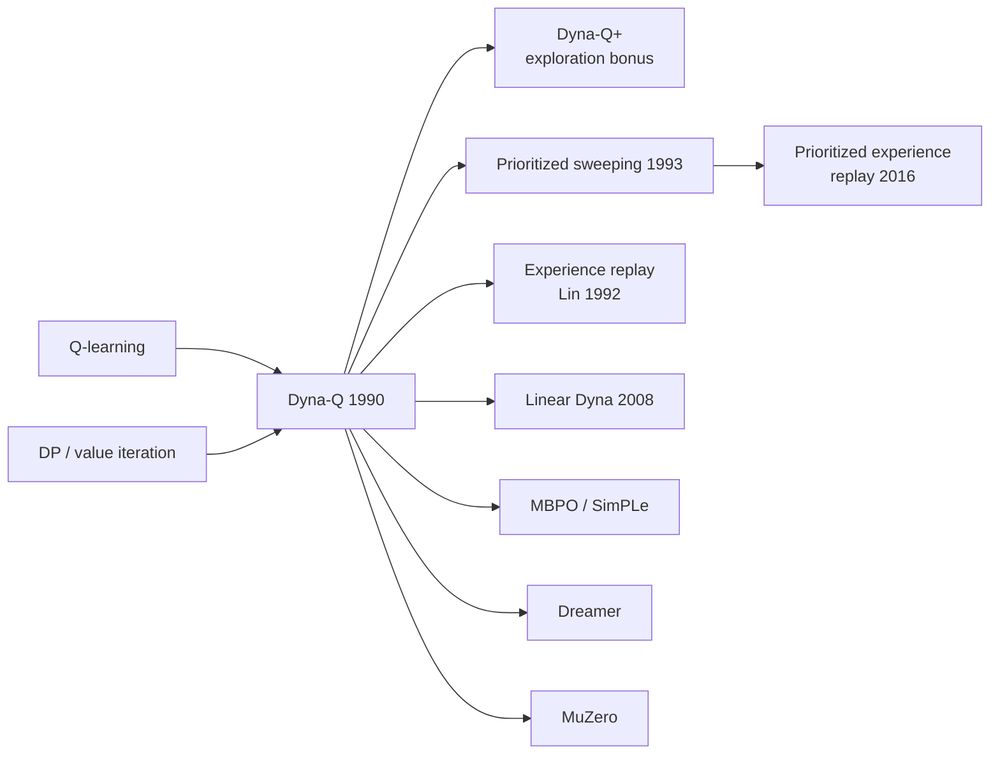

# Dyna-Q (Dyna-Q, Dyna-Q+, Prioritized Sweeping)

> Integrate **learning, planning and acting**: learn a model from real experience and use it to generate extra simulated experience for the same Q-learning updates. Real data is used far more efficiently. **Family:** Model-based → Tabular → Dyna architecture (learned model + model-free updates)  ·  **Year / origin:** Sutton (1990), "Integrated architectures for learning, planning, and reacting based on approximating dynamic programming" (ICML); prioritized sweeping by Moore & Atkeson (1993) and, independently, Peng & Williams (1993)  ·  **On/Off-policy:** off-policy (Q-learning updates on real and simulated transitions)  ·  **Action space:** discrete

---

## 1. What is it?

**Dyna-Q** is the simplest complete **model-based RL** agent. After every real step it does three things:
1. **Direct RL:** a normal [Q-learning](q-learning.md) update on the real transition $(S, A, R, S')$.
2. **Model learning:** store the transition in a model, $\text{Model}(S, A) \leftarrow (R, S')$. In a deterministic world the model is just a lookup table.
3. **Planning:** $n$ times, sample a previously seen $(s, a)$, ask the model what happens, and do a Q-learning update on that *simulated* transition.

Planning is the same update applied to imagined experience. With $n = 50$ planning steps, Dyna-Q solves the S&B Dyna maze in a few episodes, where plain Q-learning ($n=0$) needs dozens.

Two important extensions:
- **Dyna-Q+** handles **changing environments**. It adds an exploration bonus $\kappa\sqrt{\tau}$ to simulated rewards for transitions not tried for $\tau$ steps, so the agent re-checks old assumptions and discovers new shortcuts.
- **Prioritized sweeping** replaces uniform random planning with a **priority queue** keyed on how much a value would change. Updates flow backwards from where something surprising happened, and the planning effort drops sharply.

Dyna is the conceptual template for modern model-based deep RL: learned world models plus model-free updates on imagined rollouts (for example MBPO and Dreamer), and it is closely tied to experience replay.

## 2. Family & lineage

- **Parents:** [Q-learning](q-learning.md) (the update), [Dynamic Programming](dynamic-programming.md) (planning as backups over a model), system identification / certainty equivalence.
- **Siblings:** experience replay (Lin, 1992), which works like planning with a non-parametric model of past transitions; real-time DP; MCTS (decision-time rather than background planning).
- **Descendants:** prioritized experience replay (Schaul et al., 2016), linear Dyna (Sutton et al., 2008), SimPLe (Kaiser et al., 2019), MBPO (Janner et al., 2019), Dreamer, MuZero (planning with a learned model).



## 3. Core idea & intuition

**Experience is expensive; thinking is cheap.** Every real step costs time, money or risk, but replaying what you have learned in your head is almost free. Dyna uses each real transition once for learning, once to improve the model, and then many times more through planning.

- **Why planning helps:** in a maze with reward only at the goal, Q-learning propagates the goal's value back *one step per visit*. Planning on remembered transitions propagates it through the whole known part of the maze between real steps. The second episode can already be nearly optimal.
- **Planning vs learning:** the update is identical, and only the source of the transition differs. "Learning" uses real experience; "planning" uses model-generated experience. S&B call this the unified view: planning is learning from simulated experience.
- **When the model is wrong.**
  - *The world got worse* (a path became blocked). The agent soon experiences the failure, corrects the model, and recovers.
  - *The world got better* (a shortcut opened). The model never "sees" the shortcut, and the greedy agent never goes there to find it.
  - Dyna-Q+ adds curiosity: "it's been ages since I tried that door; maybe something changed". The bonus $\kappa\sqrt{\tau}$ makes long-untried transitions look attractive in planning.
- **Prioritized sweeping:** after a surprise, the *predecessors* of the surprising state are the ones whose values need to change, so update them first. A priority queue keyed on |TD error| does this automatically. It is the tabular ancestor of prioritized experience replay.

## 4. Math / formal details

**Symbols.** $Q(s,a)$: action values; $\text{Model}(s,a)$: learned prediction of $(r, s')$, either a sample model storing the last outcome or an empirical distribution; $n$: planning steps per real step; α, γ, ε as in Q-learning; $\tau(s,a)$: real time steps since $(s,a)$ was last tried; κ: bonus scale; θ: priority threshold.

**Direct RL and planning update (identical form):**
$$
Q(s,a) \leftarrow Q(s,a) + \alpha\big[r + \gamma\max_{a'} Q(s',a') - Q(s,a)\big],
$$
with $(r,s')$ either real or drawn from $\text{Model}(s,a)$.

**What planning converges to.** If planning ran to convergence between real steps with a perfect tabular model, $Q$ would equal the optimal action values of the **learned** MDP, $\hat q_*$. This is certainty-equivalence control. With finite $n$, Dyna is an asynchronous, sample-based value iteration on $\hat{M}$ interleaved with acting.

**Dyna-Q+ bonus.** Planning uses the modified reward
$$
\tilde r = r + \kappa\sqrt{\tau(s,a)}.
$$
In addition, actions never tried from a visited state are added to the model as leading back to the same state with reward 0 (S&B Sec. 8.3 footnote), so their bonus can grow.

**Prioritized sweeping.**
- The priority of a pair is the magnitude of its pending update, $P(s,a) = \big|r + \gamma\max_{a'}Q(s',a') - Q(s,a)\big|$.
- After a real step, insert $(S,A)$ into the queue if $P > \theta$.
- Each planning step pops the highest-priority pair and updates it.
- Then, for every predecessor $(\bar s, \bar a)$ with $\text{Model}(\bar s,\bar a) \to s$, compute its priority and insert it if it exceeds θ.

For stochastic environments, use **expected updates** over the model's estimated distribution, $\sum_{s',r}\hat p(s',r\mid s,a)[r + \gamma\max_{a'}Q(s',a')]$, rather than sample updates.

**Expected vs sample updates (S&B Sec. 8.5).** An expected update costs about $b$ times a sample update, where $b$ is the branching factor. With a limited compute budget and large $b$, many sample updates usually reduce error faster than a few expected ones.

## 5. Algorithm (pseudocode)

```text
Tabular Dyna-Q
 1. Init Q(s,a) and Model(s,a) for all s, a
 2. loop forever:
 3.   (a) S <- current (non-terminal) state
 4.   (b) A <- eps-greedy(S, Q)
 5.   (c) take A; observe R, S'
 6.   (d) Q(S,A) <- Q(S,A) + alpha [R + gamma max_a Q(S',a) - Q(S,A)]      # direct RL
 7.   (e) Model(S,A) <- (R, S')        (deterministic environment)         # model learning
 8.   (f) repeat n times:                                                  # planning
 9.         s <- random previously observed state
10.         a <- random action previously taken in s
11.         r, s' <- Model(s,a)
12.         Q(s,a) <- Q(s,a) + alpha [r + gamma max_a' Q(s',a') - Q(s,a)]

Dyna-Q+: as Dyna-Q, plus
   - track tau(s,a) = steps since (s,a) was last tried in the real environment
   - in step 12 use  r + kappa*sqrt(tau(s,a))  instead of r
   - allow untried actions of visited states in planning (model: back to s, reward 0)

Prioritized sweeping (deterministic environment)
 1. Init Q, Model, empty priority queue PQueue
 2. loop forever:
 3.   S <- current state; A <- policy(S, Q); take A; observe R, S'
 4.   Model(S,A) <- (R, S')
 5.   P <- |R + gamma max_a Q(S',a) - Q(S,A)|
 6.   if P > theta: insert (S,A) into PQueue with priority P
 7.   repeat n times while PQueue not empty:
 8.       (s,a) <- pop highest-priority pair;  r, s' <- Model(s,a)
 9.       Q(s,a) <- Q(s,a) + alpha [r + gamma max_a' Q(s',a') - Q(s,a)]
10.       for each (s_, a_) predicted to lead to s:
11.           r_ <- predicted reward for (s_, a_)
12.           P <- |r_ + gamma max_a Q(s,a) - Q(s_,a_)|
13.           if P > theta: insert (s_, a_) into PQueue with priority P
```

## 6. Python implementation

Runnable version: [`code/dyna-q.py`](../../code/dyna-q.py)

The script runs three classic experiments from S&B Ch. 8 on small deterministic mazes:
1. The **Dyna maze** (Example 8.1, 6×9, shortest path 14 steps) with $n = 0, 5, 50$ planning steps.
2. The **shortcut maze** (Example 8.3): after 3000 steps a shorter path opens on the right. Dyna-Q vs Dyna-Q+.
3. **Prioritized sweeping** vs Dyna-Q: total backups (real + planned) needed before the greedy path is within 20% of the shortest path. The full-optimality criterion can take very long, because untried actions keep $Q = 0$, which is pessimistic here since all rewards are ≥ 0.

It uses NumPy plus `heapq` from the standard library and runs in about 10 seconds.

```python
"""
Dyna-Q, Dyna-Q+ and prioritized sweeping (Sutton 1990; Moore & Atkeson 1993;
Sutton & Barto, 2nd ed., Ch. 8).

  1. Dyna maze (Example 8.1): steps per episode for n = 0, 5, 50 planning steps.
  2. Shortcut maze (Example 8.3): Dyna-Q vs Dyna-Q+ when a shorter path opens up.
  3. Prioritized sweeping vs Dyna-Q: total value backups until the greedy path is near-optimal.

Pure NumPy (+ heapq from the standard library).   Run:  python3 code/dyna-q.py
"""
import heapq
from collections import deque, defaultdict
import numpy as np

MOVES = [(-1, 0), (0, 1), (1, 0), (0, -1)]               # up, right, down, left


class Maze:
    """Deterministic grid maze.  Reward +1 on reaching the goal (episode ends), else 0."""

    def __init__(self, rows, cols, start, goal, walls):
        self.rows, self.cols = rows, cols
        self.start, self.goal = start, goal
        self.walls = set(walls)
        self.n_actions = 4

    def step(self, s, a):
        r, c = s[0] + MOVES[a][0], s[1] + MOVES[a][1]
        if not (0 <= r < self.rows and 0 <= c < self.cols) or (r, c) in self.walls:
            r, c = s                                     # blocked: stay put
        s2 = (r, c)
        return s2, (1.0 if s2 == self.goal else 0.0), s2 == self.goal

    def shortest_path(self):
        """BFS length of the optimal path (to check learned policies)."""
        dist, q = {self.start: 0}, deque([self.start])
        while q:
            s = q.popleft()
            for a in range(4):
                s2, _, _ = self.step(s, a)
                if s2 not in dist:
                    dist[s2] = dist[s] + 1
                    q.append(s2)
        return dist[self.goal]


def dyna_maze():
    walls = [(1, 2), (2, 2), (3, 2), (4, 5), (0, 7), (1, 7), (2, 7)]
    return Maze(6, 9, start=(2, 0), goal=(0, 8), walls=walls)


def argmax_tie(q, rng):
    return int(rng.choice(np.flatnonzero(q == q.max())))


class DynaQ:
    """Tabular Dyna-Q.  plus=True gives Dyna-Q+ (exploration bonus kappa*sqrt(tau) in planning)."""

    def __init__(self, maze, rng, n_planning=5, alpha=0.1, gamma=0.95, eps=0.1,
                 plus=False, kappa=1e-3):
        self.m, self.rng = maze, rng
        self.n, self.alpha, self.gamma, self.eps = n_planning, alpha, gamma, eps
        self.plus, self.kappa = plus, kappa
        self.Q = defaultdict(lambda: np.zeros(4))
        self.model = {}                                  # (s, a) -> (r, s')
        self.keys = []                                   # list of model keys, for sampling
        self.last_tried = {}                             # (s, a) -> time step (Dyna-Q+)
        self.t = 0
        self.backups = 0

    def act(self, s):
        if self.rng.random() < self.eps:
            return int(self.rng.integers(4))
        return argmax_tie(self.Q[s], self.rng)

    def q_update(self, s, a, r, s2):
        target = r + self.gamma * self.Q[s2].max() * (s2 != self.m.goal)
        self.Q[s][a] += self.alpha * (target - self.Q[s][a])
        self.backups += 1

    def learn(self, s, a, r, s2):
        self.t += 1
        self.q_update(s, a, r, s2)                       # (d) direct RL
        if (s, a) not in self.model:                     # (e) model learning
            self.keys.append((s, a))
            if self.plus:                                # Dyna-Q+: untried actions from a
                for b in range(4):                       # newly seen state are "known" to
                    if b != a and (s, b) not in self.model:   # lead back to s with r = 0
                        self.model[(s, b)] = (0.0, s)
                        self.keys.append((s, b))
                        self.last_tried[(s, b)] = 0
        self.model[(s, a)] = (r, s2)
        self.last_tried[(s, a)] = self.t
        for _ in range(self.n):                          # (f) planning
            ps, pa = self.keys[self.rng.integers(len(self.keys))]
            pr, ps2 = self.model[(ps, pa)]
            if self.plus:
                pr += self.kappa * np.sqrt(self.t - self.last_tried[(ps, pa)])
            self.q_update(ps, pa, pr, ps2)


def run_episodes(agent, maze, n_episodes):
    lengths = []
    for _ in range(n_episodes):
        s, done, steps = maze.start, False, 0
        while not done:
            a = agent.act(s)
            s2, r, done = maze.step(s, a)
            agent.learn(s, a, r, s2)
            s, steps = s2, steps + 1
        lengths.append(steps)
    return np.array(lengths)


def greedy_length(Q, maze, cap=200):
    s, steps = maze.start, 0
    while s != maze.goal and steps < cap:
        s, _, _ = maze.step(s, int(np.argmax(Q[s])))
        steps += 1
    return steps


# ----------------------------------------------------------------------------
# Changing environment: the shortcut maze
# ----------------------------------------------------------------------------
def shortcut_experiment(plus, rng, total_steps=6000, change_at=3000, n=20):
    early = Maze(6, 9, start=(5, 3), goal=(0, 8), walls=[(3, c) for c in range(1, 9)])
    late = Maze(6, 9, start=(5, 3), goal=(0, 8), walls=[(3, c) for c in range(1, 8)])
    agent = DynaQ(early, rng, n_planning=n, alpha=1.0, eps=0.1, plus=plus, kappa=1e-3)
    cum, total, s = [], 0.0, early.start
    for t in range(total_steps):
        maze = early if t < change_at else late
        agent.m = maze
        a = agent.act(s)
        s2, r, done = maze.step(s, a)
        agent.learn(s, a, r, s2)
        total += r
        cum.append(total)
        s = maze.start if done else s2
    return np.array(cum)


# ----------------------------------------------------------------------------
# Prioritized sweeping (deterministic environment version, S&B Sec. 8.4)
# ----------------------------------------------------------------------------
class PrioritizedSweeping(DynaQ):
    def __init__(self, maze, rng, n_planning=5, theta=1e-4, **kw):
        super().__init__(maze, rng, n_planning, **kw)
        self.theta = theta
        self.pq = []                                     # max-heap via negative priority
        self.predecessors = defaultdict(set)             # s' -> {(s, a) that lead to s'}

    def priority(self, s, a, r, s2):
        target = r + self.gamma * self.Q[s2].max() * (s2 != self.m.goal)
        return abs(target - self.Q[s][a])

    def learn(self, s, a, r, s2):
        self.model[(s, a)] = (r, s2)
        self.predecessors[s2].add((s, a))
        p = self.priority(s, a, r, s2)
        if p > self.theta:
            heapq.heappush(self.pq, (-p, s, a))
        for _ in range(self.n):
            if not self.pq:
                break
            _, ps, pa = heapq.heappop(self.pq)           # most urgent update first
            pr, ps2 = self.model[(ps, pa)]
            self.q_update(ps, pa, pr, ps2)
            for (bs, ba) in self.predecessors[ps]:       # its value changed -> recheck
                br, _ = self.model[(bs, ba)]             # every pair that leads into it
                bp = self.priority(bs, ba, br, ps)
                if bp > self.theta:
                    heapq.heappush(self.pq, (-bp, bs, ba))


def backups_until_near_optimal(make_agent, maze, tol=1.2, max_episodes=200):
    """Count value backups (real + planned) until the greedy path is within `tol` x the
    shortest path.  (Exact optimality can take very long: actions never tried keep
    Q = 0, which is pessimistic here because all rewards are >= 0.)"""
    agent = make_agent()
    target = int(tol * maze.shortest_path())
    for ep in range(max_episodes):
        run_episodes(agent, maze, 1)
        if greedy_length(agent.Q, maze) <= target:
            return agent.backups, ep + 1
    return agent.backups, max_episodes


if __name__ == "__main__":
    maze = dyna_maze()
    print(f"1) Dyna maze (6x9), shortest path = {maze.shortest_path()} steps; "
          "steps per episode, mean of 10 runs")
    print(f"   {'n':>4s} {'ep 1':>7s} {'ep 2':>7s} {'ep 5':>7s} {'ep 10':>7s} {'ep 50':>7s}")
    for n in (0, 5, 50):
        L = np.mean([run_episodes(DynaQ(maze, np.random.default_rng(i), n_planning=n), maze, 50)
                     for i in range(10)], axis=0)
        print(f"   {n:4d} {L[0]:7.0f} {L[1]:7.0f} {L[4]:7.0f} {L[9]:7.0f} {L[49]:7.0f}")

    print("\n2) Shortcut maze: cumulative reward (5 runs, n=20, shortcut opens at step 3000)")
    for plus in (False, True):
        C = np.mean([shortcut_experiment(plus, np.random.default_rng(i)) for i in range(5)], 0)
        print(f"   {'Dyna-Q+' if plus else 'Dyna-Q ':8s}: at 3000 = {C[2999]:5.1f}, at 6000 = {C[-1]:5.1f}, "
              f"reward in steps 3001-6000 = {C[-1] - C[2999]:5.1f}")

    print("\n3) Backups until greedy path <= 1.2 x shortest (Dyna maze, n=5, alpha=0.5, 10 runs)")
    for name, make in [("Dyna-Q", lambda r: DynaQ(maze, r, n_planning=5, alpha=0.5)),
                       ("Prioritized sweeping",
                        lambda r: PrioritizedSweeping(maze, r, n_planning=5, alpha=0.5))]:
        res = np.array([backups_until_near_optimal(lambda: make(np.random.default_rng(i)), maze)
                        for i in range(10)])
        print(f"   {name:22s}: backups = {res[:, 0].mean():8.0f}, episodes = {res[:, 1].mean():5.1f}")
```

Output:

```text
1) Dyna maze (6x9), shortest path = 14 steps; steps per episode, mean of 10 runs
      n    ep 1    ep 2    ep 5   ep 10   ep 50
      0     917     698     205     192      17
      5    1037     144      22      17      17
     50    1094      41      16      16      17

2) Shortcut maze: cumulative reward (5 runs, n=20, shortcut opens at step 3000)
   Dyna-Q  : at 3000 =  95.4, at 6000 = 278.6, reward in steps 3001-6000 = 183.2
   Dyna-Q+ : at 3000 = 130.4, at 6000 = 347.2, reward in steps 3001-6000 = 216.8

3) Backups until greedy path <= 1.2 x shortest (Dyna maze, n=5, alpha=0.5, 10 runs)
   Dyna-Q                : backups =     7646, episodes =   3.9
   Prioritized sweeping  : backups =     1167, episodes =   7.2
```

How to read it:
- **Experiment 1.** The first episode is a random search for every $n$: no reward has been seen yet, so planning has nothing to propagate. From the second episode on, planning makes a dramatic difference, as in S&B Fig. 8.2. The final lengths of about 16–17 rather than 14 come from ε=0.1 exploration.
- **Experiment 2.** Per run, Dyna-Q+ collected about 210–230 reward after the change in every seed, versus about 165 for Dyna-Q in four of five seeds. Dyna-Q found the shortcut in only one seed. Dyna-Q+ also does better *before* the change, because its bonus keeps it exploring efficiently. This reproduces S&B Fig. 8.5 qualitatively.
- **Experiment 3.** Prioritized sweeping reaches a near-optimal policy with about 6× fewer value backups, because it spends no effort on updates that would change nothing.

## 7. Practical tips & hyperparameters

| Hyperparameter | Typical | Notes |
|---|---|---|
| n (planning steps) | 5–50 | More is better until compute-bound or the model is wrong |
| α | 0.1 (stochastic); 0.5–1.0 (deterministic) | α=1 in deterministic worlds makes planning act like value iteration |
| ε | 0.1 | Planning does not replace exploration |
| κ (Dyna-Q+) | 1e-4 to 1e-3 × reward scale | Too large: the agent wanders forever chasing bonuses (in our tests κ=1e-2 collapsed reward to near 0) |
| θ (prioritized sweeping) | 1e-5 to 1e-3 | Larger θ means fewer updates but may stop propagation early |

- **Model choice:**
  - Deterministic: store the last $(r, s')$.
  - Stochastic: store counts and sample from them, or use expected updates.
  - Non-stationary: add Dyna-Q+ style bonuses or forget old data.
- **Random tie-breaking** is essential: before the first reward all Q-values are 0.
- **Sampling:** keep a list of observed $(s,a)$ keys for O(1) uniform sampling. Avoid `random.choice(list(dict))` in the inner loop.
- **Prioritized sweeping:** the queue can accumulate duplicates. Either keep only the highest priority per pair, as in the book, or accept duplicates as a simplification (the code does this). Store **predecessor lists** when updating the model.
- **Debugging signals:**
  - Steps per episode should drop sharply from episode 2 on.
  - If planning makes things *worse*, the model is wrong (stale or stochastic).
  - Compare the planning backup count against real steps.
- **Compute budget:** planning steps cost CPU, not environment interactions. Dyna pays off most when real experience is slow or expensive.

## 8. Pros and cons

**Pros**
- Greatly improved sample efficiency over model-free Q-learning.
- Simple: reuses the Q-learning update; planning and learning share one value function.
- Anytime: you can do as much or as little planning as compute allows.
- Prioritized sweeping focuses computation where it matters.
- Dyna-Q+ handles environments that change, including discovering improvements.

**Cons**
- Model errors propagate into the values ("planning with a wrong model"); stochastic or complex dynamics are hard to model.
- Tabular models do not generalize to unseen states.
- Uniform planning wastes updates (prioritized sweeping helps).
- Extra memory for the model and predecessor lists.
- Dyna-Q+'s bonus needs tuning; too much exploration hurts.

## 9. When to use / when not to use

**Use when:**
- Real interaction is expensive (robots, live systems, slow simulators) but computation is cheap.
- The dynamics are fairly simple, deterministic or learnable from data.
- The environment may change and you need to keep adapting (Dyna-Q+).

**Do not use when:**
- Dynamics are very hard to model (high-dimensional, highly stochastic) and you lack a good world model. Model errors may dominate; prefer model-free methods or uncertainty-aware models (PETS/MBPO).
- Simulation is already free and fast, as in Atari emulators. Plain model-free methods with more real samples may be simpler.
- You need decision-time lookahead from the current state. Consider MCTS.

## 10. Key papers, books & repos

- Sutton, R. S. (1990). "Integrated architectures for learning, planning, and reacting based on approximating dynamic programming." *ICML*.
- Sutton, R. S. (1991). "Dyna, an integrated architecture for learning, planning, and reacting." *SIGART Bulletin* 2(4).
- Moore, A. W. & Atkeson, C. G. (1993). "Prioritized sweeping: Reinforcement learning with less data and less time." *Machine Learning* 13.
- Peng, J. & Williams, R. J. (1993). "Efficient learning and planning within the Dyna framework." *Adaptive Behavior* 1(4).
- Lin, L.-J. (1992). "Self-improving reactive agents based on reinforcement learning, planning and teaching." *Machine Learning* 8. (experience replay)
- Sutton, R. S., Szepesvári, C., Geramifard, A. & Bowling, M. (2008). "Dyna-style planning with linear function approximation and prioritized sweeping." *UAI*.
- Schaul, T., Quan, J., Antonoglou, I. & Silver, D. (2016). "Prioritized experience replay." *ICLR*; arXiv:1511.05952.
- Janner, M., Fu, J., Zhang, M. & Levine, S. (2019). "When to trust your model: Model-based policy optimization." *NeurIPS*; arXiv:1906.08253. (MBPO)
- van Hasselt, H., Hessel, M. & Aslanides, J. (2019). "When to use parametric models in reinforcement learning?" *NeurIPS*; arXiv:1906.05243. (replay vs learned models)
- Sutton & Barto, *Reinforcement Learning: An Introduction*, 2nd ed., 2018. **Chapter 8** (Planning and Learning with Tabular Methods): Dyna 8.2, Dyna-Q+ and changing environments 8.3, prioritized sweeping 8.4, expected vs sample updates 8.5, trajectory sampling 8.6, real-time DP 8.7, MCTS 8.11.
- Repos: [`ShangtongZhang/reinforcement-learning-an-introduction`](https://github.com/ShangtongZhang/reinforcement-learning-an-introduction) (Ch. 8 Dyna maze, blocking/shortcut mazes, prioritized sweeping).

## 11. For business users

**What it does.** Dyna-Q learns a decision strategy from real experience *and* builds a mental model of how the world responds. It then "rehearses" in that model thousands of times between real decisions, so it learns much faster from limited real-world trials. Its variants also re-check old assumptions when the world might have changed, and focus their rehearsal on the situations where something surprising just happened.

**Analogy.** A new salesperson makes one real sales call an hour. Between calls, a smart one replays the conversations in their head: "When the client said X and I said Y, it went badly; next time I'll try Z." The rehearsal is free and makes each real call count for much more. A Dyna-Q+ salesperson also says, "I haven't tried pitching to the finance department in months; maybe their needs changed."

**Real-world use cases.**
- Robotics and industrial control, where each real trial is slow or costly.
- Operations and logistics with a learnable simulator of demand or flows.
- Game AI with limited play time.
- Adaptive systems in changing environments (Dyna-Q+): routing, pricing when competitors change.

**Value / ROI.** Large reductions in costly real-world trials. It adapts to change and makes good use of cheap compute.

**Risks.** If the learned model is wrong, the system rehearses the wrong lessons. Models of complex, random processes are hard to get right. Exploration bonuses need tuning.

**Costs.** Extra compute and memory for the model and planning; engineering to validate model accuracy.

**Questions to ask your team.**
1. How expensive is a real trial compared with a simulated one?
2. How accurate is our learned model, and how do we measure it?
3. How do we detect when the world has changed?
4. How much planning compute per decision can we afford?

## 12. For kids (ages ~8–12)

**Practising in your head.** You're learning the way through a big hedge maze at the park. You can only go once a day. A clever kid draws a map at home of everything they saw: "left at the fountain led to a dead end; right at the big tree led closer to the exit." Then, at home, they *practise* the maze on their map again and again. The next day at the park, they walk almost straight to the exit!

That's Dyna-Q: do it for real a little, then practise in your imagination a lot. And sometimes the park opens a new gate! A Dyna-Q+ kid says "I haven't checked that corner in ages, maybe there's something new" and goes to look.

**Try it yourself.** Draw a maze on paper and give it to a friend. Your friend walks through it once with their finger and draws what they remember on a blank sheet. Then they practise on their own drawing three times. Now try the real maze again. Is it faster?

**Recap:**
1. Learn from real tries.
2. Make a map in your head and practise on it.
3. Re-check old places in case things changed.

## 13. Related methods

- [Q-learning](q-learning.md): the update Dyna-Q uses for both real and simulated experience.
- [Dynamic Programming](dynamic-programming.md): planning by sweeping backups over a known model.
- [TD learning](td-learning.md): the underlying one-step bootstrapped update.
- [SARSA](sarsa.md): on-policy alternative (Dyna can use SARSA updates too).
- [Multi-armed bandits](multi-armed-bandits.md): UCB-style exploration bonuses, the ancestor of Dyna-Q+'s κ√τ.
- [Monte Carlo methods](monte-carlo.md): sampling complete trajectories (rollouts) instead.
- [DQN](../02-deep-value-based/dqn.md): experience replay is planning with a non-parametric model; [Rainbow](../02-deep-value-based/rainbow-dqn.md) adds prioritized replay.
- [MBPO / PETS](../05-model-based/mbpo-pets.md), [World Models / Dreamer](../05-model-based/world-models-dreamer.md), [MuZero](../05-model-based/muzero.md), [MCTS / AlphaZero](../05-model-based/mcts-alphazero.md): modern model-based descendants.

[← Back to overview](../../RL_Methods_Overview.md)
