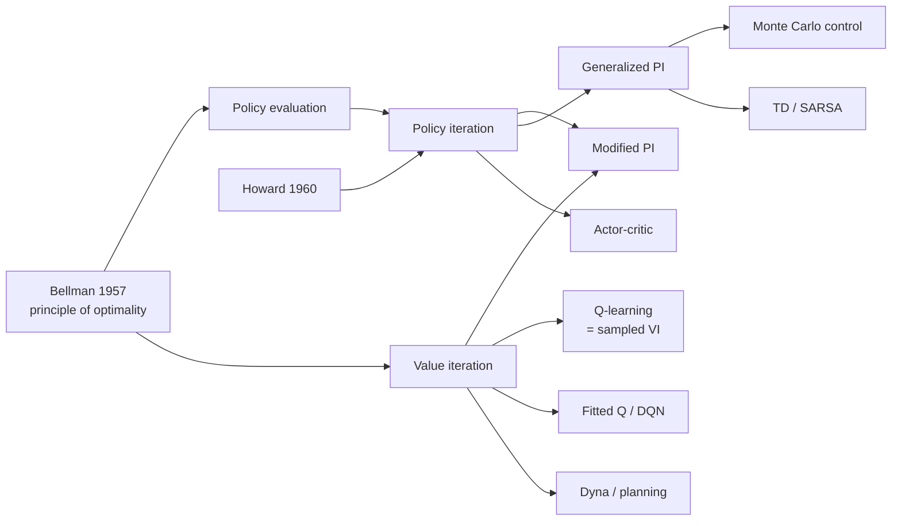
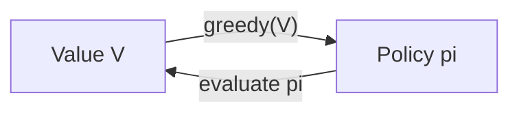

# Dynamic Programming for MDPs (DP: Policy Evaluation, Policy Iteration, Value Iteration, GPI)

> Exact planning in a fully known Markov Decision Process (MDP) by repeatedly applying Bellman backups. It is the theoretical backbone of almost every RL algorithm. **This page doubles as the repo's MDP & Bellman-equation primer.** **Family:** Foundations → Tabular → Model-based planning (known model)  ·  **Year / origin:** Bellman, *Dynamic Programming* (1957); policy iteration by Howard (1960)  ·  **On/Off-policy:** not applicable (no sampling; uses the model directly)  ·  **Action space:** discrete (finite states and actions)

---

## 1. What is it?

**Dynamic programming (DP)** is a family of algorithms that compute **optimal policies** for an MDP when you know the model exactly: the transition probabilities and expected rewards. DP does not interact with an environment. It sweeps over the state space, updating value estimates with the **Bellman equations** until they stop changing.

DP solves two problems:
- **Prediction (policy evaluation):** given a policy π, compute its value function $v_\pi$.
- **Control:** find an optimal policy $\pi_*$, via **policy iteration** or **value iteration**.

DP is rarely used as-is on large problems. The model is often unknown, and sweeping all states is infeasible because of Bellman's "curse of dimensionality". It still matters because **every RL method approximates DP**:
- **Monte Carlo** and **TD** replace the model's expectation with *samples*.
- **Q-learning** is sampled value iteration.
- **Actor-critic** is approximate policy iteration.
- **DQN** is fitted value iteration with a neural network.

Understanding DP is understanding what RL is trying to compute.

## 2. Family & lineage

- **Parents:** Bellman's principle of optimality (1950s); Markov chains; operations research.
- **Siblings:** linear-programming solutions of MDPs; modified policy iteration (Puterman & Shin, 1978); asynchronous DP and real-time DP (Barto, Bradtke & Singh, 1995).
- **Descendants:** every model-free method (MC, TD, SARSA, Q-learning), model-based planning (Dyna, MCTS), approximate DP / neuro-dynamic programming, fitted Q iteration, DQN, actor-critic.



## 3. Core idea & intuition

**The value of a state is the reward you get now plus the (discounted) value of where you land next.** Solving an MDP comes down to making that statement self-consistent everywhere.

- **Policy evaluation:** start with any guess $V$. Repeatedly replace each $V(s)$ with "expected immediate reward plus γ × expected $V$ of the next state under π". The guesses converge to $v_\pi$, because each sweep shrinks the error by a factor γ, or by finite-horizon arguments when γ=1 and episodes terminate.
- **Policy improvement:** once you know $v_\pi$, act greedily with respect to it: in each state, pick the action with the best one-step lookahead. The **policy improvement theorem** guarantees that the new policy is at least as good everywhere.
- **Policy iteration:** alternate evaluation and improvement until the policy stops changing. Usually only a handful of iterations are needed.
- **Value iteration:** do not wait for evaluation to converge. Do a single sweep that already takes the max over actions. This is the Bellman *optimality* backup.
- **Generalized policy iteration (GPI):** any interleaving of "make V consistent with π" and "make π greedy with respect to V" converges to the optimum. That one picture describes nearly all of RL.



## 4. Math / formal details

### 4.1 The MDP (primer)

A finite MDP is a tuple $(\mathcal{S}, \mathcal{A}, p, \gamma)$:
- $\mathcal{S}$: finite set of states. $\mathcal{A}(s)$: finite set of actions available in $s$.
- $p(s', r \mid s, a) = \Pr\{S_{t+1}=s', R_{t+1}=r \mid S_t=s, A_t=a\}$: the dynamics. The **Markov property** says the next state and reward depend only on the current state and action, not on earlier history.
- Derived quantities: $p(s' \mid s,a) = \sum_r p(s', r \mid s,a)$ and the expected reward $r(s,a) = \sum_{s',r} r\, p(s', r \mid s,a)$.
- $\gamma \in [0,1]$: discount factor. Use γ<1 for continuing tasks; γ=1 is allowed for episodic tasks in which every policy considered reaches a terminal state.

**Return:** $G_t = R_{t+1} + \gamma R_{t+2} + \gamma^2 R_{t+3} + \dots = \sum_{k=0}^{\infty} \gamma^k R_{t+k+1}$. Recursively, $G_t = R_{t+1} + \gamma G_{t+1}$.

**Policy:** $\pi(a \mid s)$, the probability of choosing $a$ in $s$. **Value functions:**
$$
v_\pi(s) = \mathbb{E}_\pi[G_t \mid S_t = s], \qquad q_\pi(s,a) = \mathbb{E}_\pi[G_t \mid S_t=s, A_t=a],
$$
related by $v_\pi(s) = \sum_a \pi(a\mid s) q_\pi(s,a)$ and $q_\pi(s,a) = \sum_{s',r} p(s',r\mid s,a)[r + \gamma v_\pi(s')]$.

### 4.2 Bellman equations

**Bellman expectation equation** (from $G_t = R_{t+1} + \gamma G_{t+1}$):
$$
v_\pi(s) = \sum_a \pi(a\mid s) \sum_{s', r} p(s', r \mid s, a)\big[r + \gamma v_\pi(s')\big].
$$
**Matrix form:** with $P_\pi[s,s'] = \sum_a \pi(a\mid s) p(s'\mid s,a)$ and $r_\pi[s] = \sum_a \pi(a\mid s) r(s,a)$,
$$
v_\pi = r_\pi + \gamma P_\pi v_\pi \;\Longrightarrow\; v_\pi = (I - \gamma P_\pi)^{-1} r_\pi,
$$
an $O(|\mathcal{S}|^3)$ linear solve. The code uses it to check iterative evaluation.

**Bellman optimality equations.** Optimal values are $v_*(s) = \max_\pi v_\pi(s)$ and $q_*(s,a) = \max_\pi q_\pi(s,a)$. They satisfy
$$
v_*(s) = \max_a \sum_{s',r} p(s',r\mid s,a)\big[r + \gamma v_*(s')\big],\qquad
q_*(s,a) = \sum_{s',r} p(s',r\mid s,a)\big[r + \gamma \max_{a'} q_*(s',a')\big].
$$
Any policy that is greedy with respect to $v_*$ (or $q_*$) is optimal, and a deterministic optimal policy always exists in a finite MDP.

### 4.3 Bellman operators and contraction

Define the operators on value vectors
$$
(T^\pi V)(s) = \sum_a \pi(a\mid s)\big[r(s,a) + \gamma \textstyle\sum_{s'} p(s'\mid s,a) V(s')\big],\qquad
(T^* V)(s) = \max_a \big[r(s,a) + \gamma \textstyle\sum_{s'} p(s'\mid s,a) V(s')\big].
$$
For γ<1 both are **γ-contractions** in the max-norm: $\|TV - TU\|_\infty \le \gamma \|V - U\|_\infty$. By the Banach fixed-point theorem each has a unique fixed point ($v_\pi$ and $v_*$ respectively), and iterating from any start converges geometrically: $\|V_k - v_*\|_\infty \le \gamma^k \|V_0 - v_*\|_\infty$.

### 4.4 The algorithms

- **Iterative policy evaluation:** $V_{k+1} = T^\pi V_k$. The *in-place* (Gauss–Seidel) variant overwrites $V(s)$ immediately and usually converges faster.
- **Policy improvement:** $\pi'(s) = \arg\max_a q_\pi(s,a)$. **Policy improvement theorem:** if $q_\pi(s, \pi'(s)) \ge v_\pi(s)$ for all $s$, then $v_{\pi'}(s) \ge v_\pi(s)$ for all $s$. Proof sketch: expand $v_\pi(s) \le q_\pi(s,\pi'(s)) = \mathbb{E}[R_{t+1} + \gamma v_\pi(S_{t+1}) \mid A_t = \pi'(s)]$ and apply the inequality again at $S_{t+1}$, $S_{t+2}$, … to get $\mathbb{E}_{\pi'}[G_t] = v_{\pi'}(s)$. If the improvement step leaves the policy unchanged, $v_\pi$ satisfies the Bellman optimality equation, so π is optimal.
- **Policy iteration:** $\pi_0 \xrightarrow{E} v_{\pi_0} \xrightarrow{I} \pi_1 \xrightarrow{E} v_{\pi_1} \to \dots \to \pi_*$. A finite MDP has finitely many deterministic policies and each step strictly improves until optimal, so PI terminates in a finite number of iterations, usually very few.
- **Value iteration:** $V_{k+1} = T^* V_k$. A standard stopping rule: if $\|V_{k+1} - V_k\|_\infty < \varepsilon(1-\gamma)/(2\gamma)$, the greedy policy is ε-optimal (Puterman, 1994).
- **Modified policy iteration:** run $m$ evaluation sweeps per improvement step. $m=1$ gives VI and $m=\infty$ gives PI.

**Cost per sweep:** $O(|\mathcal{S}|^2 |\mathcal{A}|)$ for dense transitions. That is polynomial in the size of the MDP, but $|\mathcal{S}|$ is usually exponential in the number of state variables.

## 5. Algorithm (pseudocode)

```text
Iterative policy evaluation (in place)
 1. Input pi, threshold theta > 0.  Initialise V(s) = 0 for all s (terminal V = 0).
 2. repeat
 3.     Delta <- 0
 4.     for each s in S:
 5.         v <- V(s)
 6.         V(s) <- sum_a pi(a|s) sum_{s',r} p(s',r|s,a) [ r + gamma V(s') ]
 7.         Delta <- max(Delta, |v - V(s)|)
 8. until Delta < theta

Policy iteration
 1. Initialise pi (any PROPER policy if gamma = 1, e.g. uniform random)
 2. loop
 3.     V <- PolicyEvaluation(pi)
 4.     stable <- true
 5.     for each s:
 6.         old <- pi(s)
 7.         pi(s) <- argmax_a sum_{s',r} p(s',r|s,a)[ r + gamma V(s') ]   (keep old on ties)
 8.         if old != pi(s): stable <- false
 9.     if stable: return V, pi

Value iteration
 1. Initialise V(s) = 0
 2. repeat
 3.     Delta <- 0
 4.     for each s:
 5.         v <- V(s)
 6.         V(s) <- max_a sum_{s',r} p(s',r|s,a)[ r + gamma V(s') ]
 7.         Delta <- max(Delta, |v - V(s)|)
 8. until Delta < theta
 9. return greedy policy pi(s) = argmax_a sum_{s',r} p(s',r|s,a)[ r + gamma V(s') ]
```

## 6. Python implementation

Runnable version: [`code/dynamic-programming.py`](../../code/dynamic-programming.py)

The MDP is stored as dense NumPy arrays: `P[s, a, s']` holds transition probabilities and `R[s, a]` expected rewards. The script then:
1. Reproduces **Example 4.1** of Sutton & Barto, the 4×4 grid with terminal corners, −1 per step, γ=1, under the random policy, and checks it against the exact linear solve.
2. Runs policy iteration and value iteration on the same grid.
3. Repeats both on a **slippery** version (20% chance of moving sideways) with γ=0.95.

```python
"""
Dynamic programming for finite MDPs (Sutton & Barto, 2nd ed., Ch. 3-4).

  * iterative policy evaluation   (Bellman expectation backup)
  * exact policy evaluation       (linear solve, for checking)
  * policy iteration              (evaluate -> greedy improve -> repeat)
  * value iteration               (Bellman optimality backup)

The MDP is given as dense arrays P[s, a, s'] and R[s, a] (expected reward),
built from a tiny GridWorld.  Pure NumPy.   Run:  python3 code/dynamic-programming.py
"""
import numpy as np

ACTIONS = [(-1, 0), (0, 1), (1, 0), (0, -1)]   # up, right, down, left
ARROWS = "^>v<"


class GridWorld:
    """rows x cols grid; -1 reward per step; terminal cells are absorbing (reward 0).

    slip: probability that the move goes to one of the two perpendicular directions
    instead (split equally).  slip=0 gives Example 4.1 of Sutton & Barto.
    """

    def __init__(self, rows=4, cols=4, terminals=(0, 15), step_reward=-1.0, slip=0.0):
        self.rows, self.cols = rows, cols
        self.nS, self.nA = rows * cols, 4
        self.terminals = set(terminals)
        self.P = np.zeros((self.nS, self.nA, self.nS))
        self.R = np.zeros((self.nS, self.nA))
        for s in range(self.nS):
            for a in range(self.nA):
                if s in self.terminals:                 # absorbing, no more reward
                    self.P[s, a, s] = 1.0
                    continue
                perp = [(a + 1) % 4, (a + 3) % 4]
                for move, p in [(a, 1 - slip), (perp[0], slip / 2), (perp[1], slip / 2)]:
                    if p > 0:
                        self.P[s, a, self._next(s, move)] += p
                self.R[s, a] = step_reward

    def _next(self, s, a):
        r, c = divmod(s, self.cols)
        dr, dc = ACTIONS[a]
        nr, nc = r + dr, c + dc
        if 0 <= nr < self.rows and 0 <= nc < self.cols:
            return nr * self.cols + nc
        return s                                         # bumping a wall: stay put


def q_from_v(P, R, V, gamma):
    """One-step lookahead: Q(s,a) = R(s,a) + gamma * sum_s' P(s'|s,a) V(s')."""
    return R + gamma * P @ V                             # (S,A,S') @ (S',) -> (S,A)


def policy_evaluation(P, R, pi, gamma=1.0, theta=1e-8, in_place=True):
    """Iterative policy evaluation.  pi[s, a] = probability of action a in state s.

    in_place=True updates V(s) immediately (Gauss-Seidel), which usually converges
    in fewer sweeps than the two-array (Jacobi) version.
    """
    nS = P.shape[0]
    V = np.zeros(nS)
    sweeps = 0
    while True:
        sweeps += 1
        if in_place:
            delta = 0.0
            for s in range(nS):
                v_old = V[s]
                V[s] = pi[s] @ (R[s] + gamma * P[s] @ V)
                delta = max(delta, abs(v_old - V[s]))
        else:
            V_new = np.sum(pi * q_from_v(P, R, V, gamma), axis=1)
            delta = np.max(np.abs(V_new - V))
            V = V_new
        if delta < theta:
            return V, sweeps


def exact_policy_value(P, R, pi, gamma, nonterminal):
    """Solve the Bellman expectation equation V = R_pi + gamma P_pi V on non-terminal states."""
    P_pi = np.einsum("sa,sat->st", pi, P)
    R_pi = np.sum(pi * R, axis=1)
    idx = np.array(sorted(nonterminal))
    V = np.zeros(P.shape[0])
    A = np.eye(len(idx)) - gamma * P_pi[np.ix_(idx, idx)]
    V[idx] = np.linalg.solve(A, R_pi[idx])
    return V


def greedy(P, R, V, gamma, old_policy=None, tol=1e-9):
    """Greedy policy w.r.t. V.  Keep the old action on (near-)ties to avoid flip-flopping."""
    Q = q_from_v(P, R, V, gamma)
    new = Q.argmax(axis=1)
    if old_policy is not None:
        keep = Q[np.arange(len(new)), old_policy] >= Q.max(axis=1) - tol
        new = np.where(keep, old_policy, new)
    return new


def policy_iteration(P, R, gamma=1.0, theta=1e-8):
    """Policy iteration.  We start from the equiprobable random policy (rather than an
    arbitrary deterministic one) because with gamma=1 a deterministic policy that never
    reaches a terminal state has value -infinity and its evaluation would never converge.
    Every greedy policy after that is "proper" (it improves on a proper policy)."""
    nS, nA = R.shape
    pi = np.full((nS, nA), 1.0 / nA)                     # pi[s, a], stochastic start
    policy = None
    for it in range(1, 1000):
        V, _ = policy_evaluation(P, R, pi, gamma, theta)        # 1. evaluation
        new_policy = greedy(P, R, V, gamma, old_policy=policy)  # 2. improvement
        if policy is not None and np.array_equal(new_policy, policy):
            return policy, V, it                         # policy stable -> optimal
        policy = new_policy
        pi = np.eye(nA)[policy]                          # one-hot deterministic policy
    raise RuntimeError("policy iteration did not converge")


def value_iteration(P, R, gamma=1.0, theta=1e-8):
    V = np.zeros(P.shape[0])
    for sweep in range(1, 100000):
        V_new = q_from_v(P, R, V, gamma).max(axis=1)     # Bellman optimality backup
        delta = np.max(np.abs(V_new - V))
        V = V_new
        if delta < theta:
            return greedy(P, R, V, gamma), V, sweep
    raise RuntimeError("value iteration did not converge")


def show(env, V=None, policy=None):
    for r in range(env.rows):
        cells = []
        for c in range(env.cols):
            s = r * env.cols + c
            if policy is not None:
                cells.append(" T" if s in env.terminals else " " + ARROWS[policy[s]])
            else:
                cells.append(f"{V[s]:7.2f}")
        print("   " + " ".join(cells))


if __name__ == "__main__":
    # --- Example 4.1: equiprobable random policy on the 4x4 grid, gamma = 1 -----
    env = GridWorld()
    nonterm = set(range(env.nS)) - env.terminals
    pi_random = np.full((env.nS, env.nA), 0.25)
    V_inplace, sw_in = policy_evaluation(env.P, env.R, pi_random, gamma=1.0, in_place=True)
    V_twoarr, sw_two = policy_evaluation(env.P, env.R, pi_random, gamma=1.0, in_place=False)
    V_exact = exact_policy_value(env.P, env.R, pi_random, 1.0, nonterm)
    print("Example 4.1 - v_pi for the random policy (expect 0 -14 -20 -22 / ...):")
    show(env, V_inplace)
    print(f"   sweeps: in-place={sw_in}, two-array={sw_two};  "
          f"max |iterative - exact| = {np.abs(V_inplace - V_exact).max():.2e}")

    # --- Policy iteration and value iteration on the same grid ----------------
    pol_pi, V_pi, n_pi = policy_iteration(env.P, env.R, gamma=1.0)
    pol_vi, V_vi, n_vi = value_iteration(env.P, env.R, gamma=1.0)
    print(f"\nDeterministic grid: policy iteration {n_pi} iterations, "
          f"value iteration {n_vi} sweeps; same V*? {np.allclose(V_pi, V_vi)}")
    show(env, V_vi)
    show(env, policy=pol_vi)

    # --- Slippery grid (20% slip), gamma = 0.95 -------------------------------
    slip = GridWorld(slip=0.2)
    pol_pi, V_pi, n_pi = policy_iteration(slip.P, slip.R, gamma=0.95)
    pol_vi, V_vi, n_vi = value_iteration(slip.P, slip.R, gamma=0.95)
    print(f"\nSlippery grid (slip=0.2, gamma=0.95): PI {n_pi} iterations, VI {n_vi} sweeps, "
          f"max |V_PI - V_VI| = {np.abs(V_pi - V_vi).max():.1e}")
    show(slip, V_vi)
    show(slip, policy=pol_pi)
    # Bellman optimality residual of the result (should be ~0)
    resid = np.abs(q_from_v(slip.P, slip.R, V_vi, 0.95).max(1) - V_vi).max()
    print(f"   Bellman optimality residual: {resid:.1e}")
```

Output:

```text
Example 4.1 - v_pi for the random policy (expect 0 -14 -20 -22 / ...):
      0.00  -14.00  -20.00  -22.00
    -14.00  -18.00  -20.00  -20.00
    -20.00  -20.00  -18.00  -14.00
    -22.00  -20.00  -14.00    0.00
   sweeps: in-place=220, two-array=342;  max |iterative - exact| = 1.02e-07

Deterministic grid: policy iteration 2 iterations, value iteration 4 sweeps; same V*? True
      0.00   -1.00   -2.00   -3.00
     -1.00   -2.00   -3.00   -2.00
     -2.00   -3.00   -2.00   -1.00
     -3.00   -2.00   -1.00    0.00
    T  <  <  v
    ^  ^  ^  v
    ^  ^  >  v
    ^  >  >  T

Slippery grid (slip=0.2, gamma=0.95): PI 2 iterations, VI 26 sweeps, max |V_PI - V_VI| = 4.7e-09
      ...
   Bellman optimality residual: 3.1e-09
```

On this grid the greedy policy with respect to the *random* policy's values is already optimal, as Sutton & Barto point out for Example 4.1. That is why policy iteration needs only one improvement step plus a confirming evaluation. The in-place sweep needs about 35% fewer sweeps than the two-array version.

## 7. Practical tips & hyperparameters

- **θ (stopping threshold):** 1e-6 to 1e-10 for small problems. For control you rarely need exact values, only the correct *ordering* of actions.
- **γ:** a smaller γ converges faster (error ∝ γ^k) but makes the agent short-sighted. VI needs roughly $\log(1/\varepsilon)/(1-\gamma)$ sweeps.
- **γ = 1 pitfall:** policy evaluation of an *improper* policy (one that never reaches a terminal state) diverges, because the values go to −∞. A naive policy iteration that starts from "always go up" on the 4×4 grid loops forever for this reason. Start from a proper policy (uniform random) or use γ<1.
- **Ties in policy improvement:** if two actions are equally good, PI can flip between them forever. Keep the old action unless the new one is strictly better (the code uses tolerance 1e-9).
- **In-place vs synchronous updates:** in-place is usually faster and is the basis of asynchronous DP. Ordering states so that values flow backwards from the goal speeds it further.
- **Use $q$ when you want model-free control later:** a greedy policy from $v$ needs the model for the lookahead, while a greedy policy from $q$ does not.
- **Debugging:** check the Bellman residual $\max_s |T V(s) - V(s)|$. Compare against a linear solve on tiny problems. Print the policy as arrows.
- **Scaling:** use sparse transition matrices; prioritized sweeping (see [Dyna-Q](dyna-q.md)) or real-time DP updates only relevant states.

## 8. Pros and cons

| Pros | Cons |
|---|---|
| Exact, guaranteed convergence; error bounds known | Requires a complete, accurate model $p(s',r\mid s,a)$ |
| Few iterations (PI) and simple vectorized code | Each sweep touches every state: curse of dimensionality |
| Produces values for **all** states, not just visited ones | Tabular only; large or continuous spaces need approximation |
| Ground truth for testing RL algorithms | Model errors propagate directly into the policy |
| Foundation for every other RL method | No learning from experience on its own |

## 9. When to use / when not to use

**Use when:**
- The model is known and the state space is small to medium (up to roughly millions of states with sparse transitions): inventory control, queueing, maintenance scheduling, board-game endgames, gridworld research.
- You need ground-truth $v_*$ or $q_*$ to debug a learning algorithm (see [Q-learning](q-learning.md), which checks against value iteration).
- As the planning step inside model-based RL, on a learned tabular model.

**Do not use when:**
- The model is unknown. Learn from samples with [Monte Carlo](monte-carlo.md), [TD](td-learning.md) or [Q-learning](q-learning.md), or learn a model first ([Dyna-Q](dyna-q.md)).
- The state space is huge or continuous. Use function approximation (DQN, actor-critic) or sampling-based planning (MCTS).

## 10. Key papers, books & repos

- Sutton & Barto, *Reinforcement Learning: An Introduction*, 2nd ed., 2018. **Chapter 3** (Finite MDPs, Bellman equations) and **Chapter 4** (Dynamic Programming: policy evaluation 4.1, improvement 4.2, policy iteration 4.3, value iteration 4.4, asynchronous DP 4.5, GPI 4.6).
- Bellman, R. (1957). *Dynamic Programming*. Princeton University Press.
- Howard, R. A. (1960). *Dynamic Programming and Markov Processes*. MIT Press. (policy iteration)
- Puterman, M. L. & Shin, M. C. (1978). "Modified policy iteration algorithms for discounted Markov decision problems." *Management Science*.
- Puterman, M. L. (1994). *Markov Decision Processes: Discrete Stochastic Dynamic Programming*. Wiley.
- Bertsekas, D. P. & Tsitsiklis, J. N. (1996). *Neuro-Dynamic Programming*. Athena Scientific.
- Barto, A. G., Bradtke, S. J. & Singh, S. P. (1995). "Learning to act using real-time dynamic programming." *Artificial Intelligence* 72.
- Repos: [`ShangtongZhang/reinforcement-learning-an-introduction`](https://github.com/ShangtongZhang/reinforcement-learning-an-introduction) (Ch. 4 gridworld, Jack's car rental, gambler's problem); [`openai/spinningup`](https://github.com/openai/spinningup) docs, "Key Concepts" for the Bellman equation refresher.

## 11. For business users

**What it does.** Dynamic programming is a way to compute the best plan when you already know the rules of the game exactly: which actions are available, what each one costs, and how likely each outcome is. It works backwards from goals: "If I'm one step from done, the best move is X. If I'm two steps away, the best move leads to a one-step-away situation…" and so on until every situation has a best action.

**Analogy.** A GPS that knows every road and its travel time computes the fastest route from *every* intersection to your destination. It does not need to drive around experimenting. That is DP. Most "AI that learns by trial and error" is trying to approximate this calculation when the map is unknown.

**Real-world use cases.**
- Inventory and supply-chain replenishment policies.
- Equipment maintenance and replacement scheduling.
- Revenue management (pricing seats or rooms over time).
- Queue and call-center staffing; dynamic pricing with known demand models.
- Validating learned AI policies against an exact benchmark.

**Value / ROI.** Provably optimal decisions for the model you give it, fully explainable as a table of "in situation S, do A", and cheap to run on problems of moderate size.

**Risks.** "Garbage in, garbage out": if the probabilities or costs in the model are wrong, the "optimal" plan is optimal for the wrong world. Problem size can explode as you add variables.

**Costs.** Mostly modelling effort (estimating transition probabilities and costs). Compute is cheap for small problems and prohibitive for very large ones.

**Questions to ask your team.**
1. How confident are we in the model's probabilities and costs, and how were they estimated?
2. How many distinct states does the problem have, and does it fit in memory?
3. How sensitive is the optimal policy to errors in the model?
4. Is a learning approach needed because the model is unknown or changing?

## 12. For kids (ages ~8–12)

**Finding the treasure, backwards.** Imagine a treasure map drawn as a grid of squares. You want the shortest way to the treasure from *any* square. Here's a trick: start *at* the treasure and write "0" there. Every square right next to it gets a "1", because it's one step away. Every square next to a "1" gets a "2". Keep going until every square has a number. Now from anywhere, just walk to a neighbour with a smaller number and you'll reach the treasure the fastest way!

That's dynamic programming: solving a big puzzle by solving lots of tiny puzzles, starting from the end.

**Try it yourself.** Draw a 5×5 grid on paper, put a star in one corner and some "walls" (black squares). Write 0 on the star, then fill in 1s, 2s, 3s… around it. Then pick any square and follow the numbers downhill to the star.

**Recap:**
1. Start from the goal.
2. Each square's number = 1 + the smallest neighbour's number.
3. Walk downhill to win.

## 13. Related methods

- [Multi-armed bandits](multi-armed-bandits.md): the one-state special case.
- [Monte Carlo methods](monte-carlo.md): GPI without a model, using sampled returns.
- [TD learning](td-learning.md): sampled Bellman expectation backups.
- [SARSA](sarsa.md): sampled policy iteration, on-policy.
- [Q-learning](q-learning.md): sampled value iteration, off-policy.
- [Dyna-Q](dyna-q.md): DP-style planning on a learned model; prioritized sweeping.
- [DQN](../02-deep-value-based/dqn.md): fitted value iteration with neural networks.
- [Actor-critic](../03-policy-gradient/actor-critic-a2c-a3c.md): approximate policy iteration.
- [MCTS / AlphaZero](../05-model-based/mcts-alphazero.md) and [MuZero](../05-model-based/muzero.md): planning by search instead of full sweeps.

[← Back to overview](../../RL_Methods_Overview.md)
