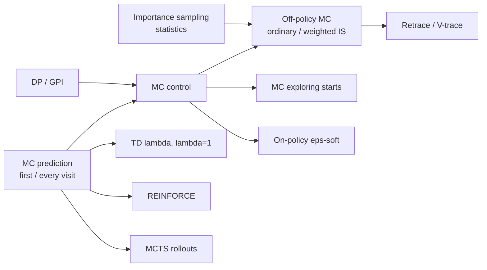

# Monte Carlo Methods (MC: First-/Every-Visit Prediction, MC ES, On-Policy ε-Soft, Off-Policy Importance Sampling)

> Learn value functions and policies from **complete sampled episodes** by averaging the returns actually observed. No model and no bootstrapping. **Family:** Model-free → Value-based → Tabular → Monte Carlo  ·  **Year / origin:** Monte Carlo sampling dates to the 1940s (Ulam, von Neumann, Metropolis); MC for RL as systematized by Sutton & Barto (1998; 2nd ed. 2018, Ch. 5); first- vs every-visit analysis by Singh & Sutton (1996)  ·  **On/Off-policy:** both (on-policy ε-soft; off-policy via importance sampling)  ·  **Action space:** discrete (tabular)

---

## 1. What is it?

Monte Carlo (MC) methods estimate $v_\pi(s)$ or $q_\pi(s,a)$ by **running episodes and averaging the returns** that follow each visit to a state or state–action pair. By the law of large numbers the averages converge to the true expected returns.

Compared with [dynamic programming](dynamic-programming.md):
- **No model needed.** MC learns from experience, real or simulated, rather than from $p(s',r\mid s,a)$.
- **No bootstrapping.** Each estimate uses the *actual* return $G_t$, not another estimate. So MC estimates are unbiased and are unaffected by the Markov property failing. The cost is higher variance and having to wait until the episode ends.
- **States can be evaluated independently.** You can estimate the value of one state of interest without computing all the others.

For **control**, MC follows generalized policy iteration (GPI): evaluate $q_\pi$ from episodes, then improve π greedily. The main issue is **exploration**: a deterministic greedy policy never tries some actions, so their values are never learned. Sutton & Barto give three fixes:
1. **Exploring starts (ES):** every episode begins with a random state–action pair.
2. **On-policy ε-soft policies:** always keep probability at least ε/|A| on every action.
3. **Off-policy learning:** follow an exploratory *behaviour* policy $b$ while learning about a greedy *target* policy π, correcting the mismatch with **importance sampling**.

MC applies only to **episodic** tasks: a return needs an end.

## 2. Family & lineage

- **Parents:** DP / GPI (for the control structure); Monte Carlo integration and importance sampling from statistics.
- **Siblings:** [TD learning](td-learning.md) (bootstraps instead of waiting for $G_t$), n-step methods and TD(λ), which interpolate between TD and MC (λ=1 behaves like MC).
- **Descendants:** REINFORCE (MC policy gradient), MC rollouts in MCTS, off-policy corrections (per-decision importance sampling, Retrace, V-trace, PPO's ratio), and off-policy evaluation in bandits and recommender systems.



## 3. Core idea & intuition

> "To know how good a state is, start there many times, play to the end, and average how it went."

- **First-visit MC:** average only the return following the *first* time $s$ appears in each episode. Each episode then contributes one independent, unbiased sample.
- **Every-visit MC:** average returns following *every* occurrence. This is biased for a finite number of samples but consistent, and it often has lower error early on. It extends more naturally to function approximation.
- **Incremental form:** $V(s) \leftarrow V(s) + \frac{1}{N(s)}(G - V(s))$, or with a constant α for non-stationary problems.
- **Control:** estimate *action* values $Q(s,a)$. Without a model you cannot make $v$ greedy, because that needs a one-step lookahead. After each episode make π greedy, or ε-greedy, with respect to Q.
- **Off-policy:** episodes come from $b$, but we want π's values. A trajectory that π would choose more often than $b$ does gets weighted up, and one π would never choose gets weight 0. With a *greedy* target, weights become zero as soon as $b$ takes a non-greedy action, so off-policy MC control learns only from the **tails** of episodes. It is correct, but it can be slow.

## 4. Math / formal details

**Returns and visits.** For an episode $S_0, A_0, R_1, \dots, S_{T-1}, A_{T-1}, R_T$, $G_t = \sum_{k=t+1}^{T} \gamma^{k-t-1} R_k$, computed backwards via $G_t = R_{t+1} + \gamma G_{t+1}$, $G_T = 0$. Let $\mathcal{T}(s)$ be the set of time steps at which $s$ is visited: only first visits for first-visit MC, all visits otherwise.

**MC prediction:**
$$
V(s) = \frac{1}{|\mathcal{T}(s)|}\sum_{t\in\mathcal{T}(s)} G_t \;\xrightarrow{\;|\mathcal{T}(s)|\to\infty\;}\; v_\pi(s).
$$
For first-visit MC each $G_t$ is an i.i.d. unbiased sample of $v_\pi(s)$, so the standard error falls as $1/\sqrt{n}$.

**MC control (GPI).** After episode $k$ update $Q$, then set $\pi_{k+1}(s) = \arg\max_a Q(s,a)$. The policy improvement theorem applies because $q_{\pi_k}(s, \pi_{k+1}(s)) = \max_a q_{\pi_k}(s,a) \ge v_{\pi_k}(s)$.

**ε-soft policies.** π is ε-soft if $\pi(a\mid s) \ge \varepsilon/|\mathcal{A}|$ for all $s,a$. The ε-greedy policy with respect to $q_\pi$ is an improvement over any ε-soft π, and the fixed point is the best ε-soft policy, not the globally optimal one.

**Importance sampling (off-policy prediction).** Coverage assumption: $\pi(a\mid s) > 0 \Rightarrow b(a\mid s) > 0$. The probability of a trajectory under the two policies differs only by policy terms, because the dynamics cancel:
$$
\rho_{t:T-1} = \prod_{k=t}^{T-1} \frac{\pi(A_k\mid S_k)}{b(A_k\mid S_k)},\qquad
\mathbb{E}_b[\rho_{t:T-1} G_t \mid S_t = s] = v_\pi(s).
$$
- **Ordinary IS:** $V(s) = \dfrac{\sum_{t\in\mathcal{T}(s)} \rho_{t:T(t)-1} G_t}{|\mathcal{T}(s)|}$. Unbiased, but the variance can be huge or even infinite.
- **Weighted IS:** $V(s) = \dfrac{\sum_{t\in\mathcal{T}(s)} \rho_{t:T(t)-1} G_t}{\sum_{t\in\mathcal{T}(s)} \rho_{t:T(t)-1}}$. Biased, though the bias vanishes asymptotically, and variance is much lower. It is preferred in practice.

**Incremental weighted IS.** With returns $G_1, G_2, \dots$ and weights $W_i$:
$$
C_{n} = C_{n-1} + W_n,\qquad V_{n+1} = V_n + \frac{W_n}{C_n}\,\big(G_n - V_n\big).
$$
**Off-policy MC control** (S&B Sec. 5.7) uses this with a greedy target, π(a|s) = 1 for the greedy action. Walking backwards through the episode, $W \leftarrow W \cdot 1/b(A_t\mid S_t)$, and the loop **stops** as soon as $A_t \ne \pi(S_t)$, because from then on $\rho = 0$.

**Variance intuition.** The variance of $\rho$ grows exponentially with episode length when π and $b$ differ. In our random-walk test, ordinary IS has an RMSE about 35× larger than weighted IS.

## 5. Algorithm (pseudocode)

```text
First-visit MC prediction (estimate V ~ v_pi)
 1. Initialise V(s) arbitrarily, Returns(s) <- empty list, for all s
 2. loop for each episode:
 3.     generate S0,A0,R1,...,S_{T-1},A_{T-1},R_T following pi
 4.     G <- 0
 5.     for t = T-1 down to 0:
 6.         G <- gamma*G + R_{t+1}
 7.         if S_t not in {S_0..S_{t-1}}:        (drop this test for every-visit)
 8.             append G to Returns(S_t);  V(S_t) <- mean(Returns(S_t))

Monte Carlo ES (exploring starts) control
 1. Initialise pi(s) arbitrarily, Q(s,a) arbitrarily, N(s,a) <- 0
 2. loop for each episode:
 3.     choose S0, A0 randomly so that every pair has probability > 0
 4.     generate an episode from S0, A0 following pi
 5.     G <- 0
 6.     for t = T-1 down to 0:
 7.         G <- gamma*G + R_{t+1}
 8.         if (S_t,A_t) not in earlier pairs of the episode:
 9.             N(S_t,A_t) += 1;  Q(S_t,A_t) += (G - Q(S_t,A_t)) / N(S_t,A_t)
10.             pi(S_t) <- argmax_a Q(S_t,a)

On-policy first-visit MC control: as above, but no exploring starts and episodes are
generated by the eps-greedy policy w.r.t. Q (pi(a|s) >= eps/|A|).

Off-policy MC control (weighted importance sampling)
 1. Initialise Q(s,a) arbitrarily, C(s,a) <- 0, pi(s) <- argmax_a Q(s,a)
 2. loop for each episode:
 3.     b <- any soft policy (e.g. eps-greedy w.r.t. Q, frozen for the episode)
 4.     generate an episode with b
 5.     G <- 0, W <- 1
 6.     for t = T-1 down to 0:
 7.         G <- gamma*G + R_{t+1}
 8.         C(S_t,A_t) += W
 9.         Q(S_t,A_t) += (W / C(S_t,A_t)) * (G - Q(S_t,A_t))
10.         pi(S_t) <- argmax_a Q(S_t,a)
11.         if A_t != pi(S_t): break               (rho becomes 0)
12.         W <- W / b(A_t|S_t)
```

## 6. Python implementation

Runnable version: [`code/monte-carlo.py`](../../code/monte-carlo.py)

The script uses two tiny environments: a 5-state **random walk** (Sutton & Barto Example 6.2, with left/right actions so that policies can differ) and a deterministic 4×4 **GridWorld** with a −1 step cost. It runs all five MC variants and finishes in about one second.

Two practical details are worth reading in the code:
- **Truncated episodes.** Deterministic greedy policies can loop forever in a grid, so episodes are capped at 100 steps. The tail of a truncated episode looks like a short, cheap episode, which would corrupt the averages, so a timeout penalty is added at truncation.
- **Pessimistic initialization for off-policy MC control.** The method only learns from episode tails, so optimistic zeros would stay greedy for a very long time.

```python
"""
Monte Carlo methods (Sutton & Barto, 2nd ed., Ch. 5).

  1. First-visit vs every-visit MC prediction        (5-state random walk)
  2. Off-policy prediction: ordinary vs weighted IS  (random walk with actions)
  3. MC control with Exploring Starts (MC ES)        (4x4 GridWorld)
  4. On-policy first-visit MC control, eps-soft      (4x4 GridWorld)
  5. Off-policy MC control, weighted IS              (4x4 GridWorld)

Pure NumPy.   Run:  python3 code/monte-carlo.py
"""
import numpy as np
from collections import defaultdict

# ----------------------------------------------------------------------------
# Environments
# ----------------------------------------------------------------------------
class RandomWalk:
    """States 0..6; 0 and 6 terminal; start in 3.  Action 0=left, 1=right.
    Reward +1 only when entering state 6.  Under a 50/50 policy v(1..5) = 1/6..5/6."""
    n_states, start, n_actions = 7, 3, 2

    def step(self, s, a):
        s2 = s + (1 if a == 1 else -1)
        return s2, (1.0 if s2 == 6 else 0.0), s2 in (0, 6)


class GridWorld:
    """4x4 grid, start top-left (0), goal bottom-right (15), reward -1 per step."""
    rows = cols = 4
    n_states, n_actions, start, goal = 16, 4, 0, 15
    moves = [(-1, 0), (0, 1), (1, 0), (0, -1)]    # up, right, down, left

    def step(self, s, a):
        r, c = divmod(s, self.cols)
        nr, nc = r + self.moves[a][0], c + self.moves[a][1]
        s2 = nr * self.cols + nc if (0 <= nr < 4 and 0 <= nc < 4) else s
        return s2, -1.0, s2 == self.goal


def rollout(env, policy_fn, rng, s0=None, a0=None, max_steps=100, timeout_penalty=0.0):
    """Generate one episode as a list of (S_t, A_t, R_{t+1}).

    max_steps caps episodes, because a deterministic greedy policy can loop forever in a
    grid.  Caution: the tail of a truncated episode looks like a *short, cheap* episode
    (e.g. a return of -2 from the start state), which corrupts MC estimates.  We therefore
    add `timeout_penalty` to the last reward of a truncated episode so that looping is
    recognised as bad rather than as "almost at the goal"."""
    s = env.start if s0 is None else s0
    episode = []
    for t in range(max_steps):
        a = a0 if (t == 0 and a0 is not None) else policy_fn(s, rng)
        s2, r, done = env.step(s, a)
        episode.append((s, a, r))
        s = s2
        if done:
            return episode
    s_last, a_last, r_last = episode[-1]
    episode[-1] = (s_last, a_last, r_last + timeout_penalty)
    return episode


# ----------------------------------------------------------------------------
# 1. MC prediction
# ----------------------------------------------------------------------------
def mc_prediction(env, policy_fn, n_episodes, rng, first_visit=True, gamma=1.0):
    returns_sum = np.zeros(env.n_states)
    returns_cnt = np.zeros(env.n_states)
    for _ in range(n_episodes):
        ep = rollout(env, policy_fn, rng, max_steps=10_000)
        states = [s for s, _, _ in ep]
        G = 0.0
        for t in reversed(range(len(ep))):            # walk backwards accumulating G
            s, _, r = ep[t]
            G = gamma * G + r
            if first_visit and s in states[:t]:       # not the first visit -> skip
                continue
            returns_sum[s] += G
            returns_cnt[s] += 1
    return np.divide(returns_sum, returns_cnt, out=np.zeros_like(returns_sum),
                     where=returns_cnt > 0)


# ----------------------------------------------------------------------------
# 2. Off-policy prediction with importance sampling
# ----------------------------------------------------------------------------
def off_policy_prediction(env, pi_right, b_right, n_episodes, rng):
    """Estimate v_pi(start) from episodes generated by behaviour policy b.
    Returns (ordinary-IS estimate, weighted-IS estimate)."""
    num, den, n = 0.0, 0.0, 0
    for _ in range(n_episodes):
        ep = rollout(env, lambda s, g: int(g.random() < b_right), rng, max_steps=10_000)
        rho = 1.0
        for _, a, _ in ep:                            # rho = prod pi(A|S) / b(A|S)
            rho *= (pi_right if a == 1 else 1 - pi_right) / (b_right if a == 1 else 1 - b_right)
        G = sum(r for _, _, r in ep)                  # gamma = 1
        num += rho * G
        den += rho
        n += 1
    return num / n, (num / den if den > 0 else 0.0)


def true_value_random_walk(pi_right):
    """Solve v = P_pi v + r_pi on the 5 non-terminal states (gamma = 1)."""
    A, b = np.eye(5), np.zeros(5)
    for i, s in enumerate(range(1, 6)):
        if s + 1 <= 5:
            A[i, i + 1] -= pi_right
        else:
            b[i] += pi_right                          # stepping into state 6 pays +1
        if s - 1 >= 1:
            A[i, i - 1] -= 1 - pi_right
    return np.linalg.solve(A, b)


# ----------------------------------------------------------------------------
# 3-5. MC control
# ----------------------------------------------------------------------------
def greedy_action(Q, s, rng):
    q = Q[s]
    return int(rng.choice(np.flatnonzero(q == q.max())))


def mc_exploring_starts(env, n_episodes, rng, gamma=1.0):
    Q = np.zeros((env.n_states, env.n_actions))
    N = np.zeros_like(Q)
    nonterminal = [s for s in range(env.n_states) if s != env.goal]
    for _ in range(n_episodes):
        s0 = int(rng.choice(nonterminal))             # exploring start: random (S0, A0)
        a0 = int(rng.integers(env.n_actions))
        ep = rollout(env, lambda s, g: greedy_action(Q, s, g), rng, s0, a0, timeout_penalty=-100)
        pairs = [(s, a) for s, a, _ in ep]
        G = 0.0
        for t in reversed(range(len(ep))):
            s, a, r = ep[t]
            G = gamma * G + r
            if (s, a) not in pairs[:t]:               # first visit of (s, a)
                N[s, a] += 1
                Q[s, a] += (G - Q[s, a]) / N[s, a]    # incremental sample average
    return Q


def mc_on_policy_eps_soft(env, n_episodes, rng, eps=0.1, gamma=1.0):
    Q = np.zeros((env.n_states, env.n_actions))
    N = np.zeros_like(Q)

    def policy(s, g):                                 # eps-greedy w.r.t. current Q
        if g.random() < eps:
            return int(g.integers(env.n_actions))
        return greedy_action(Q, s, g)

    for _ in range(n_episodes):
        ep = rollout(env, policy, rng, timeout_penalty=-100)
        pairs = [(s, a) for s, a, _ in ep]
        G = 0.0
        for t in reversed(range(len(ep))):
            s, a, r = ep[t]
            G = gamma * G + r
            if (s, a) not in pairs[:t]:
                N[s, a] += 1
                Q[s, a] += (G - Q[s, a]) / N[s, a]
    return Q


def mc_off_policy_control(env, n_episodes, rng, eps=0.3, gamma=1.0, q_init=-50.0):
    """Off-policy MC control (S&B Sec. 5.7): target = greedy(Q), behaviour = eps-greedy(Q).
    Weighted importance sampling, implemented incrementally with cumulative weights C.

    Q starts pessimistic: this method only learns from the *tail* of each episode (after
    the last non-greedy action), so an optimistic never-updated Q(s,a)=0 can stay greedy
    for a very long time.  The eps-soft behaviour policy still explores."""
    nA = env.n_actions
    Q = np.full((env.n_states, nA), q_init)
    C = np.zeros_like(Q)
    for _ in range(n_episodes):
        Q_frozen = Q.copy()                           # behaviour fixed during the episode

        def behaviour(s, g):
            if g.random() < eps:
                return int(g.integers(nA))
            return greedy_action(Q_frozen, s, g)

        ep = rollout(env, behaviour, rng, timeout_penalty=-100)
        G, W = 0.0, 1.0
        for t in reversed(range(len(ep))):
            s, a, r = ep[t]
            G = gamma * G + r
            C[s, a] += W
            Q[s, a] += (W / C[s, a]) * (G - Q[s, a])
            if Q[s].max() != Q[s, a]:                 # a is not greedy -> pi(a|s) = 0
                break                                 # earlier steps get zero weight
            greedy_set = np.flatnonzero(Q_frozen[s] == Q_frozen[s].max())
            b_prob = eps / nA + (1 - eps) * (a in greedy_set) / len(greedy_set)
            W *= 1.0 / b_prob                         # pi(a|s) = 1 for greedy target
    return Q


def evaluate_greedy(env, Q, max_steps=100):
    """Follow greedy(Q) from every non-goal state.  Returns (steps from the start state,
    fraction of states whose greedy path is a shortest path = Manhattan distance)."""
    n_optimal, start_steps = 0, None
    for s0 in range(env.n_states):
        if s0 == env.goal:
            continue
        s, steps = s0, 0
        while s != env.goal and steps < max_steps:
            s, _, _ = env.step(s, int(np.argmax(Q[s])))
            steps += 1
        r, c = divmod(s0, env.cols)
        n_optimal += (s == env.goal and steps == (3 - r) + (3 - c))
        if s0 == env.start:
            start_steps = steps
    return start_steps, n_optimal / (env.n_states - 1)


if __name__ == "__main__":
    rng = np.random.default_rng(0)
    env = RandomWalk()
    true_v = np.arange(1, 6) / 6
    print("1) MC prediction on the 5-state random walk (2000 episodes)")
    for fv in (True, False):
        V = mc_prediction(env, lambda s, g: int(g.random() < 0.5), 2000, rng, first_visit=fv)
        rms = np.sqrt(np.mean((V[1:6] - true_v) ** 2))
        print(f"   {'first-visit' if fv else 'every-visit'}: V = {np.round(V[1:6], 3)}  RMS = {rms:.4f}")

    print("\n2) Off-policy prediction: target pi(right)=0.8, behaviour b(right)=0.5")
    v_true = true_value_random_walk(0.8)[2]           # value of start state 3
    est = np.array([off_policy_prediction(env, 0.8, 0.5, 100, np.random.default_rng(i))
                    for i in range(300)])             # 300 independent runs x 100 episodes
    for j, name in enumerate(["ordinary IS", "weighted IS"]):
        bias = est[:, j].mean() - v_true
        rmse = np.sqrt(np.mean((est[:, j] - v_true) ** 2))
        print(f"   {name:12s}: mean={est[:, j].mean():.3f} (true {v_true:.3f}) "
              f"bias={bias:+.3f} RMSE={rmse:.3f}")

    grid = GridWorld()
    print("\n3-5) MC control on a 4x4 GridWorld (optimal: 6 steps from the start)")
    for name, fn in [("MC exploring starts", lambda: mc_exploring_starts(grid, 3000, rng)),
                     ("on-policy eps-soft", lambda: mc_on_policy_eps_soft(grid, 3000, rng)),
                     ("off-policy weighted IS", lambda: mc_off_policy_control(grid, 3000, rng))]:
        Q = fn()
        start_steps, frac = evaluate_greedy(grid, Q)
        print(f"   {name:24s}: greedy steps from start = {start_steps:3d}, "
              f"optimal greedy path in {100 * frac:.0f}% of states, "
              f"max_a Q(start, a) = {Q[0].max():.2f}")
```

Output:

```text
1) MC prediction on the 5-state random walk (2000 episodes)
   first-visit: V = [0.156 0.326 0.496 0.674 0.836]  RMS = 0.0072
   every-visit: V = [0.167 0.352 0.519 0.686 0.847]  RMS = 0.0161

2) Off-policy prediction: target pi(right)=0.8, behaviour b(right)=0.5
   ordinary IS : mean=0.984 (true 0.985) bias=-0.000 RMSE=0.147
   weighted IS : mean=0.984 (true 0.985) bias=-0.001 RMSE=0.004

3-5) MC control on a 4x4 GridWorld (optimal: 6 steps from the start)
   MC exploring starts     : greedy steps from start =   6, optimal greedy path in 87% of states, max_a Q(start, a) = -6.18
   on-policy eps-soft      : greedy steps from start =   6, optimal greedy path in 93% of states, max_a Q(start, a) = -6.89
   off-policy weighted IS  : greedy steps from start =   6, optimal greedy path in 100% of states, max_a Q(start, a) = -6.00
```

How to read it:
- Both prediction variants converge. In a single run like this, which one has lower error is noise.
- Weighted IS has about 35× lower RMSE than ordinary IS.
- The on-policy ε-soft estimate of Q(start) is about −6.9 rather than −6.0, because it estimates the value of the *ε-greedy* policy, which occasionally wanders.
- The off-policy method learns the greedy policy's values exactly (−6.00).

## 7. Practical tips & hyperparameters

- **Step size:** use sample averages (1/N) for stationary problems and constant α (0.01–0.1) if the policy keeps changing. In control the policy changes, so later returns are more relevant; a constant α often works better.
- **ε for on-policy control:** 0.05–0.2. Decay it over time (GLIE: greedy in the limit with infinite exploration) to converge to the optimal rather than the best ε-soft policy.
- **Exploring starts** are a theoretical device. They are possible in simulators, not in the real world.
- **Episode caps:** if you truncate, do not treat the truncated tail as a true terminal return. Penalize it, bootstrap from a value estimate (that is no longer pure MC), or discard the episode.
- **Off-policy:** prefer weighted IS. Ordinary IS can have infinite variance (S&B Example 5.5). Consider **per-decision IS** or **discounting-aware IS** (S&B Sec. 5.8–5.9) for long episodes.
- **Debugging:** compare against DP ground truth on tiny problems. Track the number of visits per (s,a): unvisited pairs mean an exploration problem. For off-policy, monitor the *effective sample size* $(\sum W)^2/\sum W^2$.
- **Variance:** MC variance grows with episode length and reward noise. If learning is too noisy, move toward [TD](td-learning.md) or n-step methods.

## 8. Pros and cons

**Pros**
- Model-free and simple; easy to explain ("average what happened").
- Unbiased (first-visit, on-policy); does not rely on the Markov property.
- Can evaluate only the states you care about; cost per state is independent of state-space size.
- Works with simulators or historical episodes; off-policy IS allows reuse of logged data.

**Cons**
- Only episodic tasks; must wait until the episode ends to learn.
- High variance, especially for long episodes or noisy rewards.
- Exploration is a real problem (ES is unrealistic; ε-soft converges to ε-optimal).
- Off-policy IS variance explodes with horizon; off-policy control with a greedy target learns slowly from tails.

## 9. When to use / when not to use

**Use when:**
- Episodes are short and you can simulate many of them cheaply: card games like blackjack, short games, rollouts in planning.
- The environment is not quite Markov (partial observability), so bootstrapping would mislead.
- You need unbiased evaluation of a fixed policy from logged episodes, as in off-policy evaluation with known behaviour probabilities.

**Do not use when:**
- Tasks are continuing or episodes are very long. Use [TD](td-learning.md), [SARSA](sarsa.md) or [Q-learning](q-learning.md).
- You need to learn online within an episode, for example in safety-critical settings where you must react to mistakes immediately.
- The behaviour and target policies are very different over long horizons (IS variance blows up).

## 10. Key papers, books & repos

- Sutton & Barto, *Reinforcement Learning: An Introduction*, 2nd ed., 2018. **Chapter 5** (Monte Carlo Methods): prediction 5.1, action values 5.2, MC ES 5.3, on-policy without ES 5.4, off-policy via importance sampling 5.5–5.7, discounting-aware and per-decision IS 5.8–5.9. Blackjack (Example 5.1) is the canonical example.
- Singh, S. P. & Sutton, R. S. (1996). "Reinforcement learning with replacing eligibility traces." *Machine Learning* 22. (analysis of first-visit vs every-visit MC)
- Precup, D., Sutton, R. S. & Singh, S. (2000). "Eligibility traces for off-policy policy evaluation." *ICML*. (per-decision importance sampling)
- Mahmood, A. R., van Hasselt, H. & Sutton, R. S. (2014). "Weighted importance sampling for off-policy learning with linear function approximation." *NeurIPS*.
- Rubinstein, R. Y. (1981). *Simulation and the Monte Carlo Method*. Wiley. (importance sampling background)
- Munos, R., Stepleton, T., Harutyunyan, A. & Bellemare, M. G. (2016). "Safe and efficient off-policy reinforcement learning." *NeurIPS*; arXiv:1606.02647. (Retrace, a modern descendant)
- Repos: [`ShangtongZhang/reinforcement-learning-an-introduction`](https://github.com/ShangtongZhang/reinforcement-learning-an-introduction) (Ch. 5 blackjack and infinite-variance examples).

## 11. For business users

**What it does.** Monte Carlo learning judges a strategy by playing it out to the end many times and averaging the outcomes. It needs no formula for how the world works, only the ability to try things, or records of what happened, and see the final results.

**Analogy.** A retailer wants to know which store layout leads to bigger baskets. Instead of modelling every customer's psychology, it tracks full shopping trips (enter to checkout) under each layout and averages the spend. With enough trips the averages tell you which layout wins. "Off-policy" Monte Carlo is like estimating how a *new* layout would do using trips recorded under the *old* layout, by re-weighting the trips that look like what the new layout would produce.

**Real-world use cases.**
- Evaluating game strategies or business playbooks in a simulator.
- Estimating customer lifetime value from complete customer journeys.
- Offline evaluation of a new recommendation policy from logged data (importance weighting).
- Risk and outcome estimation in finance and operations via simulation.

**Value / ROI.** Simple, transparent, and trustworthy in that it is unbiased: answers come straight from observed outcomes. It is a good first baseline and sanity check.

**Risks.** Needs many complete episodes, so it is slow when outcomes take months. Results are noisy. Re-weighting old data to judge a very different new strategy can give wildly unreliable numbers.

**Costs.** Mostly data or simulation volume; compute is trivial.

**Questions to ask your team.**
1. How long is an "episode" (a customer journey, a game, a process run), and how many do we have?
2. How noisy are the outcomes, and what are our confidence intervals?
3. If we evaluate a new policy from old logs, did we record the old policy's action probabilities?
4. What is the effective sample size after re-weighting?

## 12. For kids (ages ~8–12)

**The marble maze.** You have a wooden marble maze with lots of paths, and you want to know which starting hole gives the best chance of the marble landing in the "WIN" cup. You can't figure it out just by looking. So you try it! Drop the marble in hole 1 ten times and count the wins. Then hole 2, ten times. Then hole 3. The hole with the most wins is the best one.

That's Monte Carlo: try it lots of times, see how it ends, and take the average. (It's named after a famous casino town, because casinos are all about chance!)

**Try it yourself.** Flip a coin 10 times and count heads. Then 50 times. Is your fraction closer to one half with more flips? Now make a game: "Start with 3 points; heads +1, tails −1; stop at 0 or 6." Play it 20 times and count how often you reach 6. You just did Monte Carlo!

**Recap:**
1. Play the game all the way to the end.
2. Do it many times.
3. The average result tells you how good your choice was.

## 13. Related methods

- [Dynamic Programming](dynamic-programming.md): GPI with a known model; source of ground truth.
- [TD learning](td-learning.md): learns before the episode ends by bootstrapping; TD(λ) with λ=1 behaves like MC.
- [SARSA](sarsa.md): on-policy TD control (the bootstrapped cousin of on-policy MC control).
- [Q-learning](q-learning.md): off-policy control without importance sampling.
- [Multi-armed bandits](multi-armed-bandits.md): sample averages in a single state; inverse propensity scoring.
- [Dyna-Q](dyna-q.md): model-based planning as an alternative to pure sampling.
- [REINFORCE](../03-policy-gradient/reinforce.md): Monte Carlo policy gradient.
- [PPO](../03-policy-gradient/ppo.md): uses clipped importance ratios $\pi/\pi_{\text{old}}$.
- [MCTS / AlphaZero](../05-model-based/mcts-alphazero.md): MC rollouts and value averaging in a search tree.

[← Back to overview](../../RL_Methods_Overview.md)
