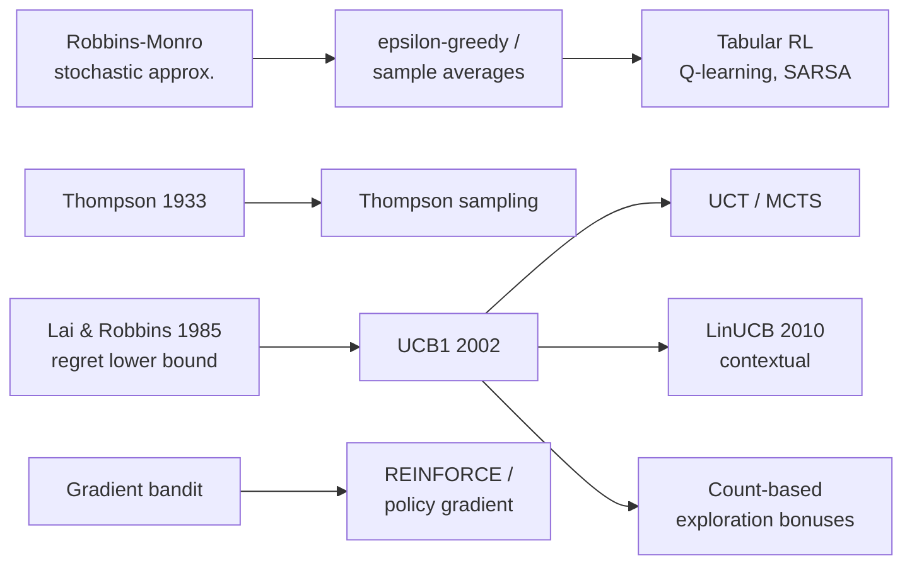

# Multi-Armed Bandits (MAB: ε-greedy, UCB1, Thompson Sampling, Gradient Bandit, LinUCB)

> The simplest RL problem: repeatedly choose one of *k* actions with unknown reward distributions and maximize total reward, trading off **exploration** against **exploitation**. **Family:** Foundations → Tabular → Bandits (single-state RL)  ·  **Year / origin:** Thompson (1933), Robbins (1952); UCB1 by Auer, Cesa-Bianchi & Fischer (2002); LinUCB by Li et al. (2010, Yahoo! Research)  ·  **On/Off-policy:** on-policy (learns from its own choices; off-policy evaluation of logged bandit data is a separate topic)  ·  **Action space:** discrete (k arms); contextual variants add a feature vector per round

---

## 1. What is it?

A **k-armed bandit** is a decision problem with one state: at each step $t = 1, 2, \dots$ the agent picks an action (an "arm") $A_t \in \{1,\dots,k\}$ and receives a reward $R_t$ drawn from an unknown distribution that depends only on the arm. The goal is to maximize $\sum_t R_t$, or equivalently to minimize **regret**, the reward lost compared with always pulling the best arm.

The name comes from slot machines ("one-armed bandits"): you stand in front of $k$ machines and have to decide which levers to pull.

The bandit is where the core RL dilemma shows up in its purest form.
- **Exploit:** pull the arm that currently looks best.
- **Explore:** pull other arms to improve your estimates, because the arm that looks best may only look that way by luck.

Full RL (MDPs) adds two more difficulties on top: **state** (the best action depends on the situation) and **delayed consequences** (actions change future states). Bandits strip both away, so they are the right place to study exploration on its own. **Contextual bandits** add back state but not delayed consequences: each round reveals a context $x_t$ (for example user features), and the best arm depends on $x_t$.

In the RL taxonomy, bandits are the base case of model-free, value-based learning: the agent keeps estimates $Q_t(a) \approx q_*(a)$ and acts on them. Sutton & Barto use them (Ch. 2) to introduce incremental updates, step sizes, optimistic initialization, UCB and policy-gradient ideas. All of these come back later in the full RL setting.

## 2. Family & lineage

- **Parents:** sequential design of experiments (Robbins, 1952), Bayesian decision theory (Thompson, 1933), stochastic approximation (Robbins & Monro, 1951).
- **Siblings:** Gittins indices (an optimal solution for discounted Bayesian bandits), adversarial bandits (EXP3), best-arm identification, dueling bandits.
- **Descendants:** contextual bandits (LinUCB, neural bandits) used in recommendation and ads; MCTS/UCT (Kocsis & Szepesvári, 2006), which applies UCB at every tree node and underlies AlphaGo-style search; count-based exploration bonuses in deep RL; the gradient-bandit update is the single-state version of REINFORCE.



## 3. Core idea & intuition

1. **Estimate each arm's value** with a running average of the rewards it produced.
2. **Act mostly greedily** on those estimates, but **inject exploration**. The strategies differ only in *how* they explore:
   - **ε-greedy:** explore uniformly at random with probability ε. It is simple and robust, but it keeps wasting pulls on arms it already knows are bad.
   - **Optimistic initialization:** start every estimate high (for example $Q_1 = +5$). Every arm then "disappoints" when tried, which pushes the agent to try the others. This is cheap, but it only drives exploration early on.
   - **UCB (optimism in the face of uncertainty):** add a confidence bonus that is large for rarely pulled arms and shrinks as $\sqrt{\ln t / N(a)}$. Pull the arm with the highest *plausible* value. Exploration becomes *directed*: it goes where uncertainty is highest.
   - **Thompson sampling (probability matching):** keep a posterior over each arm's mean, draw one sample per arm, and pull the arm whose sample is largest. Each arm is chosen with the posterior probability that it is the best one.
   - **Gradient bandit:** skip value estimates and learn *preferences* $H(a)$ with a softmax policy, nudging $H$ up for arms that beat the average reward. This is policy-gradient RL in miniature.
3. **Contextual bandits (LinUCB):** fit one linear model per arm, $\mathbb{E}[R \mid x, a] \approx x^\top\theta_a$, and add a UCB bonus measured in the model's uncertainty ellipsoid.

Intuition for "why not just be greedy": if your first pull of the best arm happens to come up unlucky, a greedy agent may never return to it. On the testbed below a pure greedy agent picks the best arm only about a third of the time even after 1000 steps.

## 4. Math / formal details

**Setup.** Arms $a \in \mathcal{A} = \{1,\dots,k\}$, true values $q_*(a) = \mathbb{E}[R_t \mid A_t = a]$, best value $\mu^* = \max_a q_*(a)$, gaps $\Delta_a = \mu^* - q_*(a)$. $N_t(a)$ is the number of times $a$ was pulled before step $t$.

**Regret** over horizon $T$:
$$
\mathcal{L}_T = T\mu^* - \mathbb{E}\Big[\sum_{t=1}^T R_t\Big] = \sum_{a} \Delta_a\, \mathbb{E}[N_{T+1}(a)].
$$
Lai & Robbins (1985) showed that any consistent algorithm must satisfy $\liminf_{T\to\infty} \mathbb{E}[N_T(a)]/\ln T \ge 1/\mathrm{KL}(\nu_a\,\|\,\nu^*)$ for every suboptimal arm. So regret has to grow at least logarithmically. ε-greedy with fixed ε has *linear* regret, since it pulls each bad arm a fixed fraction of the time. UCB and Thompson sampling achieve logarithmic regret.

**Incremental sample average.** With $Q_n$ the estimate after $n-1$ rewards from an arm,
$$
Q_{n+1} = Q_n + \frac{1}{n}\big(R_n - Q_n\big)
\quad\text{(general form: NewEstimate} \leftarrow \text{Old} + \text{StepSize}\,[\text{Target} - \text{Old}]).
$$
A **constant step size** $\alpha$ gives an exponential recency-weighted average,
$Q_{n+1} = (1-\alpha)^n Q_1 + \sum_{i=1}^n \alpha(1-\alpha)^{n-i} R_i$, which suits **non-stationary** bandits. Estimates converge with probability 1 when the step sizes satisfy the Robbins–Monro conditions $\sum_n \alpha_n = \infty$ and $\sum_n \alpha_n^2 < \infty$ (true for $1/n$, false for constant α).

**ε-greedy:** $A_t = \arg\max_a Q_t(a)$ with probability $1-\varepsilon$, otherwise a uniformly random arm.

**UCB.** Sutton & Barto's form is $A_t = \arg\max_a \big[ Q_t(a) + c\sqrt{\ln t / N_t(a)} \big]$, with untried arms treated as maximal. UCB1 (Auer et al., 2002) uses $c=\sqrt{2}$ for rewards in $[0,1]$ and has expected regret $O\big(\sum_{a:\Delta_a>0} \ln T / \Delta_a\big)$. The bonus is a Hoeffding confidence radius, so the index is a high-probability upper bound on $q_*(a)$.

**Thompson sampling.** Keep a posterior $p(\theta_a \mid \text{data})$ for each arm, draw $\tilde\theta_a \sim p(\theta_a \mid \mathcal{D})$, and play $\arg\max_a \tilde\theta_a$.
- *Bernoulli rewards:* prior $\mathrm{Beta}(\alpha_a, \beta_a)$; after reward $r\in\{0,1\}$ update $\alpha_a \mathrel{+}= r$, $\beta_a \mathrel{+}= 1-r$.
- *Gaussian rewards, known variance 1* (used in the code): with prior $\mathcal{N}(\mu_0, 1/\tau_0)$, after $n$ rewards with sum $S$ the posterior is $\mathcal{N}(\mu_n, 1/\tau_n)$, where $\tau_n = \tau_0 + n$ and $\mu_n = (\tau_0\mu_0 + S)/\tau_n$.
Agrawal & Goyal (2012) proved logarithmic regret for Beta–Bernoulli Thompson sampling.

**Gradient bandit.** Preferences $H_t(a)$ define a softmax policy $\pi_t(a) = e^{H_t(a)} / \sum_b e^{H_t(b)}$. The update is
$$
H_{t+1}(a) = H_t(a) + \alpha\,(R_t - \bar R_t)\big(\mathbb{1}[a = A_t] - \pi_t(a)\big)\quad \forall a,
$$
where $\bar R_t$ is the running average reward (the **baseline**). This is stochastic gradient ascent on $\mathbb{E}[R_t] = \sum_b \pi_t(b) q_*(b)$. Using $\partial\pi_t(b)/\partial H_t(a) = \pi_t(b)(\mathbb{1}[a=b] - \pi_t(a))$,
$$
\frac{\partial\,\mathbb{E}[R_t]}{\partial H_t(a)} = \mathbb{E}\big[(R_t - B_t)(\mathbb{1}[a=A_t] - \pi_t(a))\big]
$$
for any baseline $B_t$ that does not depend on $A_t$. Subtracting $\sum_b \pi_t(b)(\partial\pi_t(b)/\partial H_t(a))B_t = 0$ is what lets us use a baseline. The baseline leaves the gradient unbiased and reduces its variance. The identical argument gives REINFORCE with a baseline.

**LinUCB (disjoint).** For each arm keep $A_a = I_d + \sum x x^\top$ and $b_a = \sum r\,x$ (ridge regression). Then
$$
\hat\theta_a = A_a^{-1} b_a,\qquad
A_t = \arg\max_a\; x_t^\top \hat\theta_a + \alpha\sqrt{x_t^\top A_a^{-1} x_t}.
$$
The bonus is the standard deviation of the prediction along direction $x_t$.

## 5. Algorithm (pseudocode)

```text
Generic bandit loop (one agent, horizon T)
 1. Initialise for every arm a:  Q(a) <- Q0,  N(a) <- 0
    (Thompson: posterior params;  gradient bandit: H(a) <- 0, Rbar <- 0)
 2. for t = 1 .. T:
 3.     choose A_t:
          eps-greedy : with prob eps a random arm, else argmax_a Q(a)   (random tie-break)
          UCB        : any untried arm, else argmax_a Q(a) + c*sqrt(ln t / N(a))
          Thompson   : sample theta_a ~ posterior(a) for each a; argmax_a theta_a
          gradient   : pi = softmax(H); sample A_t ~ pi
 4.     observe reward R_t
 5.     update:
          N(A_t) <- N(A_t) + 1
          Q(A_t) <- Q(A_t) + (1/N(A_t)) * (R_t - Q(A_t))       (or constant alpha)
          Thompson : posterior(A_t) <- Bayes update with R_t
          gradient : H(a) <- H(a) + alpha*(R_t - Rbar)*(1[a=A_t] - pi(a))  for all a
                     Rbar <- Rbar + (R_t - Rbar)/t

LinUCB (contextual)
 1. for each arm a:  A_a <- I_d,  b_a <- 0
 2. for t = 1 .. T:
 3.     observe context x_t
 4.     for each a:  theta_a <- A_a^{-1} b_a ;  p_a <- x_t.theta_a + alpha*sqrt(x_t^T A_a^{-1} x_t)
 5.     play A_t = argmax_a p_a, observe R_t
 6.     A_{A_t} <- A_{A_t} + x_t x_t^T ;  b_{A_t} <- b_{A_t} + R_t x_t
```

## 6. Python implementation

Runnable version: [`code/multi-armed-bandits.py`](../../code/multi-armed-bandits.py)

The script reproduces Sutton & Barto's 10-armed testbed: 200 random bandit problems with $q_*(a)\sim\mathcal{N}(0,1)$ and rewards $\sim \mathcal{N}(q_*(a),1)$. It compares seven agents, repeats the gradient-bandit experiment with and without a baseline when $q_*$ is shifted to mean $+4$, and runs LinUCB against a context-blind ε-greedy agent on a linear contextual bandit. It finishes in about 20 seconds on a laptop CPU.

```python
"""
Multi-armed bandits on the 10-armed testbed (Sutton & Barto, 2nd ed., Ch. 2),
plus disjoint LinUCB on a toy contextual bandit (Li et al., 2010).

Agents: epsilon-greedy (sample average), optimistic greedy, UCB1,
Gaussian Thompson sampling, gradient bandit (softmax preferences + baseline).

Pure NumPy, no other dependencies.   Run:  python3 code/multi-armed-bandits.py
"""
import numpy as np


# ----------------------------------------------------------------------------
# Environment: the k-armed Gaussian testbed
# ----------------------------------------------------------------------------
class Testbed:
    """True values q*(a) ~ N(mean, 1); each pull returns R ~ N(q*(a), 1)."""

    def __init__(self, k, rng, mean=0.0):
        self.rng = rng
        self.q_star = rng.normal(mean, 1.0, size=k)
        self.best = int(np.argmax(self.q_star))

    def pull(self, a):
        return self.rng.normal(self.q_star[a], 1.0)


def argmax_tie(x, rng):
    """argmax with random tie-breaking (important when all estimates start equal)."""
    return int(rng.choice(np.flatnonzero(x == x.max())))


# ----------------------------------------------------------------------------
# Agents: each has act(t) -> action and update(a, r)
# ----------------------------------------------------------------------------
class EpsilonGreedy:
    """Sample-average (alpha=None) or constant-step-size epsilon-greedy."""

    def __init__(self, k, rng, eps=0.1, q0=0.0, alpha=None):
        self.k, self.rng, self.eps, self.alpha = k, rng, eps, alpha
        self.Q = np.full(k, q0, dtype=float)   # action-value estimates
        self.N = np.zeros(k)                   # pull counts

    def act(self, t):
        if self.rng.random() < self.eps:
            return int(self.rng.integers(self.k))       # explore
        return argmax_tie(self.Q, self.rng)             # exploit

    def update(self, a, r):
        self.N[a] += 1
        step = self.alpha if self.alpha is not None else 1.0 / self.N[a]
        self.Q[a] += step * (r - self.Q[a])             # NewEst = Old + step*(Target-Old)


class UCB1:
    """Upper-confidence-bound action selection: Q(a) + c*sqrt(ln t / N(a))."""

    def __init__(self, k, rng, c=2.0):
        self.k, self.rng, self.c = k, rng, c
        self.Q = np.zeros(k)
        self.N = np.zeros(k)

    def act(self, t):
        untried = np.flatnonzero(self.N == 0)
        if untried.size:                                # pull every arm once first
            return int(untried[0])
        bonus = self.c * np.sqrt(np.log(t) / self.N)
        return argmax_tie(self.Q + bonus, self.rng)

    def update(self, a, r):
        self.N[a] += 1
        self.Q[a] += (r - self.Q[a]) / self.N[a]


class GaussianThompson:
    """Thompson sampling with a N(mu0, 1/tau0) prior and known noise variance 1.

    Posterior for each arm stays Gaussian: precision tau grows by 1 per pull,
    mean is the precision-weighted average of prior mean and observed rewards.
    """

    def __init__(self, k, rng, mu0=0.0, tau0=1.0):
        self.rng = rng
        self.mu = np.full(k, mu0, dtype=float)   # posterior means
        self.tau = np.full(k, tau0, dtype=float)  # posterior precisions

    def act(self, t):
        theta = self.rng.normal(self.mu, 1.0 / np.sqrt(self.tau))  # one sample per arm
        return int(np.argmax(theta))

    def update(self, a, r):
        self.mu[a] = (self.tau[a] * self.mu[a] + r) / (self.tau[a] + 1.0)
        self.tau[a] += 1.0


class GradientBandit:
    """Softmax over preferences H, stochastic gradient ascent on E[R]."""

    def __init__(self, k, rng, alpha=0.1, baseline=True):
        self.k, self.rng, self.alpha, self.baseline = k, rng, alpha, baseline
        self.H = np.zeros(k)
        self.r_bar, self.n = 0.0, 0
        self.pi = np.full(k, 1.0 / k)

    def act(self, t):
        z = np.exp(self.H - self.H.max())               # numerically stable softmax
        self.pi = z / z.sum()
        return int(self.rng.choice(self.k, p=self.pi))

    def update(self, a, r):
        b = self.r_bar if self.baseline else 0.0
        one_hot = np.zeros(self.k)
        one_hot[a] = 1.0
        self.H += self.alpha * (r - b) * (one_hot - self.pi)
        self.n += 1
        self.r_bar += (r - self.r_bar) / self.n        # running-average baseline


def run_testbed(make_agent, runs=200, steps=1000, k=10, mean=0.0, seed=0):
    """Average reward and %-optimal-action curves over many random testbeds."""
    rewards = np.zeros((runs, steps))
    optimal = np.zeros((runs, steps))
    for i in range(runs):
        rng = np.random.default_rng(seed + i)
        env = Testbed(k, rng, mean)
        agent = make_agent(k, rng)
        for t in range(steps):
            a = agent.act(t + 1)
            r = env.pull(a)
            agent.update(a, r)
            rewards[i, t] = r
            optimal[i, t] = (a == env.best)
    return rewards.mean(0), optimal.mean(0)


# ----------------------------------------------------------------------------
# Contextual bandit: disjoint LinUCB
# ----------------------------------------------------------------------------
class LinUCB:
    """One ridge regression per arm; pick argmax_a  x.theta_a + alpha*sqrt(x^T A_a^-1 x)."""

    def __init__(self, n_arms, d, alpha=1.0):
        self.alpha = alpha
        self.A = np.stack([np.eye(d) for _ in range(n_arms)])   # d x d per arm
        self.b = np.zeros((n_arms, d))

    def act(self, x):
        scores = []
        for A, b in zip(self.A, self.b):
            A_inv = np.linalg.inv(A)
            theta = A_inv @ b
            scores.append(x @ theta + self.alpha * np.sqrt(x @ A_inv @ x))
        return int(np.argmax(scores))

    def update(self, a, x, r):
        self.A[a] += np.outer(x, x)
        self.b[a] += r * x


def run_contextual(T=2000, n_arms=5, d=6, seed=0):
    rng = np.random.default_rng(seed)
    theta_true = rng.normal(0, 1, size=(n_arms, d))       # hidden per-arm weights
    linucb = LinUCB(n_arms, d, alpha=1.0)
    eps = EpsilonGreedy(n_arms, rng, eps=0.1)              # ignores the context
    regret = {"LinUCB": 0.0, "eps-greedy (no context)": 0.0}
    for _ in range(T):
        x = rng.normal(0, 1, size=d) / np.sqrt(d)          # context (e.g. user features)
        means = theta_true @ x
        best = means.max()
        a = linucb.act(x)
        linucb.update(a, x, means[a] + rng.normal(0, 0.1))
        regret["LinUCB"] += best - means[a]
        a = eps.act(0)
        eps.update(a, means[a] + rng.normal(0, 0.1))
        regret["eps-greedy (no context)"] += best - means[a]
    return regret


if __name__ == "__main__":
    agents = {
        "greedy (eps=0)":            lambda k, rng: EpsilonGreedy(k, rng, eps=0.0),
        "eps-greedy eps=0.1":        lambda k, rng: EpsilonGreedy(k, rng, eps=0.1),
        "eps-greedy eps=0.01":       lambda k, rng: EpsilonGreedy(k, rng, eps=0.01),
        "optimistic Q0=5, a=0.1":    lambda k, rng: EpsilonGreedy(k, rng, eps=0.0, q0=5.0, alpha=0.1),
        "UCB1 c=2":                  lambda k, rng: UCB1(k, rng, c=2.0),
        "Thompson (Gaussian)":       lambda k, rng: GaussianThompson(k, rng),
        "gradient a=0.1 +baseline":  lambda k, rng: GradientBandit(k, rng, alpha=0.1),
    }
    print("10-armed testbed, 200 runs x 1000 steps")
    print(f"{'agent':28s} {'avg reward':>10s} {'%opt (last 100)':>16s}")
    for name, make in agents.items():
        r, opt = run_testbed(make)
        print(f"{name:28s} {r.mean():10.3f} {100 * opt[-100:].mean():15.1f}%")

    # Baseline matters when rewards are far from 0 (S&B Fig. 2.5 uses mean +4).
    print("\nGradient bandit on testbed with q* mean = +4 (100 runs)")
    for base in (True, False):
        _, opt = run_testbed(lambda k, rng: GradientBandit(k, rng, 0.1, baseline=base),
                             runs=100, mean=4.0)
        print(f"  baseline={str(base):5s}  %opt (last 100) = {100 * opt[-100:].mean():.1f}%")

    print("\nContextual bandit (5 arms, 6-dim context, 2000 rounds): cumulative regret")
    for name, reg in run_contextual().items():
        print(f"  {name:26s} {reg:8.1f}")
```

Output from one run (exact numbers depend on the seed):

```text
10-armed testbed, 200 runs x 1000 steps
agent                        avg reward  %opt (last 100)
greedy (eps=0)                    1.026            35.0%
eps-greedy eps=0.1                1.279            82.5%
eps-greedy eps=0.01               1.166            59.4%
optimistic Q0=5, a=0.1            1.268            86.5%
UCB1 c=2                          1.353            86.3%
Thompson (Gaussian)               1.437            92.1%
gradient a=0.1 +baseline          1.320            83.1%

Gradient bandit on testbed with q* mean = +4 (100 runs)
  baseline=True   %opt (last 100) = 76.6%
  baseline=False  %opt (last 100) = 46.2%

Contextual bandit (5 arms, 6-dim context, 2000 rounds): cumulative regret
  LinUCB                         28.6
  eps-greedy (no context)      1912.2
```

How to read it:
- **Greedy gets stuck.** It hits the optimal arm only about 35% of the time.
- **ε=0.01 vs ε=0.1.** ε=0.01 explores too slowly for a 1000-step horizon, but over a much longer run it would overtake ε=0.1, because it wastes fewer pulls once its estimates are good.
- **UCB and Thompson** do best because their exploration is directed.
- **The baseline matters** once rewards are far from zero.
- **Context matters.** A bandit that ignores context cannot represent the best policy at all, so its regret grows linearly.

## 7. Practical tips & hyperparameters

| Method | Key knob | Typical values | Notes |
|---|---|---|---|
| ε-greedy | ε | 0.01–0.1; or decay ε_t ∝ 1/t | Decaying ε can achieve log regret if tuned to the gaps; fixed ε gives linear regret |
| Optimistic init | $Q_1$ | above any plausible reward | Only drives early exploration; useless for non-stationary problems |
| UCB | $c$ | √2 for rewards in [0,1]; 1–2 on the testbed | Scale $c$ with the reward range; UCB is sensitive to reward scale |
| Thompson | prior | weak prior, e.g. Beta(1,1) or N(0,1) | Misspecified noise variance makes it over- or under-explore |
| Gradient bandit | α | 0.05–0.4 | Always use a baseline |
| LinUCB | α | 0.1–2 | Standardize features; re-solve with Sherman–Morrison or Cholesky for speed |

- **Break ties randomly.** `np.argmax` always returns the first maximum, which biases early behaviour toward arm 0.
- **Non-stationarity:** use a constant α, a sliding window, or discounted UCB/TS. Sample averages never forget.
- **Delayed/batched feedback** (common in production): Thompson sampling handles batches gracefully because of its randomization. Deterministic UCB pulls the same arm for the whole batch.
- **Debugging signals:** plot % optimal action and cumulative regret on a log-x axis. Log-regret algorithms give a roughly straight line there; a curve bending upward signals linear regret.
- **Off-policy evaluation:** if you deploy a new policy using data logged by an old one, use inverse propensity scoring (log the action probabilities!), the bandit version of the importance sampling in [Monte Carlo](monte-carlo.md).

## 8. Pros and cons

**Pros**
- Tiny, fast, easy to deploy. One table or a few small matrices.
- Strong theory: logarithmic regret bounds (UCB, Thompson), matching lower bounds.
- Thompson sampling is robust in practice and handles delayed feedback well.
- Contextual bandits capture most of the value of personalization without the complexity of full RL.

**Cons**
- No state or long-term consequences: wrong for problems where actions change the future (use MDP methods).
- Assumes rewards are observed soon and are a good proxy for the true objective.
- Tuning still matters (ε, $c$, prior, reward scale).
- Linear contextual models can be misspecified; neural bandits need careful uncertainty estimates.

## 9. When to use / when not to use

**Use when:**
- You repeatedly choose among options and get quick feedback: A/B/n testing, ads, recommendation slots, pricing experiments, clinical-trial-style allocation, hyperparameter search.
- Today's choice does not change tomorrow's situation, at least to a first approximation.
- You want to cut the cost of experimentation compared with a fixed-split A/B test.

**Do not use when:**
- Actions have delayed effects on state, such as inventory, user retention dynamics, or robotics. Use MDP methods ([Q-learning](q-learning.md), policy gradients).
- The reward is very delayed or you need a clean causal estimate for a report. A classic randomized A/B test may be simpler and statistically cleaner.
- Arms are adversarial or the environment shifts abruptly. You need adversarial bandits (EXP3) or explicit change detection.

## 10. Key papers, books & repos

- Sutton, R. S. & Barto, A. G. *Reinforcement Learning: An Introduction*, 2nd ed., MIT Press, 2018. **Chapter 2** (Multi-armed Bandits), including the 10-armed testbed and the gradient bandit derivation (Sec. 2.8).
- Thompson, W. R. (1933). "On the likelihood that one unknown probability exceeds another in view of the evidence of two samples." *Biometrika*.
- Robbins, H. (1952). "Some aspects of the sequential design of experiments." *Bulletin of the AMS*.
- Lai, T. L. & Robbins, H. (1985). "Asymptotically efficient adaptive allocation rules." *Advances in Applied Mathematics*.
- Auer, P., Cesa-Bianchi, N. & Fischer, P. (2002). "Finite-time analysis of the multiarmed bandit problem." *Machine Learning* 47. (UCB1)
- Li, L., Chu, W., Langford, J. & Schapire, R. E. (2010). "A contextual-bandit approach to personalized news article recommendation." *WWW 2010*. (LinUCB)
- Chapelle, O. & Li, L. (2011). "An empirical evaluation of Thompson sampling." *NeurIPS*.
- Agrawal, S. & Goyal, N. (2012). "Analysis of Thompson sampling for the multi-armed bandit problem." *COLT*.
- Russo, D., Van Roy, B., Kazerouni, A., Osband, I. & Wen, Z. (2018). "A Tutorial on Thompson Sampling." *Foundations and Trends in ML*; arXiv:1707.02038.
- Lattimore, T. & Szepesvári, C. (2020). *Bandit Algorithms*. Cambridge University Press. (free online draft)
- Repos: [`ShangtongZhang/reinforcement-learning-an-introduction`](https://github.com/ShangtongZhang/reinforcement-learning-an-introduction) (Python reproductions of the book's figures, Ch. 2 included); [`VowpalWabbit/vowpal_wabbit`](https://github.com/VowpalWabbit/vowpal_wabbit) (production contextual bandits).

## 11. For business users

**What it does.** A bandit algorithm decides, one customer or request at a time, which of several options to show. It learns from the results as they come in. Unlike a fixed A/B test that splits traffic 50/50 until the test ends, a bandit gradually sends more traffic to the options that are winning, while still checking the others occasionally in case it misjudged them.

**Analogy.** A new restaurant manager must decide which dishes to feature on the specials board. Featuring only yesterday's best-seller means never finding a better dish. Rotating everything equally loses money on dishes everyone dislikes. A bandit is a disciplined manager: mostly feature the proven winners, and occasionally give an uncertain dish a slot.

**Real-world use cases.**
- Website headline, image or layout testing.
- Recommendation and news slots; contextual bandits personalize by user segment.
- Email subject lines, push-notification timing, promotional offers.
- Choosing among models or prompts in production by observed quality.
- Adaptive clinical or field trials (with appropriate statistical and ethical oversight).

**Value / ROI.** Less "regret": fewer customers see inferior options during the experiment, so you collect more revenue while still learning. Bandits also adapt automatically when preferences drift.

**Risks.**
- They optimize exactly the metric you give them. Clicks can rise while satisfaction falls.
- Results are harder to read as a clean causal A/B report.
- Feedback delays and seasonality can mislead them.
- Personalization raises fairness and privacy questions.

**Costs.** Low compute. The main costs are logging infrastructure (always log which option was shown *and with what probability*), metric design and monitoring.

**Questions to ask your team.**
1. What reward are we optimizing, and how quickly do we observe it?
2. Do our actions change future customer behaviour? If so, a bandit may be too short-sighted.
3. Are we logging action probabilities so we can evaluate new policies offline?
4. How do we detect and handle drift or broken arms?
5. What guardrails stop it from over-exploiting a misleading metric?

## 12. For kids (ages ~8–12)

**The cookie jar game.** Imagine five cookie jars on a shelf. Some jars are full of yummy cookies and some are full of yucky broccoli cookies, but they all look the same from outside! Each day you get to take one cookie from one jar.

If you find a good cookie on day one, you might want to always pick that jar. But what if another jar has even *better* cookies? You only find out by trying it sometimes. And if you try a jar once and get a yucky cookie, maybe you were just unlucky!

Smart cookie-pickers mostly choose the jar that has been best so far, but every now and then they try a jar they are not sure about. That is exactly what a "bandit" computer program does.

**Try it yourself.** Get 3 cups and some coins. Ask a grown-up to secretly put lots of coins under one cup, a few under another, and almost none under the third. Lift one cup per turn, take one coin from it (put it back after counting), and keep a tally of what each cup gives. After 20 turns, did you find the best cup? How many turns did you "waste" on the others?

**Recap:**
1. You must try things to learn which one is best.
2. Once you know, pick the best one most of the time.
3. Keep trying the others a little, just in case.

## 13. Related methods

- [Dynamic Programming](dynamic-programming.md): full MDPs with a known model, where actions change the state.
- [Monte Carlo methods](monte-carlo.md): averaging returns, the multi-state version of sample averages; importance sampling for off-policy evaluation.
- [TD learning](td-learning.md), [SARSA](sarsa.md), [Q-learning](q-learning.md): ε-greedy exploration in sequential problems.
- [Dyna-Q](dyna-q.md): exploration bonuses (Dyna-Q+) in planning.
- [REINFORCE](../03-policy-gradient/reinforce.md): the gradient bandit generalized to sequences.
- [MCTS / AlphaZero](../05-model-based/mcts-alphazero.md): UCB applied at every node of a search tree.
- [Curiosity / RND](../08-exploration-hierarchical-multiagent/curiosity-icm-rnd.md): exploration bonuses in deep RL.
- [Reward modeling](../09-llm-preference-alignment/reward-modeling.md): best-of-n selection from LLMs is a bandit over sampled responses.

[← Back to overview](../../RL_Methods_Overview.md)
