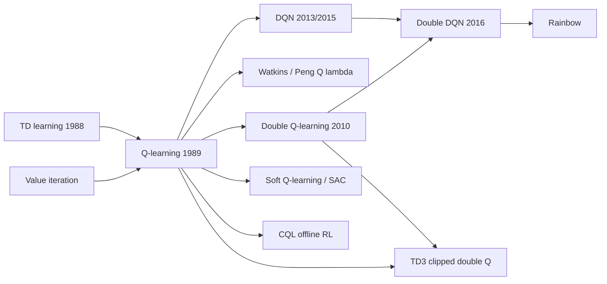

# Q-Learning (Q-learning, Double Q-learning)

> Off-policy TD control: learn the optimal action-value function $q_*$ directly with the target $R + \gamma \max_a Q(S',a)$, whatever exploratory policy generates the data. **Family:** Model-free → Value-based → Tabular → TD control (off-policy)  ·  **Year / origin:** Watkins (1989), PhD thesis *Learning from Delayed Rewards*, Cambridge; convergence proof by Watkins & Dayan (1992); Double Q-learning by van Hasselt (2010)  ·  **On/Off-policy:** off-policy  ·  **Action space:** discrete

---

## 1. What is it?

**Q-learning** learns $Q(s,a) \approx q_*(s,a)$, the expected return of taking action $a$ in state $s$ and acting optimally afterwards, from sampled transitions $(S, A, R, S')$:

$$
Q(S,A) \leftarrow Q(S,A) + \alpha\big[R + \gamma \max_{a'} Q(S',a') - Q(S,A)\big].
$$

It is a stochastic, sample-based version of **value iteration** (see [Dynamic Programming](dynamic-programming.md)). The key property is that it is **off-policy**:
- The target always assumes greedy behaviour from $S'$ onwards, regardless of which action the agent actually takes next.
- So the data can come from any sufficiently exploratory behaviour policy: ε-greedy, random, human demonstrations, or a replay buffer of old experience.
- The greedy policy $\arg\max_a Q(s,a)$ still converges to an optimal policy.

That decoupling of "how I act" from "what I learn about" made Q-learning the most influential RL algorithm of the 1990s. It is the direct ancestor of DQN (2013/2015), which brought deep RL to Atari.

**Double Q-learning** fixes Q-learning's systematic **overestimation**, the *maximization bias*. It keeps two estimators: one selects the argmax and the other evaluates it.

## 2. Family & lineage

- **Parents:** value iteration (Bellman), TD learning (Sutton, 1988), stochastic approximation.
- **Siblings:** [SARSA](sarsa.md) (on-policy), Expected SARSA (Q-learning is Expected SARSA with a greedy target), Watkins's Q(λ), Peng's Q(λ), Speedy Q-learning, delayed Q-learning (PAC-MDP).
- **Descendants:** DQN, Double DQN, Dueling DQN, prioritized replay, Rainbow, distributional RL (C51, QR-DQN), soft Q-learning / SAC, conservative Q-learning (CQL) for offline RL, and value-based LLM RL.



## 3. Core idea & intuition

- **Learn about the best policy while doing something else.** The update asks: "if I took $A$ in $S$ and landed in $S'$, and from then on acted *as well as I currently think is possible*, what would I get?" Since that question does not involve the behaviour policy, any data containing the transition $(S,A,R,S')$ is useful.
- **Sampled value iteration.** Value iteration computes $\max_a \mathbb{E}[R + \gamma V(S')]$ using the model. Q-learning keeps the max inside $Q$ and replaces the expectation over $S'$ with a running average over samples. The step size α does the averaging.
- **The cost of optimism: maximization bias.** $\max_a Q(S',a)$ picks whichever estimate is *highest*, and estimates are noisy. The highest noisy estimate tends to be an overestimate, *even if every individual estimate is unbiased*. In S&B Example 6.7, a state B has ten actions that all have true value −0.1. Their max estimate is positive early on, so Q-learning is lured into B far more often than the ε-greedy optimum.
- **Double Q-learning** breaks the coupling. Use $Q_1$ to pick the best action in $S'$ and $Q_2$ to *evaluate* it. Since $Q_2$'s noise is independent of $Q_1$'s choice, the estimate is no longer biased upward. If anything it is biased slightly low.
- **Cliff behaviour.** Q-learning learns the optimal greedy route even while exploring, but that route is risky to *execute* with exploration noise. That is the flip side of SARSA's safety (see [SARSA](sarsa.md)).

## 4. Math / formal details

**Symbols.** $Q(s,a)$: estimate of $q_*$; $\alpha_t(s,a)$: step size for the pair updated at step $t$; γ: discount; $b$: behaviour policy (any policy, e.g. ε-greedy); $q_*$: the unique fixed point of the Bellman optimality operator.

**Bellman optimality operator on Q:**
$$
(\mathcal{T}Q)(s,a) = \mathbb{E}\big[R_{t+1} + \gamma\max_{a'} Q(S_{t+1}, a') \,\big|\, S_t = s, A_t = a\big],
$$
a γ-contraction in $\|\cdot\|_\infty$ with fixed point $q_*$.

**Q-learning as stochastic approximation:**
$$
Q_{t+1}(S_t,A_t) = (1-\alpha_t) Q_t(S_t,A_t) + \alpha_t\big[\,(\mathcal{T}Q_t)(S_t,A_t) + \underbrace{w_t}_{\text{zero-mean noise}}\big],
$$
where $w_t = R_{t+1} + \gamma\max_{a'}Q_t(S_{t+1},a') - (\mathcal{T}Q_t)(S_t,A_t)$.

**Convergence theorem** (Watkins & Dayan, 1992; more general proofs by Jaakkola, Jordan & Singh, 1994 and Tsitsiklis, 1994). For a finite MDP, tabular $Q_t \to q_*$ with probability 1 if:
1. **Every state–action pair is updated infinitely often.** The behaviour policy must keep exploring; no particular policy is needed.
2. **Robbins–Monro step sizes per pair:** $\sum_t \alpha_t(s,a) = \infty$ and $\sum_t \alpha_t(s,a)^2 < \infty$, e.g. $\alpha = 1/N(s,a)^\omega$ with $\omega \in (1/2, 1]$.
3. **Bounded rewards** (bounded variance), and γ<1. For γ=1, all policies must be proper, i.e. reach a terminal state with probability 1.

The greedy policy then becomes optimal after finitely many steps. On rates: Even-Dar & Mansour (2003) showed that a linear step size $\alpha = 1/n$ can need a number of steps exponential in $1/(1-\gamma)$, whereas polynomial step sizes $1/n^\omega$ with $\omega\in(1/2,1)$ give polynomial bounds. That is why the code uses ω=0.7.

**Maximization bias.** For estimates $\hat Q(a) = q(a) + \epsilon_a$ with zero-mean noise, Jensen's inequality gives
$$
\mathbb{E}\big[\max_a \hat Q(a)\big] \;\ge\; \max_a \mathbb{E}[\hat Q(a)] = \max_a q(a),
$$
usually strictly. Through bootstrapping, the overestimate propagates backwards through states. (The same phenomenon appears in decision analysis as the "optimizer's curse", Smith & Winkler, 2006.)

**Double Q-learning** (van Hasselt, 2010). Two tables $Q^A$ and $Q^B$. On each step, with probability ½ update $Q^A$:
$$
a^* = \arg\max_{a} Q^A(S',a),\qquad
Q^A(S,A) \leftarrow Q^A(S,A) + \alpha\big[R + \gamma\, Q^B(S', a^*) - Q^A(S,A)\big],
$$
and otherwise do the same with A and B swapped. Act ε-greedily on $Q^A + Q^B$. Because $Q^B$ is estimated from different samples, $\mathbb{E}[Q^B(S',a^*)] = q(S',a^*) \le \max_a q(S',a)$. The bias is non-positive, and the method converges to $q_*$ under the same conditions. **Double DQN** (van Hasselt, Guez & Silver, 2016) uses the online network to select and the target network to evaluate. **TD3**'s clipped double Q takes the minimum of two critics.

## 5. Algorithm (pseudocode)

```text
Q-learning (off-policy TD control) for estimating pi ~ pi*
 1. Parameters: step sizes alpha (constant or 1/N(s,a)^omega), eps > 0
 2. Init Q(s,a) arbitrarily for all s, a;  Q(terminal, .) = 0
 3. for each episode:
 4.     S <- start state
 5.     repeat until S is terminal:
 6.         A <- action from behaviour policy (e.g. eps-greedy w.r.t. Q)
 7.         take A, observe R, S'
 8.         target <- R                       if S' terminal
 9.                   R + gamma * max_a Q(S',a)   otherwise
10.         Q(S,A) <- Q(S,A) + alpha * (target - Q(S,A))
11.         S <- S'

Double Q-learning
 1. Init Q1(s,a), Q2(s,a);  Q1(terminal,.) = Q2(terminal,.) = 0
 2. for each episode:  S <- start
 3.     repeat until S terminal:
 4.         A <- eps-greedy w.r.t. Q1(S,.) + Q2(S,.)
 5.         take A, observe R, S'
 6.         with probability 0.5:
 7.             a* <- argmax_a Q1(S',a)
 8.             Q1(S,A) <- Q1(S,A) + alpha [ R + gamma*Q2(S',a*) - Q1(S,A) ]
 9.         else:
10.             a* <- argmax_a Q2(S',a)
11.             Q2(S,A) <- Q2(S,A) + alpha [ R + gamma*Q1(S',a*) - Q2(S,A) ]
12.         S <- S'
```

## 6. Python implementation

Runnable version: [`code/q-learning.py`](../../code/q-learning.py)

The script has three experiments:
1. **Convergence to $q_*$.** On a slippery 4×4 grid (20% chance of moving sideways), Q-learning with a *uniformly random* behaviour policy and step sizes $1/N^{0.7}$ is compared against $q_*$ from value iteration. This illustrates the off-policy convergence theorem.
2. **Maximization bias** (S&B Example 6.7), Q-learning vs Double Q-learning, 1000 runs.
3. **Cliff Walking**, to show the risky-but-optimal greedy route.

It runs in about 15 seconds.

```python
"""
Q-learning and Double Q-learning (Watkins 1989; Watkins & Dayan 1992; van Hasselt 2010;
Sutton & Barto, 2nd ed., Sec. 6.5 & 6.7).

  1. Convergence demo: Q-learning with a uniformly random behaviour policy and
     Robbins-Monro step sizes recovers Q* (computed by value iteration) on a slippery grid.
  2. Maximization bias (S&B Example 6.7): Q-learning vs Double Q-learning.
  3. Greedy route Q-learning finds on CliffWalking.

Pure NumPy.   Run:  python3 code/q-learning.py
"""
import numpy as np

MOVES = [(-1, 0), (0, 1), (1, 0), (0, -1)]               # up, right, down, left


class SlipperyGrid:
    """4x4 grid, goal at bottom-right (terminal), -1 per step.  With probability `slip`
    the agent moves in a random perpendicular direction instead of the intended one."""

    def __init__(self, n=4, slip=0.2):
        self.n, self.slip = n, slip
        self.n_states, self.n_actions, self.goal = n * n, 4, n * n - 1

    def _move(self, s, a):
        r, c = divmod(s, self.n)
        nr, nc = r + MOVES[a][0], c + MOVES[a][1]
        return nr * self.n + nc if (0 <= nr < self.n and 0 <= nc < self.n) else s

    def step(self, s, a, rng):
        u = rng.random()
        if u < self.slip / 2:
            a = (a + 1) % 4
        elif u < self.slip:
            a = (a + 3) % 4
        s2 = self._move(s, a)
        return s2, -1.0, s2 == self.goal

    def q_star(self, gamma, iters=2000):
        """Model-based Q* by value iteration (used only to check Q-learning)."""
        Q = np.zeros((self.n_states, 4))
        for _ in range(iters):
            V = Q.max(1)
            V[self.goal] = 0.0
            for s in range(self.n_states):
                for a in range(4):
                    nxt = [(1 - self.slip, a), (self.slip / 2, (a + 1) % 4), (self.slip / 2, (a + 3) % 4)]
                    Q[s, a] = sum(p * (-1.0 + gamma * V[self._move(s, b)]) for p, b in nxt)
        Q[self.goal] = 0.0
        return Q


def q_learning_random_behaviour(env, steps, rng, gamma=0.9, omega=0.7):
    """Off-policy: behaviour is uniform random, target is greedy.
    Step size alpha = 1 / N(s,a)^omega, with 0.5 < omega <= 1 (Robbins-Monro)."""
    Q = np.zeros((env.n_states, env.n_actions))
    N = np.zeros_like(Q)
    s = int(rng.integers(env.n_states - 1))
    for _ in range(steps):
        a = int(rng.integers(env.n_actions))            # explore everything forever
        s2, r, done = env.step(s, a, rng)
        N[s, a] += 1
        alpha = 1.0 / N[s, a] ** omega
        target = r + (0.0 if done else gamma * Q[s2].max())
        Q[s, a] += alpha * (target - Q[s, a])
        s = int(rng.integers(env.n_states - 1)) if done else s2   # random restart
    return Q


# ----------------------------------------------------------------------------
# Maximization bias MDP (S&B Example 6.7)
# ----------------------------------------------------------------------------
A_STATE, B_STATE, TERMINAL = 0, 1, 2
LEFT, RIGHT = 0, 1
N_B_ACTIONS = 10


def mb_step(s, a, rng):
    if s == A_STATE:
        return (B_STATE, 0.0, False) if a == LEFT else (TERMINAL, 0.0, True)
    return TERMINAL, rng.normal(-0.1, 1.0), True        # every action in B: N(-0.1, 1)


def n_actions(s):
    return 2 if s == A_STATE else N_B_ACTIONS


def eps_greedy(q, eps, rng):
    if rng.random() < eps:
        return int(rng.integers(len(q)))
    return int(rng.choice(np.flatnonzero(q == q.max())))


def run_max_bias(double, episodes, rng, alpha=0.1, eps=0.1, gamma=1.0):
    """Returns a 0/1 array: did the agent go LEFT from A in each episode?"""
    Q1 = [np.zeros(2), np.zeros(N_B_ACTIONS)]
    Q2 = [np.zeros(2), np.zeros(N_B_ACTIONS)]
    went_left = np.zeros(episodes)
    for ep in range(episodes):
        s, done = A_STATE, False
        while not done:
            q_behave = Q1[s] + Q2[s] if double else Q1[s]   # Double Q acts on Q1 + Q2
            a = eps_greedy(q_behave, eps, rng)
            if s == A_STATE:
                went_left[ep] = (a == LEFT)
            s2, r, done = mb_step(s, a, rng)
            if not double:
                target = r + (0.0 if done else gamma * Q1[s2].max())
                Q1[s][a] += alpha * (target - Q1[s][a])
            else:
                # flip a coin: update one table, using the OTHER to evaluate its argmax
                QA, QB = (Q1, Q2) if rng.random() < 0.5 else (Q2, Q1)
                if done:
                    target = r
                else:
                    best = eps_greedy(QA[s2], 0.0, rng)  # argmax by QA (random ties)
                    target = r + gamma * QB[s2][best]    # ... evaluated by QB
                QA[s][a] += alpha * (target - QA[s][a])
            s = s2
    return went_left


# ----------------------------------------------------------------------------
# CliffWalking (same layout as S&B Example 6.6)
# ----------------------------------------------------------------------------
def cliff_step(s, a):
    r, c = divmod(s, 12)
    r = min(max(r + MOVES[a][0], 0), 3)
    c = min(max(c + MOVES[a][1], 0), 11)
    if r == 3 and 1 <= c <= 10:
        return 36, -100.0, False                       # back to start
    s2 = r * 12 + c
    return s2, -1.0, s2 == 47


def q_learning_cliff(episodes, rng, alpha=0.5, eps=0.1, gamma=1.0):
    Q = np.zeros((48, 4))
    for _ in range(episodes):
        s, done = 36, False
        while not done:
            a = eps_greedy(Q[s], eps, rng)
            s2, r, done = cliff_step(s, a)
            Q[s, a] += alpha * (r + (0.0 if done else gamma * Q[s2].max()) - Q[s, a])
            s = s2
    return Q


if __name__ == "__main__":
    # 1. convergence to Q*
    env, gamma = SlipperyGrid(), 0.9
    Qs = env.q_star(gamma)
    print("1) Q-learning (random behaviour, alpha=1/N^0.7) vs value-iteration Q*, slippery 4x4 grid")
    for steps in (10_000, 100_000, 400_000):
        Q = q_learning_random_behaviour(env, steps, np.random.default_rng(0), gamma)
        err = np.abs(Q - Qs).max()
        # greedy action is optimal if it attains max_a Q*(s,a) (the grid has many ties)
        a_greedy = Q[:-1].argmax(1)
        ok = Qs[np.arange(env.n_states - 1), a_greedy] >= Qs[:-1].max(1) - 1e-6
        print(f"   {steps:7d} steps: max |Q - Q*| = {err:.3f}, greedy action optimal in "
              f"{100 * ok.mean():.0f}% of states")

    # 2. maximization bias
    runs, episodes = 1000, 300
    print(f"\n2) Maximization bias (Example 6.7): % of episodes going LEFT from A ({runs} runs);"
          " optimal under eps=0.1 is 5%")
    left_q = np.mean([run_max_bias(False, episodes, np.random.default_rng(i)) for i in range(runs)], 0)
    left_dq = np.mean([run_max_bias(True, episodes, np.random.default_rng(i)) for i in range(runs)], 0)
    print(f"   {'episodes':>12s} {'Q-learning':>11s} {'Double Q':>9s}")
    for lo, hi in ((0, 10), (10, 25), (25, 50), (100, 150), (250, 300)):
        print(f"   {f'{lo + 1}-{hi}':>12s} {100 * left_q[lo:hi].mean():10.1f}% {100 * left_dq[lo:hi].mean():8.1f}%")

    # 3. cliff
    Q = q_learning_cliff(500, np.random.default_rng(0))
    s, path = 36, [36]
    while s != 47 and len(path) < 100:
        s, _, _ = cliff_step(s, int(np.argmax(Q[s])))
        path.append(s)
    print(f"\n3) CliffWalking: greedy Q-learning route has {len(path) - 1} steps "
          f"(optimal 13, runs along the cliff edge); Q(start) = {Q[36].max():.1f}")
```

Output:

```text
1) Q-learning (random behaviour, alpha=1/N^0.7) vs value-iteration Q*, slippery 4x4 grid
     10000 steps: max |Q - Q*| = 0.288, greedy action optimal in 87% of states
    100000 steps: max |Q - Q*| = 0.067, greedy action optimal in 93% of states
    400000 steps: max |Q - Q*| = 0.037, greedy action optimal in 100% of states

2) Maximization bias (Example 6.7): % of episodes going LEFT from A (1000 runs); optimal under eps=0.1 is 5%
       episodes  Q-learning  Double Q
           1-10       68.0%     48.0%
          11-25       92.5%     34.0%
          26-50       87.8%     18.3%
        101-150       33.6%      9.1%
        251-300       13.0%      7.0%

3) CliffWalking: greedy Q-learning route has 13 steps (optimal 13, runs along the cliff edge); Q(start) = -13.0
```

How to read it:
- **Experiment 1.** Even though the agent *never* acts greedily, its greedy policy becomes optimal and $Q \to q_*$. That is off-policy learning working as the theorem says.
- **Experiment 2.** Q-learning is drawn to the bad "left" branch by overestimated maxima and takes hundreds of episodes to recover. Double Q-learning approaches the 5% floor (pure ε-exploration) much faster.
- **Experiment 3.** Q-learning's greedy route is the 13-step optimal path along the cliff.

## 7. Practical tips & hyperparameters

| Hyperparameter | Typical (tabular) | Notes |
|---|---|---|
| α | 0.1–0.5 constant; or $1/N(s,a)^{\omega}$, ω≈0.6–0.8 | Constant α never fully converges in stochastic environments but tracks changes |
| ε | 0.1 → decay to 0.01 | Any behaviour works if it keeps visiting all pairs |
| γ | 0.9–0.99 | Higher γ means more bootstrapping and more overestimation |
| Q init | 0 or optimistic | Optimism encourages exploration; with a max target it also inflates early values |

- **Terminal states:** never bootstrap through them (target = R). Forgetting this is the most common bug.
- **Truncation vs termination:** if an episode is cut by a time limit, *do* bootstrap from $S'$. It is not a true terminal state.
- **Ties:** use random tie-breaking in `argmax` for action selection.
- **Overestimation symptoms:**
  - Q-values climbing above the maximum achievable return ($R_{\max}/(1-\gamma)$).
  - An agent preferring noisy actions.
  - Use Double Q-learning, or average several estimators.
- **Evaluation:** measure the *greedy* policy separately from the online ε-greedy return. Q-learning's online return can look bad (cliff!) while its greedy policy is optimal.
- **Learning from fixed data:** tabular Q-learning can learn from replay or logs, but with function approximation and no new data it overestimates actions the data never contains. Offline RL (CQL, IQL) exists to handle that.
- **Deadly triad:** off-policy + bootstrapping + function approximation can diverge. DQN uses target networks and replay to tame it.

## 8. Pros and cons

**Pros**
- Off-policy: learns $q_*$ from any exploratory data, including replay buffers, demonstrations and other agents.
- Simple update with strong tabular convergence guarantees.
- Directly targets the optimal policy, not the ε-soft optimum.
- Scales to deep RL (DQN family) with well-known stabilizers.

**Cons**
- Maximization bias / overestimation (fixed by Double Q).
- Online performance can be poor where exploration is dangerous (cliff).
- Can diverge with function approximation (deadly triad).
- Discrete actions only (the max over continuous actions needs an actor, as in DDPG/SAC).
- One-step backups propagate reward slowly in sparse tasks (n-step or Dyna help).

## 9. When to use / when not to use

**Use when:**
- Actions are discrete and you can explore freely, in a simulator or game.
- You want to reuse past experience (replay) or learn from data generated by other policies.
- You need the optimal greedy policy, and online safety during learning is not critical.

**Do not use when:**
- Exploration mistakes are costly. [SARSA](sarsa.md) or Expected SARSA are safer online.
- Actions are continuous. Use DDPG, TD3 or SAC.
- You only have a fixed dataset with function approximation. Use offline RL methods (CQL, IQL).
- Rewards are very noisy relative to the gaps between actions. Use Double Q-learning at least.

## 10. Key papers, books & repos

- Watkins, C. J. C. H. (1989). *Learning from Delayed Rewards*. PhD thesis, King's College, Cambridge.
- Watkins, C. J. C. H. & Dayan, P. (1992). "Q-learning." *Machine Learning* 8:279–292. (convergence proof)
- Jaakkola, T., Jordan, M. I. & Singh, S. P. (1994). "On the convergence of stochastic iterative dynamic programming algorithms." *Neural Computation* 6.
- Tsitsiklis, J. N. (1994). "Asynchronous stochastic approximation and Q-learning." *Machine Learning* 16.
- Even-Dar, E. & Mansour, Y. (2003). "Learning rates for Q-learning." *JMLR* 5.
- van Hasselt, H. (2010). "Double Q-learning." *NeurIPS 23*.
- van Hasselt, H., Guez, A. & Silver, D. (2016). "Deep reinforcement learning with double Q-learning." *AAAI*; arXiv:1509.06461.
- Mnih, V. et al. (2015). "Human-level control through deep reinforcement learning." *Nature* 518. (DQN)
- Thrun, S. & Schwartz, A. (1993). "Issues in using function approximation for reinforcement learning." *Proc. Connectionist Models Summer School*. (early analysis of overestimation)
- Sutton & Barto, *Reinforcement Learning: An Introduction*, 2nd ed., 2018. **Sec. 6.5** (Q-learning), **6.7** (maximization bias & Double Q-learning, Example 6.7), Example 6.6 (Cliff Walking), **Sec. 12.10** (Watkins's Q(λ)), **Ch. 11** (deadly triad).
- Repos: [`ShangtongZhang/reinforcement-learning-an-introduction`](https://github.com/ShangtongZhang/reinforcement-learning-an-introduction) (Ch. 6 cliff walking and maximization bias); [`vwxyzjn/cleanrl`](https://github.com/vwxyzjn/cleanrl) and [`DLR-RM/stable-baselines3`](https://github.com/DLR-RM/stable-baselines3) (DQN-family implementations).

## 11. For business users

**What it does.** Q-learning builds a scorecard that rates every possible action in every situation by how much long-term payoff it leads to, *assuming you act smartly afterwards*. It can learn this scorecard from any record of actions and results, not just from following its own current strategy.

**Analogy.** A chess coach reviews thousands of recorded games, including amateur ones full of mistakes, and still works out which move is best in each position. The coach does not need the players to have played well. Each move is judged by "what would have happened if we had played perfectly from here on?". Q-learning works the same way.

**Real-world use cases.**
- Game-playing AI (its deep version, DQN, learned many Atari games from pixels).
- Resource allocation and scheduling in simulation.
- Recommendation and ad sequencing with discrete choices.
- Network routing and congestion control (an early application, "Q-routing").
- Learning from logged operational data (with care).

**Value / ROI.** Reuses historical and simulated data, aims straight for the best strategy, and its scorecard is easy to inspect for small problems.

**Risks.**
- It can be over-optimistic about uncertain options (fixed by Double Q-learning).
- It may choose high-reward-but-risky strategies.
- Learning from old data alone, without the ability to test, can mislead it badly.

**Costs.** Small problems are cheap. Large problems need deep-learning infrastructure (GPUs, simulators).

**Questions to ask your team.**
1. Are our actions a small discrete set?
2. Can we explore safely, in simulation or live?
3. How do we guard against overestimated values (Double Q, validation)?
4. Are we evaluating the final greedy strategy separately from the exploring one?

## 12. For kids (ages ~8–12)

**The sticker chart for moves.** Imagine a video game with many rooms. In each room you can go up, down, left or right. You keep a chart: for each room and each direction you write a score that means "how good things turn out if I go this way and then play really well".

After every move you look at the room you land in, find its *best* score, and update the chart: "Going right from the kitchen was worth the coin I got plus the best score of the hallway." Even when you press random buttons just to explore, the chart keeps getting better at saying what the *best* moves are!

Watch out, though: if you're too excited about scores you're not sure of, you may think a room is better than it really is. Using two charts that check each other (Double Q) keeps you honest.

**Try it yourself.** Draw 4 rooms in a row, with a treasure in the last one. Make a chart with "left" and "right" for each room, all starting at 0. Walk around (flip a coin for direction), and every time you move, update: new score = reward + best score in the next room. After a few walks, does "right" have the higher score everywhere?

**Recap:**
1. Keep a score for every move in every room.
2. Update it with the reward plus the next room's best score.
3. You can learn the best moves even while exploring randomly.

## 13. Related methods

- [SARSA](sarsa.md): the on-policy sibling (safer online, ε-soft optimum).
- [TD learning](td-learning.md): the prediction foundation (n-step, eligibility traces).
- [Dynamic Programming](dynamic-programming.md): value iteration, which Q-learning samples.
- [Dyna-Q](dyna-q.md): Q-learning plus planning with a learned model.
- [Monte Carlo methods](monte-carlo.md): off-policy learning via importance sampling instead.
- [Multi-armed bandits](multi-armed-bandits.md): the single-state case; exploration strategies.
- [DQN](../02-deep-value-based/dqn.md), [Rainbow](../02-deep-value-based/rainbow-dqn.md), [Distributional RL](../02-deep-value-based/distributional-rl.md): deep descendants.
- [TD3](../04-off-policy-actor-critic/td3.md) (clipped double Q), [SAC](../04-off-policy-actor-critic/sac.md) (soft Q-learning).
- [CQL](../06-offline-rl/cql.md), [IQL](../06-offline-rl/iql.md): Q-learning for fixed datasets.
- [Value-based LLM RL (VAPO)](../10-llm-reasoning-rl/value-based-llm-rl-vapo.md).

[← Back to overview](../../RL_Methods_Overview.md)
