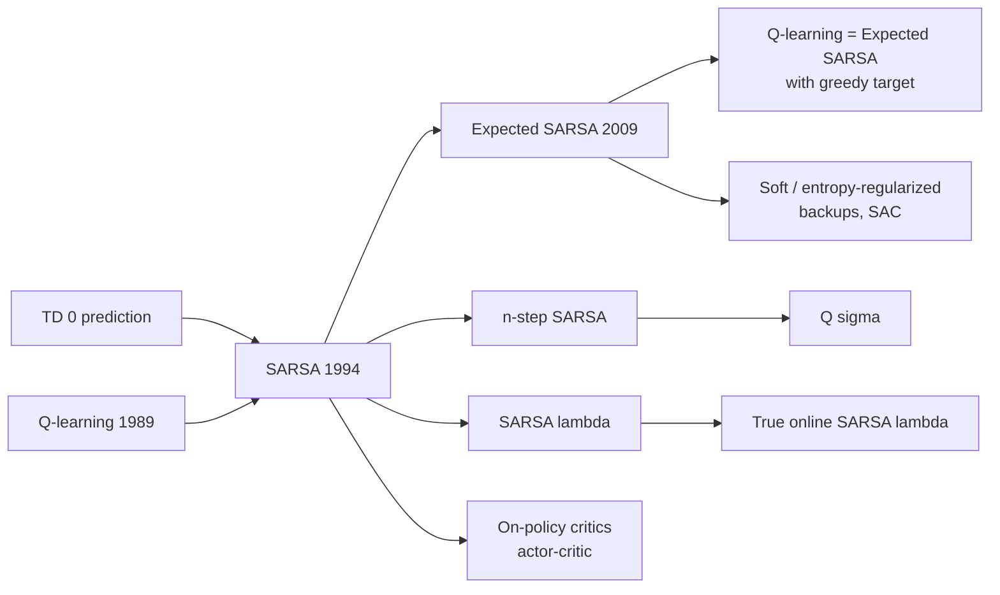

# SARSA (SARSA, Expected SARSA, n-step SARSA, SARSA(λ))

> On-policy TD control: learn $Q(s,a)$ for the policy you are actually following, using the quintuple $(S_t, A_t, R_{t+1}, S_{t+1}, A_{t+1})$. Safe, stable and exploration-aware. **Family:** Model-free → Value-based → Tabular → TD control (on-policy)  ·  **Year / origin:** Rummery & Niranjan (1994), "On-line Q-learning using connectionist systems" (Cambridge tech. report, called "Modified Connectionist Q-Learning"); the name SARSA comes from Sutton (1996). Expected SARSA: van Seijen, van Hasselt, Whiteson & Wiering (2009)  ·  **On/Off-policy:** on-policy (Expected SARSA can be used off-policy)  ·  **Action space:** discrete

---

## 1. What is it?

**SARSA** turns [TD prediction](td-learning.md) into a control algorithm. It learns action values $Q(s,a) \approx q_\pi(s,a)$ for the current policy π, typically ε-greedy with respect to $Q$, and improves π as $Q$ changes. The update uses the action the agent *will actually take next*:

$$
Q(S_t, A_t) \leftarrow Q(S_t, A_t) + \alpha\big[R_{t+1} + \gamma Q(S_{t+1}, A_{t+1}) - Q(S_t, A_t)\big].
$$

The name lists the five quantities involved: **S**tate, **A**ction, **R**eward, next **S**tate, next **A**ction.

Because it evaluates the policy it follows, *including its exploration*, SARSA learns a policy that is good **given that it will sometimes act randomly**. In the famous **Cliff Walking** task, Q-learning learns the shortest path along the cliff edge and keeps falling off during training because of ε-exploration. SARSA learns a safer path one row further away and earns more reward online. This is the defining practical difference between on-policy and off-policy TD control.

Variants:
- **Expected SARSA** replaces the sampled $Q(S_{t+1}, A_{t+1})$ with its expectation under π. That removes the variance from sampling $A_{t+1}$, allows larger step sizes, and with a greedy π becomes Q-learning.
- **n-step SARSA** uses n real rewards before bootstrapping.
- **SARSA(λ)** uses eligibility traces over state–action pairs.

## 2. Family & lineage

- **Parents:** TD(0) prediction (Sutton, 1988), generalized policy iteration, Q-learning (Watkins, 1989). SARSA was introduced as a "modified" on-policy Q-learning.
- **Siblings:** [Q-learning](q-learning.md) (off-policy), Expected SARSA, n-step Tree Backup, Q(σ) (which unifies SARSA and Tree Backup).
- **Descendants:** SARSA with linear function approximation and tile coding (S&B Ch. 10, Mountain Car), true online SARSA(λ), the on-policy critics in actor-critic methods, deep SARSA variants. Expected SARSA ideas show up in soft/entropy-regularized backups (soft Q-learning, SAC's expectation over the policy).



## 3. Core idea & intuition

- **GPI with TD:** evaluate the current policy's $Q$ with one-step TD updates, and improve the policy implicitly by acting ε-greedily on the latest $Q$. Policy evaluation and improvement happen at every single step.
- **On-policy = honest about exploration.** The target $Q(S', A')$ uses the action the ε-greedy policy actually picks. If that policy sometimes stumbles into the cliff, the values of cliff-adjacent states are pulled down, so the learned route stays away from the edge. Q-learning's target $\max_a Q(S',a)$ assumes the agent will act perfectly from the next step on, which is optimistic about a policy that still explores.
- **Expected SARSA** asks "what is the *average* value of the next state under my policy?" instead of "what is the value of the one action I happened to sample?". The answer is the same in expectation with less noise, so it is almost always at least as good as SARSA, at a cost of $O(|\mathcal{A}|)$ per step.
- **n-step SARSA and SARSA(λ)** spread credit for a reward over the last several state–action pairs, not just the most recent one. Learning then speeds up dramatically in sparse-reward tasks: one trip to the goal updates the whole path, not just the last step (S&B Fig. 7.4).

## 4. Math / formal details

**Symbols.** $Q(s,a)$: action-value estimate; α: step size; γ: discount; ε: exploration rate; π: ε-greedy policy with respect to $Q$, so $\pi(a\mid s) = \varepsilon/|\mathcal{A}| + (1-\varepsilon)\,\mathbb{1}[a = \arg\max_b Q(s,b)]$, with ties split.

**SARSA target:** $Y_t = R_{t+1} + \gamma Q(S_{t+1}, A_{t+1})$, with $A_{t+1} \sim \pi(\cdot\mid S_{t+1})$ and $Q(\text{terminal},\cdot) = 0$.

**Expected SARSA target:**
$$
Y_t = R_{t+1} + \gamma \sum_a \pi(a\mid S_{t+1})\, Q(S_{t+1}, a).
$$
If π is greedy, this is Q-learning's target $R_{t+1} + \gamma\max_a Q(S_{t+1},a)$. With an arbitrary target policy π and any behaviour policy, Expected SARSA is an off-policy method that needs no importance sampling for the one-step case.

**n-step SARSA return:**
$$
G_{t:t+n} = \sum_{i=1}^{n} \gamma^{i-1} R_{t+i} + \gamma^n Q(S_{t+n}, A_{t+n}),\qquad
Q(S_t,A_t) \leftarrow Q(S_t,A_t) + \alpha[G_{t:t+n} - Q(S_t,A_t)],
$$
truncated to the MC return if the episode ends before $t+n$. (n-step Expected SARSA replaces the last term with $\gamma^n \bar V(S_{t+n})$, where $\bar V(s) = \sum_a \pi(a\mid s) Q(s,a)$.)

**SARSA(λ)** keeps traces $z(s,a)$:
$$
\delta_t = R_{t+1} + \gamma Q(S_{t+1},A_{t+1}) - Q(S_t,A_t),
$$
$$
z(s,a) \leftarrow \gamma\lambda z(s,a) + \mathbb{1}[(s,a)=(S_t,A_t)]\;\;(\text{accumulating; replacing sets } z(S_t,A_t) = 1),
$$
$$
Q(s,a) \leftarrow Q(s,a) + \alpha\,\delta_t\, z(s,a)\quad \forall (s,a).
$$
The forward-view target is the λ-return over n-step SARSA returns.

**Convergence** (Singh, Jaakkola, Littman & Szepesvári, 2000). One-step tabular SARSA converges with probability 1 to $q_*$ and an optimal policy if:
1. every state–action pair is visited infinitely often;
2. the step sizes satisfy Robbins–Monro ($\sum_t \alpha_t(s,a) = \infty$, $\sum_t \alpha_t^2(s,a) < \infty$);
3. the policy is **GLIE**, *Greedy in the Limit with Infinite Exploration*, for example ε-greedy with $\varepsilon_t = 1/t$.

With a fixed ε, SARSA converges to the best **ε-soft** policy instead. On Cliff Walking that is the safe path, which is exactly the behaviour you want while ε is still positive.

**Variance comparison.** With the same α, the SARSA target has extra variance $\gamma^2\,\mathrm{Var}_{A'\sim\pi}[Q(S',A')]$ compared with Expected SARSA. That is why Expected SARSA tolerates α=1 in deterministic environments like Cliff Walking (van Seijen et al., 2009; S&B Fig. 6.3).

## 5. Algorithm (pseudocode)

```text
SARSA (on-policy TD control) for estimating Q ~ q*
 1. Parameters: alpha in (0,1], small eps > 0.  Init Q(s,a) arbitrarily; Q(terminal,.) = 0
 2. for each episode:
 3.     S <- start;  A <- eps-greedy(Q, S)
 4.     repeat until S terminal:
 5.         take A, observe R, S'
 6.         A' <- eps-greedy(Q, S')
 7.         Q(S,A) <- Q(S,A) + alpha * [ R + gamma*Q(S',A') - Q(S,A) ]
 8.         S <- S';  A <- A'

Expected SARSA: line 7 uses  R + gamma * sum_a pi(a|S') Q(S',a)   (A' only used to act)

n-step SARSA
 1. for each episode: S_0 <- start; A_0 <- eps-greedy(Q,S_0); T <- inf
 2. for t = 0,1,2,...:
 3.     if t < T: take A_t, observe R_{t+1}, S_{t+1}
 4.          if S_{t+1} terminal: T <- t+1   else: A_{t+1} <- eps-greedy(Q, S_{t+1})
 5.     tau <- t - n + 1
 6.     if tau >= 0:
 7.         G <- sum_{i=tau+1}^{min(tau+n,T)} gamma^{i-tau-1} R_i
 8.         if tau + n < T: G <- G + gamma^n Q(S_{tau+n}, A_{tau+n})
 9.         Q(S_tau,A_tau) <- Q(S_tau,A_tau) + alpha [G - Q(S_tau,A_tau)]
10.     until tau = T-1

SARSA(lambda), backward view
 1. for each episode: z <- 0; S <- start; A <- eps-greedy(Q,S)
 2.     repeat until S terminal:
 3.         take A, observe R, S';  A' <- eps-greedy(Q,S')
 4.         delta <- R + gamma*Q(S',A') - Q(S,A)        (Q(terminal,.) = 0)
 5.         z(S,A) <- 1          (replacing)   or  z(S,A) += 1  (accumulating)
 6.         Q <- Q + alpha*delta*z ;   z <- gamma*lambda*z
 7.         S <- S';  A <- A'
```

## 6. Python implementation

Runnable version: [`code/sarsa.py`](../../code/sarsa.py)

The environment is **Cliff Walking**, a 4×12 grid (S&B Example 6.6). Every step costs −1, stepping into the cliff costs −100 and sends you back to the start, and the episode ends at the goal. The script trains every SARSA variant, plus Q-learning as the reference, for 500 episodes × 20 seeds with ε=0.1. It reports the average **online** return (what the agent earned while learning, including exploration) and draws the greedy route each method ends up with. It runs in about 20 seconds.

```python
"""
SARSA-family control on CliffWalking (Sutton & Barto, 2nd ed., Example 6.6; Ch. 7, 12).

  * SARSA (one-step, on-policy TD control)
  * Expected SARSA
  * n-step SARSA
  * SARSA(lambda) with replacing eligibility traces
  * Q-learning, included only as the classic comparison

Pure NumPy.   Run:  python3 code/sarsa.py
"""
import numpy as np


class CliffWalking:
    """4 x 12 grid.  Start bottom-left, goal bottom-right, the cells between are a cliff.
    Every step costs -1; stepping into the cliff costs -100 and teleports you to start."""
    rows, cols = 4, 12
    n_states, n_actions = rows * cols, 4
    start, goal = 3 * 12 + 0, 3 * 12 + 11
    moves = [(-1, 0), (0, 1), (1, 0), (0, -1)]          # up, right, down, left

    def step(self, s, a):
        r, c = divmod(s, self.cols)
        r = min(max(r + self.moves[a][0], 0), self.rows - 1)
        c = min(max(c + self.moves[a][1], 0), self.cols - 1)
        s2 = r * self.cols + c
        if r == 3 and 1 <= c <= 10:                     # fell off the cliff
            return self.start, -100.0, False
        return s2, -1.0, s2 == self.goal


def eps_greedy(Q, s, eps, rng):
    if rng.random() < eps:
        return int(rng.integers(Q.shape[1]))
    q = Q[s]
    return int(rng.choice(np.flatnonzero(q == q.max())))   # random tie-breaking


def eps_greedy_probs(Q, s, eps):
    """pi(.|s) for an eps-greedy policy (needed by Expected SARSA)."""
    nA = Q.shape[1]
    greedy = np.flatnonzero(Q[s] == Q[s].max())
    p = np.full(nA, eps / nA)
    p[greedy] += (1 - eps) / len(greedy)
    return p


def sarsa(env, episodes, rng, alpha=0.5, eps=0.1, gamma=1.0, expected=False):
    """expected=False: target R + g Q(S',A').   expected=True: R + g sum_a pi(a|S') Q(S',a)."""
    Q = np.zeros((env.n_states, env.n_actions))
    returns = []
    for _ in range(episodes):
        s, G, done = env.start, 0.0, False
        a = eps_greedy(Q, s, eps, rng)
        while not done:
            s2, r, done = env.step(s, a)
            G += r
            a2 = eps_greedy(Q, s2, eps, rng)
            if done:
                target = r                              # Q(terminal, .) = 0
            elif expected:
                target = r + gamma * eps_greedy_probs(Q, s2, eps) @ Q[s2]
            else:
                target = r + gamma * Q[s2, a2]
            Q[s, a] += alpha * (target - Q[s, a])
            s, a = s2, a2
        returns.append(G)
    return Q, np.array(returns)


def q_learning(env, episodes, rng, alpha=0.5, eps=0.1, gamma=1.0):
    Q = np.zeros((env.n_states, env.n_actions))
    returns = []
    for _ in range(episodes):
        s, G, done = env.start, 0.0, False
        while not done:
            a = eps_greedy(Q, s, eps, rng)
            s2, r, done = env.step(s, a)
            G += r
            target = r if done else r + gamma * Q[s2].max()   # off-policy: greedy target
            Q[s, a] += alpha * (target - Q[s, a])
            s = s2
        returns.append(G)
    return Q, np.array(returns)


def n_step_sarsa(env, episodes, rng, n=4, alpha=0.2, eps=0.1, gamma=1.0):
    """S&B Sec. 7.2.  Stores the last n+1 states/actions/rewards of the episode."""
    Q = np.zeros((env.n_states, env.n_actions))
    returns = []
    for _ in range(episodes):
        S, A, R = [env.start], [eps_greedy(Q, env.start, eps, rng)], [0.0]  # R[0] unused
        T, t = np.inf, 0
        while True:
            if t < T:
                s2, r, done = env.step(S[t], A[t])
                S.append(s2)
                R.append(r)
                if done:
                    T = t + 1
                else:
                    A.append(eps_greedy(Q, s2, eps, rng))
            tau = t - n + 1                             # time whose estimate is updated
            if tau >= 0:
                G = sum(gamma ** (i - tau - 1) * R[i] for i in range(tau + 1, int(min(tau + n, T)) + 1))
                if tau + n < T:
                    G += gamma ** n * Q[S[tau + n], A[tau + n]]
                Q[S[tau], A[tau]] += alpha * (G - Q[S[tau], A[tau]])
            if tau == T - 1:
                break
            t += 1
        returns.append(sum(R))
    return Q, np.array(returns)


def sarsa_lambda(env, episodes, rng, lam=0.5, alpha=0.2, eps=0.1, gamma=1.0):
    """Backward-view SARSA(lambda) with replacing traces (S&B Sec. 12.7)."""
    Q = np.zeros((env.n_states, env.n_actions))
    returns = []
    for _ in range(episodes):
        z = np.zeros_like(Q)                            # one trace per (s, a)
        s, G, done = env.start, 0.0, False
        a = eps_greedy(Q, s, eps, rng)
        while not done:
            s2, r, done = env.step(s, a)
            G += r
            a2 = eps_greedy(Q, s2, eps, rng)
            delta = r - Q[s, a] + (0.0 if done else gamma * Q[s2, a2])
            z[s, a] = 1.0                               # replacing trace
            Q += alpha * delta * z                      # update every eligible pair
            z *= gamma * lam
            s, a = s2, a2
        returns.append(G)
    return Q, np.array(returns)


def greedy_path(env, Q, max_steps=100):
    """Render the greedy route from start ('o' = path, 'C' = cliff)."""
    grid = [["." for _ in range(env.cols)] for _ in range(env.rows)]
    for c in range(1, 11):
        grid[3][c] = "C"
    s, steps = env.start, 0
    while s != env.goal and steps < max_steps:
        r, c = divmod(s, env.cols)
        grid[r][c] = "o"
        s, _, _ = env.step(s, int(np.argmax(Q[s])))
        steps += 1
    grid[3][11] = "G"
    return steps, "\n".join("      " + "".join(row) for row in grid)


if __name__ == "__main__":
    env = CliffWalking()
    runs, episodes = 20, 500
    algos = {
        "SARSA            a=0.5": lambda rng: sarsa(env, episodes, rng, alpha=0.5),
        "Expected SARSA   a=0.5": lambda rng: sarsa(env, episodes, rng, alpha=0.5, expected=True),
        "Expected SARSA   a=1.0": lambda rng: sarsa(env, episodes, rng, alpha=1.0, expected=True),
        "4-step SARSA     a=0.2": lambda rng: n_step_sarsa(env, episodes, rng, n=4, alpha=0.2),
        "SARSA(0.5)       a=0.2": lambda rng: sarsa_lambda(env, episodes, rng, lam=0.5, alpha=0.2),
        "Q-learning       a=0.5": lambda rng: q_learning(env, episodes, rng, alpha=0.5),
    }
    print(f"CliffWalking, eps=0.1, {runs} runs x {episodes} episodes")
    print(f"   {'algorithm':24s} {'online return (eps 1-100)':>26s} {'(eps 101-500)':>14s} {'greedy steps':>13s}")
    final_Q = {}
    for name, fn in algos.items():
        results = [fn(np.random.default_rng(seed)) for seed in range(runs)]
        R = np.mean([r for _, r in results], axis=0)
        steps, _ = greedy_path(env, results[0][0])
        final_Q[name] = results[0][0]
        print(f"   {name:24s} {R[:100].mean():26.1f} {R[100:].mean():14.1f} {steps:13d}")

    for name in ("SARSA            a=0.5", "Q-learning       a=0.5"):
        steps, pic = greedy_path(env, final_Q[name])
        print(f"\n   Greedy route learned by {name.split()[0]} ({steps} steps):\n{pic}")
```

Output:

```text
CliffWalking, eps=0.1, 20 runs x 500 episodes
   algorithm                 online return (eps 1-100)  (eps 101-500)  greedy steps
   SARSA            a=0.5                        -69.7          -27.7            17
   Expected SARSA   a=0.5                        -56.9          -21.0            15
   Expected SARSA   a=1.0                        -45.1          -20.7            15
   4-step SARSA     a=0.2                        -74.0          -26.8            17
   SARSA(0.5)       a=0.2                        -72.5          -23.6            17
   Q-learning       a=0.5                        -82.3          -49.7            13

   Greedy route learned by SARSA (17 steps):
      ooooooooooo.
      o.........oo
      o..........o
      oCCCCCCCCCCG

   Greedy route learned by Q-learning (13 steps):
      ............
      ............
      oooooooooooo
      oCCCCCCCCCCG
```

This reproduces S&B Example 6.6 / Fig. 6.3 qualitatively.
- **Q-learning** finds the *optimal* 13-step route along the edge but earns about −50 per episode online, because ε-exploration keeps throwing it off the cliff.
- **The SARSA variants** learn safer, longer routes and earn −21 to −28.
- **Expected SARSA** is best, and it remains stable even with α = 1.

## 7. Practical tips & hyperparameters

| Hyperparameter | Typical (tabular) | Notes |
|---|---|---|
| α | 0.1–0.5 (SARSA), up to 1.0 (Expected SARSA, deterministic env) | Lower for stochastic rewards; n-step and λ need lower α |
| ε | 0.05–0.1, or decay to 0 (GLIE) | Fixed ε yields the best ε-soft policy, not $\pi_*$ |
| γ | 0.9–1.0 | γ=1 fine for episodic tasks with step costs |
| n | 2–8 | Larger n: faster credit propagation, more variance |
| λ | 0.5–0.9 | Replacing traces are more robust than accumulating |
| Q init | 0, or optimistic | Optimistic init drives early exploration (S&B Sec. 2.6) |

- **Choose A′ before updating and use that same A′ for the next step.** Re-sampling the action after the update makes the algorithm subtly inconsistent.
- **Terminal handling:** the target at a terminal transition is just $R$. Never bootstrap from a terminal state.
- **Break ties randomly** in ε-greedy. With all-zero initial Q, `argmax` otherwise always picks action 0.
- **Expected SARSA** is usually the better default: same online safety, lower variance, larger usable α.
- **SARSA(λ):** reset traces each episode. Vectorize the update (`Q += alpha*delta*z`) or track only active traces.
- **Debugging signals:**
  - Online return per episode should rise and plateau.
  - Episode length should fall.
  - Inspect the greedy route. If it hugs danger, you may be measuring the greedy policy while acting ε-greedily, or using Q-learning by mistake.
- **To get $\pi_*$ eventually,** decay ε (GLIE). The SARSA route then moves toward the edge as exploration disappears.

## 8. Pros and cons

**Pros**
- Simple, stable, and convergent (tabular, GLIE).
- Accounts for exploration, so it is safer online. Good when mistakes during learning are costly.
- With linear function approximation, on-policy SARSA is better behaved than off-policy Q-learning, which can diverge. SARSA can still chatter (S&B Ch. 10–11).
- Expected SARSA: lower variance; tolerates α=1; generalizes Q-learning.
- n-step / λ variants speed credit assignment in sparse-reward tasks.

**Cons**
- On-policy: cannot learn from replayed old data or other agents' data (except Expected SARSA with care).
- With fixed ε it converges to the ε-soft optimum, which can be suboptimal for the greedy policy.
- Plain SARSA's sampled target is noisier than Expected SARSA or Q-learning.
- Tabular only in this form; large state spaces need function approximation.

## 9. When to use / when not to use

**Use when:**
- The agent learns *while operating* and exploration mistakes are costly: robotics, live systems, any "cliff" in the task.
- You want stable on-policy learning with function approximation.
- As a teaching baseline for TD control.

**Do not use when:**
- You must learn from logged or replayed data or from demonstrations. Use off-policy methods ([Q-learning](q-learning.md), DQN, offline RL).
- You only care about the final greedy policy and exploration is free, as in a simulator. [Q-learning](q-learning.md) goes directly for $q_*$.
- Actions are continuous. Use actor-critic methods (DDPG, SAC, PPO).

## 10. Key papers, books & repos

- Sutton & Barto, *Reinforcement Learning: An Introduction*, 2nd ed., 2018. **Sec. 6.4** (SARSA), **6.6** (Expected SARSA), Example 6.6 (Cliff Walking), **Sec. 7.2** (n-step SARSA), **Sec. 12.7** (SARSA(λ)), **Sec. 10.1–10.2** (episodic semi-gradient SARSA, Mountain Car).
- Rummery, G. A. & Niranjan, M. (1994). "On-line Q-learning using connectionist systems." Tech. Report CUED/F-INFENG/TR 166, Cambridge University Engineering Department.
- Sutton, R. S. (1996). "Generalization in reinforcement learning: Successful examples using sparse coarse coding." *NeurIPS 8*. (introduced the name SARSA)
- Singh, S., Jaakkola, T., Littman, M. L. & Szepesvári, C. (2000). "Convergence results for single-step on-policy reinforcement-learning algorithms." *Machine Learning* 38.
- van Seijen, H., van Hasselt, H., Whiteson, S. & Wiering, M. (2009). "A theoretical and empirical analysis of Expected Sarsa." *IEEE ADPRL*.
- van Seijen, H., Mahmood, A. R., Pilarski, P. M., Machado, M. C. & Sutton, R. S. (2016). "True online temporal-difference learning." *JMLR* 17. (true online SARSA(λ))
- De Asis, K., Hernandez-Garcia, J. F., Holland, G. Z. & Sutton, R. S. (2018). "Multi-step reinforcement learning: A unifying algorithm." *AAAI*. (Q(σ))
- Repos: [`ShangtongZhang/reinforcement-learning-an-introduction`](https://github.com/ShangtongZhang/reinforcement-learning-an-introduction) (cliff walking, windy gridworld, Mountain Car with SARSA(λ)).

## 11. For business users

**What it does.** SARSA is a trial-and-error learning method that learns *how good each action is, given how the system actually behaves*, including the occasional experiments it runs to keep learning. As a result it picks strategies that stay safe even while it is still exploring.

**Analogy.** Two trainee delivery drivers learn a city. One (Q-learning) works out the theoretically fastest route, which runs along a narrow cliff road. But trainees sometimes take wrong turns, and on that road a wrong turn is a disaster. The other (SARSA) knows it still makes occasional mistakes and picks a slightly longer route on wide roads. During training the second driver has far fewer accidents.

**Real-world use cases.**
- Robots or machines learning on real hardware, where exploration errors cause damage.
- Online control of live systems (HVAC, traffic lights, network routing) during learning.
- Game AI and simulations where the deployed policy will keep some randomness.

**Value / ROI.** Fewer costly mistakes while the system learns. Policies are robust to imperfect execution. The method is simple and well understood.

**Risks.** Slightly conservative policies; learning only from its own current behaviour, so it cannot reuse historical logs easily. It needs a sensible exploration schedule.

**Costs.** Low compute. The main costs are the environment interaction (real-world trial time) and safety monitoring.

**Questions to ask your team.**
1. How costly are mistakes made *during* learning?
2. Will the deployed system keep exploring, or act greedily?
3. Do we need to learn from historical data? If so, consider off-policy methods.
4. How is exploration reduced over time, and how do we monitor safety?

## 12. For kids (ages ~8–12)

**The careful explorer.** You're walking along a path next to a muddy pond to get to an ice-cream truck. The shortest way is right along the edge of the pond. But sometimes you get distracted by a butterfly and take a random step. If you're on the edge, *splash!* You're muddy and have to go back home to change.

A careful explorer thinks: "I know I get distracted sometimes, so I'll walk a little further from the water." It takes a few more steps, but you almost never fall in. That's SARSA: it learns the best path *for someone who sometimes gets distracted*.

**Try it yourself.** Draw a grid with a "pond" row along the bottom and the ice-cream truck in the corner. Roll a die before every step: if you roll a 1, you must step in a random direction (roll again: 1–2 up, 3–4 down, 5 left, 6 right). Try the edge path 5 times and the "one row up" path 5 times. Which gets you to ice cream with fewer splashes?

**Recap:**
1. Learn from what you *actually* do next.
2. Remember you sometimes make random moves.
3. Choose paths that are safe even with mistakes.

## 13. Related methods

- [TD learning](td-learning.md): the prediction method SARSA builds on (n-step, λ, traces).
- [Q-learning](q-learning.md): the off-policy sibling; same update with a max target.
- [Monte Carlo methods](monte-carlo.md): on-policy ε-soft MC control without bootstrapping.
- [Dynamic Programming](dynamic-programming.md): GPI with a model.
- [Dyna-Q](dyna-q.md): adds planning on a learned model.
- [Multi-armed bandits](multi-armed-bandits.md): ε-greedy and optimistic initialization.
- [DQN](../02-deep-value-based/dqn.md): the deep off-policy counterpart.
- [Actor-critic (A2C/A3C)](../03-policy-gradient/actor-critic-a2c-a3c.md): on-policy critics trained with SARSA/TD-style targets.
- [SAC](../04-off-policy-actor-critic/sac.md): uses expected (soft) backups over the policy, as in Expected SARSA.

[← Back to overview](../../RL_Methods_Overview.md)
