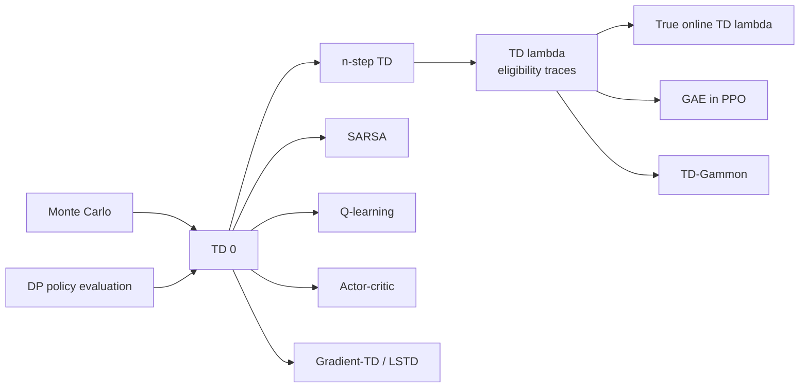

# Temporal-Difference Learning (TD(0), n-step TD, TD(λ) with Eligibility Traces)

> Learn value predictions from incomplete episodes by **bootstrapping**: nudge each estimate toward "reward + discounted estimate of the next state". This is the central idea of RL. **Family:** Model-free → Value-based → Tabular → Temporal-difference prediction  ·  **Year / origin:** Sutton (1988), "Learning to predict by the methods of temporal differences"; roots in Samuel's checkers player (1959) and Sutton & Barto's adaptive critic work (1981–83)  ·  **On/Off-policy:** prediction of the policy that generated the data (on-policy); off-policy variants use importance ratios  ·  **Action space:** any (prediction only; control versions are [SARSA](sarsa.md) and [Q-learning](q-learning.md))

---

## 1. What is it?

**Temporal-difference (TD) learning** estimates the value function $v_\pi$ of a policy from experience, like [Monte Carlo](monte-carlo.md), but it **updates after every step** using the current estimate of the next state's value as a stand-in for the rest of the return:

$$
V(S_t) \leftarrow V(S_t) + \alpha\,\big[\underbrace{R_{t+1} + \gamma V(S_{t+1})}_{\text{TD target}} - V(S_t)\big].
$$

It combines the two ideas that came before it:
- **From MC:** learn from raw experience without a model.
- **From DP:** bootstrap, i.e. update estimates from other estimates.

The benefits:
- It works **online** and in **continuing** (non-episodic) tasks.
- It usually has much **lower variance** than MC.
- In batch settings it converges to the **certainty-equivalence** estimate: the values the maximum-likelihood Markov model of the data would give.

TD is a whole spectrum, not a single algorithm:
- **TD(0)** looks one step ahead.
- **n-step TD** uses $n$ real rewards before bootstrapping.
- **TD(λ)** averages over all n-step returns, weighting them by $\lambda^{n-1}$. It is implemented efficiently with **eligibility traces**. At λ=0 it is TD(0); at λ=1 it behaves like MC.

TD is the prediction engine inside SARSA, Q-learning, actor-critic, DQN, PPO's GAE, and TD-Gammon. It is also a model of dopamine signalling in neuroscience: the reward-prediction-error hypothesis of Schultz, Dayan & Montague (1997).

## 2. Family & lineage

- **Parents:** Monte Carlo prediction (sampling), DP policy evaluation (bootstrapping), stochastic approximation (Robbins–Monro), Samuel's checkers, Klopf's and Sutton & Barto's adaptive-critic models.
- **Siblings:** n-step TD, TD(λ), true online TD(λ), gradient-TD (GTD, TDC), emphatic TD, LSTD.
- **Descendants:** [SARSA](sarsa.md) and [Q-learning](q-learning.md) (TD control), actor-critic (TD error as the critic signal), DQN, GAE (Schulman et al., 2016: the λ-return applied to advantages), TD-Gammon (Tesauro, 1995).



## 3. Core idea & intuition

**Learning a guess from a guess.** Suppose you predict your commute every morning. When you leave the office you guess 30 minutes. Ten minutes in, traffic is terrible and you now think 35 more minutes. MC waits until you get home before correcting the original guess. TD corrects it *right away*: "my initial guess should have been closer to 10 + 35 = 45". The difference between consecutive predictions, the **TD error**
$$\delta_t = R_{t+1} + \gamma V(S_{t+1}) - V(S_t),$$
is the learning signal (S&B Example 6.1 is exactly this driving-home story).

**Why TD often beats MC.** The TD target depends on one random reward and one random transition. The MC target depends on *all* the remaining rewards and transitions. So TD's target has much less variance. It is biased, because $V(S_{t+1})$ is only an estimate, but that bias shrinks as $V$ improves. TD also exploits Markov structure: if a new state leads into a familiar one, TD immediately borrows the familiar state's value.

**n-step and λ: dialling between TD and MC.** Using more real rewards before bootstrapping means less bias and more variance. Intermediate $n$ (or λ) usually wins.

**Eligibility traces: credit assignment backwards in time.** Rather than looking forward $n$ steps, keep a fading memory $z(s)$ of recently visited states. When a TD error happens, update *all* states in proportion to their trace. Recently and frequently visited states get the most credit. This "backward view" gives the same total update as the forward λ-return when updates are applied offline (verified in the code to $10^{-15}$).

## 4. Math / formal details

**Notation.** States $S_t$, rewards $R_{t+1}$, discount γ, step size α, terminal values $V(\text{terminal}) = 0$, episode length $T$.

**TD(0):** $V(S_t) \leftarrow V(S_t) + \alpha\,\delta_t$ with $\delta_t = R_{t+1} + \gamma V(S_{t+1}) - V(S_t)$.

**MC error as a sum of TD errors.** If $V$ is held fixed during the episode,
$$
G_t - V(S_t) = \sum_{k=t}^{T-1} \gamma^{k-t}\,\delta_k.
$$
Proof: $G_t - V(S_t) = R_{t+1} + \gamma G_{t+1} - V(S_t) = \delta_t + \gamma (G_{t+1} - V(S_{t+1}))$. Unroll this recursion.

**n-step return:**
$$
G_{t:t+n} = R_{t+1} + \gamma R_{t+2} + \dots + \gamma^{n-1} R_{t+n} + \gamma^n V(S_{t+n}),
$$
with $G_{t:t+n} = G_t$ if $t+n \ge T$. The update is $V(S_t) \leftarrow V(S_t) + \alpha[G_{t:t+n} - V(S_t)]$, applied at time $t+n$. **Error-reduction property:** $\max_s |\mathbb{E}_\pi[G_{t:t+n}\mid S_t=s] - v_\pi(s)| \le \gamma^n \max_s |V(s) - v_\pi(s)|$.

**λ-return (forward view):**
$$
G_t^\lambda = (1-\lambda)\sum_{n=1}^{T-t-1} \lambda^{n-1} G_{t:t+n} + \lambda^{T-t-1} G_t,
$$
a geometric average of all n-step returns; the weights sum to 1. λ=0 gives TD(0) and λ=1 gives MC. With $V$ fixed, $G^\lambda_t - V(S_t) = \sum_{k=t}^{T-1} (\gamma\lambda)^{k-t}\delta_k$.

**TD(λ), backward view.** Eligibility trace $z_t \in \mathbb{R}^{|\mathcal{S}|}$, $z_{-1} = 0$:
$$
z_t(s) = \gamma\lambda\, z_{t-1}(s) + \mathbb{1}[S_t = s] \;\;\text{(accumulating)},\qquad
z_t(S_t) = 1 \;\;\text{(replacing)},
$$
$$
V(s) \leftarrow V(s) + \alpha\,\delta_t\, z_t(s)\quad\forall s.
$$
**Equivalence.** Sum the backward-view updates for state $s$ over an episode with $V$ fixed. Swapping the order of summation gives exactly $\sum_{t: S_t = s}(G^\lambda_t - V(S_t))$, the summed forward-view updates. The match is exact for offline updating and approximate for online updating. **True online TD(λ)** (van Seijen & Sutton, 2014) uses "dutch" traces to match the online λ-return exactly.

**With function approximation** $\hat v(s, \mathbf{w})$: $\mathbf{z}_t = \gamma\lambda \mathbf{z}_{t-1} + \nabla \hat v(S_t, \mathbf{w})$ and $\mathbf{w} \leftarrow \mathbf{w} + \alpha\delta_t \mathbf{z}_t$. The tabular case is the special case where the gradient is a one-hot vector.

**Convergence.**
- Tabular TD(0) converges to $v_\pi$ in the mean for a sufficiently small constant α, and with probability 1 under the Robbins–Monro step-size conditions ($\sum\alpha=\infty$, $\sum\alpha^2<\infty$). Results: Sutton 1988; Dayan 1992; Jaakkola, Jordan & Singh 1994; Tsitsiklis 1994.
- Linear on-policy TD(λ) converges to the TD fixed point, whose error is at most $\frac{1-\gamma\lambda}{1-\gamma}$ times the best achievable (Tsitsiklis & Van Roy, 1997).
- Off-policy TD with function approximation can diverge (the "deadly triad"); gradient-TD methods fix this.

**Batch TD vs batch MC.** On a fixed dataset, batch MC converges to the values that minimize squared error on the observed returns. Batch TD(0) converges to the values of the maximum-likelihood MDP (the **certainty-equivalence** estimate), which usually generalizes better (S&B Example 6.4, "You are the Predictor").

## 5. Algorithm (pseudocode)

```text
Tabular TD(0) for estimating v_pi
 1. Input: policy pi, step size alpha in (0,1].  Init V(s) arbitrarily, V(terminal) = 0
 2. for each episode:
 3.     S <- start state
 4.     repeat until S is terminal:
 5.         A ~ pi(.|S);  take A, observe R, S'
 6.         V(S) <- V(S) + alpha * [ R + gamma*V(S') - V(S) ]
 7.         S <- S'

n-step TD
 1. for each episode: store S_0; T <- infinity
 2. for t = 0, 1, 2, ...:
 3.     if t < T: act, observe R_{t+1}, S_{t+1}; if S_{t+1} terminal: T <- t+1
 4.     tau <- t - n + 1                         (time whose estimate is updated)
 5.     if tau >= 0:
 6.         G <- sum_{i=tau+1}^{min(tau+n,T)} gamma^{i-tau-1} R_i
 7.         if tau + n < T: G <- G + gamma^n V(S_{tau+n})
 8.         V(S_tau) <- V(S_tau) + alpha [ G - V(S_tau) ]
 9.     until tau = T - 1

TD(lambda), backward view (accumulating or replacing traces)
 1. for each episode:
 2.     z(s) <- 0 for all s;  S <- start
 3.     repeat until S terminal:
 4.         A ~ pi(.|S);  observe R, S'
 5.         delta <- R + gamma*V(S') - V(S)            (V(terminal) = 0)
 6.         z <- gamma*lambda*z
 7.         z(S) <- z(S) + 1          (accumulating)   or   z(S) <- 1   (replacing)
 8.         for all s:  V(s) <- V(s) + alpha * delta * z(s)
 9.         S <- S'
```

## 6. Python implementation

Runnable version: [`code/td-learning.py`](../../code/td-learning.py)

The environment is the classic **random walk**: a chain with exits on both ends and a 50/50 policy.
- The 5-state version (S&B Example 6.2) has reward +1 only on the right exit.
- The 19-state version (S&B Sec. 7.1) has −1 on the left and +1 on the right.

The script compares TD(0) with constant-α MC, sweeps n for n-step TD and λ for TD(λ) with both trace types, and verifies the forward/backward equivalence numerically. It runs in about 7 seconds.

```python
"""
Temporal-difference prediction (Sutton & Barto, 2nd ed., Ch. 6, 7, 12).

  * TD(0) vs constant-alpha MC on the 5-state random walk (Example 6.2)
  * n-step TD on the 19-state random walk (Sec. 7.1)
  * TD(lambda), backward view with eligibility traces (Sec. 12.2)
  * check: offline TD(lambda) == offline lambda-return (forward view), exactly

Pure NumPy.   Run:  python3 code/td-learning.py
"""
import numpy as np


class RandomWalk:
    """n non-terminal states 1..n, terminals 0 and n+1, start in the middle.
    Each step goes left/right with prob 1/2.  Reward on the right exit is +1;
    on the left exit it is `left_reward` (0 for the 5-state task, -1 for 19 states)."""

    def __init__(self, n=5, left_reward=0.0):
        self.n, self.left_reward = n, left_reward
        self.start = (n + 1) // 2
        # true values: linear interpolation between the two exit rewards (gamma = 1)
        idx = np.arange(1, n + 1)
        self.true_v = left_reward + (1 - left_reward) * idx / (n + 1)

    def episode(self, rng):
        """Return visited states S_0..S_T and rewards R_1..R_T."""
        s, states, rewards = self.start, [self.start], []
        while 0 < s <= self.n:
            s += 1 if rng.random() < 0.5 else -1
            rewards.append(1.0 if s == self.n + 1 else (self.left_reward if s == 0 else 0.0))
            states.append(s)
        return states, rewards


def rms(V, env):
    return np.sqrt(np.mean((V[1:env.n + 1] - env.true_v) ** 2))


def td0(env, n_episodes, alpha, rng, gamma=1.0, v0=0.5):
    V = np.full(env.n + 2, v0)
    V[0] = V[-1] = 0.0                                  # terminal values are 0
    errors = []
    for _ in range(n_episodes):
        S, R = env.episode(rng)
        for t in range(len(R)):
            td_error = R[t] + gamma * V[S[t + 1]] - V[S[t]]   # delta_t
            V[S[t]] += alpha * td_error
        errors.append(rms(V, env))
    return V, np.array(errors)


def constant_alpha_mc(env, n_episodes, alpha, rng, gamma=1.0, v0=0.5):
    V = np.full(env.n + 2, v0)
    V[0] = V[-1] = 0.0
    errors = []
    for _ in range(n_episodes):
        S, R = env.episode(rng)
        G = 0.0
        for t in reversed(range(len(R))):               # every-visit, wait until the end
            G = gamma * G + R[t]
            V[S[t]] += alpha * (G - V[S[t]])
        errors.append(rms(V, env))
    return V, np.array(errors)


def n_step_td(env, n_episodes, alpha, n, rng, gamma=1.0):
    """Online n-step TD (S&B Sec. 7.1 pseudocode).  n=1 is TD(0); n >= T is MC."""
    V = np.zeros(env.n + 2)
    errors = []
    for _ in range(n_episodes):
        S, R = env.episode(rng)                         # pre-sampled: policy has no choice
        T = len(R)
        for tau in range(T):                            # tau = time whose estimate is updated
            end = min(tau + n, T)
            G = sum(gamma ** (i - tau) * R[i] for i in range(tau, end))
            if tau + n < T:
                G += gamma ** n * V[S[tau + n]]         # bootstrap from n steps ahead
            V[S[tau]] += alpha * (G - V[S[tau]])
        errors.append(rms(V, env))
    return V, np.array(errors)


def td_lambda(env, n_episodes, alpha, lam, rng, gamma=1.0, trace="accumulating"):
    """Online TD(lambda), backward view: every state keeps an eligibility trace z(s)."""
    V = np.zeros(env.n + 2)
    errors = []
    for _ in range(n_episodes):
        S, R = env.episode(rng)
        z = np.zeros_like(V)                            # eligibility traces, reset per episode
        for t in range(len(R)):
            z *= gamma * lam                            # decay all traces
            if trace == "accumulating":
                z[S[t]] += 1.0
            else:                                       # replacing traces
                z[S[t]] = 1.0
            delta = R[t] + gamma * V[S[t + 1]] - V[S[t]]
            V += alpha * delta * z                      # credit all recently visited states
            V[0] = V[-1] = 0.0
        errors.append(rms(V, env))
    return V, np.array(errors)


def lambda_return(S, R, V, t, lam, gamma=1.0):
    """Forward view: G_t^lambda = (1-lam) sum_n lam^(n-1) G_{t:t+n}  +  lam^(T-t-1) G_t."""
    T = len(R)
    G_lam, G_n = 0.0, 0.0
    for n in range(1, T - t + 1):
        G_n += gamma ** (n - 1) * R[t + n - 1]          # running sum of n-step rewards
        if t + n < T:
            G_lam += (1 - lam) * lam ** (n - 1) * (G_n + gamma ** n * V[S[t + n]])
        else:                                           # n-step return reached the end: MC return
            G_lam += lam ** (n - 1) * G_n
    return G_lam


def offline_equivalence_check(env, lam, rng, gamma=1.0):
    """With V held fixed during an episode, the summed TD(lambda) updates equal the
    summed lambda-return updates (S&B, 1st ed. Sec. 7.4; 2nd ed. Sec. 12.1-12.2)."""
    V = rng.normal(0, 0.3, env.n + 2)
    V[0] = V[-1] = 0.0
    S, R = env.episode(rng)
    forward = np.zeros_like(V)
    backward = np.zeros_like(V)
    z = np.zeros_like(V)
    for t in range(len(R)):
        forward[S[t]] += lambda_return(S, R, V, t, lam, gamma) - V[S[t]]
        z *= gamma * lam
        z[S[t]] += 1.0
        backward += (R[t] + gamma * V[S[t + 1]] - V[S[t]]) * z
    return np.max(np.abs(forward - backward))


if __name__ == "__main__":
    # --- 1. TD(0) vs MC on the 5-state random walk ---------------------------
    env5 = RandomWalk(5)
    runs, eps = 100, 100
    td_err = np.mean([td0(env5, eps, 0.1, np.random.default_rng(i))[1] for i in range(runs)], 0)
    mc_err = np.mean([constant_alpha_mc(env5, eps, 0.02, np.random.default_rng(i))[1]
                      for i in range(runs)], 0)
    V, _ = td0(env5, 3000, 0.01, np.random.default_rng(0))
    print("5-state random walk (100 runs x 100 episodes), RMS error vs episodes")
    print(f"   {'episode':>8s} {'TD(0) a=0.1':>12s} {'MC a=0.02':>10s}")
    for e in (1, 10, 50, 100):
        print(f"   {e:8d} {td_err[e - 1]:12.3f} {mc_err[e - 1]:10.3f}")
    print(f"   TD(0) a=0.01 V after 3000 episodes: {np.round(V[1:6], 3)}  (true {np.round(env5.true_v, 3)})")

    # --- 2. n-step TD on the 19-state random walk -----------------------------
    env19 = RandomWalk(19, left_reward=-1.0)
    alphas = [0.05, 0.1, 0.2, 0.4, 0.6]
    runs = 30
    print("\n19-state random walk: mean RMS over first 10 episodes (30 runs), best alpha")
    for n in (1, 2, 4, 8, 16, 64):
        res = [np.mean([n_step_td(env19, 10, a, n, np.random.default_rng(i))[1].mean()
                        for i in range(runs)]) for a in alphas]
        b = int(np.argmin(res))
        print(f"   n-step TD  n={n:<3d} best alpha={alphas[b]:.2f}  RMS={res[b]:.3f}")

    # --- 3. TD(lambda), backward view ----------------------------------------
    # Accumulating traces with lambda ~ 1 and a large alpha can blow up (traces > 1
    # multiply the step size); we count such alphas as "diverged" instead of crashing.
    for trace in ("accumulating", "replacing"):
        for lam in (0.0, 0.4, 0.8, 0.9, 1.0):
            res = []
            for a in alphas:
                with np.errstate(all="ignore"):
                    r = np.mean([td_lambda(env19, 10, a, lam, np.random.default_rng(i),
                                           trace=trace)[1].mean() for i in range(runs)])
                res.append(r if np.isfinite(r) and r < 10 else np.inf)
            b = int(np.argmin(res))
            n_div = int(np.sum(np.isinf(res)))
            print(f"   TD(lambda) {trace:12s} lam={lam:<4.1f} best alpha={alphas[b]:.2f}  "
                  f"RMS={res[b]:.3f}" + (f"  ({n_div} alpha(s) diverged)" if n_div else ""))

    # --- 4. forward view == backward view (offline) ---------------------------
    rng = np.random.default_rng(0)
    gap = max(offline_equivalence_check(env19, lam, rng) for lam in (0.3, 0.7, 0.95))
    print(f"\nOffline lambda-return vs offline TD(lambda): max |difference| = {gap:.2e}")
```

Output:

```text
5-state random walk (100 runs x 100 episodes), RMS error vs episodes
    episode  TD(0) a=0.1  MC a=0.02
          1        0.222      0.232
         10        0.129      0.199
         50        0.050      0.106
        100        0.057      0.085
   TD(0) a=0.01 V after 3000 episodes: [0.183 0.346 0.498 0.674 0.839]  (true [0.167 0.333 0.5   0.667 0.833])

19-state random walk: mean RMS over first 10 episodes (30 runs), best alpha
   n-step TD  n=1   best alpha=0.60  RMS=0.370
   n-step TD  n=2   best alpha=0.60  RMS=0.282
   n-step TD  n=4   best alpha=0.40  RMS=0.271
   n-step TD  n=8   best alpha=0.20  RMS=0.287
   n-step TD  n=16  best alpha=0.10  RMS=0.326
   n-step TD  n=64  best alpha=0.05  RMS=0.417
   TD(lambda) accumulating lam=0.0  best alpha=0.60  RMS=0.370
   TD(lambda) accumulating lam=0.4  best alpha=0.60  RMS=0.285
   TD(lambda) accumulating lam=0.8  best alpha=0.40  RMS=0.285
   TD(lambda) accumulating lam=0.9  best alpha=0.20  RMS=0.298
   TD(lambda) accumulating lam=1.0  best alpha=0.05  RMS=0.694  (3 alpha(s) diverged)
   TD(lambda) replacing    lam=0.0  best alpha=0.60  RMS=0.370
   TD(lambda) replacing    lam=0.4  best alpha=0.60  RMS=0.291
   TD(lambda) replacing    lam=0.8  best alpha=0.40  RMS=0.267
   TD(lambda) replacing    lam=0.9  best alpha=0.20  RMS=0.268
   TD(lambda) replacing    lam=1.0  best alpha=0.20  RMS=0.384

Offline lambda-return vs offline TD(lambda): max |difference| = 3.11e-15
```

These reproduce the qualitative findings of S&B Figs. 6.2, 7.2 and 12.3–12.6:
- TD beats MC on the random walk.
- Intermediate n (about 4) and intermediate λ (0.4–0.8) give the lowest error. Larger n or λ need a smaller α.
- Accumulating traces near λ=1 **diverge** at large α, because a state revisited in a loop builds a trace above 1 and effectively multiplies the step size. Replacing traces are more robust.
- The forward and backward views agree to machine precision offline.

## 7. Practical tips & hyperparameters

- **α:** 0.01–0.5 tabular. Larger n or λ need smaller α. Plot error against α for several n or λ: the "U-shaped" curves of S&B Ch. 7 and 12 are the standard diagnostic.
- **γ:** problem-defined; 0.9–0.99 for continuing tasks. The effective horizon is about $1/(1-\gamma)$.
- **λ:** 0.7–0.95 is common (GAE in PPO typically uses 0.95). λ=0 is cheapest but propagates information slowly; λ≈1 is high-variance.
- **n:** 3–10 is a typical sweet spot. Large n delays updates by n steps.
- **Traces:** use replacing or dutch traces (true online TD(λ)) for stability. Reset traces at episode start. With control and ε-greedy, Watkins's Q(λ) cuts traces after exploratory actions.
- **Initialization:** initial $V$ affects early learning. A good prior (for example 0.5 for a 0/1 reward) speeds things up.
- **Debugging signals:**
  - The TD error δ should shrink on average but not to zero in stochastic environments.
  - RMS versus ground truth (from DP) is the gold standard on small problems.
  - Exploding values point to α too large with accumulating traces, or to off-policy divergence.
- **Cost:** a TD(λ) step touches every state with a nonzero trace. Keep a list of active traces, or truncate traces below a threshold.

## 8. Pros and cons

**Pros**
- Online, incremental, fully model-free; works for continuing tasks.
- Lower variance than MC; usually learns faster in practice.
- Exploits Markov structure (certainty-equivalence in batch).
- n-step and λ give a smooth bias–variance knob; traces handle credit assignment efficiently.
- Foundation of nearly every modern RL algorithm.

**Cons**
- Biased targets early on; sensitive to initialization.
- Relies on the Markov property; partial observability hurts bootstrapping.
- Off-policy TD with function approximation can diverge (the deadly triad).
- Extra hyperparameters (α, λ or n) interact strongly.
- Accumulating traces can be unstable for large α and λ.

## 9. When to use / when not to use

**Use when:**
- You need to predict long-term outcomes (values) from streaming experience: game positions, customer value, system health.
- Episodes are long or never end.
- You are building a control algorithm (SARSA, Q-learning, actor-critic) and need the critic.

**Do not use when:**
- The state signal is far from Markov and you cannot fix it. MC or recurrent and history-based states are safer.
- You have the full model and a small state space. Just use [DP](dynamic-programming.md).
- You need unbiased estimates from a small number of complete, short episodes ([Monte Carlo](monte-carlo.md)).

## 10. Key papers, books & repos

- Sutton & Barto, *Reinforcement Learning: An Introduction*, 2nd ed., 2018. **Chapter 6** (TD prediction, Sec. 6.1–6.3, random walk Example 6.2), **Chapter 7** (n-step bootstrapping), **Chapter 12** (eligibility traces: λ-return 12.1, TD(λ) 12.2, true online TD(λ) 12.5, dutch traces 12.6).
- Sutton, R. S. (1988). "Learning to predict by the methods of temporal differences." *Machine Learning* 3:9–44.
- Samuel, A. L. (1959). "Some studies in machine learning using the game of checkers." *IBM Journal of R&D*.
- Dayan, P. (1992). "The convergence of TD(λ) for general λ." *Machine Learning* 8.
- Jaakkola, T., Jordan, M. I. & Singh, S. P. (1994). "On the convergence of stochastic iterative dynamic programming algorithms." *Neural Computation* 6.
- Tsitsiklis, J. N. & Van Roy, B. (1997). "An analysis of temporal-difference learning with function approximation." *IEEE Trans. Automatic Control* 42.
- Singh, S. P. & Sutton, R. S. (1996). "Reinforcement learning with replacing eligibility traces." *Machine Learning* 22.
- Tesauro, G. (1995). "Temporal difference learning and TD-Gammon." *Communications of the ACM* 38.
- Schultz, W., Dayan, P. & Montague, P. R. (1997). "A neural substrate of prediction and reward." *Science* 275.
- van Seijen, H. & Sutton, R. S. (2014). "True online TD(λ)." *ICML*.
- Schulman, J., Moritz, P., Levine, S., Jordan, M. & Abbeel, P. (2016). "High-dimensional continuous control using generalized advantage estimation." *ICLR*; arXiv:1506.02438. (the λ-return idea in modern policy gradients)
- Repos: [`ShangtongZhang/reinforcement-learning-an-introduction`](https://github.com/ShangtongZhang/reinforcement-learning-an-introduction) (Ch. 6, 7, 12 random-walk figures); [`DLR-RM/stable-baselines3`](https://github.com/DLR-RM/stable-baselines3) and [`vwxyzjn/cleanrl`](https://github.com/vwxyzjn/cleanrl) (TD targets and GAE(λ) in deep RL).

## 11. For business users

**What it does.** TD learning teaches a system to predict long-term outcomes, such as "how valuable is this customer going to be?" or "how likely is this machine to fail this month?", and to *update the prediction every time new information arrives* rather than waiting for the final outcome.

**Analogy.** A sales manager forecasts the quarter. A Monte Carlo manager waits until the quarter ends to judge whether the forecasts were good. A TD manager revises the forecast every week as deals progress, learning from the *change* between last week's forecast and this week's. Weekly revisions catch problems early and use far more feedback.

**Real-world use cases.**
- Customer lifetime value that updates with every interaction.
- Predictive maintenance scores updated with each sensor reading.
- Game AI evaluating positions (TD-Gammon learned backgammon at a strong level largely by self-play with TD).
- The "critic" component inside most modern AI decision systems, including those used to fine-tune language models.

**Value / ROI.** Faster learning from less data than waiting for final outcomes, continuous updating, and it works even when processes never "end".

**Risks.** It learns from its own earlier guesses, so early mistakes can propagate. If key information is missing from the input (the state is not "complete"), predictions can be systematically off. Tuning matters.

**Costs.** Cheap to run; the main cost is engineering good state features and monitoring.

**Questions to ask your team.**
1. What exactly are we predicting, over what horizon (what discount)?
2. Does our state description contain everything relevant to the future?
3. How do we validate predictions against actual outcomes?
4. Which settings (step size, λ) did we tune, and how sensitive are results to them?

## 12. For kids (ages ~8–12)

**The weather guesser.** Every morning you guess whether it will rain on Saturday. On Monday you say "50% chance". On Tuesday you see dark clouds far away and say "70%!". A smart guesser learns from Tuesday's clue *right away* and thinks: "Hmm, on days like Monday I should have guessed a bit higher." You don't have to wait for Saturday to learn something. Each new guess helps fix the old guess.

That's TD learning: learn from the *difference* between your guess now and your next guess.

**Try it yourself.** Play a board game like Snakes and Ladders. At each turn, before rolling, say out loud how many turns you think are left until you finish. Write the guesses down. When a ladder jumps you ahead, notice how much your guess changes. At the end, look back: which squares made you change your guess the most?

**Recap:**
1. Make a guess.
2. Take one step and make a new guess.
3. Fix your old guess a little toward the new one.

## 13. Related methods

- [Monte Carlo methods](monte-carlo.md): no bootstrapping; the λ=1 end of the spectrum.
- [Dynamic Programming](dynamic-programming.md): full-width expected backups with a model.
- [SARSA](sarsa.md): on-policy TD control, including n-step SARSA and SARSA(λ).
- [Q-learning](q-learning.md): off-policy TD control.
- [Dyna-Q](dyna-q.md): TD updates on simulated experience from a learned model.
- [Multi-armed bandits](multi-armed-bandits.md): incremental averaging without bootstrapping.
- [Actor-critic (A2C/A3C)](../03-policy-gradient/actor-critic-a2c-a3c.md): TD error as the critic's signal.
- [PPO](../03-policy-gradient/ppo.md): uses GAE(λ), the λ-return applied to advantages.
- [DQN](../02-deep-value-based/dqn.md): TD learning with neural networks and target networks.

[← Back to overview](../../RL_Methods_Overview.md)
