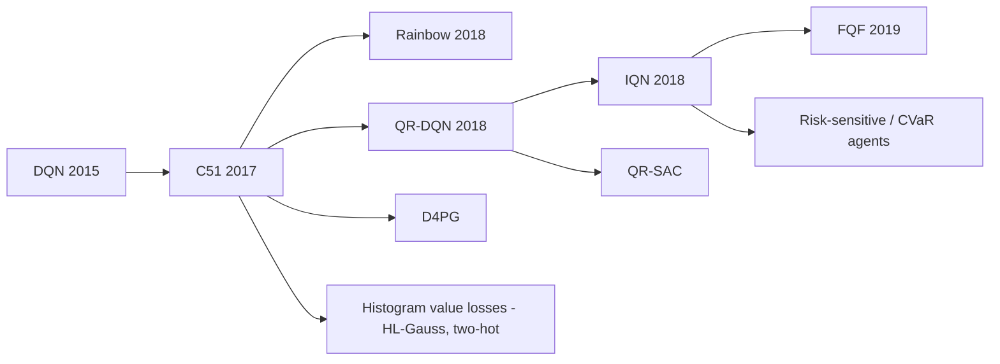

# Distributional RL (C51, QR-DQN, IQN)

> Learn the full probability distribution of future return, not just its average. **Family:** Model-free → Value-based → Deep Q-learning → Distributional  ·  **Year / origin:** Bellemare, Dabney & Munos, DeepMind, ICML 2017 (C51); Dabney et al. AAAI 2018 (QR-DQN) and ICML 2018 (IQN)  ·  **On/Off-policy:** Off-policy  ·  **Action space:** Discrete (the ideas extend to actor-critics, e.g. D4PG, QR-SAC)

## 1. What is it?

Classic RL learns the **expected** return $Q(s,a) = \mathbb E[G \mid s,a]$. Distributional RL learns the **random variable** $Z(s,a)$ whose expectation is $Q(s,a)$ — the whole distribution of returns you might get by taking $a$ in $s$ and then following the policy.

Two actions can have the same mean but very different risks: "always +5" vs. "+10 or 0 with equal chance". A mean-only learner cannot tell them apart; a distributional learner can. Surprisingly, even when you *act only on the mean* (as these agents do), learning the full distribution makes deep RL agents learn better on Atari — the extra prediction targets act as a rich auxiliary signal, and the representation learned is better.

The three landmark algorithms differ in **how the distribution is parameterized**:

| Algorithm | Parameterization | Loss | Year |
|---|---|---|---|
| **C51** | probabilities on 51 fixed, evenly spaced return values ("atoms") | cross-entropy after projecting the target onto the atoms | 2017 |
| **QR-DQN** | $N$ return values (quantiles) at fixed probability levels $\tau_i$ | quantile (Huber) regression | 2018 |
| **IQN** | a network that maps *any* $\tau \in (0,1)$ to its quantile | quantile Huber regression on sampled $\tau$ | 2018 |

All three plug into the [DQN](dqn.md) skeleton (replay, target network, ε-greedy); only the network head and the loss change. C51 is one of the six components of [Rainbow](rainbow-dqn.md).

## 2. Family & lineage

- **Parents:** DQN; earlier work on return distributions and variance (e.g. Sobel 1982 on the variance of returns; Morimura et al. 2010 on parametric return density estimation).
- **Core line:** C51 → QR-DQN → IQN → FQF (Yang et al., NeurIPS 2019, learns the $\tau$ fractions too). Expectile-based variants (Rowland et al. 2019).
- **Uses / descendants:** Rainbow (C51 head), D4PG (distributional critic for continuous control), QR-SAC and other distributional actor-critics, risk-sensitive RL (CVaR policies via IQN), and categorical "classification" value heads (two-hot targets in MuZero/DreamerV3-style agents, HL-Gauss in Farebrother et al. 2024) — close cousins that borrow the "predict a histogram" trick.



## 3. Core idea & intuition

**Distributional Bellman equation.** Ordinary Bellman says "value now = reward + discounted value later" *on average*. The distributional version says the same thing *about random variables*: the return from here is distributed like "a random reward plus γ times the (random) return from wherever you land next".

Applying this to a distribution means three operations (the "distributional Bellman operator"):
1. **Mix** the next-state return distributions according to the transition probabilities (and the next action).
2. **Shrink** the distribution towards 0 by $\gamma$.
3. **Shift** it by the reward.

The demo in the code applies these to a 2-state chain: state B pays 10 with probability 0.3 (else 0) and ends; A pays 0 and moves to B. With $\gamma = 0.9$, the mean of A is $2.7$ — but the distribution is "0 with probability 0.7, 9 with probability 0.3". The algorithm recovers exactly that.

**How do you represent a distribution in a network?**

- **C51** — draw a histogram with 51 fixed bins between $V_{\min}$ and $V_{\max}$, and predict the height of each bar (a softmax). After shift-and-shrink, the target's atoms fall *between* bins, so each atom's probability is split between its two neighboring bins (a "projection"). Then minimize cross-entropy, as in classification.
- **QR-DQN** — flip the axes. Instead of fixed return values with learned probabilities, use fixed probabilities ($\tfrac{1}{2N}, \tfrac{3}{2N}, \dots$) with learned return values: "what return is exceeded with 95% probability?" etc. No bins, no $V_{\min}/V_{\max}$, no projection — trained with the quantile regression loss (the "pinball" loss, used in forecasting).
- **IQN** — make the probability level an *input*: the network takes $(s, \tau)$ and outputs the $\tau$-quantile for every action. You can query as many quantiles as you like and, by sampling $\tau$ from a distorted distribution, act in a **risk-averse or risk-seeking** way.

## 4. Math / formal details

**Random return.** For policy $\pi$, $Z^\pi(s,a) = \sum_{t\ge 0}\gamma^t R_t$ with $S_0 = s, A_0 = a$. Then $Q^\pi(s,a) = \mathbb E[Z^\pi(s,a)]$.

**Distributional Bellman equation and operator** (equality in distribution, $\overset{D}{=}$):
$$Z^\pi(s,a) \overset{D}{=} R(s,a) + \gamma\, Z^\pi(S', A'),\quad S' \sim P(\cdot\mid s,a),\ A' \sim \pi(\cdot\mid S'),$$
$$(\mathcal T^\pi Z)(s,a) \overset{D}{=} R(s,a) + \gamma Z(S',A').$$
For control, $A' = \arg\max_{a'} \mathbb E[Z(S',a')]$ (greedy w.r.t. the mean).

**Contraction results (Bellemare et al. 2017).** $\mathcal T^\pi$ is a $\gamma$-contraction in the maximal $p$-Wasserstein metric $\bar d_p(Z_1,Z_2) = \sup_{s,a} W_p(Z_1(s,a), Z_2(s,a))$, so policy evaluation converges to $Z^\pi$. The **control** operator is *not* a contraction in any metric over distributions (its mean still converges like ordinary Q-learning). Also, the Wasserstein loss cannot be minimized without bias from sampled transitions with SGD, which is why C51 uses a projection + KL instead.

**C51.** Atoms $z_i = V_{\min} + i\,\Delta z$, $\Delta z = \frac{V_{\max} - V_{\min}}{N-1}$, $i = 0..N-1$ ($N = 51$). The network outputs logits $\ell_i(s,a)$, $p_i(s,a) = \operatorname{softmax}_i(\ell(s,a))$, and $Q(s,a) = \sum_i z_i p_i(s,a)$.

Target for a transition $(s,a,r,s',d)$: $a^* = \arg\max_{a'} \sum_i z_i\, p_i^{-}(s',a')$ (target net). Each target atom $\hat z_j = \operatorname{clip}\big(r + \gamma(1-d) z_j,\ V_{\min}, V_{\max}\big)$ carries probability $p^-_j(s',a^*)$. **Projection** $\Phi$ onto the support: with $b_j = (\hat z_j - V_{\min})/\Delta z$, $l = \lfloor b_j\rfloor$, $u = \lceil b_j \rceil$,
$$m_l \mathrel{+}= p^-_j\,(u - b_j), \qquad m_u \mathrel{+}= p^-_j\,(b_j - l)$$
(and if $l = u$, all of $p^-_j$ goes to $m_l$). Loss:
$$\mathcal L_{\text{C51}}(\theta) = -\sum_{i=0}^{N-1} m_i \log p_i(s,a;\theta),$$
i.e. the KL divergence from the projected target to the prediction, up to a constant. Rowland et al. (2018) show that the *projected* categorical operator $\Phi\mathcal T^\pi$ is a contraction in the Cramér distance (the $\ell_2$ distance between CDFs) — the theoretical justification for C51.

**Quantile regression (QR-DQN).** Represent $Z(s,a)$ as a uniform mixture of $N$ Diracs at $\theta_1(s,a),\dots,\theta_N(s,a)$ located at quantile midpoints $\hat\tau_i = \frac{2i-1}{2N}$, $i = 1..N$. The $W_1$-optimal such approximation places $\theta_i$ at the $\hat\tau_i$-quantile, which minimizes the **quantile regression loss** $\mathbb E_{\hat Z}\big[\rho_{\hat\tau}(\hat Z - \theta)\big]$ with $\rho_\tau(u) = u\,(\tau - \mathbb 1[u < 0])$. Its smooth version, the **quantile Huber loss** with threshold $\kappa$:
$$\rho^\kappa_\tau(u) = \big|\tau - \mathbb 1[u<0]\big|\ \frac{\mathcal L_\kappa(u)}{\kappa},\qquad
\mathcal L_\kappa(u) = \begin{cases}\tfrac12 u^2 & |u|\le\kappa\\ \kappa(|u| - \tfrac12\kappa) & \text{else.}\end{cases}$$
With target samples $\mathcal T\theta_j = r + \gamma(1-d)\,\theta^-_j(s',a^*)$ and pairwise errors $u_{ij} = \mathcal T\theta_j - \theta_i(s,a)$:
$$\mathcal L_{\text{QR}}(\theta) = \sum_{i=1}^N \frac{1}{N}\sum_{j=1}^{N} \rho^\kappa_{\hat\tau_i}(u_{ij}).$$
The projection onto quantile distributions combined with $\mathcal T^\pi$ is a contraction in $\bar d_\infty$ (Dabney et al. 2018), so QR-DQN has a cleaner theoretical story than C51 and needs no support bounds.

**IQN.** Learn the quantile function $Z_\tau(s,a) = F^{-1}_{Z(s,a)}(\tau)$ directly. Architecture: state embedding $\psi(s) \in \mathbb R^d$, quantile embedding
$$\phi_j(\tau) = \operatorname{ReLU}\Big(\sum_{i=0}^{n-1}\cos(\pi i \tau)\, w_{ij} + b_j\Big),$$
combined by elementwise product, $Z_\tau(s,a) \approx f\big(\psi(s)\odot\phi(\tau)\big)_a$. Sample $\tau_1..\tau_N \sim U(0,1)$ for the prediction, $\tau'_1..\tau'_{N'}$ for the target:
$$\mathcal L_{\text{IQN}} = \frac{1}{N'}\sum_{i=1}^N\sum_{j=1}^{N'} \rho^\kappa_{\tau_i}\Big(r + \gamma Z^-_{\tau'_j}(s',a^*) - Z_{\tau_i}(s,a)\Big),\qquad a^* = \arg\max_a \frac1K\sum_{k=1}^K Z_{\tilde\tau_k}(s',a).$$
**Risk-sensitive policies:** replace $\tilde\tau \sim U(0,1)$ by $\beta(\tilde\tau)$ for a distortion $\beta: [0,1]\to[0,1]$; e.g. $\beta(\tau) = \eta\tau$ gives CVaR$_\eta$ (only the worst $\eta$ fraction of outcomes matters).

**Symbols.** $s,a$: state, action; $r$: reward; $d$: terminal flag; $\gamma$: discount; $N$: number of atoms/quantiles; $z_i$: atom locations; $p_i$: atom probabilities; $\theta_i$: quantile locations; $\tau$: quantile level; $\kappa$: Huber threshold; superscript $^-$: target network.

## 5. Algorithm (pseudocode)

```text
Shared DQN skeleton (replay buffer D, online net, target net, epsilon-greedy):
1.  for each env step: act epsilon-greedily on Q(s,a) = mean of Z(s,a); store transition in D
2.  sample minibatch (s, a, r, s', d) from D
3.  a* <- argmax_a' mean(Z_target(s', a'))
4a. C51:
      target atoms  Tz_j = clip(r + gamma (1-d) z_j, Vmin, Vmax), probs p_j = P_target(s', a*)_j
      m <- project {(Tz_j, p_j)} onto the fixed support z_0..z_{N-1}
      loss <- - sum_i m_i log P_theta(s, a)_i
4b. QR-DQN:
      target samples T_j = r + gamma (1-d) theta_target_j(s', a*),  j = 1..N
      loss <- sum_i mean_j  rho^kappa_{tau_hat_i}( T_j - theta_i(s, a) )
4c. IQN:
      draw tau_1..tau_N ~ U(0,1) and tau'_1..tau'_N' ~ U(0,1)
      T_j = r + gamma (1-d) Z_target_{tau'_j}(s', a*)
      loss <- sum_i mean_j  rho^kappa_{tau_i}( T_j - Z_{tau_i}(s, a) )
5.  gradient step on the online net; every C steps copy online -> target
```

## 6. Python implementation

One file implements all three agents on the shared DQN skeleton, plus (i) unit checks of the categorical projection (conserves mass and the mean) and of quantile regression (recovers the 10/50/90% quantiles of $\mathcal N(3,1)$), and (ii) the exact distributional Bellman operator on the 2-state chain from Section 3. Environment: NumPy cart-pole (200-step cap). Each agent trains for 12k steps; total runtime ~1.5 min on CPU.

Runnable version: [`code/distributional-rl.py`](../../code/distributional-rl.py)

```python
"""
Distributional RL on a self-contained NumPy CartPole: C51, QR-DQN and IQN.

  * C51    (Bellemare, Dabney & Munos 2017): categorical distribution on a fixed support,
           target projected back onto the support, cross-entropy loss.
  * QR-DQN (Dabney, Rowland, Bellemare & Munos 2018): N quantiles at fixed fractions,
           quantile-Huber loss.
  * IQN    (Dabney, Ostrovski, Silver & Munos 2018): quantile fractions tau ~ U(0,1)
           are sampled and fed to the network through a cosine embedding.
All three share the same DQN skeleton (replay buffer, target network, epsilon-greedy).
Run:  python3 code/distributional-rl.py          (all three, ~1.5-2 min on CPU)
      python3 code/distributional-rl.py c51      (just one)
"""
import math
import random
import sys

import numpy as np
import torch
import torch.nn as nn
import torch.nn.functional as F


class CartPole:
    """Classic cart-pole physics (same constants as Gym CartPole), capped at max_steps."""
    def __init__(self, max_steps=200, seed=0):
        self.gravity, self.m_cart, self.m_pole = 9.8, 1.0, 0.1
        self.length, self.force_mag, self.tau = 0.5, 10.0, 0.02
        self.x_limit, self.theta_limit = 2.4, 12 * 2 * math.pi / 360
        self.max_steps, self.rng = max_steps, np.random.default_rng(seed)
        self.obs_dim, self.n_actions = 4, 2

    def reset(self):
        self.state, self.t = self.rng.uniform(-0.05, 0.05, size=4), 0
        return self.state.astype(np.float32)

    def step(self, action):
        x, x_dot, th, th_dot = self.state
        force = self.force_mag if action == 1 else -self.force_mag
        cos, sin = math.cos(th), math.sin(th)
        total_m, pm_l = self.m_cart + self.m_pole, self.m_pole * self.length
        temp = (force + pm_l * th_dot ** 2 * sin) / total_m
        th_acc = (self.gravity * sin - cos * temp) / (
            self.length * (4.0 / 3.0 - self.m_pole * cos ** 2 / total_m))
        x_acc = temp - pm_l * th_acc * cos / total_m
        x, x_dot = x + self.tau * x_dot, x_dot + self.tau * x_acc
        th, th_dot = th + self.tau * th_dot, th_dot + self.tau * th_acc
        self.state, self.t = np.array([x, x_dot, th, th_dot]), self.t + 1
        terminated = bool(abs(x) > self.x_limit or abs(th) > self.theta_limit)
        return self.state.astype(np.float32), 1.0, terminated, self.t >= self.max_steps


class ReplayBuffer:
    def __init__(self, capacity, obs_dim):
        self.o = np.zeros((capacity, obs_dim), np.float32); self.o2 = np.zeros_like(self.o)
        self.a = np.zeros(capacity, np.int64); self.r = np.zeros(capacity, np.float32)
        self.d = np.zeros(capacity, np.float32)
        self.capacity, self.ptr, self.size = capacity, 0, 0

    def add(self, o, a, r, o2, d):
        i = self.ptr
        self.o[i], self.a[i], self.r[i], self.o2[i], self.d[i] = o, a, r, o2, d
        self.ptr, self.size = (i + 1) % self.capacity, min(self.size + 1, self.capacity)

    def sample(self, n):
        i = np.random.randint(0, self.size, n)
        return [torch.as_tensor(x[i]) for x in (self.o, self.a, self.r, self.o2, self.d)]


# =============================================================================
# C51
# =============================================================================
class C51Net(nn.Module):
    def __init__(self, obs_dim, n_actions, n_atoms=51, v_min=0.0, v_max=100.0, hidden=128):
        super().__init__()
        self.n_actions, self.n_atoms = n_actions, n_atoms
        self.register_buffer("support", torch.linspace(v_min, v_max, n_atoms))
        self.net = nn.Sequential(nn.Linear(obs_dim, hidden), nn.ReLU(),
                                 nn.Linear(hidden, hidden), nn.ReLU(),
                                 nn.Linear(hidden, n_actions * n_atoms))

    def log_probs(self, obs):                       # [B, A, N]
        logits = self.net(obs).view(-1, self.n_actions, self.n_atoms)
        return F.log_softmax(logits, dim=-1)

    def q(self, obs):                               # expected value: sum_i p_i z_i
        return (self.log_probs(obs).exp() * self.support).sum(-1)


def categorical_projection(next_probs, rewards, discounts, support):
    """Project the distribution of r + discount * Z(s') onto the fixed support (C51, Alg. 1).
    next_probs: [B, N] probabilities of Z(s', a*); rewards, discounts: [B]; support: [N]."""
    n = support.numel()
    v_min, v_max = support[0].item(), support[-1].item()
    dz = (v_max - v_min) / (n - 1)
    tz = (rewards[:, None] + discounts[:, None] * support[None, :]).clamp(v_min, v_max)
    b = (tz - v_min) / dz                           # fractional atom index in [0, n-1]
    lo, hi = b.floor().long(), b.ceil().long()
    m = torch.zeros_like(next_probs)
    m.scatter_add_(1, lo, next_probs * (hi.float() - b))   # share mass to lower neighbour
    m.scatter_add_(1, hi, next_probs * (b - lo.float()))   # ... and upper neighbour
    m.scatter_add_(1, lo, next_probs * (lo == hi).float()) # exact hit: all mass to that atom
    return m


def c51_loss(net, tgt, batch, gamma):
    o, a, r, o2, d = batch
    with torch.no_grad():
        next_p = tgt.log_probs(o2).exp()                          # [B, A, N]
        a_star = (next_p * tgt.support).sum(-1).argmax(1)         # greedy on expected value
        p_star = next_p[torch.arange(len(a)), a_star]             # [B, N]
        m = categorical_projection(p_star, r, gamma * (1 - d), tgt.support)
    logp = net.log_probs(o)[torch.arange(len(a)), a]              # [B, N]
    return -(m * logp).sum(-1).mean()                             # cross-entropy = KL + const


# =============================================================================
# Quantile regression (shared by QR-DQN and IQN)
# =============================================================================
def quantile_huber_loss(pred, target, taus, kappa=1.0):
    """pred: [B, N] quantile estimates at fractions taus ([B, N] or [N]); target: [B, M] samples.
    rho_tau^kappa(u) = |tau - 1{u<0}| * Huber_kappa(u) / kappa, summed over i, averaged over j."""
    u = target[:, None, :] - pred[:, :, None]                     # [B, N, M] pairwise TD errors
    huber = torch.where(u.abs() <= kappa, 0.5 * u ** 2, kappa * (u.abs() - 0.5 * kappa))
    taus = taus if taus.dim() == 2 else taus.expand(pred.shape[0], -1)
    weight = (taus[:, :, None] - (u.detach() < 0).float()).abs()
    return (weight * huber / kappa).mean(dim=2).sum(dim=1).mean()


class QRNet(nn.Module):
    def __init__(self, obs_dim, n_actions, n_quantiles=32, hidden=128):
        super().__init__()
        self.n_actions, self.n_q = n_actions, n_quantiles
        # quantile midpoints tau_hat_i = (2i + 1) / (2N), i = 0..N-1
        self.register_buffer("taus", (torch.arange(n_quantiles) + 0.5) / n_quantiles)
        self.net = nn.Sequential(nn.Linear(obs_dim, hidden), nn.ReLU(),
                                 nn.Linear(hidden, hidden), nn.ReLU(),
                                 nn.Linear(hidden, n_actions * n_quantiles))

    def quantiles(self, obs):                        # [B, A, N]
        return self.net(obs).view(-1, self.n_actions, self.n_q)

    def q(self, obs):                                # mean of the quantiles
        return self.quantiles(obs).mean(-1)


def qr_loss(net, tgt, batch, gamma):
    o, a, r, o2, d = batch
    idx = torch.arange(len(a))
    with torch.no_grad():
        next_q = tgt.quantiles(o2)                                # [B, A, N]
        a_star = next_q.mean(-1).argmax(1)
        target = r[:, None] + gamma * (1 - d)[:, None] * next_q[idx, a_star]   # [B, N]
    pred = net.quantiles(o)[idx, a]                               # [B, N]
    return quantile_huber_loss(pred, target, net.taus)


class IQNNet(nn.Module):
    def __init__(self, obs_dim, n_actions, hidden=128, n_cos=64):
        super().__init__()
        self.n_actions = n_actions
        self.psi = nn.Sequential(nn.Linear(obs_dim, hidden), nn.ReLU())          # state embedding
        self.phi = nn.Sequential(nn.Linear(n_cos, hidden), nn.ReLU())            # tau embedding
        self.f = nn.Sequential(nn.Linear(hidden, hidden), nn.ReLU(), nn.Linear(hidden, n_actions))
        self.register_buffer("i_pi", math.pi * torch.arange(n_cos).float())

    def quantiles(self, obs, taus):
        """obs [B, obs_dim], taus [B, K] -> quantile values Z_tau(s, .) of shape [B, K, A]."""
        cos = torch.cos(taus[:, :, None] * self.i_pi)                # [B, K, n_cos]
        h = self.psi(obs)[:, None, :] * self.phi(cos)                # Hadamard product
        return self.f(h)

    def q(self, obs, k=32):                                          # average over sampled taus
        taus = torch.rand(obs.shape[0], k)
        return self.quantiles(obs, taus).mean(1)


def iqn_loss(net, tgt, batch, gamma, n=8, n_prime=8):
    o, a, r, o2, d = batch
    B = len(a)
    with torch.no_grad():
        a_star = net.q(o2).argmax(1)                                 # (online net picks a*)
        tq = tgt.quantiles(o2, torch.rand(B, n_prime))               # [B, N', A]
        target = r[:, None] + gamma * (1 - d)[:, None] * tq[torch.arange(B), :, a_star]
    taus = torch.rand(B, n)
    pred = net.quantiles(o, taus).gather(2, a[:, None, None].expand(B, n, 1)).squeeze(2)
    return quantile_huber_loss(pred, target, taus)


# =============================================================================
# Shared DQN-style training loop
# =============================================================================
AGENTS = {"c51": (C51Net, c51_loss), "qr-dqn": (QRNet, qr_loss), "iqn": (IQNNet, iqn_loss)}


def evaluate(net, n_episodes=10, seed=123):
    env, total = CartPole(seed=seed), 0.0
    for _ in range(n_episodes):
        o, done = env.reset(), False
        while not done:
            with torch.no_grad():
                a = int(net.q(torch.as_tensor(o)[None]).argmax())
            o, r, term, trunc = env.step(a)
            total, done = total + r, term or trunc
    return total / n_episodes


def train(name, total_steps=12_000, gamma=0.99, lr=1e-3, batch_size=64, learning_starts=1_000,
          target_update=250, train_freq=2, seed=0):
    random.seed(seed); np.random.seed(seed); torch.manual_seed(seed)
    Net, loss_fn = AGENTS[name]
    env = CartPole(seed=seed)
    net, tgt = Net(env.obs_dim, env.n_actions), Net(env.obs_dim, env.n_actions)
    tgt.load_state_dict(net.state_dict())
    opt = torch.optim.Adam(net.parameters(), lr=lr, eps=0.01 / 32)
    buf = ReplayBuffer(50_000, env.obs_dim)
    before, best, best_state = evaluate(net), -1.0, None
    o, ep_ret, rets = env.reset(), 0.0, []
    for step in range(total_steps):
        eps = max(0.05, 1.0 - step / 5_000)
        if random.random() < eps:
            a = random.randrange(env.n_actions)
        else:
            with torch.no_grad():
                a = int(net.q(torch.as_tensor(o)[None]).argmax())
        o2, r, term, trunc = env.step(a)
        buf.add(o, a, r, o2, float(term))
        o, ep_ret = o2, ep_ret + r
        if term or trunc:
            rets.append(ep_ret); o, ep_ret = env.reset(), 0.0
        if step >= learning_starts and step % train_freq == 0:
            loss = loss_fn(net, tgt, buf.sample(batch_size), gamma)
            opt.zero_grad(); loss.backward()
            nn.utils.clip_grad_norm_(net.parameters(), 10.0); opt.step()
        if step % target_update == 0:
            tgt.load_state_dict(net.state_dict())
        if (step + 1) % 3_000 == 0:
            score = evaluate(net)
            if score >= best:
                best, best_state = score, {k: v.clone() for k, v in net.state_dict().items()}
            print(f"  [{name}] step {step+1:6d}  train return (last 20)={np.mean(rets[-20:]):6.1f}"
                  f"  greedy eval={score:6.1f}")
    final = evaluate(net)
    net.load_state_dict(best_state)
    return net, before, final, evaluate(net, seed=999)


def tabular_distributional_demo():
    """Distributional Bellman operator on a 2-state chain, tabular C51-style.
    A --(r=0)--> B --(r=10 w.p. 0.3, else 0)--> end.  gamma = 0.9.
    Expected value of A is 0.9 * 3 = 2.7, but the *distribution* is bimodal: {0: 0.7, 9: 0.3}."""
    support = torch.linspace(0, 10, 11)
    Z = {s: torch.full((11,), 1 / 11) for s in "AB"}           # start from uniform distributions
    proj = lambda z, r, g: categorical_projection(z[None], torch.tensor([r]), torch.tensor([g]),
                                                  support)[0]
    for _ in range(3):   # apply the (projected) distributional Bellman operator  Z <- Pi T Z
        # B: mixture over the two possible rewards, episode ends (discount 0)
        Z["B"] = 0.3 * proj(Z["B"], 10.0, 0.0) + 0.7 * proj(Z["B"], 0.0, 0.0)
        # A: deterministic reward 0, then shrink Z(B) by gamma = 0.9 and re-project
        Z["A"] = proj(Z["B"], 0.0, 0.9)
    pa = Z["A"]
    print("tabular demo: Z(A) mass on atoms 0..10 =", [round(x, 2) for x in pa.tolist()])
    print(f"              E[Z(A)] = {(pa * support).sum():.2f} (true 2.7); "
          f"P(Z(A) >= 8) = {pa[8:].sum():.2f} (true 0.3)")


def _sanity_checks():
    torch.manual_seed(0)
    sup = torch.linspace(0, 10, 11)
    p = torch.softmax(torch.randn(3, 11), -1)
    m = categorical_projection(p, torch.tensor([0.3, 1.0, 0.0]), torch.tensor([0.5, 0.5, 0.0]), sup)
    assert torch.allclose(m.sum(-1), torch.ones(3)), "projection must conserve probability mass"
    mean_in = 0.3 + 0.5 * (p[0] * sup).sum()
    assert torch.allclose((m[0] * sup).sum(), mean_in, atol=1e-5), "interior projection keeps mean"
    assert abs(m[2, 0].item() - 1.0) < 1e-5, "discount 0 & reward 0 -> all mass on atom z=0"
    # quantile regression on samples from N(3, 1): learned 50% quantile ~ 3
    theta = torch.zeros(1, 3, requires_grad=True)
    opt, taus = torch.optim.Adam([theta], lr=0.05), torch.tensor([0.1, 0.5, 0.9])
    for _ in range(1500):
        loss = quantile_huber_loss(theta, 3 + torch.randn(1, 256), taus, kappa=0.1)
        opt.zero_grad(); loss.backward(); opt.step()
    assert abs(theta[0, 1].item() - 3.0) < 0.15 and theta[0, 0] < theta[0, 1] < theta[0, 2]
    print(f"sanity checks passed (C51 projection; quantile regression on N(3,1) -> "
          f"{[round(x, 2) for x in theta[0].tolist()]}, true ~[1.72, 3.0, 4.28])")


if __name__ == "__main__":
    torch.set_num_threads(1)
    _sanity_checks()
    tabular_distributional_demo()
    names = sys.argv[1:] or list(AGENTS)
    summary = []
    for name in names:
        net, before, final, best = train(name)
        summary.append((name, before, final, best))
    print("\nalgo     greedy return before -> after (best snapshot re-tested), max 200")
    for name, before, final, best in summary:
        print(f"{name:7s}  {before:6.1f} -> {final:6.1f}   ({best:6.1f})")
```

Example output:

```text
sanity checks passed (C51 projection; quantile regression on N(3,1) -> [1.67, 2.98, 4.23], true ~[1.72, 3.0, 4.28])
tabular demo: Z(A) mass on atoms 0..10 = [0.7, 0.0, 0.0, 0.0, 0.0, 0.0, 0.0, 0.0, 0.0, 0.3, 0.0]
              E[Z(A)] = 2.70 (true 2.7); P(Z(A) >= 8) = 0.30 (true 0.3)
  [c51] step   3000  train return (last 20)=  67.0  greedy eval= 170.5
  ...
  [iqn] step  12000  train return (last 20)= 184.1  greedy eval= 139.4

algo     greedy return before -> after (best snapshot re-tested), max 200
c51         9.6 ->  108.2   ( 195.0)
qr-dqn      9.0 ->  200.0   ( 200.0)
iqn         9.0 ->  140.2   ( 199.1)
```

All three learn to balance the pole (best snapshots ≈ 195–200); like DQN, their greedy performance can oscillate late in training, which is why the script keeps the best snapshot. Note that cart-pole is **deterministic** apart from the start state, so the true return distribution of the greedy policy is nearly a single spike — distributional agents shine on stochastic tasks (and on Atari, where the extra targets help representation learning), not on this toy.

## 7. Practical tips & hyperparameters

**Reported defaults.**

| | C51 | QR-DQN | IQN |
|---|---|---|---|
| Atoms / quantiles | 51 on $[-10, 10]$ (with Atari reward clipping) | $N = 200$ | $N = N' = 64$ sampled, $K = 32$ for acting |
| Loss | cross-entropy | quantile Huber, $\kappa = 1$ | quantile Huber, $\kappa = 1$ |
| Other | — | — | cosine embedding size $n = 64$ |
| Optimizer | Adam, $\epsilon = 0.01/32$ (DQN-scale LR) | same | same |

**Tips.**
- **C51 support must cover the returns.** With rewards of 1 per step and $\gamma = 0.99$, returns go up to $\approx 100$; a $[-10, 10]$ support (designed for clipped Atari rewards) would saturate. Either scale rewards or choose $V_{\min}, V_{\max}$ from the reward scale and horizon. QR-DQN and IQN do not have this problem.
- **Projection bugs are the #1 C51 bug.** Test that the projected distribution sums to 1 and that its mean equals $r + \gamma\,\mathbb E[Z]$ when nothing is clipped (the script does this). Handle the $l = u$ case (target atom lands exactly on a bin).
- **Quantile loss orientation:** $u = \text{target} - \text{prediction}$, weight $|\tau - \mathbb 1[u<0]|$. Getting the sign backwards produces inverted quantiles (the 90% quantile below the 10% one). Check monotonicity on a toy distribution.
- **Quantile crossing** (non-monotone quantiles) is normal early in QR-DQN/IQN training; it is harmless for acting on the mean. FQF/monotone architectures address it if you need valid CDFs (e.g. for risk measures).
- **Same mean, faster learning**: if your distributional agent is not better than DQN on a deterministic toy task, that is expected.
- **Debugging signals:** mean of the predicted distribution (should track a DQN's Q-values), the distribution's spread (should shrink in deterministic states), loss curves, and for C51 the mass on the edge atoms (lots of mass at $V_{\min}$/$V_{\max}$ means the support is too narrow).

## 8. Pros and cons

**Pros**
- Consistently better than mean-based DQN on Atari in the reported experiments; part of Rainbow.
- Gives uncertainty-about-outcome information (aleatoric risk) for free — useful for risk-sensitive decisions.
- IQN supports risk-averse/risk-seeking policies with a single trained network.
- Classification-style (cross-entropy) value losses are often more stable than MSE regression at scale.

**Cons**
- More complex losses and heads; C51 needs a hand-picked support.
- The control operator lacks the clean contraction guarantees of evaluation; theory and practice partly diverge (why it helps is still partly an empirical question).
- More compute per update (pairwise $N \times N'$ quantile losses).
- Learns *aleatoric* (environment) randomness, **not** the agent's *epistemic* uncertainty — it does not by itself drive exploration.

## 9. When to use / when not to use

**Use when:**
- The environment is stochastic and the *spread* of outcomes matters (finance-like risk, safety margins, service-level guarantees) — use IQN with a risk measure such as CVaR.
- You want the best discrete-action value-based agent (Rainbow-style with C51 or IQN).
- Your value targets vary in scale and MSE regression is unstable — categorical/histogram losses can help.

**Avoid / not necessary when:**
- The task is deterministic and small: plain DQN/Double DQN is simpler.
- You need exploration bonuses from uncertainty — look at ensembles, [RND](../08-exploration-hierarchical-multiagent/curiosity-icm-rnd.md) or Bayesian methods instead.
- Continuous actions: use a distributional critic inside an actor-critic (D4PG, QR-SAC) rather than these DQN variants.

## 10. Key papers, books & repos

- Bellemare, Dabney, Munos (2017). *A Distributional Perspective on Reinforcement Learning.* ICML 2017. arXiv:1707.06887. (C51, distributional Bellman operator, contraction results.)
- Dabney, Rowland, Bellemare, Munos (2018). *Distributional Reinforcement Learning with Quantile Regression.* AAAI 2018. arXiv:1710.10044. (QR-DQN.)
- Dabney, Ostrovski, Silver, Munos (2018). *Implicit Quantile Networks for Distributional Reinforcement Learning.* ICML 2018. arXiv:1806.06923. (IQN, risk-sensitive policies.)
- Rowland, Bellemare, Dabney, Munos, Teh (2018). *An Analysis of Categorical Distributional Reinforcement Learning.* AISTATS 2018.
- Yang et al. (2019). *Fully Parameterized Quantile Function for Distributional Reinforcement Learning* (FQF). NeurIPS 2019.
- Barth-Maron et al. (2018). *Distributed Distributional Deterministic Policy Gradients* (D4PG). ICLR 2018.
- Dabney, Kurth-Nelson, Uchida, et al. (2020). *A distributional code for value in dopamine-based reinforcement learning.* Nature 577.
- Farebrother et al. (2024). *Stop Regressing: Training Value Functions via Classification for Scalable Deep RL.* ICML 2024.
- Bellemare, Dabney, Rowland (2023). *Distributional Reinforcement Learning.* MIT Press (book).
- Sutton & Barto (2nd ed., 2018) do not cover distributional RL; background: Ch. 3 (returns, Bellman equations), 6.5 (Q-learning).
- Repos: [google/dopamine](https://github.com/google/dopamine) (C51/Rainbow, IQN, QR-DQN in JAX), [vwxyzjn/cleanrl](https://github.com/vwxyzjn/cleanrl) (`c51.py`, `c51_atari.py`), [Stable-Baselines-Team/stable-baselines3-contrib](https://github.com/Stable-Baselines-Team/stable-baselines3-contrib) (QR-DQN).

## 11. For business users

**What it does.** Most decision-making AI predicts the *average* outcome of each choice. Distributional RL predicts the *range* of outcomes and how likely each is — "this option usually yields 100, but there is a 5% chance of losing 50". The agent can then choose not only the best average, but also the safest option, or one tuned to your risk appetite.

**Analogy.** Two investment funds both average 5% per year. One gives 5% every year; the other swings between −20% and +30%. An average-only advisor sees no difference; a distributional advisor shows you the full histogram of outcomes.

**Use cases.** Risk-aware control (keep the probability of failure low, not just the average cost), inventory and capacity planning where stock-outs are expensive, trading/portfolio research, autonomous systems where worst cases matter, and as an accuracy booster inside game-playing agents. Reported real-world applications include control of stratospheric balloons (Bellemare et al., *Nature* 2020) and the racing agent GT Sophy (Wurman et al., *Nature* 2022), both reported to use distributional value learning.

**Value / ROI.** Often better learning performance at little extra cost; plus risk information you can show to decision-makers. Lets you set policies like "maximize the worst 10% of outcomes".

**Risks / costs.** More complex to implement and test; the predicted distributions are only as good as the simulator's randomness; it captures randomness in the world, not the model's own ignorance (it can be confidently wrong about states it never saw).

**Questions to ask your team.**
- Do outcomes in our problem have heavy tails or rare catastrophic events?
- Do we want to optimize the average, or a risk measure (like the worst 5%)?
- How do we validate that the predicted outcome ranges match reality?

## 12. For kids (ages ~8–12)

**Story.** Sam has two cookie jars. The blue jar always gives exactly 2 cookies. The red jar gives either 4 cookies or none — like flipping a coin. On average they're the same: 2 cookies! A robot that only remembers averages thinks the jars are identical. But Sam's smart robot keeps a little chart for each jar: "Blue: always 2. Red: half the time 4, half the time 0." Now, if Sam is super hungry and can't risk getting zero, the robot says "pick blue!" And if Sam feels lucky, maybe red!

**Try it yourself.** Flip a coin 20 times: heads = 4 points, tails = 0. Draw a bar chart of how often you got 0 and 4. Then do the "blue jar": 2 points every time. Both average about 2 — but the bar charts look totally different!

**Recap.**
1. Some choices are always the same; some are a gamble.
2. The smart robot remembers the whole bar chart, not just the average.
3. Then it can pick safe or risky choices on purpose.

## 13. Related methods

- [DQN](dqn.md) — the skeleton all three agents share.
- [Rainbow DQN](rainbow-dqn.md) — uses C51 as one of six components.
- [SAC](../04-off-policy-actor-critic/sac.md) / [TD3](../04-off-policy-actor-critic/td3.md) — continuous-control methods that can take distributional critics.
- [MuZero](../05-model-based/muzero.md) and [Dreamer](../05-model-based/world-models-dreamer.md) — use categorical (histogram) value/reward heads.
- [Safety RL & reward hacking](../09-llm-preference-alignment/safety-rl-reward-hacking.md) — risk-sensitive objectives.
- [Q-learning](../01-foundations-tabular/q-learning.md) — the expected-value ancestor.

[← Back to overview](../../RL_Methods_Overview.md)
