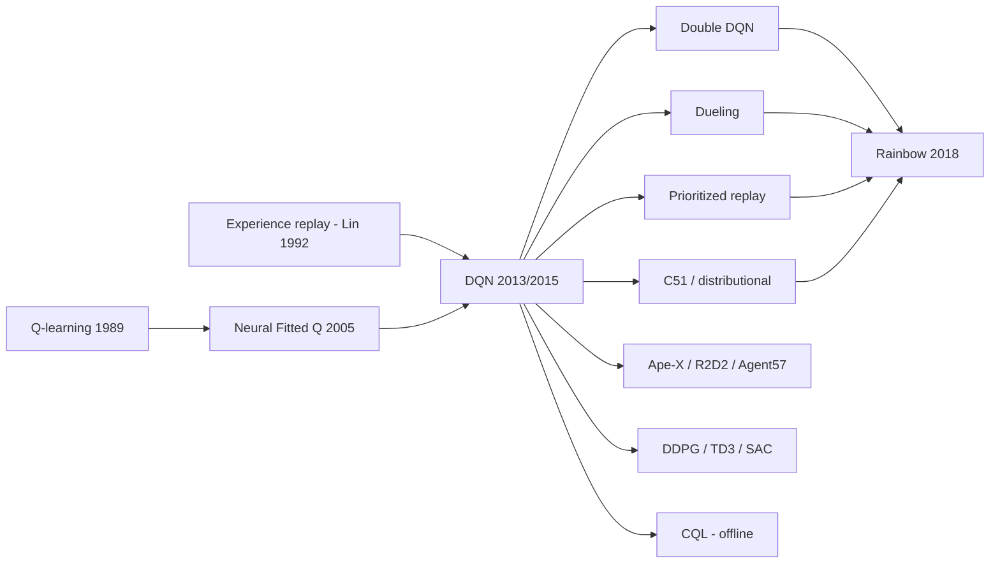

# Deep Q-Network (DQN)

> Q-learning with a neural network, made stable by experience replay and a target network. **Family:** Model-free → Value-based → Deep Q-learning  ·  **Year / origin:** Mnih et al., DeepMind — arXiv 2013 (NIPS Deep Learning Workshop), *Nature* 2015  ·  **On/Off-policy:** Off-policy  ·  **Action space:** Discrete

## 1. What is it?

DQN learns an action-value function $Q_\theta(s,a)$ with a deep neural network, then acts (almost) greedily with respect to it. It is the algorithm that kicked off the "deep RL" era: a single convolutional network, given only raw Atari pixels and the game score, learned to play dozens of Atari 2600 games, and the 2015 *Nature* paper reported performance comparable to a professional human games tester across a suite of 49 games, using the same architecture and hyperparameters for every game.

**The problem it solves.** Tabular Q-learning ([q-learning.md](../01-foundations-tabular/q-learning.md)) stores one number per $(s,a)$ pair, which is impossible when states are images. Replacing the table with a neural network is the obvious fix, but naive "online neural Q-learning" is notoriously unstable: it combines **function approximation**, **bootstrapping** and **off-policy learning** — what Sutton & Barto call the *deadly triad* (Ch. 11.3) — and tends to oscillate or diverge.

**What DQN added** on top of Q-learning with a network:

1. **Experience replay** (Lin, 1992): store transitions $(s,a,r,s',\text{done})$ in a large buffer and train on random minibatches from it. This breaks the strong temporal correlation between consecutive samples and reuses each transition many times.
2. **Target network**: compute the bootstrap target with a *frozen copy* $Q_{\theta^-}$ of the network that is only refreshed every $C$ steps. The regression target no longer moves on every gradient step.
3. **Huber loss / error clipping**: the *Nature* paper clipped the TD error term to $[-1, 1]$, which is equivalent to using the Huber loss — quadratic for small errors, linear for large ones — so rare huge errors cannot produce huge gradients.
4. **ε-greedy with a decaying schedule**: start fully random ($\varepsilon = 1$) and anneal linearly to a small value (0.1 in the *Nature* paper over the first million frames), then keep it fixed.
5. Atari-specific engineering: frame stacking (4 frames), frame skipping, reward clipping to $[-1,1]$, and a shared CNN.

**Taxonomy.** Model-free, value-based, off-policy, discrete actions. It is the parent of the whole "deep value-based" branch ([Rainbow](rainbow-dqn.md), [distributional RL](distributional-rl.md)) and an important ancestor of off-policy actor-critics ([DDPG](../04-off-policy-actor-critic/ddpg.md) is essentially "DQN for continuous actions").

## 2. Family & lineage

- **Parents:** Q-learning (Watkins 1989; Watkins & Dayan 1992), TD-Gammon-style neural value functions (Tesauro 1995), experience replay (Lin 1992), Neural Fitted Q Iteration (Riedmiller 2005), which already used batch training with a fixed target.
- **Siblings / improvements:** Double DQN, Dueling DQN, Prioritized Experience Replay, n-step DQN, Noisy Nets, C51 → all combined in **Rainbow** (2018).
- **Descendants:** distributional agents (QR-DQN, IQN), distributed agents (Gorila, Ape-X, R2D2 with recurrent networks, Agent57), DDPG/TD3/SAC (replay + target networks for continuous control), offline value-based methods such as CQL.



## 3. Core idea & intuition

Think of Q-learning as repeatedly solving a regression problem: "make $Q(s,a)$ close to $r + \gamma \max_{a'} Q(s',a')$". With a table, each update changes one cell. With a neural network, each gradient step changes the prediction for *every* state a little — including $s'$, the very state used to build the target. So the target "runs away" from the prediction you are chasing (like a dog chasing its own tail).

DQN's two tricks turn this unstable chase into something much closer to ordinary supervised learning:

- **Target network** = "freeze the answer key for a while". For $C$ steps the targets are computed with fixed weights $\theta^-$, so the network is solving a fixed regression problem. Every $C$ steps, the answer key is updated. This is like doing approximate value iteration: each period of $C$ steps is one (partial) Bellman backup.
- **Replay buffer** = "shuffle the dataset". Consecutive frames of a game are almost identical; training on them in order is like training an image classifier on 1,000 pictures of the same cat in a row. Sampling random minibatches from a big buffer gives roughly i.i.d. data, and each experience is reused many times (better sample efficiency).

Because it learns from a buffer full of old data generated by older, more exploratory policies, DQN is **off-policy**: it learns the greedy policy's values while behaving ε-greedily.

A useful mental picture of the learning dynamics (you will see it in the demo below): with a hard target update every $C$ steps and reward 1 per step, the predicted values grow by roughly "one more step of lookahead" per target refresh, so values propagate gradually over many target periods. If your $C$ is huge and your training short, $Q$ will still be badly underestimated — even though the greedy *ranking* of actions may already be good.

## 4. Math / formal details

**Setting.** MDP with states $s \in \mathcal S$, discrete actions $a \in \{1,\dots,|\mathcal A|\}$, reward $r$, discount $\gamma \in [0,1)$. The optimal action-value function satisfies the Bellman optimality equation

$$Q^*(s,a) = \mathbb E_{s',r}\big[r + \gamma \max_{a'} Q^*(s',a') \,\big|\, s,a\big].$$

**Loss.** With online parameters $\theta$, target parameters $\theta^-$ and replay buffer $\mathcal D$:

$$y = r + \gamma (1 - d)\, \max_{a'} Q_{\theta^-}(s', a'), \qquad
\mathcal L(\theta) = \mathbb E_{(s,a,r,s',d)\sim \mathcal D}\big[\,\ell_\kappa\big(y - Q_\theta(s,a)\big)\big],$$

where $d \in \{0,1\}$ is 1 only if $s'$ is a **true terminal** state (not a time-limit truncation), and the Huber loss with threshold $\kappa$ (usually $\kappa = 1$) is

$$\ell_\kappa(\delta) = \begin{cases} \tfrac12 \delta^2 & |\delta| \le \kappa \\ \kappa\big(|\delta| - \tfrac12\kappa\big) & \text{otherwise.}\end{cases}$$

**Gradient.** $y$ is treated as a constant (no gradient flows into $\theta^-$):

$$\nabla_\theta \mathcal L = -\mathbb E\big[\ell'_\kappa(y - Q_\theta(s,a))\, \nabla_\theta Q_\theta(s,a)\big], \qquad \ell'_\kappa(\delta) = \operatorname{clip}(\delta, -\kappa, \kappa).$$

This is exactly why "clip the error term to $[-1,1]$" equals the Huber loss: its derivative is the clipped TD error. This is a *semi-gradient* method (S&B Ch. 9.3): we do not differentiate through the target.

**Target update.** Either a hard copy $\theta^- \leftarrow \theta$ every $C$ steps (DQN), or Polyak averaging $\theta^- \leftarrow \tau\theta + (1-\tau)\theta^-$ with small $\tau$ (common in DDPG/SAC and sometimes used with DQN).

**Exploration.** ε-greedy:
$\pi(a\mid s) = (1-\varepsilon)\,\mathbb 1[a = \arg\max_{a'} Q_\theta(s,a')] + \varepsilon/|\mathcal A|$, with $\varepsilon_t = \max\big(\varepsilon_{\text{end}},\ \varepsilon_{\text{start}} - (\varepsilon_{\text{start}} - \varepsilon_{\text{end}})\, t / T_{\text{decay}}\big)$.

**Why it can still go wrong.** The $\max$ in the target is applied to noisy estimates, so $\mathbb E[\max_a \hat Q] \ge \max_a \mathbb E[\hat Q]$: DQN systematically **overestimates** values (maximization bias, S&B Ch. 6.7). Double DQN fixes this — see [rainbow-dqn.md](rainbow-dqn.md). There are no general convergence guarantees for DQN; it is an empirically stabilized approximation of fitted Q-iteration.

## 5. Algorithm (pseudocode)

```text
Input: replay capacity N, minibatch size B, target period C, discount gamma,
       epsilon schedule eps(t), learning starts L, total steps T
1.  Initialize Q-network weights theta randomly; target weights theta_minus <- theta
2.  Initialize empty replay buffer D (capacity N)
3.  s <- env.reset()
4.  for t = 0, 1, ..., T-1:
5.      with probability eps(t) pick a random action a, else a <- argmax_a Q_theta(s, a)
6.      execute a, observe r, s', terminated, truncated
7.      store (s, a, r, s', d = terminated) in D        # truncation is NOT terminal
8.      s <- s'; if terminated or truncated: s <- env.reset()
9.      if t >= L:
10.         sample minibatch {(s_j, a_j, r_j, s'_j, d_j)} of size B from D
11.         y_j <- r_j + gamma * (1 - d_j) * max_a' Q_theta_minus(s'_j, a')
12.         loss <- mean_j Huber(y_j - Q_theta(s_j, a_j))
13.         theta <- theta - lr * grad_theta(loss)          # (optionally clip grad norm)
14.     if t mod C == 0: theta_minus <- theta
15. return greedy policy argmax_a Q_theta(s, a)
```

## 6. Python implementation

A complete DQN on a NumPy re-implementation of the classic cart-pole (Barto, Sutton & Anderson 1983; same constants as Gym's `CartPole`). Episodes are capped at 200 steps, so the maximum return is 200. The script trains for 30k environment steps (~1 minute on one CPU core), evaluates the greedy policy every 5k steps, and keeps the best snapshot — a standard practical trick because DQN's greedy performance can oscillate.

Runnable version: [`code/dqn.py`](../../code/dqn.py)

```python
"""
DQN (Mnih et al. 2013 / 2015) on a self-contained NumPy CartPole.

Ingredients shown here:
  * experience replay buffer (uniform sampling)
  * target network (hard copy every `target_update` steps)
  * Huber (smooth-L1) TD loss
  * linearly decaying epsilon-greedy exploration
Run:  python3 code/dqn.py      (about 30-60 s on a laptop CPU)
"""
import math
import random

import numpy as np
import torch
import torch.nn as nn
import torch.nn.functional as F


# ----------------------------------------------------------------------------
# Minimal CartPole (same physics/constants as the classic Barto-Sutton-Anderson
# task and Gym's CartPole). Episodes are capped at `max_steps` (truncation).
# ----------------------------------------------------------------------------
class CartPole:
    def __init__(self, max_steps=200, seed=0):
        self.gravity, self.m_cart, self.m_pole = 9.8, 1.0, 0.1
        self.length, self.force_mag, self.tau = 0.5, 10.0, 0.02  # half pole length, N, s
        self.x_limit, self.theta_limit = 2.4, 12 * 2 * math.pi / 360
        self.max_steps, self.rng = max_steps, np.random.default_rng(seed)
        self.obs_dim, self.n_actions = 4, 2

    def reset(self):
        self.state = self.rng.uniform(-0.05, 0.05, size=4)
        self.t = 0
        return self.state.astype(np.float32)

    def step(self, action):
        x, x_dot, th, th_dot = self.state
        force = self.force_mag if action == 1 else -self.force_mag
        cos, sin = math.cos(th), math.sin(th)
        total_m, pm_l = self.m_cart + self.m_pole, self.m_pole * self.length
        temp = (force + pm_l * th_dot ** 2 * sin) / total_m
        th_acc = (self.gravity * sin - cos * temp) / (
            self.length * (4.0 / 3.0 - self.m_pole * cos ** 2 / total_m))
        x_acc = temp - pm_l * th_acc * cos / total_m
        # explicit Euler integration
        x, x_dot = x + self.tau * x_dot, x_dot + self.tau * x_acc
        th, th_dot = th + self.tau * th_dot, th_dot + self.tau * th_acc
        self.state = np.array([x, x_dot, th, th_dot])
        self.t += 1
        terminated = bool(abs(x) > self.x_limit or abs(th) > self.theta_limit)
        truncated = self.t >= self.max_steps
        return self.state.astype(np.float32), 1.0, terminated, truncated


# ----------------------------------------------------------------------------
# Replay buffer: a circular array of transitions, sampled uniformly.
# ----------------------------------------------------------------------------
class ReplayBuffer:
    def __init__(self, capacity, obs_dim):
        self.obs = np.zeros((capacity, obs_dim), np.float32)
        self.next_obs = np.zeros((capacity, obs_dim), np.float32)
        self.act = np.zeros(capacity, np.int64)
        self.rew = np.zeros(capacity, np.float32)
        self.done = np.zeros(capacity, np.float32)  # 1 only for TRUE terminals
        self.capacity, self.ptr, self.size = capacity, 0, 0

    def add(self, o, a, r, o2, d):
        i = self.ptr
        self.obs[i], self.act[i], self.rew[i], self.next_obs[i], self.done[i] = o, a, r, o2, d
        self.ptr = (self.ptr + 1) % self.capacity
        self.size = min(self.size + 1, self.capacity)

    def sample(self, batch_size):
        idx = np.random.randint(0, self.size, size=batch_size)
        return (torch.as_tensor(self.obs[idx]), torch.as_tensor(self.act[idx]),
                torch.as_tensor(self.rew[idx]), torch.as_tensor(self.next_obs[idx]),
                torch.as_tensor(self.done[idx]))


def make_q_net(obs_dim, n_actions, hidden=128):
    return nn.Sequential(nn.Linear(obs_dim, hidden), nn.ReLU(),
                         nn.Linear(hidden, hidden), nn.ReLU(),
                         nn.Linear(hidden, n_actions))


def epsilon_at(step, eps_start=1.0, eps_end=0.05, decay_steps=10_000):
    """Linear decay from eps_start to eps_end, then constant (as in the Nature paper)."""
    frac = min(1.0, step / decay_steps)
    return eps_start + frac * (eps_end - eps_start)


def evaluate(q_net, n_episodes=10, seed=123):
    """Greedy (epsilon = 0) average return."""
    env, total = CartPole(seed=seed), 0.0
    for _ in range(n_episodes):
        o, done = env.reset(), False
        while not done:
            with torch.no_grad():
                a = int(q_net(torch.as_tensor(o)).argmax())
            o, r, term, trunc = env.step(a)
            total += r
            done = term or trunc
    return total / n_episodes


def train(total_steps=30_000, gamma=0.99, lr=1e-3, batch_size=64, buffer_size=50_000,
          learning_starts=1_000, train_freq=1, target_update=1_000, seed=0):
    random.seed(seed); np.random.seed(seed); torch.manual_seed(seed)
    env = CartPole(seed=seed)
    q_net = make_q_net(env.obs_dim, env.n_actions)
    target_net = make_q_net(env.obs_dim, env.n_actions)
    target_net.load_state_dict(q_net.state_dict())
    opt = torch.optim.Adam(q_net.parameters(), lr=lr)
    buf = ReplayBuffer(buffer_size, env.obs_dim)

    before = evaluate(q_net)
    best_score, best_state = -1.0, None   # DQN can oscillate: keep the best greedy snapshot
    o, ep_ret, ep_returns = env.reset(), 0.0, []
    for step in range(total_steps):
        # ---- act (epsilon-greedy) ----
        if random.random() < epsilon_at(step):
            a = random.randrange(env.n_actions)
        else:
            with torch.no_grad():
                a = int(q_net(torch.as_tensor(o)).argmax())
        o2, r, term, trunc = env.step(a)
        # store `term` (not trunc): a time-limit cut is not a real terminal state
        buf.add(o, a, r, o2, float(term))
        o, ep_ret = o2, ep_ret + r
        if term or trunc:
            ep_returns.append(ep_ret)
            o, ep_ret = env.reset(), 0.0

        # ---- learn ----
        if step >= learning_starts and step % train_freq == 0:
            obs, act, rew, nobs, done = buf.sample(batch_size)
            with torch.no_grad():  # y = r + gamma * max_a' Q_target(s', a')
                target = rew + gamma * (1.0 - done) * target_net(nobs).max(dim=1).values
            q_sa = q_net(obs).gather(1, act.unsqueeze(1)).squeeze(1)
            loss = F.smooth_l1_loss(q_sa, target)  # Huber loss (= error clipping)
            opt.zero_grad()
            loss.backward()
            nn.utils.clip_grad_norm_(q_net.parameters(), 10.0)
            opt.step()

        if step % target_update == 0:  # hard target-network update
            target_net.load_state_dict(q_net.state_dict())

        if (step + 1) % 5_000 == 0:
            recent = np.mean(ep_returns[-20:]) if ep_returns else 0.0
            score = evaluate(q_net)
            if score >= best_score:
                best_score = score
                best_state = {k: v.clone() for k, v in q_net.state_dict().items()}
            print(f"step {step+1:6d}  eps={epsilon_at(step):.2f}  "
                  f"avg train return (last 20 eps)={recent:6.1f}  greedy eval={score:6.1f}")

    final = evaluate(q_net)
    q_net.load_state_dict(best_state)
    return before, final, evaluate(q_net, seed=999)   # re-test best snapshot on fresh episodes


if __name__ == "__main__":
    torch.set_num_threads(1)
    before, final, best = train()
    print(f"\nGreedy eval return before training : {before:.1f}")
    print(f"Greedy eval return after training  : {final:.1f}   (max possible = 200)")
    print(f"Best snapshot, re-tested on new eps: {best:.1f}")
```

Example output (one run on CPU; your numbers will vary):

```text
step   5000  eps=0.53  avg train return (last 20 eps)=  36.6  greedy eval=  25.2
step  10000  eps=0.05  avg train return (last 20 eps)= 121.2  greedy eval= 158.5
...
step  30000  eps=0.05  avg train return (last 20 eps)= 143.8  greedy eval= 188.7

Greedy eval return before training : 87.6
Greedy eval return after training  : 188.7   (max possible = 200)
Best snapshot, re-tested on new eps: 185.3
```

(The untrained network already scores ~88 on this seed by luck: a random network sometimes encodes a half-decent "push toward the lean" rule. Other seeds start around 9.)

## 7. Practical tips & hyperparameters

**Typical values.**

| Hyperparameter | *Nature* DQN (Atari) | Small tasks (CartPole-like) |
|---|---|---|
| Replay capacity | 1M transitions | 10k–100k |
| Minibatch size | 32 | 64–128 |
| Discount $\gamma$ | 0.99 | 0.99 |
| Optimizer / LR | RMSProp, 2.5e-4 | Adam, 1e-4 – 1e-3 |
| Target update period $C$ | 10k updates | 500–1000 steps (or Polyak $\tau$ = 0.005) |
| ε schedule | 1.0 → 0.1 over 1M frames | 1.0 → 0.05 over 10–30% of training |
| Learning starts | 50k frames | 1k steps |
| Train frequency | every 4 agent steps | every step |
| Loss | Huber (error clipping) | Huber or MSE |

Modern Atari implementations (e.g. Dopamine, CleanRL) often use Adam and a final ε of 0.01.

**Pitfalls.**

- **Terminal vs. truncated.** Only mask the bootstrap (`1 - done`) on true terminals. Treating a time-limit cut as "the world ended" teaches the agent that states near step 200 are worth 0 — a classic silent bug.
- **Forgetting `no_grad` / `detach` on the target**: gradients then flow through the target, turning DQN into a residual-gradient method that usually learns much slower.
- **Too-frequent target updates** ($C$ tiny) → instability; **too rare** → slow value propagation (see Section 3).
- **Reward scale.** Large rewards make Huber act like L1 almost everywhere; normalize or clip rewards (DQN clipped Atari rewards to $[-1,1]$, which also changes the objective — the agent can no longer tell a big reward from a small one).
- **Overestimation.** If predicted Q-values grow far above any achievable return, switch on Double DQN.
- **Catastrophic forgetting / oscillation.** Once the buffer only contains "good" data the network may forget why bad states are bad, and performance collapses then recovers. Larger buffers, lower LR, and keeping the best checkpoint help.

**Debugging signals.** Log the mean predicted $Q$ of sampled states (should rise smoothly and plateau near the true discounted return — for CartPole with $\gamma=0.99$ and a 200-step cap, at most $\frac{1-0.99^{200}}{0.01}\approx 86.6$), the TD loss (should not explode), episode returns under the greedy policy, and ε. A Q-value curve that keeps increasing without bound means divergence or overestimation.

## 8. Pros and cons

**Pros**
- Simple, well understood, with excellent reference implementations.
- Off-policy and sample-reusing: every transition is replayed many times.
- Works directly from high-dimensional observations (pixels).
- Greedy policy extraction is trivial — no separate actor network.
- The foundation for a large, well-studied family of improvements.

**Cons**
- Discrete actions only (the $\max_{a'}$ is intractable over continuous actions).
- Overestimation bias; brittle to hyperparameters ($C$, LR, buffer size).
- Learning can oscillate; no convergence guarantee with nonlinear function approximation.
- ε-greedy exploration is undirected and weak on hard-exploration tasks.
- Memory-hungry replay buffers for image observations; less sample-efficient than model-based methods.

## 9. When to use / when not to use

**Use DQN (or better, a Rainbow-style variant) when:**
- Actions are discrete and not too many (up to a few hundred).
- Environment interaction is moderately expensive and you want to reuse data (off-policy).
- You want a strong, simple baseline for a discrete-control problem (games, recommendation slates with few options, scheduling choices).

**Avoid when:**
- Actions are continuous or combinatorial → use [SAC](../04-off-policy-actor-critic/sac.md)/[TD3](../04-off-policy-actor-critic/td3.md) or policy-gradient methods.
- You need a stochastic policy (e.g. in games with mixed strategies) → policy-gradient methods.
- You can simulate cheaply and massively in parallel → [PPO](../03-policy-gradient/ppo.md) is often easier to tune.
- You only have a fixed dataset → use an offline method such as [CQL](../06-offline-rl/cql.md); naive DQN on offline data overestimates out-of-distribution actions.

## 10. Key papers, books & repos

- Mnih, Kavukcuoglu, Silver, Graves, Antonoglou, Wierstra, Riedmiller (2013). *Playing Atari with Deep Reinforcement Learning.* NIPS Deep Learning Workshop. arXiv:1312.5602.
- Mnih et al. (2015). *Human-level control through deep reinforcement learning.* Nature 518, 529–533. (Adds the target network; 49-game evaluation.)
- Lin, L.-J. (1992). *Self-improving reactive agents based on reinforcement learning, planning and teaching.* Machine Learning 8. (Experience replay.)
- Riedmiller, M. (2005). *Neural Fitted Q Iteration.* ECML 2005.
- Watkins & Dayan (1992). *Q-learning.* Machine Learning 8.
- van Hasselt, Guez, Silver (2016). *Deep Reinforcement Learning with Double Q-learning.* AAAI. arXiv:1509.06461.
- Sutton & Barto, *Reinforcement Learning: An Introduction* (2nd ed., 2018): Ch. 6.5 (Q-learning), 6.7 (maximization bias), Ch. 9–11 (function approximation, semi-gradient methods, the deadly triad in 11.3), 16.5 (case study: human-level video game play).
- Repos: [vwxyzjn/cleanrl](https://github.com/vwxyzjn/cleanrl) (`dqn.py`, `dqn_atari.py` — single-file reference), [DLR-RM/stable-baselines3](https://github.com/DLR-RM/stable-baselines3) (`DQN`), [openai/baselines](https://github.com/openai/baselines) (`deepq`), [google/dopamine](https://github.com/google/dopamine) (research framework with DQN/Rainbow/IQN).

## 11. For business users

**What it does.** DQN is a way for software to learn, by trial and error, how valuable each available choice is in each situation — and then pick the most valuable one. It learns from a large memory of past experiences, replaying them over and over to squeeze out lessons, which makes it relatively data-efficient for a learning-by-doing method.

**Analogy.** A new store manager keeps a diary of every decision ("Monday morning, put snacks at the entrance → sales went up a bit"). Each evening they re-read random pages of the diary and refine a mental scorecard: "in situation X, option Y is worth about Z". To avoid constantly second-guessing themselves, they only rewrite the "official" scorecard once a week.

**Real-world use cases.** Game-playing agents (the original Atari results), choosing among a fixed menu of actions in operations (e.g. which queue to serve, which discrete setting to apply), some recommendation and ad-selection research, network/traffic control prototypes, and as a building block inside larger systems.

**Value / ROI.** A strong, well-understood baseline whenever decisions are a choice among a handful of options and you have a simulator or plenty of logged interactions. Open-source implementations make prototyping cheap.

**Risks.** Needs lots of interaction data or a good simulator; can be unstable and sensitive to settings; can overestimate how good actions are; learns whatever the reward rewards (badly specified rewards → undesired behavior). Running it on historical data alone, without care, is risky.

**Costs.** Mostly compute for simulation and training (GPUs for image inputs), engineering time to build a reliable simulator and reward, and tuning time.

**Questions to ask your team.**
- Are our actions a small discrete set? If not, why DQN?
- Do we have a simulator, or are we learning from logged data only (then we need offline RL)?
- How do we know the learned values are not wildly overestimated?
- What's the baseline (rules, heuristics) and how much better is the agent across many random seeds?
- How do we stop and roll back if the policy's performance suddenly collapses?

## 12. For kids (ages ~8–12)

**Story.** Robo the robot is learning to balance a broom on its hand. Every time it tries, it writes a sticky note: "Broom leaning left, I moved right → it stayed up! 👍" or "...it fell 👎". Robo keeps thousands of sticky notes in a big jar. At night, Robo pulls out random notes and practices guessing: "If the broom leans left, how many seconds will it stay up if I move right?" Robo keeps one "official guess book" that it only updates once in a while, so it doesn't get confused by changing its mind every second. After lots of nights, Robo's guesses are great — and it just picks the move with the best guess!

**Try it yourself.** Balance a pencil (eraser up) on your palm. Each try, note what you did when it started to fall (moved toward the lean, or away?). Write 10 notes, then shuffle them and read them back. Which move kept it up longer?

**Recap.**
1. Robo remembers lots of past tries in a jar (replay).
2. It practices guessing how good each move is.
3. It picks the move with the best guess — and sometimes tries a random one to learn more.

## 13. Related methods

- [Q-learning (tabular)](../01-foundations-tabular/q-learning.md) — the update rule DQN approximates.
- [TD learning](../01-foundations-tabular/td-learning.md) — bootstrapping basics.
- [Rainbow DQN](rainbow-dqn.md) — Double, Dueling, PER, n-step, Noisy Nets, C51 combined.
- [Distributional RL (C51, QR-DQN, IQN)](distributional-rl.md) — learn the whole return distribution.
- [DDPG](../04-off-policy-actor-critic/ddpg.md) — replay + target networks for continuous actions.
- [CQL](../06-offline-rl/cql.md) — conservative Q-learning from fixed datasets.
- [PPO](../03-policy-gradient/ppo.md) — the main on-policy alternative.
- [Curiosity / RND](../08-exploration-hierarchical-multiagent/curiosity-icm-rnd.md) — better exploration than ε-greedy.

[← Back to overview](../../RL_Methods_Overview.md)
