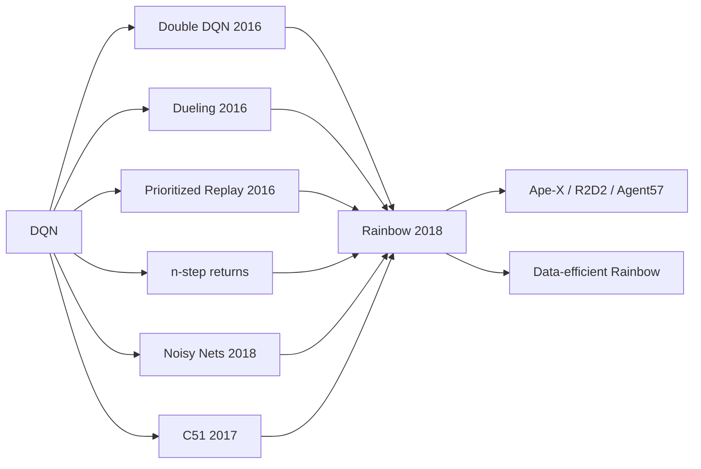

# Rainbow DQN (Double DQN, Dueling, PER, n-step, Noisy Nets, C51)

> Six independent fixes to DQN — each attacking a different weakness — combined into one agent that was state of the art on Atari in 2017. **Family:** Model-free → Value-based → Deep Q-learning  ·  **Year / origin:** Hessel et al., DeepMind, AAAI 2018 (arXiv 2017); components 2015–2017  ·  **On/Off-policy:** Off-policy  ·  **Action space:** Discrete

## 1. What is it?

After [DQN](dqn.md) (2013/2015), researchers proposed many targeted improvements. **Rainbow** (Hessel et al., 2018) asked a simple question: *are these improvements complementary?* It combined six of them into a single agent and showed that, on the Atari-57 benchmark, the combination was markedly better than any single component — both in final performance and in data efficiency — and ran an ablation study to measure how much each piece contributes.

The six components and what they fix:

| Component | Paper | Problem in DQN it addresses |
|---|---|---|
| **Double DQN** | van Hasselt, Guez, Silver (AAAI 2016) | Overestimation from the $\max$ in the target |
| **Dueling network** | Wang et al. (ICML 2016) | Inefficient learning when action choice rarely matters |
| **Prioritized Experience Replay (PER)** | Schaul et al. (ICLR 2016) | Uniform replay wastes updates on already-learned transitions |
| **n-step returns** | classic (Sutton 1988; S&B Ch. 7), used in A3C | 1-step bootstrapping propagates reward slowly |
| **Noisy Nets** | Fortunato et al. (ICLR 2018) | ε-greedy exploration is state-independent and crude |
| **Distributional (C51)** | Bellemare, Dabney, Munos (ICML 2017) | Learning only the mean return discards information; see [distributional-rl.md](distributional-rl.md) |

Rainbow is still a model-free, off-policy, discrete-action value-based method; it simply makes every part of the DQN pipeline — target, architecture, sampling, horizon, exploration and loss — better.

## 2. Family & lineage

- **Parent:** DQN.
- **Components (siblings):** Double DQN, Dueling DQN, PER, multi-step DQN, NoisyNet-DQN, C51.
- **Descendants / relatives:** Ape-X (distributed PER), R2D2 (recurrent, distributed, n-step + PER + double + dueling), Agent57, IQN-based Rainbow variants (Dopamine's "Rainbow" uses C51; later work swapped in IQN), Data-efficient Rainbow (DER) for the Atari-100k benchmark, "Revisiting Rainbow" (Obando-Ceron & Castro, ICML 2021) studying it at small scale.



## 3. Core idea & intuition

Each component has a one-sentence intuition:

- **Double DQN — "don't let the same judge pick and grade".** The $\max$ over noisy estimates picks whichever action happens to be overestimated. Let the online network *choose* the next action and the target network *evaluate* it; independent errors no longer compound.
- **Dueling — "how good is the situation vs. how much better is this move?"** In many states all actions are about equally good (e.g. nothing is happening on screen). Split $Q$ into a state value $V(s)$ and an advantage $A(s,a)$. $V$ gets updated by every transition, regardless of which action was taken, so it learns faster.
- **PER — "study your mistakes".** Replay transitions with a large TD error more often, because that's where the network is most wrong. Correct the resulting bias with importance-sampling weights.
- **n-step — "look further before trusting your guess".** Use $n$ real rewards before bootstrapping. Reward information moves $n$ steps per update instead of 1 (at the cost of some bias from the off-policy data, which Rainbow simply ignores for small $n$).
- **Noisy Nets — "learned, state-dependent curiosity".** Add learnable noise to the network weights. The agent learns how much to randomize in each state, and the noise shrinks where it is no longer useful. This replaces ε-greedy.
- **C51 — "predict the whole spread of outcomes, not just the average".** Model the return as a categorical distribution over 51 fixed values; training on the full distribution gives a richer learning signal.

Why the combination works: they modify **different parts** of the algorithm (target computation, network head, sampling distribution, return horizon, exploration, loss), so they mostly do not interfere.

## 4. Math / formal details

Notation: online parameters $\theta$, target parameters $\theta^-$, discount $\gamma$, transition $(s_t, a_t, r_{t+1}, s_{t+1})$.

**Double DQN target.**
$$y^{\text{Double}}_t = r_{t+1} + \gamma\, Q_{\theta^-}\!\big(s_{t+1},\ \arg\max_{a'} Q_\theta(s_{t+1}, a')\big).$$
Compare DQN: $y_t = r_{t+1} + \gamma \max_{a'} Q_{\theta^-}(s_{t+1},a')$. (Original Double Q-learning, van Hasselt 2010, kept two fully separate tables.)

**Dueling aggregation.** With a shared torso and two streams $V_\theta(s)$ and $A_\theta(s,a)$:
$$Q_\theta(s,a) = V_\theta(s) + A_\theta(s,a) - \frac{1}{|\mathcal A|}\sum_{a'} A_\theta(s,a').$$
Subtracting the mean makes the decomposition identifiable ($V$ and $A$ cannot drift by opposite constants). The paper also discusses subtracting $\max_{a'} A$; the mean version was more stable in practice.

**n-step return.**
$$G^{(n)}_t = \sum_{k=0}^{n-1}\gamma^k r_{t+k+1}, \qquad y_t = G^{(n)}_t + \gamma^n\, Q_{\theta^-}\big(s_{t+n}, a^*_{t+n}\big),$$
truncated at episode termination (then no bootstrap term). In Rainbow, $a^*_{t+n}$ is chosen Double-DQN style.

**Prioritized replay (proportional variant).** Each transition $i$ has priority $p_i = |\delta_i| + \epsilon$, where $\delta_i$ is its last TD error. Sampling probability and importance-sampling (IS) weight:
$$P(i) = \frac{p_i^{\alpha}}{\sum_k p_k^{\alpha}}, \qquad w_i = \Big(\frac{1}{N \cdot P(i)}\Big)^{\beta} \Big/ \max_j w_j.$$
$\alpha \in [0,1]$ controls how greedy prioritization is ($\alpha=0$ is uniform); $\beta$ is annealed from $\beta_0$ (e.g. 0.4) to 1 so that updates become unbiased near the end of training. The loss for sample $i$ is multiplied by $w_i$. Sampling is $O(\log N)$ with a **sum tree**. (A rank-based variant with $p_i = 1/\text{rank}(i)$ also exists.) Rainbow uses the KL loss of C51 as the priority instead of $|\delta|$.

**Noisy linear layer (factorized Gaussian).** For a layer with $p$ inputs and $q$ outputs:
$$y = (\mu^w + \sigma^w \odot \varepsilon^w)\,x + (\mu^b + \sigma^b \odot \varepsilon^b), \quad \varepsilon^w = f(\varepsilon_{\text{out}})\, f(\varepsilon_{\text{in}})^\top,\ \varepsilon^b = f(\varepsilon_{\text{out}}),$$
with $f(x) = \operatorname{sign}(x)\sqrt{|x|}$, $\varepsilon_{\text{in}} \in \mathbb R^p$, $\varepsilon_{\text{out}} \in \mathbb R^q$ standard normal, and $\sigma$ initialized to $\sigma_0/\sqrt{p}$ ($\sigma_0 = 0.5$). $\mu, \sigma$ are learned by ordinary backprop; the agent acts greedily w.r.t. the noisy network.

**C51 (distributional) loss.** Return distribution on fixed atoms $z_i = V_{\min} + i\,\Delta z$, $i=0..50$. The target distribution $\hat{\mathcal T}Z = r + \gamma^n z$ is projected onto the atoms ($\Phi$) and the loss is the cross-entropy $-\sum_i (\Phi \hat{\mathcal T} Z)_i \log p_\theta(s,a)_i$. Details in [distributional-rl.md](distributional-rl.md). In Rainbow, the dueling streams output per-atom logits: $\text{logit}_i(s,a) = v_i(s) + a_i(s,a) - \text{mean}_{a'} a_i(s,a')$, followed by a softmax over atoms.

**Rainbow ablation (reported).** Removing **prioritized replay** or **multi-step** learning hurt the most; removing the distributional component also caused a large drop (mainly later in training); removing Noisy Nets hurt on some games and helped on others; removing Double or Dueling had comparatively small effects in the full combination.

## 5. Algorithm (pseudocode)

```text
Input: n-step n, PER exponents alpha, beta0, target period C, discount gamma, total steps T
1.  Init online net Q_theta (dueling, optionally noisy / distributional); theta_minus <- theta
2.  Init prioritized replay D (sum tree), empty n-step queue
3.  s <- env.reset()
4.  for t = 0..T-1:
5.      a <- argmax_a Q_theta(s, a)           # noisy nets explore; else epsilon-greedy
6.      step env -> r, s', terminated, truncated
7.      push (s, a, r) into n-step queue; when it holds n items (or the episode ends):
8.          emit (s_t, a_t, G_t^(n), s_{t+k}, gamma^k * (1 - terminated)) and add to D
9.          with priority = current max priority
10.     s <- s' (reset if episode ended)
11.     if t >= learning_starts:
12.         beta <- beta0 + (1 - beta0) * t / T
13.         sample minibatch i_1..i_B with P(i) ~ p_i^alpha; IS weights w_i
14.         a* <- argmax_a Q_theta(s_{t+n}, a)                  # Double: online net selects
15.         y  <- G^(n) + discount * Q_theta_minus(s_{t+n}, a*)  # target net evaluates
16.         loss <- mean_i w_i * Huber(y_i - Q_theta(s_i, a_i))  # (C51: cross-entropy)
17.         gradient step on theta; update priorities p_i <- |y_i - Q_theta(s_i, a_i)| + eps
18.         resample noise in noisy layers
19.     every C steps: theta_minus <- theta
```

## 6. Python implementation

The script below implements **Double DQN + Dueling + 3-step returns + Prioritized Replay (sum tree)** with optional **Noisy Nets** (`use_noisy=True`). The distributional C51 head lives in [`code/distributional-rl.py`](../../code/distributional-rl.py) so that each file stays readable; plugging it in means replacing the dueling scalar output by per-atom logits and the Huber loss by the projected cross-entropy. The environment is a NumPy cart-pole (200-step cap). The script also runs two unit checks (n-step returns, sum-tree sampling frequencies).

Runnable version: [`code/rainbow-dqn.py`](../../code/rainbow-dqn.py)

```python
"""
"Rainbow-lite" DQN on a self-contained NumPy CartPole.

Combines the DQN extensions from Hessel et al. (2018), "Rainbow":
  * Double DQN         (van Hasselt et al. 2016)  -> online net picks a', target net evaluates it
  * Dueling network    (Wang et al. 2016)         -> Q = V + A - mean(A)
  * n-step returns     (Sutton 1988; used in A3C/Rainbow)
  * Prioritized replay (Schaul et al. 2016)       -> sum-tree, proportional variant, IS weights
  * Noisy Nets         (Fortunato et al. 2018)    -> optional (USE_NOISY), replaces epsilon-greedy
The distributional (C51) head is shown separately in code/distributional-rl.py.
Run:  python3 code/rainbow-dqn.py      (about 1 minute on CPU)
"""
import math
import random
from collections import deque

import numpy as np
import torch
import torch.nn as nn
import torch.nn.functional as F


class CartPole:
    """Classic cart-pole physics (same constants as Gym CartPole), capped at max_steps."""
    def __init__(self, max_steps=200, seed=0):
        self.gravity, self.m_cart, self.m_pole = 9.8, 1.0, 0.1
        self.length, self.force_mag, self.tau = 0.5, 10.0, 0.02
        self.x_limit, self.theta_limit = 2.4, 12 * 2 * math.pi / 360
        self.max_steps, self.rng = max_steps, np.random.default_rng(seed)
        self.obs_dim, self.n_actions = 4, 2

    def reset(self):
        self.state, self.t = self.rng.uniform(-0.05, 0.05, size=4), 0
        return self.state.astype(np.float32)

    def step(self, action):
        x, x_dot, th, th_dot = self.state
        force = self.force_mag if action == 1 else -self.force_mag
        cos, sin = math.cos(th), math.sin(th)
        total_m, pm_l = self.m_cart + self.m_pole, self.m_pole * self.length
        temp = (force + pm_l * th_dot ** 2 * sin) / total_m
        th_acc = (self.gravity * sin - cos * temp) / (
            self.length * (4.0 / 3.0 - self.m_pole * cos ** 2 / total_m))
        x_acc = temp - pm_l * th_acc * cos / total_m
        x, x_dot = x + self.tau * x_dot, x_dot + self.tau * x_acc
        th, th_dot = th + self.tau * th_dot, th_dot + self.tau * th_acc
        self.state, self.t = np.array([x, x_dot, th, th_dot]), self.t + 1
        terminated = bool(abs(x) > self.x_limit or abs(th) > self.theta_limit)
        return self.state.astype(np.float32), 1.0, terminated, self.t >= self.max_steps


# ----------------------------------------------------------------------------
# Prioritized replay (proportional variant) backed by a sum tree.
# ----------------------------------------------------------------------------
class SumTree:
    """Binary tree where each parent stores the sum of its children; leaves = priorities."""
    def __init__(self, capacity):
        assert capacity & (capacity - 1) == 0, "use a power of two"
        self.capacity, self.tree = capacity, np.zeros(2 * capacity)

    def update(self, idx, priority):
        i = idx + self.capacity
        delta = priority - self.tree[i]
        while i >= 1:          # propagate the change up to the root
            self.tree[i] += delta
            i //= 2

    def total(self):
        return self.tree[1]

    def find(self, value):
        """Return the leaf index whose cumulative-sum interval contains `value`."""
        i = 1
        while i < self.capacity:
            left = 2 * i
            if value <= self.tree[left]:
                i = left
            else:
                value -= self.tree[left]
                i = left + 1
        return i - self.capacity


class PrioritizedReplay:
    def __init__(self, capacity, obs_dim, alpha=0.6, eps=1e-5):
        self.tree, self.alpha, self.eps = SumTree(capacity), alpha, eps
        self.obs = np.zeros((capacity, obs_dim), np.float32)
        self.next_obs = np.zeros((capacity, obs_dim), np.float32)
        self.act = np.zeros(capacity, np.int64)
        self.ret = np.zeros(capacity, np.float32)    # n-step discounted reward sum
        self.disc = np.zeros(capacity, np.float32)   # gamma^k, or 0 if episode terminated
        self.capacity, self.ptr, self.size, self.max_prio = capacity, 0, 0, 1.0

    def add(self, o, a, R, o_n, disc):
        i = self.ptr
        self.obs[i], self.act[i], self.ret[i], self.next_obs[i], self.disc[i] = o, a, R, o_n, disc
        self.tree.update(i, self.max_prio ** self.alpha)   # new data gets max priority
        self.ptr, self.size = (i + 1) % self.capacity, min(self.size + 1, self.capacity)

    def sample(self, batch_size, beta):
        # stratified sampling: one sample from each of `batch_size` equal-mass segments
        seg = self.tree.total() / batch_size
        vals = (np.arange(batch_size) + np.random.rand(batch_size)) * seg
        idx = np.array([min(self.tree.find(v), self.size - 1) for v in vals])
        probs = self.tree.tree[idx + self.capacity] / self.tree.total()
        weights = (self.size * probs) ** (-beta)                # importance-sampling correction
        weights /= weights.max()
        t = torch.as_tensor
        return idx, (t(self.obs[idx]), t(self.act[idx]), t(self.ret[idx]),
                     t(self.next_obs[idx]), t(self.disc[idx]), t(weights, dtype=torch.float32))

    def update_priorities(self, idx, td_errors):
        prios = np.abs(td_errors) + self.eps
        for i, p in zip(idx, prios):
            self.tree.update(int(i), p ** self.alpha)
        self.max_prio = max(self.max_prio, float(prios.max()))


class NStepAccumulator:
    """Turns 1-step transitions into n-step ones: (s_t, a_t, sum_k g^k r_{t+k}, s_{t+n}, g^n)."""
    def __init__(self, n, gamma):
        self.n, self.gamma, self.queue = n, gamma, deque()

    def _pop(self, last_obs, terminated):
        k = len(self.queue)
        R = sum(self.gamma ** j * r for j, (_, _, r) in enumerate(self.queue))
        o, a, _ = self.queue.popleft()
        return o, a, R, last_obs, 0.0 if terminated else self.gamma ** k

    def push(self, o, a, r, o2, terminated, truncated):
        self.queue.append((o, a, r))
        out = []
        if len(self.queue) == self.n:
            out.append(self._pop(o2, terminated))
        if terminated or truncated:          # flush shorter-horizon transitions at episode end
            while self.queue:
                out.append(self._pop(o2, terminated))
        return out


# ----------------------------------------------------------------------------
# Networks: Noisy linear layer + dueling head.
# ----------------------------------------------------------------------------
class NoisyLinear(nn.Module):
    """Factorised-Gaussian noisy layer: w = mu_w + sigma_w * (f(e_out) f(e_in)^T)."""
    def __init__(self, n_in, n_out, sigma0=0.5):
        super().__init__()
        self.n_in, self.n_out = n_in, n_out
        bound = 1 / math.sqrt(n_in)
        self.w_mu = nn.Parameter(torch.empty(n_out, n_in).uniform_(-bound, bound))
        self.b_mu = nn.Parameter(torch.empty(n_out).uniform_(-bound, bound))
        self.w_sigma = nn.Parameter(torch.full((n_out, n_in), sigma0 / math.sqrt(n_in)))
        self.b_sigma = nn.Parameter(torch.full((n_out,), sigma0 / math.sqrt(n_in)))
        self.register_buffer("eps_in", torch.zeros(n_in))
        self.register_buffer("eps_out", torch.zeros(n_out))
        self.reset_noise()

    @staticmethod
    def _f(x):
        return x.sign() * x.abs().sqrt()

    def reset_noise(self):
        self.eps_in.copy_(self._f(torch.randn(self.n_in)))
        self.eps_out.copy_(self._f(torch.randn(self.n_out)))

    def forward(self, x):
        w = self.w_mu + self.w_sigma * torch.outer(self.eps_out, self.eps_in)
        b = self.b_mu + self.b_sigma * self.eps_out
        return F.linear(x, w, b)


class DuelingQNet(nn.Module):
    def __init__(self, obs_dim, n_actions, hidden=128, noisy=False):
        super().__init__()
        Lin = NoisyLinear if noisy else nn.Linear
        self.body = nn.Sequential(nn.Linear(obs_dim, hidden), nn.ReLU())
        self.value = nn.Sequential(Lin(hidden, hidden), nn.ReLU(), Lin(hidden, 1))
        self.adv = nn.Sequential(Lin(hidden, hidden), nn.ReLU(), Lin(hidden, n_actions))

    def forward(self, x):
        h = self.body(x)
        v, a = self.value(h), self.adv(h)
        return v + a - a.mean(dim=-1, keepdim=True)   # identifiability: mean advantage = 0

    def reset_noise(self):
        for m in self.modules():
            if isinstance(m, NoisyLinear):
                m.reset_noise()


def evaluate(net, n_episodes=10, seed=123):
    env, total = CartPole(seed=seed), 0.0
    for _ in range(n_episodes):
        o, done = env.reset(), False
        while not done:
            with torch.no_grad():
                a = int(net(torch.as_tensor(o)).argmax())
            o, r, term, trunc = env.step(a)
            total, done = total + r, term or trunc
    return total / n_episodes


def train(total_steps=25_000, gamma=0.99, n_step=3, lr=5e-4, batch_size=64,
          buffer_size=2 ** 15, learning_starts=1_000, target_update=500,
          alpha=0.6, beta0=0.4, use_noisy=False, seed=0):
    random.seed(seed); np.random.seed(seed); torch.manual_seed(seed)
    env = CartPole(seed=seed)
    net = DuelingQNet(env.obs_dim, env.n_actions, noisy=use_noisy)
    target = DuelingQNet(env.obs_dim, env.n_actions, noisy=use_noisy)
    target.load_state_dict(net.state_dict())
    opt = torch.optim.Adam(net.parameters(), lr=lr, eps=1.5e-4)
    buf, nstep = PrioritizedReplay(buffer_size, env.obs_dim, alpha), NStepAccumulator(n_step, gamma)

    before = evaluate(net)
    best_score, best_state = -1.0, None
    o, ep_ret, ep_returns = env.reset(), 0.0, []
    for step in range(total_steps):
        eps = 0.0 if use_noisy else max(0.05, 1.0 - step / 8_000)  # noisy nets explore by themselves
        if random.random() < eps:
            a = random.randrange(env.n_actions)
        else:
            with torch.no_grad():
                a = int(net(torch.as_tensor(o)).argmax())
        o2, r, term, trunc = env.step(a)
        for tr in nstep.push(o, a, r, o2, term, trunc):
            buf.add(*tr)
        o, ep_ret = o2, ep_ret + r
        if term or trunc:
            ep_returns.append(ep_ret)
            o, ep_ret = env.reset(), 0.0

        if step >= learning_starts:
            beta = beta0 + (1.0 - beta0) * step / total_steps       # anneal IS exponent -> 1
            idx, (obs, act, R, nobs, disc, w) = buf.sample(batch_size, beta)
            with torch.no_grad():
                # Double DQN: argmax from the ONLINE net, value from the TARGET net
                a_star = net(nobs).argmax(dim=1, keepdim=True)
                q_next = target(nobs).gather(1, a_star).squeeze(1)
                y = R + disc * q_next                                  # n-step target
            q_sa = net(obs).gather(1, act.unsqueeze(1)).squeeze(1)
            td = y - q_sa
            loss = (w * F.smooth_l1_loss(q_sa, y, reduction="none")).mean()
            opt.zero_grad()
            loss.backward()
            nn.utils.clip_grad_norm_(net.parameters(), 10.0)
            opt.step()
            buf.update_priorities(idx, td.detach().numpy())
            if use_noisy:
                net.reset_noise(); target.reset_noise()

        if step % target_update == 0:
            target.load_state_dict(net.state_dict())
        if (step + 1) % 5_000 == 0:
            score = evaluate(net)
            if score >= best_score:
                best_score, best_state = score, {k: v.clone() for k, v in net.state_dict().items()}
            print(f"step {step+1:6d}  avg train return (last 20 eps)={np.mean(ep_returns[-20:]):6.1f}"
                  f"  greedy eval={score:6.1f}")
    final = evaluate(net)
    net.load_state_dict(best_state)
    return before, final, evaluate(net, seed=999)


def _sanity_checks():
    # n-step accumulator: 3 rewards of 1 with gamma=0.5, then termination
    acc, out = NStepAccumulator(3, 0.5), []
    for t in range(3):
        out += acc.push(t, 0, 1.0, t + 1, terminated=(t == 2), truncated=False)
    assert [round(x[2], 3) for x in out] == [1.75, 1.5, 1.0] and all(x[4] == 0.0 for x in out)
    # sum tree samples leaves proportionally to priority
    st = SumTree(4)
    for i, p in enumerate([1.0, 0.0, 3.0, 0.0]):
        st.update(i, p)
    counts = np.bincount([st.find(v) for v in np.random.rand(20000) * st.total()], minlength=4)
    assert abs(counts[2] / counts.sum() - 0.75) < 0.02 and counts[1] == counts[3] == 0
    print("sanity checks passed (n-step returns, sum-tree sampling)")


if __name__ == "__main__":
    torch.set_num_threads(1)
    _sanity_checks()
    before, final, best = train()
    print(f"\nDouble+Dueling+3-step+PER greedy return: before {before:.1f} -> after {final:.1f} (max 200)")
    print(f"Best snapshot, re-tested on new episodes: {best:.1f}")
```

Example output (CPU, ~1.5 min):

```text
sanity checks passed (n-step returns, sum-tree sampling)
step   5000  avg train return (last 20 eps)= 109.5  greedy eval= 199.6
step  10000  avg train return (last 20 eps)= 194.9  greedy eval= 197.4
step  15000  avg train return (last 20 eps)= 200.0  greedy eval= 200.0
step  20000  avg train return (last 20 eps)= 200.0  greedy eval= 199.8
step  25000  avg train return (last 20 eps)= 197.2  greedy eval= 159.2

Double+Dueling+3-step+PER greedy return: before 9.6 -> after 159.2 (max 200)
Best snapshot, re-tested on new episodes: 200.0
```

Compared with the plain DQN in [`code/dqn.py`](../../code/dqn.py) on the same environment, the combined agent reaches the 200 cap within about 10–15k steps instead of oscillating around 100–190 — a small-scale echo of the Rainbow result. (Single runs on CartPole are noisy; compare over several seeds before drawing conclusions.)

## 7. Practical tips & hyperparameters

**Rainbow's Atari settings (as reported in the paper).**

| Hyperparameter | Value |
|---|---|
| n-step | 3 |
| Discount $\gamma$ | 0.99 |
| PER $\alpha$ / $\beta$ | 0.5 / annealed 0.4 → 1.0 |
| Optimizer | Adam, LR 6.25e-5, $\epsilon_{\text{Adam}}$ = 1.5e-4 |
| Noisy Nets $\sigma_0$ | 0.5 (no ε-greedy) |
| C51 atoms / support | 51 / $[-10, 10]$ |
| Target update | every 32k frames |
| Learning starts | 80k frames |

**Tips.**
- **Start from Double + Dueling + n-step(3)**: they cost a few lines of code each and rarely hurt. Add PER next; it is the most code but often the biggest win.
- **PER details matter**: new transitions get *max* priority (so everything is replayed at least once); add a small $\epsilon$ to priorities; anneal $\beta \to 1$; normalize IS weights by their max; use a power-of-two sum tree to avoid indexing bugs.
- **n-step + replay is slightly off-policy-biased**: the stored rewards came from an older ε-greedy policy. Keep $n$ small (3–5) or use corrections (Retrace, as in Reactor).
- **Episode ends in n-step**: flush the queue on termination *and* truncation, but only zero the bootstrap on true termination (this is what `NStepAccumulator` does).
- **Noisy Nets**: resample noise every training step (and per acting step); evaluate either with the noisy net or with noise disabled (mean weights) — be consistent. On very easy tasks Noisy Nets can explore too little or too much; ε-greedy is a fine fallback.
- **Lower learning rate than DQN** when combining with PER (larger effective step sizes on high-priority samples).
- **Debugging**: plot the distribution of priorities (should not collapse onto a handful of transitions), max IS weight, mean Q (Double DQN should be lower than DQN's), and the advantage stream magnitude (dueling).

## 8. Pros and cons

**Pros**
- Much better sample efficiency and final performance than DQN on Atari (reported).
- Components are modular: you can take only the ones that help your problem.
- Still off-policy and replay-based; same deployment story as DQN.
- Strong discrete-action baseline in research (Dopamine, Atari-100k).

**Cons**
- Many interacting hyperparameters (six components' worth).
- PER adds complexity and per-step cost (sum-tree updates); harder to distribute (Ape-X solves this differently).
- Still discrete actions only; still ε/noise-based exploration (fails on hard exploration like Montezuma's Revenge).
- n-step returns from replay are technically biased off-policy.
- Gains of individual components can be environment-specific; results from Atari do not always transfer.

## 9. When to use / when not to use

**Use when:** you have a discrete action space, want to squeeze the most out of each environment interaction, and are already using DQN-style infrastructure. Double + Dueling + n-step is an almost free upgrade over vanilla DQN.

**Don't use when:** actions are continuous ([SAC](../04-off-policy-actor-critic/sac.md), [TD3](../04-off-policy-actor-critic/td3.md)); simulation is cheap and massively parallel (on-policy [PPO](../03-policy-gradient/ppo.md) is simpler to scale); you need very hard exploration (add [curiosity/RND](../08-exploration-hierarchical-multiagent/curiosity-icm-rnd.md) or go model-based, e.g. [MuZero](../05-model-based/muzero.md)); or you only have offline data ([CQL](../06-offline-rl/cql.md), [IQL](../06-offline-rl/iql.md)).

## 10. Key papers, books & repos

- Hessel, Modayil, van Hasselt, Schaul, Ostrovski, Dabney, Horgan, Piot, Azar, Silver (2018). *Rainbow: Combining Improvements in Deep Reinforcement Learning.* AAAI 2018. arXiv:1710.02298.
- van Hasselt (2010). *Double Q-learning.* NeurIPS 2010.
- van Hasselt, Guez, Silver (2016). *Deep Reinforcement Learning with Double Q-learning.* AAAI 2016. arXiv:1509.06461.
- Wang, Schaul, Hessel, van Hasselt, Lanctot, de Freitas (2016). *Dueling Network Architectures for Deep Reinforcement Learning.* ICML 2016. arXiv:1511.06581.
- Schaul, Quan, Antonoglou, Silver (2016). *Prioritized Experience Replay.* ICLR 2016. arXiv:1511.05952.
- Fortunato et al. (2018). *Noisy Networks for Exploration.* ICLR 2018. arXiv:1706.10295.
- Bellemare, Dabney, Munos (2017). *A Distributional Perspective on Reinforcement Learning.* ICML 2017. arXiv:1707.06887.
- Horgan et al. (2018). *Distributed Prioritized Experience Replay* (Ape-X). ICLR 2018.
- Obando-Ceron & Castro (2021). *Revisiting Rainbow: Promoting more insightful and inclusive deep reinforcement learning research.* ICML 2021.
- Sutton & Barto (2nd ed., 2018): Ch. 6.7 (maximization bias and Double learning), Ch. 7 (n-step bootstrapping), Ch. 8.4 (prioritized sweeping — the tabular ancestor of PER).
- Repos: [google/dopamine](https://github.com/google/dopamine) (Rainbow, IQN), [vwxyzjn/cleanrl](https://github.com/vwxyzjn/cleanrl) (DQN, C51 single-file versions), [DLR-RM/stable-baselines3](https://github.com/DLR-RM/stable-baselines3) (DQN; QR-DQN in sb3-contrib).

## 11. For business users

**What it does.** Rainbow is the "fully upgraded" version of DQN: the same idea — software learns the value of each option by trial and error — but with six well-tested improvements that make it learn faster from the same amount of experience and make fewer optimistic mistakes.

**Analogy.** Think of a sales team learning which offer to make to each customer. Upgrades: a second person double-checks the most optimistic forecasts (Double), the team separates "is this a good customer?" from "which offer is best for them?" (Dueling), they review the deals they got most wrong first (Prioritized replay), they wait a few days to see results before judging (n-step), they try new offers in a smart, targeted way rather than at random (Noisy Nets), and they forecast the range of possible outcomes, not just the average (Distributional).

**Use cases.** Discrete decision problems with a simulator or large interaction logs: game AI, scheduling and dispatching choices, discrete control settings, research benchmarks.

**Value / ROI.** If you already run DQN, the cheaper upgrades (Double, Dueling, n-step) often give measurable gains for a few lines of code — usually a good return on engineering time.

**Risks / costs.** More moving parts means more tuning and more places for bugs; some components (prioritized replay) add compute overhead; still requires a reliable simulator or lots of data.

**Questions to ask your team.**
- Which of the six components are we using, and did we ablate them on *our* problem?
- How many random seeds did we test before concluding something helps?
- Is the extra complexity of prioritized replay justified by the measured gain?

## 12. For kids (ages ~8–12)

**Story.** Mia is learning a video game. She gets six power-ups for her brain:
1. **Double-check**: a friend checks her "this move is AMAZING!" guesses, so she doesn't fool herself.
2. **Two questions**: "Is this a good spot to be in?" and "Which button is best right now?"
3. **Mistake notebook**: she practices the levels where she messed up the most.
4. **Look ahead**: she waits three moves to see what happens before deciding if a move was good.
5. **Smart wiggle**: she tries new things more when she's unsure, less when she knows.
6. **Range guess**: instead of "I'll get 10 coins", she thinks "maybe 5, maybe 15".
With all six, Mia gets good at the game way faster than before!

**Try it yourself.** Play any simple game (tic-tac-toe, a card game) 10 times. Keep a "mistake notebook" and re-read only the games you lost before playing again. Do you improve faster than when you re-read random games?

**Recap.**
1. Rainbow = DQN + six brain power-ups.
2. Each power-up fixes a different weakness.
3. Together they learn much faster.

## 13. Related methods

- [DQN](dqn.md) — the base algorithm.
- [Distributional RL (C51, QR-DQN, IQN)](distributional-rl.md) — the distributional component in depth, with runnable C51 code.
- [Q-learning](../01-foundations-tabular/q-learning.md) and [TD learning](../01-foundations-tabular/td-learning.md) — tabular roots (n-step, double learning).
- [Dyna-Q](../01-foundations-tabular/dyna-q.md) — prioritized sweeping is the tabular cousin of PER.
- [A2C/A3C](../03-policy-gradient/actor-critic-a2c-a3c.md) — popularized n-step returns in deep RL.
- [Curiosity / RND](../08-exploration-hierarchical-multiagent/curiosity-icm-rnd.md) — exploration beyond noisy nets.
- [MuZero](../05-model-based/muzero.md) — later state of the art on Atari, model-based.

[← Back to overview](../../RL_Methods_Overview.md)
