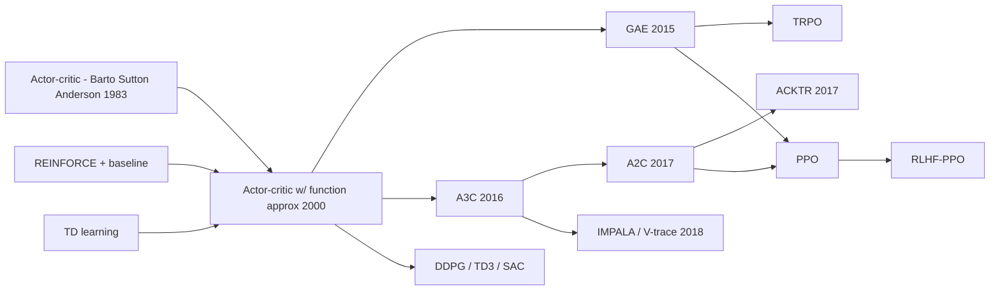

# Actor-Critic, A2C / A3C, GAE (and IMPALA / V-trace)

> A policy (the actor) improved with advantage estimates from a learned value function (the critic), run on many parallel environments. **Family:** Model-free → Policy-based → Policy Gradient → Actor-Critic  ·  **Year / origin:** actor-critic: Barto, Sutton & Anderson 1983; GAE: Schulman et al. 2015 (ICLR 2016); A3C: Mnih et al., DeepMind, ICML 2016; A2C: synchronous variant popularized by OpenAI Baselines 2017; IMPALA: Espeholt et al., DeepMind, ICML 2018  ·  **On/Off-policy:** On-policy (A2C/A3C); IMPALA corrects for slightly off-policy data with V-trace  ·  **Action space:** Discrete and continuous

## 1. What is it?

[REINFORCE](reinforce.md) waits until the end of an episode and weights each action by its noisy Monte-Carlo return. **Actor-critic** methods add a second learned function — the **critic** $V_\phi(s)$ — and use it to:

1. **Baseline** the return (lower variance: "was this better than expected?"), and
2. **Bootstrap**: replace most of the future return by the critic's estimate, so the actor can learn from partial trajectories of $n$ steps rather than whole episodes (much lower variance, some bias).

The quantity that drives the actor is the **advantage** $A(s,a) = Q(s,a) - V(s)$: how much better this action was than the policy's average behaviour in that state. **Generalized Advantage Estimation (GAE)** gives a single knob $\lambda \in [0,1]$ that smoothly trades bias for variance between the one-step TD advantage ($\lambda=0$) and the Monte-Carlo advantage ($\lambda=1$).

**A3C** (Asynchronous Advantage Actor-Critic, Mnih et al. 2016) showed that deep actor-critic can be stabilized *without a replay buffer*: run many actor-learners in parallel CPU threads, each on its own environment copy, each computing $n$-step advantage gradients and applying them asynchronously ("Hogwild!"-style) to shared parameters. The decorrelation comes from the diversity of parallel experience instead of from replay. It reached strong Atari results while training on CPUs in less wall-clock time than DQN on a GPU, and worked for continuous control and 3D navigation (Labyrinth).

**A2C** is the synchronous, batched version: step $N$ environments in lock-step, collect an $n$-step rollout from each, and do one batched gradient update. OpenAI's Baselines release (2017) reported that A2C performs as well as A3C while using GPUs more efficiently, and it has become the standard form.

**IMPALA** (2018) scales this to thousands of actors by decoupling acting from learning. Because actors lag behind the learner, their data is slightly off-policy; **V-trace** corrects for this with truncated importance weights.

Actor-critic + GAE is the backbone of [TRPO](trpo.md) and [PPO](ppo.md), and of PPO-based RLHF for LLMs, where the critic is a value head on a language model.

## 2. Family & lineage

- **Parents:** REINFORCE with baseline; TD learning (the critic); the original actor-critic architecture of Barto, Sutton & Anderson (1983) — which, fittingly, was demonstrated on **cart-pole balancing**.
- **Theory:** policy gradient theorem with function approximation (Sutton et al. 2000), actor-critic convergence (Konda & Tsitsiklis 2000), compatible function approximation, natural actor-critic (Peters & Schaal 2008).
- **Deep era:** A3C (2016), GA3C (GPU A3C, 2017), A2C, ACKTR (K-FAC natural gradient actor-critic, Wu et al. 2017), ACER (off-policy actor-critic with Retrace, Wang et al. 2017), IMPALA (2018), SEED RL (2020).
- **Descendants:** TRPO and PPO (actor-critic + GAE + trust region), off-policy actor-critics (DDPG, TD3, SAC), RLHF-PPO.



## 3. Core idea & intuition

- **Actor** = the player. It picks actions with probabilities $\pi_\theta(a\mid s)$.
- **Critic** = the coach. It predicts "how well things will go from here", $V_\phi(s)$.
- After each step, the coach compares what actually happened (reward + its prediction for the next state) with what it predicted for the current state. That difference is the **TD error** $\delta_t$ — a surprise signal. Positive surprise: the action was better than expected → make it more likely. Negative → less likely.
- The coach also learns from the same surprise, improving its predictions.

**Bias vs. variance.** One-step TD errors have low variance (only one random reward) but are biased if the critic is wrong. Monte-Carlo returns are unbiased but very noisy. $n$-step returns and GAE interpolate. GAE's $\lambda$ is like asking: "how many steps of real experience do I trust before leaning on the coach's opinion?" — with an exponentially decaying weighting rather than a hard cut-off. In practice $\lambda \approx 0.95$ works across a huge range of problems.

**Why parallel environments?** Policy-gradient updates need fresh on-policy data, but consecutive steps of one episode are highly correlated. Running 8–64 environments side by side gives a batch of diverse, roughly independent samples per update — the on-policy counterpart of DQN's replay buffer.

**Entropy bonus.** Adding $\beta\,\mathcal H[\pi(\cdot\mid s)]$ to the objective keeps the policy from becoming deterministic too early, which A3C found important for exploration.

## 4. Math / formal details

**Symbols.** $s_t, a_t, r_t$: state, action, reward received after $a_t$; $\gamma$: discount; $\pi_\theta$: actor; $V_\phi$: critic; $d_t \in\{0,1\}$: episode ended at step $t$; $T$: rollout length ($n$ in A3C's "$n$-step").

**Advantage actor-critic gradient.** From the policy gradient theorem with a state-value baseline:
$$\nabla_\theta J(\theta) = \mathbb E\big[\nabla_\theta\log\pi_\theta(a_t\mid s_t)\,A^\pi(s_t,a_t)\big],\qquad A^\pi = Q^\pi - V^\pi.$$

**TD error** (an unbiased estimate of $A^\pi$ if $V_\phi = V^\pi$):
$$\delta_t = r_t + \gamma(1-d_t)V_\phi(s_{t+1}) - V_\phi(s_t).$$

**$n$-step advantage** (A3C): $\hat A^{(n)}_t = \sum_{k=0}^{n-1}\gamma^k r_{t+k} + \gamma^n V_\phi(s_{t+n}) - V_\phi(s_t)$, where in A3C each step in the rollout uses as many real rewards as remain until the end of the rollout.

**GAE** (Schulman et al. 2015) — the exponentially weighted average of all $n$-step advantages:
$$\hat A^{\text{GAE}(\gamma,\lambda)}_t = \sum_{l=0}^{\infty}(\gamma\lambda)^l\,\delta_{t+l} \qquad\Longleftrightarrow\qquad \hat A_t = \delta_t + \gamma\lambda(1-d_t)\hat A_{t+1}.$$
Limits: $\lambda = 0 \Rightarrow \hat A_t = \delta_t$ (low variance, biased); $\lambda = 1 \Rightarrow \hat A_t = \sum_l \gamma^l r_{t+l} - V(s_t)$ (Monte-Carlo minus baseline, unbiased, high variance). This is the advantage analogue of the TD($\lambda$) / $\lambda$-return of S&B Ch. 12. The critic target is $\hat R_t = \hat A_t + V_\phi(s_t)$ (the $\lambda$-return).

**A2C loss** on a batch of $N$ environments × $T$ steps (all $\hat A$, $\hat R$ treated as constants):
$$\mathcal L(\theta,\phi) = \underbrace{-\frac{1}{NT}\sum \log\pi_\theta(a_t\mid s_t)\hat A_t}_{\text{actor}} + c_v\underbrace{\frac{1}{NT}\sum\big(V_\phi(s_t) - \hat R_t\big)^2}_{\text{critic}} - \beta\underbrace{\frac{1}{NT}\sum\mathcal H[\pi_\theta(\cdot\mid s_t)]}_{\text{entropy}}.$$

**Time-limit truncation.** If an episode is cut by a time limit (not a real terminal), bootstrapping should continue: $r_t \leftarrow r_t + \gamma V_\phi(s^{\text{final}}_{t+1})$, then cut the trace. The code does this.

**A3C's asynchronous update.** Each of $K$ workers: copy global parameters, run $\le t_{\max}$ steps, compute gradients of the loss above on its own rollout, apply them to the global parameters without locks, repeat. Gradients may be computed with slightly stale parameters.

**V-trace (IMPALA).** Behaviour policy $\mu$ (actor's, possibly stale), target policy $\pi$ (learner's). Truncated importance weights $\rho_t = \min\big(\bar\rho, \tfrac{\pi(a_t\mid s_t)}{\mu(a_t\mid s_t)}\big)$, $c_t = \min\big(\bar c, \tfrac{\pi(a_t\mid s_t)}{\mu(a_t\mid s_t)}\big)$. The $n$-step V-trace target:
$$v_s = V(s_s) + \sum_{t=s}^{s+n-1}\gamma^{t-s}\Big(\prod_{i=s}^{t-1}c_i\Big)\rho_t\,\delta^V_t,\qquad \delta^V_t = r_t + \gamma V(s_{t+1}) - V(s_t),$$
computed recursively as $v_s - V(s_s) = \rho_s\delta^V_s + \gamma c_s\big(v_{s+1} - V(s_{s+1})\big)$. Critic regresses $V(s_s)\to v_s$; the actor uses advantage $\rho_s\big(r_s + \gamma v_{s+1} - V(s_s)\big)$. $\bar\rho$ controls which value function is learned (the fixed point is the value of a policy between $\mu$ and $\pi$ when $\bar\rho < \infty$); $\bar c$ controls the speed of convergence (variance). **On-policy** ($\pi = \mu$, $\bar\rho = \bar c = 1$) V-trace reduces to the ordinary $n$-step Bellman target — verified numerically in the code.

## 5. Algorithm (pseudocode)

```text
A2C with GAE
Input: N parallel envs, rollout length T, gamma, lambda, coefficients c_v, beta, LR
1.  initialize actor pi_theta and critic V_phi; s <- reset all N envs
2.  repeat:
3.      for t = 0..T-1:                                   # collect N*T transitions
4.          a_t ~ pi_theta(.|s_t) for each env; step all envs -> r_t, s_{t+1}, done_t
5.          if an env was truncated by a time limit: r_t <- r_t + gamma * V_phi(final obs)
6.      bootstrap value V_last <- V_phi(s_T)
7.      for t = T-1 down to 0:                            # GAE, backwards
8.          delta_t <- r_t + gamma * (1 - done_t) * V(s_{t+1}) - V(s_t)
9.          A_t     <- delta_t + gamma * lambda * (1 - done_t) * A_{t+1}
10.         R_t     <- A_t + V(s_t)
11.     loss <- -mean(log pi(a_t|s_t) * A_t) + c_v * mean((V_phi(s_t) - R_t)^2) - beta * mean(H[pi(.|s_t)])
12.     one gradient step on (theta, phi), with global grad-norm clipping

A3C: run K copies of lines 3-11 in parallel threads (one env each, T = t_max ~ 5-20,
     lambda = 1 i.e. plain n-step returns), each applying its gradients asynchronously
     to shared parameters.
IMPALA: actors only run line 3-5 with a (stale) copy mu of the policy and send trajectories
     with log mu(a|s); the learner replaces lines 7-10 by V-trace targets.
```

## 6. Python implementation

A2C with GAE on 8 vectorized NumPy cart-poles (200-step cap), separate actor and critic MLPs, entropy bonus, gradient clipping and correct truncation bootstrapping. A `vtrace` function is included and unit-tested: GAE's $\lambda = 0$/$\lambda = 1$ limits are checked, and on-policy V-trace is checked to equal the Monte-Carlo return. Runs in ~10–20 s on CPU.

Runnable version: [`code/actor-critic-a2c-a3c.py`](../../code/actor-critic-a2c-a3c.py)

```python
"""
Advantage Actor-Critic (A2C, the synchronous variant of A3C, Mnih et al. 2016) with
Generalized Advantage Estimation (GAE, Schulman et al. 2015) on a self-contained NumPy CartPole.
Also includes a V-trace (IMPALA, Espeholt et al. 2018) target function with a sanity check.

Run:  python3 code/actor-critic-a2c-a3c.py     (about 1 minute on CPU)
"""
import math

import numpy as np
import torch
import torch.nn as nn


class CartPole:
    """Classic cart-pole physics (same constants as Gym CartPole), capped at max_steps."""
    def __init__(self, max_steps=200, seed=0):
        self.gravity, self.m_cart, self.m_pole = 9.8, 1.0, 0.1
        self.length, self.force_mag, self.tau = 0.5, 10.0, 0.02
        self.x_limit, self.theta_limit = 2.4, 12 * 2 * math.pi / 360
        self.max_steps, self.rng = max_steps, np.random.default_rng(seed)
        self.obs_dim, self.n_actions = 4, 2

    def reset(self):
        self.state, self.t = self.rng.uniform(-0.05, 0.05, size=4), 0
        return self.state.astype(np.float32)

    def step(self, action):
        x, x_dot, th, th_dot = self.state
        force = self.force_mag if action == 1 else -self.force_mag
        cos, sin = math.cos(th), math.sin(th)
        total_m, pm_l = self.m_cart + self.m_pole, self.m_pole * self.length
        temp = (force + pm_l * th_dot ** 2 * sin) / total_m
        th_acc = (self.gravity * sin - cos * temp) / (
            self.length * (4.0 / 3.0 - self.m_pole * cos ** 2 / total_m))
        x_acc = temp - pm_l * th_acc * cos / total_m
        x, x_dot = x + self.tau * x_dot, x_dot + self.tau * x_acc
        th, th_dot = th + self.tau * th_dot, th_dot + self.tau * th_acc
        self.state, self.t = np.array([x, x_dot, th, th_dot]), self.t + 1
        terminated = bool(abs(x) > self.x_limit or abs(th) > self.theta_limit)
        return self.state.astype(np.float32), 1.0, terminated, self.t >= self.max_steps


class VecCartPole:
    """N independent CartPoles stepped in lock-step, auto-resetting finished episodes."""
    def __init__(self, n, seed=0):
        self.envs = [CartPole(seed=seed + i) for i in range(n)]
        self.ep_ret, self.finished = np.zeros(n), []

    def reset(self):
        return np.stack([e.reset() for e in self.envs])

    def step(self, actions):
        obs, rew, term, trunc, final_obs = [], [], [], [], []
        for i, (env, a) in enumerate(zip(self.envs, actions)):
            o, r, te, tr = env.step(int(a))
            self.ep_ret[i] += r
            final_obs.append(o)                    # true next state (before any reset)
            if te or tr:
                self.finished.append(self.ep_ret[i]); self.ep_ret[i] = 0.0
                o = env.reset()
            obs.append(o); rew.append(r); term.append(te); trunc.append(tr)
        return (np.stack(obs), np.array(rew, np.float32), np.array(term), np.array(trunc),
                np.stack(final_obs))


def compute_gae(rewards, values, dones, last_values, gamma=0.99, lam=0.95):
    """GAE(gamma, lambda). Inputs are [T, N] tensors (last_values: [N]); dones[t]=1 if the
    episode ended at step t (so no bootstrapping across it). Returns (advantages, returns)."""
    T = rewards.shape[0]
    adv = torch.zeros_like(rewards)
    gae = torch.zeros_like(last_values)
    for t in reversed(range(T)):
        next_v = last_values if t == T - 1 else values[t + 1]
        nonterminal = 1.0 - dones[t]
        delta = rewards[t] + gamma * next_v * nonterminal - values[t]      # TD error
        gae = delta + gamma * lam * nonterminal * gae                      # discounted sum of deltas
        adv[t] = gae
    return adv, adv + values


def vtrace(behaviour_logp, target_logp, rewards, values, bootstrap_value, discounts,
           rho_bar=1.0, c_bar=1.0):
    """V-trace targets v_s (IMPALA). All inputs [T] except bootstrap_value (scalar).
    discounts[t] = gamma * (1 - done_t). Returns (vs, policy-gradient advantages)."""
    rhos = torch.exp(target_logp - behaviour_logp)
    clipped_rho, cs = rhos.clamp(max=rho_bar), rhos.clamp(max=c_bar)
    values_tp1 = torch.cat([values[1:], bootstrap_value.view(1)])
    deltas = clipped_rho * (rewards + discounts * values_tp1 - values)
    acc, vs_minus_v = torch.zeros(()), torch.zeros_like(values)
    for t in reversed(range(len(rewards))):
        acc = deltas[t] + discounts[t] * cs[t] * acc
        vs_minus_v[t] = acc
    vs = vs_minus_v + values
    vs_tp1 = torch.cat([vs[1:], bootstrap_value.view(1)])
    pg_adv = clipped_rho * (rewards + discounts * vs_tp1 - values)
    return vs, pg_adv


def mlp(n_in, n_out, hidden=64):
    return nn.Sequential(nn.Linear(n_in, hidden), nn.Tanh(), nn.Linear(hidden, hidden), nn.Tanh(),
                         nn.Linear(hidden, n_out))


def evaluate(actor, n_episodes=10, seed=123):
    env, total = CartPole(seed=seed), 0.0
    for _ in range(n_episodes):
        o, done = env.reset(), False
        while not done:
            with torch.no_grad():
                a = int(actor(torch.as_tensor(o)).argmax())
            o, r, term, trunc = env.step(a)
            total, done = total + r, term or trunc
    return total / n_episodes


def train(total_steps=150_000, n_envs=8, n_steps=16, gamma=0.99, lam=0.95, lr=1e-3,
          ent_coef=0.01, vf_coef=0.5, max_grad_norm=0.5, seed=0):
    torch.manual_seed(seed); np.random.seed(seed)
    envs = VecCartPole(n_envs, seed=seed)
    actor, critic = mlp(4, 2), mlp(4, 1)
    params = list(actor.parameters()) + list(critic.parameters())
    opt = torch.optim.Adam(params, lr=lr)
    before = evaluate(actor)
    obs = torch.as_tensor(envs.reset())
    n_updates = total_steps // (n_envs * n_steps)
    for update in range(1, n_updates + 1):
        # ---------- collect an n_steps x n_envs rollout with the current policy ----------
        b_obs, b_act, b_rew, b_done = [], [], [], []
        for _ in range(n_steps):
            with torch.no_grad():
                a = torch.distributions.Categorical(logits=actor(obs)).sample()
            nobs, r, term, trunc, final_obs = envs.step(a.numpy())
            r = torch.as_tensor(r)
            if trunc.any():   # time-limit cut: bootstrap with V(true final state), not 0
                with torch.no_grad():
                    v_final = critic(torch.as_tensor(final_obs)).squeeze(-1)
                r = r + gamma * v_final * torch.as_tensor(trunc & ~term, dtype=torch.float32)
            b_obs.append(obs); b_act.append(a); b_rew.append(r)
            b_done.append(torch.as_tensor(term | trunc, dtype=torch.float32))
            obs = torch.as_tensor(nobs)
        b_obs, b_act = torch.stack(b_obs), torch.stack(b_act)          # [T, N, 4], [T, N]
        b_rew, b_done = torch.stack(b_rew), torch.stack(b_done)        # [T, N]

        # ---------- advantages with GAE; critic targets = GAE returns ----------
        values = critic(b_obs).squeeze(-1)                             # [T, N] (with grad)
        with torch.no_grad():
            adv, ret = compute_gae(b_rew, values.detach(), b_done,
                                   critic(obs).squeeze(-1), gamma, lam)
        dist = torch.distributions.Categorical(logits=actor(b_obs))
        policy_loss = -(dist.log_prob(b_act) * adv).mean()             # actor: grad log pi * A
        value_loss = ((values - ret) ** 2).mean()                      # critic: regression
        entropy = dist.entropy().mean()                                # exploration bonus
        loss = policy_loss + vf_coef * value_loss - ent_coef * entropy
        opt.zero_grad(); loss.backward()
        nn.utils.clip_grad_norm_(params, max_grad_norm)
        opt.step()
        if update % 200 == 0:
            print(f"update {update:4d}  env steps {update * n_envs * n_steps:7d}  "
                  f"avg return (last 20 eps) {np.mean(envs.finished[-20:]):6.1f}  "
                  f"entropy {entropy.item():.3f}")
    return before, np.mean(envs.finished[-20:]), evaluate(actor)


def _sanity_checks():
    # 1) GAE with lambda=1 equals Monte-Carlo return minus V; with lambda=0 equals the TD error
    T = 5
    r, v = torch.rand(T, 1), torch.rand(T, 1)
    d = torch.zeros(T, 1); d[-1] = 1
    adv1, _ = compute_gae(r, v, d, torch.zeros(1), gamma=0.9, lam=1.0)
    mc = torch.tensor([sum(0.9 ** k * r[t + k, 0].item() for k in range(T - t)) for t in range(T)])
    assert torch.allclose(adv1[:, 0], mc - v[:, 0], atol=1e-5)
    adv0, _ = compute_gae(r, v, d, torch.zeros(1), gamma=0.9, lam=0.0)
    td = r[:, 0] + 0.9 * torch.cat([v[1:, 0], torch.zeros(1)]) * (1 - d[:, 0]) - v[:, 0]
    assert torch.allclose(adv0[:, 0], td, atol=1e-6)
    # 2) on-policy V-trace (rho = c = 1) reduces to the n-step Bellman target = GAE(lambda=1) return
    lp = torch.log(torch.rand(T))
    disc = 0.9 * (1 - d[:, 0])
    vs, _ = vtrace(lp, lp, r[:, 0], v[:, 0], torch.tensor(0.0), disc)
    assert torch.allclose(vs, mc, atol=1e-5)
    print("sanity checks passed (GAE lambda=0/1 limits, on-policy V-trace == MC return)")


if __name__ == "__main__":
    torch.set_num_threads(1)
    _sanity_checks()
    before, train_ret, after = train()
    print(f"\nA2C greedy return before training: {before:.1f}")
    print(f"A2C avg training-episode return at the end: {train_ret:.1f}")
    print(f"A2C greedy return after training : {after:.1f}   (max 200)")
```

Example output:

```text
sanity checks passed (GAE lambda=0/1 limits, on-policy V-trace == MC return)
update  200  env steps   25600  avg return (last 20 eps)  137.9  entropy 0.547
update  400  env steps   51200  avg return (last 20 eps)  181.9  entropy 0.568
update  600  env steps   76800  avg return (last 20 eps)  196.6  entropy 0.436
update  800  env steps  102400  avg return (last 20 eps)  200.0  entropy 0.446
update 1000  env steps  128000  avg return (last 20 eps)  101.3  entropy 0.545

A2C greedy return before training: 9.0
A2C avg training-episode return at the end: 200.0
A2C greedy return after training : 200.0   (max 200)
```

The temporary dip at update 1000 is typical of plain A2C: nothing limits the size of each policy update, so an unlucky large step can temporarily degrade the policy. TRPO and PPO were designed to prevent exactly this.

## 7. Practical tips & hyperparameters

| Hyperparameter | A3C (Atari, reported) | A2C (typical, e.g. SB3 defaults) | This demo |
|---|---|---|---|
| Parallel envs / workers | 16 CPU threads | 8–16 envs | 8 |
| Rollout length $T$ ($t_{\max}$) | 5 | 5 | 16 |
| $\gamma$ | 0.99 | 0.99 | 0.99 |
| $\lambda$ (GAE) | — (plain $n$-step) | 1.0 (SB3 default) or 0.95 | 0.95 |
| Optimizer | RMSProp with shared statistics | RMSProp, LR 7e-4 | Adam, LR 1e-3 |
| Entropy coef $\beta$ | 0.01 | 0.0–0.01 | 0.01 |
| Value coef $c_v$ | 0.5 | 0.5 | 0.5 |
| Grad-norm clip | — | 0.5 | 0.5 |

**Tips.**
- **Separate vs. shared networks.** Sharing a torso saves compute (Atari) but couples the value and policy losses; for small vector-observation tasks separate networks are often more stable. If shared, tune $c_v$.
- **Normalize observations and (optionally) advantages**; scale rewards so values are $O(1)$–$O(100)$.
- **Truncation handling** (bootstrapping at time limits) noticeably helps on time-limited tasks.
- **Entropy collapse** (entropy → 0 early) means premature convergence: increase $\beta$ or lower the LR. Entropy stuck at maximum means the actor isn't learning (check advantage signs/normalization).
- **Critic quality:** track explained variance of the value function; if it's ≤ 0 the advantages are mostly noise.
- **A3C vs A2C:** on modern hardware A2C (or PPO) is simpler and at least as good; A3C's asynchrony mostly mattered for CPU-only setups.
- **When scaling to many actors, use V-trace** (IMPALA) or PPO-style clipping; ignoring policy lag silently biases the gradient.

## 8. Pros and cons

**Pros**
- Much lower variance than REINFORCE; learns online from partial trajectories.
- Works for discrete and continuous actions; learns stochastic policies.
- No replay buffer → low memory; parallel environments scale throughput.
- GAE gives a robust, tunable bias–variance trade-off used by nearly every modern on-policy method.
- IMPALA/V-trace scales to thousands of actors with high throughput.

**Cons**
- On-policy: each sample is used once (A2C), so sample efficiency is poor compared with off-policy methods.
- No control over update size → occasional performance collapses (fixed by TRPO/PPO).
- Two networks and more hyperparameters ($\lambda$, $c_v$, $\beta$).
- Critic bias can mislead the actor; actor-critic training is a two-timescale problem that can oscillate.
- A3C's asynchrony makes runs non-deterministic and hard to debug.

## 9. When to use / when not to use

**Use when:** simulation is cheap and parallelizable (games, physics simulators); you want a simple, fast on-policy baseline; you need the building blocks (critic + GAE) for PPO/TRPO; large-scale distributed training (IMPALA).

**Prefer something else when:**
- You want robust improvement without careful tuning → [PPO](ppo.md).
- Interactions are expensive (robots, real users) → off-policy [SAC](../04-off-policy-actor-critic/sac.md) / [TD3](../04-off-policy-actor-critic/td3.md) or model-based methods ([MBPO](../05-model-based/mbpo-pets.md), [Dreamer](../05-model-based/world-models-dreamer.md)).
- Only outcome rewards on short sequences (e.g. LLM responses) and memory is tight → critic-free REINFORCE variants ([RLOO](../10-llm-reasoning-rl/rloo-remax-reinforcepp.md), [GRPO](../10-llm-reasoning-rl/grpo.md)).

## 10. Key papers, books & repos

- Barto, Sutton, Anderson (1983). *Neuronlike adaptive elements that can solve difficult learning control problems.* IEEE Trans. Systems, Man, and Cybernetics 13(5). (Original actor-critic; cart-pole.)
- Sutton, McAllester, Singh, Mansour (2000). *Policy Gradient Methods for Reinforcement Learning with Function Approximation.* NeurIPS.
- Konda & Tsitsiklis (2000). *Actor-Critic Algorithms.* NeurIPS.
- Peters & Schaal (2008). *Natural Actor-Critic.* Neurocomputing 71.
- Schulman, Moritz, Levine, Jordan, Abbeel (2016). *High-Dimensional Continuous Control Using Generalized Advantage Estimation.* ICLR 2016. arXiv:1506.02438.
- Mnih, Badia, Mirza, Graves, Lillicrap, Harley, Silver, Kavukcuoglu (2016). *Asynchronous Methods for Deep Reinforcement Learning.* ICML 2016. arXiv:1602.01783. (A3C.)
- Wu, Mansimov, Liao, Grosse, Ba (2017). *Scalable trust-region method for deep reinforcement learning using Kronecker-factored approximation* (ACKTR). NeurIPS 2017.
- Espeholt et al. (2018). *IMPALA: Scalable Distributed Deep-RL with Importance Weighted Actor-Learner Architectures.* ICML 2018. arXiv:1802.01561.
- Sutton & Barto (2nd ed., 2018): Ch. 13.5 (actor-critic methods), Ch. 12 ($\lambda$-returns, eligibility traces — the basis of GAE), Ch. 7 ($n$-step returns), Ch. 15.7–15.8 (actor-critic and neuroscience).
- Repos: [DLR-RM/stable-baselines3](https://github.com/DLR-RM/stable-baselines3) (`A2C`), [openai/baselines](https://github.com/openai/baselines) (`a2c`, `acktr`), [vwxyzjn/cleanrl](https://github.com/vwxyzjn/cleanrl) (PPO files show the same GAE code), [facebookresearch/torchbeast](https://github.com/facebookresearch/torchbeast) (PyTorch IMPALA), [openai/spinningup](https://github.com/openai/spinningup) (VPG with GAE).

## 11. For business users

**What it does.** Two AI components learn together: a **decision-maker** that chooses actions, and an **evaluator** that predicts how well things will go. After every step, the evaluator says "that turned out better (or worse) than I expected", and the decision-maker adjusts. Many copies of the task run in parallel so the system learns fast from lots of fresh experience.

**Analogy.** A trainee salesperson (actor) and a sales manager (critic). The manager doesn't wait for the quarter to end; after each call they say "that went better than I'd expect for a lead like that" or "worse". The trainee adapts call by call, and the manager gets better at judging leads. Running many trainees at once (parallel environments) speeds everything up.

**Use cases.** Game AI and simulations, robotics in simulation, resource allocation and control tasks with a fast simulator, and — via PPO — training large language models with human feedback.

**Value / ROI.** Faster, steadier learning than "wait until the end and score everything"; scales well with cheap parallel compute (CPUs); the basis of the most widely used RL algorithm (PPO).

**Risks.** Needs a simulator or lots of live interaction (it can't reuse old data well); a bad evaluator misleads the decision-maker; learning can occasionally degrade suddenly without safeguards.

**Costs.** Compute for many parallel simulations; engineering for the simulator and reward; monitoring.

**Questions to ask your team.**
- How fast and how parallel is our simulator?
- How do we know the critic (evaluator) is accurate?
- Why A2C instead of PPO? Do we see sudden performance drops?
- Are time limits in the simulator handled correctly in training?

## 12. For kids (ages ~8–12)

**Story.** Zoe is learning to ride a skateboard, and her big brother Max watches. Before each move, Max guesses: "This will go okay." After the move, he compares: "Whoa, that went *better* than I guessed — do that again!" or "Hmm, worse than I guessed — try something else." Zoe doesn't need to finish the whole ride to learn; she gets a tip after every move. And Max gets better at guessing, too! Now imagine eight Zoes practicing on eight skateboards at once, all sharing what they learn. That's how the computer learns fast.

**Try it yourself.** Play a game of "guess the score" with a friend shooting paper balls into a bin. Before each shot, guess whether it will go in. After each shot, say "better than I guessed" or "worse". Does your friend change how they throw based on your comments?

**Recap.**
1. The player (actor) tries moves; the coach (critic) guesses how well they'll go.
2. "Better than expected" → do it more. "Worse" → do it less.
3. Lots of players practicing at once learn faster.

## 13. Related methods

- [REINFORCE](reinforce.md) — the Monte-Carlo parent.
- [TD learning](../01-foundations-tabular/td-learning.md) — how the critic learns.
- [TRPO](trpo.md) — actor-critic + trust region on update size.
- [PPO](ppo.md) — actor-critic + GAE + clipped updates; the default on-policy algorithm.
- [DDPG](../04-off-policy-actor-critic/ddpg.md), [TD3](../04-off-policy-actor-critic/td3.md), [SAC](../04-off-policy-actor-critic/sac.md) — off-policy actor-critics.
- [Multi-agent RL](../08-exploration-hierarchical-multiagent/multi-agent-rl.md) — centralized-critic actor-critics (MADDPG, MAPPO).
- [RLHF with PPO](../09-llm-preference-alignment/rlhf-ppo.md) — actor-critic for language models.
- [Value-based LLM RL (VAPO)](../10-llm-reasoning-rl/value-based-llm-rl-vapo.md) — critics for long reasoning chains.

[← Back to overview](../../RL_Methods_Overview.md)
