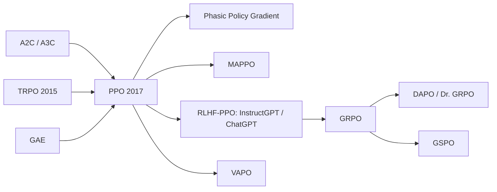

# Proximal Policy Optimization (PPO, PPO-Clip, PPO-Penalty)

> Several epochs of minibatch SGD on a clipped importance-ratio objective, so each batch of on-policy data is reused without letting the policy move too far — TRPO's stability with first-order simplicity. **Family:** Model-free → Policy-based → Policy Gradient → Actor-Critic → Trust-region style  ·  **Year / origin:** Schulman, Wolski, Dhariwal, Radford & Klimov, OpenAI, arXiv 2017  ·  **On/Off-policy:** On-policy (mildly reuses each batch for a few epochs)  ·  **Action space:** Discrete, continuous, multi-discrete, token sequences

## 1. What is it?

PPO is the most widely used deep RL algorithm. It is an **actor-critic** method ([A2C](actor-critic-a2c-a3c.md) + [GAE](actor-critic-a2c-a3c.md)) whose policy update is a cheap first-order approximation of [TRPO](trpo.md)'s trust region:

- **Problem with A2C:** each batch of experience gives exactly one gradient step (data is on-policy), and nothing prevents an unlucky large step from collapsing the policy.
- **Problem with TRPO:** stable, but requires second-order machinery (Fisher-vector products, conjugate gradient, line search), and doesn't combine easily with shared actor-critic networks or auxiliary losses.
- **PPO's fix:** optimize a *surrogate* objective based on the probability ratio $r_t(\theta) = \pi_\theta(a_t\mid s_t)/\pi_{\text{old}}(a_t\mid s_t)$, but **clip** it so that there is no incentive to push $r_t$ outside $[1-\epsilon, 1+\epsilon]$. Then you can safely run **several epochs of minibatch SGD** on the same batch with Adam.

The paper also proposed **PPO-Penalty**: an adaptive KL penalty $\beta\,\mathrm{KL}[\pi_{\text{old}},\pi_\theta]$ whose coefficient grows or shrinks to hit a target KL. The **clipped** variant performed better in the paper and is what "PPO" usually means.

PPO's reach is enormous: it trained OpenAI Five (Dota 2), the robotic hand that solved a Rubik's cube, countless game and robotics agents, and — crucially — it is the RL engine of **RLHF** as used for **InstructGPT** (Ouyang et al. 2022) and, per OpenAI's announcement, **ChatGPT**: the language model is the policy, each token is an action, a learned reward model scores the full response, and a per-token KL penalty keeps the model close to its supervised starting point. Many recent LLM-RL methods ([GRPO](../10-llm-reasoning-rl/grpo.md), [DAPO](../10-llm-reasoning-rl/dapo-dr-grpo.md), [VAPO](../10-llm-reasoning-rl/value-based-llm-rl-vapo.md)) are modifications of PPO's clipped objective.

A key lesson from the PPO literature is that **implementation details matter as much as the core idea**. Huang et al.'s ICLR 2022 blog post *The 37 Implementation Details of Proximal Policy Optimization* catalogued the tricks in OpenAI's reference implementation; Engstrom et al. (2020) and Andrychowicz et al. (2021) showed that many of PPO's gains over TRPO come from such "code-level optimizations".

## 2. Family & lineage

- **Parents:** TRPO (trust region, surrogate objective), A2C/A3C (parallel actors, entropy bonus, actor-critic loss), GAE (advantages).
- **Siblings:** PPO-Penalty (adaptive KL), ACKTR, IMPALA/V-trace, PPG (Phasic Policy Gradient, Cobbe et al. 2021), MAPPO (multi-agent PPO).
- **Descendants in LLMs:** RLHF-PPO (Ziegler et al. 2019; Stiennon et al. 2020; InstructGPT 2022), GRPO (critic-free, group baseline), DAPO / Dr. GRPO (clip-higher, token-level normalization), VAPO (value-based PPO for reasoning), GSPO (sequence-level ratio).



## 3. Core idea & intuition

**Reusing data safely.** After collecting a batch with $\pi_{\text{old}}$, the importance ratio $r_t(\theta)$ lets us estimate how a slightly different policy $\pi_\theta$ would do: $\mathbb E[r_t\hat A_t]$. Maximizing this surrogate *without limits* would push $r_t \to \infty$ for good actions and $\to 0$ for bad ones — far outside the region where the estimate is valid.

**Clipping = "you've changed enough on this sample".** For an action with positive advantage, the objective increases with $r_t$ only until $r_t = 1 + \epsilon$; beyond that it is flat, so the gradient is zero — no more incentive to increase that action's probability *on this batch*. For a negative advantage, the floor is $1 - \epsilon$. Taking the **minimum** of the clipped and unclipped terms makes the objective a pessimistic (lower) bound: clipping only ever removes incentives to move further, never adds them. If an update overshoots in the harmful direction, the unclipped term keeps the gradient that pulls it back.

**Why multiple epochs work.** Each epoch, some samples hit the clip boundary and stop contributing; the remaining ones keep improving. The result behaves like a soft trust region. Monitoring the **clip fraction** and the **approximate KL** tells you how far the policy moved.

**The rest of the recipe** (from A2C): a value-function loss (critic), an entropy bonus (exploration), GAE advantages, parallel environments, gradient clipping.

## 4. Math / formal details

**Symbols.** $\pi_\theta$: policy; $\pi_{\text{old}}$: policy that collected the batch; $\hat A_t$: GAE advantage; $\hat R_t = \hat A_t + V_{\text{old}}(s_t)$: value target; $V_\phi$: critic; $\epsilon$: clip range; $c_1, c_2$: value and entropy coefficients; $\mathcal H$: entropy.

**Probability ratio.** $r_t(\theta) = \dfrac{\pi_\theta(a_t\mid s_t)}{\pi_{\text{old}}(a_t\mid s_t)} = \exp\big(\log\pi_\theta(a_t\mid s_t) - \log\pi_{\text{old}}(a_t\mid s_t)\big)$.

**Clipped surrogate (PPO-Clip).**
$$L^{\text{CLIP}}(\theta) = \hat{\mathbb E}_t\Big[\min\big(r_t(\theta)\hat A_t,\ \operatorname{clip}(r_t(\theta), 1-\epsilon, 1+\epsilon)\,\hat A_t\big)\Big].$$
Case analysis: if $\hat A_t > 0$, the term equals $\min(r_t, 1+\epsilon)\hat A_t$; if $\hat A_t < 0$, it equals $\max(r_t, 1-\epsilon)\hat A_t$. At $\theta = \theta_{\text{old}}$ ($r_t = 1$), $\nabla L^{\text{CLIP}} = \nabla L^{\text{PG}}$, the ordinary policy gradient.

**Adaptive KL penalty (PPO-Penalty).** $L^{\text{KLPEN}} = \hat{\mathbb E}_t\big[r_t\hat A_t - \beta\,\mathrm{KL}[\pi_{\text{old}}(\cdot\mid s_t),\pi_\theta(\cdot\mid s_t)]\big]$; after each update, if $d = \hat{\mathbb E}[\mathrm{KL}] < d_{\text{targ}}/1.5$ then $\beta \leftarrow \beta/2$; if $d > 1.5\,d_{\text{targ}}$ then $\beta\leftarrow 2\beta$.

**Full objective** (maximized; the code minimizes its negative):
$$L(\theta,\phi) = \hat{\mathbb E}_t\Big[L^{\text{CLIP}}_t(\theta) - c_1 L^{V}_t(\phi) + c_2\,\mathcal H[\pi_\theta(\cdot\mid s_t)]\Big].$$

**Value loss with clipping** (from OpenAI Baselines' `ppo2`, not in the paper):
$$L^V_t = \tfrac12\max\Big(\big(V_\phi(s_t) - \hat R_t\big)^2,\ \big(V_{\text{old}}(s_t) + \operatorname{clip}(V_\phi(s_t) - V_{\text{old}}(s_t), -\epsilon, \epsilon) - \hat R_t\big)^2\Big).$$
Studies (Engstrom et al. 2020; Andrychowicz et al. 2021) found value clipping does not help and can hurt; it is kept as an option for fidelity.

**GAE.** $\delta_t = r_t + \gamma(1-d_t)V(s_{t+1}) - V(s_t)$, $\hat A_t = \delta_t + \gamma\lambda(1-d_t)\hat A_{t+1}$ (see [actor-critic](actor-critic-a2c-a3c.md)).

**Diagnostics.** Approximate KL with the low-variance estimator $\widehat{\mathrm{KL}} = \hat{\mathbb E}[(r_t - 1) - \log r_t]$ (non-negative, unbiased for $\mathrm{KL}[\pi_{\text{old}},\pi_\theta]$); clip fraction $=\hat{\mathbb E}[\mathbb 1(|r_t - 1| > \epsilon)]$.

**PPO in RLHF (sketch).** Per token $t$ of a response $y$ to prompt $x$: reward $r_t = -\beta\big(\log\pi_\theta(y_t\mid x,y_{<t}) - \log\pi_{\text{ref}}(y_t\mid x, y_{<t})\big)$, plus the reward-model score $R(x,y)$ added at the last token; a value head estimates $V(x, y_{<t})$; GAE over tokens (often $\gamma = 1$); then exactly the clipped loss above, applied per token with a padding mask. InstructGPT additionally mixed in pretraining gradients ("PPO-ptx"). See [RLHF-PPO](../09-llm-preference-alignment/rlhf-ppo.md).

## 5. Algorithm (pseudocode)

```text
Input: N envs, rollout length T, epochs K, minibatches M, clip eps, gamma, lambda, c1, c2, LR
1.  initialize actor-critic (orthogonal init; policy head std 0.01, value head std 1)
2.  for update = 1 .. U:
3.      LR <- LR0 * (1 - (update-1)/U)                      # linear annealing
4.      for t = 0 .. T-1:                                    # rollout with pi_old
5.          a_t ~ pi_old(.|s_t); store s_t, a_t, log pi_old(a_t|s_t), V_old(s_t)
6.          step all envs -> r_t, done_t   (bootstrap r_t with gamma*V(final obs) on truncation)
7.      compute A_t with GAE(gamma, lambda); R_t <- A_t + V_old(s_t)
8.      flatten the N*T batch
9.      for epoch = 1 .. K:
10.         shuffle indices; split into M minibatches
11.         for each minibatch:
12.             normalize A over the minibatch
13.             ratio <- exp(log pi_theta(a|s) - log pi_old(a|s))
14.             L_clip <- mean( max(-A*ratio, -A*clip(ratio, 1-eps, 1+eps)) )
15.             L_v    <- 0.5 * mean( max((V - R)^2, (V_old + clip(V - V_old, -eps, eps) - R)^2) )
16.             loss   <- L_clip + c1 * L_v - c2 * mean(entropy)
17.             Adam step (eps = 1e-5) after clipping the global grad norm to 0.5
18.         (optional) stop early if approx_kl > target_kl
```

## 6. Python implementation

A single-file PPO in the style of CleanRL's `ppo.py`, on 8 vectorized NumPy cart-poles (200-step cap). It includes the core implementation details from Huang et al. (2022): vectorized envs, orthogonal init, Adam $\epsilon = 10^{-5}$, LR annealing, GAE, shuffled minibatches over several epochs, per-minibatch advantage normalization, clipped surrogate, clipped value loss, entropy bonus, global gradient clipping, separate actor/critic MLPs, and the debug variables `approx_kl` and `clipfrac`. It also bootstraps correctly on time-limit truncation. The `ppo_loss` function is reusable on any flat tensors of log-probs/advantages/values — the same structure that RLHF libraries apply per token with a mask. A sanity check verifies that the clipped objective has zero gradient once the ratio leaves the clip range in the direction favoured by the advantage. Runs in ~15 s on CPU.

Runnable version: [`code/ppo.py`](../../code/ppo.py)

```python
"""
PPO-Clip (Schulman et al. 2017) on a self-contained NumPy CartPole, following the
CleanRL-style "implementation details" (Huang et al., ICLR Blog Track 2022):
  vectorized envs, GAE, advantage normalization (per minibatch), clipped surrogate,
  clipped value loss, entropy bonus, several epochs of shuffled minibatches, global
  gradient clipping, Adam with eps=1e-5 and linear LR annealing, orthogonal init,
  correct bootstrapping on time-limit truncation, approx-KL / clip-fraction diagnostics.
Run:  python3 code/ppo.py      (about 30-60 s on CPU)
"""
import math

import numpy as np
import torch
import torch.nn as nn


class CartPole:
    """Classic cart-pole physics (same constants as Gym CartPole), capped at max_steps."""
    def __init__(self, max_steps=200, seed=0):
        self.gravity, self.m_cart, self.m_pole = 9.8, 1.0, 0.1
        self.length, self.force_mag, self.tau = 0.5, 10.0, 0.02
        self.x_limit, self.theta_limit = 2.4, 12 * 2 * math.pi / 360
        self.max_steps, self.rng = max_steps, np.random.default_rng(seed)
        self.obs_dim, self.n_actions = 4, 2

    def reset(self):
        self.state, self.t = self.rng.uniform(-0.05, 0.05, size=4), 0
        return self.state.astype(np.float32)

    def step(self, action):
        x, x_dot, th, th_dot = self.state
        force = self.force_mag if action == 1 else -self.force_mag
        cos, sin = math.cos(th), math.sin(th)
        total_m, pm_l = self.m_cart + self.m_pole, self.m_pole * self.length
        temp = (force + pm_l * th_dot ** 2 * sin) / total_m
        th_acc = (self.gravity * sin - cos * temp) / (
            self.length * (4.0 / 3.0 - self.m_pole * cos ** 2 / total_m))
        x_acc = temp - pm_l * th_acc * cos / total_m
        x, x_dot = x + self.tau * x_dot, x_dot + self.tau * x_acc
        th, th_dot = th + self.tau * th_dot, th_dot + self.tau * th_acc
        self.state, self.t = np.array([x, x_dot, th, th_dot]), self.t + 1
        terminated = bool(abs(x) > self.x_limit or abs(th) > self.theta_limit)
        return self.state.astype(np.float32), 1.0, terminated, self.t >= self.max_steps


class VecCartPole:
    """N CartPoles stepped in lock-step with auto-reset; also returns the true final obs."""
    def __init__(self, n, seed=0):
        self.envs = [CartPole(seed=seed + i) for i in range(n)]
        self.ep_ret, self.finished = np.zeros(n), []

    def reset(self):
        return np.stack([e.reset() for e in self.envs])

    def step(self, actions):
        obs, rew, term, trunc, final_obs = [], [], [], [], []
        for i, (env, a) in enumerate(zip(self.envs, actions)):
            o, r, te, tr = env.step(int(a))
            self.ep_ret[i] += r
            final_obs.append(o)
            if te or tr:
                self.finished.append(self.ep_ret[i]); self.ep_ret[i] = 0.0
                o = env.reset()
            obs.append(o); rew.append(r); term.append(te); trunc.append(tr)
        return (np.stack(obs), np.array(rew, np.float32), np.array(term), np.array(trunc),
                np.stack(final_obs))


def layer_init(layer, std=math.sqrt(2), bias=0.0):
    nn.init.orthogonal_(layer.weight, std)        # detail: orthogonal init, small policy-head scale
    nn.init.constant_(layer.bias, bias)
    return layer


class ActorCritic(nn.Module):
    def __init__(self, obs_dim=4, n_actions=2, hidden=64):
        super().__init__()
        self.critic = nn.Sequential(layer_init(nn.Linear(obs_dim, hidden)), nn.Tanh(),
                                    layer_init(nn.Linear(hidden, hidden)), nn.Tanh(),
                                    layer_init(nn.Linear(hidden, 1), std=1.0))
        self.actor = nn.Sequential(layer_init(nn.Linear(obs_dim, hidden)), nn.Tanh(),
                                   layer_init(nn.Linear(hidden, hidden)), nn.Tanh(),
                                   layer_init(nn.Linear(hidden, n_actions), std=0.01))

    def value(self, x):
        return self.critic(x).squeeze(-1)

    def act(self, x, action=None):
        dist = torch.distributions.Categorical(logits=self.actor(x))
        if action is None:
            action = dist.sample()
        return action, dist.log_prob(action), dist.entropy(), self.value(x)


def compute_gae(rewards, values, dones, last_values, gamma=0.99, lam=0.95):
    T, adv = rewards.shape[0], torch.zeros_like(rewards)
    gae = torch.zeros_like(last_values)
    for t in reversed(range(T)):
        next_v = last_values if t == T - 1 else values[t + 1]
        nonterminal = 1.0 - dones[t]
        delta = rewards[t] + gamma * next_v * nonterminal - values[t]
        gae = delta + gamma * lam * nonterminal * gae
        adv[t] = gae
    return adv, adv + values


def ppo_loss(new_logp, old_logp, adv, new_values, old_values, returns, entropy,
             clip_coef=0.2, vf_coef=0.5, ent_coef=0.01, clip_vloss=True):
    """The PPO objective on a minibatch of flat tensors. Returns (loss, diagnostics dict)."""
    log_ratio = new_logp - old_logp
    ratio = log_ratio.exp()                                       # r_t(theta)
    adv = (adv - adv.mean()) / (adv.std() + 1e-8)                 # per-minibatch normalization
    pg_loss1 = -adv * ratio
    pg_loss2 = -adv * ratio.clamp(1 - clip_coef, 1 + clip_coef)
    pg_loss = torch.max(pg_loss1, pg_loss2).mean()                # = -min(r A, clip(r) A)
    if clip_vloss:                                                # value clipping (PPO2 style)
        v_clipped = old_values + (new_values - old_values).clamp(-clip_coef, clip_coef)
        v_loss = 0.5 * torch.max((new_values - returns) ** 2, (v_clipped - returns) ** 2).mean()
    else:
        v_loss = 0.5 * ((new_values - returns) ** 2).mean()
    ent = entropy.mean()
    loss = pg_loss + vf_coef * v_loss - ent_coef * ent
    with torch.no_grad():
        approx_kl = ((ratio - 1) - log_ratio).mean()              # low-variance KL estimator
        clipfrac = ((ratio - 1).abs() > clip_coef).float().mean()
    return loss, {"pg": pg_loss.item(), "v": v_loss.item(), "ent": ent.item(),
                  "kl": approx_kl.item(), "clipfrac": clipfrac.item()}


def evaluate(agent, n_episodes=10, seed=123):
    env, total = CartPole(seed=seed), 0.0
    for _ in range(n_episodes):
        o, done = env.reset(), False
        while not done:
            with torch.no_grad():
                a = int(agent.actor(torch.as_tensor(o)).argmax())
            o, r, term, trunc = env.step(a)
            total, done = total + r, term or trunc
    return total / n_episodes


def train(total_steps=100_000, n_envs=8, n_steps=128, n_epochs=4, n_minibatches=4,
          lr=1e-3, gamma=0.99, lam=0.95, clip_coef=0.2, ent_coef=0.01, vf_coef=0.5,
          max_grad_norm=0.5, target_kl=None, seed=0):
    torch.manual_seed(seed); np.random.seed(seed)
    envs, agent = VecCartPole(n_envs, seed=seed), ActorCritic()
    opt = torch.optim.Adam(agent.parameters(), lr=lr, eps=1e-5)
    batch_size = n_envs * n_steps
    mb_size, n_updates = batch_size // n_minibatches, total_steps // batch_size
    before = evaluate(agent)
    obs = torch.as_tensor(envs.reset())
    for update in range(1, n_updates + 1):
        opt.param_groups[0]["lr"] = lr * (1.0 - (update - 1) / n_updates)  # linear LR annealing
        # ------------------------------ rollout ------------------------------
        b_obs, b_act, b_logp, b_rew, b_done, b_val = [], [], [], [], [], []
        for _ in range(n_steps):
            with torch.no_grad():
                a, logp, _, v = agent.act(obs)
            nobs, r, term, trunc, final_obs = envs.step(a.numpy())
            r = torch.as_tensor(r)
            if trunc.any():   # time-limit truncation is not death: bootstrap with V(final obs)
                with torch.no_grad():
                    r = r + gamma * agent.value(torch.as_tensor(final_obs)) * \
                        torch.as_tensor(trunc & ~term, dtype=torch.float32)
            b_obs.append(obs); b_act.append(a); b_logp.append(logp); b_val.append(v)
            b_rew.append(r); b_done.append(torch.as_tensor(term | trunc, dtype=torch.float32))
            obs = torch.as_tensor(nobs)
        stack = lambda xs: torch.stack(xs)
        b_obs, b_act, b_logp, b_val = stack(b_obs), stack(b_act), stack(b_logp), stack(b_val)
        b_rew, b_done = stack(b_rew), stack(b_done)
        with torch.no_grad():
            adv, ret = compute_gae(b_rew, b_val, b_done, agent.value(obs), gamma, lam)
        # flatten [T, N, ...] -> [T*N, ...]
        f_obs, f_act, f_logp = b_obs.reshape(-1, 4), b_act.reshape(-1), b_logp.reshape(-1)
        f_adv, f_ret, f_val = adv.reshape(-1), ret.reshape(-1), b_val.reshape(-1)

        # ------------------- K epochs of shuffled minibatch SGD -------------------
        for epoch in range(n_epochs):
            for idx in torch.randperm(batch_size).split(mb_size):
                _, new_logp, entropy, new_v = agent.act(f_obs[idx], f_act[idx])
                loss, info = ppo_loss(new_logp, f_logp[idx], f_adv[idx], new_v, f_val[idx],
                                      f_ret[idx], entropy, clip_coef, vf_coef, ent_coef)
                opt.zero_grad(); loss.backward()
                nn.utils.clip_grad_norm_(agent.parameters(), max_grad_norm)
                opt.step()
            if target_kl is not None and info["kl"] > target_kl:   # optional early stopping
                break
        if update % 10 == 0:
            print(f"update {update:3d}  steps {update * batch_size:6d}  "
                  f"avg return (last 20 eps) {np.mean(envs.finished[-20:]):6.1f}  "
                  f"approx_kl {info['kl']:.4f}  clipfrac {info['clipfrac']:.3f}  "
                  f"entropy {info['ent']:.3f}")
    return before, np.mean(envs.finished[-20:]), evaluate(agent)


def _sanity_checks():
    # The clipped objective has zero gradient once the ratio leaves [1-eps, 1+eps] in the
    # direction the advantage favours (that is what stops the policy from moving too far).
    old_logp = torch.zeros(2)
    new_logp = torch.log(torch.tensor([1.5, 0.5])).requires_grad_()   # ratios 1.5 and 0.5
    adv = torch.tensor([1.0, -1.0])     # (normalization keeps the signs for this pair)
    zeros = torch.zeros(2)
    loss, _ = ppo_loss(new_logp, old_logp, adv, zeros, zeros, zeros, zeros, ent_coef=0.0)
    loss.backward()
    assert torch.allclose(new_logp.grad, torch.zeros(2)), new_logp.grad
    # inside the trust region the gradient is the ordinary importance-weighted PG
    new_logp2 = torch.zeros(2, requires_grad=True)
    loss2, _ = ppo_loss(new_logp2, old_logp, adv, zeros, zeros, zeros, zeros, ent_coef=0.0)
    loss2.backward()
    assert (new_logp2.grad.abs() > 0).all()
    print("sanity checks passed (clipped surrogate kills gradients outside the clip range)")


if __name__ == "__main__":
    torch.set_num_threads(1)
    _sanity_checks()
    before, train_ret, after = train()
    print(f"\nPPO greedy return before training: {before:.1f}")
    print(f"PPO avg training-episode return at the end: {train_ret:.1f}")
    print(f"PPO greedy return after training : {after:.1f}   (max 200)")
```

Example output:

```text
sanity checks passed (clipped surrogate kills gradients outside the clip range)
update  10  steps  10240  avg return (last 20 eps)  152.8  approx_kl 0.0045  clipfrac 0.027  entropy 0.571
update  20  steps  20480  avg return (last 20 eps)  192.7  approx_kl 0.0046  clipfrac 0.039  entropy 0.542
update  30  steps  30720  avg return (last 20 eps)  194.3  approx_kl 0.0024  clipfrac 0.020  entropy 0.537
...
update  90  steps  92160  avg return (last 20 eps)  196.2  approx_kl 0.0000  clipfrac 0.000  entropy 0.552

PPO greedy return before training: 9.1
PPO avg training-episode return at the end: 186.2
PPO greedy return after training : 200.0   (max 200)
```

The training-episode return stays slightly below 200 because the policy is still stochastic (entropy ≈ 0.55 nats, kept up by the entropy bonus); the greedy policy is perfect. `approx_kl` and `clipfrac` shrink as the learning rate anneals to zero. With CleanRL's Atari learning rate of 2.5e-4 this short run moved the policy so little that `clipfrac` stayed at 0 — a sign the step size is too small for the budget, which is why the demo uses 1e-3.

## 7. Practical tips & hyperparameters

**Reported settings.**

| Hyperparameter | PPO paper, MuJoCo | PPO paper, Atari | CleanRL `ppo.py` (CartPole) |
|---|---|---|---|
| Parallel envs | 1 | 8 | 4 |
| Steps per env per rollout $T$ | 2048 | 128 | 128 |
| Epochs $K$ | 10 | 3 | 4 |
| Minibatch size | 64 | 32 × 8 | 128 (4 minibatches) |
| Adam LR | 3e-4 | 2.5e-4, linearly annealed | 2.5e-4, annealed |
| Clip $\epsilon$ | 0.2 | 0.1, annealed | 0.2 |
| $\gamma$ / $\lambda$ | 0.99 / 0.95 | 0.99 / 0.95 | 0.99 / 0.95 |
| Value coef $c_1$ / entropy coef $c_2$ | — / 0 | 1 / 0.01 | 0.5 / 0.01 |

**The 37 implementation details (Huang et al. 2022), in brief.** The post groups them into 13 *core* details (vectorized environments; orthogonal initialization with constant-zero biases; Adam with $\epsilon = 10^{-5}$; learning-rate annealing; GAE; minibatch updates; advantage normalization; clipped surrogate objective; value-function loss clipping; overall loss with entropy bonus; global gradient clipping at 0.5; debug variables such as approx-KL and clip fraction; shared vs. separate actor/critic networks), 9 Atari-specific details (standard Atari wrappers such as no-op resets, frame skip, episodic life, fire reset, reward clipping, frame stacking and the Nature-CNN torso), 9 details for continuous actions (Gaussian policy with state-independent log-std, independent action components, clipping actions to bounds, observation normalization and clipping, reward scaling and clipping), 5 LSTM details, and 1 for MultiDiscrete action spaces.

**Tips and pitfalls.**
- **Watch `approx_kl` and `clipfrac`.** Typical healthy ranges: KL ≈ 0.005–0.03, clip fraction ≈ 0.05–0.3. KL ≫ 0.05 → LR too high or too many epochs (use `target_kl` early stopping); clip fraction ≈ 0 → updates too small.
- **Advantage normalization** is almost always on; per-minibatch (CleanRL) or per-batch both work.
- **Truncation vs. termination**: bootstrap at time limits (done here); the original Baselines code treats them as terminal, which is a common source of subtle bias.
- **Observation/reward normalization** (running mean/std) is critical in continuous control.
- **Value-function scale**: if returns are large, either normalize rewards or the value loss will dominate a shared network.
- **Entropy**: falling too fast → raise $c_2$; for continuous control $c_2 = 0$ is common.
- **Explained variance** of the critic should rise toward 1; negative values mean advantages are mostly noise.
- **Reproducibility**: PPO results vary considerably across seeds; report several.
- **LLM-specific**: per-token KL penalty to a reference model, value head initialized from the reward model (InstructGPT), small LR (~1e-6), few epochs (1–4), large batches, and careful masking of prompt/padding tokens. Reward hacking and KL blow-ups are the main failure modes.

## 8. Pros and cons

**Pros**
- Simple to implement with first-order optimizers; works with shared networks, RNNs, auxiliary losses.
- Robust across a wide range of tasks with near-default hyperparameters.
- Good wall-clock performance with parallel simulation; scales to massive distributed training (OpenAI Five).
- Reuses each batch for several epochs — more sample-efficient than A2C.
- The default algorithm for RLHF; mature tooling in every major RL and LLM library.

**Cons**
- Still on-policy: sample-inefficient compared with off-policy methods (SAC, DQN) and model-based RL.
- Clipping is a heuristic: it does not strictly bound the KL; the policy can still drift with many epochs or large LRs.
- Performance depends heavily on implementation details and normalization.
- Needs a critic — for LLMs that means a second model as large as the policy (memory and compute), which motivated critic-free GRPO/RLOO.
- Sensitive to reward scale and to time-limit handling.

## 9. When to use / when not to use

**Use when:**
- You have a fast simulator and can run many environments in parallel (games, physics, procedurally generated tasks).
- You want a reliable default for discrete or continuous control.
- RLHF/RL fine-tuning of language models when you can afford a critic (or need token-level credit assignment), or as the base on which to build GRPO-style variants.
- Multi-agent settings (MAPPO is a strong baseline).

**Avoid when:**
- Interaction is expensive (real robots, real users) → off-policy ([SAC](../04-off-policy-actor-critic/sac.md), [TD3](../04-off-policy-actor-critic/td3.md)) or model-based ([MBPO](../05-model-based/mbpo-pets.md), [Dreamer](../05-model-based/world-models-dreamer.md)).
- You only have a fixed dataset → offline RL ([CQL](../06-offline-rl/cql.md), [IQL](../06-offline-rl/iql.md)) or, for preferences, [DPO](../09-llm-preference-alignment/dpo.md).
- LLM training with only outcome rewards and tight memory → [GRPO](../10-llm-reasoning-rl/grpo.md), [RLOO](../10-llm-reasoning-rl/rloo-remax-reinforcepp.md).

## 10. Key papers, books & repos

- Schulman, Wolski, Dhariwal, Radford, Klimov (2017). *Proximal Policy Optimization Algorithms.* arXiv:1707.06347.
- Schulman, Levine, Moritz, Jordan, Abbeel (2015). *Trust Region Policy Optimization.* ICML. arXiv:1502.05477.
- Schulman, Moritz, Levine, Jordan, Abbeel (2016). *High-Dimensional Continuous Control Using Generalized Advantage Estimation.* ICLR. arXiv:1506.02438.
- Huang, Dossa, Raffin, Kanervisto, Wang (2022). *The 37 Implementation Details of Proximal Policy Optimization.* ICLR Blog Track 2022.
- Engstrom et al. (2020). *Implementation Matters in Deep Policy Gradients: A Case Study on PPO and TRPO.* ICLR 2020.
- Andrychowicz et al. (2021). *What Matters in On-Policy Reinforcement Learning? A Large-Scale Empirical Study.* ICLR 2021.
- Cobbe, Hilton, Klimov, Schulman (2021). *Phasic Policy Gradient.* ICML 2021.
- Berner et al. (2019). *Dota 2 with Large Scale Deep Reinforcement Learning.* arXiv:1912.06680. (OpenAI Five, PPO at scale.)
- OpenAI, Akkaya et al. (2019). *Solving Rubik's Cube with a Robot Hand.* arXiv:1910.07113.
- Ziegler et al. (2019). *Fine-Tuning Language Models from Human Preferences.* arXiv:1909.08593.
- Stiennon et al. (2020). *Learning to Summarize from Human Feedback.* NeurIPS 2020.
- Ouyang et al. (2022). *Training Language Models to Follow Instructions with Human Feedback.* NeurIPS 2022. (InstructGPT; PPO and PPO-ptx.)
- OpenAI (2022). *Introducing ChatGPT* (blog post) — states the model was trained with RLHF using the same methods as InstructGPT, with PPO.
- Sutton & Barto (2nd ed., 2018): Ch. 13 (policy gradient, actor-critic) — background; PPO itself postdates the book's core material.
- Repos: [vwxyzjn/cleanrl](https://github.com/vwxyzjn/cleanrl) (`ppo.py`, `ppo_atari.py`, `ppo_continuous_action.py`), [openai/baselines](https://github.com/openai/baselines) (`ppo2`), [DLR-RM/stable-baselines3](https://github.com/DLR-RM/stable-baselines3) (`PPO`), [openai/spinningup](https://github.com/openai/spinningup) (`ppo`), [huggingface/trl](https://github.com/huggingface/trl) (PPO for LLMs), [OpenRLHF/OpenRLHF](https://github.com/OpenRLHF/OpenRLHF), [volcengine/verl](https://github.com/volcengine/verl).

## 11. For business users

**What it does.** PPO is the standard recipe for teaching an AI system to improve its behaviour from feedback, in steady, controlled steps. It collects a batch of experience, learns as much as it safely can from it, and deliberately stops itself from changing too drastically at once. It is the method that turned human feedback into the helpful behaviour of ChatGPT-style assistants (InstructGPT/ChatGPT used it).

**Analogy.** A chef refining a recipe based on customer ratings. After each service, they adjust the recipe — more of what customers liked — but with a rule: never change any ingredient by more than ~20% at a time. Big swings risk ruining a dish that was already good; small consistent tweaks reliably improve it.

**Use cases.** Fine-tuning large language models with human or AI feedback (RLHF); game AI (OpenAI Five for Dota 2); robotics trained in simulation (dexterous manipulation); recommendation and operations research prototypes with simulators.

**Value / ROI.** Reliable and well-understood, with mature open-source tooling — lower engineering risk than exotic alternatives. For LLMs, it is a proven path from "knows a lot" to "behaves as intended".

**Risks.** It optimizes exactly the reward you give it, so flawed reward models get exploited ("reward hacking"); it requires lots of fresh interaction (expensive if each interaction is a costly LLM generation or a real-world trial); results vary between runs; for LLMs it needs an extra "critic" model, roughly doubling memory.

**Costs.** Compute for generation/simulation (often the dominant cost), training compute for policy + critic, reward-model development, and evaluation infrastructure.

**Questions to ask your team.**
- What exactly is the reward, and how do we detect reward hacking?
- How far is the model allowed to drift from its starting point (KL budget)? Are we monitoring it?
- How many random seeds/runs back up our conclusions?
- Would a critic-free method (GRPO/RLOO) or an offline method (DPO) be cheaper for our case?

## 12. For kids (ages ~8–12)

**Story.** Ava is practicing free throws in basketball. After every 20 shots, she looks at which ways of throwing went in. She wants to change her throw to be more like the good ones — but her coach has a rule: "You can only change your throw a *little bit* each practice!" Why? Because last year her friend tried changing everything at once and forgot how to shoot completely! So Ava makes small changes, practices them a few times with the same 20 shots in mind, and then shoots 20 new ones. Little by little, she becomes a great shooter.

**Try it yourself.** Toss a sock into a laundry basket from 3 big steps away. Do 10 tosses, count how many go in. Pick ONE small thing to change (a bit higher, a bit softer), do 10 more, and count again. Keep changes small. Draw a chart of your score each round!

**Recap.**
1. Practice a bunch, then look at what worked.
2. Change a little toward what worked — but not too much!
3. Repeat, and you get better without forgetting.

## 13. Related methods

- [REINFORCE](reinforce.md) — the policy-gradient root.
- [Actor-critic, A2C/A3C, GAE](actor-critic-a2c-a3c.md) — PPO's loss structure and advantage estimator.
- [TRPO](trpo.md) — the second-order trust-region method PPO approximates.
- [SAC](../04-off-policy-actor-critic/sac.md) — off-policy alternative for continuous control.
- [Multi-agent RL](../08-exploration-hierarchical-multiagent/multi-agent-rl.md) — MAPPO.
- [RLHF with PPO](../09-llm-preference-alignment/rlhf-ppo.md) — PPO applied to language models.
- [Reward modeling](../09-llm-preference-alignment/reward-modeling.md) — where the RLHF reward comes from.
- [DPO](../09-llm-preference-alignment/dpo.md) — RL-free preference optimization alternative.
- [GRPO](../10-llm-reasoning-rl/grpo.md), [DAPO / Dr. GRPO](../10-llm-reasoning-rl/dapo-dr-grpo.md), [GSPO / SAPO / GMPO / CISPO](../10-llm-reasoning-rl/gspo-sapo-gmpo-cispo.md), [VAPO](../10-llm-reasoning-rl/value-based-llm-rl-vapo.md) — PPO's descendants for LLM reasoning.
- [Safety RL & reward hacking](../09-llm-preference-alignment/safety-rl-reward-hacking.md).

[← Back to overview](../../RL_Methods_Overview.md)
