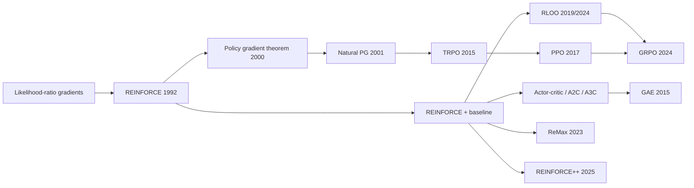

# REINFORCE (Monte-Carlo Policy Gradient, "vanilla policy gradient", VPG)

> Directly adjust a stochastic policy's parameters in the direction that makes high-return actions more likely, using complete-episode returns. **Family:** Model-free → Policy-based → Policy Gradient  ·  **Year / origin:** Williams 1992 (*Machine Learning*); policy gradient theorem: Sutton, McAllester, Singh & Mansour 2000  ·  **On/Off-policy:** On-policy  ·  **Action space:** Discrete and continuous

## 1. What is it?

REINFORCE is the simplest **policy-gradient** algorithm. Instead of learning values and acting greedily (like [Q-learning](../01-foundations-tabular/q-learning.md) or [DQN](../02-deep-value-based/dqn.md)), it parameterizes the policy itself, $\pi_\theta(a\mid s)$ — e.g. a neural network that outputs action probabilities — and does stochastic gradient **ascent** on the expected return $J(\theta)$.

The key fact that makes this possible is the **likelihood-ratio** (a.k.a. "score function" or "log-derivative") trick: even though the environment is a black box that we cannot differentiate, the gradient of the expected return can be written as an expectation of $\nabla_\theta \log \pi_\theta(a\mid s)$ weighted by returns — which we can estimate just by running the policy.

Williams (1992) introduced the family of "REward Increment = Nonnegative Factor × Offset Reinforcement × Characteristic Eligibility" algorithms (that is where the acronym comes from). Sutton et al. (2000) proved the general **policy gradient theorem** for function approximation.

**Why it matters.**
- It handles **continuous** and **discrete** actions identically, learns **stochastic** policies natively, and has convergence to a local optimum (for suitable step sizes) because it is true stochastic gradient ascent.
- Its weakness is **high variance**: Monte-Carlo returns are noisy, so it needs many samples. Almost all of the policy-gradient family — **baselines**, **actor-critic**, **GAE**, **TRPO**, **PPO** — can be read as "REINFORCE + variance reduction + step-size control".
- **It is the direct ancestor of modern LLM RL.** With a language model as the policy, a whole response as one "action sequence", and a single outcome reward (a reward model or a verifier), REINFORCE with a good baseline is exactly what **RLOO**, **ReMax**, **REINFORCE++** and **GRPO** do. Ahmadian et al. (2024) argued that REINFORCE-style methods are sufficient — and cheaper than PPO — for RLHF; DeepSeek's GRPO uses a group-mean baseline in the same spirit.

## 2. Family & lineage

- **Parents:** stochastic approximation / likelihood-ratio gradient estimation (also known in operations research and simulation), Williams' REINFORCE (earlier conference versions in the late 1980s; journal paper 1992), associative reward-penalty learning.
- **Siblings:** natural policy gradient (Kakade 2001), GPOMDP (Baxter & Bartlett 2001), evolution strategies (gradient estimates from parameter perturbations instead of action sampling).
- **Descendants:** actor-critic (learned baseline/critic), A2C/A3C, GAE, TRPO, PPO; in LLMs: RLOO, ReMax, REINFORCE++, GRPO and their variants (DAPO, Dr. GRPO, GSPO ...).



## 3. Core idea & intuition

**"Do more of what worked."** Run the policy for a whole episode. For each action you took, nudge the parameters to make that action more probable — by an amount proportional to how good the outcome after it was. Good episodes make their actions more likely; bad episodes make theirs less likely. Averaged over many episodes, this is exactly the gradient of expected return.

**Why "log" probability?** $\nabla \log \pi = \nabla \pi / \pi$. Dividing by $\pi$ corrects for the fact that frequently chosen actions get pushed more often simply because they are sampled more. The result is an unbiased gradient.

**Three variance-reduction ideas that are central to everything that follows:**

1. **Causality / reward-to-go.** An action at time $t$ cannot affect rewards before $t$. Weight $\nabla\log\pi(a_t\mid s_t)$ by the return *from $t$ onward* ($G_t$), not by the whole-episode return. Same expectation, less noise.
2. **Baselines.** Subtract a number $b(s_t)$ that does not depend on the action: weight by $G_t - b(s_t)$. Expectation unchanged (proof below), but if $b \approx$ "what we usually get from here", the weight now says "better or worse than usual", and its variance drops dramatically. A learned $b(s) = V(s)$ leads to actor-critic.
3. **Many samples per update / leave-one-out baselines.** Sample $K$ episodes (or $K$ LLM responses to the same prompt) and use the *other* samples' average as the baseline for each one — no value network needed. This is RLOO; using the group mean (and dividing by the group standard deviation) is GRPO.

In the code's variance measurement at the initial policy, reward-to-go cuts the gradient variance to ~18% of the whole-return estimator, and adding a simple baseline cuts it to ~8%.

## 4. Math / formal details

**Objective.** Trajectory $\tau = (s_0, a_0, r_1, s_1, a_1, \dots, s_T)$ generated by $\pi_\theta$ and the environment dynamics $p$; return $R(\tau) = \sum_{t=0}^{T-1}\gamma^t r_{t+1}$.
$$J(\theta) = \mathbb E_{\tau\sim p_\theta}[R(\tau)], \qquad p_\theta(\tau) = \rho_0(s_0)\prod_{t} \pi_\theta(a_t\mid s_t)\,p(s_{t+1}, r_{t+1}\mid s_t,a_t).$$

**Log-derivative trick.** $\nabla_\theta p_\theta(\tau) = p_\theta(\tau)\nabla_\theta\log p_\theta(\tau)$, and the dynamics terms do not depend on $\theta$, so
$$\nabla_\theta J(\theta) = \mathbb E_\tau\Big[R(\tau)\sum_{t}\nabla_\theta \log\pi_\theta(a_t\mid s_t)\Big].$$

**Reward-to-go.** Because rewards before $t$ are independent of $a_t$ given the past,
$$\nabla_\theta J(\theta) = \mathbb E_\tau\Big[\sum_t \nabla_\theta\log\pi_\theta(a_t\mid s_t)\, G_t\Big], \qquad G_t = \sum_{k=t}^{T-1}\gamma^{k-t} r_{k+1}.$$
(Strictly, the discounted objective has an extra $\gamma^t$ factor in front of each term; almost all implementations drop it, which is a common, slightly biased convention discussed in S&B Ch. 13.3.)

**Policy gradient theorem** (Sutton et al. 2000; S&B Ch. 13.2). For the episodic case,
$$\nabla_\theta J(\theta) \propto \sum_s \mu_\pi(s)\sum_a Q^\pi(s,a)\,\nabla_\theta\pi_\theta(a\mid s) = \mathbb E_{s\sim\mu_\pi,\ a\sim\pi}\big[Q^\pi(s,a)\nabla_\theta\log\pi_\theta(a\mid s)\big],$$
where $\mu_\pi$ is the on-policy state distribution. Crucially, the gradient does **not** involve the derivative of the state distribution. REINFORCE uses the sample $G_t$ as an unbiased estimate of $Q^\pi(s_t,a_t)$.

**Baselines are unbiased.** For any $b(s)$ independent of $a$:
$$\mathbb E_{a\sim\pi}\big[b(s)\nabla_\theta\log\pi_\theta(a\mid s)\big] = b(s)\sum_a\nabla_\theta\pi_\theta(a\mid s) = b(s)\,\nabla_\theta\!\sum_a\pi_\theta(a\mid s) = b(s)\nabla_\theta 1 = 0.$$
So $\nabla J = \mathbb E[\nabla\log\pi(a_t\mid s_t)(G_t - b(s_t))]$. The variance-minimizing constant baseline is $b^* = \mathbb E[\lVert g\rVert^2 G]/\mathbb E[\lVert g\rVert^2]$ with $g = \nabla\log\pi$ (Greensmith et al. 2004); in practice $b(s) \approx V^\pi(s)$ is used. $G_t - V(s_t)$ is an estimate of the **advantage** $A^\pi(s_t,a_t) = Q^\pi - V^\pi$.

**Leave-one-out baseline (RLOO).** With $K$ i.i.d. samples $\tau_1..\tau_K$ (e.g. responses to the same prompt) with scalar rewards $R_i$:
$$\hat g = \frac1K\sum_{i=1}^K\Big(R_i - \frac{1}{K-1}\sum_{j\ne i}R_j\Big)\nabla_\theta\log p_\theta(\tau_i),$$
unbiased because each baseline is independent of its own sample. GRPO uses $\hat A_i = (R_i - \operatorname{mean}_j R_j)/\operatorname{std}_j R_j$ (which includes the sample itself and rescales — slightly biased, but practical) inside a PPO-style clipped objective.

**Softmax policy gradient (tabular sanity check).** For $\pi(a\mid s) \propto \exp(h(s,a))$: $\nabla_{h(s,\cdot)}\log\pi(a\mid s) = \mathbf e_a - \pi(\cdot\mid s)$ — increase the logit of the taken action, decrease all in proportion to their probability. This is also the bandit "gradient bandit" algorithm (S&B Ch. 2.8).

**Surrogate loss used in code.** Autodiff frameworks need a scalar to differentiate:
$$\mathcal L(\theta) = -\frac1m\sum_{i=1}^m\sum_t \log\pi_\theta(a^i_t\mid s^i_t)\,\hat A^i_t,$$
with $\hat A$ treated as a constant. Its gradient is the (negative) REINFORCE estimator. Note this "loss" value itself is meaningless as a progress metric.

## 5. Algorithm (pseudocode)

```text
Input: policy pi_theta, (optional) baseline V_phi, step sizes alpha_theta, alpha_phi,
       episodes per update m, discount gamma
1.  repeat for each iteration:
2.      run m episodes with pi_theta: {(s_t^i, a_t^i, r_{t+1}^i)}
3.      for every episode i and time t:
4.          G_t^i <- sum_{k>=t} gamma^(k-t) r_{k+1}^i                 # reward-to-go
5.          A_t^i <- G_t^i - b(s_t^i)      # b = 0 (vanilla), V_phi(s) (learned), or
                                           # leave-one-out mean of other episodes (RLOO)
6.      theta <- theta + alpha_theta * (1/m) sum_i sum_t A_t^i * grad log pi_theta(a_t^i | s_t^i)
7.      if learned baseline: phi <- phi - alpha_phi * grad (1/N) sum (V_phi(s_t^i) - G_t^i)^2
8.  until converged
```

## 6. Python implementation

PyTorch + NumPy with a NumPy cart-pole (200-step cap, so maximum return = 200). The script first **measures** the gradient variance of three estimators at the initial policy, then trains three variants for 600 episodes each (2 seeds): no baseline, learned value baseline, and an RLOO-style leave-one-out baseline on whole-episode returns — the same estimator that LLM methods use with sequence-level rewards.

Runnable version: [`code/reinforce.py`](../../code/reinforce.py)

```python
"""
REINFORCE (Williams 1992) with and without baselines, on a self-contained NumPy CartPole.

What this script shows
  1. Gradient-variance measurement at the initial policy for three estimators:
       (a) whole-episode return G_0 for every action (original REINFORCE)
       (b) reward-to-go G_t (causality)
       (c) reward-to-go minus a baseline
  2. Training with three variants:
       "none"  : reward-to-go, no baseline
       "value" : reward-to-go minus a learned state-value baseline V(s_t)
       "rloo"  : one scalar score per episode minus the leave-one-out mean of the OTHER episodes
                 in the batch (the estimator behind RLOO / GRPO-style LLM training)
Run:  python3 code/reinforce.py      (about 30-60 s on CPU)
"""
import math

import numpy as np
import torch
import torch.nn as nn


class CartPole:
    """Classic cart-pole physics (same constants as Gym CartPole), capped at max_steps."""
    def __init__(self, max_steps=200, seed=0):
        self.gravity, self.m_cart, self.m_pole = 9.8, 1.0, 0.1
        self.length, self.force_mag, self.tau = 0.5, 10.0, 0.02
        self.x_limit, self.theta_limit = 2.4, 12 * 2 * math.pi / 360
        self.max_steps, self.rng = max_steps, np.random.default_rng(seed)
        self.obs_dim, self.n_actions = 4, 2

    def reset(self):
        self.state, self.t = self.rng.uniform(-0.05, 0.05, size=4), 0
        return self.state.astype(np.float32)

    def step(self, action):
        x, x_dot, th, th_dot = self.state
        force = self.force_mag if action == 1 else -self.force_mag
        cos, sin = math.cos(th), math.sin(th)
        total_m, pm_l = self.m_cart + self.m_pole, self.m_pole * self.length
        temp = (force + pm_l * th_dot ** 2 * sin) / total_m
        th_acc = (self.gravity * sin - cos * temp) / (
            self.length * (4.0 / 3.0 - self.m_pole * cos ** 2 / total_m))
        x_acc = temp - pm_l * th_acc * cos / total_m
        x, x_dot = x + self.tau * x_dot, x_dot + self.tau * x_acc
        th, th_dot = th + self.tau * th_dot, th_dot + self.tau * th_acc
        self.state, self.t = np.array([x, x_dot, th, th_dot]), self.t + 1
        terminated = bool(abs(x) > self.x_limit or abs(th) > self.theta_limit)
        return self.state.astype(np.float32), 1.0, terminated, self.t >= self.max_steps


def mlp(n_in, n_out, hidden=64):
    return nn.Sequential(nn.Linear(n_in, hidden), nn.Tanh(), nn.Linear(hidden, n_out))


def rollout(env, policy):
    """Run one episode with the stochastic policy; return obs [T,4], actions [T], rewards [T]."""
    obs, acts, rews = [], [], []
    o, done = env.reset(), False
    while not done:
        with torch.no_grad():
            a = torch.distributions.Categorical(logits=policy(torch.as_tensor(o))).sample().item()
        o2, r, term, trunc = env.step(a)
        obs.append(o); acts.append(a); rews.append(r)
        o, done = o2, term or trunc
    return torch.as_tensor(np.array(obs)), torch.as_tensor(acts), np.array(rews, np.float32)


def reward_to_go(rews, gamma):
    """G_t = sum_{k>=t} gamma^(k-t) r_k, computed backwards."""
    g, out = 0.0, np.zeros_like(rews)
    for t in reversed(range(len(rews))):
        g = rews[t] + gamma * g
        out[t] = g
    return torch.as_tensor(out)


def pg_loss(policy, obs, acts, weights):
    """Surrogate whose gradient is the REINFORCE estimator: -E[ log pi(a|s) * weight ]."""
    logp = torch.distributions.Categorical(logits=policy(obs)).log_prob(acts)
    return -(logp * weights).sum()


def gradient_variance_demo(seed=0, n_batches=30, episodes_per_batch=5, gamma=0.99):
    torch.manual_seed(seed)
    env, policy = CartPole(seed=seed), mlp(4, 2)
    grads = {"(a) total return G_0": [], "(b) reward-to-go G_t": [], "(c) G_t - baseline": []}
    for _ in range(n_batches):
        eps = [rollout(env, policy) for _ in range(episodes_per_batch)]
        rtgs = [reward_to_go(r, gamma) for _, _, r in eps]
        # simple baseline: average reward-to-go at the same time step across the batch
        T = max(len(g) for g in rtgs)
        padded = torch.zeros(len(rtgs), T)
        mask = torch.zeros(len(rtgs), T)
        for i, g in enumerate(rtgs):
            padded[i, :len(g)], mask[i, :len(g)] = g, 1
        b_t = padded.sum(0) / mask.sum(0).clamp(min=1)
        for key in grads:
            policy.zero_grad()
            loss = 0
            for (o, a, r), g in zip(eps, rtgs):
                if key.startswith("(a)"):
                    w = torch.full_like(g, float(g[0]))
                elif key.startswith("(b)"):
                    w = g
                else:
                    w = g - b_t[:len(g)]
                loss = loss + pg_loss(policy, o, a, w) / episodes_per_batch
            loss.backward()
            grads[key].append(torch.cat([p.grad.flatten() for p in policy.parameters()]).clone())
    print("Gradient-estimator variance at the initial policy (sum of per-parameter variances):")
    base = None
    for key, gs in grads.items():
        v = torch.stack(gs).var(0).sum().item()
        base = base or v
        print(f"  {key:24s} {v:10.2f}   ({v / base:5.2f}x of (a))")


def train(variant, n_updates=60, episodes_per_update=10, gamma=0.99, lr=1e-2, seed=0):
    torch.manual_seed(seed); np.random.seed(seed)
    env = CartPole(seed=seed)
    policy, value = mlp(4, 2), mlp(4, 1)
    opt = torch.optim.Adam(policy.parameters(), lr=lr)
    v_opt = torch.optim.Adam(value.parameters(), lr=1e-2)
    history = []
    for it in range(n_updates):
        eps = [rollout(env, policy) for _ in range(episodes_per_update)]
        returns = np.array([r.sum() for _, _, r in eps])
        history.append(returns.mean())
        loss = 0.0
        if variant == "rloo":
            # outcome-level score (like an LLM's sequence reward): undiscounted episode return,
            # baseline = mean return of the other K-1 episodes in the batch (leave-one-out)
            K = len(eps)
            loo_baseline = (returns.sum() - returns) / (K - 1)
            for (o, a, _), R, b in zip(eps, returns, loo_baseline):
                loss = loss + pg_loss(policy, o, a, torch.full((len(a),), float(R - b)))
        else:
            all_obs = torch.cat([o for o, _, _ in eps])
            all_g = torch.cat([reward_to_go(r, gamma) for _, _, r in eps])
            if variant == "value":
                with torch.no_grad():
                    adv = all_g - value(all_obs).squeeze(-1)
                # fit the baseline V(s) ~ G_t by regression (a few gradient steps)
                for _ in range(5):
                    v_loss = ((value(all_obs).squeeze(-1) - all_g) ** 2).mean()
                    v_opt.zero_grad(); v_loss.backward(); v_opt.step()
            else:
                adv = all_g
            all_a = torch.cat([a for _, a, _ in eps])
            loss = pg_loss(policy, all_obs, all_a, adv)
        # average over episodes (the "1/m" in the Monte-Carlo estimate)
        loss = loss / episodes_per_update
        opt.zero_grad(); loss.backward(); opt.step()
    return history


if __name__ == "__main__":
    torch.set_num_threads(1)
    gradient_variance_demo()
    print("\nTraining (10 episodes per update, 60 updates = 600 episodes; max return 200)")
    for variant in ["none", "value", "rloo"]:
        finals = []
        for seed in range(2):
            h = train(variant, seed=seed)
            finals.append((np.mean(h[:5]), np.mean(h[-5:])))
        f = np.array(finals)
        print(f"  baseline={variant:6s} avg return first 5 updates {f[:, 0].mean():6.1f}  ->  "
              f"last 5 updates {f[:, 1].mean():6.1f}   (mean of 2 seeds)")
```

Example output (CPU, ~1 min):

```text
Gradient-estimator variance at the initial policy (sum of per-parameter variances):
  (a) total return G_0       11281.49   ( 1.00x of (a))
  (b) reward-to-go G_t        1974.67   ( 0.18x of (a))
  (c) G_t - baseline           939.78   ( 0.08x of (a))

Training (10 episodes per update, 60 updates = 600 episodes; max return 200)
  baseline=none   avg return first 5 updates   30.8  ->  last 5 updates  188.3   (mean of 2 seeds)
  baseline=value  avg return first 5 updates   32.5  ->  last 5 updates  200.0   (mean of 2 seeds)
  baseline=rloo   avg return first 5 updates   33.4  ->  last 5 updates  200.0   (mean of 2 seeds)
```

(The baseline in the variance demo is computed from the same batch, so it is very slightly biased; it is meant to illustrate the variance effect. The training variants use a separately fitted value function or a strict leave-one-out mean.)

**How this maps to LLM training.** Replace the cart-pole episode by "prompt → sampled response", `rollout` by `model.generate`, the per-step `log_prob` by the sum of per-token log-probs of the response, and `returns` by a reward-model or verifier score. The `rloo` branch is then essentially RLOO; normalizing by the group's standard deviation and adding PPO-style clipping gives GRPO (see [GRPO](../10-llm-reasoning-rl/grpo.md) and [RLOO / ReMax / REINFORCE++](../10-llm-reasoning-rl/rloo-remax-reinforcepp.md)).

## 7. Practical tips & hyperparameters

- **Learning rate:** Adam 1e-3 – 1e-2 for tiny MLPs on toy tasks; much smaller (1e-6 – 1e-5) for LLM fine-tuning.
- **Batch size:** more episodes per update = lower variance. 5–50 episodes for toy tasks; for LLMs, $K = 4$–$64$ samples per prompt for leave-one-out/group baselines.
- **Always use reward-to-go and a baseline.** Vanilla whole-return REINFORCE is mainly of historical interest.
- **Normalize advantages** (subtract mean, divide by std over the batch) — cheap and very effective, although it changes the effective step size.
- **Entropy bonus** ($+\beta\,\mathcal H[\pi(\cdot\mid s)]$, $\beta \approx 0.01$) if the policy collapses to deterministic too early.
- **Discount:** $\gamma = 0.99$ for long tasks; for LLM outcome rewards usually $\gamma = 1$ (one reward at the end).
- **Pitfalls:** forgetting to detach the baseline/advantage (gradients then flow into the critic through the policy loss); using `loss.mean()` over *all timesteps* of variable-length episodes instead of a per-episode sum (it silently re-weights long vs. short episodes — the same issue as "length normalization" debates in GRPO variants, see [Dr. GRPO / DAPO](../10-llm-reasoning-rl/dapo-dr-grpo.md)); reusing old data (REINFORCE is on-policy: after one update the samples are stale — PPO's clipping is what makes a few reuse epochs safe).
- **Debugging signals:** average return (noisy — smooth it), policy entropy (should decrease slowly, not crash to 0), gradient norm, and the explained variance of the baseline ($1 - \operatorname{Var}[G - V]/\operatorname{Var}[G]$; should become positive).

## 8. Pros and cons

**Pros**
- Extremely simple; a dozen lines on top of a policy network.
- Unbiased gradient estimates; converges to a local optimum with suitable step sizes.
- Works for discrete, continuous and structured (sequence) actions; learns stochastic policies.
- No value function required (with leave-one-out baselines) → low memory; this is why it is attractive for LLMs (no critic as big as the policy).
- Insensitive to delayed/sparse rewards in the sense that it needs no bootstrapping (no bias from a bad critic).

**Cons**
- High-variance gradients → sample-inefficient, needs many episodes.
- On-policy: each sample is used for a single gradient step.
- Needs complete episodes (Monte-Carlo); unsuitable for very long or continuing tasks without truncation.
- Step size is hard to choose: too large → policy collapse; nothing constrains how far the policy moves (fixed by TRPO/PPO).
- Only finds local optima; sensitive to reward scaling (fixed by normalization/baselines).

## 9. When to use / when not to use

**Use when:**
- You want the simplest correct policy-gradient baseline or a teaching implementation.
- Episodes are short and cheap to simulate; or rewards are given once per episode (bandit-like sequences).
- **LLM fine-tuning with outcome rewards** (verifiable math/code, reward-model scores): REINFORCE with a leave-one-out or group baseline (RLOO, GRPO) is a strong, memory-efficient choice.

**Avoid when:**
- Interaction is expensive → off-policy methods ([SAC](../04-off-policy-actor-critic/sac.md), [DQN](../02-deep-value-based/dqn.md)) reuse data far better.
- Long horizons with dense rewards → use a critic and bootstrapping ([A2C](actor-critic-a2c-a3c.md), [PPO](ppo.md)).
- You need reliable monotonic improvement → [TRPO](trpo.md)/[PPO](ppo.md).

## 10. Key papers, books & repos

- Williams, R. J. (1992). *Simple statistical gradient-following algorithms for connectionist reinforcement learning.* Machine Learning 8(3–4), 229–256.
- Sutton, McAllester, Singh, Mansour (2000). *Policy Gradient Methods for Reinforcement Learning with Function Approximation.* NeurIPS (NIPS 12).
- Baxter & Bartlett (2001). *Infinite-Horizon Policy-Gradient Estimation.* JAIR 15. (GPOMDP.)
- Greensmith, Bartlett, Baxter (2004). *Variance Reduction Techniques for Gradient Estimates in Reinforcement Learning.* JMLR 5.
- Kakade (2001). *A Natural Policy Gradient.* NeurIPS.
- Kool, van Hoof, Welling (2019). *Buy 4 REINFORCE Samples, Get a Baseline for Free!* ICLR 2019 Workshop (DeepRLStructPred). (Leave-one-out baseline.)
- Ahmadian et al. (2024). *Back to Basics: Revisiting REINFORCE Style Optimization for Learning from Human Feedback in LLMs.* ACL 2024. arXiv:2402.14740. (RLOO for RLHF.)
- Li et al. (2023). *ReMax: A Simple, Effective, and Efficient Reinforcement Learning Method for Aligning Large Language Models.* arXiv:2310.10505.
- Shao et al. (2024). *DeepSeekMath: Pushing the Limits of Mathematical Reasoning in Open Language Models.* arXiv:2402.03300. (GRPO.)
- Sutton & Barto (2nd ed., 2018), **Ch. 13** — 13.1 policy approximation, 13.2 policy gradient theorem, 13.3 REINFORCE, 13.4 REINFORCE with baseline, 13.5 actor-critic; Ch. 2.8 gradient bandits.
- Repos: [openai/spinningup](https://github.com/openai/spinningup) (VPG with GAE, excellent docs on the derivation), [huggingface/trl](https://github.com/huggingface/trl) (`RLOOTrainer`, `GRPOTrainer`), [OpenRLHF/OpenRLHF](https://github.com/OpenRLHF/OpenRLHF) (REINFORCE++, RLOO, GRPO), [volcengine/verl](https://github.com/volcengine/verl) (GRPO, RLOO, REINFORCE++ estimators), [deepseek-ai/DeepSeek-Math](https://github.com/deepseek-ai/DeepSeek-Math).

## 11. For business users

**What it does.** REINFORCE teaches a system to make better decisions by trying things, seeing how well each whole attempt went, and then making the choices from good attempts more likely and those from bad attempts less likely. No hand-written rules, no model of the world — just "do more of what worked".

**Analogy.** A coach reviewing game footage: after a winning game, every play the team ran gets a little more practice time; after a loss, those plays get a little less. To be fair, the coach compares against "how we usually do" — a win against a weak opponent is less informative than one against a strong opponent (this is the "baseline").

**Use cases.** Training large language models on tasks with checkable answers (math, code, formatting) or on human-preference scores — today's RLOO and GRPO methods are REINFORCE at heart; optimizing sequences of decisions where only the final result is scored (e.g. a full schedule, a generated design); simple control tasks; teaching and prototyping.

**Value / ROI.** Simple to implement and audit; needs no separate "value" model, which for LLMs saves a lot of GPU memory compared with PPO. Works whenever you can score an outcome automatically.

**Risks.** Needs many attempts (noisy learning); optimizes exactly what you score — if the score can be gamed, the model will find the loophole (reward hacking); can become overconfident and lose diversity; on-policy, so old data can't easily be reused.

**Costs.** Mainly compute for generating many attempts; for LLMs, the generation (sampling) step usually dominates the cost.

**Questions to ask your team.**
- How do we score an attempt, and can that score be gamed?
- How many samples per prompt/episode do we use for the baseline?
- Are we monitoring diversity (entropy) so the model doesn't collapse to one answer?
- Why REINFORCE/RLOO/GRPO instead of PPO (or vice versa) for our setting?

## 12. For kids (ages ~8–12)

**Story.** Lily is teaching her puppy, Biscuit, to do tricks. Biscuit tries a bunch of things in a row — sits, spins, barks, lies down. At the end, if Lily is happy, Biscuit gets a treat, and Biscuit thinks: "Everything I did just now, I'll do a bit more often!" If there's no treat: "I'll do those things a bit less." But Biscuit is clever: "Today was a normal day — I *usually* get one treat. Getting two is great; getting one is just normal." Comparing to "normal" helps Biscuit learn much faster!

**Try it yourself.** Play "hot and cold" with a friend: they hide a toy, and you try paths around the room. After each try they only say how close you ended up (a number from 0 to 10). Next try, repeat more of the turns from your best tries. How many tries until you find it?

**Recap.**
1. Try a whole round, then see how well it went.
2. Do more of what worked, less of what didn't.
3. Compare to "how I usually do" to learn faster.

## 13. Related methods

- [Multi-armed bandits](../01-foundations-tabular/multi-armed-bandits.md) — gradient bandit algorithm = one-step REINFORCE.
- [Monte Carlo methods](../01-foundations-tabular/monte-carlo.md) — the return estimates REINFORCE uses.
- [Actor-critic, A2C/A3C, GAE](actor-critic-a2c-a3c.md) — learned baseline + bootstrapping.
- [TRPO](trpo.md) and [PPO](ppo.md) — step-size control on top of the policy gradient.
- [Evolution strategies](../08-exploration-hierarchical-multiagent/evolution-strategies.md) — gradient estimates by perturbing parameters instead.
- [RLOO / ReMax / REINFORCE++](../10-llm-reasoning-rl/rloo-remax-reinforcepp.md) — REINFORCE for LLMs.
- [GRPO](../10-llm-reasoning-rl/grpo.md) — group-relative baseline + PPO-style clipping.
- [RLVR](../10-llm-reasoning-rl/rlvr.md) — RL with verifiable rewards.
- [RLHF with PPO](../09-llm-preference-alignment/rlhf-ppo.md) — the PPO-based alternative.

[← Back to overview](../../RL_Methods_Overview.md)
