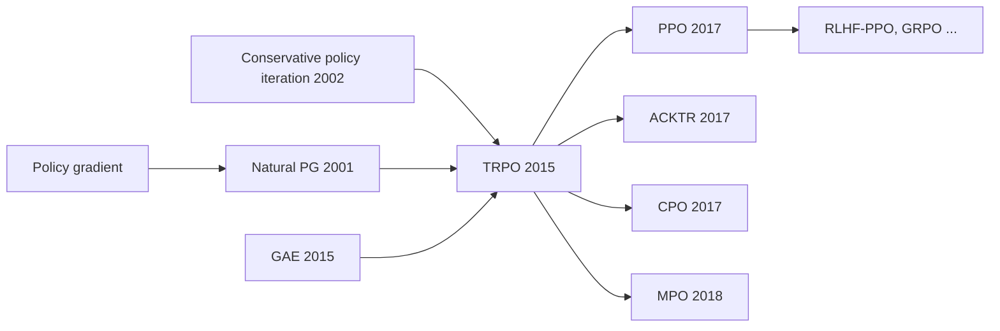

# Trust Region Policy Optimization (TRPO)

> Take the biggest policy-improvement step whose average KL divergence from the old policy stays below a threshold, solved with natural gradients, conjugate gradient and a line search. **Family:** Model-free → Policy-based → Policy Gradient → Trust-region / natural-gradient methods  ·  **Year / origin:** Schulman, Levine, Moritz, Jordan & Abbeel, UC Berkeley, ICML 2015  ·  **On/Off-policy:** On-policy  ·  **Action space:** Discrete and continuous

## 1. What is it?

Plain policy gradient ([REINFORCE](reinforce.md), [A2C](actor-critic-a2c-a3c.md)) takes a step of fixed size in **parameter** space. But a small change in parameters can mean a huge change in **behaviour** (or a tiny one) depending on where you are — so a learning rate that is safe in one place causes a catastrophic policy collapse in another, and a collapsed policy then collects bad data, making recovery hard.

**TRPO** instead limits how much the *policy distribution* changes per update:

$$\max_\theta\ \ \mathbb E\Big[\tfrac{\pi_\theta(a\mid s)}{\pi_{\text{old}}(a\mid s)}\,\hat A(s,a)\Big] \quad\text{s.t.}\quad \mathbb E_s\big[D_{\mathrm{KL}}(\pi_{\text{old}}(\cdot\mid s)\,\Vert\,\pi_\theta(\cdot\mid s))\big] \le \delta.$$

It is grounded in a monotonic-improvement theorem (a lower bound on the true improvement in terms of a surrogate objective minus a KL penalty), building on Kakade & Langford's conservative policy iteration (2002). The practical algorithm approximates the problem to second order, which gives a **natural gradient** step (Kakade 2001), computes it efficiently with **conjugate gradient** using only Fisher-vector products, scales it to the trust-region boundary, and checks it with a **backtracking line search**.

TRPO made deep policy-gradient training reliable for simulated robotic locomotion and Atari from pixels, and was the main policy-optimization workhorse until [PPO](ppo.md) (2017) achieved similar stability with a much simpler first-order method. Its ideas — **surrogate objective with importance ratios**, **KL trust regions**, **GAE** — live on in PPO and in KL-regularized RLHF.

## 2. Family & lineage

- **Parents:** policy gradient (REINFORCE, actor-critic), natural policy gradient (Kakade 2001) and natural actor-critic (Peters & Schaal 2008), conservative policy iteration (Kakade & Langford 2002), relative entropy policy search (REPS; Peters, Mülling & Altün 2010).
- **Siblings:** ACKTR (Kronecker-factored natural gradient, 2017), constrained policy optimization (CPO, Achiam et al. 2017 — TRPO with safety constraints), MPO (maximum a-posteriori policy optimization, DeepMind 2018, KL-constrained EM-style updates).
- **Descendants:** PPO (first-order approximation of the trust region), PPO-penalty (adaptive KL), KL-regularized RLHF objectives, trust-region ideas in GRPO/GSPO-style LLM methods.



## 3. Core idea & intuition

**Hiking in fog.** You want to climb a hill (maximize return), but you can only see a few meters around you (your estimate of the improvement — the surrogate — is only accurate near the current policy). Plain gradient ascent says "take a 1-meter step in parameter space"; but parameter-space distance is a poor measure of how far you actually moved in "behaviour space". TRPO says: "move as far uphill as you like, **as long as you stay inside the circle where your map is trustworthy**", and measures that circle with the KL divergence between old and new action distributions — a measure of behaviour change that does not depend on how the network is parameterized.

**The four computational ingredients:**

1. **Surrogate objective.** Reuse samples from $\pi_{\text{old}}$ to estimate the performance of a nearby $\pi_\theta$ via importance ratios $\pi_\theta/\pi_{\text{old}}$. Its gradient at $\theta_{\text{old}}$ equals the ordinary policy gradient.
2. **Quadratic model of the KL.** Near $\theta_{\text{old}}$, $\overline{\mathrm{KL}} \approx \tfrac12 \Delta\theta^\top F\,\Delta\theta$, where $F$ is the Fisher information matrix. Maximizing a linear objective under this quadratic constraint gives the **natural gradient** direction $F^{-1}g$.
3. **Conjugate gradient (CG).** $F$ has (#params)² entries — far too big to form. But CG solves $Fx = g$ using only products $Fv$, and $Fv$ can be computed with two backward passes ("Hessian-vector product of the KL"). ~10 CG iterations suffice.
4. **Line search.** The quadratic model is only an approximation. Starting from the full step to the boundary, halve the step until the *actual* KL is within $\delta$ and the surrogate actually improved.

## 4. Math / formal details

**Symbols.** $\eta(\pi) = \mathbb E_{\tau\sim\pi}[\sum_t\gamma^t r_t]$: expected discounted return. $\rho_\pi(s) = \sum_t\gamma^t P(s_t = s\mid\pi)$: discounted state visitation. $A_\pi(s,a)$: advantage. $\theta_{\text{old}}$: current parameters; $\delta$: KL radius.

**Performance-difference identity** (Kakade & Langford 2002):
$$\eta(\tilde\pi) = \eta(\pi) + \sum_s \rho_{\tilde\pi}(s)\sum_a\tilde\pi(a\mid s)A_\pi(s,a).$$
The dependence on $\rho_{\tilde\pi}$ (states visited by the *new* policy) makes it hard to optimize. **Local approximation**: replace $\rho_{\tilde\pi}$ by $\rho_\pi$:
$$L_\pi(\tilde\pi) = \eta(\pi) + \sum_s\rho_\pi(s)\sum_a\tilde\pi(a\mid s)A_\pi(s,a),$$
which matches $\eta$ to first order at $\tilde\pi = \pi$.

**Monotonic improvement bound** (TRPO, Theorem 1). With $\epsilon = \max_{s,a}|A_\pi(s,a)|$ and $D^{\max}_{\mathrm{KL}}(\pi,\tilde\pi) = \max_s D_{\mathrm{KL}}(\pi(\cdot\mid s)\Vert\tilde\pi(\cdot\mid s))$:
$$\eta(\tilde\pi) \ge L_\pi(\tilde\pi) - C\,D^{\max}_{\mathrm{KL}}(\pi,\tilde\pi),\qquad C = \frac{4\epsilon\gamma}{(1-\gamma)^2}.$$
Maximizing the right-hand side each iteration guarantees non-decreasing $\eta$ (a minorize–maximize scheme). The penalty coefficient $C$ is far too conservative in practice, so TRPO switches to a **constraint** on the **average** KL.

**Practical problem** (sample-based, with importance sampling over actions):
$$\max_\theta\ L(\theta) = \hat{\mathbb E}_t\Big[\frac{\pi_\theta(a_t\mid s_t)}{\pi_{\theta_{\text{old}}}(a_t\mid s_t)}\hat A_t\Big]\quad\text{s.t.}\quad \bar D_{\mathrm{KL}}(\theta) = \hat{\mathbb E}_t\big[D_{\mathrm{KL}}(\pi_{\theta_{\text{old}}}(\cdot\mid s_t)\Vert\pi_\theta(\cdot\mid s_t))\big]\le\delta.$$

**Second-order approximation** around $\theta_{\text{old}}$, with $g = \nabla_\theta L\big|_{\theta_{\text{old}}}$ and $F = \nabla^2_\theta\bar D_{\mathrm{KL}}\big|_{\theta_{\text{old}}}$ (equals the Fisher information matrix $\hat{\mathbb E}[\nabla\log\pi\,\nabla\log\pi^\top]$ at $\theta_{\text{old}}$):
$$\max_{\Delta}\ g^\top\Delta\quad\text{s.t.}\quad\tfrac12\Delta^\top F\Delta\le\delta \;\;\Longrightarrow\;\; \Delta^* = \sqrt{\frac{2\delta}{g^\top F^{-1}g}}\;F^{-1}g.$$
$F^{-1}g$ is the **natural gradient**. The step size $\beta = \sqrt{2\delta/(s^\top F s)}$ with $s = F^{-1}g$ puts the step exactly on the boundary of the quadratic trust region.

**Fisher-vector product without forming $F$:**
$$Fv = \nabla_\theta\Big(\big(\nabla_\theta\bar D_{\mathrm{KL}}(\theta)\big)^\top v\Big)\Big|_{\theta_{\text{old}}} \quad(+\ \text{damping}\cdot v),$$
two reverse-mode passes. A small damping term (e.g. $0.1v$) keeps $F$ well-conditioned.

**Conjugate gradient** for $Fx = g$ (Hestenes & Stiefel 1952): start $x_0 = 0$, $r_0 = p_0 = g$; repeat
$\alpha_k = \frac{r_k^\top r_k}{p_k^\top Fp_k}$, $x_{k+1} = x_k + \alpha_kp_k$, $r_{k+1} = r_k - \alpha_kFp_k$, $p_{k+1} = r_{k+1} + \frac{r_{k+1}^\top r_{k+1}}{r_k^\top r_k}p_k$. Exact in at most $n$ steps for an $n$-dimensional SPD system; in TRPO ~10 steps give a good enough direction.

**Line search.** Try $\theta = \theta_{\text{old}} + \alpha^j\Delta^*$ for $j = 0,1,\dots$ ($\alpha = 0.5$ or $0.8$), accept the first one with $\bar D_{\mathrm{KL}} \le \delta$ and $L(\theta) > L(\theta_{\text{old}})$; if none, keep $\theta_{\text{old}}$.

**Value function.** Fitted separately by regression on (GAE) returns — originally also with a trust region; in most implementations simply with Adam/L-BFGS.

## 5. Algorithm (pseudocode)

```text
Input: KL radius delta, CG iterations K, damping, backtrack coefficient alpha, GAE (gamma, lambda)
1.  initialize policy pi_theta and value function V_phi
2.  for iteration = 1, 2, ...:
3.      collect a batch of trajectories with pi_theta_old (theta_old = theta)
4.      compute advantages A_t with GAE(gamma, lambda) using V_phi; normalize them
5.      g  <- grad_theta  mean_t [ pi_theta(a_t|s_t) / pi_old(a_t|s_t) * A_t ]    at theta_old
6.      define Fvp(v) = grad_theta( (grad_theta mean_t KL(pi_old || pi_theta))^T v ) + damping * v
7.      s  <- ConjugateGradient(Fvp, g, K)                 # s ~ F^{-1} g (natural gradient)
8.      full_step <- sqrt(2 * delta / (s^T Fvp(s))) * s
9.      for j = 0, 1, ..., J:                              # backtracking line search
10.         theta_new <- theta_old + alpha^j * full_step
11.         if KL(theta_new) <= delta and L(theta_new) > L(theta_old): accept; break
12.     if no step accepted: theta <- theta_old
13.     update V_phi by regression on returns (several epochs of minibatch SGD)
```

## 6. Python implementation

TRPO for a categorical policy on 8 vectorized NumPy cart-poles (200-step cap). Implements the Fisher-vector product by double back-prop, conjugate gradient from scratch, the step-to-boundary scaling and the backtracking line search; GAE advantages; separately trained critic. The script first verifies that CG matches `torch.linalg.solve` on a random SPD system and that the Fisher-vector product equals the exact Hessian of the KL times $v$ for a tiny policy. Runs in ~10 s on CPU.

Runnable version: [`code/trpo.py`](../../code/trpo.py)

```python
"""
TRPO (Schulman et al. 2015) on a self-contained NumPy CartPole.

Key pieces implemented from scratch:
  * Fisher-vector product via double back-prop through the mean KL (no explicit Fisher matrix)
  * conjugate gradient to solve F x = g
  * step scaling to the KL trust-region boundary + backtracking line search
  * GAE advantages and a separately-trained value function
Run:  python3 code/trpo.py      (about 30-60 s on CPU)
"""
import math

import numpy as np
import torch
import torch.nn as nn
from torch.nn.utils import parameters_to_vector, vector_to_parameters


class CartPole:
    """Classic cart-pole physics (same constants as Gym CartPole), capped at max_steps."""
    def __init__(self, max_steps=200, seed=0):
        self.gravity, self.m_cart, self.m_pole = 9.8, 1.0, 0.1
        self.length, self.force_mag, self.tau = 0.5, 10.0, 0.02
        self.x_limit, self.theta_limit = 2.4, 12 * 2 * math.pi / 360
        self.max_steps, self.rng = max_steps, np.random.default_rng(seed)
        self.obs_dim, self.n_actions = 4, 2

    def reset(self):
        self.state, self.t = self.rng.uniform(-0.05, 0.05, size=4), 0
        return self.state.astype(np.float32)

    def step(self, action):
        x, x_dot, th, th_dot = self.state
        force = self.force_mag if action == 1 else -self.force_mag
        cos, sin = math.cos(th), math.sin(th)
        total_m, pm_l = self.m_cart + self.m_pole, self.m_pole * self.length
        temp = (force + pm_l * th_dot ** 2 * sin) / total_m
        th_acc = (self.gravity * sin - cos * temp) / (
            self.length * (4.0 / 3.0 - self.m_pole * cos ** 2 / total_m))
        x_acc = temp - pm_l * th_acc * cos / total_m
        x, x_dot = x + self.tau * x_dot, x_dot + self.tau * x_acc
        th, th_dot = th + self.tau * th_dot, th_dot + self.tau * th_acc
        self.state, self.t = np.array([x, x_dot, th, th_dot]), self.t + 1
        terminated = bool(abs(x) > self.x_limit or abs(th) > self.theta_limit)
        return self.state.astype(np.float32), 1.0, terminated, self.t >= self.max_steps


class VecCartPole:
    """N CartPoles stepped in lock-step with auto-reset; also returns the true final obs."""
    def __init__(self, n, seed=0):
        self.envs = [CartPole(seed=seed + i) for i in range(n)]
        self.ep_ret, self.finished = np.zeros(n), []

    def reset(self):
        return np.stack([e.reset() for e in self.envs])

    def step(self, actions):
        obs, rew, term, trunc, final_obs = [], [], [], [], []
        for i, (env, a) in enumerate(zip(self.envs, actions)):
            o, r, te, tr = env.step(int(a))
            self.ep_ret[i] += r
            final_obs.append(o)
            if te or tr:
                self.finished.append(self.ep_ret[i]); self.ep_ret[i] = 0.0
                o = env.reset()
            obs.append(o); rew.append(r); term.append(te); trunc.append(tr)
        return (np.stack(obs), np.array(rew, np.float32), np.array(term), np.array(trunc),
                np.stack(final_obs))


def compute_gae(rewards, values, dones, last_values, gamma=0.99, lam=0.97):
    T, adv = rewards.shape[0], torch.zeros_like(rewards)
    gae = torch.zeros_like(last_values)
    for t in reversed(range(T)):
        next_v = last_values if t == T - 1 else values[t + 1]
        nonterminal = 1.0 - dones[t]
        delta = rewards[t] + gamma * next_v * nonterminal - values[t]
        gae = delta + gamma * lam * nonterminal * gae
        adv[t] = gae
    return adv, adv + values


# ----------------------------------------------------------------------------
# The TRPO-specific numerics
# ----------------------------------------------------------------------------
def conjugate_gradient(Avp, b, n_iters=10, residual_tol=1e-10):
    """Solve A x = b for symmetric positive-definite A, given only v -> A v (Hestenes-Stiefel)."""
    x = torch.zeros_like(b)
    r = b.clone()              # residual b - A x  (x = 0)
    p = b.clone()              # search direction
    rr = r @ r
    for _ in range(n_iters):
        Ap = Avp(p)
        alpha = rr / (p @ Ap)
        x += alpha * p
        r -= alpha * Ap
        rr_new = r @ r
        if rr_new < residual_tol:
            break
        p = r + (rr_new / rr) * p
        rr = rr_new
    return x


def mean_kl(policy, obs, old_logits):
    """KL(pi_old || pi_theta) averaged over states, for categorical policies."""
    old_logp = torch.log_softmax(old_logits, -1)
    new_logp = torch.log_softmax(policy(obs), -1)
    return (old_logp.exp() * (old_logp - new_logp)).sum(-1).mean()


def fisher_vector_product(policy, obs, old_logits, v, damping=0.1):
    """F v = d/dtheta [ (d KL / d theta) . v ]  evaluated at theta_old  (+ damping * v)."""
    kl = mean_kl(policy, obs, old_logits)
    grads = torch.autograd.grad(kl, list(policy.parameters()), create_graph=True)
    flat_grad = torch.cat([g.reshape(-1) for g in grads])
    hvp = torch.autograd.grad(flat_grad @ v, list(policy.parameters()))
    return torch.cat([g.reshape(-1) for g in hvp]) + damping * v


def surrogate(policy, obs, acts, adv, old_logp):
    """L(theta) = E[ pi_theta(a|s) / pi_old(a|s) * A ]."""
    logp = torch.distributions.Categorical(logits=policy(obs)).log_prob(acts)
    return (torch.exp(logp - old_logp) * adv).mean()


def trpo_step(policy, obs, acts, adv, max_kl=0.01, damping=0.1, cg_iters=10,
              backtrack_iters=10, backtrack_coeff=0.5):
    with torch.no_grad():
        old_logits = policy(obs)
        old_logp = torch.distributions.Categorical(logits=old_logits).log_prob(acts)
    # 1) policy gradient g of the surrogate at theta_old
    loss = surrogate(policy, obs, acts, adv, old_logp)
    g = torch.cat([x.reshape(-1) for x in torch.autograd.grad(loss, list(policy.parameters()))])
    # 2) natural-gradient direction s = F^{-1} g by conjugate gradient
    Fvp = lambda v: fisher_vector_product(policy, obs, old_logits, v, damping)
    s = conjugate_gradient(Fvp, g, cg_iters)
    # 3) largest step on the quadratic KL model: 0.5 * beta^2 s^T F s = max_kl
    sFs = s @ Fvp(s)
    full_step = torch.sqrt(2 * max_kl / (sFs + 1e-8)) * s
    expected_improve = g @ full_step
    # 4) backtracking line search: accept if KL <= max_kl AND surrogate improves
    theta_old = parameters_to_vector(policy.parameters()).detach().clone()
    with torch.no_grad():
        for i in range(backtrack_iters):
            frac = backtrack_coeff ** i
            vector_to_parameters(theta_old + frac * full_step, policy.parameters())
            new_loss = surrogate(policy, obs, acts, adv, old_logp)
            kl = mean_kl(policy, obs, old_logits)
            if kl <= max_kl and new_loss - loss > 0:
                return {"kl": kl.item(), "improve": (new_loss - loss).item(),
                        "expected": (frac * expected_improve).item(), "backtracks": i}
        vector_to_parameters(theta_old, policy.parameters())     # no acceptable step: reject
    return {"kl": 0.0, "improve": 0.0, "expected": expected_improve.item(), "backtracks": -1}


def mlp(n_in, n_out, hidden=64):
    return nn.Sequential(nn.Linear(n_in, hidden), nn.Tanh(), nn.Linear(hidden, hidden), nn.Tanh(),
                         nn.Linear(hidden, n_out))


def evaluate(policy, n_episodes=10, seed=123):
    env, total = CartPole(seed=seed), 0.0
    for _ in range(n_episodes):
        o, done = env.reset(), False
        while not done:
            with torch.no_grad():
                a = int(policy(torch.as_tensor(o)).argmax())
            o, r, term, trunc = env.step(a)
            total, done = total + r, term or trunc
    return total / n_episodes


def train(n_iters=40, n_envs=8, n_steps=256, gamma=0.99, lam=0.97, max_kl=0.01, vf_lr=1e-3,
          vf_epochs=5, seed=0):
    torch.manual_seed(seed); np.random.seed(seed)
    envs = VecCartPole(n_envs, seed=seed)
    policy, critic = mlp(4, 2), mlp(4, 1)
    v_opt = torch.optim.Adam(critic.parameters(), lr=vf_lr)
    before = evaluate(policy)
    obs = torch.as_tensor(envs.reset())
    for it in range(1, n_iters + 1):
        b_obs, b_act, b_rew, b_done = [], [], [], []
        for _ in range(n_steps):
            with torch.no_grad():
                a = torch.distributions.Categorical(logits=policy(obs)).sample()
            nobs, r, term, trunc, final_obs = envs.step(a.numpy())
            r = torch.as_tensor(r)
            if trunc.any():   # bootstrap through time-limit truncation
                with torch.no_grad():
                    r = r + gamma * critic(torch.as_tensor(final_obs)).squeeze(-1) * \
                        torch.as_tensor(trunc & ~term, dtype=torch.float32)
            b_obs.append(obs); b_act.append(a); b_rew.append(r)
            b_done.append(torch.as_tensor(term | trunc, dtype=torch.float32))
            obs = torch.as_tensor(nobs)
        b_obs, b_act = torch.stack(b_obs), torch.stack(b_act)
        b_rew, b_done = torch.stack(b_rew), torch.stack(b_done)
        with torch.no_grad():
            adv, ret = compute_gae(b_rew, critic(b_obs).squeeze(-1), b_done,
                                   critic(obs).squeeze(-1), gamma, lam)
        flat_obs, flat_act = b_obs.reshape(-1, 4), b_act.reshape(-1)
        flat_adv, flat_ret = adv.reshape(-1), ret.reshape(-1)
        flat_adv = (flat_adv - flat_adv.mean()) / (flat_adv.std() + 1e-8)

        info = trpo_step(policy, flat_obs, flat_act, flat_adv, max_kl=max_kl)

        # value function: plain regression on GAE returns (minibatch Adam)
        for _ in range(vf_epochs):
            for idx in torch.randperm(len(flat_ret)).split(256):
                v_loss = ((critic(flat_obs[idx]).squeeze(-1) - flat_ret[idx]) ** 2).mean()
                v_opt.zero_grad(); v_loss.backward(); v_opt.step()
        if it % 5 == 0:
            print(f"iter {it:3d}  avg return (last 20 eps) {np.mean(envs.finished[-20:]):6.1f}  "
                  f"KL {info['kl']:.4f}  surrogate gain {info['improve']:.4f} "
                  f"(predicted {info['expected']:.4f})  backtracks {info['backtracks']}")
    return before, np.mean(envs.finished[-20:]), evaluate(policy)


def _sanity_checks():
    # conjugate gradient solves a random SPD system using only matrix-vector products
    torch.manual_seed(0)
    M = torch.randn(20, 20, dtype=torch.float64)
    A = M @ M.T + 20 * torch.eye(20, dtype=torch.float64)
    b = torch.randn(20, dtype=torch.float64)
    x = conjugate_gradient(lambda v: A @ v, b, n_iters=50, residual_tol=1e-20)
    assert torch.allclose(x, torch.linalg.solve(A, b), atol=1e-8)
    # Fisher-vector product matches an explicit Hessian of the KL for a tiny policy
    pol = nn.Linear(3, 2)
    obs = torch.randn(16, 3)
    with torch.no_grad():
        old_logits = pol(obs)
    v = torch.randn(sum(p.numel() for p in pol.parameters()))
    def kl_of(flat):
        W, bb = flat[:6].view(2, 3), flat[6:]
        old_logp = torch.log_softmax(old_logits, -1)
        return (old_logp.exp() * (old_logp - torch.log_softmax(obs @ W.T + bb, -1))).sum(-1).mean()
    H = torch.autograd.functional.hessian(kl_of, parameters_to_vector(pol.parameters()).detach())
    assert torch.allclose(fisher_vector_product(pol, obs, old_logits, v, damping=0.0), H @ v, atol=1e-5)
    print("sanity checks passed (CG == linalg.solve, Fisher-vector product == KL Hessian @ v)")


if __name__ == "__main__":
    torch.set_num_threads(1)
    _sanity_checks()
    before, train_ret, after = train()
    print(f"\nTRPO greedy return before training: {before:.1f}")
    print(f"TRPO avg training-episode return at the end: {train_ret:.1f}")
    print(f"TRPO greedy return after training : {after:.1f}   (max 200)")
```

Example output:

```text
sanity checks passed (CG == linalg.solve, Fisher-vector product == KL Hessian @ v)
iter   5  avg return (last 20 eps)   63.0  KL 0.0079  surrogate gain 0.0211 (predicted 0.0204)  backtracks 0
iter  10  avg return (last 20 eps)  186.6  KL 0.0082  surrogate gain 0.0072 (predicted 0.0083)  backtracks 0
iter  15  avg return (last 20 eps)  200.0  KL 0.0086  surrogate gain 0.0073 (predicted 0.0069)  backtracks 0
...
iter  40  avg return (last 20 eps)  200.0  KL 0.0084  surrogate gain 0.0070 (predicted 0.0065)  backtracks 0

TRPO greedy return before training: 9.0
TRPO avg training-episode return at the end: 200.0
TRPO greedy return after training : 200.0   (max 200)
```

Things to notice: the realized KL is always just under $\delta = 0.01$ (the step is scaled to the boundary of the *quadratic* model and the true KL is close to it), the actual surrogate gain closely tracks the linear prediction $g^\top\Delta$, and the line search rarely needs to backtrack on this smooth problem.

## 7. Practical tips & hyperparameters

| Hyperparameter | Typical value |
|---|---|
| Max KL $\delta$ | 0.01 (0.001–0.05) |
| CG iterations | 10 |
| CG damping | 0.1 (0.01–0.1) |
| Backtracking coefficient / steps | 0.5–0.8 / 10 |
| Batch size per iteration | 1k–50k steps (larger than PPO; the step is only as good as $g$ and $F$) |
| GAE $\lambda$, $\gamma$ | 0.95–0.98, 0.99 |
| Value function | Adam LR 1e-3, several epochs per iteration |

**Tips.**
- **Normalize advantages.** It doesn't change the direction but makes the predicted improvement and line-search criterion well-scaled.
- **Compute the Fisher on a subsample** (e.g. 10–20% of the batch) for speed — the original paper did this.
- **Don't take gradients through `old_logits`** — they must be constants. A KL whose gradient at $\theta_{\text{old}}$ is not ~0 indicates a bug.
- **Sanity-check the FVP and CG** as the script does; a sign error in the FVP produces steps in the wrong direction that the line search then always rejects.
- **Diagnostics to log:** realized KL (should be ≈ $\delta$), number of backtracks (frequently hitting the maximum → $\delta$ too large or bug), ratio of actual to predicted improvement (≈ 1 is good), policy entropy, value-function explained variance.
- **Continuous actions:** Gaussian policy with state-independent log-std parameters; the KL between Gaussians has a closed form.
- **Shared actor-critic networks** are awkward with TRPO (the trust region applies only to the policy loss); keep them separate.
- **Compared with PPO**: TRPO has fewer "magic" hyperparameters and stronger guarantees per step, but is more code, uses each batch for only one policy step, and doesn't combine well with dropout, parameter sharing, or very large models (CG on billions of parameters is costly).

## 8. Pros and cons

**Pros**
- Stable, near-monotonic improvement; robust to the scale of the problem — $\delta$ transfers well across tasks.
- Parameterization-invariant step size (natural gradient).
- Theoretical motivation (lower bound on improvement).
- Few hyperparameters, all interpretable.

**Cons**
- Complex to implement (FVP, CG, line search).
- Second-order computations are expensive for large networks; awkward with shared architectures and auxiliary losses.
- On-policy and sample-hungry: each batch yields a single policy update.
- In practice the gap to PPO is small or negative on standard benchmarks (reported), and much of the difference between the two comes from implementation details (Engstrom et al. 2020).

## 9. When to use / when not to use

**Use when:** you need reliable, conservative policy updates with a principled step size; for small/medium networks where the second-order cost is acceptable; as a teaching tool for natural gradients and trust regions; when you need a constrained variant (CPO for safety constraints).

**Prefer something else when:** you have large models or shared actor-critic networks (→ [PPO](ppo.md)); sample efficiency matters most (→ off-policy [SAC](../04-off-policy-actor-critic/sac.md)/[TD3](../04-off-policy-actor-critic/td3.md)); training LLMs (→ PPO / GRPO-style clipped objectives with a KL penalty, see [RLHF-PPO](../09-llm-preference-alignment/rlhf-ppo.md)).

## 10. Key papers, books & repos

- Schulman, Levine, Moritz, Jordan, Abbeel (2015). *Trust Region Policy Optimization.* ICML 2015. arXiv:1502.05477.
- Kakade & Langford (2002). *Approximately Optimal Approximate Reinforcement Learning.* ICML 2002. (Conservative policy iteration, performance-difference identity.)
- Kakade (2001). *A Natural Policy Gradient.* NeurIPS 2001.
- Amari (1998). *Natural Gradient Works Efficiently in Learning.* Neural Computation 10(2).
- Peters & Schaal (2008). *Natural Actor-Critic.* Neurocomputing 71.
- Schulman, Moritz, Levine, Jordan, Abbeel (2016). *High-Dimensional Continuous Control Using Generalized Advantage Estimation.* ICLR 2016 (GAE, used with TRPO).
- Achiam, Held, Tamar, Abbeel (2017). *Constrained Policy Optimization.* ICML 2017.
- Wu, Mansimov, Liao, Grosse, Ba (2017). ACKTR. NeurIPS 2017.
- Engstrom, Ilyas, Santurkar, Tsipras, Janoos, Rudolph, Madry (2020). *Implementation Matters in Deep Policy Gradients: A Case Study on PPO and TRPO.* ICLR 2020.
- Hestenes & Stiefel (1952). *Methods of Conjugate Gradients for Solving Linear Systems.* J. Research NBS 49.
- Sutton & Barto (2nd ed., 2018): Ch. 13 (policy gradient methods) — TRPO itself is beyond the book's scope.
- Repos: [openai/spinningup](https://github.com/openai/spinningup) (`trpo`, with a very clear derivation page), [openai/baselines](https://github.com/openai/baselines) (`trpo_mpi`), [Stable-Baselines-Team/stable-baselines3-contrib](https://github.com/Stable-Baselines-Team/stable-baselines3-contrib) (`TRPO`), [joschu/modular_rl](https://github.com/joschu/modular_rl) (John Schulman's early implementation).

## 11. For business users

**What it does.** TRPO is a training method that improves an AI's decision policy in **safe, controlled steps**. Each update is allowed to change the AI's behaviour only by a limited, measurable amount, so it never suddenly "forgets" how to do the task because of one over-eager update.

**Analogy.** Changing a company's processes: instead of overhauling everything after one good quarter, you adopt changes that are clearly better *and* small enough that you still understand their consequences — then re-measure and repeat. It's a "change budget" per review cycle.

**Use cases.** Simulated robotics and locomotion, control tasks where stability matters, research on safe RL (constrained versions that respect safety limits), and historically as the forerunner of the PPO method used to train chat assistants.

**Value / ROI.** Reliability: fewer failed or collapsed training runs, less babysitting, settings that transfer between tasks.

**Risks.** Still needs lots of simulated experience; more complex to implement and slower per update than PPO; small-step updates can make learning slow.

**Costs.** Simulation compute; slightly more training compute per update than simpler methods; specialist engineering time.

**Questions to ask your team.**
- Why TRPO rather than PPO for our problem?
- What change budget (KL limit) are we using, and how did we pick it?
- Do our logs show updates hitting the budget or being rejected?

## 12. For kids (ages ~8–12)

**Story.** Noah is learning to draw a cat. His teacher says: "Each day, you can change your drawing style a little — but not too much!" If Noah changed *everything* at once (big ears, tiny legs, purple fur...) he might end up with something that doesn't look like a cat at all, and he'd be lost. So each day he makes the best small change he can — maybe rounder eyes — checks that it really looks better, and if a change was too wild, he makes it smaller. Day by day, his cats get better and better, and never suddenly worse.

**Try it yourself.** Build a paper airplane. Each round, change only *one small thing* (fold the wing tips a little, or move the fold a few millimeters) and test it. If it flies worse, undo half of the change. After 6 rounds, compare with your first plane!

**Recap.**
1. Improve a little bit at a time.
2. Never change so much that you get lost.
3. Check that each change really helped; if not, make it smaller.

## 13. Related methods

- [REINFORCE](reinforce.md) — the basic policy gradient TRPO builds on.
- [Actor-critic, A2C/A3C, GAE](actor-critic-a2c-a3c.md) — advantage estimation used by TRPO.
- [PPO](ppo.md) — first-order, clipped approximation of TRPO's trust region.
- [SAC](../04-off-policy-actor-critic/sac.md) — off-policy alternative for continuous control.
- [Evolution strategies](../08-exploration-hierarchical-multiagent/evolution-strategies.md) — another way to make stable, gradient-free policy updates.
- [RLHF with PPO](../09-llm-preference-alignment/rlhf-ppo.md) — KL-regularized policy optimization for LLMs.
- [GSPO / SAPO / GMPO / CISPO](../10-llm-reasoning-rl/gspo-sapo-gmpo-cispo.md) — modern trust-region-flavoured objectives for LLMs.

[← Back to overview](../../RL_Methods_Overview.md)
