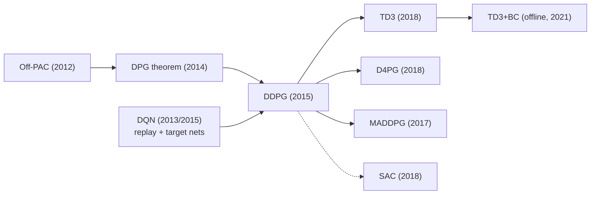

# Deterministic Policy Gradient & Deep DPG (DPG, DDPG)
> A deterministic actor $\mu_\theta(s)$ is pushed uphill along the critic's action-gradient $\nabla_a Q(s,a)$, trained off-policy from a replay buffer with slowly-moving target networks. **Family:** Model-free → Actor-critic → Off-policy deterministic actor-critic  ·  **Year / origin:** DPG: Silver et al., ICML 2014 (DeepMind/UCL); DDPG: Lillicrap et al., arXiv 2015 / ICLR 2016 (DeepMind)  ·  **On/Off-policy:** Off-policy  ·  **Action space:** Continuous

## 1. What is it?

**DPG** (Deterministic Policy Gradient) is a theorem plus an algorithm family. The theorem says that, for a *deterministic* policy $a = \mu_\theta(s)$, the gradient of expected return takes a very simple form: average, over visited states, the critic's slope with respect to the action, chained through the actor's Jacobian. No integral over actions is needed, which makes the gradient much lower-variance than a stochastic policy gradient in high-dimensional continuous action spaces.

**DDPG** (Deep DPG) is "DQN for continuous actions". DQN cannot be used directly when actions are continuous because its target needs $\max_a Q(s', a)$, which is an inner optimization problem at every step. DDPG replaces the max with a learned *actor* that approximates the argmax: $\mu(s) \approx \arg\max_a Q(s,a)$. From DQN it borrows:

- an **experience replay buffer** (decorrelates samples, allows off-policy reuse),
- **target networks**, but updated by **Polyak averaging** ("soft updates", $\theta' \leftarrow \tau\theta + (1-\tau)\theta'$) instead of periodic hard copies,

and it adds **exploration noise** to the deterministic action (Ornstein–Uhlenbeck noise in the paper; plain Gaussian noise works as well in practice).

Where it sits: model-free, off-policy, actor-critic, continuous control. It was the first deep RL algorithm to solve a broad suite of MuJoCo-style physics tasks (and some from pixels) with one set of hyperparameters. It is the direct parent of **TD3** and a close relative of **SAC**, which together largely replaced it in practice.

What it improved over predecessors:
- Over **stochastic policy gradients** (REINFORCE, A2C, TRPO): off-policy reuse of every transition → far better sample efficiency; lower-variance gradient (no action integral).
- Over **DQN**: works natively in continuous, multi-dimensional action spaces (no discretization blow-up).
- Over the original linear **DPG** (2014): deep function approximators, made stable by replay + target networks (+ batch norm in the paper).

## 2. Family & lineage

- **Parents:** Deterministic Policy Gradient theorem (Silver et al., 2014); off-policy actor-critic (Degris, White & Sutton, 2012); DQN (Mnih et al., 2015) for replay + target networks; Neural Fitted Q / NFQCA ideas.
- **Siblings:** NAF (Normalized Advantage Functions, Gu et al., 2016) — another way to do continuous-action Q-learning; SVG(0) — stochastic value gradients.
- **Descendants:** **TD3** (2018, fixes overestimation), **D4PG** (2018, distributional critic + distributed actors + n-step), **MADDPG** (multi-agent), **SAC** (2018, stochastic max-entropy cousin), **TD3+BC** (offline RL), DDPGfD (from demonstrations).



## 3. Core idea & intuition

Imagine the critic $Q(s,a)$ as a landscape over actions for a fixed state. A stochastic policy gradient "tries" actions at random and reinforces the ones that did better than average — slow and noisy. DDPG instead asks the critic directly: *"if I nudge the action a little, which way does Q go up?"* That's $\nabla_a Q(s,a)$. The actor then adjusts its parameters to move its output in that direction. The actor is effectively doing **gradient ascent on the critic**, one state at a time, and amortizing the result into a network so that at test time choosing an action is a single forward pass.

Because the actor's gradient comes entirely from the critic, **everything hinges on the critic being accurate**, especially its *slope* with respect to actions. This explains DDPG's famous brittleness: if the critic develops a spurious bump (overestimation), the actor will happily climb it. TD3 and SAC are mostly about making that critic more trustworthy.

Off-policy-ness comes almost for free: the critic is learned by TD regression on any transitions $(s,a,r,s')$, and the DPG gradient only needs states, not the actions that were taken. So a replay buffer full of old, noisy-exploration data is fine.

Target networks + Polyak averaging: the critic's regression target $y = r + \gamma Q'(s', \mu'(s'))$ depends on the networks being trained. If you use the live networks, the target moves every step and training can diverge. Slowly-tracking copies make the target nearly stationary over short time scales.

Exploration: a deterministic policy never explores by itself, so we add noise to actions *when acting* (not when computing targets). The paper used temporally correlated Ornstein–Uhlenbeck (OU) noise, motivated by physical systems with momentum; later work (TD3 paper, Spinning Up) found uncorrelated Gaussian noise $\mathcal N(0, 0.1^2)$ works just as well.

## 4. Math / formal details

**Setup.** MDP with states $s\in\mathcal S$, continuous actions $a \in \mathcal A \subseteq \mathbb R^m$, reward $r(s,a)$, transition $p(s'|s,a)$, discount $\gamma\in[0,1)$. Deterministic policy $\mu_\theta:\mathcal S\to\mathcal A$ with parameters $\theta$. Critic $Q_\phi(s,a)$ with parameters $\phi$. Behaviour policy $\beta$ (e.g. $\mu_\theta$ + noise) generates the data; $\rho^\beta$ is its discounted state distribution.

**Objective.**
$$J(\theta) = \mathbb E_{s_0}\big[ V^{\mu_\theta}(s_0) \big] = \int_{\mathcal S} \rho^{\mu}(s)\, r(s, \mu_\theta(s))\, ds .$$

**Deterministic Policy Gradient theorem** (Silver et al., 2014). Under mild regularity conditions,
$$\nabla_\theta J(\theta) = \mathbb E_{s\sim\rho^{\mu}}\Big[ \nabla_\theta \mu_\theta(s)\; \nabla_a Q^{\mu}(s,a)\big|_{a=\mu_\theta(s)} \Big].$$
Here $\nabla_\theta \mu_\theta(s)$ is the $|\theta|\times m$ Jacobian of the actor and $\nabla_a Q^\mu$ is the $m$-vector of action-slopes. Contrast with the stochastic PG theorem, $\nabla_\theta J = \mathbb E_{s,a\sim\pi}[\nabla_\theta\log\pi_\theta(a|s)\,Q^\pi(s,a)]$, which also integrates over actions. Silver et al. show the DPG is the limit of the stochastic PG as the policy variance goes to zero.

**Off-policy DPG.** Replacing $\rho^{\mu}$ by the behaviour distribution $\rho^\beta$ gives the (approximate, as in Off-PAC) off-policy gradient
$$\nabla_\theta J_\beta(\theta) \approx \mathbb E_{s\sim\rho^{\beta}}\Big[ \nabla_\theta \mu_\theta(s)\, \nabla_a Q_\phi(s,a)\big|_{a=\mu_\theta(s)} \Big].$$
No importance ratio over actions is needed because the deterministic gradient does not integrate over actions.

**Critic (TD / Q-learning) loss.** With replay buffer $\mathcal D$ and target networks $\phi', \theta'$:
$$y = r + \gamma (1-d)\, Q_{\phi'}\big(s', \mu_{\theta'}(s')\big),\qquad
\mathcal L(\phi) = \mathbb E_{(s,a,r,s',d)\sim\mathcal D}\big[ (Q_\phi(s,a) - y)^2 \big],$$
where $d=1$ iff $s'$ is a *true* terminal state (time-limit truncation is **not** terminal).

**Actor loss** (what autograd actually minimizes):
$$\mathcal L(\theta) = -\,\mathbb E_{s\sim\mathcal D}\big[ Q_\phi(s, \mu_\theta(s)) \big], $$
whose gradient by the chain rule is exactly the off-policy DPG above.

**Soft (Polyak) target updates** with $\tau \ll 1$:
$$\phi' \leftarrow \tau\phi + (1-\tau)\phi', \qquad \theta' \leftarrow \tau\theta + (1-\tau)\theta'.$$
The target is an exponential moving average with time constant $\approx 1/\tau$ updates.

**Exploration noise.** Act with $a_t = \text{clip}(\mu_\theta(s_t) + \epsilon_t,\ a_{\text{low}}, a_{\text{high}})$.
- Gaussian: $\epsilon_t \sim \mathcal N(0, \sigma^2 I)$.
- Ornstein–Uhlenbeck (discretized): $\epsilon_{t+1} = \epsilon_t + \theta_{\text{OU}}(\mu_{\text{OU}} - \epsilon_t)\Delta t + \sigma\sqrt{\Delta t}\,\xi_t$, $\xi_t\sim\mathcal N(0,I)$; the DDPG paper used $\theta_{\text{OU}}=0.15$, $\sigma=0.2$.

**Compatible function approximation** (from the DPG paper): a critic of the form $Q^w(s,a) = (a-\mu_\theta(s))^\top\nabla_\theta\mu_\theta(s)^\top w + V^v(s)$ yields an unbiased DPG when $w$ minimizes the MSE between $\nabla_a Q^w$ and $\nabla_a Q^\mu$. Deep DDPG ignores this restriction and uses a generic MLP critic, trading theory for capacity.

## 5. Algorithm (pseudocode)

```text
DDPG
Input: actor mu_theta, critic Q_phi, replay buffer D, tau, gamma, noise scale sigma
 1. Initialize theta, phi randomly; target nets theta' <- theta, phi' <- phi; D <- empty
 2. for t = 1 .. T do
 3.     observe s_t
 4.     if t <= start_steps: a_t ~ Uniform(action space)                 # warm-up
 5.     else:               a_t = clip(mu_theta(s_t) + eps, a_low, a_high),  eps ~ N(0, sigma^2)
 6.     execute a_t, observe r_t, s_{t+1}, terminal flag d_t (time-limit => d_t = 0)
 7.     store (s_t, a_t, r_t, s_{t+1}, d_t) in D; reset env if episode ended
 8.     if t > start_steps:
 9.         sample minibatch B = {(s, a, r, s', d)} from D
10.         y = r + gamma * (1 - d) * Q_phi'(s', mu_theta'(s'))              # target networks
11.         phi   <- phi   - lr_c * grad_phi   mean_B (Q_phi(s,a) - y)^2
12.         theta <- theta + lr_a * grad_theta mean_B Q_phi(s, mu_theta(s))  # DPG step
13.         phi'   <- tau * phi   + (1 - tau) * phi'                         # Polyak
14.         theta' <- tau * theta + (1 - tau) * theta'
15. return mu_theta
```

## 6. Python implementation

Runnable version: [`code/ddpg.py`](../../code/ddpg.py)

The script re-implements Gym's **Pendulum-v1** dynamics in NumPy (swing a pendulum upright with limited torque; returns range from about −1500 for random flailing to about −150 for a good swing-up controller), then trains DDPG for 15k environment steps. Tested output on CPU (≈50 s):

```text
random policy  : avg return  -1268.1
step   3000 | last-5 train return  -1093.7 |   7.1s
step   6000 | last-5 train return   -123.5 |  17.4s
step   9000 | last-5 train return   -385.8 |  28.3s
step  12000 | last-5 train return   -155.4 |  39.0s
step  15000 | last-5 train return   -112.5 |  49.6s
DDPG (greedy)  : avg return   -199.7   (random -1268.1; ~-150 is near-optimal)
```

Note the non-monotone training curve (−123 → −385 → −155): typical DDPG instability.

@@CODE@@

Key implementation notes:
- `buf.add(..., float(term))` stores **only true termination** as done. Pendulum is time-limited (truncated at 200 steps), so bootstrapping must continue through truncation; treating truncation as terminal is a classic silent bug.
- The actor loss backpropagates through the critic; only the actor's optimizer steps, so the critic is not changed by it (its stale `.grad` buffers are cleared by `opt_c.zero_grad()` next iteration).
- Gaussian noise is used instead of OU; swap in OU if your system benefits from temporally correlated exploration (e.g. large-inertia robots).

## 7. Practical tips & hyperparameters

| Hyperparameter | Original paper (2015) | Common modern defaults (SB3/CleanRL-style) |
|---|---|---|
| Actor / critic LR | 1e-4 / 1e-3 | 1e-3 / 1e-3 or 3e-4 / 3e-4 |
| Discount $\gamma$ | 0.99 | 0.99 |
| Polyak $\tau$ | 0.001 | 0.005 |
| Batch size | 64 | 100–256 |
| Replay size | $10^6$ | $10^6$ |
| Exploration noise | OU, $\theta=0.15,\sigma=0.2$ | Gaussian, $\sigma = 0.1 \cdot a_{\max}$ |
| Warm-up random steps | — | 1k–25k |
| Network | 400–300 hidden units, batch norm | 256–256 (or 400–300), ReLU, no batch norm |
| Critic weight decay | L2 $10^{-2}$ | usually none |

Tips and pitfalls:
- **Overestimation & critic exploitation**: watch the mean $Q$ prediction. If it grows far beyond plausible returns (e.g. $> r_{\max}/(1-\gamma)$), the actor is exploiting critic errors. Fix: TD3 tricks (twin critics, target smoothing, delayed actor), lower actor LR, larger batch.
- **Action bounds**: squash actor output with `tanh` and scale; clip noisy actions to bounds. Without squashing, the actor can push outputs to infinity where the critic is extrapolating.
- **Observation normalization** helps a lot on MuJoCo-like tasks; reward scaling matters too (DDPG is not scale-invariant).
- **Seeds**: DDPG has high variance across random seeds — always report several seeds; a single good run proves little.
- **Truncation vs termination**: see the note above; also don't bootstrap from post-terminal states.
- **Debugging signals**: critic loss should not explode; actor loss ($-Q$) should decrease smoothly; the Q estimate on held-out start states should track Monte-Carlo returns of the greedy policy.
- **Update-to-data ratio** (UTD): one gradient step per environment step is standard. Higher UTD increases sample efficiency but needs regularization (see REDQ, DroQ in the SAC page).

## 8. Pros and cons

**Pros**
- Off-policy: reuses every transition many times → much more sample-efficient than on-policy PG (PPO/TRPO).
- Handles continuous, multi-dimensional actions natively; acting is one forward pass.
- Low-variance gradient (no integration over actions).
- Conceptually simple; easy to extend (distributional critics, n-step, multi-agent, demonstrations).

**Cons**
- Brittle and hyperparameter-sensitive; high variance across seeds.
- Systematic Q overestimation that the actor exploits (fixed by TD3).
- Deterministic policy needs hand-designed exploration noise; can get stuck in poor local optima.
- No guarantee of monotonic improvement; learning curves can collapse.
- Generally dominated by TD3/SAC today on standard benchmarks.

## 9. When to use / when not to use

**Use when**
- You need a simple, fast-to-run baseline for continuous control, or a didactic stepping stone toward TD3/SAC.
- Actions are continuous and smooth, and acting must be very cheap (deterministic forward pass).
- You are building a variant that relies on the deterministic gradient (e.g. MADDPG for multi-agent, DDPGfD with demonstrations, TD3+BC offline).

**Avoid when**
- You want robust performance with little tuning → prefer **TD3** or **SAC**.
- Actions are discrete → use DQN-family or PPO.
- Rewards are sparse or exploration is hard → a deterministic actor with small Gaussian noise explores poorly; consider SAC, intrinsic motivation, or model-based methods.
- Simulation is cheap and wall-clock matters more than samples → massively parallel on-policy PPO is often simpler.

## 10. Key papers, books & repos

- D. Silver, G. Lever, N. Heess, T. Degris, D. Wierstra, M. Riedmiller. *Deterministic Policy Gradient Algorithms.* ICML 2014.
- T. P. Lillicrap, J. J. Hunt, A. Pritzel, N. Heess, T. Erez, Y. Tassa, D. Silver, D. Wierstra. *Continuous control with deep reinforcement learning.* arXiv:1509.02971 (2015), ICLR 2016.
- T. Degris, M. White, R. S. Sutton. *Off-Policy Actor-Critic.* ICML 2012.
- V. Mnih et al. *Human-level control through deep reinforcement learning.* Nature 518, 2015 (DQN: replay + target networks).
- S. Fujimoto, H. van Hoof, D. Meger. *Addressing Function Approximation Error in Actor-Critic Methods.* ICML 2018 (TD3; shows DDPG's overestimation).
- G. Barth-Maron et al. *Distributed Distributional Deterministic Policy Gradients (D4PG).* ICLR 2018.
- R. Lowe et al. *Multi-Agent Actor-Critic for Mixed Cooperative-Competitive Environments (MADDPG).* NeurIPS 2017.
- R. S. Sutton & A. G. Barto. *Reinforcement Learning: An Introduction*, 2nd ed., 2018 — Ch. 13 (Policy Gradient Methods; 13.7 continuous actions), Ch. 11 (off-policy methods with approximation, the "deadly triad").
- Repos: [openai/spinningup](https://github.com/openai/spinningup) (excellent DDPG write-up + code), [DLR-RM/stable-baselines3](https://github.com/DLR-RM/stable-baselines3) (`DDPG`), [vwxyzjn/cleanrl](https://github.com/vwxyzjn/cleanrl) (`ddpg_continuous_action.py`), [openai/baselines](https://github.com/openai/baselines).

## 11. For business users

**What it does.** DDPG learns a *controller* for a machine or process whose actions are continuous dials (torque, speed, temperature, price level, valve opening). It learns from logged experience and trial-and-error, building two things: a "judge" that predicts how good a dial setting will be in a given situation, and a "driver" that turns the dials in whichever direction the judge says improves the outcome.

**Business analogy.** Think of a junior operator (the driver) and a senior advisor (the judge). The advisor, having watched thousands of past shifts, can say "turn the heat up a little — that will help." The junior follows that advice, and over time learns to act well instantly without asking. The danger: if the advisor is overconfident about something they have rarely seen, the junior will chase that mistaken advice.

**Real-world use cases.** Robotic arm and locomotion control in simulation; continuous process control (HVAC, chemical setpoints) in research settings; it was historically used in autonomous-driving and finance research prototypes. In production today teams usually choose its successors (TD3/SAC), but the architecture is the same.

**Value / ROI.** Learns from recorded data plus new experience, so it needs fewer expensive real-world trials than "on-policy" methods. Produces a very cheap-to-run controller.

**Risks.** Unstable training (results vary a lot between runs); can find and exploit errors in its own judge; needs a simulator or careful safety constraints for exploration; performance can collapse unexpectedly.

**Costs.** Modest compute (a single GPU or even CPU for small problems); the real cost is engineering a faithful simulator, a reward that captures what you want, and safety guardrails.

**Questions to ask your team.**
- Why DDPG rather than TD3 or SAC? Have we compared them?
- How many random seeds did we run, and how different were the results?
- How do we prevent unsafe actions during exploration on real hardware?
- What happens when the system sees conditions outside the training data?

## 12. For kids (ages ~8–12)

**The skateboard and the coach.** Mia is learning to balance on a skateboard. She has a coach who watches and says things like "lean a tiny bit more forward — that would be better!" Mia doesn't try random wiggles; she just listens to which way the coach says to lean and adjusts a little each time. Meanwhile the coach is also learning — every time Mia wobbles or rides smoothly, the coach gets better at predicting what will happen. To keep the coach from changing his mind too fast, Mia writes down his advice in a notebook and only slowly updates the notebook. And sometimes Mia wiggles a bit on purpose, just to discover new tricks!

**Try it yourself.** Fill a glass with water up to a line without looking at the line, only listening to a friend who says "more" or "less" and "a lot" or "a little". Notice how you use the *direction* of their advice to adjust. Then swap roles!

**Recap.**
1. A coach guesses how good each move is.
2. The rider changes her move in the direction the coach says is better.
3. A little random wiggling helps find new, better moves.

## 13. Related methods

- [TD3 — the fixed-up successor of DDPG](./td3.md)
- [SAC — stochastic, maximum-entropy off-policy actor-critic](./sac.md)
- [DQN — where replay buffers and target networks come from](../02-deep-value-based/dqn.md)
- [Actor-critic (A2C/A3C) — on-policy actor-critic](../03-policy-gradient/actor-critic-a2c-a3c.md)
- [REINFORCE — the stochastic policy gradient](../03-policy-gradient/reinforce.md)
- [PPO — the on-policy workhorse](../03-policy-gradient/ppo.md)
- [Q-learning — the tabular ancestor of the critic update](../01-foundations-tabular/q-learning.md)
- [MBPO / PETS — model-based methods that often use an off-policy actor-critic inside](../05-model-based/mbpo-pets.md)
- [Multi-agent RL (MADDPG)](../08-exploration-hierarchical-multiagent/multi-agent-rl.md)

[← Back to overview](../../RL_Methods_Overview.md)
