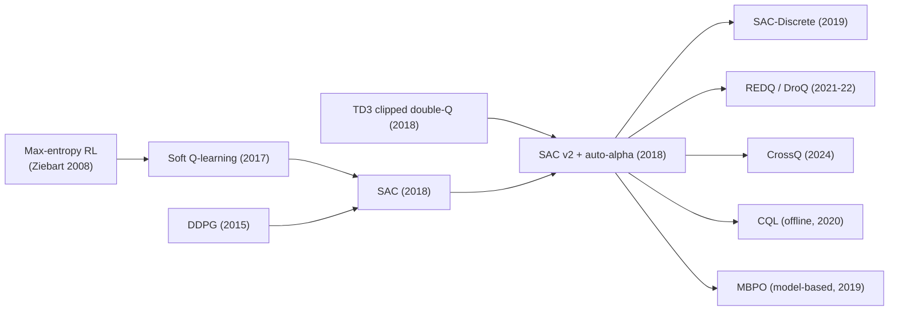

# Soft Actor-Critic (SAC)
> Off-policy actor-critic that maximizes reward **plus policy entropy**, using a soft Bellman backup, twin critics, a reparameterized tanh-Gaussian policy and an automatically tuned temperature. **Family:** Model-free → Actor-critic → Off-policy maximum-entropy actor-critic  ·  **Year / origin:** Haarnoja, Zhou, Abbeel & Levine, ICML 2018 (UC Berkeley); "SAC Algorithms and Applications" (Haarnoja et al., 2018, Berkeley + Google Brain) added auto-temperature  ·  **On/Off-policy:** Off-policy  ·  **Action space:** Continuous (discrete variants exist)

## 1. What is it?

SAC learns a **stochastic** policy that tries to succeed at the task *while acting as randomly as possible*. Formally it maximizes the **maximum-entropy objective**: expected return plus $\alpha$ times the entropy of the policy at every visited state. The temperature $\alpha$ sets the trade-off; in the now-standard version it is learned automatically so that the policy keeps a target amount of entropy.

Why this helps:
- **Exploration for free**: no hand-crafted noise process; the policy is incentivized to stay stochastic wherever that costs little reward.
- **Robustness**: the policy keeps multiple good behaviours alive rather than collapsing early on one; it is less sensitive to critic errors because it does not chase a single sharp maximum.
- **Stability + sample efficiency**: off-policy learning from a replay buffer (like DDPG/TD3) combined with the smoothing effect of entropy. SAC became the default off-policy algorithm for continuous control in research and robotics.

SAC's ingredients:
1. **Soft Bellman backup** for the critic: the target includes $-\alpha \log\pi(a'|s')$, i.e. the value of a state includes the entropy you will get from it.
2. **Twin critics with the min** (as in TD3) to curb overestimation.
3. **Reparameterized tanh-Gaussian policy**: $a = \tanh(\mu_\theta(s) + \sigma_\theta(s)\odot\epsilon)$, so policy gradients flow through the sample (low variance), with a change-of-variables correction to the log-probability.
4. **Automatic temperature tuning**: treat entropy as a constraint ($\mathcal H(\pi(\cdot|s)) \ge \bar{\mathcal H}$) and learn $\alpha$ as its Lagrange multiplier.

Where it sits: model-free, off-policy, stochastic actor-critic, built on the **maximum-entropy RL** / "control as inference" framework. It improved over DDPG (brittle, needs noise), over its own predecessor Soft Q-Learning (which needed approximate sampling from energy-based policies via SVGD), and over on-policy methods (PPO/TRPO) in sample efficiency.

## 2. Family & lineage

- **Parents:** maximum-entropy RL (Ziebart et al., 2008; Ziebart's 2010 thesis), soft Q-learning (Haarnoja et al., 2017), DDPG (off-policy actor-critic with replay), the reparameterization trick (Kingma & Welling, 2014); TD3's clipped double-Q (adopted in SAC v2).
- **Siblings:** TD3 (deterministic, same year), MPO (Abdolmaleki et al., 2018; KL-regularized EM-style policy optimization), soft Q-learning.
- **Descendants / variants:** SAC-Discrete (Christodoulou, 2019); REDQ (ensemble critics, high update-to-data ratio, 2021); DroQ (dropout Q-functions, 2022); CrossQ (batch-norm, no target nets, 2024); larger-network recipes such as BRO and SimBa (2024–2025, reported strong sample efficiency); CQL is commonly implemented on top of SAC for offline RL; MBPO uses SAC as its policy learner; DrQ/DrQ-v2 and SAC-AE/CURL bring SAC-style learning to pixels.



## 3. Core idea & intuition

**Reward + surprise bonus.** Picture the agent receiving a small bonus each step for "keeping its options open" (high entropy). Where many actions are equally good, it spreads its probability across them. Where one action is clearly best, the reward difference dominates and the policy becomes sharp. The temperature $\alpha$ is the exchange rate between reward and randomness.

**Soft values.** If entropy is part of the reward, then the *value* of a state must include future entropy too. So the critic's target becomes "reward + discounted (Q minus $\alpha \log\pi$) at the next state". States from which the agent can act in many good ways get extra value — the agent is drawn toward flexibility.

**Policy = softmax of Q.** In max-entropy RL the optimal policy is a Boltzmann distribution over actions: $\pi^*(a|s) \propto \exp(Q^*(s,a)/\alpha)$. SAC's actor update is literally "move the Gaussian policy toward $\exp(Q/\alpha)$ in KL divergence," which with reparameterization becomes: *sample an action through the network, push it toward higher Q, and penalize low entropy.*

**Auto-temperature.** Picking $\alpha$ by hand is hard because reward scales differ between tasks and change during learning. Instead specify how much entropy you want (e.g., $-\dim(\mathcal A)$ nats) and let a dual variable adjust $\alpha$: if the policy is more deterministic than the target, raise $\alpha$; if more random, lower it. In practice $\alpha$ starts high (explore) and decays as the critic becomes confident.

**Squashed Gaussian.** Real actuators have bounds, so sample $u\sim\mathcal N(\mu,\sigma^2)$ and output $a=\tanh(u)$. Because tanh squashes space, densities change, and we must subtract $\log(1-\tanh^2 u)$ from the Gaussian log-density — forgetting this is a classic bug that makes the entropy estimate wrong.

## 4. Math / formal details

Symbols: state $s$, action $a\in\mathbb R^m$ (bounded), reward $r$, discount $\gamma$, terminal flag $d$, policy $\pi_\theta(a|s)$, twin critics $Q_{\phi_1}, Q_{\phi_2}$, target critics $Q_{\phi'_1},Q_{\phi'_2}$, replay buffer $\mathcal D$, temperature $\alpha > 0$, entropy $\mathcal H(\pi(\cdot|s)) = \mathbb E_{a\sim\pi}[-\log\pi(a|s)]$, target entropy $\bar{\mathcal H}$.

**Maximum-entropy objective.**
$$J(\pi) = \sum_t \mathbb E_{(s_t,a_t)\sim\rho_\pi}\Big[ r(s_t,a_t) + \alpha\, \mathcal H\big(\pi(\cdot|s_t)\big) \Big].$$
(With discounting in practice.) As $\alpha\to 0$ we recover standard RL.

**Soft value functions & soft Bellman equation.**
$$Q^\pi(s,a) = r(s,a) + \gamma\, \mathbb E_{s'\sim p}\big[V^\pi(s')\big], \qquad V^\pi(s) = \mathbb E_{a\sim\pi}\big[ Q^\pi(s,a) - \alpha\log\pi(a|s) \big].$$

**Soft policy iteration (tabular theory).** (i) *Soft policy evaluation*: iterating the soft Bellman operator $\mathcal T^\pi Q = r + \gamma\mathbb E[V]$ converges to $Q^\pi$. (ii) *Soft policy improvement*: 
$$\pi_{\text{new}} = \arg\min_{\pi'\in\Pi} D_{\text{KL}}\Big( \pi'(\cdot|s)\ \Big\|\ \frac{\exp(Q^{\pi_{\text{old}}}(s,\cdot)/\alpha)}{Z(s)} \Big)$$
guarantees $Q^{\pi_{\text{new}}} \ge Q^{\pi_{\text{old}}}$. Alternating converges to the optimal max-ent policy within $\Pi$. SAC is the function-approximation version, taking one gradient step on each.

**Critic loss** (soft TD with clipped double-Q):
$$y = r + \gamma(1-d)\Big( \min_{j=1,2} Q_{\phi'_j}(s',\tilde a') - \alpha\log\pi_\theta(\tilde a'|s') \Big),\quad \tilde a'\sim\pi_\theta(\cdot|s'),$$
$$\mathcal L(\phi_j) = \mathbb E_{\mathcal D}\big[ (Q_{\phi_j}(s,a) - y)^2 \big].$$
Note $\tilde a'$ is sampled fresh from the *current* policy (no target actor). The original SAC v1 paper additionally learned a separate soft state-value network $V_\psi(s)$ (with its own target network) and regressed $Q$ toward $r + \gamma V_{\psi'}(s')$; the v2 paper dropped $V_\psi$ in favour of the form above.

**Reparameterized policy.** $u = \mu_\theta(s) + \sigma_\theta(s)\odot\epsilon,\ \epsilon\sim\mathcal N(0,I)$, $a = a_{\max}\tanh(u)$. Log-density by change of variables:
$$\log\pi_\theta(a|s) = \log\mathcal N(u;\mu_\theta(s),\sigma_\theta^2(s)) - \sum_{i=1}^m \log\big(1-\tanh^2(u_i)\big) - m\log a_{\max},$$
using the stable identity $\log(1-\tanh^2 u) = 2(\log 2 - u - \mathrm{softplus}(-2u))$.

**Policy loss** (KL projection, reparameterized):
$$\mathcal L(\theta) = \mathbb E_{s\sim\mathcal D,\ \epsilon\sim\mathcal N}\Big[ \alpha\log\pi_\theta(f_\theta(\epsilon;s)|s) - \min_{j} Q_{\phi_j}\big(s, f_\theta(\epsilon;s)\big) \Big].$$
Gradients flow through $f_\theta$ into $Q$ (like DPG) and through the log-prob (entropy term).

**Automatic temperature** (dual of the constrained problem $\max_\pi \mathbb E[\sum r]$ s.t. $\mathbb E[-\log\pi]\ge\bar{\mathcal H}$):
$$\mathcal L(\alpha) = \mathbb E_{s\sim\mathcal D,\ a\sim\pi_\theta}\big[ -\alpha\,(\log\pi_\theta(a|s) + \bar{\mathcal H}) \big], \qquad \bar{\mathcal H} = -m \text{ (heuristic)}.$$
Optimize $\log\alpha$ for positivity. If entropy $<\bar{\mathcal H}$, then $\log\pi + \bar{\mathcal H} > 0$ and the gradient increases $\alpha$.

**Target networks:** $\phi'_j\leftarrow\tau\phi_j + (1-\tau)\phi'_j$, $\tau = 0.005$.

**Deterministic evaluation:** act with $a = a_{\max}\tanh(\mu_\theta(s))$ at test time (often slightly better than sampling).

## 5. Algorithm (pseudocode)

```text
SAC (v2, with automatic entropy tuning)
Input: policy pi_theta (tanh-Gaussian), critics Q_phi1, Q_phi2, targets phi1', phi2',
       replay D, log_alpha, target entropy H_bar = -dim(A), tau, gamma
 1. Initialize all parameters; phi_j' <- phi_j; log_alpha <- 0
 2. for each environment step t do
 3.     a ~ pi_theta(.|s)  (uniform random during warm-up)      # no extra noise needed
 4.     step env -> r, s', d (d = 1 only for true termination); store in D
 5.     for each gradient step do
 6.         sample minibatch B = {(s, a, r, s', d)} from D
 7.         a' ~ pi_theta(.|s'), compute log pi_theta(a'|s')
 8.         y = r + gamma*(1-d)*( min_j Q_phij'(s', a') - alpha * log pi_theta(a'|s') )
 9.         phi_j <- phi_j - lr * grad mean_B (Q_phij(s,a) - y)^2           for j = 1, 2
10.         a~ = f_theta(eps; s) (reparameterized), compute log pi_theta(a~|s)
11.         theta <- theta - lr * grad mean_B ( alpha*log pi_theta(a~|s) - min_j Q_phij(s, a~) )
12.         log_alpha <- log_alpha - lr * grad mean_B ( -alpha * (log pi_theta(a~|s) + H_bar) )
13.         phi_j' <- tau*phi_j + (1-tau)*phi_j'
14. return pi_theta  (deploy tanh(mean) deterministically, or sample)
```

## 6. Python implementation

Runnable version: [`code/sac.py`](../../code/sac.py)

Same NumPy Pendulum-v1 as the DDPG/TD3 pages. Watch $\alpha$ fall automatically from 1.0 as the policy becomes confident, and the policy entropy settle near the target of $-1$ nat. Tested output (≈55 s CPU):

```text
step   2000 | last-5 train return  -1543.8 | alpha 0.384 | policy entropy  0.32 |   4.8s
step   4000 | last-5 train return   -445.6 | alpha 0.209 | policy entropy -1.05 |  16.6s
step   6000 | last-5 train return   -124.3 | alpha 0.146 | policy entropy -0.86 |  27.9s
step   8000 | last-5 train return   -421.5 | alpha 0.110 | policy entropy -1.06 |  39.4s
step  10000 | last-5 train return   -255.3 | alpha 0.127 | policy entropy -0.80 |  50.6s
SAC deterministic (tanh(mean)) : avg return   -179.2
SAC stochastic                 : avg return   -257.5   (~-150 is near-optimal; random ~-1200)
final temperature alpha = 0.1271 (started at 1.0, tuned toward target entropy -1.0)
```

(The "policy entropy" printed is the single-sample estimate $-\log\pi(\tilde a|s)$ of the squashed policy, which can be negative for continuous distributions.)

```python
"""SAC (Haarnoja et al., 2018) with automatic temperature tuning on a NumPy Pendulum-v1.

Self-contained: needs only numpy + torch. Runs in about 1-1.5 minutes on CPU.
    python3 code/sac.py
"""
import copy
import math
import time

import numpy as np
import torch
import torch.nn as nn
import torch.nn.functional as F

torch.set_num_threads(1)


# ----------------------------------------------------------------------------------------------
# Environment: Pendulum-v1 in NumPy
# ----------------------------------------------------------------------------------------------
class Pendulum:
    max_speed, max_torque, dt, g, m, l, horizon = 8.0, 2.0, 0.05, 10.0, 1.0, 1.0, 200
    obs_dim, act_dim = 3, 1

    def __init__(self, seed=0):
        self.rng = np.random.default_rng(seed)

    def reset(self):
        self.th, self.thdot, self.t = self.rng.uniform(-np.pi, np.pi), self.rng.uniform(-1, 1), 0
        return self._obs()

    def _obs(self):
        return np.array([np.cos(self.th), np.sin(self.th), self.thdot], dtype=np.float32)

    def step(self, action):
        u = float(np.clip(action, -self.max_torque, self.max_torque)[0])
        th_norm = ((self.th + np.pi) % (2 * np.pi)) - np.pi
        cost = th_norm ** 2 + 0.1 * self.thdot ** 2 + 0.001 * u ** 2
        self.thdot += (3 * self.g / (2 * self.l) * np.sin(self.th) + 3.0 / (self.m * self.l ** 2) * u) * self.dt
        self.thdot = np.clip(self.thdot, -self.max_speed, self.max_speed)
        self.th += self.thdot * self.dt
        self.t += 1
        return self._obs(), -cost, False, self.t >= self.horizon


class ReplayBuffer:
    def __init__(self, obs_dim, act_dim, size=100_000):
        self.o, self.a = np.zeros((size, obs_dim), np.float32), np.zeros((size, act_dim), np.float32)
        self.r, self.o2 = np.zeros((size, 1), np.float32), np.zeros((size, obs_dim), np.float32)
        self.d = np.zeros((size, 1), np.float32)
        self.ptr, self.n, self.size = 0, 0, size

    def add(self, o, a, r, o2, d):
        i = self.ptr
        self.o[i], self.a[i], self.r[i], self.o2[i], self.d[i] = o, a, r, o2, d
        self.ptr, self.n = (i + 1) % self.size, min(self.n + 1, self.size)

    def sample(self, bs):
        idx = np.random.randint(0, self.n, size=bs)
        return [torch.as_tensor(x[idx]) for x in (self.o, self.a, self.r, self.o2, self.d)]


def mlp(inp, out, hidden=128):
    return nn.Sequential(nn.Linear(inp, hidden), nn.ReLU(), nn.Linear(hidden, hidden), nn.ReLU(),
                         nn.Linear(hidden, out))


# ----------------------------------------------------------------------------------------------
# Squashed (tanh) Gaussian policy with the reparameterization trick
# ----------------------------------------------------------------------------------------------
class TanhGaussianActor(nn.Module):
    LOG_STD_MIN, LOG_STD_MAX = -5.0, 2.0

    def __init__(self, obs_dim, act_dim, max_action):
        super().__init__()
        self.net, self.max_action = mlp(obs_dim, 2 * act_dim), max_action

    def forward(self, s, deterministic=False):
        mu, log_std = self.net(s).chunk(2, dim=-1)
        log_std = log_std.clamp(self.LOG_STD_MIN, self.LOG_STD_MAX)
        std = log_std.exp()
        u = mu if deterministic else mu + std * torch.randn_like(mu)   # u = mu + sigma * eps  (rsample)
        a = torch.tanh(u)
        # log N(u; mu, sigma) summed over action dims
        log_prob = (-0.5 * ((u - mu) / std) ** 2 - log_std - 0.5 * math.log(2 * math.pi)).sum(-1, keepdim=True)
        # change of variables for a = tanh(u): subtract log|da/du| = log(1 - tanh(u)^2), written in a
        # numerically stable form: log(1 - tanh(u)^2) = 2 * (log 2 - u - softplus(-2u))
        log_prob -= (2 * (math.log(2) - u - F.softplus(-2 * u))).sum(-1, keepdim=True)
        # rescaling by max_action is a constant shift of log-prob; it does not affect gradients
        return self.max_action * a, log_prob


class TwinCritic(nn.Module):
    def __init__(self, obs_dim, act_dim):
        super().__init__()
        self.q1, self.q2 = mlp(obs_dim + act_dim, 1), mlp(obs_dim + act_dim, 1)

    def forward(self, s, a):
        sa = torch.cat([s, a], -1)
        return self.q1(sa), self.q2(sa)


@torch.no_grad()
def polyak_update(net, target, tau):
    for p, p_t in zip(net.parameters(), target.parameters()):
        p_t.mul_(1 - tau).add_(tau * p)


class SAC:
    def __init__(self, obs_dim, act_dim, max_action, gamma=0.99, tau=0.005, lr=1e-3):
        self.actor = TanhGaussianActor(obs_dim, act_dim, max_action)
        self.critic = TwinCritic(obs_dim, act_dim)
        self.critic_t = copy.deepcopy(self.critic)        # SAC (v2) has no target ACTOR
        self.opt_a = torch.optim.Adam(self.actor.parameters(), lr=lr)
        self.opt_c = torch.optim.Adam(self.critic.parameters(), lr=lr)
        # automatic entropy tuning: learn log(alpha) so that E[-log pi] tracks target_entropy
        self.log_alpha = torch.zeros(1, requires_grad=True)
        self.opt_alpha = torch.optim.Adam([self.log_alpha], lr=lr)
        self.target_entropy = -float(act_dim)               # heuristic from the SAC paper: -|A|
        self.gamma, self.tau = gamma, tau

    @property
    def alpha(self):
        return self.log_alpha.exp().item()

    @torch.no_grad()
    def act(self, obs, deterministic=False):
        a, _ = self.actor(torch.as_tensor(obs).unsqueeze(0), deterministic)
        return a[0].numpy()

    def update(self, batch):
        s, a, r, s2, d = batch
        alpha = self.log_alpha.exp().detach()

        # ---- soft Bellman backup: y = r + gamma * (min Q_targ(s',a') - alpha * log pi(a'|s')),  a' ~ pi(.|s')
        with torch.no_grad():
            a2, logp2 = self.actor(s2)
            q1_t, q2_t = self.critic_t(s2, a2)
            y = r + self.gamma * (1 - d) * (torch.min(q1_t, q2_t) - alpha * logp2)
        q1, q2 = self.critic(s, a)
        critic_loss = F.mse_loss(q1, y) + F.mse_loss(q2, y)
        self.opt_c.zero_grad()
        critic_loss.backward()
        self.opt_c.step()

        # ---- policy: minimize E_s E_eps [ alpha * log pi(a~|s) - min Q(s, a~) ],  a~ = reparameterized sample
        a_new, logp = self.actor(s)
        q1_pi, q2_pi = self.critic(s, a_new)
        actor_loss = (alpha * logp - torch.min(q1_pi, q2_pi)).mean()
        self.opt_a.zero_grad()
        actor_loss.backward()
        self.opt_a.step()

        # ---- temperature: minimize E[ -alpha * (log pi + target_entropy) ]
        alpha_loss = -(self.log_alpha * (logp.detach() + self.target_entropy)).mean()
        self.opt_alpha.zero_grad()
        alpha_loss.backward()
        self.opt_alpha.step()

        polyak_update(self.critic, self.critic_t, self.tau)
        return critic_loss.item(), actor_loss.item(), -logp.mean().item()


def evaluate(env, policy_fn, episodes=10):
    rets = []
    for _ in range(episodes):
        o, ret = env.reset(), 0.0
        while True:
            o, r, term, trunc = env.step(policy_fn(o))
            ret += r
            if term or trunc:
                break
        rets.append(ret)
    return float(np.mean(rets))


def main(total_steps=10_000, start_steps=1_000, batch_size=128, seed=0):
    np.random.seed(seed)
    torch.manual_seed(seed)
    env, eval_env = Pendulum(seed), Pendulum(seed + 100)
    agent = SAC(env.obs_dim, env.act_dim, env.max_torque)
    buf = ReplayBuffer(env.obs_dim, env.act_dim)

    o, ep_ret, ep_rets, t0, ent = env.reset(), 0.0, [], time.time(), float("nan")
    for t in range(1, total_steps + 1):
        # no external noise needed: the stochastic policy explores by itself
        a = np.random.uniform(-2, 2, size=1).astype(np.float32) if t <= start_steps else agent.act(o)
        o2, r, term, trunc = env.step(a)
        buf.add(o, a, r, o2, float(term))
        o, ep_ret = o2, ep_ret + r
        if term or trunc:
            ep_rets.append(ep_ret)
            o, ep_ret = env.reset(), 0.0
        if t > start_steps:
            _, _, ent = agent.update(buf.sample(batch_size))
        if t % 2000 == 0:
            print(f"step {t:6d} | last-5 train return {np.mean(ep_rets[-5:]):8.1f} | alpha {agent.alpha:.3f} "
                  f"| policy entropy {ent:5.2f} | {time.time() - t0:5.1f}s")

    det = evaluate(eval_env, lambda x: agent.act(x, deterministic=True))
    sto = evaluate(eval_env, lambda x: agent.act(x, deterministic=False))
    print(f"SAC deterministic (tanh(mean)) : avg return {det:8.1f}")
    print(f"SAC stochastic                 : avg return {sto:8.1f}   (~-150 is near-optimal; random ~-1200)")
    print(f"final temperature alpha = {agent.alpha:.4f} (started at 1.0, tuned toward target entropy "
          f"{agent.target_entropy})")


if __name__ == "__main__":
    main()
```

Notes:
- The temperature loss uses `logp.detach()` so it does not push gradients into the actor.
- `alpha` is detached inside the critic and actor losses — it is a coefficient there, not a variable.
- Deterministic evaluation (`tanh(mean)`) beats sampling, as is typical.

## 7. Practical tips & hyperparameters

| Hyperparameter | Typical value (SAC paper v2 / SB3 / CleanRL) |
|---|---|
| Learning rates (actor, critic, $\alpha$) | 3e-4 (CleanRL uses 3e-4 actor, 1e-3 critic) |
| Batch size | 256 |
| $\gamma$ | 0.99 |
| $\tau$ | 0.005 |
| Target entropy $\bar{\mathcal H}$ | $-\dim(\mathcal A)$ |
| Initial $\alpha$ | 1.0 (or 0.1–0.2) |
| Network | 2 × 256, ReLU |
| Replay size | $10^6$ |
| Warm-up random steps | 5k–10k (1k for tiny tasks) |
| log-std clamp | $[-5, 2]$ or $[-20, 2]$ |
| Updates per env step (UTD) | 1 (REDQ/DroQ use up to 10–20 with ensembles/dropout) |

Tips & pitfalls:
- **Forgetting the tanh correction** makes the entropy term wrong and the temperature tuning misbehaves.
- **Reward scale matters with fixed $\alpha$** (the original SAC v1 tuned a "reward scale" per task); auto-$\alpha$ largely removes this. If you fix $\alpha$, re-tune it whenever rewards are rescaled.
- **Target entropy**: $-\dim(\mathcal A)$ is a heuristic; for very low-dimensional or very precise tasks, a lower target (more deterministic) can help.
- **$\alpha$ collapse or blow-up** is a key diagnostic: $\alpha\to 0$ very fast → policy collapsed to deterministic early (exploration stalls); $\alpha$ growing without bound → critic or log-prob bug.
- **Truncation is not termination** (time limits): keep bootstrapping.
- **Discrete actions**: use SAC-Discrete (compute expectations exactly over the action softmax; target entropy e.g. $0.98\cdot\log|\mathcal A|$ or lower — tuning is reported to be finicky).
- **Pixels**: SAC on images needs augmentation (DrQ) or auxiliary losses (CURL, SAC-AE); don't backprop the actor loss through the encoder in those setups.
- **High UTD** improves sample efficiency only with regularization (ensembles, dropout, layer norm, periodic resets).

## 8. Pros and cons

**Pros**
- Strong, robust performance across continuous-control tasks with little tuning (auto-$\alpha$).
- Built-in, state-dependent exploration; no noise process to design.
- Off-policy → sample-efficient; used successfully on real robots (reported in Haarnoja et al., 2018b, e.g. quadruped locomotion and dexterous manipulation).
- Stochastic policy is more robust to perturbations; principled (soft policy iteration).
- Foundation for many later methods (CQL, MBPO, REDQ, DrQ, CrossQ).

**Cons**
- More moving parts than TD3 (log-prob correction, temperature).
- Gaussian (unimodal) policy limits the "multi-modal" promise of max-ent; truly multi-modal behaviors need richer policies (flows, diffusion).
- Entropy bonus can hurt tasks that need very precise actions unless the target entropy is tuned.
- Discrete-action variant is less reliable than the continuous one.
- Off-policy TD learning still subject to the deadly triad; can diverge in some settings.

## 9. When to use / when not to use

**Use when**
- Continuous control with limited samples (robotics, physics sims): SAC is often the default first choice.
- Exploration matters and you don't want to tune noise schedules.
- You need a robust inner learner for model-based (MBPO) or offline (CQL) pipelines.

**Avoid when**
- Very cheap, massively parallel simulators where wall-clock dominates → PPO is simpler to scale.
- Discrete action spaces → DQN/Rainbow or PPO usually easier.
- Large-scale LLM fine-tuning → policy-gradient methods (PPO/GRPO) dominate; SAC-style entropy bonuses are rarely used there.
- Strict determinism or interpretability of the policy is required and TD3 suffices.

## 10. Key papers, books & repos

- T. Haarnoja, A. Zhou, P. Abbeel, S. Levine. *Soft Actor-Critic: Off-Policy Maximum Entropy Deep Reinforcement Learning with a Stochastic Actor.* ICML 2018, arXiv:1801.01290.
- T. Haarnoja, A. Zhou, K. Hartikainen, G. Tucker, S. Ha, J. Tan, V. Kumar, H. Zhu, A. Gupta, P. Abbeel, S. Levine. *Soft Actor-Critic Algorithms and Applications.* arXiv:1812.05905 (2018) — auto-temperature, twin critics, real-robot results.
- T. Haarnoja, H. Tang, P. Abbeel, S. Levine. *Reinforcement Learning with Deep Energy-Based Policies (Soft Q-learning).* ICML 2017.
- B. D. Ziebart, A. Maas, J. A. Bagnell, A. K. Dey. *Maximum Entropy Inverse Reinforcement Learning.* AAAI 2008.
- S. Levine. *Reinforcement Learning and Control as Probabilistic Inference: Tutorial and Review.* arXiv:1805.00909 (2018).
- P. Christodoulou. *Soft Actor-Critic for Discrete Action Settings.* arXiv:1910.07207 (2019).
- X. Chen et al. *Randomized Ensembled Double Q-Learning (REDQ).* ICLR 2021; T. Hiraoka et al. *Dropout Q-Functions for Doubly Efficient Reinforcement Learning (DroQ).* ICLR 2022.
- A. Bhatt et al. *CrossQ: Batch Normalization in Deep Reinforcement Learning for Greater Sample Efficiency and Simplicity.* ICLR 2024.
- R. S. Sutton & A. G. Barto, *Reinforcement Learning: An Introduction*, 2nd ed., 2018 — Ch. 13 (policy gradient, §13.7 continuous actions with Gaussian policies), Ch. 6 (TD learning).
- Repos: [rail-berkeley/softlearning](https://github.com/rail-berkeley/softlearning) (authors' implementation), [openai/spinningup](https://github.com/openai/spinningup), [DLR-RM/stable-baselines3](https://github.com/DLR-RM/stable-baselines3) (`SAC`), [vwxyzjn/cleanrl](https://github.com/vwxyzjn/cleanrl) (`sac_continuous_action.py`).

## 11. For business users

**What it does.** SAC learns a controller for continuous decisions from experience, and is deliberately designed to stay curious: it is rewarded both for doing the job well and for not becoming rigid too early. It automatically turns the "curiosity" down as it becomes confident.

**Business analogy.** A new sales team is told: hit your targets, but keep trying a variety of approaches as long as they're nearly as good as the best one. Early on the team experiments a lot; as evidence accumulates, they converge on what works — but they never become so rigid that a small market change breaks them.

**Real-world use cases.** Robot locomotion and grasping (including learning directly on hardware in research), simulated-to-real robot transfer, continuous process and energy control, data-center/HVAC cooling research, and as the learning engine in model-based and offline-RL systems.

**Value / ROI.** Typically reaches good performance with fewer trials than older methods and with less hyperparameter tuning — fewer engineer-weeks and fewer expensive real-world experiments. The learned policy degrades more gracefully under disturbances.

**Risks.** Exploration on real hardware must be bounded for safety; the randomness that helps learning should usually be turned off at deployment; like any RL system it can exploit flaws in the reward or simulator.

**Costs.** Moderate compute (a single GPU typically suffices for state-based tasks; pixel-based tasks need more). Main costs: simulator/data collection, reward design, safety engineering.

**Questions to ask your team.**
- Are we evaluating the deterministic or the stochastic version of the policy, and why?
- How is exploration made safe on real equipment?
- How sensitive are results to the target-entropy setting and to random seeds?
- Did we compare against TD3 and a classical controller baseline?

## 12. For kids (ages ~8–12)

**The ice-cream explorer.** Leo's favourite ice-cream shop has 20 flavours. If he only ever picks chocolate, he'll never find out that mango is amazing. So Leo makes a rule: "I pick flavours I think are yummy, but I also get a bonus point for trying different ones." At first he tries lots of flavours. As he learns which ones are great, he mostly sticks with the best few — but he still tries something new now and then. A grown-up helper ("the thermostat for curiosity") watches him: if Leo gets too stuck on one flavour, the helper says "be a bit more adventurous!"; if he's being too random, "focus a bit more!"

**Try it yourself.** Play rock-paper-scissors with a friend 20 times. First, always pick rock — how quickly does your friend notice? Then mix it up randomly. Which way did you win more? Being a little unpredictable is often smart!

**Recap.**
1. Do well, but keep trying different things.
2. Curiosity is turned down automatically as you learn.
3. Being flexible makes you harder to trip up.

## 13. Related methods

- [DDPG — deterministic off-policy actor-critic](./ddpg.md)
- [TD3 — where the twin-critic min trick comes from](./td3.md)
- [PPO — on-policy alternative with entropy bonus](../03-policy-gradient/ppo.md)
- [Actor-critic (A2C/A3C)](../03-policy-gradient/actor-critic-a2c-a3c.md)
- [MBPO / PETS — MBPO trains SAC on model-generated data](../05-model-based/mbpo-pets.md)
- [CQL — offline RL commonly built on SAC](../06-offline-rl/cql.md)
- [Curiosity (ICM/RND) — another kind of exploration bonus](../08-exploration-hierarchical-multiagent/curiosity-icm-rnd.md)
- [Inverse RL — maximum-entropy IRL shares the same math](../07-imitation-inverse-rl/inverse-rl.md)

[← Back to overview](../../RL_Methods_Overview.md)
