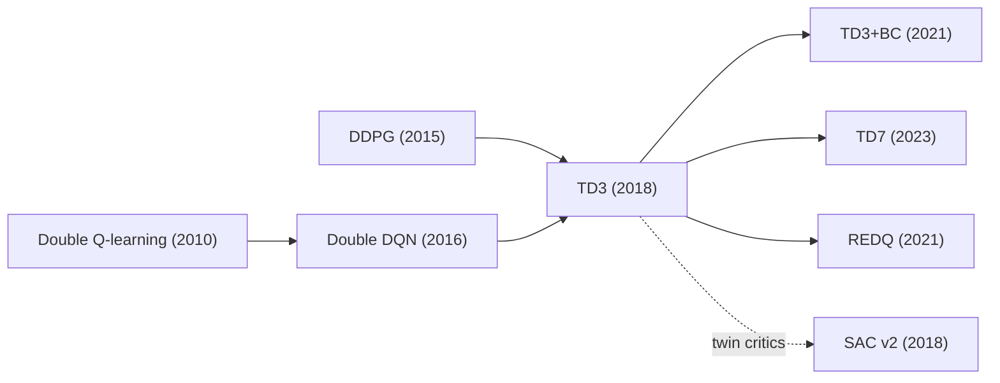

# Twin Delayed Deep Deterministic Policy Gradient (TD3)
> DDPG plus three surgical fixes against critic overestimation: clipped double-Q targets, delayed actor/target updates, and target policy smoothing. **Family:** Model-free → Actor-critic → Off-policy deterministic actor-critic  ·  **Year / origin:** Fujimoto, van Hoof & Meger, ICML 2018 (McGill University)  ·  **On/Off-policy:** Off-policy  ·  **Action space:** Continuous

## 1. What is it?

TD3 is the "make DDPG actually work" algorithm. Fujimoto et al. showed that the overestimation bias well known from Q-learning (and fixed in the discrete case by Double Q-learning / Double DQN) also afflicts actor-critic methods: the actor is trained to maximize the critic, so it actively seeks out regions where the critic's errors are positive, and TD bootstrapping propagates those errors through time. The result is inflated value estimates, a policy that chases phantoms, and unstable learning.

TD3 keeps DDPG's structure — deterministic actor, Q critic, replay buffer, Polyak-averaged target networks, Gaussian exploration noise — and adds three changes:

1. **Clipped double-Q learning** — learn two critics $Q_{\phi_1}, Q_{\phi_2}$ and use the *minimum* of their target values in the Bellman target. This biases the target toward underestimation, which is far less harmful than overestimation because the actor does not seek out underestimated actions.
2. **Delayed policy updates** — update the actor (and the target networks) only every $d$ critic updates (typically $d=2$), so the actor follows a critic that has had time to reduce its error.
3. **Target policy smoothing** — add small clipped noise to the target action $\mu_{\theta'}(s')$ when computing the target. This is a regularizer: it says "similar actions should have similar values," removing narrow spikes in $Q$ that the actor could exploit.

Where it sits: model-free, off-policy, deterministic actor-critic for continuous control. On the MuJoCo benchmarks of its time it substantially outperformed DDPG and was competitive with SAC (published the same year). It remains one of the strongest, simplest baselines, and is the backbone of several later methods (TD3+BC for offline RL, TD7).

## 2. Family & lineage

- **Parents:** DDPG (Lillicrap et al., 2015); Double Q-learning (van Hasselt, 2010) and Double DQN (van Hasselt, Guez & Silver, 2016) for the overestimation insight.
- **Siblings:** SAC (Haarnoja et al., 2018) — independently adopted the twin-critic min trick, adds entropy; D4PG — distributional variant of DDPG.
- **Descendants:** **TD3+BC** (Fujimoto & Gu, 2021, offline RL with a behavior-cloning term); **TD7** (Fujimoto et al., 2023, adds learned state-action embeddings "SALE", prioritized replay and checkpoints); REDQ (Chen et al., 2021, ensemble of critics + random subset min) generalizes clipped double-Q; many robotics and model-based pipelines use TD3 as their inner learner.



## 3. Core idea & intuition

**Why overestimation happens.** Suppose the critic's estimates are true values plus zero-mean noise: $\hat Q(s,a) = Q(s,a) + \epsilon(s,a)$. Picking the action that maximizes $\hat Q$ preferentially picks actions where $\epsilon$ happens to be positive, so $\mathbb E[\max_a \hat Q] \ge \max_a Q$. In DDPG the actor *is* that maximizer (via gradient ascent), and the target $r + \gamma \hat Q(s', \mu(s'))$ feeds the inflated value back into the critic. Errors compound over the effective horizon $1/(1-\gamma)$.

**Why the min of two critics helps.** Two critics trained on the same targets but with different initializations make partly independent errors. Taking $\min(Q_1, Q_2)$ cancels a lot of the upward bias. It can underestimate — but an underestimated action is simply not chosen by the actor, so the error does not get amplified the way overestimation does.

Why not just use Double DQN's trick (evaluate the target actor's action with the *online* critic)? Fujimoto et al. found that in actor-critic the online and target networks change so slowly that they are too correlated to decorrelate the error; an explicit second critic works much better.

**Why delay the actor.** The actor's gradient is only as good as the critic's slope. If you update the actor every step, it chases a critic that is still noisy and moving. Updating the actor less often (and the targets with it) lets the critic's error shrink first: "update the value estimate until it is good, then improve the policy" — a soft version of policy iteration.

**Why smooth the target.** A deterministic actor trained against a neural critic can find sharp, narrow peaks in $Q$ (artifacts of function approximation). Averaging the target over a small neighborhood of actions, $\mathbb E_\epsilon[Q(s', \mu'(s') + \epsilon)]$, removes those peaks, akin to SARSA-style expected updates with a smoothed policy.

## 4. Math / formal details

Symbols: state $s$, action $a\in[a_{\text{low}}, a_{\text{high}}]^m$, reward $r$, discount $\gamma$, terminal flag $d$; actor $\mu_\theta$; two critics $Q_{\phi_1}, Q_{\phi_2}$; target networks $\theta', \phi'_1, \phi'_2$; replay buffer $\mathcal D$; Polyak rate $\tau$; target-noise std $\tilde\sigma$ and clip $c$; policy delay $d_\pi$.

**Overestimation (actor-critic version).** Let $\theta_{\text{approx}}$ be the actor updated by ascending $Q_\phi$ and $\theta_{\text{true}}$ the actor updated by ascending the true $Q^\pi$. Fujimoto et al. show that for sufficiently small step sizes, $\mathbb E[Q_\phi(s, \mu_{\theta_{\text{approx}}}(s))] \ge \mathbb E[Q^\pi(s,\mu_{\theta_{\text{approx}}}(s))]$ under mild assumptions — i.e., the updated policy's value is overestimated — and that this error accumulates through TD bootstrapping.

**Target policy smoothing.**
$$\tilde a' = \text{clip}\Big(\mu_{\theta'}(s') + \text{clip}(\epsilon, -c, c),\ a_{\text{low}}, a_{\text{high}}\Big), \qquad \epsilon\sim\mathcal N(0, \tilde\sigma^2 I).$$

**Clipped double-Q target** (one shared target for both critics):
$$y = r + \gamma (1-d)\, \min_{j=1,2} Q_{\phi'_j}(s', \tilde a').$$

**Critic losses:**
$$\mathcal L(\phi_j) = \mathbb E_{(s,a,r,s',d)\sim\mathcal D}\big[(Q_{\phi_j}(s,a) - y)^2\big], \quad j=1,2.$$

**Delayed actor update** (every $d_\pi$ critic steps), deterministic policy gradient through $Q_{\phi_1}$ only:
$$\nabla_\theta J(\theta) = \mathbb E_{s\sim\mathcal D}\big[\nabla_a Q_{\phi_1}(s,a)\big|_{a=\mu_\theta(s)}\;\nabla_\theta\mu_\theta(s)\big].$$

**Targets** (also every $d_\pi$ steps):
$$\phi'_j \leftarrow \tau\phi_j + (1-\tau)\phi'_j, \qquad \theta' \leftarrow \tau\theta + (1-\tau)\theta'.$$

**Exploration** when acting: $a = \text{clip}(\mu_\theta(s) + \mathcal N(0,\sigma^2_{\text{expl}}),\ a_{\text{low}}, a_{\text{high}})$, typically $\sigma_{\text{expl}} = 0.1\, a_{\max}$.

**Bias intuition for the min.** If $Q_1 = Q + \epsilon_1$, $Q_2 = Q + \epsilon_2$ with i.i.d. zero-mean noise of std $\sigma_\epsilon$, then $\mathbb E[\min(Q_1,Q_2)] = Q - \sigma_\epsilon/\sqrt{\pi}$ for Gaussian noise — a bounded downward bias in place of the unbounded upward drift caused by maximization feedback.

## 5. Algorithm (pseudocode)

```text
TD3
Input: actor mu_theta, critics Q_phi1, Q_phi2, replay D, tau, gamma,
       exploration std sigma, target noise std sigma~, noise clip c, policy delay d
 1. Initialize theta, phi1, phi2; targets theta' <- theta, phi1' <- phi1, phi2' <- phi2
 2. for t = 1 .. T do
 3.     a = clip(mu_theta(s) + N(0, sigma^2), a_low, a_high)   (uniform random during warm-up)
 4.     step env -> r, s', d (d = 1 only for true termination); store (s, a, r, s', d) in D
 5.     sample minibatch B from D
 6.     eps = clip(N(0, sigma~^2), -c, c)
 7.     a~' = clip(mu_theta'(s') + eps, a_low, a_high)                 # target policy smoothing
 8.     y = r + gamma * (1 - d) * min(Q_phi1'(s', a~'), Q_phi2'(s', a~'))   # clipped double-Q
 9.     update phi1, phi2 by minimizing sum_j mean_B (Q_phij(s,a) - y)^2
10.     if t mod d == 0:                                                # delayed updates
11.         update theta by gradient ascent on mean_B Q_phi1(s, mu_theta(s))
12.         phi_j' <- tau*phi_j + (1-tau)*phi_j'   (j = 1, 2)
13.         theta' <- tau*theta + (1-tau)*theta'
14. return mu_theta
```

## 6. Python implementation

Runnable version: [`code/td3.py`](../../code/td3.py)

Same NumPy Pendulum-v1 as the DDPG page so you can compare directly. After training, the script also measures critic bias: it compares $Q_1(s, \mu(s))$ along greedy rollouts with the actual discounted Monte-Carlo return. Tested output (≈55 s CPU):

```text
step   3000 | last-5 train return  -1534.3 |   6.4s
step   6000 | last-5 train return   -273.8 |  16.7s
step   9000 | last-5 train return   -126.1 |  27.3s
step  12000 | last-5 train return   -201.8 |  40.8s
step  15000 | last-5 train return   -112.1 |  52.7s
TD3 (greedy)   : avg return   -179.0   (~-150 is near-optimal)
critic bias    : mean Q1 prediction   -27.4 vs true discounted return   -28.3  (clipped double-Q keeps these close)
```

```python
"""TD3 (Fujimoto, van Hoof & Meger, 2018) on a NumPy re-implementation of Pendulum-v1.

Self-contained: needs only numpy + torch. Runs in about a minute on CPU.
    python3 code/td3.py
"""
import copy
import time

import numpy as np
import torch
import torch.nn as nn
import torch.nn.functional as F

torch.set_num_threads(1)


# ----------------------------------------------------------------------------------------------
# Environment: Pendulum-v1 in NumPy
# ----------------------------------------------------------------------------------------------
class Pendulum:
    max_speed, max_torque, dt, g, m, l, horizon = 8.0, 2.0, 0.05, 10.0, 1.0, 1.0, 200
    obs_dim, act_dim = 3, 1

    def __init__(self, seed=0):
        self.rng = np.random.default_rng(seed)

    def reset(self):
        self.th, self.thdot, self.t = self.rng.uniform(-np.pi, np.pi), self.rng.uniform(-1, 1), 0
        return self._obs()

    def _obs(self):
        return np.array([np.cos(self.th), np.sin(self.th), self.thdot], dtype=np.float32)

    def step(self, action):
        u = float(np.clip(action, -self.max_torque, self.max_torque)[0])
        th_norm = ((self.th + np.pi) % (2 * np.pi)) - np.pi
        cost = th_norm ** 2 + 0.1 * self.thdot ** 2 + 0.001 * u ** 2
        self.thdot += (3 * self.g / (2 * self.l) * np.sin(self.th) + 3.0 / (self.m * self.l ** 2) * u) * self.dt
        self.thdot = np.clip(self.thdot, -self.max_speed, self.max_speed)
        self.th += self.thdot * self.dt
        self.t += 1
        return self._obs(), -cost, False, self.t >= self.horizon   # obs, reward, terminated, truncated


class ReplayBuffer:
    def __init__(self, obs_dim, act_dim, size=100_000):
        self.o, self.a = np.zeros((size, obs_dim), np.float32), np.zeros((size, act_dim), np.float32)
        self.r, self.o2 = np.zeros((size, 1), np.float32), np.zeros((size, obs_dim), np.float32)
        self.d = np.zeros((size, 1), np.float32)
        self.ptr, self.n, self.size = 0, 0, size

    def add(self, o, a, r, o2, d):
        i = self.ptr
        self.o[i], self.a[i], self.r[i], self.o2[i], self.d[i] = o, a, r, o2, d
        self.ptr, self.n = (i + 1) % self.size, min(self.n + 1, self.size)

    def sample(self, bs):
        idx = np.random.randint(0, self.n, size=bs)
        return [torch.as_tensor(x[idx]) for x in (self.o, self.a, self.r, self.o2, self.d)]


def mlp(inp, out, hidden=128):
    return nn.Sequential(nn.Linear(inp, hidden), nn.ReLU(), nn.Linear(hidden, hidden), nn.ReLU(),
                         nn.Linear(hidden, out))


class Actor(nn.Module):
    def __init__(self, obs_dim, act_dim, max_action):
        super().__init__()
        self.net, self.max_action = mlp(obs_dim, act_dim), max_action

    def forward(self, s):
        return self.max_action * torch.tanh(self.net(s))


class TwinCritic(nn.Module):
    """Two independent Q-networks in one module (trick #1: clipped double-Q)."""

    def __init__(self, obs_dim, act_dim):
        super().__init__()
        self.q1, self.q2 = mlp(obs_dim + act_dim, 1), mlp(obs_dim + act_dim, 1)

    def forward(self, s, a):
        sa = torch.cat([s, a], dim=-1)
        return self.q1(sa), self.q2(sa)


@torch.no_grad()
def polyak_update(net, target, tau):
    for p, p_t in zip(net.parameters(), target.parameters()):
        p_t.mul_(1 - tau).add_(tau * p)


class TD3:
    def __init__(self, obs_dim, act_dim, max_action, gamma=0.99, tau=0.005, lr=1e-3,
                 policy_noise=0.2, noise_clip=0.5, policy_delay=2):
        self.actor, self.critic = Actor(obs_dim, act_dim, max_action), TwinCritic(obs_dim, act_dim)
        self.actor_t, self.critic_t = copy.deepcopy(self.actor), copy.deepcopy(self.critic)
        self.opt_a = torch.optim.Adam(self.actor.parameters(), lr=lr)
        self.opt_c = torch.optim.Adam(self.critic.parameters(), lr=lr)
        self.gamma, self.tau, self.max_action = gamma, tau, max_action
        # noise values are given relative to max_action, as in the paper (0.2, clipped at 0.5)
        self.policy_noise, self.noise_clip = policy_noise * max_action, noise_clip * max_action
        self.policy_delay, self.it = policy_delay, 0

    @torch.no_grad()
    def act(self, obs, noise_std=0.0):
        a = self.actor(torch.as_tensor(obs).unsqueeze(0))[0].numpy()
        a = a + noise_std * self.max_action * np.random.randn(*a.shape)
        return np.clip(a, -self.max_action, self.max_action).astype(np.float32)

    def update(self, batch):
        self.it += 1
        s, a, r, s2, d = batch
        with torch.no_grad():
            # trick #3: target policy smoothing -- add clipped noise to the target action
            eps = (torch.randn_like(a) * self.policy_noise).clamp(-self.noise_clip, self.noise_clip)
            a2 = (self.actor_t(s2) + eps).clamp(-self.max_action, self.max_action)
            # trick #1: clipped double-Q -- take the MIN of the two target critics
            q1_t, q2_t = self.critic_t(s2, a2)
            y = r + self.gamma * (1 - d) * torch.min(q1_t, q2_t)
        q1, q2 = self.critic(s, a)
        critic_loss = F.mse_loss(q1, y) + F.mse_loss(q2, y)   # both critics regress on the SAME target
        self.opt_c.zero_grad()
        critic_loss.backward()
        self.opt_c.step()

        # trick #2: delayed policy (and target) updates -- once every `policy_delay` critic steps
        if self.it % self.policy_delay == 0:
            actor_loss = -self.critic.q1(torch.cat([s, self.actor(s)], -1)).mean()  # DPG through Q1 only
            self.opt_a.zero_grad()
            actor_loss.backward()
            self.opt_a.step()
            polyak_update(self.actor, self.actor_t, self.tau)
            polyak_update(self.critic, self.critic_t, self.tau)
        return critic_loss.item()

    @torch.no_grad()
    def q_estimate(self, s):
        """Q1(s, mu(s)) -- used below to measure over-estimation bias."""
        return self.critic.q1(torch.cat([s, self.actor(s)], -1))


def run_episode(env, policy_fn):
    o, ret, rewards, obs = env.reset(), 0.0, [], []
    while True:
        obs.append(o)
        o, r, term, trunc = env.step(policy_fn(o))
        rewards.append(r)
        if term or trunc:
            return np.array(obs), np.array(rewards)


def main(total_steps=15_000, start_steps=1_000, batch_size=128, expl_noise=0.1, seed=0):
    np.random.seed(seed)
    torch.manual_seed(seed)
    env, eval_env = Pendulum(seed), Pendulum(seed + 100)
    agent = TD3(env.obs_dim, env.act_dim, env.max_torque)
    buf = ReplayBuffer(env.obs_dim, env.act_dim)

    o, ep_ret, ep_rets, t0 = env.reset(), 0.0, [], time.time()
    for t in range(1, total_steps + 1):
        a = (np.random.uniform(-2, 2, size=1).astype(np.float32) if t <= start_steps
             else agent.act(o, expl_noise))
        o2, r, term, trunc = env.step(a)
        buf.add(o, a, r, o2, float(term))
        o, ep_ret = o2, ep_ret + r
        if term or trunc:
            ep_rets.append(ep_ret)
            o, ep_ret = env.reset(), 0.0
        if t > start_steps:
            agent.update(buf.sample(batch_size))
        if t % 3000 == 0:
            print(f"step {t:6d} | last-5 train return {np.mean(ep_rets[-5:]):8.1f} | {time.time() - t0:5.1f}s")

    # Evaluate and compare the critic's predicted value with the true discounted Monte-Carlo return
    rets, q_pred, q_true = [], [], []
    for _ in range(10):
        obs, rews = run_episode(eval_env, lambda x: agent.act(x, 0.0))
        rets.append(rews.sum())
        disc = np.array([np.sum(rews[i:] * 0.99 ** np.arange(len(rews) - i)) for i in range(len(rews))])
        q_pred.append(agent.q_estimate(torch.as_tensor(obs[:100])).numpy().ravel())
        q_true.append(disc[:100])   # first half only: far from the time-limit, so truncation matters less
    print(f"TD3 (greedy)   : avg return {np.mean(rets):8.1f}   (~-150 is near-optimal)")
    print(f"critic bias    : mean Q1 prediction {np.mean(q_pred):7.1f} vs true discounted return "
          f"{np.mean(q_true):7.1f}  (clipped double-Q keeps these close)")


if __name__ == "__main__":
    main()
```

What to try:
- Set `policy_delay=1`, `policy_noise=0.0` and replace `torch.min(q1_t, q2_t)` with `q1_t` → you get (twin-headed) DDPG; rerun the bias measurement and compare.
- On Pendulum the differences are small (the task is easy); on harder MuJoCo-style tasks the TD3 paper reports large gains from clipped double-Q especially.

## 7. Practical tips & hyperparameters

| Hyperparameter | TD3 paper / author repo (typical) | Notes |
|---|---|---|
| Actor & critic LR | 1e-3 in the paper; 3e-4 in the author's later repo | Adam |
| Batch size | 100 in the paper; 256 in the later repo | |
| $\gamma$ | 0.99 | |
| $\tau$ | 0.005 | |
| Policy delay $d$ | 2 | update actor every 2 critic steps |
| Target noise $\tilde\sigma$, clip $c$ | 0.2, 0.5 (× max action) | |
| Exploration noise | $\mathcal N(0, 0.1)$ (× max action) | |
| Warm-up random steps | 1k in the paper, 25k in the later repo | |
| Network | 2 hidden layers, 256 (or 400–300), ReLU | |

Tips:
- **Both critics regress on the same target**; do not give each critic its own min target.
- **Actor uses $Q_1$ only** (cheaper; using the min or mean of both also works).
- **Scale noise to the action range.** If actions are in $[-2, 2]$ (Pendulum), noise of 0.2 means $0.2 \times 2 = 0.4$.
- **Underestimation is not free**: in very sparse-reward or optimistic-exploration settings, the pessimism of the min can slow learning. Some methods (e.g. tuned ensembles, REDQ, "optimistic" variants) trade off pessimism.
- **Debugging signal**: plot mean $Q_1(s,\mu(s))$ vs Monte-Carlo returns (as the script does). Large positive gaps = overestimation (actor exploiting critic); large negative = excessive pessimism.
- **Delayed updates also delay the targets** — that is part of what stabilizes training.
- **Offline**: TD3+BC adds $\lambda$-normalized behavior cloning to the actor loss: maximize $\lambda Q(s,\mu(s)) - (\mu(s) - a)^2$. A one-line change with strong results on D4RL.

## 8. Pros and cons

**Pros**
- Much more stable and better-performing than DDPG with only a few lines of change.
- Simple, deterministic, cheap at inference; easy to reason about.
- Strong baseline on continuous control; few hyperparameters; robust defaults.
- Excellent foundation for offline RL (TD3+BC) and representation-learning extensions (TD7).

**Cons**
- Still needs hand-tuned exploration noise; deterministic policy can be poor at exploration.
- Pessimistic bias can under-explore or slow learning in some tasks.
- Two critics ≈ 2× critic compute.
- Continuous actions only.
- SAC is often slightly more robust across tasks thanks to entropy-driven exploration.

## 9. When to use / when not to use

**Use when**
- You need a reliable, simple off-policy baseline for continuous control (robotics sims, locomotion, manipulation).
- You want a deterministic policy (e.g. for deployment or as a base for offline RL with TD3+BC).
- You care about sample efficiency more than wall-clock parallelism.

**Avoid when**
- Exploration is the bottleneck (sparse rewards) → SAC (entropy), intrinsic motivation, or model-based methods.
- Actions are discrete → DQN family, PPO.
- You have massively parallel cheap simulators → PPO can be simpler and faster in wall-clock.
- Your problem is a fixed dataset with no interaction → use offline variants (TD3+BC, IQL, CQL), not plain TD3.

## 10. Key papers, books & repos

- S. Fujimoto, H. van Hoof, D. Meger. *Addressing Function Approximation Error in Actor-Critic Methods.* ICML 2018, arXiv:1802.09477.
- H. van Hasselt. *Double Q-learning.* NeurIPS 2010.
- H. van Hasselt, A. Guez, D. Silver. *Deep Reinforcement Learning with Double Q-learning.* AAAI 2016.
- S. Thrun, A. Schwartz. *Issues in Using Function Approximation for Reinforcement Learning.* 1993 (early analysis of overestimation).
- T. P. Lillicrap et al. *Continuous control with deep reinforcement learning (DDPG).* arXiv:1509.02971.
- S. Fujimoto, S. S. Gu. *A Minimalist Approach to Offline Reinforcement Learning (TD3+BC).* NeurIPS 2021.
- S. Fujimoto et al. *For SALE: State-Action Representation Learning for Deep Reinforcement Learning (TD7).* NeurIPS 2023.
- X. Chen, C. Wang, Z. Zhou, K. Ross. *Randomized Ensembled Double Q-Learning: Learning Fast Without a Model (REDQ).* ICLR 2021.
- R. S. Sutton & A. G. Barto, *Reinforcement Learning: An Introduction*, 2nd ed., 2018 — §6.7 (maximization bias and Double Learning), Ch. 13 (policy gradient).
- Repos: [sfujim/TD3](https://github.com/sfujim/TD3) (author's reference), [openai/spinningup](https://github.com/openai/spinningup) (TD3 docs + code), [DLR-RM/stable-baselines3](https://github.com/DLR-RM/stable-baselines3) (`TD3`), [vwxyzjn/cleanrl](https://github.com/vwxyzjn/cleanrl) (`td3_continuous_action.py`).

## 11. For business users

**What it does.** TD3 learns a controller for continuous "dials" (motor torques, flow rates, set-points) from experience, like DDPG, but with built-in skepticism: it keeps two independent "judges" of how good an action is and always believes the more pessimistic one. It also lets the judges settle before the "driver" changes its behavior.

**Business analogy.** A purchasing manager gets two independent quotes for how much a project will return and plans on the lower one; and she waits for the analysts to finish revising their numbers before changing strategy. That habit avoids chasing overly rosy forecasts.

**Real-world use cases.** Robot locomotion and manipulation in simulation (then transferred to hardware), industrial control research, energy-system control, and as the core learner inside offline-RL systems that learn from historical logs (TD3+BC).

**Value / ROI.** More reliable than DDPG at essentially the same cost; fewer failed training runs means less engineering time and compute wasted. Produces a fast, deterministic controller that is easy to deploy and test.

**Risks.** Still requires a good simulator or safe exploration; can be overly cautious in some tasks; like all RL, it optimizes exactly the reward you define — mis-specified rewards produce mis-specified behavior.

**Costs.** Small-to-moderate compute (often a single GPU); main costs are simulator fidelity, reward design, and validation.

**Questions to ask your team.**
- Are we comparing against SAC and a simple non-RL controller (e.g. PID / MPC)?
- How do learned value estimates compare with actual measured returns?
- How stable are results over 5+ random seeds?
- What is the plan for safe deployment and monitoring on the real system?

## 12. For kids (ages ~8–12)

**Two weather forecasters.** You want to know whether to bring a jacket to the park. You ask two friends who each guess the weather. One says "super sunny, 30 degrees!" and the other says "kind of cool, 18 degrees." A careful kid plans for the cooler guess and brings a light jacket — you won't freeze if the happy guess was wrong. TD3 does the same: it asks two "guessers" how good a move is and trusts the less excited one. It also doesn't change its plan every second — it waits until the guessers have thought a bit more. And it checks that moves *near* a good move are also good, so it doesn't fall for a lucky fluke.

**Try it yourself.** Ask two family members to guess how many candies are in a jar. Write down the smaller guess. Count the candies. Was the smaller guess closer more often than the bigger one? Try it with several jars!

**Recap.**
1. Ask two guessers, believe the more careful one.
2. Don't change your plan too often — let the guessers learn first.
3. Good moves should have good neighbors, not just one lucky spot.

## 13. Related methods

- [DDPG — the parent algorithm](./ddpg.md)
- [SAC — stochastic maximum-entropy cousin that also uses twin critics](./sac.md)
- [DQN / Double DQN — origins of overestimation fixes](../02-deep-value-based/dqn.md)
- [Rainbow DQN — combining many DQN fixes](../02-deep-value-based/rainbow-dqn.md)
- [Q-learning — maximization bias in the tabular case](../01-foundations-tabular/q-learning.md)
- [CQL — pessimism taken further, for offline RL](../06-offline-rl/cql.md)
- [IQL — offline RL alternative to TD3+BC](../06-offline-rl/iql.md)
- [MBPO / PETS — model-based RL that pairs a learned model with an off-policy learner](../05-model-based/mbpo-pets.md)

[← Back to overview](../../RL_Methods_Overview.md)
