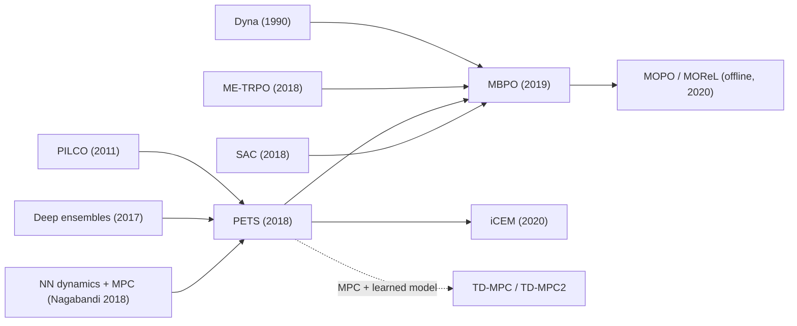

# Probabilistic Ensembles & Model-Based Policy Optimization (PETS, MBPO)
> Learn an **ensemble of probabilistic neural dynamics models** that captures both noise and uncertainty, then either **plan with it** (PETS: CEM model-predictive control) or **feed short model rollouts to SAC** (MBPO). **Family:** Model-based → Learned state-space dynamics → MPC (PETS) / Dyna-style policy optimization (MBPO)  ·  **Year / origin:** PETS: Chua, Calandra, McAllister & Levine, NeurIPS 2018 (UC Berkeley); MBPO: Janner, Fu, Zhang & Levine, NeurIPS 2019 (UC Berkeley)  ·  **On/Off-policy:** Off-policy (all real data reused to fit the model; MBPO's SAC is off-policy)  ·  **Action space:** Continuous

## 1. What is it?

Both methods attack the main weakness of model-free deep RL in continuous control — needing hundreds of thousands to millions of environment steps — by learning a **dynamics model** $\hat p(s_{t+1}|s_t,a_t)$ from data and using it to decide what to do. Their shared key insight is that **model uncertainty must be represented**: a single neural network model is confidently wrong in unfamiliar regions, and an optimizer (planner or policy) will happily exploit those errors.

**PETS** (Probabilistic Ensembles with Trajectory Sampling):
- **Probabilistic** networks output a Gaussian over the next-state change, capturing *aleatoric* uncertainty (inherent noise).
- An **ensemble** of $B$ such networks, each trained on a bootstrap of the data, captures *epistemic* uncertainty (lack of data): members disagree where data is scarce.
- **Trajectory sampling** propagates "particles" through the ensemble to estimate the distribution of future returns for a candidate action sequence.
- **CEM model-predictive control** (MPC): at each real step, optimize an $H$-step action sequence with the cross-entropy method, execute only the first action, re-plan next step.
- The reward function is assumed known. No policy or value network at all.

PETS reached the asymptotic performance of the model-free algorithms of its time on several MuJoCo-style tasks while using roughly an order of magnitude fewer samples (reported, e.g., half-cheetah), and matched PILCO-level data efficiency on small tasks while scaling to larger ones.

**MBPO** (Model-Based Policy Optimization):
- Same kind of probabilistic ensemble.
- Instead of planning, generate **short branched rollouts** ($k$ = 1 to ~15 steps) from states *sampled from the real replay buffer*, and add them to a model buffer.
- Train **SAC** mostly on the model buffer, with many gradient steps per real step.
- Theory: a return bound shows that long model rollouts accumulate error and can make model-based improvement meaningless, while short rollouts branched from real states keep the error controlled yet still give a large data multiplier.

MBPO matched the asymptotic performance of SAC on MuJoCo benchmarks with many times fewer samples (reported, often around 10× on some tasks) and outperformed PETS and earlier model-based methods (ME-TRPO, STEVE, SLBO) on longer-horizon tasks.

Where they sit: model-based RL with **learned, state-space (not latent/pixel) dynamics**. PETS is the "planning" branch (like MPC in control engineering), MBPO the "Dyna" branch (simulate data, learn a policy model-free).

## 2. Family & lineage

- **Parents:** Dyna (Sutton, 1990), PILCO (Deisenroth & Rasmussen, 2011, Gaussian-process dynamics with analytic uncertainty propagation), MPC from control theory, CEM (Rubinstein), neural-network dynamics + random-shooting MPC (Nagabandi et al., 2018), deep ensembles (Lakshminarayanan et al., 2017), ME-TRPO (Kurutach et al., 2018).
- **Siblings:** STEVE and MVE (model-based value expansion), SLBO, PlaNet (latent CEM planning from pixels).
- **Descendants:** MOPO and MOReL (offline model-based RL with uncertainty penalties, 2020), M2AC, iCEM (improved CEM, 2020), MBRL-Lib (2021), TD-MPC/TD-MPC2 (latent model + MPPI + value), and MBPO-style "data augmentation with models" in many robotics pipelines.



## 3. Core idea & intuition

**Two kinds of "I don't know".** If you push a hockey puck, where it ends up is a bit random even with perfect knowledge (aleatoric). If you've never pushed a puck on this ice before, you also don't know the friction (epistemic). A Gaussian output head handles the first; an ensemble handles the second — five models trained on different resamples agree where there was lots of data and disagree elsewhere. Planning with *all* of them (averaging returns across members) automatically makes the planner wary of regions where the models disagree, because there the predicted returns are inconsistent and rarely all high.

**PETS = "think a second ahead, every step".** At each time step: imagine hundreds of candidate action sequences for the next ~1 second, simulate each through the ensemble, score them with the known reward, refine the candidate distribution toward the best ones (CEM), do the first action of the best plan, and repeat. Re-planning every step corrects for model errors (feedback), just like classical MPC.

**MBPO = "practise on short imagined detours".** Long imagined trajectories drift away from reality (errors compound). So MBPO takes real states it has visited and imagines just a few steps forward from each — many short "what-if detours" anchored to reality. SAC trains on these synthetic transitions, getting maybe 10–100× more training data than the environment provides, with limited error.

**The rollout-length trade-off** (the heart of MBPO): longer rollouts give more novel data and value propagation but more compounding error; $k=1$ is almost model-free data augmentation. MBPO's theory and experiments say short, branched rollouts work best, and the length can be increased slowly as the model improves.

## 4. Math / formal details

Symbols: state $s\in\mathbb R^{d_s}$, action $a\in\mathbb R^{d_a}$, reward $r(s,a)$ (known in PETS), ensemble of $B$ models $\{\hat f_{\theta_b}\}_{b=1}^B$, each outputting a Gaussian over $\Delta = s_{t+1} - s_t$: mean $\mu_{\theta_b}(s,a)$, diagonal covariance $\Sigma_{\theta_b}(s,a)$; planning horizon $H$; CEM population $N$, elites $E$, iterations $I$; MBPO rollout length $k$.

**Probabilistic model & loss** (Gaussian negative log-likelihood, per member on its bootstrap $\mathcal D_b$):
$$\hat f_{\theta_b}(s,a) = \mathcal N\big(\mu_{\theta_b}(s,a), \Sigma_{\theta_b}(s,a)\big),\qquad
\mathcal L(\theta_b) = \sum_{(s,a,s')\in\mathcal D_b} [\mu_{\theta_b} - \Delta]^\top \Sigma_{\theta_b}^{-1}[\mu_{\theta_b} - \Delta] + \log\det\Sigma_{\theta_b},$$
with soft upper/lower bounds on $\log\Sigma$ (learned) to avoid variance collapse or blow-up outside the data.

**Trajectory sampling.** Create $P$ particles from $s_t$. TS1: at every step, each particle is propagated by a member chosen uniformly at random. TS$\infty$: each particle is assigned one member for the whole horizon (separates aleatoric from epistemic uncertainty more cleanly). Next state: $s^{p}_{\tau+1} = s^{p}_\tau + \Delta$, $\Delta\sim\hat f_{\theta_{b(p,\tau)}}(s^p_\tau, a_\tau)$.

**Planning objective** for an action sequence $A = (a_t,\dots,a_{t+H-1})$:
$$J(A) = \frac{1}{P}\sum_{p=1}^P \sum_{\tau=t}^{t+H-1} r\big(s^p_\tau, a_\tau\big)\quad(\text{reward on predicted next states in practice}).$$

**CEM.** Maintain $\mathcal N(m, \mathrm{diag}(\sigma^2))$ over sequences. For $i=1..I$: sample $N$ sequences (clipped to bounds), evaluate $J$, keep the top-$E$ elites, refit with smoothing
$$m \leftarrow \alpha m + (1-\alpha)\,\mathrm{mean}(\text{elites}),\quad \sigma \leftarrow \alpha\sigma + (1-\alpha)\,\mathrm{std}(\text{elites}).$$
Execute $a_t = m_0$; shift $m$ by one step to warm-start the next plan.

**MBPO bound (informal).** Let $\eta[\pi]$ be true return and $\hat\eta[\pi]$ the return under the model. MBPO proves bounds of the form
$$\eta[\pi] \ \ge\ \hat\eta[\pi] - C(\epsilon_m, \epsilon_\pi),$$
where $\epsilon_m$ is the model's generalization error and $\epsilon_\pi$ the policy shift from the data-collecting policy. For full-length model rollouts the penalty grows like $\gamma\,\epsilon_m/(1-\gamma)^2$ — usually too loose to guarantee improvement. For **$k$-step branched rollouts** starting from the real state distribution, the model-error term scales with $k$ (roughly linearly) rather than with the effective horizon, while the policy-shift term shrinks with $k$; with an empirically small model-error-vs-policy-shift slope, the optimal $k$ is $>0$ but small. (See the paper for the exact constants.)

**MBPO policy learning.** SAC (see the SAC page) on minibatches drawn mostly from $\mathcal D_{\text{model}}$ (the reference implementation mixes in a small fraction, ~5%, of real data), with many updates $G$ per environment step (e.g. 20–40).

## 5. Algorithm (pseudocode)

```text
PETS
 1. D <- transitions from a few random-action episodes
 2. for each episode:
 3.     train ensemble {f_b} on bootstraps of D with Gaussian NLL
 4.     for t = 1..T:
 5.         m <- shifted previous plan, sigma <- initial std
 6.         for i = 1..I:                                              # CEM
 7.             sample N action sequences A^n ~ N(m, sigma^2), clip to bounds
 8.             for each A^n: propagate P particles through the ensemble (TS1 or TS-inf),
 9.                           J(A^n) = mean over particles of sum of rewards
10.             elites <- top-E sequences by J; m, sigma <- smoothed mean/std of elites
11.         execute a_t = m[0] in the real env; store (s_t, a_t, s_{t+1}) in D   # MPC

MBPO
 1. initialize SAC policy pi, ensemble {f_b}, real buffer D_env, model buffer D_model
 2. for N epochs:
 3.     train ensemble on D_env (hold-out validation, keep the best "elite" members)
 4.     for E environment steps:
 5.         act a_t ~ pi(s_t) in the real env; add transition to D_env
 6.         for M model rollouts:
 7.             sample s ~ D_env (uniformly)
 8.             for j = 1..k: a ~ pi(s); s' ~ random elite member f_b(s, a); r = r_hat(s, a)
 9.                          add (s, a, r, s') to D_model; s <- s'
10.         for G gradient steps: update SAC on batches from D_model (+ small share of D_env)
11.     (optionally increase k over epochs according to a schedule)
```

## 6. Python implementation

Runnable version: [`code/mbpo-pets.py`](../../code/mbpo-pets.py)

The script implements, on a NumPy re-implementation of **Pendulum-v1**:
- a **probabilistic ensemble** (5 Gaussian MLPs in one module via batched matmuls, input/output normalization, learned soft log-variance bounds, bootstrapped training with Gaussian NLL),
- **CEM-MPC with TS$\infty$** particle propagation and the known Pendulum reward (PETS),
- an **MBPO-style branched-rollout generator** (random member per transition, TS1), used to measure how model error compounds with rollout length $k$ — the core argument for MBPO's short rollouts. (A full MBPO would plug these synthetic transitions into the SAC agent from [`code/sac.py`](../../code/sac.py).)

Tested output (≈50 s CPU):

```text
episode 0 (random actions)  return   -895.4
episode 1 (PETS / CEM-MPC) return   -491.4 | model 1-step MSE 0.00084 | data  400 transitions |  12.1s
episode 2 (PETS / CEM-MPC) return   -246.6 | model 1-step MSE 0.00031 | data  600 transitions |  24.1s
episode 3 (PETS / CEM-MPC) return   -127.4 | model 1-step MSE 0.00017 | data  800 transitions |  36.6s
episode 4 (PETS / CEM-MPC) return   -129.2 | model 1-step MSE 0.00013 | data 1000 transitions |  49.5s
(Pendulum-v1: random ~ -1200, good swing-up ~ -150 to -250; model-free agents need ~10k+ steps)
MBPO branched rollouts from 1000 real states (random actions): model-vs-true squared error by step k
  k=1:0.0012  k=2:0.0026  k=5:0.0123  k=10:0.0461  k=20:0.3738
  -> error compounds with k; MBPO therefore uses short rollouts (k ~ 1-5) branched from real states, giving 5000 synthetic transitions here for k=5.
```

PETS swings the pendulum up after **~600–800 real transitions**, versus ~6,000–10,000 for DDPG/TD3/SAC on the same environment in this repo. The rollout-error table shows error growing ~300× from $k=1$ to $k=20$.

```python
"""PETS (Chua et al., 2018): probabilistic ensemble dynamics + CEM model-predictive control,
on a NumPy re-implementation of Pendulum-v1. Ends with an MBPO-style (Janner et al., 2019)
branched short-rollout demo that shows WHY MBPO keeps model rollouts short.

numpy + torch, ~1-2 minutes on CPU.
    python3 code/mbpo-pets.py
"""
import time

import numpy as np
import torch
import torch.nn as nn
import torch.nn.functional as F

torch.set_num_threads(1)
np.random.seed(0)
torch.manual_seed(0)


# ----------------------------------------------------------------------------------------------
# 1. Environment: Pendulum-v1 in NumPy (+ a vectorized ground-truth step used only for diagnostics)
# ----------------------------------------------------------------------------------------------
class Pendulum:
    max_speed, max_torque, dt, g, m, l, horizon = 8.0, 2.0, 0.05, 10.0, 1.0, 1.0, 200
    obs_dim, act_dim = 3, 1

    def __init__(self, seed=0):
        self.rng = np.random.default_rng(seed)

    def reset(self):
        self.th, self.thdot, self.t = self.rng.uniform(-np.pi, np.pi), self.rng.uniform(-1, 1), 0
        return self._obs()

    def _obs(self):
        return np.array([np.cos(self.th), np.sin(self.th), self.thdot], dtype=np.float32)

    def step(self, action):
        u = float(np.clip(action, -self.max_torque, self.max_torque)[0])
        th_norm = ((self.th + np.pi) % (2 * np.pi)) - np.pi
        cost = th_norm ** 2 + 0.1 * self.thdot ** 2 + 0.001 * u ** 2
        self.thdot += (3 * self.g / (2 * self.l) * np.sin(self.th) + 3.0 / (self.m * self.l ** 2) * u) * self.dt
        self.thdot = np.clip(self.thdot, -self.max_speed, self.max_speed)
        self.th += self.thdot * self.dt
        self.t += 1
        return self._obs(), -cost, False, self.t >= self.horizon


def true_step_batch(obs, act):
    """Ground-truth dynamics on a batch of observations (only for measuring model error)."""
    th, thdot, u = np.arctan2(obs[:, 1], obs[:, 0]), obs[:, 2], np.clip(act[:, 0], -2, 2)
    thdot = np.clip(thdot + (15.0 * np.sin(th) + 3.0 * u) * 0.05, -8, 8)
    th = th + thdot * 0.05
    return np.stack([np.cos(th), np.sin(th), thdot], 1).astype(np.float32)


def reward_fn(obs, act):
    """PETS assumes the reward function is KNOWN (it only learns dynamics). Torch, batched."""
    th = torch.atan2(obs[..., 1], obs[..., 0])
    return -(th ** 2 + 0.1 * obs[..., 2] ** 2 + 0.001 * act[..., 0] ** 2)


# ----------------------------------------------------------------------------------------------
# 2. Probabilistic ensemble: E Gaussian MLPs trained in parallel with batched matmuls
# ----------------------------------------------------------------------------------------------
class EnsembleLinear(nn.Module):
    def __init__(self, E, inp, out):
        super().__init__()
        self.w = nn.Parameter(torch.randn(E, inp, out) / np.sqrt(inp))
        self.b = nn.Parameter(torch.zeros(E, 1, out))

    def forward(self, x):            # x: (E, N, inp)
        return torch.baddbmm(self.b, x, self.w)


class ProbabilisticEnsemble(nn.Module):
    """Each member outputs mean and log-variance of the state CHANGE  delta = s' - s."""

    def __init__(self, obs_dim, act_dim, E=5, hidden=96):
        super().__init__()
        self.E, self.obs_dim = E, obs_dim
        self.layers = nn.ModuleList([EnsembleLinear(E, obs_dim + act_dim, hidden), EnsembleLinear(E, hidden, hidden),
                                     EnsembleLinear(E, hidden, hidden), EnsembleLinear(E, hidden, 2 * obs_dim)])
        # soft bounds on the predicted log-variance (learned), as in the PETS reference implementation
        self.max_logvar = nn.Parameter(torch.full((1, 1, obs_dim), 0.5))
        self.min_logvar = nn.Parameter(torch.full((1, 1, obs_dim), -10.0))
        self.register_buffer("in_mu", torch.zeros(obs_dim + act_dim))
        self.register_buffer("in_std", torch.ones(obs_dim + act_dim))
        self.register_buffer("out_mu", torch.zeros(obs_dim))
        self.register_buffer("out_std", torch.ones(obs_dim))

    def set_normalizer(self, x, y):
        self.in_mu.copy_(x.mean(0)); self.in_std.copy_(x.std(0) + 1e-6)
        self.out_mu.copy_(y.mean(0)); self.out_std.copy_(y.std(0) + 1e-6)

    def forward(self, obs, act):     # (E, N, .) -> normalized mean, logvar of delta
        x = (torch.cat([obs, act], -1) - self.in_mu) / self.in_std
        for layer in self.layers[:-1]:
            x = F.silu(layer(x))
        mean, logvar = self.layers[-1](x).chunk(2, -1)
        logvar = self.max_logvar - F.softplus(self.max_logvar - logvar)
        logvar = self.min_logvar + F.softplus(logvar - self.min_logvar)
        return mean, logvar

    def sample_next(self, obs, act):
        """Sample s' from each member's Gaussian (aleatoric noise) -- obs/act shaped (E, N, .)."""
        mean, logvar = self(obs, act)
        delta = mean + torch.randn_like(mean) * (0.5 * logvar).exp()
        return obs + delta * self.out_std + self.out_mu

    def mean_next(self, obs, act):
        mean, _ = self(obs, act)
        return obs + mean * self.out_std + self.out_mu


def train_ensemble(model, opt, X_obs, X_act, Y, epochs=40, batch=256):
    N = len(Y)
    model.set_normalizer(torch.cat([X_obs, X_act], -1), Y)
    Y_n = (Y - model.out_mu) / model.out_std
    boot = torch.randint(0, N, (model.E, N))                 # each member gets its own bootstrap resample
    for _ in range(epochs):
        perm = boot[:, torch.randperm(N)]
        for i in range(0, N, batch):
            idx = perm[:, i:i + batch]                        # (E, b)
            mean, logvar = model(X_obs[idx], X_act[idx])
            inv_var = (-logvar).exp()
            # Gaussian negative log-likelihood (up to a constant), summed over dims, averaged over data
            nll = (((mean - Y_n[idx]) ** 2) * inv_var + logvar).sum(-1).mean()
            loss = nll + 0.01 * (model.max_logvar.sum() - model.min_logvar.sum())
            opt.zero_grad()
            loss.backward()
            opt.step()
    with torch.no_grad():   # report held-in one-step MSE of the ensemble mean (in raw units)
        pred = model.mean_next(X_obs[None].expand(model.E, -1, -1), X_act[None].expand(model.E, -1, -1)).mean(0)
        return F.mse_loss(pred, X_obs + Y).item()


# ----------------------------------------------------------------------------------------------
# 3. CEM planner with trajectory sampling (TS-infinity: each particle sticks to one ensemble member)
# ----------------------------------------------------------------------------------------------
class CEMPlanner:
    def __init__(self, model, horizon=15, pop=200, elites=20, iters=4, alpha=0.1, max_a=2.0):
        self.m, self.H, self.pop, self.n_elite, self.iters, self.alpha, self.max_a = \
            model, horizon, pop, elites, iters, alpha, max_a
        self.mean = torch.zeros(horizon, 1)

    def reset(self):
        self.mean = torch.zeros(self.H, 1)

    @torch.no_grad()
    def evaluate(self, obs, seqs):
        """Expected return of each action sequence, averaged over E particles (one per member)."""
        E, P = self.m.E, seqs.shape[0]
        s = torch.as_tensor(obs).expand(E, P, -1).clone()     # (E, P, obs_dim): particle e uses member e
        total = torch.zeros(E, P)
        for t in range(self.H):
            a = seqs[:, t][None].expand(E, -1, -1)
            s = self.m.sample_next(s, a)
            total += reward_fn(s, a)
        return total.mean(0)                                  # average over particles = model uncertainty

    @torch.no_grad()
    def act(self, obs):
        mean, std = self.mean.clone(), torch.full((self.H, 1), self.max_a)
        for _ in range(self.iters):
            seqs = (mean + std * torch.randn(self.pop, self.H, 1)).clamp(-self.max_a, self.max_a)
            returns = self.evaluate(obs, seqs)
            elite = seqs[returns.topk(self.n_elite).indices]
            # smoothed refit of the sampling distribution to the elites
            mean = self.alpha * mean + (1 - self.alpha) * elite.mean(0)
            std = self.alpha * std + (1 - self.alpha) * elite.std(0)
        self.mean = torch.cat([mean[1:], torch.zeros(1, 1)])  # warm start: shift the plan by one step
        return mean[0].numpy()                                 # MPC: execute only the first action


def run_episode(env, policy):
    o, ret, data = env.reset(), 0.0, []
    while True:
        a = policy(o)
        o2, r, term, trunc = env.step(a)
        data.append((o, a, o2))
        ret, o = ret + r, o2
        if term or trunc:
            return ret, data


# ----------------------------------------------------------------------------------------------
# 4. MBPO ingredient: short branched rollouts from REAL states using the learned ensemble
# ----------------------------------------------------------------------------------------------
@torch.no_grad()
def branched_rollouts(model, start_obs, policy, k):
    """Start at real replay states, roll the model k steps; each transition uses a random member (TS1).
    In full MBPO these synthetic transitions fill a 'model buffer' that SAC trains on."""
    s, synthetic = start_obs.clone(), []
    for _ in range(k):
        a = policy(s)
        member = torch.randint(0, model.E, (s.shape[0],))
        nxt = model.sample_next(s[None].expand(model.E, -1, -1), a[None].expand(model.E, -1, -1))
        s2 = nxt[member, torch.arange(s.shape[0])]
        synthetic.append((s, a, reward_fn(s2, a), s2))
        s = s2
    return synthetic


def main(n_mpc_episodes=4):
    env = Pendulum(seed=0)
    model = ProbabilisticEnsemble(env.obs_dim, env.act_dim)
    opt = torch.optim.Adam(model.parameters(), lr=1e-3, weight_decay=1e-5)
    planner, data, t0 = CEMPlanner(model), [], time.time()

    ret, ep = run_episode(env, lambda o: np.random.uniform(-2, 2, size=1).astype(np.float32))
    data += ep
    print(f"episode 0 (random actions)  return {ret:8.1f}")
    for i in range(1, n_mpc_episodes + 1):
        X_obs = torch.as_tensor(np.array([d[0] for d in data]))
        X_act = torch.as_tensor(np.array([d[1] for d in data]), dtype=torch.float32)
        Y = torch.as_tensor(np.array([d[2] for d in data])) - X_obs
        mse = train_ensemble(model, opt, X_obs, X_act, Y)
        planner.reset()
        ret, ep = run_episode(env, planner.act)
        data += ep
        print(f"episode {i} (PETS / CEM-MPC) return {ret:8.1f} | model 1-step MSE {mse:.5f} | "
              f"data {len(data):4d} transitions | {time.time() - t0:5.1f}s")
    print("(Pendulum-v1: random ~ -1200, good swing-up ~ -150 to -250; model-free agents need ~10k+ steps)")

    # ---- MBPO-style branched rollouts: how fast does model error compound with rollout length k?
    X_obs = torch.as_tensor(np.array([d[0] for d in data]))
    starts = X_obs[torch.randint(0, len(X_obs), (1000,))]
    rand_policy = lambda s: torch.rand(s.shape[0], 1) * 4 - 2
    torch.manual_seed(1)
    syn = branched_rollouts(model, starts, rand_policy, k=20)
    # replay the same action sequences through the TRUE dynamics to measure compounding error
    s_true, errs = starts.numpy(), []
    for (s, a, r, s2) in syn:
        s_true = true_step_batch(s_true, a.numpy())
        errs.append(np.mean(np.sum((s_true - s2.numpy()) ** 2, -1)))
    print("MBPO branched rollouts from 1000 real states (random actions): model-vs-true squared error by step k")
    print("  " + "  ".join(f"k={k}:{errs[k - 1]:.4f}" for k in (1, 2, 5, 10, 20)))
    print(f"  -> error compounds with k; MBPO therefore uses short rollouts (k ~ 1-5) branched from real "
          f"states, giving {len(syn[:5]) * len(starts)} synthetic transitions here for k=5.")


if __name__ == "__main__":
    main()
```

## 7. Practical tips & hyperparameters

| Setting | Typical values (PETS / MBPO papers & MBRL-Lib) | Toy script |
|---|---|---|
| Ensemble size | 5 (PETS); 7 trained, 5 "elites" used (MBPO) | 5 |
| Model network | 4 hidden layers × 200 units, Swish/SiLU | 3 × 96, SiLU |
| Predict | state *delta*, normalized inputs/targets | same |
| CEM | horizon 15–30, population ~400–500, elites ~10%, ~5 iterations | 15, 200, 20, 4 |
| Particles | 20 (PETS) | 5 (one per member) |
| MBPO rollout length $k$ | 1 to ~15, often scheduled (grow with epochs) | demo only |
| MBPO model rollouts per env step | ~400 (reference implementation) | — |
| MBPO policy updates per env step $G$ | 20–40 | — |
| Real-data ratio in SAC batches | ~5% | — |

Tips:
- **Predict deltas, normalize everything.** Raw next-state prediction is much harder; normalization is essential for NLL training.
- **Bound the log-variance** (learned soft bounds) — otherwise NLL can drive variances to absurd values out of distribution.
- **Validate the model on held-out data** and early-stop; track one-step and multi-step error.
- **Known vs learned reward:** PETS assumes the reward function is known (fine for many robotics tasks); MBPO learns it as an extra output.
- **Angles:** represent angles as $(\cos, \sin)$ (as Pendulum does) to avoid wrap-around discontinuities.
- **CEM is embarrassingly parallel**: batch all population × particles × members in one forward call (the script does this with `baddbmm`). iCEM (colored noise, elite reuse) cuts samples by large factors.
- **MPC latency**: each real step costs $I\times H$ batched model calls; for fast control loops consider amortized policies (MBPO) or shorter horizons with a value function (TD-MPC).
- **MBPO pitfalls**: too-long rollouts → value overestimation from model errors; too-high UTD without regularization → SAC overfitting. Use the elites and the rollout schedule.
- **Offline extensions** (MOPO): penalize rewards by ensemble disagreement, $\tilde r = \hat r - \lambda\,u(s,a)$.

## 8. Pros and cons

**Pros**
- Very sample-efficient: tens of episodes instead of thousands on many control tasks.
- Ensembles give practical uncertainty estimates that reduce model exploitation.
- PETS: no policy/value training; easily handles changing reward functions (just change $r$ at planning time); replanning gives robustness.
- MBPO: fast inference (amortized SAC policy), strong asymptotic performance, simple to bolt onto an off-policy learner.
- State-space models are interpretable and testable (compare predicted vs actual trajectories).

**Cons**
- PETS: expensive per-step planning; short horizons can be myopic without a terminal value; known reward assumed.
- MBPO: many moving parts (ensemble, rollout schedule, high-UTD SAC); compute-heavy per real step.
- Both struggle with high-dimensional observations (pixels) without a latent model; compounding errors limit long horizons.
- Model bias in contact-rich / discontinuous dynamics; hyperparameter sensitivity (rollout length, CEM settings).

## 9. When to use / when not to use

**Use when**
- Real interaction is expensive (physical robots, slow simulators, industrial processes) and the state is low-dimensional and well-observed.
- You know the reward/cost function and want flexible goals at test time → PETS/MPC.
- You need a fast deployable policy with model-based sample efficiency → MBPO.
- You want calibrated-ish uncertainty about the dynamics (e.g., for safety margins or offline RL with MOPO).

**Avoid when**
- Observations are images → Dreamer / TD-MPC2 / latent models.
- Simulation is cheap and fast → model-free (PPO/SAC) is simpler and may be faster in wall-clock.
- Dynamics are highly discontinuous or chaotic over the planning horizon.
- Strict real-time constraints rule out per-step optimization (PETS) and you can't afford MBPO's training compute.

## 10. Key papers, books & repos

- K. Chua, R. Calandra, R. McAllister, S. Levine. *Deep Reinforcement Learning in a Handful of Trials using Probabilistic Dynamics Models (PETS).* NeurIPS 2018, arXiv:1805.12114.
- M. Janner, J. Fu, M. Zhang, S. Levine. *When to Trust Your Model: Model-Based Policy Optimization (MBPO).* NeurIPS 2019, arXiv:1906.08253.
- M. P. Deisenroth, C. E. Rasmussen. *PILCO: A Model-Based and Data-Efficient Approach to Policy Search.* ICML 2011.
- A. Nagabandi, G. Kahn, R. S. Fearing, S. Levine. *Neural Network Dynamics for Model-Based Deep Reinforcement Learning with Model-Free Fine-Tuning.* ICRA 2018.
- T. Kurutach, I. Clavera, Y. Duan, A. Tamar, P. Abbeel. *Model-Ensemble Trust-Region Policy Optimization (ME-TRPO).* ICLR 2018.
- B. Lakshminarayanan, A. Pritzel, C. Blundell. *Simple and Scalable Predictive Uncertainty Estimation using Deep Ensembles.* NeurIPS 2017.
- J. Buckman, D. Hafner, G. Tucker, E. Brevdo, H. Lee. *Sample-Efficient Reinforcement Learning with Stochastic Ensemble Value Expansion (STEVE).* NeurIPS 2018.
- C. Pinneri et al. *Sample-efficient Cross-Entropy Method for Real-time Planning (iCEM).* CoRL 2020.
- T. Yu et al. *MOPO: Model-based Offline Policy Optimization.* NeurIPS 2020; R. Kidambi et al. *MOReL: Model-Based Offline Reinforcement Learning.* NeurIPS 2020.
- L. Pineda, B. Amos, A. Zhang, N. O. Lambert, R. Calandra. *MBRL-Lib: A Modular Library for Model-based Reinforcement Learning.* arXiv:2104.10159 (2021).
- T. Wang et al. *Benchmarking Model-Based Reinforcement Learning.* arXiv:1907.02057 (2019).
- R. S. Sutton & A. G. Barto, *Reinforcement Learning: An Introduction*, 2nd ed., 2018 — Ch. 8 (models, Dyna, planning at decision time — the conceptual basis of both MBPO and MPC).
- Repos: [kchua/handful-of-trials](https://github.com/kchua/handful-of-trials) (PETS, authors), [jannerm/mbpo](https://github.com/jannerm/mbpo) (MBPO, authors), [facebookresearch/mbrl-lib](https://github.com/facebookresearch/mbrl-lib) (PETS + MBPO in PyTorch).

## 11. For business users

**What it does.** These methods first learn a *predictive model* of how a system responds to actions — with a built-in sense of how confident each prediction is — and then use it either to plan the next move a moment ahead (PETS) or to generate realistic practice data for a learning controller (MBPO).

**Business analogy.** PETS is like a ship's navigator who, every few minutes, simulates several possible course corrections using a forecast model (and multiple forecasters to judge reliability), picks the best, applies just the first correction, and re-plans. MBPO is like a sales team rehearsing short "what-if" role-plays that start from real customer conversations — plenty of practice, but never drifting too far from reality.

**Real-world use cases.** Robot control with limited lab time, industrial process control (temperatures, flows), energy and building systems, any setting where trials are expensive but sensors give a clear view of the system state; offline variants (MOPO) learn from historical logs.

**Value / ROI.** Often 10× or more fewer real-world trials than model-free RL; the learned model is also valuable on its own (forecasting, what-if analysis, anomaly detection). Uncertainty estimates help decide when to trust the system.

**Risks.** Model errors in rarely-seen conditions; computational cost of planning in real time (PETS); complexity of tuning (MBPO); assumes the system state is measurable.

**Costs.** Modest data collection; moderate compute (ensembles + planning or many policy updates); engineering for real-time planning on embedded hardware may be needed.

**Questions to ask your team.**
- How accurate is the model a few steps ahead, and how do we know when it's uncertain?
- Can the planner run fast enough for our control loop?
- Do we know the reward/cost function explicitly, or must it be learned?
- How does this compare to classical MPC with a physics model we already have?

## 12. For kids (ages ~8–12)

**Five friends guessing the bounce.** You want to throw a ball so it bounces into a bucket. Before throwing, you ask five friends, "If I throw like this, where will it land?" Each friend has watched a few of your throws and makes a guess. If they all say the same thing, you can trust it! If they disagree, nobody really knows. You try many throws in your head, pick the one most friends think will work, throw it, and then everyone learns from what really happened. That's PETS! MBPO is like practising lots of tiny "what if I throw a bit harder?" guesses starting from real throws you've already made.

**Try it yourself.** Roll a toy car down a ramp from 3 heights and mark where it stops. Now ask 3 people to guess where it will stop from a new height. Do their guesses agree? Test it! Were they more right for heights close to the ones you'd already tried?

**Recap.**
1. Learn to predict what happens next — and how sure you are.
2. Try many plans in your head, do the best first step, then plan again.
3. Imagine only a little way ahead, because guesses get worse the further you go.

## 13. Related methods

- [World Models / Dreamer — latent world models and learning in imagination](./world-models-dreamer.md)
- [MuZero — learned model + tree search](./muzero.md)
- [MCTS & AlphaZero — planning with a known simulator](./mcts-alphazero.md)
- [Dyna-Q — the tabular original of "simulated experience" (MBPO's ancestor)](../01-foundations-tabular/dyna-q.md)
- [SAC — the policy learner inside MBPO](../04-off-policy-actor-critic/sac.md)
- [TD3 — alternative off-policy learner](../04-off-policy-actor-critic/td3.md)
- [CQL — model-free offline RL (compare with MOPO/MOReL)](../06-offline-rl/cql.md)
- [Evolution strategies — CEM is a close cousin](../08-exploration-hierarchical-multiagent/evolution-strategies.md)

[← Back to overview](../../RL_Methods_Overview.md)
