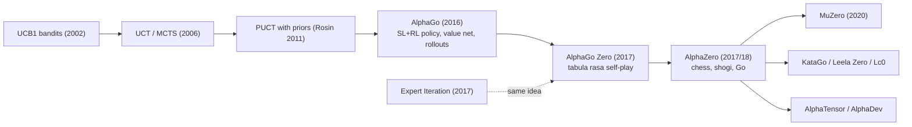

# Monte Carlo Tree Search & AlphaZero (MCTS, UCT, PUCT, AlphaGo, AlphaGo Zero, AlphaZero)
> Plan by growing a search tree guided by a learned policy prior and value function, then train those networks to imitate the search's improved decisions and predict self-play outcomes. **Family:** Model-based → Planning with a known model → Search + learned policy/value (expert iteration)  ·  **Year / origin:** UCT: Kocsis & Szepesvári 2006; AlphaGo 2016, AlphaGo Zero 2017, AlphaZero 2017/2018 (DeepMind)  ·  **On/Off-policy:** Self-play; search acts as a policy-improvement operator, training data comes from recent self-play (close to on-policy)  ·  **Action space:** Discrete (large but finite)

## 1. What is it?

**Monte Carlo Tree Search (MCTS)** is a planning algorithm for problems where you have a simulator (the rules of the game). From the current state it repeatedly runs *simulations* that walk down a growing search tree, choosing actions with a bandit rule that balances exploiting moves that looked good and exploring moves that have been tried rarely; it then evaluates the new leaf and backs the result up the path. After many simulations, the most-visited move at the root is played.

**UCT** (Upper Confidence bounds applied to Trees) is the classical selection rule, from the UCB1 bandit algorithm; leaves were originally evaluated by random rollouts to the end of the game.

**AlphaGo / AlphaGo Zero / AlphaZero** (DeepMind) replaced the hand-crafted parts of MCTS with deep networks:
- a **policy network** $p_\theta(a|s)$ gives *prior probabilities* that focus search on promising moves (the **PUCT** selection rule),
- a **value network** $v_\theta(s)$ replaces (AlphaGo: augments) random rollouts at the leaves,
- and in AlphaGo Zero/AlphaZero, both are trained purely from **self-play**: the network learns to predict the search's visit distribution (policy target) and the game result (value target). Better networks make better searches, better searches produce better training targets — a virtuous loop called **expert iteration** or "search as policy improvement".

Where it sits: model-based RL with a *known, exact* model (game rules). It is "planning + learning": the search is the planner, the networks amortize what search learns. Its successor **MuZero** removes the need for known rules by learning the model. Outside games, AlphaZero-style search has been applied to discovering matrix-multiplication algorithms (AlphaTensor) and faster sorting routines (AlphaDev), and inspired search-based approaches for formal theorem proving (e.g., AlphaProof) and LLM reasoning.

What it improved:
- **UCT vs. plain Monte Carlo**: focuses simulations on promising lines; converges to minimax in the limit.
- **AlphaGo vs. earlier Go programs**: first program to beat a professional (Fan Hui, 2015) and a top professional (Lee Sedol, 2016, 4–1).
- **AlphaGo Zero vs. AlphaGo**: no human data, no hand-crafted features, no rollouts; a single residual network for policy+value; reported 100–0 against the version that beat Lee Sedol.
- **AlphaZero vs. AlphaGo Zero**: one general algorithm for chess, shogi and Go (no game-specific tweaks beyond the rules and input encoding), reported to defeat world-champion programs (Stockfish, Elmo, and AlphaGo Zero) after hours of self-play on large TPU clusters.

## 2. Family & lineage

- **Parents:** Multi-armed bandits & UCB1 (Auer et al., 2002); Monte Carlo evaluation; minimax/alpha-beta game search; MCTS (Coulom 2006; Kocsis & Szepesvári 2006); PUCT bandit with predictor (Rosin, 2011); TD-Gammon (self-play learning, Tesauro).
- **Siblings:** Expert Iteration (ExIt, Anthony, Tian & Barber, 2017) — the same search-imitation idea developed independently for the game Hex; policy iteration in general.
- **Descendants:** MuZero (learned model), EfficientZero, Sampled/Gumbel MuZero, Stochastic MuZero; open re-implementations Leela Zero (Go), Leela Chess Zero, KataGo (with many efficiency improvements); AlphaTensor, AlphaDev; MCTS-guided LLM reasoning/decoding.



## 3. Core idea & intuition

**Search as a "thinking harder" operator.** A policy network alone is like a strong player's intuition: fast, usually right, sometimes blunders. MCTS is like that player thinking ahead: considering the moves intuition suggests, imagining replies, judging the resulting positions. The result of thinking (the visit counts at the root) is a *better* policy than raw intuition. Training the policy network to imitate those visit counts distills slow thinking into fast intuition. Repeat, and intuition keeps improving.

**The four phases of one simulation:**
1. **Select**: from the root, repeatedly pick the child maximizing "value so far + exploration bonus" until reaching a node not yet expanded.
2. **Expand**: create the node's children; the network gives prior probabilities for each move.
3. **Evaluate**: the value network estimates how good the leaf position is (or the exact result if the game is over). Classic MCTS instead played random moves to the end ("rollout").
4. **Back up**: add the value to every node on the path (flipping sign between players in two-player zero-sum games) and increment visit counts.

**Why PUCT?** UCT's bonus $\sqrt{\ln N/n}$ treats all unexplored moves equally. In Go there are ~250 legal moves; most are terrible. PUCT multiplies the bonus by the network's prior $P(s,a)$, so search spends its budget where a strong player would look, and decays the bonus as a move is visited ($1/(1+n)$).

**Exploration in self-play.** Without noise, self-play games repeat; so AlphaZero adds Dirichlet noise to root priors and samples moves in proportion to visit counts for the opening moves (temperature 1), then plays greedily.

**Why the value target is the game result $z$.** In a deterministic two-player game the final outcome is an unbiased (if noisy) sample of the value under the current self-play policy. As self-play strengthens, values approach minimax values.

## 4. Math / formal details

Symbols: state (node) $s$; action $a$; visit count $N(s,a)$; total visits $N(s) = \sum_b N(s,b)$; total backed-up value $W(s,a)$; mean value $Q(s,a) = W(s,a)/N(s,a)$; network prior $P(s,a) = p_\theta(a|s)$; network value $v_\theta(s)\in[-1,1]$ from the perspective of the player to move; game outcome $z\in\{-1,0,+1\}$.

**UCT** (with UCB1; $c$ = exploration constant):
$$a^* = \arg\max_a \Big[ Q(s,a) + c\sqrt{\frac{\ln N(s)}{N(s,a)}} \Big].$$
Kocsis & Szepesvári proved that the failure probability at the root converges to zero as the number of simulations grows (for suitable $c$).

**PUCT** (AlphaGo Zero / AlphaZero form):
$$a^* = \arg\max_a \Big[ Q(s,a) + c_{\text{puct}}\, P(s,a)\,\frac{\sqrt{N(s)}}{1 + N(s,a)} \Big].$$
AlphaZero's published pseudocode grows $c_{\text{puct}}$ slowly with visits: $c(s) = \log\frac{1 + N(s) + c_{\text{base}}}{c_{\text{base}}} + c_{\text{init}}$, with $c_{\text{base}}=19652$, $c_{\text{init}}=1.25$.

**Root exploration noise:** $P(s_{\text{root}},a) \leftarrow (1-\varepsilon)\,p_\theta(a|s) + \varepsilon\,\eta_a$, $\eta\sim\text{Dir}(\alpha_{\text{dir}})$, $\varepsilon=0.25$; AlphaZero used $\alpha_{\text{dir}} = 0.3, 0.15, 0.03$ for chess, shogi, Go (roughly inversely proportional to the number of legal moves).

**Backup (two-player zero-sum, negamax convention):** for leaf value $v$ (perspective of player to move at the leaf), walking up the path, each edge on the way gets
$$N \leftarrow N+1,\qquad W \leftarrow W + (\pm v),$$
with the sign alternating at each ply so that each edge's $Q$ is from the perspective of the player who chose it.

**Search policy (training target)** with temperature $\tau$:
$$\pi(a|s) = \frac{N(s,a)^{1/\tau}}{\sum_b N(s,b)^{1/\tau}}.$$

**AlphaZero loss** for network $(p, v) = f_\theta(s)$:
$$\ell(\theta) = (z - v)^2 \;-\; \pi^\top\log p \;+\; c\,\lVert\theta\rVert^2.$$
The first term regresses the value onto self-play outcomes, the second is cross-entropy between search policy and network policy, the third is L2 regularization.

**Why imitation of visit counts is policy improvement.** Grill et al. (ICML 2020) showed that the visit distribution of PUCT approximately solves a regularized policy-optimization problem, $\bar\pi = \arg\max_{y}\big[ q^\top y - \lambda_N\,\mathrm{KL}(p_\theta \,\|\, y)\big]$, with $\lambda_N \propto \sqrt{N}/(|\mathcal A| + N)$ shrinking roughly like $1/\sqrt{N}$: search output = prior pushed toward higher Q, more strongly the more simulations are run.

**AlphaGo (2016) specifics:** SL policy net trained on ~30M human positions; RL policy net improved by policy-gradient self-play; value net regressed on self-play outcomes; leaf evaluation mixing value net and a fast rollout: $V(s_L) = (1-\lambda)v_\theta(s_L) + \lambda z_L$, $\lambda = 0.5$.

**AlphaGo Zero → AlphaZero differences:** AlphaGo Zero used board symmetries for augmentation and an evaluator that only replaced the self-play network if a candidate won ≥55% of games; AlphaZero dropped the gating (continuous update), did not use symmetries (chess/shogi aren't symmetric), and handled draws ($z = 0$).

## 5. Algorithm (pseudocode)

```text
MCTS with PUCT (one move decision)
 1. root <- new node for s; (P, v) <- f_theta(s); create children with priors P
 2. if self-play: mix Dirichlet noise into root priors
 3. repeat n_simulations times:
 4.     node <- root; path <- [root]
 5.     while node is expanded:                       # SELECT
 6.         a <- argmax_a Q(node,a) + c_puct * P(node,a) * sqrt(N(node)) / (1 + N(node,a))
 7.         node <- child(node, a); path.append(node)
 8.     if node's state is terminal: v <- exact outcome for player to move
 9.     else: (P, v) <- f_theta(state); expand node with priors P      # EXPAND + EVALUATE
10.     for node in reversed(path):                   # BACKUP (sign flips every ply)
11.         N(node) += 1; W(node) += -v; v <- -v
12. return visit counts N(root, .)

AlphaZero training loop
 1. initialize network f_theta randomly; replay window R <- empty
 2. loop:
 3.     play self-play games: at each state s run MCTS; pi <- N(s,.)^(1/tau) normalized
 4.         sample a ~ pi (tau = 1 for the first moves, then tau -> 0 i.e. argmax)
 5.     at game end with result z, add (s_t, pi_t, z_t) for every position (z_t from mover's view) to R
 6.     sample minibatches from R; minimize (z - v)^2 - pi^T log p + c ||theta||^2
 7.     (AlphaGo Zero only: gate new network by evaluation matches)
```

## 6. Python implementation

Runnable version: [`code/mcts-alphazero.py`](../../code/mcts-alphazero.py)

A full AlphaZero loop on **tic-tac-toe**: canonical board representation (always from the side to move), PUCT MCTS with Dirichlet root noise, self-play with visit-count policy targets and 8-fold symmetry augmentation, a small PyTorch policy/value MLP, and evaluation against a random player and a **perfect minimax player** (tic-tac-toe is a draw under perfect play, so "never lose" is the goal). It also grades move quality on 500 random reachable positions. Tested output (≈35 s CPU):

```text
iter   5 | buffer   4104 | loss 1.989 |   2.7s
iter  10 | buffer   8624 | loss 1.579 |   5.5s
...
iter  40 | buffer  20000 | loss 0.965 |  27.4s
raw policy net  | optimal-move rate 92.6% | vs random W/D/L  96/  4/  0 | vs perfect W/D/L   0/ 97/  3
net + MCTS(100) | optimal-move rate 98.6% | vs random W/D/L  87/ 13/  0 | vs perfect W/D/L   0/100/  0
value of empty board predicted +0.11 (true game-theoretic value: 0 = draw)
```

Search on top of the same network raises the optimal-move rate from ~93% to ~99% and removes all losses against perfect play — the "search as policy improvement" effect in miniature. (Against the random player, the greedy-argmax raw policy happens to win slightly more; both never lose.)

```python
"""AlphaZero-style self-play (PUCT MCTS + policy/value network) on tic-tac-toe.

Self-contained: numpy + torch. Trains in ~1 minute on CPU and then plays against
(a) a uniformly random player and (b) a perfect minimax player.
    python3 code/mcts-alphazero.py
"""
import functools
import math
import time

import numpy as np
import torch
import torch.nn as nn
import torch.nn.functional as F

torch.set_num_threads(1)
rng = np.random.default_rng(0)
torch.manual_seed(0)

# ----------------------------------------------------------------------------------------------
# 1. Game: tic-tac-toe in CANONICAL form -- the board is always seen from the player to move (+1)
# ----------------------------------------------------------------------------------------------
LINES = [(0, 1, 2), (3, 4, 5), (6, 7, 8), (0, 3, 6), (1, 4, 7), (2, 5, 8), (0, 4, 8), (2, 4, 6)]


def legal_moves(b):
    return np.flatnonzero(b == 0)


def next_state(b, a):
    """Current player (+1) plays square a; flip signs so the opponent becomes the player to move."""
    b2 = b.copy()
    b2[a] = 1
    return -b2


def terminal_value(b):
    """Value for the player to move: -1 if the opponent just completed a line, 0 for a draw, None otherwise."""
    for i, j, k in LINES:
        if b[i] + b[j] + b[k] == -3:
            return -1.0
    if not (b == 0).any():
        return 0.0
    return None


# ----------------------------------------------------------------------------------------------
# 2. Policy/value network f_theta(s) -> (p, v)
# ----------------------------------------------------------------------------------------------
class PolicyValueNet(nn.Module):
    def __init__(self, hidden=128):
        super().__init__()
        self.body = nn.Sequential(nn.Linear(27, hidden), nn.ReLU(), nn.Linear(hidden, hidden), nn.ReLU())
        self.policy_head, self.value_head = nn.Linear(hidden, 9), nn.Linear(hidden, 1)

    @staticmethod
    def encode(boards):  # (N, 9) in {-1,0,1} -> (N, 27) one-hot planes: mine / theirs / empty
        boards = torch.as_tensor(np.asarray(boards), dtype=torch.float32)
        return torch.cat([(boards == 1).float(), (boards == -1).float(), (boards == 0).float()], dim=-1)

    def forward(self, boards):
        h = self.body(self.encode(boards))
        return self.policy_head(h), torch.tanh(self.value_head(h)).squeeze(-1)

    @torch.no_grad()
    def predict(self, b):
        logits, v = self(b[None])
        logits = logits[0].numpy()
        mask = np.full(9, -np.inf)
        mask[legal_moves(b)] = 0.0
        p = np.exp(logits + mask - np.max(logits + mask))
        return p / p.sum(), float(v[0])


# ----------------------------------------------------------------------------------------------
# 3. MCTS with the PUCT selection rule used by AlphaGo Zero / AlphaZero
# ----------------------------------------------------------------------------------------------
class Node:
    __slots__ = ("prior", "N", "W", "children")

    def __init__(self, prior):
        self.prior, self.N, self.W, self.children = prior, 0, 0.0, {}

    def Q(self):  # mean value from the perspective of the player who chose the move INTO this node
        return self.W / self.N if self.N else 0.0


class MCTS:
    def __init__(self, net, n_sims=50, c_puct=1.5, dir_alpha=0.6, dir_eps=0.25):
        self.net, self.n_sims, self.c_puct, self.dir_alpha, self.dir_eps = net, n_sims, c_puct, dir_alpha, dir_eps

    def _expand(self, node, b):
        p, v = self.net.predict(b)
        for a in legal_moves(b):
            node.children[a] = Node(p[a])
        return v

    def _select(self, node):
        sqrt_n = math.sqrt(node.N)
        best, best_score = None, -1e9
        for a, child in node.children.items():
            # PUCT: exploit Q, explore in proportion to the network prior and inversely to visit count
            u = self.c_puct * child.prior * sqrt_n / (1 + child.N)
            score = child.Q() + u
            if score > best_score:
                best, best_score = a, score
        return best, node.children[best]

    def search(self, b, add_noise=False):
        root = Node(1.0)
        self._expand(root, b)
        if add_noise:  # Dirichlet noise at the root keeps self-play exploring
            acts = list(root.children)
            noise = rng.dirichlet([self.dir_alpha] * len(acts))
            for a, n in zip(acts, noise):
                root.children[a].prior = (1 - self.dir_eps) * root.children[a].prior + self.dir_eps * n
        for _ in range(self.n_sims):
            node, s, path = root, b, [root]
            while node.children:                     # 1) SELECT down the tree
                a, node = self._select(node)
                s = next_state(s, a)
                path.append(node)
            v = terminal_value(s)                    # 2) EVALUATE leaf (exact if terminal)
            if v is None:
                v = self._expand(node, s)            # 3) EXPAND with network priors, value v
            for n in reversed(path):                 # 4) BACK UP, flipping sign every ply
                n.N += 1
                n.W += -v                            # node stores value for the player who moved into it
                v = -v
        visits = np.zeros(9)
        for a, child in root.children.items():
            visits[a] = child.N
        return visits


# ----------------------------------------------------------------------------------------------
# 4. Self-play data generation, with the 8 board symmetries as data augmentation
# ----------------------------------------------------------------------------------------------
IDX = np.arange(9).reshape(3, 3)
SYMS = [np.rot90(IDX, k).ravel() for k in range(4)] + [np.rot90(IDX.T, k).ravel() for k in range(4)]


def self_play_game(mcts, temp_moves=5):
    b, history = np.zeros(9), []
    while terminal_value(b) is None:
        visits = mcts.search(b, add_noise=True)
        pi = visits / visits.sum()                   # policy target = normalized visit counts
        history.append((b.copy(), pi))
        if len(history) <= temp_moves:               # temperature 1 for the opening, then greedy
            a = rng.choice(9, p=pi)
        else:
            a = int(np.argmax(visits))
        b = next_state(b, a)
    z = terminal_value(b)                            # outcome for the player to move at the END
    data = []
    for s, pi in reversed(history):                  # walk back, flipping perspective each ply
        z = -z
        for perm in SYMS:
            data.append((s[perm], pi[perm], z))
    return data


def train(net, opt, buffer, steps=60, batch=128):
    for _ in range(steps):
        idx = rng.integers(0, len(buffer), size=batch)
        s = np.stack([buffer[i][0] for i in idx])
        pi = torch.as_tensor(np.stack([buffer[i][1] for i in idx]), dtype=torch.float32)
        z = torch.as_tensor([buffer[i][2] for i in idx], dtype=torch.float32)
        logits, v = net(s)
        # AlphaZero loss: (z - v)^2 - pi^T log p   (+ L2 via weight_decay in the optimizer)
        loss = F.mse_loss(v, z) - (pi * F.log_softmax(logits, -1)).sum(-1).mean()
        opt.zero_grad()
        loss.backward()
        opt.step()
    return loss.item()


# ----------------------------------------------------------------------------------------------
# 5. Opponents for evaluation: random and perfect (minimax)
# ----------------------------------------------------------------------------------------------
@functools.lru_cache(maxsize=None)
def minimax_value(key):
    b = np.array(key)
    tv = terminal_value(b)
    if tv is not None:
        return tv
    return max(-minimax_value(tuple(next_state(b, a))) for a in legal_moves(b))


def optimal_moves(b):
    vals = {a: -minimax_value(tuple(next_state(b, a))) for a in legal_moves(b)}
    best = max(vals.values())
    return {a for a, v in vals.items() if v == best}


def perfect_move(b):
    return rng.choice(sorted(optimal_moves(b)))   # random among game-theoretically optimal moves


def all_positions():
    """Every reachable non-terminal position (4,520 in canonical form) -- used to grade move quality."""
    seen, stack = set(), [tuple(np.zeros(9))]
    while stack:
        key = stack.pop()
        if key in seen or terminal_value(np.array(key)) is not None:
            continue
        seen.add(key)
        stack.extend(tuple(next_state(np.array(key), a)) for a in legal_moves(np.array(key)))
    return [np.array(k) for k in seen]


def play(agent_fn, opp_fn, agent_first):
    b, agent_turn = np.zeros(9), agent_first
    while terminal_value(b) is None:
        b = next_state(b, agent_fn(b) if agent_turn else opp_fn(b))
        agent_turn = not agent_turn
    # terminal_value is for the player to move; if that is the opponent, flip it
    return terminal_value(b) * (1 if agent_turn else -1)   # +1 agent win, 0 draw, -1 loss


def match(agent_fn, opp_fn, games=40):
    res = [play(agent_fn, opp_fn, agent_first=(g % 2 == 0)) for g in range(games)]
    return sum(r > 0 for r in res), sum(r == 0 for r in res), sum(r < 0 for r in res)


def main(iterations=40, games_per_iter=15):
    net = PolicyValueNet()
    opt = torch.optim.Adam(net.parameters(), lr=2e-3, weight_decay=1e-4)
    mcts, buffer, t0 = MCTS(net, n_sims=50), [], time.time()
    random_fn = lambda b: rng.choice(legal_moves(b))
    for it in range(1, iterations + 1):
        for _ in range(games_per_iter):
            buffer.extend(self_play_game(mcts))
        buffer = buffer[-20_000:]                    # sliding window replay buffer
        loss = train(net, opt, buffer)
        if it % 5 == 0:
            print(f"iter {it:3d} | buffer {len(buffer):6d} | loss {loss:.3f} | {time.time() - t0:5.1f}s")

    eval_mcts = MCTS(net, n_sims=100)
    az_fn = lambda b: int(np.argmax(eval_mcts.search(b)))
    raw_fn = lambda b: int(np.argmax(net.predict(b)[0]))      # network alone, no search
    positions = all_positions()
    sample = [positions[i] for i in rng.choice(len(positions), size=500, replace=False)]
    for name, fn in [("raw policy net ", raw_fn), ("net + MCTS(100)", az_fn)]:
        w, d, l = match(fn, random_fn, games=100)
        w2, d2, l2 = match(fn, perfect_move, games=100)
        opt_rate = np.mean([fn(b) in optimal_moves(b) for b in sample])
        print(f"{name} | optimal-move rate {opt_rate:5.1%} | vs random W/D/L {w:3d}/{d:3d}/{l:3d} "
              f"| vs perfect W/D/L {w2:3d}/{d2:3d}/{l2:3d}")
    _, v_empty = net.predict(np.zeros(9))
    print(f"value of empty board predicted {v_empty:+.2f} (true game-theoretic value: 0 = draw)")


if __name__ == "__main__":
    main()
```

Design notes:
- **Canonical form + negamax backups** keep the code player-agnostic: the network always evaluates "me to move", and the sign flips once per ply.
- **Terminal leaves use the exact result**, not the network — important early when the value head is poor.
- `temp_moves=5`: sampling the first moves from visit counts creates diverse positions; with too little diversity the value net only knows a narrow set of openings and search can be misled in unfamiliar positions (try `temp_moves=1` and watch losses vs. the perfect player appear).

## 7. Practical tips & hyperparameters

| Setting | AlphaZero (reported) | Small-game starting point |
|---|---|---|
| Simulations per move | 800 | 25–200 |
| $c_{\text{puct}}$ | $c_{\text{init}}=1.25$, slowly growing with $N$ | 1–2.5 |
| Dirichlet $\alpha$ / $\varepsilon$ | 0.3 (chess), 0.15 (shogi), 0.03 (Go) / 0.25 | ≈ 10 / (avg. legal moves) / 0.25 |
| Temperature | $\tau=1$ for early moves (first 30 in Go for AlphaGo Zero), then greedy | first 2–5 moves |
| Network | ResNet (AlphaGo Zero: 20 or 40 residual blocks) | MLP or small CNN |
| Replay window | recent self-play games (e.g. last ~500k games in AlphaGo Zero) | last 10–50k positions |
| L2 coefficient $c$ | $10^{-4}$ | $10^{-4}$ |

Tips:
- **Batch network evaluations** across parallel games or with "virtual loss" (temporarily penalize nodes being explored by other threads) — single-position inference is the main bottleneck.
- **Reuse the subtree** of the chosen move for the next search.
- **First-play urgency (FPU)**: the value assigned to unvisited children matters; 0 (as here) is simple; Leela/KataGo use the parent value minus a reduction.
- **Value-head overfitting** to recent games is common (AlphaGo noted it with successive positions from one game); sample positions across many games.
- **Resignation** (with a false-positive check) saves a lot of self-play compute in long games.
- **Diagnostics**: Elo vs. previous checkpoints; policy entropy at the root; how often the search's chosen move differs from the network's top move (should be moderate); value loss vs policy loss.
- **Compute**: AlphaZero-scale training used thousands of TPUs for self-play (reported). Community projects (Leela Zero, KataGo) reached superhuman Go with distributed volunteer compute and, in KataGo's case, large efficiency gains (auxiliary targets, playout cap randomization).

## 8. Pros and cons

**Pros**
- Superhuman play in Go, chess, shogi from rules alone, no human data.
- Search provides strong, explainable-ish lookahead and anytime behavior (more simulations → better moves).
- The same algorithm transfers across games and to combinatorial optimization (AlphaTensor, AlphaDev).
- Policy improvement via search is stable and data-efficient compared to pure policy gradients in such domains.

**Cons**
- Needs a perfect, fast simulator (the rules); not applicable as-is when dynamics are unknown → MuZero.
- Very expensive self-play compute at scale.
- Designed for discrete actions, deterministic, perfect-information, two-player zero-sum settings; stochastic, imperfect-information or continuous problems need extensions (Stochastic MuZero, Sampled MuZero, ReBeL/CFR-style methods for poker).
- Inference latency: hundreds of network calls per decision.
- Can have blind spots in positions far from self-play distribution (adversarial attacks against KataGo have been reported).

## 9. When to use / when not to use

**Use when**
- You have an exact, cheap simulator and discrete decisions: board games, puzzles, combinatorial optimization, scheduling or program search where the "rules" are known.
- Decision time allows lookahead at inference (tens of ms to seconds).
- You want a self-improving loop without human demonstrations.

**Avoid when**
- The environment's dynamics are unknown or expensive to simulate → MuZero, Dreamer, model-free methods.
- Actions are continuous and high-dimensional → SAC/TD3, or Sampled MuZero.
- Hidden information dominates (poker) → CFR-based methods.
- Strict real-time constraints prevent search at inference.

## 10. Key papers, books & repos

- L. Kocsis, C. Szepesvári. *Bandit Based Monte-Carlo Planning.* ECML 2006 (UCT).
- R. Coulom. *Efficient Selectivity and Backup Operators in Monte-Carlo Tree Search.* Computers and Games 2006.
- P. Auer, N. Cesa-Bianchi, P. Fischer. *Finite-time Analysis of the Multiarmed Bandit Problem.* Machine Learning 47, 2002 (UCB1).
- C. D. Rosin. *Multi-armed bandits with episode context.* Annals of Mathematics and Artificial Intelligence, 2011 (PUCT).
- C. B. Browne et al. *A Survey of Monte Carlo Tree Search Methods.* IEEE Trans. Computational Intelligence and AI in Games, 2012.
- D. Silver et al. *Mastering the game of Go with deep neural networks and tree search.* Nature 529, 2016 (AlphaGo).
- D. Silver et al. *Mastering the game of Go without human knowledge.* Nature 550, 2017 (AlphaGo Zero).
- D. Silver et al. *A general reinforcement learning algorithm that masters chess, shogi, and Go through self-play.* Science 362, 2018 (AlphaZero; preprint arXiv:1712.01815).
- T. Anthony, Z. Tian, D. Barber. *Thinking Fast and Slow with Deep Learning and Tree Search.* NeurIPS 2017 (Expert Iteration).
- J.-B. Grill et al. *Monte-Carlo Tree Search as Regularized Policy Optimization.* ICML 2020.
- D. J. Wu. *Accelerating Self-Play Learning in Go.* arXiv:1902.10565 (KataGo).
- A. Fawzi et al. *Discovering faster matrix multiplication algorithms with reinforcement learning.* Nature 2022 (AlphaTensor); D. J. Mankowitz et al. *Faster sorting algorithms discovered using deep reinforcement learning.* Nature 2023 (AlphaDev).
- R. S. Sutton & A. G. Barto, *Reinforcement Learning: An Introduction*, 2nd ed., 2018 — §8.8–8.11 (planning at decision time, rollout algorithms, MCTS), §16.6 (Mastering the Game of Go: AlphaGo and AlphaGo Zero), Ch. 2 (bandits/UCB).
- Repos: [google-deepmind/open_spiel](https://github.com/google-deepmind/open_spiel) (MCTS + AlphaZero implementations), [google-deepmind/mctx](https://github.com/google-deepmind/mctx) (JAX MCTS incl. AlphaZero/MuZero/Gumbel policies), [suragnair/alpha-zero-general](https://github.com/suragnair/alpha-zero-general), [lightvector/KataGo](https://github.com/lightvector/KataGo), [LeelaChessZero/lc0](https://github.com/LeelaChessZero/lc0), [leela-zero/leela-zero](https://github.com/leela-zero/leela-zero).

## 11. For business users

**What it does.** AlphaZero-style systems make decisions by combining instinct with deliberate look-ahead. A neural network provides "gut feeling" about which options are promising and how good a situation is; a search procedure then explores the most promising sequences of future moves using an exact simulator of the rules, and picks the best. The system learns entirely by playing against itself.

**Business analogy.** A chess grandmaster: years of experience give strong intuition about which moves to consider; before moving, they still calculate a few key lines ahead. AlphaZero trains its intuition on the results of its own calculations, so both keep getting better.

**Real-world use cases.** Game AI (Go, chess, shogi — superhuman); discovering new algorithms (matrix multiplication, sorting routines); combinatorial optimization such as scheduling, routing, chip-design-like placement, and resource allocation where rules are known; search-based reasoning in AI systems.

**Value / ROI.** When your problem has precise rules and a simulator, these systems can discover strategies better than human experts or hand-written heuristics, without needing historical decision data. The search gives a dial: spend more compute at decision time for better decisions.

**Risks.** Requires an exact model of the "rules" — if reality differs from the simulator, decisions can be badly wrong. Training can be very compute-hungry. The system may have surprising blind spots in situations it rarely saw in self-play.

**Costs.** Self-play training compute can be large (from a few GPUs for small problems up to large clusters for Go-scale problems); inference costs grow with the search budget.

**Questions to ask your team.**
- Do we truly have an exact, fast simulator of our decision problem?
- How does performance scale with the search budget at decision time, and what latency can we afford?
- What baseline (heuristics, integer programming, human experts) are we comparing against?
- How do we test for blind spots (unusual or adversarial situations)?

## 12. For kids (ages ~8–12)

**The "what if" game.** When you play tic-tac-toe, you might think, "If I put my X here, then my friend will block there, and then I can win over here!" That's looking ahead, like climbing a tree of "what ifs." AlphaZero does that very fast, but it can't check every branch, so it has a helper — a little brain that has a hunch about which moves look good and who's winning. It checks the branches its hunch likes most. After lots of games against itself, both its hunches and its "what-if" thinking get better and better, until it never loses at tic-tac-toe!

**Try it yourself.** Play tic-tac-toe with a friend, but before each move say out loud two "what ifs": "If I go here, they might go there..." Draw the little tree of moves on paper. Do you make fewer mistakes when you do this?

**Recap.**
1. Look ahead with "what if" thinking.
2. Use your hunches to decide which "what ifs" to check.
3. Practice against yourself to make your hunches smarter.

## 13. Related methods

- [MuZero — the same search, with a learned model instead of the rules](./muzero.md)
- [World Models / Dreamer — learn a model and plan/learn in imagination](./world-models-dreamer.md)
- [MBPO / PETS — model-based control with learned dynamics](./mbpo-pets.md)
- [Multi-armed bandits — UCB, the root of UCT](../01-foundations-tabular/multi-armed-bandits.md)
- [Monte Carlo methods](../01-foundations-tabular/monte-carlo.md)
- [Dyna-Q — combining learning and planning in the tabular world](../01-foundations-tabular/dyna-q.md)
- [Dynamic programming — policy iteration, which AlphaZero approximates](../01-foundations-tabular/dynamic-programming.md)
- [Multi-agent RL — self-play in a wider context](../08-exploration-hierarchical-multiagent/multi-agent-rl.md)
- [Process reward models — search-guided LLM reasoning](../10-llm-reasoning-rl/process-reward-prime.md)

[← Back to overview](../../RL_Methods_Overview.md)
