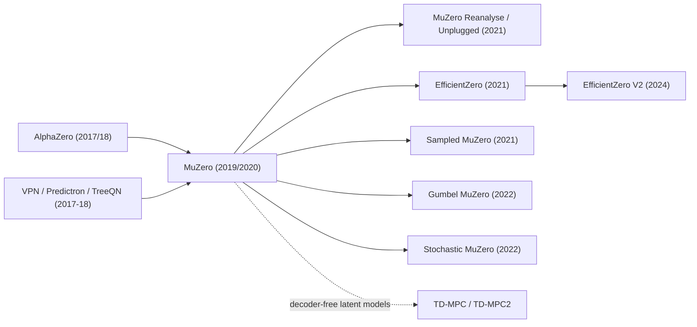

# MuZero (and EfficientZero, Sampled MuZero, Gumbel MuZero)
> AlphaZero-style tree search inside a **learned latent model** that is trained only to predict rewards, values and policies — never to reconstruct observations. **Family:** Model-based → Learned (value-equivalent) model → Planning with MCTS in latent space  ·  **Year / origin:** Schrittwieser et al., arXiv 2019 / Nature 2020 (DeepMind)  ·  **On/Off-policy:** Off-policy-ish (replay buffer of self-play trajectories; Reanalyse refreshes targets)  ·  **Action space:** Discrete (Sampled MuZero extends to continuous/large)

## 1. What is it?

AlphaZero needs the rules of the game to run MCTS: given a state and an action, it must know the next state and whether the game ended. **MuZero** removes that requirement. It learns three functions:

- **representation** $h_\theta$: maps the observation history to an abstract hidden state $s^0$;
- **dynamics** $g_\theta$: maps $(s^{k-1}, a^k)$ to the next hidden state $s^k$ and a predicted reward $r^k$;
- **prediction** $f_\theta$: maps $s^k$ to a policy prior $p^k$ and value $v^k$.

Search is ordinary PUCT MCTS (as in AlphaZero), but every expansion calls $g_\theta$ instead of the real simulator, and every evaluation calls $f_\theta$. Crucially, the hidden states are **not** required to reconstruct the observation or match any real state. The model is trained end-to-end so that, when unrolled along actually-taken actions, its predicted rewards, values and policies match the targets from real experience. This is the **value-equivalence** principle: the model only has to be correct about what matters for planning.

Results (Nature 2020): matched AlphaZero's superhuman performance in Go, chess and shogi without being given the rules, and set a new state of the art on the 57-game Atari benchmark at the time, where previous model-based methods had lagged far behind model-free ones.

Where it sits: model-based RL with a *learned, abstract* model, combining AlphaZero's search-based policy improvement with model learning. It bridges "planning with known models" (AlphaZero) and "learning world models" (Dreamer), but unlike Dreamer it never reconstructs pixels.

**Important follow-ups:**
- **MuZero Reanalyse / MuZero Unplugged** (Schrittwieser et al., 2021): re-run search with the latest network on stored trajectories to refresh policy/value targets; works even fully offline.
- **EfficientZero** (Ye et al., NeurIPS 2021): sample-efficient MuZero for the Atari 100k benchmark (≈2 hours of game-play), with (1) a self-supervised temporal-consistency loss (SimSiam-style) that makes predicted latents match encoded future observations, (2) a "value prefix" LSTM predicting cumulative reward instead of per-step rewards, (3) model-based off-policy correction of value targets (shorter, adaptive bootstrap horizons for stale data). Reported above-human mean and median human-normalized scores on Atari 100k. **EfficientZero V2** (Wang et al., ICML 2024) extends this to continuous control.
- **Sampled MuZero** (Hubert et al., ICML 2021): search over a *sampled subset* of actions, with a corrected prior, enabling large discrete and continuous action spaces.
- **Gumbel MuZero / Gumbel AlphaZero** (Danihelka et al., ICLR 2022): root action selection by Gumbel-Top-k sampling + Sequential Halving, and a policy target built from "completed Q-values", which *guarantees policy improvement* even with very few simulations (e.g. 2–16).
- **Stochastic MuZero** (Antonoglou et al., ICLR 2022): adds chance nodes with learned discrete "afterstate" codes for stochastic environments (e.g. 2048, backgammon).

## 2. Family & lineage

- **Parents:** AlphaZero (search + self-play training); value-prediction-style learned models — Predictron (Silver et al., 2017), Value Prediction Network (Oh, Singh & Lee, 2017), TreeQN (Farquhar et al., 2018).
- **Siblings:** Dreamer / PlaNet (learn reconstructive latent models, learn behavior in imagination), TD-MPC/TD-MPC2 (latent, decoder-free models with MPPI planning for continuous control).
- **Descendants:** MuZero Reanalyse/Unplugged, EfficientZero (V2), Sampled MuZero, Gumbel MuZero, Stochastic MuZero; applications such as MuZero-based rate control for video compression (YouTube/VP9, reported by DeepMind, 2022).



## 3. Core idea & intuition

**You don't need to model everything — only what matters for decisions.** A Dreamer-style world model learns to predict every pixel of the next frame, including irrelevant background details. MuZero's model is judged only on three questions, asked $K$ steps into an imagined future along the action sequence actually taken: *What reward will I get? How good will the situation be? What would a good player do?* If the model answers those correctly, MCTS over it makes good decisions, whatever the hidden states "look like".

**Why it works with search.** In AlphaZero, search improves the policy because it looks ahead using the true rules. In MuZero, look-ahead uses learned rules; training on multi-step unrolls (typically $K=5$) makes the dynamics accurate for a few steps, and the value function handles the long tail beyond the search horizon.

**Training loop = AlphaZero + unrolled model:**
1. Act with MCTS over the learned model; store trajectories with the search's visit-count policies and root values.
2. Sample a position from replay; encode the observation; unroll the dynamics $K$ steps with the *real* actions.
3. At each unrolled step, regress reward and value, and cross-entropy the policy to stored targets.

**Value targets** are $n$-step bootstrapped returns from real rewards plus the (stored or freshly computed) search value $n$ steps later — like n-step TD, but with MCTS values.

**Tricks that keep the unroll stable:** min-max normalization of hidden states to $[0,1]$; scaling the gradient entering the dynamics function by 1/2; scaling per-step losses by $1/K$; normalizing Q in search by the min/max seen in the tree (since reward scales are arbitrary in single-player tasks); categorical (distributional) value and reward heads with an invertible squashing transform for Atari's widely varying reward scales.

## 4. Math / formal details

Symbols: observation $o_t$; real actions $a_{t+1}, \dots$ (MuZero indexes the action taken after $o_t$ as $a_{t+1}$); real rewards $u_{t+1},\dots$; unroll index $k = 0..K$; hidden states $s^k_t$; predicted reward $r^k_t$, policy $p^k_t$, value $v^k_t$; search policy target $\pi_t$; search root value $\nu_t$; discount $\gamma$; bootstrap length $n$.

**Model:**
$$s^0_t = h_\theta(o_1,\dots,o_t),\qquad (r^k_t, s^k_t) = g_\theta(s^{k-1}_t, a_{t+k}),\qquad (p^k_t, v^k_t) = f_\theta(s^k_t).$$

**Value target** ($n$-step return bootstrapped with the search value):
$$z_t = u_{t+1} + \gamma u_{t+2} + \dots + \gamma^{n-1} u_{t+n} + \gamma^n \nu_{t+n}.$$
(For board games, $z_t$ is just the final outcome.) Past the end of an episode, targets are those of an absorbing state: value 0, reward 0, and no policy loss (or a uniform one).

**Loss** (summed over the unroll):
$$\ell_t(\theta) = \sum_{k=0}^{K} \Big[\ \ell^r(u_{t+k}, r^k_t) + \ell^v(z_{t+k}, v^k_t) + \ell^p(\pi_{t+k}, p^k_t)\ \Big] + c\lVert\theta\rVert^2 ,$$
with $\ell^p$ cross-entropy and $\ell^r,\ell^v$ either MSE (board games) or cross-entropy against a categorical "two-hot" encoding of $\phi(x)$ (Atari), using the transform
$$\phi(x) = \mathrm{sign}(x)\big(\sqrt{|x|+1} - 1\big) + \epsilon x,\qquad \epsilon = 10^{-3}.$$
(The $k=0$ reward term is absent.)

**Search (pUCT with MuZero's constants):**
$$a^k = \arg\max_a\Big[ \bar Q(s,a) + P(s,a)\,\frac{\sqrt{N(s)}}{1+N(s,a)}\Big( c_1 + \log\frac{N(s) + c_2 + 1}{c_2}\Big) \Big],\quad c_1 = 1.25,\ c_2 = 19652,$$
with min-max normalized values $\bar Q(s,a) = \frac{Q(s,a) - \min Q}{\max Q - \min Q}$ over the tree. Backed-up value along a path of length $l$ from node $k$:
$$G^k = \sum_{\tau=0}^{l-1-k}\gamma^\tau r_{k+1+\tau} + \gamma^{l-k} v^l,\qquad Q(s^{k-1}, a^k) \leftarrow \frac{N\,Q + G^k}{N + 1}.$$

**Gumbel MuZero policy target.** With logits $\ell(a)$ and "completed" Q-values $\hat q(a)$ (search Q for visited actions, a value estimate for unvisited ones), the improved policy is
$$\pi'(a) = \mathrm{softmax}\big(\ell(a) + \sigma(\hat q(a))\big),\qquad \sigma(\hat q) = (c_{\text{visit}} + \max_b N(b))\, c_{\text{scale}}\, \hat q ,$$
and the root action is chosen among Gumbel-Top-$m$ samples by Sequential Halving on $g(a) + \ell(a) + \sigma(\hat q(a))$. This gives a policy improvement guarantee in expectation for any number of simulations.

**Sampled MuZero.** Sample $K$ actions $a_i\sim\beta$ (e.g. $\beta = \pi$), run search on that subset with prior $\hat\beta/\beta\cdot\pi$ (where $\hat\beta$ is the empirical sample distribution), and train the policy on the sampled-improvement target; this is shown to be an unbiased policy-improvement operator in expectation.

**Value equivalence** (Grimm et al., 2020): two models are equivalent with respect to a set of policies and functions if they produce the same Bellman updates; MuZero's loss enforces a version of this along observed trajectories.

## 5. Algorithm (pseudocode)

```text
MuZero
 Networks: h (representation), g (dynamics), f (prediction); replay buffer R
 Acting (self-play / environment interaction)
 1. for each step t of an episode:
 2.     s0 <- h(o_1..o_t); (p, v) <- f(s0); create root with priors p (+ Dirichlet noise)
 3.     repeat N_sim times:
 4.         descend tree by pUCT on min-max-normalized Q until an unexpanded edge (s, a)
 5.         (r, s') <- g(s, a); (p', v') <- f(s'); expand node s' with priors p', store reward r
 6.         back up discounted returns G along the path; update min-max statistics
 7.     pi_t <- visit distribution at root; nu_t <- root value
 8.     sample a_{t+1} ~ pi_t^(1/T); step env -> o_{t+1}, u_{t+1}
 9. store trajectory (o, a, u, pi, nu) in R
 Training
10. sample position t from a trajectory in R (optionally prioritized)
11. s <- h(o_t)
12. for k = 0..K:
13.     if k > 0: (r^k, s) <- g(s, a_{t+k}); loss += l_r(u_{t+k}, r^k); scale grad of s by 1/2
14.     (p^k, v^k) <- f(s); loss += l_v(z_{t+k}, v^k) + l_p(pi_{t+k}, p^k)    (k>0 terms scaled 1/K)
15. gradient step on loss + c * ||theta||^2
16. (Reanalyse: periodically re-run MCTS on stored observations to refresh pi and nu)
```

## 6. Python implementation

Runnable version: [`code/muzero.py`](../../code/muzero.py)

A compact but complete MuZero on a tiny deterministic 5×5 maze (reward +1 only on reaching the goal; a wall with a single gap forces a detour). The agent is never told the maze rules: it learns $h$, $g$, $f$ from its own experience and plans with MCTS **entirely in latent space**. It includes min-max latent scaling, pUCT with normalized Q, $n$-step value targets bootstrapped from stored root values, $K=5$ unrolls with absorbing-state targets after termination, gradient scaling, and Dirichlet root noise.

Simplifications vs. the paper: scalar MSE heads (no categorical support), MLPs, small replay, no prioritized replay, no Reanalyse.

Tested output (≈45 s CPU):

```text
untrained MuZero + MCTS: success 20%
   [early check @ep25] success with latent MCTS 60% vs raw policy head 30%
episode   50 | self-play success (last 50)  92% | loss 1.1401 |   7.4s
   [early check @ep50] success with latent MCTS 100% vs raw policy head 55%
...
episode  300 | self-play success (last 50) 100% | loss 0.7268 |  41.1s
MuZero + latent MCTS : reaches goal from 100% of 20 starts, path length / shortest = 1.00
raw policy head only : reaches goal from 100% of starts, path length / shortest = 1.00
imagined rewards from (0,3), plan right,down,down,down,down (reaches G): -0.01 +0.00 +0.00 +0.00 +1.00
imagined rewards from (0,3), plan down x5 (blocked by the wall)       : +0.01 -0.01 -0.00 +0.00 +0.00
```

Two things to notice: (1) early in training, **planning with the learned model clearly beats the raw policy prior** (60% vs 30%, then 100% vs 55%); by the end the policy head has distilled the search. (2) The learned dynamics "know" about the wall: imagining the blocked plan predicts no reward, while the detour predicts +1 exactly on the fifth step — even though the model was never trained to reconstruct positions.

```python
"""A compact MuZero-style learner (Schrittwieser et al., 2020) on a tiny deterministic maze.

The agent is NEVER given the maze rules. It learns three networks
    h (representation): observation      -> latent state s^0
    g (dynamics)      : (s^k, action)    -> (s^{k+1}, predicted reward r^{k+1})
    f (prediction)    : s^k              -> (policy logits p^k, value v^k)
and plans with MCTS entirely inside the learned latent space.

Simplifications vs. the paper (all noted in the md): scalar value/reward heads with MSE instead of
categorical supports, MLPs instead of ResNets, a tiny replay buffer, no reanalyse, no prioritized replay.
Self-contained: numpy + torch, ~1-2 minutes on CPU.
    python3 code/muzero.py
"""
import math
import time
from collections import deque

import numpy as np
import torch
import torch.nn as nn
import torch.nn.functional as F

torch.set_num_threads(1)
rng = np.random.default_rng(0)
torch.manual_seed(0)

# ----------------------------------------------------------------------------------------------
# 1. Environment: a 5x5 maze. Reward +1 on reaching the goal G (episode ends), else 0.
#      . . . . .        row 2 is a wall with a single gap on the right, so from the top-left corner
#      . . . . .        the agent must first walk AWAY from the goal's column... it has to learn the
#      # # # # .        wall from experience (it is never told the rules) and plan around it.
#      . . . . .
#      . . . . G
# ----------------------------------------------------------------------------------------------
WALLS = {(2, 0), (2, 1), (2, 2), (2, 3)}


class Maze:
    size, n_actions, max_steps = 5, 4, 20
    walls, goal = WALLS, (4, 4)
    moves = [(-1, 0), (1, 0), (0, -1), (0, 1)]  # up, down, left, right
    free_cells = [(r, c) for r in range(5) for c in range(5) if (r, c) not in WALLS and (r, c) != (4, 4)]

    def reset(self, start=None):
        self.pos = start if start is not None else self.free_cells[rng.integers(len(self.free_cells))]
        self.t = 0
        return self.obs()

    def obs(self):
        o = np.zeros(self.size * self.size, np.float32)
        o[self.pos[0] * self.size + self.pos[1]] = 1.0
        return o

    def step(self, a):
        r, c = self.pos[0] + self.moves[a][0], self.pos[1] + self.moves[a][1]
        if 0 <= r < self.size and 0 <= c < self.size and (r, c) not in self.walls:
            self.pos = (r, c)                                   # bumping into a wall = stay in place
        self.t += 1
        terminated = self.pos == self.goal
        return self.obs(), float(terminated), terminated, self.t >= self.max_steps

    def shortest_path(self, start):  # BFS, only used for evaluation
        frontier, dist = deque([start]), {start: 0}
        while frontier:
            p = frontier.popleft()
            for dr, dc in self.moves:
                q = (p[0] + dr, p[1] + dc)
                if 0 <= q[0] < 5 and 0 <= q[1] < 5 and q not in self.walls and q not in dist:
                    dist[q] = dist[p] + 1
                    frontier.append(q)
        return dist[self.goal]


# ----------------------------------------------------------------------------------------------
# 2. The three MuZero networks
# ----------------------------------------------------------------------------------------------
LATENT, HIDDEN, GAMMA = 32, 128, 0.9


def scale_latent(s):
    """MuZero min-max normalizes each hidden state to [0, 1] -- keeps the dynamics unroll well-scaled."""
    mn, mx = s.min(-1, keepdim=True)[0], s.max(-1, keepdim=True)[0]
    return (s - mn) / (mx - mn + 1e-5)


class MuZeroNet(nn.Module):
    def __init__(self, obs_dim, n_actions):
        super().__init__()
        self.n_actions = n_actions
        self.h = nn.Sequential(nn.Linear(obs_dim, HIDDEN), nn.ReLU(), nn.Linear(HIDDEN, LATENT))
        self.g = nn.Sequential(nn.Linear(LATENT + n_actions, HIDDEN), nn.ReLU(), nn.Linear(HIDDEN, HIDDEN), nn.ReLU())
        self.g_state, self.g_reward = nn.Linear(HIDDEN, LATENT), nn.Linear(HIDDEN, 1)
        self.f = nn.Sequential(nn.Linear(LATENT, HIDDEN), nn.ReLU())
        self.f_policy, self.f_value = nn.Linear(HIDDEN, n_actions), nn.Linear(HIDDEN, 1)

    def represent(self, obs):
        return scale_latent(self.h(obs))

    def dynamics(self, s, a):
        x = self.g(torch.cat([s, F.one_hot(a, self.n_actions).float()], -1))
        return scale_latent(self.g_state(x)), self.g_reward(x).squeeze(-1)

    def predict(self, s):
        x = self.f(s)
        return self.f_policy(x), self.f_value(x).squeeze(-1)


# ----------------------------------------------------------------------------------------------
# 3. MCTS in latent space (single-player: rewards on edges, discounting, min-max normalized Q)
# ----------------------------------------------------------------------------------------------
class MinMax:
    def __init__(self):
        self.lo, self.hi = float("inf"), -float("inf")

    def update(self, x):
        self.lo, self.hi = min(self.lo, x), max(self.hi, x)

    def norm(self, x):
        return (x - self.lo) / (self.hi - self.lo) if self.hi > self.lo else x


class LNode:
    __slots__ = ("prior", "N", "value_sum", "reward", "latent", "children")

    def __init__(self, prior):
        self.prior, self.N, self.value_sum, self.reward, self.latent, self.children = prior, 0, 0.0, 0.0, None, {}

    def value(self):
        return self.value_sum / self.N if self.N else 0.0


@torch.no_grad()
def expand(node, net, latent):
    logits, v = net.predict(latent)
    p = torch.softmax(logits, -1)[0].numpy()
    node.latent = latent
    for a in range(net.n_actions):
        node.children[a] = LNode(p[a])
    return float(v[0])


@torch.no_grad()
def run_mcts(net, obs, n_sims=25, c1=1.25, add_noise=True, dir_alpha=0.3, dir_eps=0.25):
    root, mm = LNode(1.0), MinMax()
    root_v = expand(root, net, net.represent(torch.as_tensor(obs)[None]))
    if add_noise:
        noise = rng.dirichlet([dir_alpha] * net.n_actions)
        for a, n in enumerate(noise):
            root.children[a].prior = (1 - dir_eps) * root.children[a].prior + dir_eps * n
    for _ in range(n_sims):
        node, path, actions = root, [root], []
        while node.children:                               # SELECT with pUCT on normalized Q
            sqrt_n = math.sqrt(node.N + 1)
            scores = [(mm.norm(ch.reward + GAMMA * ch.value()) if ch.N else 0.0)
                      + c1 * ch.prior * sqrt_n / (1 + ch.N) for ch in node.children.values()]
            a = int(np.argmax(scores))
            actions.append(a)
            node = node.children[a]
            path.append(node)
        parent = path[-2]                                  # EXPAND: one step of the LEARNED model
        latent, r = net.dynamics(parent.latent, torch.tensor([actions[-1]]))
        node.reward = float(r[0])
        v = expand(node, net, latent)
        for n in reversed(path):                           # BACK UP discounted returns
            n.value_sum += v
            n.N += 1
            mm.update(n.reward + GAMMA * n.value())
            v = n.reward + GAMMA * v
    visits = np.array([root.children[a].N for a in range(net.n_actions)], np.float32)
    return visits, root.value() if root.N else root_v


# ----------------------------------------------------------------------------------------------
# 4. Self-play / acting and target construction
# ----------------------------------------------------------------------------------------------
def play_episode(env, net, temperature=1.0, n_sims=25, start=None):
    obs, done, traj = env.reset(start), False, {"obs": [], "act": [], "rew": [], "pi": [], "v": []}
    terminated = False
    while not done:
        visits, root_value = run_mcts(net, obs, n_sims, add_noise=temperature > 0)
        if temperature > 0:
            p = visits ** (1 / temperature)
            a = int(rng.choice(len(p), p=p / p.sum()))
        else:
            a = int(np.argmax(visits))
        traj["obs"].append(obs); traj["act"].append(a); traj["pi"].append(visits / visits.sum())
        traj["v"].append(root_value)
        obs, r, terminated, truncated = env.step(a)
        traj["rew"].append(r)
        done = terminated or truncated
    with torch.no_grad():   # bootstrap value of the last state: 0 if terminal, else network estimate
        last_v = 0.0 if terminated else float(net.predict(net.represent(torch.as_tensor(obs)[None]))[1][0])
    traj["v"].append(last_v)
    traj["terminated"] = terminated
    return traj


def make_targets(traj, t, K, n_step=10, n_actions=4):
    """Targets for unrolling K steps from position t (see section 4 of the md)."""
    T, rew, V = len(traj["act"]), traj["rew"], traj["v"]
    actions, tv, vm, tr, rm, tp, pm = [], [], [], [], [], [], []
    for k in range(K + 1):
        j = t + k
        # value target: n-step bootstrapped return z_j = sum gamma^i r_{j+i+1} + gamma^(b-j) V[b]
        if j < T:
            b = min(j + n_step, T)
            z = sum(GAMMA ** (i - j) * rew[i] for i in range(j, b)) + GAMMA ** (b - j) * V[b]
            tv.append(z); vm.append(1.0); tp.append(traj["pi"][j]); pm.append(1.0)
        else:   # past the end: absorbing state (value 0) if terminal; unknown (masked) if truncated
            tv.append(0.0); vm.append(1.0 if traj["terminated"] else 0.0)
            tp.append(np.ones(n_actions) / n_actions); pm.append(0.0)
        if k > 0:  # reward target for the transition (j-1 -> j)
            tr.append(rew[j - 1] if j - 1 < T else 0.0)
            rm.append(1.0 if (j - 1 < T or traj["terminated"]) else 0.0)
        if k < K:  # action used for the k-th unroll step (random past the end of the episode)
            actions.append(traj["act"][j] if j < T else int(rng.integers(n_actions)))
    return traj["obs"][t], actions, tv, vm, tr, rm, np.array(tp), pm


def scale_grad(x, s):
    """Forward: identity. Backward: gradient multiplied by s (MuZero halves grads entering dynamics)."""
    return x * s + x.detach() * (1 - s)


def train_step(net, opt, replay, K=5, batch=128):
    samples = []
    for _ in range(batch):
        traj = replay[rng.integers(len(replay))]
        samples.append(make_targets(traj, int(rng.integers(len(traj["act"]))), K))
    obs, acts, tv, vm, tr, rm, tp, pm = [torch.as_tensor(np.array(x), dtype=torch.float32) for x in zip(*samples)]
    acts = acts.long()
    s = net.represent(obs)
    loss = 0.0
    for k in range(K + 1):
        if k > 0:
            s, r_pred = net.dynamics(s, acts[:, k - 1])
            loss = loss + (rm[:, k - 1] * (r_pred - tr[:, k - 1]) ** 2).mean() / K
            s = scale_grad(s, 0.5)
        logits, v = net.predict(s)
        w = 1.0 if k == 0 else 1.0 / K                          # scale unrolled-step losses by 1/K
        loss = loss + w * (vm[:, k] * (v - tv[:, k]) ** 2).mean()
        loss = loss + w * (pm[:, k] * -(tp[:, k] * F.log_softmax(logits, -1)).sum(-1)).mean()
    opt.zero_grad()
    loss.backward()
    nn.utils.clip_grad_norm_(net.parameters(), 5.0)
    opt.step()
    return loss.item()


def evaluate(env, net, use_search=True):
    succ, ratio = 0, []
    for start in env.free_cells:
        if use_search:
            traj = play_episode(env, net, temperature=0.0, n_sims=25, start=start)
            steps, ok = len(traj["act"]), traj["terminated"]
        else:  # greedy w.r.t. the raw policy head, no planning
            obs, ok, steps = env.reset(start), False, 0
            for steps in range(1, env.max_steps + 1):
                with torch.no_grad():
                    a = int(net.predict(net.represent(torch.as_tensor(obs)[None]))[0].argmax())
                obs, _, ok, trunc = env.step(a)
                if ok or trunc:
                    break
        succ += ok
        if ok:
            ratio.append(steps / env.shortest_path(start))
    return succ / len(env.free_cells), (np.mean(ratio) if ratio else float("nan"))


def main(episodes=300, train_per_episode=8):
    env, net = Maze(), MuZeroNet(25, 4)
    opt = torch.optim.Adam(net.parameters(), lr=1e-3, weight_decay=1e-5)
    replay, t0, successes = deque(maxlen=400), time.time(), deque(maxlen=50)
    sr, _ = evaluate(env, net)
    print(f"untrained MuZero + MCTS: success {sr:.0%}")
    for ep in range(1, episodes + 1):
        temp = 1.0 if ep < episodes * 0.6 else 0.5               # anneal action-selection temperature
        traj = play_episode(env, net, temperature=temp)
        replay.append(traj)
        successes.append(traj["terminated"])
        for _ in range(train_per_episode):
            loss = train_step(net, opt, replay)
        if ep % 50 == 0:
            print(f"episode {ep:4d} | self-play success (last 50) {np.mean(successes):4.0%} | loss {loss:.4f}"
                  f" | {time.time() - t0:5.1f}s")
        if ep in (25, 50):  # early in training, planning with the learned model beats the raw policy prior
            print(f"   [early check @ep{ep}] success with latent MCTS {evaluate(env, net)[0]:.0%} vs raw policy "
                  f"head {evaluate(env, net, use_search=False)[0]:.0%}")
    sr, ratio = evaluate(env, net, use_search=True)
    sr_raw, ratio_raw = evaluate(env, net, use_search=False)
    print(f"MuZero + latent MCTS : reaches goal from {sr:.0%} of {len(env.free_cells)} starts, "
          f"path length / shortest = {ratio:.2f}")
    print(f"raw policy head only : reaches goal from {sr_raw:.0%} of starts, path length / shortest = {ratio_raw:.2f}")
    # Imagination check: roll the LEARNED model forward open-loop (never touching the env)
    with torch.no_grad():
        for name, plan in [("right,down,down,down,down (reaches G)", [3, 1, 1, 1, 1]),
                           ("down x5 (blocked by the wall)       ", [1, 1, 1, 1, 1])]:
            s = net.represent(torch.as_tensor(env.reset((0, 3)))[None])
            preds = []
            for a in plan:
                s, r = net.dynamics(s, torch.tensor([a]))
                preds.append(float(r[0]))
            print(f"imagined rewards from (0,3), plan {name}: " + " ".join(f"{r:+.2f}" for r in preds))

if __name__ == "__main__":
    main()
```

## 7. Practical tips & hyperparameters

| Setting | MuZero paper (reported) | Toy starting point |
|---|---|---|
| Unroll steps $K$ | 5 | 3–5 |
| TD steps $n$ | 10 (Atari); full return (board games) | 5–10 |
| Simulations | 800 (board games), 50 (Atari) | 16–50 |
| Discount $\gamma$ | 0.997 (Atari) | 0.9–0.99 |
| $c_1$, $c_2$ | 1.25, 19652 | 1.25, — |
| Value/reward heads | categorical, 601 bins, $\phi$ transform | scalar MSE for tiny tasks |
| Dynamics gradient scale | 0.5 | 0.5 |
| Replay | prioritized, large; optionally Reanalyse to refresh targets | uniform |

Tips:
- **Hidden-state scaling** (min-max to $[0,1]$, or layer norm) prevents the unrolled latents from drifting in scale.
- **Short horizon tasks benefit from smaller $\gamma$**: in sparse-reward tasks, $\gamma$ close to 1 makes values at distance $d$ and $d+1$ nearly identical, so greedy search can wander (the toy task fails more often with $\gamma=0.97$ than with $0.9$).
- **Absorbing-state targets** after episode termination stop the model from inventing rewards beyond the end.
- **Stale targets**: as the network improves, old $\pi$/$\nu$ targets become poor; Reanalyse (or EfficientZero's adaptive horizon) is the standard fix.
- **Representation collapse** in low-data regimes: add EfficientZero's self-supervised consistency loss.
- **Large/continuous actions**: Sampled MuZero; **few simulations**: Gumbel MuZero (also available in `mctx`).
- **Debugging**: check reward prediction along held-out real trajectories at each unroll depth; check search value vs actual returns; monitor how often search changes the argmax relative to the prior.
- **Cost**: MuZero is compute-heavy (search per step × many env steps); batch MCTS across environments (e.g. `mctx` on accelerators, LightZero).

## 8. Pros and cons

**Pros**
- Plans without knowing the rules; matches AlphaZero in board games and was SOTA on Atari at publication.
- Model only learns decision-relevant features → no wasted capacity on pixel reconstruction.
- Search gives policy improvement and test-time compute scaling.
- Rich ecosystem of extensions (sample efficiency, continuous actions, stochasticity, offline).

**Cons**
- Complex to implement and tune (search, unroll, targets, replay, reanalyse).
- Expensive: many network calls per environment step.
- Learned latents are not interpretable and can't be used for other tasks (no observation reconstruction).
- Original algorithm assumes deterministic dynamics (needs Stochastic MuZero otherwise) and discrete actions.
- Value-equivalent models can be less robust when the policy changes a lot (model only accurate on visited behaviour).

## 9. When to use / when not to use

**Use when**
- Discrete-action sequential problems where look-ahead pays off but you have no (or only an expensive) simulator: Atari-like games, planning-heavy control, combinatorial decision problems.
- You want AlphaZero-like strength but cannot hard-code transitions.
- Sample efficiency is critical (EfficientZero).

**Avoid when**
- You *do* have exact, cheap rules → AlphaZero is simpler.
- Continuous control with limited compute → SAC, TD-MPC2, DreamerV3 are often simpler and strong.
- You need an interpretable or reusable model of the world (e.g. for safety analysis or visual prediction) → reconstructive world models.
- Latency budgets forbid search at inference.

## 10. Key papers, books & repos

- J. Schrittwieser, I. Antonoglou, T. Hubert, K. Simonyan, L. Sifre, S. Schmitt, A. Guez, E. Lockhart, D. Hassabis, T. Graepel, T. Lillicrap, D. Silver. *Mastering Atari, Go, chess and shogi by planning with a learned model.* Nature 588, 2020 (arXiv:1911.08265).
- J. Schrittwieser et al. *Online and Offline Reinforcement Learning by Planning with a Learned Model.* NeurIPS 2021 (MuZero Reanalyse / Unplugged).
- W. Ye, S. Liu, T. Kurutach, P. Abbeel, Y. Gao. *Mastering Atari Games with Limited Data (EfficientZero).* NeurIPS 2021.
- S. Wang et al. *EfficientZero V2: Mastering Discrete and Continuous Control with Limited Data.* ICML 2024.
- T. Hubert, J. Schrittwieser, I. Antonoglou, M. Barekatain, S. Schmitt, D. Silver. *Learning and Planning in Complex Action Spaces (Sampled MuZero).* ICML 2021.
- I. Danihelka, A. Guez, J. Schrittwieser, D. Silver. *Policy improvement by planning with Gumbel (Gumbel MuZero).* ICLR 2022.
- I. Antonoglou et al. *Planning in Stochastic Environments with a Learned Model (Stochastic MuZero).* ICLR 2022.
- J. Oh, S. Singh, H. Lee. *Value Prediction Network.* NeurIPS 2017; D. Silver et al. *The Predictron.* ICML 2017.
- C. Grimm, A. Barreto, S. Singh, D. Silver. *The Value Equivalence Principle for Model-Based Reinforcement Learning.* NeurIPS 2020.
- A. Mandhane et al. *MuZero with Self-competition for Rate Control in VP9 Video Compression.* arXiv:2202.06626 (2022).
- R. S. Sutton & A. G. Barto, *Reinforcement Learning: An Introduction*, 2nd ed., 2018 — Ch. 8 (planning and learning with tabular models: Dyna, decision-time planning, §8.11 MCTS).
- Repos: [google-deepmind/mctx](https://github.com/google-deepmind/mctx) (MuZero & Gumbel MuZero search in JAX), [werner-duvaud/muzero-general](https://github.com/werner-duvaud/muzero-general) (readable PyTorch implementation), [YeWR/EfficientZero](https://github.com/YeWR/EfficientZero), [opendilab/LightZero](https://github.com/opendilab/LightZero) (MuZero family benchmark suite).

## 11. For business users

**What it does.** MuZero makes plans by imagining the future — but unlike AlphaZero it doesn't need to be told how the world works. It learns its own compact internal "mental simulator" that predicts only what matters for decisions: what reward is coming, how good a situation is, and which actions are promising. It then looks ahead inside that mental simulator before acting.

**Business analogy.** An experienced operations manager doesn't model every detail of the supply chain; they have a mental model of the few levers and outcomes that matter ("if we expedite this order, costs rise but the key customer is retained"). They mentally play out a few scenarios before deciding. MuZero builds such a decision-focused mental model from experience.

**Real-world use cases.** Games (Atari, Go, chess, shogi) at superhuman level; video-compression rate control (DeepMind reported using MuZero for YouTube's VP9 encoding with bitrate savings); research in scheduling, resource allocation and other sequential decision problems where an exact simulator is unavailable.

**Value / ROI.** Brings look-ahead planning to problems without a hand-built simulator; planning compute at decision time can be traded for decision quality. Sample-efficient variants (EfficientZero) learn from much less data.

**Risks.** Complex engineering; its internal model is a black box (it can't show you a "predicted picture" of the future); errors in the learned model can mislead the search in unfamiliar situations; heavy compute.

**Costs.** Significant training compute (search on every step) and specialist engineering effort; inference cost scales with the number of search simulations.

**Questions to ask your team.**
- Why do we need planning here instead of a simpler model-free policy?
- How accurate is the learned model's reward/value prediction a few steps ahead on real data?
- What is the decision-time latency budget and how many simulations fit into it?
- Have we considered EfficientZero (data-limited) or Gumbel MuZero (few simulations)?

## 12. For kids (ages ~8–12)

**The daydreaming explorer.** Imagine you're in a new playground maze and you can't see the map. You walk around, bump into walls, and find the slide at the end. Every time, you remember a little: "Going right from the big tree was good; going down there was a wall." Soon you can close your eyes and *imagine* walking through the maze: "right, down, down... yes, slide!" You don't need to imagine every leaf on the trees — just the important stuff: where the walls are and where the fun is. MuZero is like that: it builds a simple daydream of the world and practises in the daydream before it moves.

**Try it yourself.** Have a friend draw a secret maze on paper with walls and a treasure. You say moves out loud ("up, left...") and your friend only tells you "bump!" or "treasure!". After a few tries, close your eyes and plan the whole path in your head. Did your daydream map work?

**Recap.**
1. Learn a simple "daydream" of the world from experience.
2. Only remember what matters: walls, treasure, good moves.
3. Plan in the daydream, then act for real.

## 13. Related methods

- [MCTS & AlphaZero — the same search with known rules](./mcts-alphazero.md)
- [World Models / Dreamer — reconstructive latent world models, learning in imagination](./world-models-dreamer.md)
- [MBPO / PETS — learned dynamics models for continuous control](./mbpo-pets.md)
- [Dyna-Q — the classic "learn a model, plan with it" loop](../01-foundations-tabular/dyna-q.md)
- [DQN — model-free baseline on Atari](../02-deep-value-based/dqn.md)
- [Distributional RL — categorical value heads like MuZero's](../02-deep-value-based/distributional-rl.md)
- [Decision Transformer — sequence modeling alternative for offline RL](../06-offline-rl/decision-transformer.md)

[← Back to overview](../../RL_Methods_Overview.md)
