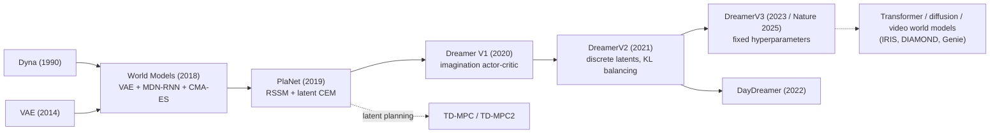

# World Models, PlaNet & Dreamer (V1–V3, RSSM)
> Learn a compact latent model of the environment from experience, then plan or train an actor-critic **inside the model's imagination**, touching the real environment only to collect more data. **Family:** Model-based → Learned latent world model → Learning/planning in imagination  ·  **Year / origin:** World Models: Ha & Schmidhuber 2018; PlaNet: Hafner et al., ICML 2019 (Google); Dreamer: Hafner et al., ICLR 2020; DreamerV2: ICLR 2021; DreamerV3: arXiv 2023, Nature 2025 (Hafner et al., Google DeepMind / Toronto)  ·  **On/Off-policy:** Off-policy for the world model (replay buffer); actor-critic is on-policy *in imagination*  ·  **Action space:** Continuous and discrete

## 1. What is it?

A **world model** is a learned simulator: given what the agent has seen and the action it takes, it predicts what comes next (observations, rewards, whether the episode ends). If the model is good, the agent can practice in it — "dream" — instead of the expensive real world, which can dramatically improve sample efficiency.

The line of work covered here:

- **World Models** (Ha & Schmidhuber, 2018): three separately trained parts — **V**, a VAE compressing each frame to a latent $z$; **M**, an MDN-RNN predicting the next $z$; and **C**, a tiny linear controller on $[z, h]$ trained by an evolution strategy (CMA-ES). They showed a controller could be trained *entirely inside the dream* (VizDoom) and transferred to the real game, and solved CarRacing from pixels.
- **PlaNet** (Hafner et al., 2019): introduced the **Recurrent State-Space Model (RSSM)** — a latent dynamics model with both a deterministic recurrent path and a stochastic latent — trained as a sequential VAE, and planned with **CEM in latent space** (no policy network). Strong pixel-based continuous control with far fewer environment steps than model-free agents of its time.
- **Dreamer (V1)** (Hafner et al., 2020): replaced online planning with an **actor-critic learned in imagination**: roll the RSSM forward for $H$ steps from real latent states, compute **$\lambda$-returns** with a learned value function, and train the actor by **backpropagating value gradients through the learned dynamics**.
- **DreamerV2** (2021): **discrete (categorical) latents** (32 variables × 32 classes) with straight-through gradients, **KL balancing**, and REINFORCE-style actor gradients for discrete actions; first world-model agent to reach human-level performance on the Atari 55-game benchmark (reported).
- **DreamerV3** (2023; Nature 2025): a single set of hyperparameters across >150 tasks (Atari, ProcGen, DMLab, DeepMind Control, Minecraft, …) via robustness tricks: **symlog** predictions, **two-hot** discrete regression for rewards/values, **free bits**, **percentile return normalization**, unimix categoricals. First algorithm reported to collect **diamonds in Minecraft from scratch** without human data or curricula.

Where it sits: model-based RL with a *reconstructive*, learned latent model (contrast with MuZero, whose model is trained only to predict reward/value/policy). The policy is learned by RL inside the model (Dyna-style, but with gradients through the model in V1).

**Emerging directions (brief):** **TD-MPC / TD-MPC2** (Hansen et al., 2022/2024) learn a decoder-free latent model and combine short-horizon MPPI planning with a learned terminal value, scaling to a single multi-task agent across many continuous-control tasks. Transformer/diffusion world models (**IRIS**, **DIAMOND**) and large **generative/video world models** — e.g. DeepMind's **Genie** (2024, learned interactive environments from unlabeled Internet video) and its successors announced in 2024–2025 — point toward world models as general-purpose, promptable simulators for training agents.

## 2. Family & lineage

- **Parents:** Dyna (Sutton, 1990/91: learn a model, train on simulated experience); VAEs (Kingma & Welling, 2014); recurrent latent-variable models (e.g., VRNN); Schmidhuber's early 1990s work on learning world models with RNNs for controllers.
- **Siblings:** MuZero (value-equivalent latent model + MCTS); SimPLe (video-prediction model for Atari, 2020); PETS/MBPO (state-space models for proprioceptive control); SLAC (stochastic latent actor-critic).
- **Descendants:** DayDreamer (Dreamer on real robots, 2022), DreamerV3, TD-MPC2, IRIS, DIAMOND, STORM and other transformer/diffusion world models; Genie-style generative interactive environments.



## 3. Core idea & intuition

**Compress, predict, imagine.** Raw observations (pixels) are huge and mostly irrelevant. The world model learns:
1. an **encoder** that turns each observation into a small latent,
2. a **dynamics** model that predicts the next latent from the current one and the action — *without* seeing the next observation,
3. **heads** that predict reward (and episode continuation), and a **decoder** to reconstruct the observation (this reconstruction is the main learning signal for the latent).

**Why both deterministic and stochastic state (RSSM)?** A purely deterministic RNN can't represent uncertainty about the future; a purely stochastic state-space model struggles to remember information over many steps. The RSSM uses a GRU state $h_t$ (reliable memory) plus a stochastic $z_t$ (captures uncertainty/multimodality). When observing, the **posterior** $q(z_t|h_t, o_t)$ uses the actual observation; when dreaming, the **prior** $p(z_t|h_t)$ must guess without it. The KL term between them trains the prior to predict what the posterior will see — which is exactly what makes dreaming possible.

**Learning behavior in imagination.** Start from latent states inferred from real data, roll the prior forward $H \approx 15$ steps using actions from the actor, predict rewards, and compute $\lambda$-returns bootstrapped by a critic. In Dreamer V1 (continuous control), the actor is improved by **backpropagating** the return through the differentiable model (an analytic policy gradient, low variance). In V2/V3 the actor uses REINFORCE-style gradients (necessary for discrete actions), with an entropy bonus.

**Why it's sample-efficient.** Each real transition trains the world model, and the world model generates thousands of imagined trajectories in parallel on accelerators. The agent "practices" far more than it "acts".

**Why DreamerV3 works with fixed hyperparameters.** Different domains have rewards from $10^{-3}$ to $10^{4}$. Symlog-transforming targets, two-hot regression, normalizing returns by their 5–95th percentile range, and free-bits KL make the losses scale-invariant, so one configuration fits all.

## 4. Math / formal details

Symbols: observation $x_t$ (the Dreamer papers' notation; $o_t$ in the code), action $a_t$, reward $r_t$, continue flag $c_t\in\{0,1\}$; deterministic state $h_t$, stochastic state $z_t$, model state $s_t = (h_t, z_t)$; world-model parameters $\phi$; actor $\pi_\theta(a|s)$; critic $v_\psi(s)$; imagination horizon $H$; discount $\gamma$; $\lambda$ for returns; $\mathrm{sg}(\cdot)$ = stop-gradient.

**RSSM:**
$$\begin{aligned}
\text{Recurrent model:}\quad & h_t = f_\phi(h_{t-1}, z_{t-1}, a_{t-1})\\
\text{Posterior (representation):}\quad & z_t \sim q_\phi(z_t \mid h_t, x_t)\\
\text{Prior (transition):}\quad & \hat z_t \sim p_\phi(\hat z_t \mid h_t)\\
\text{Decoder / reward / continue:}\quad & \hat x_t \sim p_\phi(\hat x_t\mid h_t, z_t),\ \ \hat r_t\sim p_\phi(\hat r_t\mid h_t,z_t),\ \ \hat c_t\sim p_\phi(\hat c_t\mid h_t,z_t)
\end{aligned}$$

**World-model loss** (negative ELBO, summed over a sequence of length $T$):
$$\mathcal L(\phi) = \mathbb E_{q_\phi}\Big[\sum_{t=1}^T \underbrace{-\ln p_\phi(x_t|s_t) - \ln p_\phi(r_t|s_t) - \ln p_\phi(c_t|s_t)}_{\text{prediction}} + \beta\, \underbrace{\mathrm{KL}\big(q_\phi(z_t|h_t,x_t)\,\|\,p_\phi(z_t|h_t)\big)}_{\text{dynamics/representation}}\Big].$$

**KL balancing** (V2): with $\alpha = 0.8$,
$$\mathrm{KL}_{\text{bal}} = \alpha\, \mathrm{KL}\big(\mathrm{sg}(q)\,\|\,p\big) + (1-\alpha)\,\mathrm{KL}\big(q\,\|\,\mathrm{sg}(p)\big),$$
i.e. train the prior toward the posterior faster than regularizing the posterior toward the prior. **DreamerV3** writes this as $\beta_{\text{dyn}}\max(1, \mathrm{KL}(\mathrm{sg}(q)\|p)) + \beta_{\text{rep}}\max(1, \mathrm{KL}(q\|\mathrm{sg}(p)))$ with $\beta_{\text{dyn}} = 0.5$, $\beta_{\text{rep}} = 0.1$ and **free bits** of 1 nat (the clip at 1).

**Imagination rollout:** from posterior starts $s_0$, for $\tau = 0..H-1$: $a_\tau\sim\pi_\theta(\cdot|s_\tau)$, $h_{\tau+1} = f_\phi(h_\tau, z_\tau, a_\tau)$, $z_{\tau+1}\sim p_\phi(\cdot|h_{\tau+1})$, $\hat r_{\tau+1}$, $\hat c_{\tau+1}$ from heads.

**$\lambda$-return:**
$$R^\lambda_\tau = \hat r_{\tau+1} + \gamma\, \hat c_{\tau+1}\Big[(1-\lambda)\, v_\psi(s_{\tau+1}) + \lambda R^\lambda_{\tau+1}\Big],\qquad R^\lambda_H = v_\psi(s_H).$$

**Critic:** $\mathcal L(\psi) = \mathbb E\big[\sum_\tau \tfrac12 (v_\psi(s_\tau) - \mathrm{sg}(R^\lambda_\tau))^2\big]$ (V3: two-hot cross-entropy on symlog targets, plus regularization toward an EMA critic).

**Actor:**
- V1 (dynamics backprop): $\mathcal L(\theta) = -\mathbb E\big[\sum_\tau R^\lambda_\tau\big]$ with gradients flowing through $a_\tau = $ reparameterized sample, the dynamics, reward head and critic.
- V2/V3 (REINFORCE + entropy), V3 form:
$$\mathcal L(\theta) = -\sum_\tau \mathrm{sg}\Big(\frac{R^\lambda_\tau - v_\psi(s_\tau)}{\max(1, S)}\Big)\log\pi_\theta(a_\tau|s_\tau) - \eta\, \mathcal H[\pi_\theta(\cdot|s_\tau)],$$
with $S = \mathrm{EMA}\big(\mathrm{Per}(R^\lambda, 95) - \mathrm{Per}(R^\lambda, 5)\big)$ and $\eta = 3\times10^{-4}$.

**Symlog & two-hot** (V3): $\mathrm{symlog}(x) = \mathrm{sign}(x)\ln(|x|+1)$, $\mathrm{symexp}$ its inverse. Rewards and values are predicted as categorical distributions over exponentially spaced bins; targets are "two-hot" encoded between the two nearest bins.

**World Models (2018) for comparison:** VAE $z_t = \text{Enc}(x_t)$; MDN-RNN $P(z_{t+1}\mid a_t, z_t, h_t)$ as a Gaussian mixture; controller $a_t = W_c[z_t; h_t] + b_c$ optimized with CMA-ES on (real or dreamed) episode returns; a temperature $\tau$ on the MDN makes the dream harder, reducing exploitation of model errors.

**PlaNet planning:** CEM over action sequences evaluated by summing predicted rewards over the latent rollout (no value function); plus "latent overshooting" (multi-step KL) as a regularizer.

## 5. Algorithm (pseudocode)

```text
Dreamer (V1/V2-style)
 1. Initialize replay D with S random seed episodes; init world model phi, actor theta, critic psi
 2. while not done:
 3.     for u = 1 .. U (update steps):
 4.         sample B sequences of length L from D: {(x_t, a_{t-1}, r_t, c_t)}
 5.         world-model learning:
 6.             filter with posterior: h_t = f(h_{t-1}, z_{t-1}, a_{t-1}); z_t ~ q(z_t | h_t, x_t)
 7.             loss = recon(x_t) + reward(r_t) + continue(c_t) + beta * KL_balanced(q || p)
 8.             update phi
 9.         behavior learning in imagination (no real env!):
10.             start states s_0 <- sg(all posterior states from step 6)
11.             for tau = 0..H-1: a_tau ~ pi(s_tau); s_{tau+1} from PRIOR; predict r, c
12.             compute lambda-returns R^lambda_tau using critic (or slow target critic)
13.             update actor: maximize R^lambda (dynamics backprop)  or  REINFORCE + entropy
14.             update critic: regress v(s_tau) -> sg(R^lambda_tau)
15.         periodically update target critic
16.     environment interaction:
17.         run the actor in the real env; at each step update (h_t, z_t) with the POSTERIOR
18.         from the new observation; add the episode to D
```

## 6. Python implementation

Runnable version: [`code/world-models-dreamer.py`](../../code/world-models-dreamer.py)

A simplified, faithful-in-spirit Dreamer on a toy continuous-control task: a 2-D point mass must be driven to the origin (reward = −distance, noisy observations of position/velocity, 50-step episodes). It implements an RSSM (GRU deterministic path + Gaussian stochastic latent, prior and posterior), a world-model loss with reconstruction + reward + KL balancing + free nats, imagination rollouts from posterior states, $\lambda$-returns, an actor trained by **backprop through the learned dynamics** (V1 style), a critic with a periodically-copied target, and online latent filtering when acting. Simplifications: vector observations (no CNN), Gaussian latents (V1-style), no continue head (no terminations), tiny networks, imagination starts subsampled for CPU speed.

Tested output (≈70 s CPU):

```text
random policy return   -59.3 | hand-tuned PD controller   -13.2
episode   3 | real return   -80.3 | recon 0.0644 rew-err 0.0265 KL 0.96 | mean dreamed reward -1.260 |  12.9s
episode   6 | real return  -100.9 | recon 0.0872 rew-err 0.0441 KL 1.00 | mean dreamed reward -1.141 |  24.7s
episode   9 | real return   -30.5 | recon 0.0713 rew-err 0.0295 KL 1.09 | mean dreamed reward -1.273 |  37.8s
episode  12 | real return   -11.1 | recon 0.0420 rew-err 0.0230 KL 0.95 | mean dreamed reward -1.016 |  51.7s
episode  15 | real return   -16.9 | recon 0.0341 rew-err 0.0204 KL 0.98 | mean dreamed reward -0.858 |  66.8s
Dreamer-style agent (eval) return   -11.6   vs random -59.3, PD -13.2
open-loop dream vs reality (rewards, steps 5..19):
  dreamed: -1.21 -1.10 -0.99 -0.89 -0.80 -0.73 -0.67 -0.62 -0.58 -0.54 -0.52 -0.50 -0.48 -0.47 -0.45
  real   : -1.35 -1.22 -1.07 -0.92 -0.76 -0.62 -0.51 -0.42 -0.35 -0.29 -0.25 -0.22 -0.19 -0.17 -0.15
```

With only 20 real episodes (1,000 real steps), the agent matches a hand-tuned PD controller. The open-loop dream shows the expected behaviour of learned models: accurate for a few steps, then drifting — the reason Dreamer imagines only $H\approx15$ steps and relies on a value function beyond that.

```python
"""A simplified Dreamer (Hafner et al.): RSSM world model + actor-critic trained purely in imagination.

Toy env: a 2-D point mass that must be driven to the origin (continuous actions).
What is kept from Dreamer V1/V2:
  * RSSM: deterministic GRU path h_t + stochastic Gaussian latent z_t (prior p(z|h), posterior q(z|h,o))
  * world-model loss = reconstruction + reward prediction + KL(posterior || prior) with free nats
    and KL balancing (V2)
  * actor-critic trained on H-step latent "dreams", lambda-returns, actor gradients backpropagated
    through the learned dynamics (V1 style, continuous actions), slow target critic
Simplified: vector observations (no CNN), Gaussian (not categorical) latents, no continue head
(the env never terminates), tiny networks.  numpy + torch, ~1-2 minutes on CPU.
    python3 code/world-models-dreamer.py
"""
import copy
import time

import numpy as np
import torch
import torch.nn as nn
import torch.nn.functional as F
from torch.distributions import Normal, kl_divergence

torch.set_num_threads(1)
np.random.seed(0)
torch.manual_seed(0)


# ----------------------------------------------------------------------------------------------
# 1. Environment: point mass in 2-D, reward = -distance to origin
# ----------------------------------------------------------------------------------------------
class PointMass:
    obs_dim, act_dim, horizon = 4, 2, 50

    def __init__(self, seed=0):
        self.rng = np.random.default_rng(seed)

    def reset(self):
        self.p = self.rng.uniform(-1.5, 1.5, size=2)
        self.v = np.zeros(2)
        self.t = 0
        return self._obs()

    def _obs(self):  # slightly noisy observation of position & velocity
        return (np.concatenate([self.p, self.v]) + 0.01 * self.rng.standard_normal(4)).astype(np.float32)

    def step(self, a):
        a = np.clip(a, -1, 1)
        self.v = 0.9 * self.v + 0.1 * a                       # damped acceleration
        self.p = np.clip(self.p + 0.2 * self.v, -2, 2)
        self.t += 1
        reward = -np.linalg.norm(self.p) - 0.01 * np.sum(a ** 2)
        return self._obs(), float(reward), False, self.t >= self.horizon


# ----------------------------------------------------------------------------------------------
# 2. RSSM world model
# ----------------------------------------------------------------------------------------------
H_DIM, Z_DIM, HID = 64, 8, 128


def mlp(inp, out, hid=HID):
    return nn.Sequential(nn.Linear(inp, hid), nn.ELU(), nn.Linear(hid, hid), nn.ELU(), nn.Linear(hid, out))


class RSSM(nn.Module):
    def __init__(self, obs_dim, act_dim):
        super().__init__()
        self.encoder = mlp(obs_dim, HID)
        self.inp = nn.Linear(Z_DIM + act_dim, HID)
        self.gru = nn.GRUCell(HID, H_DIM)                     # deterministic path  h_t = f(h_{t-1}, z_{t-1}, a_{t-1})
        self.prior_net = mlp(H_DIM, 2 * Z_DIM)                # p(z_t | h_t)          -- used when dreaming
        self.post_net = mlp(H_DIM + HID, 2 * Z_DIM)           # q(z_t | h_t, o_t)     -- used when observing
        self.decoder = mlp(H_DIM + Z_DIM, obs_dim)            # p(o_t | h_t, z_t)
        self.reward = mlp(H_DIM + Z_DIM, 1)                   # p(r_t | h_t, z_t)

    @staticmethod
    def _dist(x):
        mean, std = x.chunk(2, -1)
        return Normal(mean, F.softplus(std) + 0.1)

    def initial(self, batch):
        return torch.zeros(batch, H_DIM), torch.zeros(batch, Z_DIM)

    def img_step(self, h, z, a):
        """One step of the latent dynamics WITHOUT an observation (the 'dream' step)."""
        h = self.gru(F.elu(self.inp(torch.cat([z, a], -1))), h)
        prior = self._dist(self.prior_net(h))
        return h, prior

    def obs_step(self, h, z, a, obs):
        """One filtering step WITH an observation: prior from the dynamics, posterior corrected by o_t."""
        h, prior = self.img_step(h, z, a)
        post = self._dist(self.post_net(torch.cat([h, self.encoder(obs)], -1)))
        return h, prior, post

    def observe(self, obs, act):
        """obs: (B, L, obs_dim), act: (B, L, act_dim) where act[:, t] is the action taken BEFORE obs[:, t]."""
        B, L, _ = obs.shape
        h, z = self.initial(B)
        hs, zs, priors_m, priors_s, posts_m, posts_s = [], [], [], [], [], []
        for t in range(L):
            h, prior, post = self.obs_step(h, z, act[:, t], obs[:, t])
            z = post.rsample()
            hs.append(h); zs.append(z)
            priors_m.append(prior.mean); priors_s.append(prior.stddev)
            posts_m.append(post.mean); posts_s.append(post.stddev)
        st = lambda xs: torch.stack(xs, 1)
        return st(hs), st(zs), Normal(st(priors_m), st(priors_s)), Normal(st(posts_m), st(posts_s))


def world_model_loss(wm, obs, act, rew, free_nats=1.0, kl_balance=0.8, kl_scale=1.0):
    h, z, prior, post = wm.observe(obs, act)
    feat = torch.cat([h, z], -1)
    recon = F.mse_loss(wm.decoder(feat), obs, reduction="none").sum(-1).mean()
    reward = F.mse_loss(wm.reward(feat).squeeze(-1), rew)
    # KL balancing (DreamerV2): train the prior toward the posterior faster than the reverse
    sg = lambda d: Normal(d.mean.detach(), d.stddev.detach())
    kl_prior = kl_divergence(sg(post), prior).sum(-1).mean()
    kl_post = kl_divergence(post, sg(prior)).sum(-1).mean()
    kl = kl_balance * torch.clamp(kl_prior, min=free_nats) + (1 - kl_balance) * torch.clamp(kl_post, min=free_nats)
    return recon + reward + kl_scale * kl, (h.detach(), z.detach()), dict(recon=recon.item(), rew=reward.item(),
                                                                           kl=kl_prior.item())


# ----------------------------------------------------------------------------------------------
# 3. Actor and critic operating on latent features [h, z]
# ----------------------------------------------------------------------------------------------
class Actor(nn.Module):
    def __init__(self, act_dim):
        super().__init__()
        self.net = mlp(H_DIM + Z_DIM, 2 * act_dim)

    def forward(self, feat, deterministic=False):
        mean, std = self.net(feat).chunk(2, -1)
        std = F.softplus(std) + 0.05
        u = mean if deterministic else mean + std * torch.randn_like(mean)   # reparameterized
        ent = Normal(mean, std).entropy().sum(-1)                            # pre-tanh entropy (bonus)
        return torch.tanh(u), ent


def lambda_returns(rewards, values, gamma=0.95, lam=0.95):
    """rewards: (H, N) for steps 1..H; values: (H+1, N) for states 0..H.
    R^lambda_t = r_{t+1} + gamma * ((1 - lam) * V(s_{t+1}) + lam * R^lambda_{t+1}),  R^lambda_H = V(s_H)."""
    H = rewards.shape[0]
    ret, out = values[-1], []
    for t in reversed(range(H)):
        ret = rewards[t] + gamma * ((1 - lam) * values[t + 1] + lam * ret)
        out.append(ret)
    return torch.stack(out[::-1])           # (H, N): returns for states 0..H-1


def imagine_and_learn(wm, actor, critic, critic_t, opt_actor, opt_critic, start, horizon=12, ent_coef=1e-3,
                      n_starts=256):
    h, z = [x.reshape(-1, x.shape[-1]) for x in start]       # posterior states become dream starts
    idx = torch.randperm(h.shape[0])[:n_starts]              # (subsampled to keep the CPU demo fast)
    h, z = h[idx], z[idx]
    feats, rews = [torch.cat([h, z], -1)], []
    for _ in range(horizon):
        a, _ = actor(feats[-1])
        h, prior = wm.img_step(h, z, a)
        z = prior.rsample()                                  # dream with the PRIOR (no observations)
        f = torch.cat([h, z], -1)
        feats.append(f)
        rews.append(wm.reward(f).squeeze(-1))
    feats, rews = torch.stack(feats), torch.stack(rews)      # (H+1, N, F), (H, N)
    values = critic_t(feats).squeeze(-1)
    returns = lambda_returns(rews, values)
    _, ent = actor(feats[:-1].detach())
    # actor: maximize lambda-returns by backpropagating THROUGH the learned dynamics and reward model
    actor_loss = -returns.mean() - ent_coef * ent.mean()
    opt_actor.zero_grad()
    actor_loss.backward()
    nn.utils.clip_grad_norm_(actor.parameters(), 100.0)
    opt_actor.step()
    # critic: regress V(s_t) on the (detached) lambda-returns
    critic_loss = 0.5 * (critic(feats[:-1].detach()).squeeze(-1) - returns.detach()).pow(2).mean()
    opt_critic.zero_grad()
    critic_loss.backward()
    opt_critic.step()
    return actor_loss.item(), critic_loss.item(), rews.mean().item()


# ----------------------------------------------------------------------------------------------
# 4. Acting in the real env: filter the latent state online with the posterior
# ----------------------------------------------------------------------------------------------
@torch.no_grad()
def run_episode(env, wm, actor, mode="explore"):
    obs, ep = env.reset(), {"obs": [], "act": [], "rew": []}
    h, z = wm.initial(1)
    a_prev = torch.zeros(1, env.act_dim)
    ret = 0.0
    while True:
        h, _, post = wm.obs_step(h, z, a_prev, torch.as_tensor(obs)[None])
        z = post.mean if mode == "eval" else post.sample()
        if mode == "random":
            a = torch.as_tensor(np.random.uniform(-1, 1, size=(1, env.act_dim)), dtype=torch.float32)
        else:
            a, _ = actor(torch.cat([h, z], -1), deterministic=(mode == "eval"))
        # store (o_t, a_{t-1}, r_t) aligned so that act[t] is the action that LED to obs[t]
        ep["obs"].append(obs); ep["act"].append(a_prev[0].numpy()); ep["rew"].append(0.0 if not ep["rew"] else r)
        obs, r, term, trunc = env.step(a[0].numpy())
        ret += r
        a_prev = a
        if term or trunc:
            break
    ep = {k: np.array(v, np.float32) for k, v in ep.items()}
    return ep, ret


def sample_batch(episodes, B=32, L=20):
    o, a, r = [], [], []
    for _ in range(B):
        ep = episodes[np.random.randint(len(episodes))]
        t = np.random.randint(0, len(ep["obs"]) - L + 1)
        o.append(ep["obs"][t:t + L]); a.append(ep["act"][t:t + L]); r.append(ep["rew"][t:t + L])
    return [torch.as_tensor(np.array(x)) for x in (o, a, r)]


def main(seed_episodes=5, train_episodes=15, updates_per_episode=30):
    env = PointMass(0)
    wm, actor = RSSM(env.obs_dim, env.act_dim), Actor(env.act_dim)
    critic = mlp(H_DIM + Z_DIM, 1)
    critic_t = copy.deepcopy(critic)
    opt_wm = torch.optim.Adam(wm.parameters(), lr=1e-3)
    opt_actor = torch.optim.Adam(actor.parameters(), lr=3e-4)
    opt_critic = torch.optim.Adam(critic.parameters(), lr=3e-4)

    episodes = [run_episode(env, wm, actor, mode="random")[0] for _ in range(seed_episodes)]
    rand_ret = np.mean([run_episode(env, wm, actor, mode="random")[1] for _ in range(10)])
    pd_env = PointMass(123)                    # hand-designed PD controller as a reference ceiling
    pd_rets = []
    for _ in range(10):
        o, ret = pd_env.reset(), 0.0
        for _ in range(pd_env.horizon):
            o, r, _, _ = pd_env.step(np.clip(-2.0 * o[:2] - 3.0 * o[2:], -1, 1))
            ret += r
        pd_rets.append(ret)
    print(f"random policy return {rand_ret:7.1f} | hand-tuned PD controller {np.mean(pd_rets):7.1f}")

    t0, it = time.time(), 0
    for ep_i in range(1, train_episodes + 1):
        for _ in range(updates_per_episode):
            obs, act, rew = sample_batch(episodes)
            loss, start, info = world_model_loss(wm, obs, act, rew)
            opt_wm.zero_grad()
            loss.backward()
            nn.utils.clip_grad_norm_(wm.parameters(), 100.0)
            opt_wm.step()
            _, _, dream_r = imagine_and_learn(wm, actor, critic, critic_t, opt_actor, opt_critic, start)
            it += 1
            if it % 20 == 0:   # hard-ish target critic update (Dreamer V2 uses periodic copies)
                critic_t.load_state_dict(critic.state_dict())
        ep, ret = run_episode(env, wm, actor, mode="explore")
        episodes.append(ep)
        if ep_i % 3 == 0:
            print(f"episode {ep_i:3d} | real return {ret:7.1f} | recon {info['recon']:.4f} rew-err {info['rew']:.4f} "
                  f"KL {info['kl']:.2f} | mean dreamed reward {dream_r:6.3f} | {time.time() - t0:5.1f}s")
    eval_ret = np.mean([run_episode(env, wm, actor, mode="eval")[1] for _ in range(10)])
    print(f"Dreamer-style agent (eval) return {eval_ret:7.1f}   vs random {rand_ret:.1f}, PD {np.mean(pd_rets):.1f}")

    # open-loop imagination check: observe 5 real steps, then dream 15 steps and compare predicted rewards
    ep, _ = run_episode(env, wm, actor, mode="eval")
    with torch.no_grad():
        o, a = torch.as_tensor(ep["obs"][None, :5]), torch.as_tensor(ep["act"][None, :5])
        h, z, _, post = wm.observe(o, a)
        h, z = h[:, -1], post.mean[:, -1]
        pred = []
        for t in range(5, 20):
            h, prior = wm.img_step(h, z, torch.as_tensor(ep["act"][None, t]))
            z = prior.mean
            pred.append(wm.reward(torch.cat([h, z], -1)).item())
    print("open-loop dream vs reality (rewards, steps 5..19):")
    print("  dreamed: " + " ".join(f"{x:5.2f}" for x in pred))
    print("  real   : " + " ".join(f"{x:5.2f}" for x in ep["rew"][5:20]))


if __name__ == "__main__":
    main()
```

## 7. Practical tips & hyperparameters

| Setting | DreamerV2/V3 (reported defaults) | Toy script |
|---|---|---|
| Sequence batch $B\times L$ | 16 × 50–64 | 32 × 20 |
| Imagination horizon $H$ | 15 | 12 |
| $\gamma$, $\lambda$ | ≈0.99–0.997 (V3: $\gamma = 1 - 1/333$), 0.95 | 0.95, 0.95 |
| Latent | V2/V3: 32 categoricals × 32 classes; deterministic GRU (size grows with model scale) | Gaussian 8-d + GRU 64 |
| KL | V2: balance 0.8; V3: $\beta_{\text{dyn}}=0.5$, $\beta_{\text{rep}}=0.1$, free bits 1 | balance 0.8, free nats 1 |
| Actor entropy $\eta$ | V3: $3\times10^{-4}$ | $10^{-3}$ |
| Train ratio (replayed steps per env step) | task-dependent (V3 scales it as a knob) | ~40 updates / 50-step episode |

Tips:
- **Free bits / free nats** prevent the KL from collapsing the posterior to the prior early in training (posterior collapse → useless latents).
- **KL balancing** matters: without it the posterior is pulled toward a poor prior and representation suffers.
- **Reward head accuracy** is the key diagnostic: if imagined rewards don't track real ones, behavior learning optimizes nonsense. Plot open-loop predictions vs reality (as the script does).
- **Start imagination from all posterior states** in the batch (sg'd) — cheap and diverse.
- **Model exploitation**: the actor can find actions where the model is wrong (overly optimistic). Short horizons, stochastic latents, and continued real-data collection mitigate it.
- **Pixel tasks**: reconstruction can waste capacity on irrelevant details (backgrounds); decoder-free alternatives (TD-MPC2, MuZero-like) or contrastive objectives help in distracting environments.
- **Use symlog/two-hot** (V3) when reward scales vary or are unknown.
- **Real robots** (DayDreamer): Dreamer learned quadruped walking from scratch in about an hour of real-world interaction (reported), thanks to its sample efficiency.

## 8. Pros and cons

**Pros**
- Very sample-efficient: most learning happens in imagination.
- Works from pixels; handles partial observability via the recurrent latent state.
- DreamerV3: one hyperparameter set across many domains; strong results from Atari to Minecraft.
- The learned model is reusable (multi-task, exploration via model disagreement, e.g. Plan2Explore) and inspectable (decode predictions to images).
- Imagination is massively parallel on accelerators.

**Cons**
- Complex system with many interacting losses; implementation details matter.
- Compounding model error limits imagination horizon; the actor can exploit model errors.
- Reconstruction objective spends capacity on task-irrelevant details.
- Wall-clock per environment step is higher than for model-free methods (large model updates).
- Less mature than PPO/SAC in industrial tooling.

## 9. When to use / when not to use

**Use when**
- Environment interaction is expensive or slow (robots, complex simulators) and sample efficiency matters.
- Observations are high-dimensional (images) and partially observable.
- You want one robust configuration across diverse tasks (DreamerV3), or a reusable model for multiple tasks / exploration.

**Avoid when**
- Simulation is very cheap and massively parallel → model-free PPO may be simpler and faster in wall-clock.
- Precise long-horizon prediction is required with no tolerance for model error (safety-critical open-loop plans).
- Exact rules are known and look-ahead is key → AlphaZero/MCTS.
- Low-dimensional proprioceptive control with tight compute → SAC/TD3, MBPO, TD-MPC2.

## 10. Key papers, books & repos

- D. Ha, J. Schmidhuber. *World Models.* arXiv:1803.10122 (2018); *Recurrent World Models Facilitate Policy Evolution.* NeurIPS 2018.
- D. Hafner, T. Lillicrap, I. Fischer, R. Villegas, D. Ha, H. Lee, J. Davidson. *Learning Latent Dynamics for Planning from Pixels (PlaNet).* ICML 2019.
- D. Hafner, T. Lillicrap, J. Ba, M. Norouzi. *Dream to Control: Learning Behaviors by Latent Imagination (Dreamer).* ICLR 2020.
- D. Hafner, T. Lillicrap, M. Norouzi, J. Ba. *Mastering Atari with Discrete World Models (DreamerV2).* ICLR 2021.
- D. Hafner, J. Pasukonis, J. Ba, T. Lillicrap. *Mastering Diverse Domains through World Models (DreamerV3).* arXiv:2301.04104 (2023); published in Nature (2025).
- P. Wu, A. Escontrela, D. Hafner, K. Goldberg, P. Abbeel. *DayDreamer: World Models for Physical Robot Learning.* CoRL 2022.
- N. Hansen, X. Wang, H. Su. *Temporal Difference Learning for Model Predictive Control (TD-MPC).* ICML 2022; N. Hansen, H. Su, X. Wang. *TD-MPC2: Scalable, Robust World Models for Continuous Control.* ICLR 2024.
- V. Micheli, E. Alonso, F. Fleuret. *Transformers are Sample-Efficient World Models (IRIS).* ICLR 2023; E. Alonso et al. *Diffusion for World Modeling: Visual Details Matter in Atari (DIAMOND).* NeurIPS 2024.
- J. Bruce et al. *Genie: Generative Interactive Environments.* ICML 2024.
- Ł. Kaiser et al. *Model-Based Reinforcement Learning for Atari (SimPLe).* ICLR 2020.
- R. S. Sutton. *Dyna, an Integrated Architecture for Learning, Planning, and Reacting.* SIGART Bulletin, 1991.
- R. S. Sutton & A. G. Barto, *Reinforcement Learning: An Introduction*, 2nd ed., 2018 — Ch. 8 (Planning and Learning with Tabular Methods: models, Dyna, simulated experience), Ch. 12 (eligibility traces and the λ-return), §17.3 (observations and state).
- Repos: [danijar/dreamerv3](https://github.com/danijar/dreamerv3), [danijar/dreamerv2](https://github.com/danijar/dreamerv2), [google-research/planet](https://github.com/google-research/planet), [nicklashansen/tdmpc2](https://github.com/nicklashansen/tdmpc2), [eloialonso/iris](https://github.com/eloialonso/iris), [eloialonso/diamond](https://github.com/eloialonso/diamond).

## 11. For business users

**What it does.** A world-model agent first learns a "mental simulator" of its environment from experience — how things move, what earns reward — and then practises inside that simulator, like a flight-simulator for itself. It only goes back to the real world to gather more experience and correct its simulator.

**Business analogy.** A company builds a digital twin of its warehouse from sensor data, then tests thousands of new operating strategies on the twin overnight, deploying only the most promising ones on the real floor and using the results to improve the twin.

**Real-world use cases.** Robot learning with limited real-world time (legged robots, manipulators), game-playing agents (Atari, Minecraft), autonomous-driving research using learned simulators, and emerging "generative world models" that turn video into interactive environments for training and testing agents.

**Value / ROI.** Large reduction in costly real-world trials (robot wear, downtime, safety risk); one learned model can support multiple tasks; general-purpose configurations (DreamerV3) reduce tuning effort.

**Risks.** The agent can exploit flaws in its own simulator ("it works in the dream but not in reality"); long-range predictions drift; complex to engineer and validate.

**Costs.** GPU training (models plus large numbers of imagined rollouts); data-collection infrastructure; validation on real systems. Usually cheaper in real-world interaction, more expensive in compute than simple model-free methods.

**Questions to ask your team.**
- How accurate is the learned simulator a few steps ahead on real held-out data?
- How do we detect the agent exploiting simulator errors before deployment?
- How much real-world interaction did we save versus a model-free baseline?
- Can the learned world model be reused for other tasks we care about?

## 12. For kids (ages ~8–12)

**Practising in your dreams.** Have you ever imagined kicking a football before a game — the run-up, the kick, the ball flying into the goal? Your brain is a little "world simulator": it has learned how balls fly and how your legs move, so you can practise in your head. A Dreamer robot does the same: it plays for real for a bit, learns how its world works, then practises thousands of times in its imagination. Then it plays for real again and gets better, and fixes the parts of its daydream that were wrong.

**Try it yourself.** Toss a soft ball into a basket 5 times and remember how it felt. Now close your eyes and imagine 10 throws, making each one better in your head. Then throw 5 more for real. Did imagining help? Notice where your "imagination" was a bit wrong!

**Recap.**
1. Learn how the world works from real tries.
2. Practise a lot in your imagination.
3. Go back to the real world to check and fix your imagination.

## 13. Related methods

- [MuZero — latent model trained only for planning-relevant predictions](./muzero.md)
- [MBPO / PETS — learned dynamics + short rollouts or MPC](./mbpo-pets.md)
- [MCTS & AlphaZero — planning with a known simulator](./mcts-alphazero.md)
- [Dyna-Q — the tabular ancestor: learn a model, practise on simulated experience](../01-foundations-tabular/dyna-q.md)
- [TD learning and λ-returns](../01-foundations-tabular/td-learning.md)
- [Actor-critic (A2C/A3C)](../03-policy-gradient/actor-critic-a2c-a3c.md)
- [SAC — model-free continuous-control baseline](../04-off-policy-actor-critic/sac.md)
- [Curiosity (ICM/RND) — prediction-error-based exploration related to world models](../08-exploration-hierarchical-multiagent/curiosity-icm-rnd.md)
- [Evolution strategies — how the 2018 World Models controller was trained](../08-exploration-hierarchical-multiagent/evolution-strategies.md)

[← Back to overview](../../RL_Methods_Overview.md)
