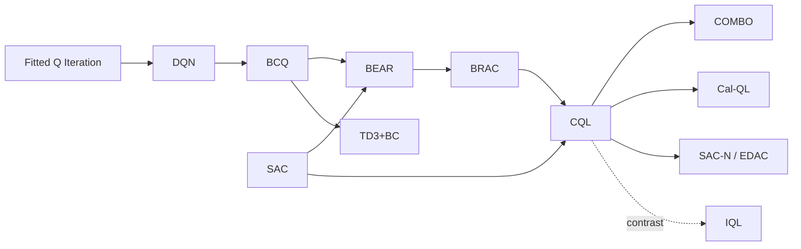

# Conservative Q-Learning (CQL) and the Offline RL Problem (BCQ, BEAR)
> Learn a Q-function from a fixed dataset that deliberately *under*-estimates the value of actions the data never tried, so the learned policy stays where the data can vouch for it. **Family:** Model-free → Value-based / Actor-critic → Offline (batch) RL → Value regularization  ·  **Year / origin:** Kumar, Zhou, Tucker & Levine, NeurIPS 2020 (UC Berkeley / Google Brain)  ·  **On/Off-policy:** Offline (fully off-policy, no environment interaction during training)  ·  **Action space:** Discrete (CQL-DQN / QR-DQN) and continuous (CQL-SAC)

---

## 1. What is it?

**Offline RL** (also called *batch RL*) asks: given a fixed dataset $\mathcal{D}=\{(s,a,r,s')\}$ collected by some unknown *behavior policy* $\pi_\beta$ (humans, older controllers, a mix of scripts), learn the best possible policy **without ever interacting with the environment**. This is the setting of healthcare, robotics from logs, recommender systems, autonomous driving fleets and industrial control — anywhere exploration is expensive or dangerous but logs are plentiful.

The naive approach is to run an off-policy algorithm (DQN, SAC, TD3) on the static dataset. It usually **fails badly**, and the reason is specific:

* **Distribution shift.** The learned policy $\pi$ differs from $\pi_\beta$. The Bellman target $r + \gamma \max_{a'} Q(s',a')$ queries $Q$ at actions $a'$ that may *never appear* in the data for state $s'$.
* **Extrapolation error** (Fujimoto et al., 2019). For such *out-of-distribution* (OOD) actions, the network's value is pure extrapolation. Some will be erroneously high. The $\max$ (or the actor's gradient ascent on $Q$) *selects exactly those errors*, and bootstrapping propagates them backwards through the whole value function. In online RL the agent would try the action, be disappointed, and correct the estimate. Offline, nothing ever corrects it.

Two broad families of fixes:

1. **Policy constraints** — keep $\pi$ close to $\pi_\beta$: BCQ (only consider actions a generative model of the data finds likely), BEAR (constrain the policy's *support* via MMD), BRAC (KL/MMD penalties), TD3+BC (add a BC term to the actor loss).
2. **Value regularization / pessimism** — make $Q$ itself pessimistic on OOD actions: **CQL**, and in a different way IQL (which avoids querying OOD actions at all; see [IQL](iql.md)).

**CQL** adds a simple regularizer to the ordinary Bellman error: *push down* $Q$ on actions sampled from a broad distribution (or on all actions via log-sum-exp) and *push up* $Q$ on actions that are in the dataset. The paper shows that, with a large enough weight $\alpha$, the resulting value function lower-bounds the true value of the policy (in expectation), which protects against over-optimistic extrapolation. It was a big step over BEAR/BRAC on the D4RL benchmark, especially on the harder, multi-modal datasets (AntMaze, Kitchen, Adroit), and it remains one of the standard offline RL baselines.

## 2. Family & lineage

* **Parents:** Q-learning / DQN ([dqn](../02-deep-value-based/dqn.md)), SAC ([sac](../04-off-policy-actor-critic/sac.md)), fitted Q iteration (Ernst et al., 2005), and the "deadly triad" analysis of off-policy bootstrapping (Sutton & Barto Ch. 11).
* **Siblings (2019–2021):** BCQ (Fujimoto, Meger & Precup, 2019), BEAR (Kumar et al., 2019), BRAC (Wu, Tucker & Nachum, 2019), AWR/AWAC (advantage-weighted regression), CRR (Wang et al., 2020), TD3+BC (Fujimoto & Gu, 2021), model-based MOPO/MOReL (2020).
* **Descendants:** COMBO (model-based CQL, Yu et al. 2021), Cal-QL (calibrated CQL for offline-to-online fine-tuning, Nakamoto et al. 2023), IQL (in-sample learning), ensemble pessimism (EDAC / SAC-N, An et al. 2021), and pessimism ideas in offline RL for language models.



## 3. Core idea & intuition

Picture the Q-network as a landscape over actions for every state. The dataset pins the landscape down only at the actions it contains; elsewhere the landscape is free to bulge up. Q-learning climbs to the highest point — so it ends up on an unsupported bulge.

CQL's fix is to **press the whole landscape down, then lift it back up only where there is data**:

* $\log\sum_a \exp Q(s,a)$ is a "soft maximum" over all actions. Minimizing it pushes hardest on whatever action currently has the largest Q — precisely the dangerous bulges.
* $-\,Q(s,a_{\text{data}})$ lifts the actions that were actually taken, so the data's own actions are not penalized.
* The Bellman error keeps the in-distribution values consistent with observed rewards.

The net effect: actions the data never took look worse than they probably are, so the greedy policy prefers actions the data supports, but it may still *choose among* those supported actions better than the behavior policy did. That is how CQL improves over behavior cloning on mixed-quality data while remaining safe.

A useful mental model: **CQL = Q-learning + a classifier-like term that says "data actions good, everything else suspicious"**. When $\alpha \to 0$ you recover (unstable) offline DQN; when $\alpha \to \infty$ the Q-function is dominated by the regularizer and the greedy policy approaches behavior cloning.

## 4. Math / formal details

**Setting.** MDP $(\mathcal{S},\mathcal{A},P,r,\gamma)$; dataset $\mathcal{D}$ of transitions from behavior policy $\pi_\beta$; $\hat{\mathcal{B}}^\pi$ is the empirical Bellman operator, $\hat{\mathcal{B}}^\pi \hat Q(s,a) = r + \gamma\, \mathbb{E}_{a'\sim\pi(\cdot|s')}[\hat Q(s',a')]$ with $(s,a,r,s')\sim\mathcal{D}$.

**Standard (offline) policy evaluation step.**
$$\hat Q^{k+1} \leftarrow \arg\min_Q \; \tfrac12\, \mathbb{E}_{(s,a,s')\sim\mathcal{D}}\Big[\big(Q(s,a) - \hat{\mathcal{B}}^{\pi}\hat Q^{k}(s,a)\big)^2\Big].$$

**CQL evaluation step** (Kumar et al., 2020, Eq. 2): with a distribution $\mu(a|s)$ over actions,
$$\hat Q^{k+1} \leftarrow \arg\min_Q\; \alpha\Big(\mathbb{E}_{s\sim\mathcal{D},a\sim\mu}[Q(s,a)] - \mathbb{E}_{(s,a)\sim\mathcal{D}}[Q(s,a)]\Big) + \tfrac12\,\mathbb{E}_{\mathcal{D}}\Big[\big(Q - \hat{\mathcal{B}}^{\pi}\hat Q^{k}\big)^2\Big].$$
* With only the first (push-down) term, the paper shows the fixed point is a **pointwise lower bound** on $Q^\pi$ for large enough $\alpha$.
* With the push-up term on dataset actions, pointwise bounds are lost but the **expected value** $\hat V^\pi(s)=\mathbb{E}_{\pi}[\hat Q(s,a)]$ is a lower bound on $V^\pi(s)$ when $\mu=\pi$ (Theorem 3.2 of the paper, under their sampling-error assumptions). This is tighter.

**CQL as policy optimization.** Instead of alternating evaluation and improvement, choose $\mu$ to maximize the regularizer (adversarially), plus a regularizer $\mathcal{R}(\mu)$:
$$\min_Q \max_\mu\; \alpha\Big(\mathbb{E}_{s\sim\mathcal{D},a\sim\mu}[Q(s,a)] - \mathbb{E}_{\mathcal{D}}[Q(s,a)]\Big) + \tfrac12\mathbb{E}_{\mathcal{D}}\big[(Q - \hat{\mathcal{B}}^{\pi_k}\hat Q^k)^2\big] + \mathcal{R}(\mu).$$
Choosing $\mathcal{R}(\mu)=\mathcal{H}(\mu)$ (entropy) gives $\mu(a|s)\propto \exp Q(s,a)$ and the closed form **CQL(H)**:
$$\boxed{\mathcal{L}_{\text{CQL(H)}}(Q) = \alpha\,\mathbb{E}_{s\sim\mathcal{D}}\Big[\log\sum_a \exp Q(s,a) - \mathbb{E}_{a\sim\hat\pi_\beta(\cdot|s)}[Q(s,a)]\Big] + \tfrac12\,\mathbb{E}_{\mathcal{D}}\big[(Q(s,a) - \hat{\mathcal{B}}^{\pi}\hat Q^k(s,a))^2\big]}$$
Choosing $\mathcal{R}(\mu) = -D_{\mathrm{KL}}(\mu\,\|\,\rho)$ for a prior $\rho$ (e.g., the previous policy) gives **CQL($\rho$)**, which weights the push-down by $\rho(a|s)\exp Q(s,a)$.

**Continuous actions.** $\log\int\exp Q(s,a)\,da$ is estimated by importance sampling with $N$ actions from a uniform distribution and $N$ from the current policy at $s$ and $s'$:
$$\log\sum_a e^{Q(s,a)} \approx \log\Big(\tfrac{1}{2N}\sum_{a_i\sim\text{Unif}}\tfrac{e^{Q(s,a_i)}}{\text{Unif}(a_i)} + \tfrac{1}{2N}\sum_{a_i\sim\pi}\tfrac{e^{Q(s,a_i)}}{\pi(a_i|s)}\Big).$$
The actor is updated as in SAC: $\max_\phi \mathbb{E}_{s\sim\mathcal{D},a\sim\pi_\phi}[\min_j Q_j(s,a) - \alpha_{\text{ent}}\log\pi_\phi(a|s)]$.

**Lagrangian (auto-tuned) $\alpha$.** Pick a target gap $\tau$ and solve
$$\min_Q\max_{\alpha\ge0}\; \alpha\big(\mathbb{E}_s[\log\textstyle\sum_a e^{Q(s,a)} - \mathbb{E}_{a\sim\hat\pi_\beta}Q(s,a)] - \tau\big) + \tfrac12\,\mathbb{E}\big[(Q-\hat{\mathcal{B}}\hat Q)^2\big],$$
so $\alpha$ grows when the gap between soft-max Q and data Q exceeds $\tau$.

**Why the gap matters for policy improvement.** The CQL gap $\mathbb{E}_{\pi}[\hat Q] - \mathbb{E}_{\pi_\beta}[\hat Q]$ is penalized, so the policy can only deviate from $\pi_\beta$ where the evidence (rewards) is strong enough to overcome $\alpha$ — a "safe policy improvement" flavor.

**BCQ (sketch).** Fit a conditional VAE $G_\omega(s)$ to $\pi_\beta$; at decision time sample $n$ actions $a_i\sim G_\omega(s)$, perturb them $a_i + \xi_\phi(s,a_i,\Phi)$ with $|\xi|\le\Phi$, and act $\arg\max_i Q(s,\tilde a_i)$. The Bellman target uses the same restricted max, so OOD actions are never evaluated. The discrete version simply masks actions with $\hat\pi_\beta(a|s)/\max_{a'}\hat\pi_\beta(a'|s) < \tau$.

**BEAR (sketch).** Train an ensemble of Q-functions and an actor with a *support* constraint $\mathrm{MMD}(\pi(\cdot|s), \pi_\beta(\cdot|s)) \le \varepsilon$ enforced with a Lagrange multiplier; support matching (rather than distribution matching) lets the policy put mass on the best in-support actions instead of copying $\pi_\beta$'s frequencies.

## 5. Algorithm (pseudocode)

```text
CQL (discrete actions, DQN-style; the continuous version swaps in SAC + sampled logsumexp)
Input: offline dataset D = {(s, a, r, s', terminal)}, weight alpha, Polyak rate tau
 1. Initialise Q_theta, target Q_theta' <- Q_theta
 2. for step = 1 .. N do
 3.     sample minibatch B ~ D
 4.     y   <- r + gamma * (1 - terminal) * max_a' Q_theta'(s', a')        # TD target
 5.     L_TD  <- 1/2 * mean_B ( Q_theta(s, a) - y )^2
 6.     L_CQL <- mean_B [ logsumexp_a Q_theta(s, a)  -  Q_theta(s, a_data) ]
 7.     L     <- L_TD + alpha * L_CQL
 8.     theta <- theta - lr * grad_theta L
 9.     theta' <- (1 - tau) theta' + tau theta                              # target network
10.     (Lagrangian variant) alpha <- max(0, alpha + lr_alpha * (L_CQL - target_gap))
11. end for
12. return greedy policy  pi(s) = argmax_a Q_theta(s, a)
```

## 6. Python implementation

The demo builds a tiny 2-D navigation task with a **lava block** between start and goal. The behavior policy is a cautious script that goes North around the lava, wobbling to neighbouring compass directions 30% of the time, and **never** uses the W, SW or S actions. Only 30 episodes (~600 transitions) are logged. We then train, purely offline:

* naive offline DQN ($\alpha=0$),
* CQL(H) with $\alpha\in\{0.1, 0.5\}$,
* behavior cloning (BC) for reference,

and evaluate each greedy policy in the real environment, comparing the network's own estimate $\max_a Q(s_0,a)$ with the true return.

Runnable version: [`code/cql.py`](../../code/cql.py)

```python
{{CODE}}
```

Example output from our run (CPU, ~30 s):

```text
Dataset: 610 transitions from 30 episodes; behavior return = 0.823
Action counts (E,NE,N,NW,W,SW,S,SE): [196, 111, 213, 45, 0, 0, 0, 45]

method               true return  goal %  lava %  Q(s0) estimate
naive offline DQN         -0.961       0     100           1.034
CQL alpha=0.1              0.838     100       0           0.913
CQL alpha=0.5              0.838     100       0           2.396
behavior cloning           0.839     100       0             nan
```

How to read it:

* **Naive offline DQN** *believes* it will get ~1.0 but actually walks into the lava every time (true return −0.96). That is extrapolation error in its purest form: its values on never-taken actions are fiction, and the `max` chose them.
* **CQL** (both α) recovers a safe, goal-reaching policy. With α = 0.1 its estimate (0.91) is close to, and here slightly above, the truth (0.84).
* With α = 0.5 the estimate is **inflated** (2.4). The push-up term $-Q(s,a_{\text{data}})$ lifts in-data actions, and bootstrapping compounds that lift. CQL's lower-bound guarantee is about the *expected* value under the evaluated policy in an idealized setting. It is **not** a promise that every greedy $\max_a Q$ is below the truth when you use function approximation. Treat CQL values as useful for *ranking* actions, and calibrate them (Cal-QL) if you need absolute values, e.g. for offline-to-online fine-tuning.
* BC does just as well here because the behavior policy was already decent. CQL's advantage over BC shows up when the data is mixed-quality and the Q-function can tell good actions from bad ones (see the IQL demo for such a dataset).

Discrete CQL is just the `cql_loss` function above. For continuous actions, the minimal change to a SAC critic loss looks like this (illustrative; the shapes match the code above):

```python
import torch

def cql_continuous_penalty(q_net, s, a_data, policy, n_samples=10, act_dim=2):
    """Sampled log-sum-exp penalty (Kumar et al. 2020, Appendix F). q_net(s, a) -> [B]."""
    B = s.shape[0]
    s_rep = s.repeat_interleave(n_samples, 0)
    a_unif = torch.empty(B * n_samples, act_dim).uniform_(-1, 1)
    a_pi, logp_pi = policy.sample(s_rep)                      # reparameterised samples + log-probs
    q_unif = q_net(s_rep, a_unif).view(B, n_samples) - torch.log(torch.tensor(0.5 ** act_dim))
    q_pi = q_net(s_rep, a_pi.detach()).view(B, n_samples) - logp_pi.detach().view(B, n_samples)
    lse = torch.logsumexp(torch.cat([q_unif, q_pi], 1), 1) - torch.log(torch.tensor(2.0 * n_samples))
    return (lse - q_net(s, a_data)).mean()
```

## 7. Practical tips & hyperparameters

* **α (conservatism weight)** is the key knob. Public CQL-SAC implementations commonly use values from about 1 to 10 for continuous control, or the Lagrangian version with a target gap τ (values around 5–10 have been reported for some tasks). Discrete CQL on Atari used small α (e.g. 0.5–4 range has been reported). Sweep it; it trades off safety against improvement.
* **Diagnose with the CQL gap.** Log `logsumexp(Q) - Q_data`. If it collapses toward 0, the network is pushing data actions up as hard as everything else (α too small or learning rate too high). If it explodes, α is too large and values become meaningless.
* **Compare Q estimates to Monte-Carlo returns** of the learned policy (when you can afford a few evaluation rollouts or have held-out logged returns). Over-estimation that grows during training is the classic offline failure signature.
* **Reward scaling matters.** Because the penalty is in units of Q, multiplying rewards by 10 changes the effective α. Normalize rewards (e.g. to unit return range) before tuning.
* **Continuous actions:** 10 sampled actions per state for the log-sum-exp is a common default. Use twin critics plus a SAC actor; a lower actor learning rate (e.g. 1e-4 or 3e-5) than critic learning rate (3e-4) is common.
* **Small, narrow datasets** need more conservatism; large, diverse ones (random + expert mixtures) less.
* **Offline-to-online:** plain CQL values are often too low, causing an initial performance dip when fine-tuning online. Cal-QL fixes this by lower-bounding Q with a reference (Monte-Carlo) value.
* **Policy evaluation is hard offline.** Off-policy evaluation (FQE, importance sampling) is noisy. In practice, hyperparameters are often chosen with a small online evaluation budget. Be honest about that in reports.

## 8. Pros and cons

| Pros | Cons |
|---|---|
| Simple: one extra loss term on top of DQN/SAC | α is sensitive and dataset-dependent; tuning without online evaluation is hard |
| Strong, widely reproduced offline baseline (D4RL, Atari) | Absolute Q-values are biased (conservative *or* inflated, see the demo); poor for offline-to-online without calibration |
| Theory: lower bound on policy value (idealized setting) | Continuous version needs sampled log-sum-exp: extra compute (≈ several Q forward passes per state) |
| Works for discrete and continuous actions | Can be over-conservative on narrow data: no better than BC |
| No explicit behavior model needed (unlike BCQ/BEAR) | Slower and more finicky than TD3+BC or IQL in many reports |

## 9. When to use / when not to use

**Use CQL when**
* you have a static log, with no simulator or with exploration that is unsafe or expensive;
* the data is mixed-quality and you want to improve on it, not just imitate it;
* you need a well-known baseline for an offline RL paper or product evaluation.

**Avoid / reconsider when**
* the data is near-expert and homogeneous: BC (or filtered BC) is simpler and as good;
* you plan to fine-tune online right away: use Cal-QL, IQL, or an offline-to-online method;
* you need fast iteration on big continuous-control problems: TD3+BC and IQL are cheaper and often comparable;
* the dataset is tiny relative to the state space: no offline method can recover what was never observed.

## 10. Key papers, books & repos

* Kumar, Zhou, Tucker, Levine. **Conservative Q-Learning for Offline Reinforcement Learning.** NeurIPS 2020. arXiv:2006.04779.
* Fujimoto, Meger, Precup. **Off-Policy Deep Reinforcement Learning without Exploration** (BCQ). ICML 2019. arXiv:1812.02900.
* Kumar, Fu, Tucker, Levine. **Stabilizing Off-Policy Q-Learning via Bootstrapping Error Reduction** (BEAR). NeurIPS 2019. arXiv:1906.00949.
* Wu, Tucker, Nachum. **Behavior Regularized Offline Reinforcement Learning** (BRAC). arXiv:1911.11361, 2019.
* Levine, Kumar, Tucker, Fu. **Offline Reinforcement Learning: Tutorial, Review, and Perspectives on Open Problems.** arXiv:2005.01643, 2020.
* Fu, Kumar, Nachum, Tucker, Levine. **D4RL: Datasets for Deep Data-Driven Reinforcement Learning.** arXiv:2004.07219, 2020.
* Fujimoto & Gu. **A Minimalist Approach to Offline Reinforcement Learning** (TD3+BC). NeurIPS 2021. arXiv:2106.06860.
* Nakamoto et al. **Cal-QL: Calibrated Offline RL Pre-Training for Efficient Online Fine-Tuning.** NeurIPS 2023.
* Agarwal, Schuurmans, Norouzi. **An Optimistic Perspective on Offline Reinforcement Learning** (DQN Replay dataset, REM). ICML 2020.
* Sutton & Barto, *Reinforcement Learning: An Introduction* (2nd ed., 2018): Ch. 11 (off-policy methods with approximation, the deadly triad), Ch. 6.5 (Q-learning).
* Repos: `aviralkumar2907/CQL` (official), `young-geng/CQL` (JAX re-implementation), `tinkoff-ai/CORL` (clean single-file offline RL, now `corl-team/CORL`), `takuseno/d3rlpy` (offline RL library), `Farama-Foundation/D4RL` / `Farama-Foundation/Minari` (datasets), `sfujim/BCQ`, `sfujim/TD3_BC`.

## 11. For business users

**What it does.** Most companies already have years of logged decisions: what the pricing engine offered, which treatment a clinician chose, how an operator ran a plant. Offline RL tries to learn a *better* decision policy from those logs alone, without experimenting on live customers or machines. CQL is a popular method that does this **cautiously**. It refuses to believe that an untested action is great just because a model guesses so.

**Analogy.** A new store manager reads years of sales reports. A reckless manager notices that "we never tried a 70% discount on Mondays" and assumes it must be amazing. The model has no evidence either way, so its guess might be wildly optimistic. A conservative manager (CQL) says "no evidence, so assume it's mediocre". They improve only on decisions the reports clearly support.

**Use cases.** Recommendation and ad ranking from interaction logs; dynamic pricing; HVAC/data-center cooling optimization from historical operations; treatment-policy research on electronic health records (as decision support, not autonomous); robotics from teleoperation logs; logistics and inventory policies.

**Value / ROI.** You reuse data you already own, and you skip costly or risky live exploration. The conservatism lowers the chance of a catastrophic new policy, which is often the main blocker to deployment.

**Risks.** (1) The logs may not cover the situations that matter, and no algorithm can invent knowledge the data lacks. (2) Hidden confounders: the logged decisions may depend on information that wasn't recorded. (3) Evaluating a new policy before deployment is genuinely hard; offline estimates can be wrong. (4) The conservatism dial needs tuning; too little gives unsafe policies, too much gives "same as before".

**Costs.** Modest compute (hours on one GPU for typical datasets). The real costs are in data cleaning, defining the reward, and a careful staged rollout (shadow mode → A/B test).

**Questions to ask your team.**
* What fraction of the decisions we care about are actually covered in the logs?
* How will we evaluate the new policy before it touches customers? Is there a shadow-mode or small A/B plan?
* How do results compare with simply imitating our best historical decisions (behavior cloning)?
* Which actions does the new policy take that the old one never did, and why do we believe them?

## 12. For kids (ages ~8–12)

**The Lava-Floor Map.** Imagine you find a notebook from an explorer who crossed a cave full of lava. The notebook says which steps she took: "north, north, north-east...". She **never** wrote anything about stepping south-west.

A silly robot reads the notebook and thinks: "Nobody ever tried south-west… maybe it's the best step ever!" It tries it — *sizzle!* — right into the lava.

A careful robot (that's CQL) thinks: "If nobody wrote about it, I'll **assume it's not great** until I have proof." It follows the steps the explorer actually knew about, and picks the best of those. It reaches the treasure safely!

**Try it yourself.** Draw a 5×5 grid. Color some squares red (lava). Ask a friend to walk a path to a star square and write down each move. Now, using **only** their written moves, find a shorter safe path. Every time you want to use a move that isn't in their notes, put a sticker on it: "unknown – be careful!"

**Recap.**
1. Learning only from someone else's notes is called offline learning.
2. Guessing that untried things are amazing can get you burned.
3. CQL plays it safe: trust what you've seen, be suspicious of what you haven't.

## 13. Related methods

* [IQL — Implicit Q-Learning](iql.md): avoids querying OOD actions at all; a lighter-weight offline alternative.
* [Decision Transformer](decision-transformer.md): offline RL as return-conditioned sequence modeling.
* [Behavior Cloning & DAgger](../07-imitation-inverse-rl/behavior-cloning-dagger.md): the "imitate the data" baseline CQL must beat.
* [DQN](../02-deep-value-based/dqn.md) and [SAC](../04-off-policy-actor-critic/sac.md): the online algorithms CQL modifies.
* [TD3](../04-off-policy-actor-critic/td3.md): basis of TD3+BC.
* [MBPO / PETS](../05-model-based/mbpo-pets.md): model-based RL; offline versions (MOPO, MOReL, COMBO) combine models with pessimism.
* [Q-learning](../01-foundations-tabular/q-learning.md): where the max-operator over-estimation story begins.
* [Value-based LLM RL (VAPO)](../10-llm-reasoning-rl/value-based-llm-rl-vapo.md): value learning for language models.

[← Back to overview](../../RL_Methods_Overview.md)
