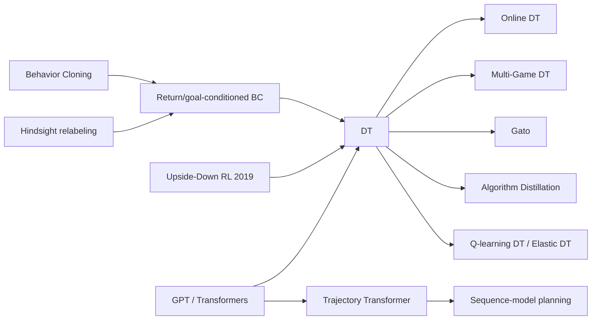

# Decision Transformer (DT) and RL as Sequence Modeling (Trajectory Transformer, TT)
> Treat a trajectory as a sentence of (return-to-go, state, action) tokens, train a causal transformer to predict actions by plain supervised learning, and at test time "prompt" it with the return you want. **Family:** Offline RL → RL via supervised learning (RvS) → Return-conditioned sequence modeling  ·  **Year / origin:** Chen, Lu, Rajeswaran, Lee, Grover, Laskin, Abbeel, Srinivas & Mordatch, NeurIPS 2021 (UC Berkeley / FAIR / Google Brain); Trajectory Transformer: Janner, Li & Levine, NeurIPS 2021  ·  **On/Off-policy:** Offline (Online DT adds online fine-tuning)  ·  **Action space:** Discrete and continuous

---

## 1. What is it?

Classical RL learns value functions with Bellman backups and improves policies by maximizing them. **Decision Transformer (DT)** throws all of that away. It learns no value function, uses no bootstrapping, and computes no policy gradient. Instead:

* Each trajectory is written as a sequence $(\hat R_1, s_1, a_1, \hat R_2, s_2, a_2, \dots)$, where $\hat R_t = \sum_{t'\ge t} r_{t'}$ is the **return-to-go** (RTG).
* A GPT-style **causal transformer** is trained to predict $a_t$ from the preceding tokens, using cross-entropy for discrete or MSE for continuous actions. That is behavior cloning, but **conditioned on the return that the trajectory actually achieved**.
* At test time you set $\hat R_1$ to the return you *want* (e.g. expert-level), act, observe reward $r_t$, update $\hat R_{t+1} = \hat R_t - r_t$, and continue.

If the dataset contains a mix of good and bad trajectories, conditioning on a high return asks the model "what would someone who ends up with this return do here?". On D4RL locomotion and Atari, DT matched or approached strong offline TD methods (CQL) at publication, with a much simpler training loop that borrows all the tooling of language modeling.

**Trajectory Transformer (TT)** (Janner et al., 2021, published at the same time) is the model-based sibling. It discretizes every dimension of states, actions and rewards into tokens, trains a transformer to model the *whole* trajectory distribution, and **plans with beam search** over predicted sequences, scoring beams by predicted reward plus a learned return-to-go. TT is closer to "a learned world model + planner"; DT is closer to "conditional imitation".

Where it sits: offline RL, in the **RL via supervised learning (RvS)** branch alongside Upside-Down RL (Schmidhuber, 2019), RvS (Emmons et al., 2021), and goal-conditioned BC / hindsight relabeling. It is also the most direct bridge between RL and large language models.

## 2. Family & lineage



* **Parents:** behavior cloning; goal-conditioned imitation and hindsight relabeling; Upside-Down RL (commands = desired return and horizon); GPT-2 architecture.
* **Siblings:** Trajectory Transformer (TT), RvS (shows simple MLP conditioning can be competitive), "%BC" (filtered behavior cloning), which is a strong baseline that DT is often compared against.
* **Descendants:** Online Decision Transformer (Zheng, Zhang & Grover, ICML 2022), Multi-Game DT (Lee et al., 2022), Gato (Reed et al., 2022, a generalist agent trained as one big sequence model), Algorithm Distillation (Laskin et al., 2022, in-context RL from learning histories), Q-learning DT and Elastic DT (adding stitching ability), and reward-/attribute-conditioned language-model training.

## 3. Core idea & intuition

**A movie with the ending written on the first frame.** Every training trajectory comes labeled with how well it went. The model learns the correlation "trajectories that end up scoring X look like *this* at each step". Conditioning on X at test time picks out the matching behavior from the mixture.

Why a transformer?

* **Long-range credit assignment by attention.** Instead of propagating values backwards with Bellman updates, the model can attend directly from the current decision to the RTG token and to earlier states.
* **It's just sequence modeling.** The same code, optimizers and scaling recipes as for language models apply. Multiple tasks and modalities fit into one model (Gato).
* **The RTG token is a dial.** Turn it up for expert behavior, down for deliberately mediocre behavior. Our demo shows the achieved return tracks the commanded one.

What DT does *not* do well (important!):

* **Stitching.** DT conditions on returns actually observed in single trajectories. If the best path needs the first half of trajectory A and the second half of trajectory B, TD methods (IQL/CQL) can combine them through the value function, but vanilla DT has no mechanism for that (Brandfonbrener et al., 2022, analyze when return-conditioned supervised learning works).
* **Stochastic environments.** A high return in the data may have come from luck (a lucky die roll), not good actions. Conditioning on it then teaches the model to "hope for luck" (Paster et al., 2022 discuss this; ESPER conditions on luck-independent statistics).
* **Asking for the impossible.** Commanding a return far above anything in the data is out of distribution; behavior is unpredictable. In practice you condition on roughly the dataset's best return.

## 4. Math / formal details

**Data.** Trajectories $\tau = (s_1,a_1,r_1,\dots,s_T,a_T,r_T)$ from an unknown behavior policy (or a mixture). Return-to-go $\hat R_t = \sum_{t'=t}^{T} r_{t'}$ (undiscounted in the original DT).

**Tokenization.** For context length $K$ (timesteps), the input is $3K$ tokens
$$\big(\hat R_{t-K+1}, s_{t-K+1}, a_{t-K+1}, \dots, \hat R_t, s_t, a_t\big).$$
Each modality has its own linear (or embedding) encoder. A learned **timestep embedding** $\omega(t)$ (the absolute episode step, shared by the three tokens of a timestep) is added, then LayerNorm.

**Model.** Causal transformer $f_\theta$. Let $h_{s_t}$ be the output at the $s_t$ token; it may attend to $\hat R_{\le t}$, $s_{\le t}$, $a_{<t}$ only. The action head is $\hat a_t = g_\theta(h_{s_t})$.

**Objective (behavior cloning conditioned on RTG).**
$$\mathcal{L}(\theta) = \mathbb{E}_{\tau\sim\mathcal{D},\,t}\Big[\ell\big(a_t,\; g_\theta(f_\theta(\hat R_{\le t}, s_{\le t}, a_{<t}))\big)\Big],$$
with $\ell$ = cross-entropy for discrete actions, squared error for continuous actions (or the Gaussian NLL in Online DT, plus an entropy constraint).

**Interpretation.** DT estimates $\pi_\theta(a_t \mid s_{\le t}, a_{<t}, \hat R_t)$, the behavior policy conditioned on the outcome. By Bayes,
$$\pi(a\mid s,\hat R) \propto \pi_\beta(a\mid s)\,p(\hat R\mid s,a),$$
so conditioning on a high $\hat R$ up-weights actions that make high returns likely. Compare with AWR's $\pi_\beta(a|s)\exp(\beta A(s,a))$ in [IQL](iql.md): same spirit, but DT uses the *empirical outcome distribution* instead of a learned advantage. That is why it inherits the luck/stitching issues above.

**Inference.** Choose target $\hat R_1 = R^{\text{target}}$. At each step: feed the last $K$ timesteps, take $a_t$ (argmax/sample or the regressed mean), observe $r_t$, set $\hat R_{t+1} = \hat R_t - r_t$.

**Trajectory Transformer.** Discretize each scalar dimension into $V$ bins (uniform or quantile), flatten a timestep into $N + M + 2$ tokens (state dims, action dims, reward, value-to-go), and train autoregressively:
$$\max_\theta \sum_t \Big[\sum_{i=1}^{N}\log P_\theta(s_t^i\mid s_t^{<i},\tau_{<t}) + \sum_{j=1}^{M}\log P_\theta(a_t^j\mid a_t^{<j}, s_t,\tau_{<t}) + \log P_\theta(r_t\mid a_t,s_t,\tau_{<t}) + \log P_\theta(R_t \mid r_t, a_t, s_t, \tau_{<t})\Big].$$
Planning uses beam search, keeping the beams with the highest predicted $\sum r + \hat R$, and executes the first action (MPC style).

## 5. Algorithm (pseudocode)

```text
Decision Transformer - training
Input: offline trajectories D, context length K
 1. for each trajectory compute returns-to-go  R_t = sum_{t' >= t} r_t'
 2. repeat
 3.     sample a batch of windows of length K: (R, s, a, t) for t in window  (left-pad + mask)
 4.     tokens <- interleave(embed_R(R) + emb_t, embed_s(s) + emb_t, embed_a(a) + emb_t)
 5.     h      <- CausalTransformer(tokens)
 6.     a_hat  <- ActionHead(h at the state-token positions)
 7.     loss   <- CE(a_hat, a)  (discrete)  or  MSE(a_hat, a)  (continuous), masked
 8.     gradient step on loss
 9. until done

Decision Transformer - evaluation (return-conditioned control)
10. choose target return R_1; observe s_1
11. for t = 1, 2, ... do
12.     a_t <- DT( last K of (R, s, a) )           # predict at the newest state token
13.     execute a_t; observe r_t, s_{t+1}
14.     R_{t+1} <- R_t - r_t                        # decrement return-to-go
15. end for
```

## 6. Python implementation

A 6×6 gridworld: start (0,0), goal (5,5), −1 per step, at most 20 steps, so returns lie in [−20, −10] and −10 is optimal. The dataset contains 1,500 trajectories from ε-greedy policies with ε drawn uniformly in [0,1], from near-expert to near-random. A 2-layer, 64-dim causal transformer with context 8 is trained for 1,500 steps, then rolled out with different target returns.

Runnable version: [`code/decision_transformer.py`](../../code/decision_transformer.py)

```python
{{CODE}}
```

Example output from our run (CPU, ~60 s):

```text
Dataset: 1500 trajectories; return mean -16.1, min -20, max -10 (optimal = -10)
step    0  action CE loss 1.396
step  500  action CE loss 1.205
step 1000  action CE loss 1.174

Return-conditioned rollouts (sampled actions, 50 episodes each):
 target return  achieved mean    std
           -10         -10.22   0.58
           -13         -13.00   0.89
           -16         -16.06   1.38
           -20         -19.70   1.06
```

The model reaches the optimum when asked for −10, even though the average trajectory in the data scored −16, and it *deliberately* wanders when asked for −16 or −20. That's the defining DT behavior: one network, a whole family of policies indexed by the commanded return.

**With Hugging Face.** `transformers` ships a `DecisionTransformerModel` (GPT-2 backbone) and pre-trained D4RL checkpoints on the Hub. *Requires the library (and ideally a GPU); not run here:*

```python
# pip install transformers torch   (not run here)
import torch
from transformers import DecisionTransformerConfig, DecisionTransformerModel

config = DecisionTransformerConfig(state_dim=17, act_dim=6, max_ep_len=1000, hidden_size=128,
                                   n_layer=3, n_head=1)
model = DecisionTransformerModel(config)
B, K = 4, 20
out = model(states=torch.randn(B, K, 17), actions=torch.randn(B, K, 6), rewards=torch.randn(B, K, 1),
            returns_to_go=torch.randn(B, K, 1), timesteps=torch.arange(K).repeat(B, 1),
            attention_mask=torch.ones(B, K, dtype=torch.long))
action_preds = out.action_preds          # [B, K, act_dim]; train with MSE against dataset actions
```

## 7. Practical tips & hyperparameters

* **Context length K:** the paper reports K=20 for D4RL MuJoCo and K=30 (50 for Pong) on Atari. Longer context helps on partially observable / long-horizon tasks but costs quadratic attention.
* **Model size:** small GPTs suffice for D4RL (e.g. 3 layers, 128 hidden, 1 head in the reference code); dropout ≈0.1; AdamW lr ≈1e-4 with warm-up; gradient clipping 0.25–1.0.
* **RTG scaling:** divide returns by a constant (e.g. 1000 for MuJoCo) so the RTG input is O(1).
* **Target return at test time:** start near the best return in the dataset. Far above it is out of distribution; check the achieved-vs-target curve (it should be monotone and saturate).
* **State normalization:** standardize states with dataset mean/std (continuous tasks).
* **Timestep embedding:** absolute episode step, not position in the window. It matters for time-dependent behavior.
* **Discrete actions:** sample or argmax. Sampling gives smoother return tracking (as in our demo).
* **Know the baselines:** always compare with %BC (BC on the top X% of trajectories) and RvS-style MLPs. On many D4RL tasks they are close to DT, so the transformer isn't always what buys you the gain.
* **Need stitching?** Use IQL/CQL, or DT variants with value-based relabeling (Q-learning DT, Elastic DT).
* **Online fine-tuning:** Online DT switches to a stochastic policy with an entropy constraint and uses hindsight return relabeling of new trajectories.

## 8. Pros and cons

| Pros | Cons |
|---|---|
| Pure supervised learning: stable, simple, no bootstrapping or deadly triad | No stitching of sub-optimal trajectory pieces (vanilla DT) |
| Uses mature LLM tooling and scales like language models | Conditioning on lucky returns in stochastic environments misleads it |
| One model represents many policies (return is a dial) | Asking for returns beyond the data is unreliable; needs a sensible target |
| Handles long horizons and sparse/delayed rewards gracefully | Often no better than %BC / RvS MLPs on standard benchmarks |
| Natural for multi-task, multi-modal generalist agents (Gato, MGDT) | Transformer inference is heavier than an MLP policy (latency on robots) |

## 9. When to use / when not to use

**Use DT when**
* you have large, diverse offline data with returns, and want a simple, stable learner;
* you want controllable behavior quality (e.g. simulate players of different skill levels, or "safe but slower" modes);
* you are building multi-task or generalist sequence-model agents and want to share LLM infrastructure;
* rewards are sparse/delayed and TD learning is unstable.

**Avoid / reconsider when**
* good behavior must be assembled from fragments of different trajectories (use IQL/CQL);
* the environment is highly stochastic (returns reflect luck);
* you need to exceed the best demonstrated performance substantially;
* compute/latency is tight and a small MLP (%BC, TD3+BC) would do.

## 10. Key papers, books & repos

* Chen, Lu, Rajeswaran, Lee, Grover, Laskin, Abbeel, Srinivas, Mordatch. **Decision Transformer: Reinforcement Learning via Sequence Modeling.** NeurIPS 2021. arXiv:2106.01345.
* Janner, Li, Levine. **Offline Reinforcement Learning as One Big Sequence Modeling Problem** (Trajectory Transformer). NeurIPS 2021. arXiv:2106.02039.
* Schmidhuber. **Reinforcement Learning Upside Down: Don't Predict Rewards — Just Map Them to Actions.** arXiv:1912.02875, 2019.
* Emmons, Eysenbach, Kostrikov, Levine. **RvS: What is Essential for Offline RL via Supervised Learning?** ICLR 2022.
* Brandfonbrener, Bietti, Buckman, Laroche, Bruna. **When does return-conditioned supervised learning work for offline reinforcement learning?** NeurIPS 2022.
* Paster, McIlraith, Ba. **You Can't Count on Luck: Why Decision Transformers and RvS Fail in Stochastic Environments.** NeurIPS 2022.
* Zheng, Zhang, Grover. **Online Decision Transformer.** ICML 2022.
* Lee et al. **Multi-Game Decision Transformers.** NeurIPS 2022.
* Reed et al. **A Generalist Agent** (Gato). TMLR 2022.
* Laskin et al. **In-context Reinforcement Learning with Algorithm Distillation.** ICLR 2023.
* Lu et al. **Quark: Controllable Text Generation with Reinforced Unlearning.** NeurIPS 2022 (reward-quantile tokens for LMs, a return-conditioning idea for text).
* Repos: `kzl/decision-transformer` (official), `jannerm/trajectory-transformer` (official), `huggingface/transformers` (`DecisionTransformerModel`), `corl-team/CORL` (DT baseline), `Farama-Foundation/D4RL`.
* Sutton & Barto (2nd ed.) does not cover DT. For the contrast with value-based credit assignment see Ch. 6 (TD) and Ch. 12 (eligibility traces).

## 11. For business users

**What it does.** Decision Transformer learns decision-making the way chatbots learn language: by reading lots of examples. Each example is a recorded episode (a game, a robot task, a customer journey) **labelled with how well it turned out**. Afterwards you tell the model "behave like an episode that scored *this* well," and it does.

**Analogy.** Imagine a flight simulator recorder that has thousands of flights, each tagged with a landing-quality score. A trainee who studied all of them can be asked: "fly like a 9/10 landing" or "fly like a 5/10 landing". The trainee can only imitate qualities that actually exist in the recordings.

**Use cases.** Game AI with adjustable difficulty; robots learning from large logs of teleoperation; generalist agents that share one model across many tasks; recommendation and dialogue systems trained on outcome-labelled sessions; simulation of human-like behavior at different skill levels.

**Value / ROI.** It reuses your existing transformer/LLM stack and talent, trains stably with standard tooling, and gives a single model with a controllable "quality dial".

**Risks.** It can't reliably exceed the best behavior in your data, and it can't combine partial successes the way value-based methods do. If good outcomes in your data were partly luck, the model learns to "hope". Inference is heavier than small policies.

**Costs.** GPU training similar to a small language model; data engineering to turn logs into (outcome, situation, action) sequences.

**Questions to ask your team.**
* How does it compare to simply imitating our top 10% of episodes?
* Are high scores in our data driven by skill or by luck/external factors?
* What target score will we command in production, and is it inside what the data shows?
* Do we need the model to combine partial successes (then consider IQL/CQL)?

## 12. For kids (ages ~8–12)

**The Magic Score Button.** Imagine a video-game robot that watched thousands of people play a maze game. Some players were super fast (they got 10 points), some got lost (only 2 points). The robot remembers *every* game together with its score.

Now the robot has a magic button: you dial a number and press it. Dial **10**, and the robot plays like the speedy players, zooming straight to the exit. Dial **2**, and it wanders around like someone who's lost, on purpose!

The robot didn't learn "good" or "bad". It learned "**what does a 10-point game look like?**" and "**what does a 2-point game look like?**"

**Try it yourself.** Play a simple game (like tossing a ball into a bucket from different distances) ten times and write down how you threw and whether you scored. Then ask a friend to "throw like the scoring throws" using only your notes. Next, ask them to "throw like the missing throws". Can they do both?

**Recap.**
1. Every recorded game gets a score label.
2. The robot learns what games with each score look like.
3. You choose a score, and it plays like that!

## 13. Related methods

* [IQL](iql.md): advantage-weighted cloning with value learning; handles stitching.
* [CQL](cql.md): pessimistic offline Q-learning.
* [Behavior Cloning & DAgger](../07-imitation-inverse-rl/behavior-cloning-dagger.md): DT is return-conditioned BC.
* [World Models / Dreamer](../05-model-based/world-models-dreamer.md) and [MuZero](../05-model-based/muzero.md): the Trajectory Transformer is a learned sequence world model with planning.
* [RLHF-PPO](../09-llm-preference-alignment/rlhf-ppo.md), [DPO](../09-llm-preference-alignment/dpo.md): the LLM side of the RL ↔ sequence-modeling bridge; reward-conditioned SFT is a DT-like alternative to RL fine-tuning.
* [On-policy distillation](../10-llm-reasoning-rl/on-policy-distillation.md) and [Agentic multi-turn RL](../10-llm-reasoning-rl/agentic-multi-turn-rl.md): sequence models acting in environments.

[← Back to overview](../../RL_Methods_Overview.md)
