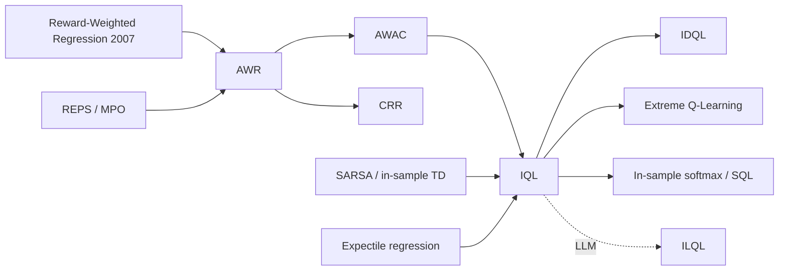

# Implicit Q-Learning (IQL) — with AWR and AWAC
> Offline RL that never evaluates an action outside the dataset: fit an *upper-expectile* value function by regression, then extract a policy by advantage-weighted behavior cloning. **Family:** Model-free → Actor-critic → Offline RL → In-sample learning / weighted regression  ·  **Year / origin:** Kostrikov, Nair & Levine, "Offline Reinforcement Learning with Implicit Q-Learning", arXiv 2021 / ICLR 2022 (UC Berkeley)  ·  **On/Off-policy:** Offline (and offline-to-online fine-tuning)  ·  **Action space:** Continuous and discrete

---

## 1. What is it?

Offline RL methods fail when the Bellman backup queries $Q(s', a')$ at actions $a'$ the dataset never contains: those values are extrapolations, and maximizing over them amplifies errors (see the offline-RL problem statement in [CQL](cql.md)). CQL fights this by *penalizing* OOD values. **IQL takes a more radical route: it never queries them at all.**

The trick is to approximate the maximization $\max_{a'} Q(s',a')$ *implicitly*, using only dataset actions:

1. Learn a state-value function $V(s)$ by **expectile regression** of $Q(s,a)$ on dataset actions. An upper expectile ($\tau \to 1$) of the distribution of $Q(s,a)$ over in-data actions approximates the *best in-support* action value.
2. Learn $Q(s,a)$ with an ordinary TD target $r + \gamma V(s')$, which needs no action at $s'$.
3. Extract a policy with **advantage-weighted regression (AWR)**: behavior cloning where each dataset action is weighted by $\exp(\beta\,[Q(s,a)-V(s)])$.

All three steps are plain supervised regressions on dataset tuples. IQL is simple, fast (no sampling of actions in the critic update), stable, and was state of the art on D4RL at publication, notably on the AntMaze tasks that require **stitching** together pieces of sub-optimal trajectories. Its weighted-regression policy also makes **offline-to-online fine-tuning** straightforward.

**AWR** (Peng et al., 2019) and **AWAC** (Nair et al., 2020) are the direct ancestors of IQL's policy step:
* **AWR**: on-policy-ish; estimate advantages with Monte-Carlo/TD($\lambda$) returns and a learned $V$, then fit $\pi$ by exp-advantage-weighted maximum likelihood on a replay buffer.
* **AWAC**: same actor update, but the critic is an off-policy Q-function trained by TD with actions sampled *from the current policy*. That makes AWAC good for "offline pre-training then online fine-tuning". Purely offline, though, it is still exposed to OOD queries in the critic target, which IQL removes.

## 2. Family & lineage



* **Parents:** reward-weighted regression (Peters & Schaal, 2007), REPS / MPO's KL-regularized policy improvement, AWR, AWAC, SARSA-style "in-sample" evaluation, and expectile regression from statistics (Newey & Powell, 1987).
* **Siblings:** CQL (value pessimism), TD3+BC (policy constraint), CRR (critic-regularized regression, Wang et al. 2020), One-step RL (Brandfonbrener et al. 2021, which showed a single step of policy improvement on $Q^{\pi_\beta}$ is already strong).
* **Descendants:** IDQL (IQL critic + diffusion policy, Hansen-Estruch et al. 2023), Extreme Q-Learning (Garg et al. 2023, Gumbel regression instead of expectiles), in-sample softmax methods, and **ILQL** (Snell et al., 2022), which adapts IQL to offline RL for language-model generation.

## 3. Core idea & intuition

**Why expectiles?** For a random variable $X$, the $\tau$-expectile $m_\tau$ minimizes an *asymmetric* squared loss: errors above the estimate cost $\tau$, errors below cost $1-\tau$. With $\tau=0.5$ you get the mean. With $\tau = 0.9$ you get a value that sits near the top of the distribution, and as $\tau\to1$ you get the maximum of its support.

Now let $X = Q(s,a)$ where $a$ is drawn from the *dataset's* actions at $s$. Then:

* $\tau=0.5$: $V(s) \approx \mathbb{E}_{a\sim\pi_\beta}[Q(s,a)]$, i.e. SARSA-style evaluation of the behavior policy (safe but no improvement).
* $\tau\to 1$: $V(s)\approx \max_{a\in\operatorname{supp}\pi_\beta(\cdot|s)} Q(s,a)$, i.e. Q-learning **restricted to actions that actually appear in the data**.

Then $Q(s,a) \leftarrow r + \gamma V(s')$ chains these in-support maxima across time. That is what lets IQL *stitch*: if trajectory A reaches a state halfway and trajectory B goes from that state to the goal, the backup combines them, even though no single trajectory did both.

**Policy extraction.** Once $Q$ and $V$ are known, the advantage $A(s,a)=Q(s,a)-V(s)$ tells which dataset actions beat the (upper-expectile) baseline. AWR clones the dataset, but each sample counts $\exp(\beta A)$ times: good actions are copied loudly, bad ones whispered. Because it only re-weights dataset actions, the policy cannot drift off support.

## 4. Math / formal details

**Notation.** Dataset $\mathcal{D}$ of $(s,a,r,s')$; $Q_\theta$ (often twin networks with $\min$), target network $Q_{\hat\theta}$ (Polyak average); value $V_\psi$; policy $\pi_\phi$; discount $\gamma$; expectile $\tau\in(0,1)$; inverse temperature $\beta>0$.

**Expectile loss.** For residual $u$,
$$L_2^\tau(u) = |\tau - \mathbb{1}(u<0)|\;u^2 .$$

**Value step** (expectile of the target critic over dataset actions):
$$\mathcal{L}_V(\psi) = \mathbb{E}_{(s,a)\sim\mathcal{D}}\Big[L_2^\tau\big(Q_{\hat\theta}(s,a) - V_\psi(s)\big)\Big].$$

**Q step** (TD on dataset transitions, bootstrapping from $V$, not from $\max_{a'}Q$):
$$\mathcal{L}_Q(\theta) = \mathbb{E}_{(s,a,r,s')\sim\mathcal{D}}\Big[\big(r + \gamma\,V_\psi(s') - Q_\theta(s,a)\big)^2\Big].$$

Kostrikov et al. show that as $\tau\to1$, the fixed point approaches the optimal in-support value, $\lim_{\tau\to1} V_\tau(s) = \max_{a\in\mathcal{A},\ \pi_\beta(a|s)>0} Q^*(s,a)$ (Lemma/Corollary in the paper, deterministic-dynamics caveat: with stochastic transitions, the expectile over the *joint* randomness of $(a,s')$ can be optimistic. That is why they fit $V$ on $Q$ rather than directly on $r+\gamma V(s')$).

**Policy step (AWR).** Derived from the KL-constrained improvement problem
$$\max_\pi \mathbb{E}_{a\sim\pi}[Q(s,a)] \;\;\text{s.t.}\;\; D_{\mathrm{KL}}(\pi\,\|\,\pi_\beta)\le\epsilon \;\;\Rightarrow\;\; \pi^*(a|s)\propto\pi_\beta(a|s)\,\exp\!\big(\beta\,A(s,a)\big),$$
whose projection onto a parametric family by weighted maximum likelihood is
$$\mathcal{L}_\pi(\phi) = -\,\mathbb{E}_{(s,a)\sim\mathcal{D}}\Big[\exp\!\big(\beta\,(Q_{\hat\theta}(s,a) - V_\psi(s))\big)\,\log\pi_\phi(a|s)\Big].$$
In practice the weight is clipped (e.g. at 100). $\beta\to0$ gives plain BC; large $\beta$ approaches greedy argmax over dataset actions.

**AWR (original).** Uses $A(s,a) = \mathcal{R}^{\text{TD}(\lambda)}_{s,a} - V(s)$ from sampled returns and the same $\exp(A/\beta')$-weighted log-likelihood (note AWR writes a temperature $\beta'$ in the denominator; IQL writes an inverse temperature $\beta$ in the numerator).

**AWAC.** Critic: $\min_\theta \mathbb{E}_{\mathcal{D}}[(Q_\theta(s,a) - r - \gamma\,\mathbb{E}_{a'\sim\pi}Q_{\hat\theta}(s',a'))^2]$. Note the next action comes from the policy, which can be OOD. Actor: the same advantage-weighted likelihood with $A = Q(s,a) - \mathbb{E}_{a'\sim\pi}Q(s,a')$.

## 5. Algorithm (pseudocode)

```text
IQL
Input: dataset D, expectile tau (e.g. 0.7-0.9), inverse temperature beta (e.g. 3-10)
 1. Initialise Q1, Q2 (+ targets), V, policy pi
 2. for step = 1 .. N do
 3.     sample minibatch (s, a, r, s', done) ~ D
 4.     q_t  <- min(Q1_target(s,a), Q2_target(s,a))
 5.     # value: upper expectile of Q over dataset actions
 6.     L_V  <- mean( |tau - 1(q_t - V(s) < 0)| * (q_t - V(s))^2 );  update V
 7.     # critic: in-sample TD, bootstrap from V(s') (no action at s' needed)
 8.     y    <- r + gamma * (1 - done) * V(s')
 9.     L_Q  <- mean( (Q1(s,a) - y)^2 + (Q2(s,a) - y)^2 );  update Q1, Q2
10.     # actor: advantage-weighted regression on dataset actions
11.     w    <- min( exp(beta * (q_t - V(s))), 100 )
12.     L_pi <- - mean( w * log pi(a | s) );  update pi
13.     Polyak-update target critics
14. end for
15. return pi   (deterministic mean action at test time)
```

## 6. Python implementation

The demo uses a continuous-action version of a lava-navigation task: a point in the unit square must reach a goal disc in the top-right while a lava block blocks the direct diagonal. The dataset is deliberately **mixed-quality**:

* 10 noisy **expert** episodes that go North around the lava, then to the goal;
* 90 **reckless** episodes that head straight for the goal and nearly always die in the lava.

We compare BC on all data, "filtered BC" (BC on successful episodes only, a strong simple baseline that needs success labels), and IQL.

Runnable version: [`code/iql.py`](../../code/iql.py)

```python
"""
Implicit Q-Learning (IQL, Kostrikov, Nair & Levine 2021) on a tiny continuous-action
navigation task, compared with behavior cloning (BC) and filtered BC.

The offline dataset is a MIXTURE: a few noisy expert trajectories that drive around a
lava block to the goal, plus many trajectories from a "reckless" policy that heads straight
for the goal through the lava. BC copies the average (mostly reckless) behavior; IQL learns
which actions are better than the data's average (upper-expectile value) and extracts a
policy by advantage-weighted regression - without ever evaluating unseen actions.

Run:  python3 code/iql.py     (roughly 30-90 s on CPU)
"""
import numpy as np
import torch
import torch.nn as nn

torch.set_num_threads(1)
np.random.seed(0)
torch.manual_seed(0)

GOAL = np.array([0.9, 0.9], np.float32)
STEP, HORIZON, GAMMA = 0.08, 60, 0.99


# ----------------------------------------------------------------------------
# 1) Environment: point in [0,1]^2, action a in [-1,1]^2 (velocity), lava block.
# ----------------------------------------------------------------------------
def in_lava(s):
    return 0.35 < s[0] < 0.65 and s[1] < 0.6


class LavaNavCont:
    def reset(self):
        self.t = 0
        self.s = np.array([0.1, 0.1], np.float32) + np.random.uniform(-0.05, 0.05, 2).astype(np.float32)
        return self.s.copy()

    def step(self, a):
        self.t += 1
        a = np.clip(a, -1, 1).astype(np.float32)
        self.s = np.clip(self.s + STEP * a + np.random.normal(0, 0.01, 2).astype(np.float32), 0, 1)
        if np.linalg.norm(self.s - GOAL) < 0.1:
            return self.s.copy(), 1.0, True, True
        if in_lava(self.s):
            return self.s.copy(), -1.0, True, True
        return self.s.copy(), 0.0, self.t >= HORIZON, False


def expert_action(s):
    target = np.array([0.15, 0.8], np.float32) if (s[1] < 0.75 and s[0] < 0.35) else GOAL
    d = target - s
    return d / (np.linalg.norm(d) + 1e-6)


def reckless_action(s):
    """A careless driver: heads straight for the goal - right through the lava."""
    d = GOAL - s
    return d / (np.linalg.norm(d) + 1e-6)


def collect(n_expert=10, n_reckless=90):
    env, buf, rets = LavaNavCont(), {k: [] for k in ["s", "a", "r", "s2", "term", "ep"]}, []
    for ep in range(n_expert + n_reckless):
        s, done, G, t = env.reset(), False, 0.0, 0
        while not done:
            if ep < n_expert:
                a = np.clip(expert_action(s) + np.random.normal(0, 0.3, 2), -1, 1)
            else:
                a = np.clip(reckless_action(s) + np.random.normal(0, 0.5, 2), -1, 1)
            s2, r, done, term = env.step(a)
            for k, v in zip(buf, [s, a, r, s2, float(term), ep]):
                buf[k].append(v)
            G += GAMMA ** t * r
            s, t = s2, t + 1
        rets.append(G)
    data = {k: torch.tensor(np.array(v), dtype=torch.float32) for k, v in buf.items()}
    data["ep"] = data["ep"].long()
    return data, np.array(rets)


# ----------------------------------------------------------------------------
# 2) Networks
# ----------------------------------------------------------------------------
def mlp(i, o, h=128):
    return nn.Sequential(nn.Linear(i, h), nn.ReLU(), nn.Linear(h, h), nn.ReLU(), nn.Linear(h, o))


class GaussianPolicy(nn.Module):
    def __init__(self):
        super().__init__()
        self.mu = mlp(2, 2)
        self.log_std = nn.Parameter(torch.zeros(2))

    def log_prob(self, s, a):
        mu = torch.tanh(self.mu(s))
        dist = torch.distributions.Normal(mu, self.log_std.clamp(-5, 1).exp())
        return dist.log_prob(a).sum(-1)

    def act(self, s):
        return torch.tanh(self.mu(s))  # deterministic mean action at test time


# ----------------------------------------------------------------------------
# 3) The three IQL losses (these mirror the reference implementation)
# ----------------------------------------------------------------------------
def expectile_loss(diff, tau):
    """L_2^tau(u) = |tau - 1(u < 0)| * u^2   with u = Q(s,a) - V(s)."""
    weight = torch.where(diff > 0, tau, 1 - tau)
    return (weight * diff ** 2).mean()


def iql_value_loss(v, q_target_sa, tau):
    return expectile_loss(q_target_sa.detach() - v, tau)


def iql_q_loss(q1, q2, r, term, v_next):
    y = r + GAMMA * (1 - term) * v_next.detach()   # bootstrap from V(s'), never from max_a Q
    return ((q1 - y) ** 2).mean() + ((q2 - y) ** 2).mean()


def awr_policy_loss(log_prob, q_target_sa, v, beta, max_weight=100.0):
    adv = (q_target_sa - v).detach()
    w = torch.exp(beta * adv).clamp(max=max_weight)
    return -(w * log_prob).mean()


def train_iql(data, steps=6000, tau=0.8, beta=5.0, batch=256, lr=3e-4, polyak=0.005):
    Q1, Q2, V, pi = mlp(4, 1), mlp(4, 1), mlp(2, 1), GaussianPolicy()
    Q1t, Q2t = mlp(4, 1), mlp(4, 1)
    Q1t.load_state_dict(Q1.state_dict()); Q2t.load_state_dict(Q2.state_dict())
    opt_q = torch.optim.Adam(list(Q1.parameters()) + list(Q2.parameters()), lr=lr)
    opt_v = torch.optim.Adam(V.parameters(), lr=lr)
    opt_pi = torch.optim.Adam(pi.parameters(), lr=lr)
    N = data["s"].shape[0]
    for it in range(steps):
        idx = torch.randint(0, N, (batch,))
        s, a, r, s2, term = (data[k][idx] for k in ["s", "a", "r", "s2", "term"])
        sa = torch.cat([s, a], -1)
        with torch.no_grad():
            q_t = torch.min(Q1t(sa), Q2t(sa)).squeeze(-1)  # clipped double-Q target critic
        # (a) V <- expectile of Q over dataset actions
        v = V(s).squeeze(-1)
        loss_v = iql_value_loss(v, q_t, tau)
        opt_v.zero_grad(); loss_v.backward(); opt_v.step()
        # (b) Q <- r + gamma * V(s')
        with torch.no_grad():
            v_next = V(s2).squeeze(-1)
        loss_q = iql_q_loss(Q1(sa).squeeze(-1), Q2(sa).squeeze(-1), r, term, v_next)
        opt_q.zero_grad(); loss_q.backward(); opt_q.step()
        # (c) policy <- advantage-weighted regression on dataset actions
        loss_pi = awr_policy_loss(pi.log_prob(s, a), q_t, v.detach(), beta)
        opt_pi.zero_grad(); loss_pi.backward(); opt_pi.step()
        with torch.no_grad():
            for net, tgt in ((Q1, Q1t), (Q2, Q2t)):
                for p, pt in zip(net.parameters(), tgt.parameters()):
                    pt.mul_(1 - polyak).add_(polyak * p)
    return pi


def train_bc(data, steps=3000, batch=256, lr=3e-4):
    pi = GaussianPolicy()
    opt = torch.optim.Adam(pi.parameters(), lr=lr)
    N = data["s"].shape[0]
    for _ in range(steps):
        idx = torch.randint(0, N, (batch,))
        loss = -pi.log_prob(data["s"][idx], data["a"][idx]).mean()
        opt.zero_grad(); loss.backward(); opt.step()
    return pi


@torch.no_grad()
def evaluate(pi, n=100):
    env, rets, goal, lava = LavaNavCont(), [], 0, 0
    for _ in range(n):
        s, done, G, t = env.reset(), False, 0.0, 0
        while not done:
            s, r, done, _ = env.step(pi.act(torch.tensor(s)[None])[0].numpy())
            G += GAMMA ** t * r; t += 1
            goal += r > 0; lava += r < 0
        rets.append(G)
    return float(np.mean(rets)), goal / n, lava / n


if __name__ == "__main__":
    data, ep_rets = collect()
    print(f"Dataset: {data['s'].shape[0]} transitions, {len(ep_rets)} episodes "
          f"(10 noisy-expert, 90 reckless). Mean episode return = {ep_rets.mean():.3f}")

    # Filtered BC ("%BC"): clone only the transitions of episodes that reached the goal.
    good = torch.tensor(np.where(ep_rets > 0)[0])
    mask = torch.isin(data["ep"], good)
    filt = {k: v[mask] for k, v in data.items()}

    results = {"BC (all data)": evaluate(train_bc(data)),
               "filtered BC (successes)": evaluate(train_bc(filt)),
               "IQL (tau=0.8, beta=5)": evaluate(train_iql(data))}
    print(f"\n{'method':<26}{'return':>9}{'goal %':>8}{'lava %':>8}")
    for k, (ret, g, l) in results.items():
        print(f"{k:<26}{ret:>9.3f}{100*g:>8.0f}{100*l:>8.0f}")
    print("\nIQL never queries Q on actions outside the dataset, yet improves on the data by\n"
          "up-weighting actions whose Q exceeds the upper-expectile value V(s).")
```

Example output from our run (CPU, ~50 s):

```text
Dataset: 714 transitions, 100 episodes (10 noisy-expert, 90 reckless). Mean episode return = -0.742

method                       return  goal %  lava %
BC (all data)                -0.937       1      99
filtered BC (successes)       0.802      98       2
IQL (tau=0.8, beta=5)         0.834     100       0
```

BC copies the majority behavior and dives into the lava. IQL's critic learns that "head North near the start" has high advantage and "head diagonally" has low advantage, and its AWR policy up-weights the former. It matches or beats filtered BC **without being told which episodes succeeded**. It only uses rewards, and it would also stitch partial successes, which filtered BC cannot.

**IQL for discrete actions / tokens** is the same three losses with a categorical policy (`log_prob = log_softmax(logits)[a]`). ILQL (Snell et al., 2022) applies this idea to language models: token-level Q and V heads trained with expectile regression on offline dialogues, with generation steered by perturbing the LM's logits by $\beta(Q - V)$.

## 7. Practical tips & hyperparameters

* **Expectile τ:** values reported in the IQL paper are 0.7 for D4RL locomotion and 0.9 for AntMaze. Higher τ means more optimistic in-support maximization, which is better for stitching but can be noisier and over-optimistic with stochastic dynamics.
* **Inverse temperature β:** values reported are 3 (locomotion) and 10 (AntMaze). Too small gives BC. Too large means the weights are dominated by a few samples (high variance), so clip the weights (≈100).
* **Reward normalization:** the paper normalizes locomotion rewards by the dataset's return range (×1000 / (max return − min return)) and subtracts 1 from AntMaze rewards. Because β multiplies the advantage, reward scale directly changes the effective β.
* **Critic details:** twin Q with `min`, Polyak τ≈0.005, Adam 3e-4, batch 256, ~1M gradient steps in the paper (much less for toy tasks). A cosine learning-rate schedule for the actor was used in the reference implementation.
* **Deterministic evaluation:** use the policy mean. A state-independent learned log-std is fine for AWR.
* **Debugging:** plot the distribution of advantages. If it is all near zero, the critic hasn't learned or τ is too low. Watch the effective sample size of the AWR weights $(\sum w)^2/\sum w^2$; a tiny ESS means β is too high.
* **Fine-tuning online:** keep the same losses and just append fresh online data to the buffer. IQL is known to fine-tune smoothly, unlike strongly conservative critics.
* **Multimodal behavior data:** a unimodal Gaussian AWR policy averages modes. Consider a mixture, a discretized, or a diffusion policy (IDQL).

## 8. Pros and cons

| Pros | Cons |
|---|---|
| Never queries Q on OOD actions: very stable | Policy can only re-weight dataset actions; cannot extrapolate beyond the data's support |
| Three simple regressions; fast (no action sampling in the critic) | Expectile ≠ max under stochastic dynamics (can be optimistic); τ needs tuning |
| Strong at stitching sub-optimal trajectories (AntMaze) | Unimodal AWR policies blur multimodal data |
| Easy offline-to-online fine-tuning | Exp-weights are high-variance; needs clipping and reward normalization |
| Works for discrete actions and has been adapted to LMs (ILQL) | Like all offline RL, choosing hyperparameters without online evaluation is hard |

## 9. When to use / when not to use

**Use IQL when**
* you have mixed-quality offline data with rewards and want something more robust than BC;
* the task requires stitching (navigation, multi-stage manipulation);
* you plan offline pre-training followed by online fine-tuning;
* you want a strong, low-maintenance default offline RL baseline.

**Avoid / reconsider when**
* the data is all expert-level: BC is enough;
* better actions are known to lie *outside* the data's support (no in-sample method can find them, so you need online exploration or a model);
* the environment is highly stochastic and you need calibrated values (consider distributional or model-based approaches);
* you don't have rewards at all: use imitation learning ([BC/DAgger](../07-imitation-inverse-rl/behavior-cloning-dagger.md), [GAIL](../07-imitation-inverse-rl/gail.md)).

## 10. Key papers, books & repos

* Kostrikov, Nair, Levine. **Offline Reinforcement Learning with Implicit Q-Learning.** ICLR 2022. arXiv:2110.06169.
* Peng, Kumar, Zhang, Levine. **Advantage-Weighted Regression: Simple and Scalable Off-Policy Reinforcement Learning.** arXiv:1910.00177, 2019.
* Nair, Gupta, Dalal, Levine. **AWAC: Accelerating Online Reinforcement Learning with Offline Datasets.** arXiv:2006.09359, 2020.
* Peters & Schaal. **Reinforcement Learning by Reward-Weighted Regression for Operational Space Control.** ICML 2007.
* Wang et al. **Critic Regularized Regression.** NeurIPS 2020.
* Brandfonbrener, Whitney, Ranganath, Bruna. **Offline RL Without Off-Policy Evaluation** (One-step RL). NeurIPS 2021.
* Hansen-Estruch et al. **IDQL: Implicit Q-Learning as an Actor-Critic Method with Diffusion Policies.** arXiv 2023.
* Snell, Kostrikov, Su, Yang, Levine. **Offline RL for Natural Language Generation with Implicit Language Q Learning** (ILQL). arXiv:2206.11871, 2022 (ICLR 2023).
* Newey & Powell. **Asymmetric Least Squares Estimation and Testing.** Econometrica, 1987 (expectiles).
* Sutton & Barto (2nd ed., 2018): Ch. 6.4 (SARSA, in-sample evaluation), Ch. 13 (policy gradient; AWR is a weighted-likelihood relative).
* Repos: `ikostrikov/implicit_q_learning` (official, JAX), `tinkoff-ai/CORL` / `corl-team/CORL` (PyTorch single-file IQL, AWAC, CQL, TD3+BC), `takuseno/d3rlpy`, `Farama-Foundation/D4RL`.

## 11. For business users

**What it does.** IQL learns a better decision policy from historical logs by asking, for every logged decision, "was this better or worse than what we typically achieve from this situation?" Then it **imitates the better-than-usual decisions more strongly**. It never recommends an action that doesn't appear in your data, which makes it predictable and safe to review.

**Analogy.** A sales coach watches recordings of 1,000 calls. Instead of telling new reps to copy everyone (most calls are average), the coach scores every call against what usually happens at that stage of a conversation, and trains reps mainly on the moves that beat the norm. Moves nobody ever made aren't taught at all.

**Use cases.** Learning operating policies from plant/process logs; customer-service and sales playbooks from outcome-labeled interactions; robot skills from mixed teleoperation data; recommendation re-ranking from logs; offline pre-training before a cautious live pilot.

**Value / ROI.** Outperforms plain imitation when your historical data mixes good and bad decisions, which is the normal case. It is cheap to train, stable, and keeps recommendations inside known territory, which eases compliance review.

**Risks.** It cannot discover genuinely new strategies (only re-weight old ones). It is sensitive to how "reward" is defined, and biased logs give biased policies. Offline estimates of improvement can be over-optimistic, so validate with a controlled rollout.

**Costs.** Low compute (a single GPU, often hours). Main effort: assembling outcome-labeled logs and defining the reward.

**Questions to ask your team.**
* What's our reward signal, and does it capture long-term outcomes rather than just immediate clicks?
* How much better is IQL than "copy our top performers" (filtered imitation)?
* Which situations are poorly covered by the logs?
* What's the plan for a limited live test and fine-tuning?

## 12. For kids (ages ~8–12)

**The Best-Throw Coach.** You and 99 friends each throw paper airplanes at a target, and someone films all the throws. Most friends throw straight at the target, but there's a fan blowing in the middle, and their planes crash! Only a few kids throw a bit upward first, and their planes glide around the wind and hit the target.

A lazy coach says: "Do what most kids did." Crash!

A smart coach (that's IQL) watches each throw and asks: "Was this throw **better than usual** for a kid standing here?" The upward throws were way better than usual, so the coach says "copy those ones a LOT". The straight throws were worse than usual: "copy those just a tiny bit". The coach never invents a brand-new throw. She only picks from throws someone really did.

**Try it yourself.** Make 10 paper-airplane throws, writing down how you threw each one (high, low, hard, soft) and how far it flew. Circle the throws that went farther than your average. Next round, copy the circled ones. Did your average go up?

**Recap.**
1. Score each try against "what usually happens".
2. Copy the better-than-usual tries the most.
3. Only use moves that someone actually tried.

## 13. Related methods

* [CQL](cql.md): pessimistic value regularization; the offline-RL problem statement in detail.
* [Decision Transformer](decision-transformer.md): conditioning on desired return instead of weighting by advantage.
* [Behavior Cloning & DAgger](../07-imitation-inverse-rl/behavior-cloning-dagger.md): AWR with β→0 is BC.
* [SAC](../04-off-policy-actor-critic/sac.md) and [TD3](../04-off-policy-actor-critic/td3.md): online actor-critics that offline methods modify.
* [SARSA](../01-foundations-tabular/sarsa.md): in-sample TD evaluation, the τ=0.5 limit of IQL.
* [Reward modeling](../09-llm-preference-alignment/reward-modeling.md) and [RLHF-PPO](../09-llm-preference-alignment/rlhf-ppo.md): advantage-weighted / reward-weighted ideas also appear in LLM alignment (e.g. ILQL, filtered/rejection-sampling fine-tuning).
* [Value-based LLM RL (VAPO)](../10-llm-reasoning-rl/value-based-llm-rl-vapo.md).

[← Back to overview](../../RL_Methods_Overview.md)
