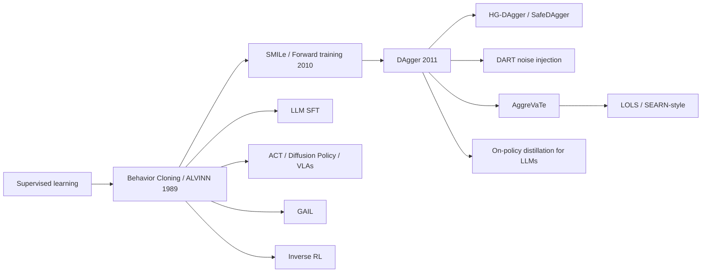

# Behavior Cloning (BC) and DAgger (Dataset Aggregation)
> Learn a policy by supervised learning on expert (state, action) pairs, and fix its compounding-error problem by having the expert label the states the *learner* visits. **Family:** Imitation learning → Direct policy learning (BC) → Interactive imitation (DAgger)  ·  **Year / origin:** BC: ALVINN (Pomerleau, 1989) and earlier; DAgger: Ross, Gordon & Bagnell, AISTATS 2011 (Carnegie Mellon)  ·  **On/Off-policy:** BC is offline; DAgger is on-policy w.r.t. the learner's state distribution (interactive)  ·  **Action space:** Any (classification for discrete, regression for continuous)

---

## 1. What is it?

**Imitation learning** learns from demonstrations instead of rewards. The simplest version, **behavior cloning (BC)**, treats it as ordinary supervised learning: collect pairs $(s, a^*)$ from an expert and fit $\pi_\theta(a|s)$ by maximum likelihood (cross-entropy or MSE). Self-driving's ALVINN (1989) did this with a small neural network mapping camera images to steering, and today BC is the workhorse behind robot manipulation policies (ACT, Diffusion Policy, vision-language-action models), game bots, and **supervised fine-tuning (SFT) of LLMs**. SFT is exactly BC at the token level: the "expert" is the human-written or teacher-generated response, the "state" is the prefix, the "action" is the next token.

BC has a fundamental flaw: **compounding errors / covariate shift**. Supervised learning assumes test inputs come from the training distribution. But a policy *chooses* its next input. A small mistake moves the agent to a state slightly off the expert's path, where the learner has seen fewer examples and makes larger mistakes, which moves it further off, and so on. Ross & Bagnell (2010) formalized this: if the learner errs with probability $\epsilon$ on the expert's state distribution, its expected cost over horizon $T$ can grow as $O(T^2\epsilon)$, rather than the $O(T\epsilon)$ you'd expect from i.i.d. mistakes.

**DAgger** fixes the distribution mismatch directly. Roll out the *current learner*, ask the expert what it *would have done* in each visited state, add those labeled states to the dataset, retrain, repeat. Because the training distribution converges to the learner's own state distribution, the error bound becomes linear in $T$ (via a reduction to no-regret online learning). The price: the expert must be **queryable on arbitrary states** (a human corrector, a planner, a privileged teacher policy, or a larger model).

## 2. Family & lineage



* **Parents:** supervised learning; structured prediction (SEARN, Daumé et al., 2009); Ross & Bagnell's forward training and SMILe (2010).
* **Siblings:** inverse RL (recover a reward, then plan), GAIL (match occupancy distributions adversarially), DART (inject noise into the expert during data collection so demonstrations contain recoveries), AggreVaTe (Ross & Bagnell, 2014, DAgger with cost-to-go information).
* **Descendants:** HG-DAgger (the human takes over only when needed), SafeDAgger, privileged-teacher distillation in robotics ("learning by cheating"), and **on-policy distillation / GKD** for LLMs, where the student generates and the teacher labels the student's own tokens. That is DAgger for language models.

## 3. Core idea & intuition

**BC:** "Watch the expert, copy the expert." Works well when (i) demonstrations are plentiful and cover the states the learner will see, (ii) the learner can fit the expert closely, and (iii) small errors don't push you into unfamiliar territory (short horizons, self-correcting dynamics).

**The failure mode.** Perfect demonstrations contain **no mistakes and therefore no recoveries**. A student driver who only ever watched flawless driving has never seen what to do when the car is drifting toward the curb. In our demo, BC on perfect demos crashes in 100% of episodes, even though it fits the training data almost exactly.

**Two cures:**
1. **Put recoveries in the data while recording.** DART injects noise into the expert's actions during demonstration, so the expert is forced to correct and those corrections are recorded. In our demo this alone fixes the problem.
2. **DAgger: let the learner make its own mistakes and have the expert annotate them.** The data then covers exactly the states the learner tends to reach. One or two rounds are often enough.

**The LLM analogy.** SFT trains on human-written continuations (teacher forcing). At generation time the model conditions on *its own* previous tokens. That mismatch is called **exposure bias** in NLP, and it's the same covariate-shift problem. On-policy distillation, where the teacher scores tokens of student-generated text, is the DAgger fix.

## 4. Math / formal details

**Setting.** Finite-horizon MDP with horizon $T$; expert policy $\pi^*$; learner $\pi$; $d_\pi^t$ = distribution of states at time $t$ under $\pi$, and $d_\pi = \frac1T\sum_t d_\pi^t$. Let $C(s,a)\in[0,1]$ be the immediate cost, and $J(\pi) = T\,\mathbb{E}_{s\sim d_\pi}[C_\pi(s)]$ the total cost. A surrogate loss $\ell(s,\pi)$ measures disagreement with the expert, e.g. the 0-1 loss $\mathbb{1}[\pi(s)\ne\pi^*(s)]$.

**BC objective (empirical risk on the expert's distribution).**
$$\hat\pi_{\text{BC}} = \arg\min_{\pi\in\Pi}\; \mathbb{E}_{s\sim d_{\pi^*}}\big[\ell(s,\pi)\big] \;\;\approx\;\; \arg\max_\theta \sum_{(s,a^*)\in\mathcal{D}} \log \pi_\theta(a^*\mid s).$$

**Compounding error (Ross & Bagnell, 2010).** If $\mathbb{E}_{s\sim d_{\pi^*}}[\ell(s,\hat\pi)] = \epsilon$ (0-1 loss), then
$$J(\hat\pi) \;\le\; J(\pi^*) + T^2\epsilon,$$
and the bound is tight in the worst case. Intuition: the first mistake can happen at any step with probability about $\epsilon$, and after it the learner may be "lost" (paying cost up to 1) for all remaining steps.

**DAgger.** Iterations $i = 1..N$; mixture policy $\pi_i = \beta_i\pi^* + (1-\beta_i)\hat\pi_i$ (follow the expert with probability $\beta_i$, commonly $\beta_1=1$ and $\beta_i=0$ afterwards, or $\beta_i = p^{i-1}$):
$$\mathcal{D}_i = \{(s, \pi^*(s)) : s\sim d_{\pi_i}\},\qquad \mathcal{D}\leftarrow\mathcal{D}\cup\mathcal{D}_i,\qquad \hat\pi_{i+1} = \arg\min_{\pi\in\Pi}\sum_{(s,a^*)\in\mathcal{D}} \ell(s,\pi;a^*).$$
Training on the aggregate dataset is "Follow-the-Leader", a no-regret online learning algorithm. Ross et al. show that for the best policy in the sequence (or the mixture),
$$\mathbb{E}_{s\sim d_{\hat\pi}}[\ell(s,\hat\pi)] \le \epsilon_N + \gamma_N + O\!\Big(\tfrac{1}{N}\Big),\qquad J(\hat\pi)\le J(\pi^*) + uT\,\epsilon_N + O(1),$$
where $\epsilon_N$ is the best achievable loss in hindsight on the aggregate distribution, $\gamma_N\to0$ is the average regret, and $u$ bounds how much one deviation from the expert increases the expert's cost-to-go. The key change is $T^2 \to T$.

**DART (Laskey et al., 2017).** Collect demos with a noisy expert $\pi^*_{\eta}(a|s) = \pi^*(s) + \mathcal{N}(0,\eta^2)$, but label with the noise-free expert action. The noise level is chosen to make the expert's state distribution resemble the learner's error distribution.

**Token-level BC for LLMs (SFT).**
$$\mathcal{L}_{\text{SFT}}(\theta) = -\sum_{t}\log \pi_\theta\big(y_t^*\mid x, y^*_{<t}\big),$$
teacher-forced on expert prefixes $y^*_{<t}$. The test-time prefix $\hat y_{<t}$ is the model's own, which is the covariate shift.

## 5. Algorithm (pseudocode)

```text
Behavior cloning
 1. collect D = {(s, a*)} from expert demonstrations
 2. train pi_theta to minimise  sum_{(s,a*) in D} loss(pi_theta(s), a*)
 3. deploy pi_theta

DAgger (Ross, Gordon & Bagnell 2011)
 1. D <- expert demonstrations;  pi_1 <- train on D        (this is BC)
 2. for i = 1 .. N do
 3.     pi_mix <- beta_i * expert + (1 - beta_i) * pi_i   (often beta_1 = 1, then 0)
 4.     roll out pi_mix for M episodes; record visited states S_i
 5.     query the expert:  D_i <- {(s, expert(s)) : s in S_i}
 6.     D <- D U D_i                                       # aggregate, never discard
 7.     pi_{i+1} <- train on D
 8. end for
 9. return best pi_i on validation (or the last one)
```

## 6. Python implementation

A lane-keeping toy: a car on a winding road with state (lateral offset $e$, heading error $\psi$, road curvature $\kappa$). The expert is a feedback controller $u^* = \kappa - 2e - 3\psi$. At deployment, random gusts perturb the heading every step; leaving the lane ($|e|>0.5$) is a crash. We compare:

1. **BC on perfect demos** (calm day, car starts exactly centred, so the data never shows an off-centre state);
2. **BC on noise-injected demos** (DART-style);
3. **DAgger**, starting from (1) and adding three learner episodes labelled by the expert per round.

Runnable version: [`code/behavior-cloning-dagger.py`](../../code/behavior-cloning-dagger.py)

```python
"""
Behavior Cloning (BC), noise-injected BC (DART-style) and DAgger
(Ross, Gordon & Bagnell, 2011) on a tiny lane-keeping task.

Car on a winding road.  State = (lateral offset e, heading error psi, road curvature k).
Expert = a feedback controller  u* = k - 2 e - 3 psi.
Deployment has random "gusts" that perturb the heading every step; leaving the lane
(|e| > 0.5) ends the episode as a crash.

Experiment:
  1. BC on PERFECT demos (calm day, car starts exactly centred): the data never shows
     an off-centre state, so the learner never learns how to recover -> it drifts and
     crashes once gusts push it off the centre line (compounding error).
  2. BC on demos where noise was injected into the EXPERT's actions while recording
     (the DART idea): the data now contains recoveries.
  3. DAgger: start from (1), then repeatedly roll out the LEARNER under deployment
     conditions, ask the expert to label every visited state, aggregate, retrain.

Run:  python3 code/behavior-cloning-dagger.py     (about 15-40 s on CPU)
"""
import numpy as np
import torch
import torch.nn as nn

torch.set_num_threads(1)
np.random.seed(0)
torch.manual_seed(0)

DT, T_MAX, LANE = 0.1, 300, 0.5


class Road:
    def __init__(self, gust):
        self.gust = gust

    def reset(self):
        self.t, self.phase = 0, np.random.uniform(0, 2 * np.pi)
        self.e = np.random.normal(0, 0.02) if self.gust > 0 else 0.0  # calm demos start centred
        self.psi = 0.0
        return self.obs()

    def curvature(self, t):
        return 0.5 * np.sin(0.04 * t + self.phase)

    def obs(self):
        return np.array([self.e, self.psi, self.curvature(self.t)], np.float32)

    def step(self, u):
        u = float(np.clip(u, -1, 1))
        self.psi += DT * (u - self.curvature(self.t)) + np.random.normal(0, self.gust)
        self.e += DT * np.sin(self.psi)
        self.t += 1
        crash = abs(self.e) > LANE
        return self.obs(), crash or self.t >= T_MAX, crash


def expert(o):
    e, psi, k = o
    return float(np.clip(k - 2.0 * e - 3.0 * psi, -1, 1))


def rollout(policy, n_episodes, gust, action_noise=0.0):
    """Run `policy` and record (state, EXPERT label) for every visited state."""
    env, X, Y, crashes, steps = Road(gust), [], [], 0, 0
    for _ in range(n_episodes):
        o, done = env.reset(), False
        while not done:
            X.append(o); Y.append(expert(o)); steps += 1
            u = policy(o) + (np.random.normal(0, action_noise) if action_noise else 0.0)
            o, done, crash = env.step(u)
            crashes += crash
    return np.array(X), np.array(Y, np.float32), crashes / n_episodes, steps / n_episodes


def bc_loss(policy_net, states, expert_actions):
    """The whole of behavior cloning: supervised regression onto expert actions."""
    return ((policy_net(states) - expert_actions) ** 2).mean()


def fit(X, Y, steps=1000, lr=1e-3):
    net = nn.Sequential(nn.Linear(3, 64), nn.Tanh(), nn.Linear(64, 64), nn.Tanh(), nn.Linear(64, 1))
    opt = torch.optim.Adam(net.parameters(), lr=lr)
    Xt, Yt = torch.tensor(X), torch.tensor(Y)[:, None]
    for _ in range(steps):
        idx = torch.randint(0, len(X), (256,))
        loss = bc_loss(net, Xt[idx], Yt[idx])
        opt.zero_grad(); loss.backward(); opt.step()
    return lambda o: net(torch.tensor(o)[None]).item()


def evaluate(policy, gust=0.02, n=50):
    _, _, crash, length = rollout(policy, n, gust)
    return crash, length


if __name__ == "__main__":
    GUST, N_DEMO = 0.02, 3
    c, L = evaluate(expert)
    print(f"Expert under gusts:            crash rate {c:.2f}, mean episode length {L:5.1f}/{T_MAX}")

    X, Y, _, _ = rollout(expert, N_DEMO, gust=0.0)
    print(f"Perfect demos: {len(X)} states, offset range [{X[:,0].min():.1e}, {X[:,0].max():.1e}]")
    c, L = evaluate(fit(X, Y))
    print(f"BC on perfect demos:           crash rate {c:.2f}, mean episode length {L:5.1f}")

    Xn, Yn, _, _ = rollout(expert, N_DEMO, gust=0.0, action_noise=0.3)
    c, L = evaluate(fit(Xn, Yn))
    print(f"BC on noise-injected demos:    crash rate {c:.2f}, mean episode length {L:5.1f}")

    print("\nDAgger (beta = 0 after the first round; each round = 3 learner episodes labelled by the expert)")
    DX, DY = X, Y
    policy = fit(DX, DY)
    for it in range(1, 5):
        Xi, Yi, _, _ = rollout(policy, N_DEMO, gust=GUST)   # states the LEARNER visits
        DX, DY = np.concatenate([DX, Xi]), np.concatenate([DY, Yi])  # aggregate
        policy = fit(DX, DY)
        c, L = evaluate(policy)
        print(f"  round {it}: {len(DX):5d} labelled states   crash rate {c:.2f}, mean length {L:5.1f}")
    print("\nPerfect demonstrations contain no mistakes, so they teach nothing about recovering from\n"
          "mistakes. DAgger (or noise injection) puts the learner's own error states into the data.")
```

Example output from our run (CPU, ~13 s):

```text
Expert under gusts:            crash rate 0.00, mean episode length 300.0/300
Perfect demos: 900 states, offset range [-8.0e-09, 7.7e-09]
BC on perfect demos:           crash rate 1.00, mean episode length  88.6
BC on noise-injected demos:    crash rate 0.00, mean episode length 300.0

DAgger (beta = 0 after the first round; each round = 3 learner episodes labelled by the expert)
  round 1:  1004 labelled states   crash rate 0.00, mean length 300.0
  round 2:  1904 labelled states   crash rate 0.00, mean length 300.0
  round 3:  2804 labelled states   crash rate 0.00, mean length 300.0
  round 4:  3704 labelled states   crash rate 0.00, mean length 300.0
```

The BC learner fits its training data almost perfectly, but that data says nothing about the $e$ and $\psi$ directions (they are always 0), so the learner's response to drift is arbitrary and it crashes every time. A single DAgger round, about 100 extra labeled states, fixes it. Note the first DAgger round stopped early (crashes) yet still produced exactly the informative states.

**LLM SFT is BC.** The token-level loss used by every SFT trainer (TRL's `SFTTrainer`, etc.) is just masked cross-entropy:

```python
import torch
import torch.nn.functional as F

def sft_loss(logits, labels, loss_mask):
    """Behavior cloning on tokens. logits [B,T,V], labels [B,T] (next tokens), loss_mask [B,T]
    (1 on response tokens, 0 on prompt/padding)."""
    nll = F.cross_entropy(logits.reshape(-1, logits.size(-1)), labels.reshape(-1), reduction="none")
    return (nll * loss_mask.reshape(-1)).sum() / loss_mask.sum().clamp(min=1)

# tiny check
logits = torch.randn(2, 5, 11); labels = torch.randint(0, 11, (2, 5)); mask = torch.ones(2, 5)
print(sft_loss(logits, labels, mask))
```

## 7. Practical tips & hyperparameters

* **More data on the right states beats more data.** BC failures are usually about *coverage*, not quantity. Check where the learner fails and collect demos there (manual DAgger).
* **Inject noise or perturbations during collection** (DART, randomized starts). It's cheap and often enough.
* **Action chunking / temporal ensembling** (predict several future actions at once, as in ACT) reduces the effective horizon and therefore compounding error in robotics.
* **Multimodal experts** (two equally good ways to go around an obstacle) break MSE regression, which averages them into a crash. Use mixture density networks, discretized actions, diffusion/flow policies, or a transformer over action tokens.
* **Causal confusion:** the learner may latch onto spurious features correlated with the expert's action, e.g. a dashboard brake light that turns on *because* the expert braked (de Haan et al., 2019). Limit observation history or use interventions.
* **DAgger in practice:** the expert must label off-distribution states. Humans find this unnatural, which is why HG-DAgger lets the human take control only when needed and records those corrections. Privileged teachers (a policy that sees ground-truth state in simulation) make DAgger nearly free.
* **β schedule:** β₁ = 1 (pure expert), then 0 is a common, simple choice; decaying $\beta_i = p^{i-1}$ is safer when learner rollouts are risky.
* **Validation:** offline BC loss is a poor predictor of closed-loop performance. Always evaluate by rolling out.
* **LLMs:** SFT on data generated by your own model ("self-distillation", "rejection-sampling fine-tuning") is closer to on-policy and suffers less exposure bias. On-policy distillation (student samples, teacher gives per-token log-probs) is the DAgger analogue.

## 8. Pros and cons

| Pros | Cons |
|---|---|
| BC: simplest possible method, plain supervised learning, no reward needed | BC: compounding errors / covariate shift, $O(T^2\epsilon)$ worst case |
| BC: offline, scales to huge datasets (SFT, VLAs) | BC: can't exceed the expert; copies its mistakes; struggles with multimodal actions |
| DAgger: provable fix of distribution shift ($O(T\epsilon)$) | DAgger: needs an expert that can be queried on arbitrary states |
| DAgger: few iterations usually suffice; reuses BC code | DAgger: learner rollouts can be unsafe or expensive in the real world |
| Both: easy to debug, stable, no adversarial or RL instability | Both: no notion of *why* the expert acts (no reward), so poor transfer to new dynamics/goals |

## 9. When to use / when not to use

**Use BC when**
* you have many good demonstrations that cover deployment conditions;
* horizons are short or the system is self-correcting;
* you need a strong, quick baseline or a pre-training stage before RL (as in LLM SFT → RLHF/RLVR, or AlphaStar's supervised start).

**Use DAgger when**
* BC drifts and you have a queryable expert (simulator planner, privileged policy, a bigger model, or a human willing to correct);
* learner rollouts are safe enough (simulation, or with human takeover).

**Avoid / reconsider when**
* no expert is available but a reward is: use RL;
* you need to outperform the demonstrator: use RL fine-tuning, offline RL with rewards (IQL/CQL), or IRL;
* demos come from different embodiments/dynamics: use IRL or GAIL-style methods that recover *intent*.

## 10. Key papers, books & repos

* Pomerleau. **ALVINN: An Autonomous Land Vehicle in a Neural Network.** NeurIPS (NIPS) 1989.
* Ross & Bagnell. **Efficient Reductions for Imitation Learning.** AISTATS 2010 (compounding-error analysis, forward training, SMILe).
* Ross, Gordon, Bagnell. **A Reduction of Imitation Learning and Structured Prediction to No-Regret Online Learning** (DAgger). AISTATS 2011. arXiv:1011.0686.
* Ross & Bagnell. **Reinforcement and Imitation Learning via Interactive No-Regret Learning** (AggreVaTe). arXiv:1406.5979, 2014.
* Laskey, Lee, Fox, Dragan, Goldberg. **DART: Noise Injection for Robust Imitation Learning.** CoRL 2017.
* Kelly, Sidrane, Driggs-Campbell, Kochenderfer. **HG-DAgger: Interactive Imitation Learning with Human Experts.** ICRA 2019.
* de Haan, Jayaraman, Levine. **Causal Confusion in Imitation Learning.** NeurIPS 2019.
* Bojarski et al. **End to End Learning for Self-Driving Cars.** arXiv:1604.07316, 2016.
* Zhao, Kumar, Levine, Finn. **Learning Fine-Grained Bimanual Manipulation with Low-Cost Hardware** (ACT / ALOHA). RSS 2023.
* Chi et al. **Diffusion Policy: Visuomotor Policy Learning via Action Diffusion.** RSS 2023.
* Bengio, Vinyals, Jaitly, Shazeer. **Scheduled Sampling for Sequence Prediction with RNNs.** NeurIPS 2015 (exposure bias).
* Agarwal et al. **On-Policy Distillation of Language Models: Learning from Self-Generated Mistakes** (GKD). ICLR 2024.
* Osa et al. **An Algorithmic Perspective on Imitation Learning.** Foundations and Trends in Robotics, 2018 (survey).
* Repos: `HumanCompatibleAI/imitation` (BC, DAgger, GAIL, AIRL in PyTorch/SB3), `huggingface/trl` (`SFTTrainer`, `GKDTrainer`), `huggingface/lerobot` (BC policies such as ACT and Diffusion Policy), `real-stanford/diffusion_policy`.
* Sutton & Barto (2nd ed.) treat imitation only briefly (Ch. 17.4 discusses learning from demonstrations / reward design).

## 11. For business users

**What it does.** Behavior cloning teaches software to act by **copying recorded examples of experts**. Examples: how a skilled operator runs a machine, how a driver steers, how an agent answers a ticket. It's the same idea used to fine-tune chatbots on example conversations. DAgger is the follow-up step: let the trained system try, have an expert **correct the mistakes it actually makes**, add those corrections, and retrain.

**Analogy.** A trainee watches videos of a top performer, then starts doing the job. On the first day, the supervisor stands behind them and says "here, I would have done *this*" every time they slip. Those corrections are worth far more than another hundred hours of polished videos, because they address the trainee's own mistakes.

**Use cases.** Robot picking and assembly from teleoperation; driver-assistance prototyping; automating back-office workflows from logged operator actions; game bots; fine-tuning LLMs on company-approved answers (SFT); distilling a large, expensive model into a smaller one (where the large model plays "expert").

**Value / ROI.** Fast to build, uses data you can record directly, no need to define a reward. DAgger-style correction loops usually give the biggest reliability jump per labeling hour.

**Risks.** The system copies the expert's flaws and cannot surpass them. It can fail badly in situations the recordings never covered, and errors snowball over long tasks. Correction loops need expert time and a safe way to let the system try (simulation, shadow mode, human override).

**Costs.** Data collection (expert time, recording setup) is the main cost; training compute is modest except for very large models.

**Questions to ask your team.**
* Do our demonstrations include recoveries from mistakes, or only perfect runs?
* Where does the system fail in closed-loop tests, and are we collecting data *there*?
* Who can act as the expert for corrections, and how much of their time do we need?
* What's the safe-trial environment (simulator, shadow mode) for DAgger rounds?

## 12. For kids (ages ~8–12)

**Learning to Ride a Bike by Watching.** Imagine you watch your big sister ride her bike perfectly for a whole week. She never wobbles, never tips. Then you hop on... wobble! Uh-oh. You never saw what she does when the bike leans, because she never leaned!

That's behavior cloning: copying exactly what you saw. It works until you get into a spot you never saw.

Now imagine your sister runs next to you. Every time you wobble, she shouts "lean the other way! steer a little left!" You remember each tip. After a few rides you know how to fix your own wobbles. That's **DAgger**: you try, the expert fixes *your* mistakes, you learn from them.

**Try it yourself.** Balance a ruler on your fingertip. First, just watch someone else do it for a minute, then try. Hard, right? Now try while a friend says "move left!" or "move right!" each time it tips. Which way helped you learn faster?

**Recap.**
1. Copying a perfect expert doesn't teach you how to fix mistakes.
2. Small mistakes can grow into big ones.
3. Getting corrections on *your own* mistakes (DAgger) fixes that.

## 13. Related methods

* [Inverse RL](inverse-rl.md): recover the expert's reward instead of copying actions.
* [GAIL](gail.md): adversarial occupancy matching; fewer compounding-error issues than BC with few demos.
* [Decision Transformer](../06-offline-rl/decision-transformer.md): return-conditioned BC.
* [IQL](../06-offline-rl/iql.md): advantage-weighted BC for mixed-quality data.
* [On-policy distillation](../10-llm-reasoning-rl/on-policy-distillation.md): DAgger for LLMs.
* [RLHF-PPO](../09-llm-preference-alignment/rlhf-ppo.md): SFT (BC) is stage 1 of the RLHF pipeline.
* [MCTS / AlphaZero](../05-model-based/mcts-alphazero.md): policy distillation from a search "expert" is DAgger-like (the learner's own visited states get labeled by search).

[← Back to overview](../../RL_Methods_Overview.md)
