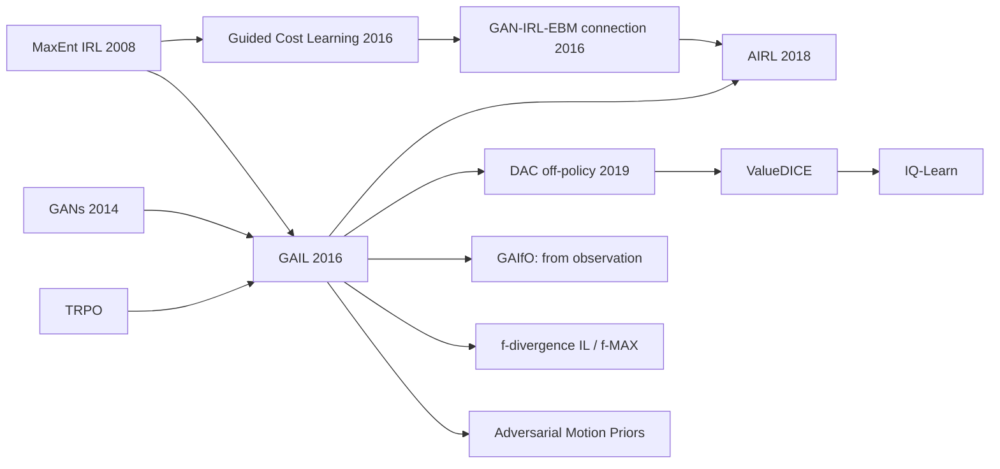

# Generative Adversarial Imitation Learning (GAIL) and Adversarial IRL (AIRL)
> Imitate an expert by training a policy so that a discriminator cannot tell its (state, action) pairs from the expert's. This is RL on a learned, adversarial reward, i.e. occupancy-measure matching. **Family:** Imitation learning → Adversarial imitation (IRL ∘ RL collapsed into one loop)  ·  **Year / origin:** Ho & Ermon, NeurIPS 2016 (Stanford); AIRL: Fu, Luo & Levine, ICLR 2018 (UC Berkeley)  ·  **On/Off-policy:** On-policy (TRPO/PPO inner loop); off-policy variants exist (DAC)  ·  **Action space:** Continuous and discrete

---

## 1. What is it?

[Behavior cloning](behavior-cloning-dagger.md) copies actions state-by-state and suffers compounding errors. [Inverse RL](inverse-rl.md) recovers a reward and then runs RL, which generalizes better but needs an expensive RL solve inside every reward update. **GAIL** gets most of IRL's benefits without the nested loop.

Ho & Ermon showed that "do MaxEnt IRL, then RL on the recovered reward" is equivalent to **finding a policy whose occupancy measure** (the distribution of visited state-action pairs) **matches the expert's**, as measured by a divergence determined by the reward regularizer. Choosing a particular regularizer turns that divergence into the **Jensen–Shannon divergence**, which a GAN discriminator can estimate. The algorithm becomes:

* a **discriminator** $D(s,a)$ is trained to distinguish expert pairs from policy pairs;
* the **policy** is trained by on-policy RL (TRPO in the paper, PPO today) with a reward that is high where $D$ is fooled.

Because the policy optimizes *long-horizon* returns under this reward, it learns to steer back toward expert-like states, so it does not suffer from BC's covariate-shift problem. GAIL was reported to reach near-expert performance on MuJoCo tasks from a small number of (subsampled) expert trajectories where BC needed many more.

**AIRL** (Adversarial IRL) restructures the discriminator so that, at optimum, it also yields a **reward function** that is disentangled from the dynamics and therefore transfers to new environments, something the GAIL discriminator does not provide.

## 2. Family & lineage



* **Parents:** MaxEnt IRL, apprenticeship learning (feature-expectation matching), GANs (Goodfellow et al., 2014), TRPO.
* **Siblings:** Guided Cost Learning and its GAN/energy-based model connection (Finn, Christiano, Abbeel & Levine, 2016); BC; DAgger; SQIL (Reddy et al., 2019, which gives reward 1 to expert transitions and 0 to the agent's own, then runs soft Q-learning).
* **Descendants:** AIRL; Discriminator-Actor-Critic (DAC, Kostrikov et al., 2019, off-policy and fixing absorbing-state reward bias); GAIfO (state-only, Torabi et al., 2018); f-divergence views (f-MAX, Ghasemipour et al., 2019); ValueDICE and IQ-Learn (non-adversarial occupancy matching); Adversarial Motion Priors for character animation and legged robots (Peng et al., 2021).

## 3. Core idea & intuition

**A forger and an art critic.** The policy is a forger producing "paintings", here trajectories of (state, action) pairs. The discriminator is a critic who has seen genuine expert paintings and scores how real each new one looks. The forger is rewarded for every brush-stroke the critic believes, and it plans whole paintings (with RL) to collect as much belief as possible. As the critic gets sharper, the forger must get closer to the real thing. At equilibrium, the forger's distribution of brush-strokes matches the expert's.

**Why this beats BC with few demonstrations.** BC only learns "in state $s$, do $a$" for states in the data. GAIL's reward says "being in expert-like states *and* doing expert-like things is good". If the policy drifts, the reward drops, and RL learns to *return* to expert-like regions, so recovery behavior is learned without anyone demonstrating it.

**Why it is harder in practice.** It inherits the instability of GANs (a too-strong discriminator gives a vanishing reward, a too-weak one gives noise) and the sample cost of on-policy RL (many environment interactions). In our toy demo BC actually wins, because the task is low-dimensional, the expert is deterministic and demonstrations are plentiful, which is exactly BC's best case. GAIL earns its keep with few demonstrations, long horizons, and stochastic dynamics.

**Reward sign matters (survival bias).** $-\log(1-D)$ is always positive, so it implicitly rewards *staying alive* (long episodes). $\log D$ is always negative, which rewards *ending early*. Neither is neutral in tasks with variable episode length. DAC addresses this by learning a reward for absorbing states, and AIRL's $\log D-\log(1-D)$ can take either sign.

## 4. Math / formal details

**Occupancy measure.** For policy $\pi$, $\rho_\pi(s,a) = \pi(a|s)\sum_{t=0}^\infty\gamma^t P(s_t=s\mid\pi)$. There is a one-to-one correspondence between policies and valid occupancy measures, and $\mathbb{E}_\pi[\sum_t\gamma^t c(s_t,a_t)] = \sum_{s,a}\rho_\pi(s,a)c(s,a)$.

**IRL as a saddle point.** With cost regularizer $\psi$ and causal entropy $H(\pi)=\mathbb{E}_\pi[-\log\pi(a|s)]$:
$$\mathrm{IRL}_\psi(\pi_E) = \arg\max_{c}\; -\psi(c) + \Big(\min_\pi -H(\pi) + \mathbb{E}_\pi[c]\Big) - \mathbb{E}_{\pi_E}[c],\qquad \mathrm{RL}(c) = \arg\min_\pi -H(\pi)+\mathbb{E}_\pi[c].$$
**Main result (Ho & Ermon, Prop. 3.2):**
$$\mathrm{RL}\circ\mathrm{IRL}_\psi(\pi_E) = \arg\min_\pi\; -H(\pi) + \psi^*(\rho_\pi - \rho_{\pi_E}),$$
where $\psi^*$ is the convex conjugate of $\psi$. So IRL followed by RL is **occupancy matching under the divergence $\psi^*$**. A constant $\psi$ gives exact occupancy matching (intractable in large spaces); apprenticeship learning corresponds to an indicator-function $\psi$ over linear costs.

**The GAIL regularizer.** Ho & Ermon choose a $\psi_{\mathrm{GA}}$ whose conjugate is
$$\psi^*_{\mathrm{GA}}(\rho_\pi-\rho_{\pi_E}) = \max_{D\in(0,1)^{\mathcal{S}\times\mathcal{A}}}\; \mathbb{E}_\pi[\log D(s,a)] + \mathbb{E}_{\pi_E}[\log(1-D(s,a))],$$
which equals (up to a constant) the Jensen–Shannon divergence $D_{\mathrm{JS}}(\rho_\pi\|\rho_{\pi_E})$ between normalized occupancies. The GAIL objective is the saddle point
$$\min_\pi\max_D\; \mathbb{E}_{\pi}[\log D(s,a)] + \mathbb{E}_{\pi_E}[\log(1-D(s,a))] - \lambda H(\pi).$$
*Convention note:* in the paper, $D$ outputs the probability that the pair came from **the policy**, and the policy minimizes the cost $\log D(s,a)$. Most code (including ours) flips it: $D(s,a)$ = probability of **expert**, discriminator trained with BCE (expert = 1), and policy reward
$$r(s,a) = -\log\big(1-D(s,a)\big)\quad(\text{or }\log D(s,a),\ \text{or } \log D - \log(1-D)).$$

**Policy step.** Any policy-gradient method on $r$. Ho & Ermon used TRPO with a KL trust region and GAE; PPO is the modern default:
$$\nabla_\theta J = \mathbb{E}_{\pi_\theta}\big[\nabla_\theta\log\pi_\theta(a|s)\,\hat A(s,a)\big] + \lambda\nabla_\theta H(\pi_\theta),\quad \hat A\text{ from GAE on } r(s,a).$$

**AIRL.** Uses a discriminator of the special form
$$D_{\theta,\phi}(s,a,s') = \frac{\exp f_{\theta,\phi}(s,a,s')}{\exp f_{\theta,\phi}(s,a,s') + \pi(a|s)},\qquad f_{\theta,\phi}(s,a,s') = g_\theta(s) + \gamma h_\phi(s') - h_\phi(s).$$
Then the policy reward
$$\hat r(s,a,s') = \log D - \log(1-D) = f_{\theta,\phi}(s,a,s') - \log\pi(a|s)$$
turns the policy objective into entropy-regularized RL on $f$. At optimum, $f^* = A^*(s,a)$ (the soft advantage) and, under conditions on the dynamics, the **state-only** term $g^*(s)$ recovers the true reward up to a constant, while $h^*$ recovers the soft value function (a shaping potential). Because $g$ doesn't absorb dynamics-dependent shaping, it transfers to environments with changed dynamics.

## 5. Algorithm (pseudocode)

```text
GAIL (PPO version)
Input: expert pairs D_E = {(s, a)}, policy pi_theta (+ value V), discriminator D_w
 1. for iteration = 1 .. N do
 2.     roll out pi_theta for a batch of trajectories: tau_i = {(s_t, a_t)}
 3.     for k = 1 .. K_D do                                  # discriminator
 4.         sample expert pairs B_E ~ D_E and policy pairs B_pi ~ tau
 5.         L_D = - mean_{B_E} log D_w(s,a) - mean_{B_pi} log(1 - D_w(s,a))
 6.         w <- w - lr_D * grad L_D
 7.     r_t <- -log(1 - D_w(s_t, a_t))                       # surrogate reward
 8.     compute advantages A_t with GAE(gamma, lambda) on r_t and V
 9.     PPO update of theta (clipped ratio objective, value loss, optional entropy bonus)
10. end for
11. return pi_theta

AIRL: replace step 5's D_w by D = exp(f)/(exp(f) + pi(a|s)) with f = g(s) + gamma h(s') - h(s),
      and step 7's reward by r = f(s,a,s') - log pi(a|s).  Keep g(s) as the transferable reward.
```

## 6. Python implementation

A goal-conditioned 2-D reaching task. The observation is position plus goal offset; the action is a velocity in $[-1,1]^2$. The expert flies straight at the goal and stops on it. The learner gets **20 expert trajectories** and *never sees the true reward* (negative distance to goal), which we use for evaluation only. The policy is trained with a minimal PPO on $r=-\log(1-D)$, with 5 discriminator steps per iteration and 64 parallel NumPy environments.

Runnable version: [`code/gail.py`](../../code/gail.py)

```python
"""
Generative Adversarial Imitation Learning (GAIL, Ho & Ermon 2016) in miniature.

Task: goal-conditioned 2-D reaching. Observation o = (x, y, gx-x, gy-y); action = velocity in
[-1,1]^2.  The learner NEVER sees the true reward; it only gets 20 expert demonstrations.

  * Discriminator D(s,a) is trained to tell expert (s,a) pairs from policy pairs.
  * The policy is trained with PPO on the surrogate reward r(s,a) = -log(1 - D(s,a)).
  * For evaluation only, we measure the true task cost: distance to the goal.

Also compares with behavior cloning (BC) on the same demos and with a random policy.

Run:  python3 code/gail.py     (roughly 40-100 s on CPU)
"""
import numpy as np
import torch
import torch.nn as nn
import torch.nn.functional as F

torch.set_num_threads(1)
np.random.seed(0)
torch.manual_seed(0)

STEP, HORIZON, N_ENVS = 0.1, 25, 64


# ----------------------------------------------------------------------------
# 1) Vectorised NumPy environment + scripted expert
# ----------------------------------------------------------------------------
class ReachEnv:
    def __init__(self, n):
        self.n = n

    def reset(self):
        self.pos = np.random.uniform(0, 1, (self.n, 2))
        self.goal = np.random.uniform(0, 1, (self.n, 2))
        self.t = 0
        return self.obs()

    def obs(self):
        # position + goal offset (relative coordinates make the problem easier for both D and pi)
        return np.concatenate([self.pos, self.goal - self.pos], 1).astype(np.float32)

    def step(self, a):
        self.pos = np.clip(self.pos + STEP * np.clip(a, -1, 1), 0, 1)
        self.t += 1
        true_r = -np.linalg.norm(self.pos - self.goal, axis=1)  # only used for evaluation
        return self.obs(), true_r, self.t >= HORIZON


def expert_policy(o):
    d = o[:, 2:]                     # goal offset
    dist = np.linalg.norm(d, axis=1, keepdims=True) + 1e-8
    return d / dist * np.minimum(1.0, dist / STEP)  # full speed, then slow down exactly onto goal


def collect_expert(n_episodes=20):
    env, S, A = ReachEnv(n_episodes), [], []
    o, done = env.reset(), False
    while not done:
        a = expert_policy(o)
        S.append(o); A.append(a)
        o, _, done = env.step(a)
    return torch.tensor(np.concatenate(S)), torch.tensor(np.concatenate(A), dtype=torch.float32)


# ----------------------------------------------------------------------------
# 2) Networks
# ----------------------------------------------------------------------------
def mlp(i, o, h=64):
    return nn.Sequential(nn.Linear(i, h), nn.Tanh(), nn.Linear(h, h), nn.Tanh(), nn.Linear(h, o))


class Policy(nn.Module):
    def __init__(self):
        super().__init__()
        self.mu, self.v = mlp(4, 2), mlp(4, 1)
        self.log_std = nn.Parameter(torch.full((2,), -0.5))

    def dist(self, o):
        return torch.distributions.Normal(self.mu(o), self.log_std.exp())


# ----------------------------------------------------------------------------
# 3) GAIL pieces: discriminator loss and surrogate reward
# ----------------------------------------------------------------------------
def discriminator_loss(D, s_exp, a_exp, s_pol, a_pol):
    """Binary cross-entropy: expert pairs -> label 1, policy pairs -> label 0."""
    logit_e = D(torch.cat([s_exp, a_exp], 1))
    logit_p = D(torch.cat([s_pol, a_pol], 1))
    return (F.binary_cross_entropy_with_logits(logit_e, torch.ones_like(logit_e)) +
            F.binary_cross_entropy_with_logits(logit_p, torch.zeros_like(logit_p)))


@torch.no_grad()
def gail_reward(D, s, a):
    """r = -log(1 - D(s,a)) = softplus(logit).  High when the pair 'looks expert'."""
    return F.softplus(D(torch.cat([s, a], 1))).squeeze(-1)


def ppo_update(pi, opt, obs, act, logp_old, adv, ret, epochs=4, mb=512, clip=0.2):
    adv = (adv - adv.mean()) / (adv.std() + 1e-8)
    n = obs.shape[0]
    for _ in range(epochs):
        for idx in torch.randperm(n).split(mb):
            d = pi.dist(obs[idx])
            logp = d.log_prob(act[idx]).sum(-1)
            ratio = (logp - logp_old[idx]).exp()
            pg = -torch.min(ratio * adv[idx], ratio.clamp(1 - clip, 1 + clip) * adv[idx]).mean()
            v_loss = F.mse_loss(pi.v(obs[idx]).squeeze(-1), ret[idx])
            loss = pg + 0.5 * v_loss          # (an entropy bonus is optional here)
            opt.zero_grad(); loss.backward(); opt.step()


def gae(rew, val, last_val, gamma=0.99, lam=0.95):
    T = rew.shape[0]
    adv, last = torch.zeros_like(rew), torch.zeros(rew.shape[1])
    for t in reversed(range(T)):
        nxt = last_val if t == T - 1 else val[t + 1]
        delta = rew[t] + gamma * nxt - val[t]   # fixed horizon: bootstrap the time-limit
        last = delta + gamma * lam * last
        adv[t] = last
    return adv, adv + val


def train_gail(s_exp, a_exp, iters=300):
    pi, D = Policy(), mlp(6, 1)
    opt_pi = torch.optim.Adam(pi.parameters(), lr=1e-3)
    opt_d = torch.optim.Adam(D.parameters(), lr=1e-3)
    env = ReachEnv(N_ENVS)
    for it in range(iters):
        O, A, LP, V = [], [], [], []
        o, done = env.reset(), False
        while not done:  # roll out the current policy
            ot = torch.tensor(o)
            with torch.no_grad():
                d = pi.dist(ot); a = d.sample()
                O.append(ot); A.append(a); LP.append(d.log_prob(a).sum(-1)); V.append(pi.v(ot).squeeze(-1))
            o, _, done = env.step(a.numpy())
        O, A, LP, V = map(torch.stack, (O, A, LP, V))       # [T, N, ...]
        flatO, flatA = O.reshape(-1, 4), A.reshape(-1, 2)
        # (1) a few discriminator steps (a weak D gives an uninformative reward)
        for _ in range(5):
            idx = torch.randint(0, s_exp.shape[0], (flatO.shape[0],))
            ld = discriminator_loss(D, s_exp[idx], a_exp[idx], flatO, flatA.clamp(-1, 1))
            opt_d.zero_grad(); ld.backward(); opt_d.step()
        # (2) PPO step on the discriminator reward
        R = gail_reward(D, flatO, flatA.clamp(-1, 1)).reshape(HORIZON, N_ENVS)
        with torch.no_grad():
            last_v = pi.v(torch.tensor(o)).squeeze(-1)
        adv, ret = gae(R, V, last_v)
        ppo_update(pi, opt_pi, flatO, flatA, LP.reshape(-1), adv.reshape(-1), ret.reshape(-1))
        if it % 50 == 0 or it == iters - 1:
            print(f"  iter {it:3d}  D loss {ld.item():.3f}   mean GAIL reward {R.mean():.3f}   "
                  f"true final dist {evaluate(lambda x: pi.mu(torch.tensor(x)).detach().numpy())[1]:.3f}")
    return pi


def train_bc(s_exp, a_exp, steps=2000):
    pi = Policy()
    opt = torch.optim.Adam(pi.parameters(), lr=1e-3)
    for _ in range(steps):
        idx = torch.randint(0, s_exp.shape[0], (256,))
        loss = F.mse_loss(pi.mu(s_exp[idx]), a_exp[idx])
        opt.zero_grad(); loss.backward(); opt.step()
    return pi


def evaluate(policy_fn, n=500):
    np_state = np.random.get_state()
    np.random.seed(123)  # same evaluation goals for every method
    env = ReachEnv(n)
    o, done, G = env.reset(), False, 0.0
    while not done:
        o, r, done = env.step(policy_fn(o))
        G += r
    np.random.set_state(np_state)
    return float(G.mean()), float(np.linalg.norm(env.pos - env.goal, axis=1).mean())


if __name__ == "__main__":
    s_exp, a_exp = collect_expert()
    print(f"Expert demos: {s_exp.shape[0]} (s,a) pairs from 20 episodes\n")
    print("Training GAIL ...")
    pi_gail = train_gail(s_exp, a_exp)
    pi_bc = train_bc(s_exp, a_exp)
    rows = [("expert", expert_policy),
            ("random", lambda o: np.random.uniform(-1, 1, (o.shape[0], 2))),
            ("behavior cloning", lambda o: pi_bc.mu(torch.tensor(o)).detach().numpy()),
            ("GAIL (PPO + discriminator)", lambda o: pi_gail.mu(torch.tensor(o)).detach().numpy())]
    print(f"\n{'policy':<28}{'true return':>12}{'final dist':>12}")
    for name, fn in rows:
        G, dist = evaluate(fn)
        print(f"{name:<28}{G:>12.2f}{dist:>12.3f}")
    print("\nGAIL never saw the true reward (distance); it learned purely by trying to make its\n"
          "(state, action) pairs indistinguishable from the expert's.")
```

Example output from our run (CPU, ~25 s):

```text
Expert demos: 500 (s,a) pairs from 20 episodes

Training GAIL ...
  iter   0  D loss 1.333   mean GAIL reward 0.624   true final dist 0.621
  iter  50  D loss 1.170   mean GAIL reward 0.643   true final dist 0.205
  iter 100  D loss 0.847   mean GAIL reward 0.406   true final dist 0.233
  iter 150  D loss 0.526   mean GAIL reward 0.258   true final dist 0.192
  iter 200  D loss 0.440   mean GAIL reward 0.226   true final dist 0.080
  iter 250  D loss 0.407   mean GAIL reward 0.219   true final dist 0.106
  iter 299  D loss 0.302   mean GAIL reward 0.154   true final dist 0.081

policy                       true return  final dist
expert                             -1.53       0.000
random                            -13.66       0.552
behavior cloning                   -1.52       0.003
GAIL (PPO + discriminator)         -3.15       0.081
```

GAIL learns to reach the goal (final distance 0.55 → 0.08) purely from the adversarial signal. Note two honest lessons:

1. **BC is better here.** The expert is deterministic, the state is 4-D, and 500 labeled pairs cover the space. BC's compounding-error problem barely bites, and GAIL pays for RL noise.
2. **The discriminator schedule matters.** With only 2 discriminator steps per iteration (our first attempt), the discriminator stayed near chance (loss ≈ 1.39 = 2 ln 2), the reward was uninformative, and the policy didn't learn. Watching the D-loss is the first debugging step.

**With a library.** `HumanCompatibleAI/imitation` provides GAIL/AIRL on top of Stable-Baselines3. *Requires `imitation`, `stable-baselines3`, `gymnasium`; not run here:*

```python
# pip install imitation stable-baselines3 gymnasium   (not run here)
from imitation.algorithms.adversarial.gail import GAIL
from imitation.rewards.reward_nets import BasicRewardNet
from imitation.util.networks import RunningNorm
from imitation.util.util import make_vec_env
from stable_baselines3 import PPO
import numpy as np

venv = make_vec_env("CartPole-v1", rng=np.random.default_rng(0), n_envs=8)
learner = PPO("MlpPolicy", venv, batch_size=64, n_epochs=4, learning_rate=4e-4)
reward_net = BasicRewardNet(venv.observation_space, venv.action_space, normalize_input_layer=RunningNorm)
trainer = GAIL(demonstrations=expert_rollouts,   # list of imitation.data.types.Trajectory
               demo_batch_size=1024, gen_replay_buffer_capacity=2048, n_disc_updates_per_round=4,
               venv=venv, gen_algo=learner, reward_net=reward_net)
trainer.train(total_timesteps=200_000)
```

## 7. Practical tips & hyperparameters

* **Balance D and π.** Monitor D's loss/accuracy. Near chance (≈1.39 total BCE) means the reward carries no signal, so do more D steps or raise its learning rate. Near 0 (D wins completely) means the reward saturates, so use fewer D steps, add a gradient penalty (as in DAC/WGAN-GP), label smoothing, or noise on D's inputs.
* **Typical settings:** 1–5 D updates per policy iteration; D learning rate 1e-4–1e-3; PPO with GAE λ≈0.95, γ≈0.99; small entropy bonus.
* **Normalize observations** (running mean/std) for both policy and discriminator.
* **Reward choice:** $-\log(1-D)$ (survival-biased, positive), $\log D$ (termination-biased, negative), or $\log D - \log(1-D)$ (AIRL-style, either sign). Match the choice to whether early termination is good or bad in your task, or use DAC's absorbing-state handling.
* **Pre-train with BC.** Initializing the policy with BC and then running GAIL often speeds things up a lot.
* **Off-policy for sample efficiency.** DAC (SAC/TD3 + discriminator on a replay buffer) can cut environment interactions by an order of magnitude versus on-policy GAIL, as reported by its authors.
* **State-only discriminators** (GAIfO, AMP) enable learning from videos or motion capture without action labels.
* **Avoid discriminator shortcuts:** D can latch onto trivial cues (timestep features, action-noise magnitude, absorbing states). Remove time features from D's input and evaluate the policy deterministically.
* **Evaluate on the true task metric**, not the GAIL reward. The GAIL reward is non-stationary and goes *down* as D improves (visible in our log).

## 8. Pros and cons

| Pros | Cons |
|---|---|
| Learns recovery behavior; robust to compounding errors | Needs environment interaction (on-policy RL): sample-hungry |
| Effective with few demonstrations | GAN-style instability; sensitive D/π balance |
| No hand-designed reward or features | GAIL's discriminator is not a transferable reward (AIRL fixes this partially) |
| Works with state-only demos (variants) | Reward-sign/survival biases with variable-length episodes |
| AIRL recovers a reward that transfers across dynamics | More moving parts than BC; often worse than BC when demos are plentiful |

## 9. When to use / when not to use

**Use GAIL/AIRL when**
* you have a simulator, few demonstrations, and long horizons where BC drifts;
* you can't (or don't want to) design a reward, but can run RL;
* you need natural-looking motion (AMP for animation and legged robots);
* (AIRL) you need a reward that transfers to modified dynamics or embodiments.

**Avoid / reconsider when**
* demonstrations are plentiful and cover deployment states: BC/DAgger is simpler and often better;
* environment interaction is impossible: use offline imitation (BC, ValueDICE-style, IQ-Learn offline) or offline RL;
* you need a stable, low-maintenance pipeline (consider SQIL or IQ-Learn).

## 10. Key papers, books & repos

* Ho & Ermon. **Generative Adversarial Imitation Learning.** NeurIPS 2016. arXiv:1606.03476.
* Fu, Luo, Levine. **Learning Robust Rewards with Adversarial Inverse Reinforcement Learning** (AIRL). ICLR 2018. arXiv:1710.11248.
* Finn, Christiano, Abbeel, Levine. **A Connection between Generative Adversarial Networks, Inverse Reinforcement Learning, and Energy-Based Models.** arXiv:1611.03852, 2016.
* Goodfellow et al. **Generative Adversarial Nets.** NeurIPS 2014.
* Kostrikov, Agrawal, Dwibedi, Levine, Tompson. **Discriminator-Actor-Critic: Addressing Sample Inefficiency and Reward Bias in Adversarial Imitation Learning.** ICLR 2019.
* Torabi, Warnell, Stone. **Generative Adversarial Imitation from Observation.** arXiv:1807.06158, 2018.
* Ghasemipour, Zemel, Gu. **A Divergence Minimization Perspective on Imitation Learning Methods.** CoRL 2019.
* Reddy, Dragan, Levine. **SQIL: Imitation Learning via Reinforcement Learning with Sparse Rewards.** ICLR 2020.
* Kostrikov, Nachum, Tompson. **Imitation Learning via Off-Policy Distribution Matching** (ValueDICE). ICLR 2020.
* Garg, Chakraborty, Cundy, Song, Ermon. **IQ-Learn: Inverse soft-Q Learning for Imitation.** NeurIPS 2021.
* Peng, Ma, Abbeel, Levine, Kanazawa. **AMP: Adversarial Motion Priors for Stylized Physics-Based Character Control.** SIGGRAPH 2021.
* Repos: `HumanCompatibleAI/imitation` (GAIL, AIRL, BC, DAgger), `openai/baselines` (contains a TRPO-based GAIL implementation), `justinjfu/inverse_rl` (original AIRL code), `Div99/IQ-Learn`.

## 11. For business users

**What it does.** GAIL teaches a system to behave like an expert by setting up a game between two AI components. One (the "trainee") acts; the other (the "inspector") tries to tell the trainee's behavior apart from recordings of the expert. The trainee is rewarded for fooling the inspector, and it practices in a simulator until its behavior is indistinguishable from the expert's.

**Analogy.** An apprentice chef cooks dishes while a food critic, who has tasted the master chef's food, tries to spot which plate is the apprentice's. Every time the critic is fooled, the apprentice gets a point. Over many rounds, the apprentice learns not just the recipes but how to rescue a dish that's going wrong, because rescuing it keeps the critic fooled.

**Use cases.** Realistic character animation and robot locomotion from motion-capture clips; human-like driving behavior in simulators; game AI that plays like humans; robots learning skills from a handful of demonstrations in simulation.

**Value / ROI.** Needs few demonstrations and no hand-written scoring rules, and it produces robust behavior that recovers from small mistakes.

**Risks.** Training is unstable and needs expertise to tune. It requires a simulator or safe practice environment and lots of trial runs (compute cost). The "inspector" can latch onto superficial differences. With plentiful demonstrations, simple imitation is often just as good and much cheaper.

**Costs.** Simulator plus significant compute for the RL loop; ML engineering time to stabilize training.

**Questions to ask your team.**
* How many demonstrations do we have? Have we tried plain behavior cloning first?
* Do we have a simulator where the system can practice safely?
* How will we measure success on the real task (not the inspector's score)?
* Do we need the learned objective to transfer to different hardware or conditions (then consider AIRL)?

## 12. For kids (ages ~8–12)

**The Dance-Off Judge.** You want to dance exactly like your favorite pop star. Your friend Maya has watched the star's videos a hundred times. She becomes the **judge**: you dance, and she guesses whether she's seeing the real star or you.

Every time Maya says "that looks like the real star!", you get a sticker. When she spots you ("that wobble wasn't the star!"), no sticker. You keep practicing to earn more stickers. And Maya keeps getting better at spotting fakes, so you have to keep getting better too!

After lots of rounds, your dancing looks so much like the star's that Maya just can't tell. That's GAIL!

**Try it yourself.** With a friend, pick a funny walk (like a penguin waddle) shown in a video. One person tries to copy it; the other closes their eyes, then opens them for 3 seconds and guesses "video-style or copy?". Swap roles. Who got good at fooling the judge?

**Recap.**
1. One player copies, one player judges.
2. Fooling the judge earns rewards.
3. Both get better until the copy looks just like the real thing.

## 13. Related methods

* [Behavior Cloning & DAgger](behavior-cloning-dagger.md): the simplest imitation baseline; DAgger needs a queryable expert, GAIL doesn't.
* [Inverse RL](inverse-rl.md): MaxEnt IRL, which GAIL implicitly performs.
* [PPO](../03-policy-gradient/ppo.md) and [TRPO](../03-policy-gradient/trpo.md): GAIL's inner-loop optimizers.
* [SAC](../04-off-policy-actor-critic/sac.md): used by off-policy adversarial imitation (DAC).
* [Reward modeling](../09-llm-preference-alignment/reward-modeling.md): learned rewards for LLMs; discriminator-style rewards also appear in LLM training.
* [On-policy distillation](../10-llm-reasoning-rl/on-policy-distillation.md): matching a teacher's distribution on the student's own samples, a cousin of occupancy matching.
* [Multi-agent RL](../08-exploration-hierarchical-multiagent/multi-agent-rl.md): adversarial training dynamics and equilibrium concepts.

[← Back to overview](../../RL_Methods_Overview.md)
