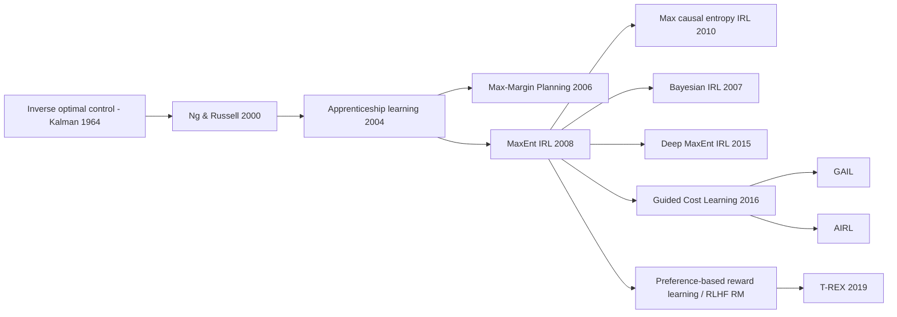

# Inverse Reinforcement Learning (IRL): Ng & Russell, Apprenticeship Learning, MaxEnt IRL
> Instead of copying what an expert does, infer *why*: recover a reward function under which the expert's behavior is (near-)optimal, then plan or do RL with it. **Family:** Imitation learning → Inverse RL (reward learning)  ·  **Year / origin:** Ng & Russell, ICML 2000 (UC Berkeley); Abbeel & Ng, ICML 2004 (Stanford); Ziebart, Maas, Bagnell & Dey, AAAI 2008 (Carnegie Mellon)  ·  **On/Off-policy:** Learns from fixed demonstrations; the inner planning/RL loop can be either  ·  **Action space:** Classic algorithms: discrete/tabular; deep variants: continuous

---

## 1. What is it?

Forward RL: *given a reward, find a good policy.* **Inverse RL: given (demonstrations of) a good policy, find the reward.**

Why bother, when [behavior cloning](behavior-cloning-dagger.md) can copy the actions directly?

* **Rewards transfer; action mappings don't.** A reward like "stay on the road, avoid lava, reach the goal" is defined over *features* of the world. It still makes sense on a new map, a new robot, or under new dynamics, where cloned state→action mappings break.
* **Rewards are succinct.** Russell (1998) argued the reward is "the most succinct, robust and transferable definition of the task".
* **Planning with a recovered reward avoids compounding errors**: the learned policy knows what to do in states the expert never visited.

The difficulty: IRL is **ill-posed**. Many rewards explain the same behavior. $R\equiv0$ makes every policy optimal; adding a constant or a potential-based shaping term changes nothing about optimal behavior. Each classic algorithm is essentially a way to pick *one* reasonable reward:

1. **Ng & Russell (2000):** characterize all rewards for which the expert policy is optimal (linear constraints) and pick the one that makes the expert *maximally better* than alternatives, with an $L_1$ penalty for simplicity (linear programming).
2. **Abbeel & Ng (2004), apprenticeship learning:** assume $R(s) = w^\top\phi(s)$ and don't insist on recovering the true $w$. Find a policy whose **feature expectations** match the expert's. Then, for *any* $w$ with $\|w\|\le1$, its value is within $\epsilon$ of the expert's.
3. **Ziebart et al. (2008), Maximum-Entropy IRL:** among all trajectory distributions that match the expert's feature expectations, pick the one with **maximum entropy**. This yields a probabilistic model $P(\tau)\propto\exp(w^\top f_\tau)$ that resolves ambiguity in a principled way and handles sub-optimal, noisy demonstrations. MaxEnt IRL is the foundation of almost all modern IRL (deep MaxEnt, guided cost learning, AIRL) and is closely related to reward modeling in RLHF.

## 2. Family & lineage



* **Parents:** inverse optimal control (Kalman, 1964), Russell's 1998 call for IRL, and forward RL / dynamic programming as the inner loop.
* **Siblings:** behavior cloning, GAIL (skips the explicit reward), Bayesian IRL (Ramachandran & Amir, 2007), Maximum-Margin Planning (Ratliff, Bagnell & Zinkevich, 2006).
* **Descendants:** maximum *causal* entropy IRL (Ziebart, Bagnell & Dey, 2010) for stochastic dynamics; deep MaxEnt IRL (Wulfmeier et al., 2015); guided cost learning (Finn, Levine & Abbeel, 2016); AIRL (Fu, Luo & Levine, 2018); **learning rewards from preferences/rankings** (Christiano et al., 2017; T-REX by Brown et al., 2019), which is the reward model of RLHF.

## 3. Core idea & intuition

Imagine you watch someone cross a park. They take the paved path even though cutting across the grass would be shorter, and they make a long detour around a pond. From that, you infer: grass is somewhat unpleasant, the pond is very unpleasant, getting to the other side is worth it. You inferred a reward.

**Feature matching.** If the reward is a weighted sum of features (on-grass, in-pond, at-goal...), then the expected *return* of any policy is $w^\top\mu(\pi)$, where $\mu(\pi)$ is the expected (discounted) feature count. **Two policies with the same feature counts get the same return under every such reward.** So "imitate the expert" can be reduced to "match the expert's feature counts". That's apprenticeship learning.

**Maximum entropy.** Many policies match the feature counts. MaxEnt IRL picks the *least committed* one, the trajectory distribution that assumes nothing beyond the matched statistics. The result is the exponential family $P(\tau)\propto\exp(R(\tau))$: higher-reward trajectories are exponentially more likely, but sub-optimal ones still have probability. This makes the model robust to noisy demonstrations and gives a clean likelihood to maximize. Its gradient is beautifully simple:
$$\nabla_w \log L = \underbrace{\text{expert's feature counts}}_{\text{observed}} - \underbrace{\text{model's expected feature counts}}_{\text{soft value iteration + forward pass}}.$$
Raise the weight of features the expert visits more than the model does, and vice versa.

**Link to RLHF.** RLHF reward models learn $r_\phi$ such that $P(y_w\succ y_l)=\sigma(r_\phi(y_w)-r_\phi(y_l))$ (Bradley–Terry). That's again "an exponential-family choice model whose energy is the reward", which is the MaxEnt idea applied to pairwise choices rather than whole demonstrations. RLHF is often described as *reward learning from human feedback*, and IRL is its intellectual ancestor. DPO then shows the policy itself can implicitly represent that reward, much as MaxEnt IRL's optimal policy is $\pi(a|s)\propto\exp(Q_{\text{soft}}(s,a))$.

## 4. Math / formal details

**Notation.** MDP without reward $(\mathcal{S},\mathcal{A},P,\gamma,p_0)$; expert policy $\pi_E$ (or demos $\mathcal{D}=\{\tau_i\}$); features $\phi:\mathcal{S}\to\mathbb{R}^k$; linear reward $R_w(s)=w^\top\phi(s)$.

**Ng & Russell (2000), finite MDP, known $\pi_E$.** Write $\mathbf{P}_a$ for the $|\mathcal{S}|\times|\mathcal{S}|$ transition matrix of action $a$, and relabel actions so that $\pi_E(s)=a_1$. Then $\pi_E$ is optimal for reward vector $\mathbf{R}$ iff
$$(\mathbf{P}_{a_1}-\mathbf{P}_a)(\mathbf{I}-\gamma\mathbf{P}_{a_1})^{-1}\mathbf{R}\;\succeq\;0\qquad\forall a\in\mathcal{A}\setminus\{a_1\}.$$
To avoid degenerate solutions (e.g. $\mathbf{R}=0$), solve the LP
$$\max_{\mathbf{R}}\;\sum_{s}\min_{a\ne a_1}\Big\{\big[(\mathbf{P}_{a_1}(s)-\mathbf{P}_a(s))(\mathbf{I}-\gamma\mathbf{P}_{a_1})^{-1}\mathbf{R}\big]\Big\} - \lambda\|\mathbf{R}\|_1 \quad\text{s.t. the constraints above},\; |R_i|\le R_{\max}.$$
They also give sampled-trajectory versions with linear function approximation.

**Feature expectations (Abbeel & Ng, 2004).**
$$\mu(\pi) = \mathbb{E}\Big[\sum_{t=0}^{\infty}\gamma^t\phi(s_t)\,\Big|\,\pi\Big],\qquad V_w(\pi) = w^\top\mu(\pi).$$
If $\|\mu(\tilde\pi)-\mu_E\|_2\le\epsilon$ and $\|w\|_2\le1$, then $|V_w(\tilde\pi)-V_w(\pi_E)|\le\epsilon$ (Cauchy–Schwarz).
*Max-margin iteration:* $t^{(i)} = \max_{\|w\|_2\le1}\min_{j<i} w^\top(\mu_E-\mu^{(j)})$, with $w^{(i)}$ the maximizer; compute $\pi^{(i)}$ = optimal policy for $R=w^{(i)\top}\phi$; stop when $t^{(i)}\le\epsilon$. *Projection variant:* $\bar\mu^{(i)}$ is the projection of $\mu_E$ onto the line through $\bar\mu^{(i-1)}$ and $\mu^{(i)}$, with $w^{(i)}=\mu_E-\bar\mu^{(i)}$. Output: a *mixture* of the found policies. At most $O\big(\frac{k}{(1-\gamma)^2\epsilon^2}\log\frac{k}{(1-\gamma)\epsilon}\big)$ iterations are needed.

**MaxEnt IRL (Ziebart et al., 2008).** For deterministic dynamics, with trajectory features $f_\tau = \sum_{s_t\in\tau}\phi(s_t)$:
$$P(\tau\mid w) = \frac{\exp(w^\top f_\tau)}{Z(w)},\qquad \max_w\; \mathcal{L}(w)=\sum_{\tau\in\mathcal{D}}\log P(\tau\mid w).$$
This is the maximum-entropy distribution subject to $\mathbb{E}_P[f_\tau] = \tilde f$ (the empirical expert feature count). The gradient is
$$\nabla_w\mathcal{L} = \tilde f - \sum_{\tau}P(\tau\mid w) f_\tau = \tilde f - \sum_{s} D_w(s)\,\phi(s),$$
where $D_w(s)$ are expected state-visitation frequencies, computed by dynamic programming:

* **Backward pass (soft value iteration),** finite horizon $T$:
$Q_t(s,a) = R_w(s) + \mathbb{E}_{s'\sim P(\cdot|s,a)}[V_{t+1}(s')]$, $V_t(s) = \log\sum_a\exp Q_t(s,a)$, $\pi_t(a|s) = \exp(Q_t(s,a)-V_t(s))$.
* **Forward pass:** $D_1 = p_0$; $D_{t+1}(s') = \sum_{s,a}D_t(s)\pi_t(a|s)P(s'|s,a)$; $D=\sum_t D_t$.

For stochastic dynamics, the **maximum causal entropy** formulation (Ziebart et al., 2010) gives exactly this soft-Bellman recursion (the trajectory-level version would wrongly let the agent "choose" lucky transitions). The log-likelihood is concave in $w$ for linear rewards. With neural rewards $R_\theta$ (deep MaxEnt IRL), the same gradient is backpropagated: $\nabla_\theta\mathcal{L} = \sum_s (\tilde D(s)-D_\theta(s))\nabla_\theta R_\theta(s)$.

**Identifiability.** Even with infinite data, rewards are identifiable at best up to transformations that preserve the (soft-)optimal policy: an additive constant (with fixed horizon), positive scaling (with the temperature), and potential-based shaping $F(s,s') = \gamma\Phi(s')-\Phi(s)$ (Ng, Harada & Russell, 1999). AIRL's disentangled reward is one attempt to pin this down. Our demo shows the shift ambiguity: the recovered weights match the true ones only after subtracting the "road" weight.

## 5. Algorithm (pseudocode)

```text
MaxEnt IRL (tabular, finite horizon T, linear reward r_w(s) = w . phi(s))
Input: demos D, features phi, dynamics P, learning rate eta
 1. f_E <- average over demos of sum_t phi(s_t)          # empirical feature counts
 2. p0  <- empirical start-state distribution
 3. w   <- 0
 4. repeat
 5.     r <- Phi w                                       # reward per state
 6.     # backward: soft value iteration -> time-indexed stochastic policies
 7.     V_T <- 0
 8.     for t = T-1 .. 0:  Q_t(s,a) = r(s) + sum_s' P(s'|s,a) V_{t+1}(s')
 9.                        V_t(s)   = logsumexp_a Q_t(s,a);  pi_t(a|s) = exp(Q_t - V_t)
10.     # forward: expected state-visitation frequencies
11.     d_0 <- p0;  D <- 0
12.     for t = 0 .. T-1:  D += d_t;  d_{t+1}(s') = sum_{s,a} d_t(s) pi_t(a|s) P(s'|s,a)
13.     grad <- f_E - Phi^T D
14.     w    <- w + eta * grad
15. until ||grad|| small
16. return w  (then plan / run RL with r_w)

Apprenticeship learning (projection variant)
 1. pick random pi_0; mu_0 <- mu(pi_0); mubar <- mu_0
 2. repeat: w <- mu_E - mubar;  t <- ||w||;  if t <= eps stop
 3.         pi_i <- RL with reward w . phi;  mu_i <- mu(pi_i)
 4.         mubar <- mubar + [(mu_i - mubar).(mu_E - mubar) / ||mu_i - mubar||^2] (mu_i - mubar)
 5. return a mixture of the pi_i that matches mu_E within eps
```

## 6. Python implementation

An 8×8 grid where every cell is *road*, *grass*, *lava* or the *goal*. The hidden true reward is linear in one-hot terrain features, $w_{\text{true}} = [0,-0.3,-2,+1]$. The expert acts soft-optimally on **map A**; we see only 300 of its trajectories. MaxEnt IRL recovers $w$. Then we **plan with the recovered reward on an unseen map B** and measure the *true* return, which is something a cloned state→action table could not do. Pure NumPy.

Runnable version: [`code/inverse_rl.py`](../../code/inverse_rl.py)

```python
"""
Maximum-Entropy Inverse RL (Ziebart, Maas, Bagnell & Dey, 2008) on a tiny gridworld,
in pure NumPy, plus a transfer test that shows WHY one would recover a reward instead
of just cloning actions.

Each cell has a terrain type: road, grass, lava, or goal. The (hidden) true reward is
linear in one-hot terrain features:  r(s) = w_true . phi(s).
The expert behaves (soft-)optimally for the true reward on MAP A; we observe only its
trajectories. MaxEnt IRL recovers w by matching expected feature counts.
Then we plan with the recovered reward on a NEW map B, which behavior cloning cannot
transfer to (the states are different), but a reward over features can.

Run:  python3 code/inverse_rl.py     (a few seconds)
"""
import numpy as np

rng = np.random.default_rng(0)
N, T = 8, 20                                   # grid size, horizon
MOVES = [(1, 0), (0, 1), (-1, 0), (0, -1), (0, 0)]  # R, U, L, D, stay
TYPES = ["road", "grass", "lava", "goal"]
W_TRUE = np.array([0.0, -0.3, -2.0, 1.0])      # hidden from the learner


def make_map(seed):
    r = np.random.default_rng(seed)
    terrain = r.choice(3, size=(N, N), p=[0.5, 0.35, 0.15])  # road / grass / lava
    terrain[N - 1, N - 1] = 3                                   # goal in the corner
    terrain[0, 0] = 0
    return terrain


def features(terrain):
    """phi: [S, F] one-hot terrain features, S = N*N."""
    return np.eye(len(TYPES))[terrain.reshape(-1)]


def transition_table():
    """Deterministic next-state index P[s, a]."""
    P = np.zeros((N * N, len(MOVES)), int)
    for x in range(N):
        for y in range(N):
            for a, (dx, dy) in enumerate(MOVES):
                nx, ny = min(max(x + dx, 0), N - 1), min(max(y + dy, 0), N - 1)
                P[x * N + y, a] = nx * N + ny
    return P


P = transition_table()


def soft_value_iteration(r, T=T):
    """Finite-horizon soft (MaxEnt) Bellman backup.
    Q_t(s,a) = r(s) + V_{t+1}(s'),   V_t(s) = log sum_a exp Q_t(s,a)
    Returns time-indexed stochastic policies pi_t(a|s) = exp(Q_t - V_t)."""
    V = np.zeros(N * N)
    policies = []
    for _ in range(T):
        Q = r[:, None] + V[P]                       # [S, A]
        V = np.logaddexp.reduce(Q, axis=1)
        policies.append(np.exp(Q - V[:, None]))
    return policies[::-1]                           # pi_0 ... pi_{T-1}


def expected_svf(policies, p0):
    """Forward pass: expected state-visitation counts D(s) = sum_t P(s_t = s)."""
    d, D = p0.copy(), np.zeros(N * N)
    for pi in policies:
        D += d
        d_next = np.zeros(N * N)
        for a in range(len(MOVES)):
            np.add.at(d_next, P[:, a], d * pi[:, a])
        d = d_next
    return D


def sample_demos(policies, starts, n):
    trajs = []
    for _ in range(n):
        s = starts[rng.integers(len(starts))]
        traj = [s]
        for pi in policies[:-1]:
            a = rng.choice(len(MOVES), p=pi[s])
            s = P[s, a]
            traj.append(s)
        trajs.append(traj)
    return trajs


def maxent_irl(phi, trajs, n_iters=300, lr=0.05):
    """Gradient ascent on the log-likelihood of demos under the MaxEnt model:
       grad L(w) = mu_expert - E_{pi_w}[ sum_t phi(s_t) ]."""
    mu_E = np.mean([phi[t].sum(0) for t in trajs], axis=0)
    p0 = np.bincount([t[0] for t in trajs], minlength=N * N) / len(trajs)
    w = np.zeros(phi.shape[1])
    for it in range(n_iters):
        policies = soft_value_iteration(phi @ w)
        mu_w = expected_svf(policies, p0) @ phi
        grad = mu_E - mu_w
        w += lr * grad
        if it % 100 == 0 or it == n_iters - 1:
            print(f"  iter {it:3d}  |feature-count gap| = {np.abs(grad).sum():.3f}")
    return w


def true_return(terrain, policies, starts):
    """Expected TRUE return of a (time-indexed) policy from uniform starts."""
    phi = features(terrain)
    p0 = np.zeros(N * N); p0[starts] = 1 / len(starts)
    return float(expected_svf(policies, p0) @ (phi @ W_TRUE))


def greedy(policies):
    """Turn soft policies into deterministic argmax policies (planning with the reward)."""
    return [np.eye(len(MOVES))[pi.argmax(1)] for pi in policies]


if __name__ == "__main__":
    A, B = make_map(1), make_map(7)
    starts = [x * N + y for x in range(3) for y in range(3)]  # bottom-left 3x3 block
    phiA = features(A)

    expert_pols = soft_value_iteration(phiA @ W_TRUE)
    demos = sample_demos(expert_pols, starts, n=300)
    print(f"Collected {len(demos)} expert demonstrations of length {T} on map A")

    print("\nRunning MaxEnt IRL ...")
    w = maxent_irl(phiA, demos)
    # Rewards are only identifiable up to shift (and scale, given temperature): compare shifted
    print("\n terrain   true w   learned w   (learned - learned[road])")
    for i, name in enumerate(TYPES):
        print(f" {name:<7}{W_TRUE[i]:>8.2f}{w[i]:>11.2f}{w[i] - w[0]:>12.2f}")

    print("\nExpected TRUE return from the same start states")
    print("  (soft = Boltzmann policy like the demonstrator; greedy = deterministic planner)")
    print(f"  {'map':<14}{'soft expert':>12}{'soft IRL':>10}{'greedy true-r':>15}{'greedy IRL-r':>14}{'random':>8}")
    for name, terrain in [("A (train)", A), ("B (new)", B)]:
        phi = features(terrain)
        row = [true_return(terrain, soft_value_iteration(phi @ W_TRUE), starts),
               true_return(terrain, soft_value_iteration(phi @ w), starts),
               true_return(terrain, greedy(soft_value_iteration(phi @ W_TRUE)), starts),
               true_return(terrain, greedy(soft_value_iteration(phi @ w)), starts),
               true_return(terrain, [np.full((N * N, 5), 0.2)] * T, starts)]
        print(f"  {name:<14}" + "".join(f"{v:>{wd}.2f}" for v, wd in zip(row, [12, 10, 15, 14, 8])))
    print("\nThe recovered reward transfers to a new layout because it is a function of terrain\n"
          "features, not of particular cells: that is the main selling point of IRL over BC.")
```

Example output from our run (well under a second):

```text
Collected 300 expert demonstrations of length 20 on map A

Running MaxEnt IRL ...
  iter   0  |feature-count gap| = 7.198
  iter 100  |feature-count gap| = 0.128
  iter 200  |feature-count gap| = 0.019
  iter 299  |feature-count gap| = 0.003

 terrain   true w   learned w   (learned - learned[road])
 road       0.00       0.32        0.00
 grass     -0.30       0.06       -0.26
 lava      -2.00      -1.72       -2.04
 goal       1.00       1.34        1.01

Expected TRUE return from the same start states
  (soft = Boltzmann policy like the demonstrator; greedy = deterministic planner)
  map            soft expert  soft IRL  greedy true-r  greedy IRL-r  random
  A (train)            -2.11     -2.13           4.89          4.82   -8.81
  B (new)              -2.11     -2.13           3.91          3.91   -9.98
```

Observations:

* The learned weights equal the true ones **up to an additive constant** (+0.32), which is exactly the expected non-identifiability for a fixed-horizon problem.
* Planning with the recovered reward on the **new** map B achieves the optimal true return (3.91), so the reward transfers.
* With fewer demonstrations (we tried 100), the recovered goal weight was noticeably off (0.90 vs 1.0), and the greedy planner's return on map B dropped a lot. Small reward errors can flip discrete decisions. Validate learned rewards by the behavior they induce, not just by eye.

## 7. Practical tips & hyperparameters

* **Feature design is half the battle** for linear IRL. If the true reward isn't (approximately) in your feature span, feature matching still yields a policy that matches the expert on *those* features, but not more.
* **Use MaxEnt (or causal-entropy) IRL by default.** It handles sub-optimal demos and gives a convex objective for linear rewards. Use the *causal* version when dynamics are stochastic.
* **Learning rate / optimizer:** plain gradient ascent with lr 0.01–0.1 on normalized features works for tabular problems; exponentiated gradient or Adam also work. Watch the feature-count gap: it should shrink monotonically.
* **Horizon and discount** must match how the expert behaved. A horizon that is too short makes distant goals look unattractive.
* **The inner loop is expensive.** Every gradient step requires solving a (soft) RL problem. Deep IRL variants (GCL, AIRL) interleave a few policy-optimization steps per reward update instead of solving to convergence.
* **Regularize neural rewards** (weight decay, gradient penalty, state-only rewards) to avoid degenerate rewards that overfit the demonstrations.
* **Evaluate by downstream behavior:** train a fresh policy on the learned reward (ideally in a *new* environment variant) and measure true task success. Reward correlation with ground truth (EPIC distance, Gleave et al., 2021) is another option.
* **Preferences are often easier to collect than demonstrations.** If experts can't demonstrate (e.g. a backflip), ask them to compare behaviors; this is the RLHF reward-model route.

## 8. Pros and cons

| Pros | Cons |
|---|---|
| Recovers *intent*; rewards transfer to new layouts/dynamics/embodiments | Ill-posed: rewards are identifiable only up to shaping/shift/scale |
| Planning with the reward avoids BC's compounding errors | Each reward update needs an inner RL/planning solve (expensive) |
| MaxEnt: principled handling of noisy, sub-optimal experts; convex for linear rewards | Classic algorithms need known dynamics and enumerable states |
| Interpretable (linear weights on meaningful features) | Feature design (linear) or overfitting (neural) problems |
| Foundation of reward learning in RLHF | Learned rewards can be exploited by the optimizer (reward hacking) |

## 9. When to use / when not to use

**Use IRL when**
* you need the behavior to generalize to new environments, maps, or dynamics;
* you want an interpretable account of *what experts value* (e.g. driver preference modeling, route choice, pedestrian prediction; Ziebart's original application was taxi-driver route prediction);
* you'll keep improving the policy with RL afterwards, and need a reward to do it.

**Avoid / reconsider when**
* you only need to reproduce behavior in the same environment: BC/DAgger is far cheaper;
* you have no simulator or dynamics model for the inner loop: consider offline IRL variants, GAIL-style methods, or preference-based reward modeling;
* demonstrations are scarce *and* the reward space is rich: the ambiguity will dominate.

## 10. Key papers, books & repos

* Ng & Russell. **Algorithms for Inverse Reinforcement Learning.** ICML 2000.
* Abbeel & Ng. **Apprenticeship Learning via Inverse Reinforcement Learning.** ICML 2004.
* Ratliff, Bagnell, Zinkevich. **Maximum Margin Planning.** ICML 2006.
* Ramachandran & Amir. **Bayesian Inverse Reinforcement Learning.** IJCAI 2007.
* Ziebart, Maas, Bagnell, Dey. **Maximum Entropy Inverse Reinforcement Learning.** AAAI 2008.
* Ziebart, Bagnell, Dey. **Modeling Interaction via the Principle of Maximum Causal Entropy.** ICML 2010.
* Ng, Harada, Russell. **Policy Invariance under Reward Transformations: Theory and Application to Reward Shaping.** ICML 1999.
* Wulfmeier, Ondruska, Posner. **Maximum Entropy Deep Inverse Reinforcement Learning.** arXiv:1507.04888, 2015.
* Finn, Levine, Abbeel. **Guided Cost Learning: Deep Inverse Optimal Control via Policy Optimization.** ICML 2016.
* Christiano, Leike, Brown, Martic, Legg, Amodei. **Deep Reinforcement Learning from Human Preferences.** NeurIPS 2017.
* Brown, Goo, Nagarajan, Niekum. **Extrapolating Beyond Suboptimal Demonstrations via Inverse RL from Observations** (T-REX). ICML 2019.
* Arora & Doshi. **A Survey of Inverse Reinforcement Learning: Challenges, Methods and Progress.** Artificial Intelligence, 2021.
* Sutton & Barto (2nd ed., 2018): Ch. 17.4 (Designing reward signals, which mentions inverse RL and learning from demonstrations); soft/entropy-regularized values relate to Ch. 13 policy parameterizations.
* Repos: `HumanCompatibleAI/imitation` (MCE-IRL, AIRL, GAIL, preference comparisons), `HumanCompatibleAI/evaluating-rewards` (EPIC), `anthropics/hh-rlhf` (preference data for reward models), `huggingface/trl` (`RewardTrainer`).

## 11. For business users

**What it does.** Inverse RL looks at how skilled people (or systems) behave and **infers what they are trying to achieve**: the trade-offs, priorities and "costs" they implicitly weigh. That inferred objective can then drive automated decision-making, including in situations the experts never encountered.

**Analogy.** Copying a chess grandmaster's moves (behavior cloning) helps only in positions you've seen them play. Understanding their *principles*, like "control the center, keep the king safe", lets you play well in brand-new positions. IRL extracts the principles.

**Use cases.** Modeling driver and pedestrian preferences for autonomous-vehicle planning; route recommendation that matches how real drivers trade time against tolls and road types; robot task learning that must transfer to new layouts; understanding operator priorities in industrial control; and, in modern AI, **reward models for RLHF**, which learn "what humans prefer" from comparisons and steer LLM training.

**Value / ROI.** Better generalization than pure imitation, interpretable insight into expert priorities, and a reusable objective you can keep optimizing (for example, to outperform average experts).

**Risks.** Several different objectives can explain the same behavior, so the inferred one may be subtly wrong. Optimizing a slightly-wrong objective hard can produce odd or unsafe behavior ("reward hacking"). Inference is compute-heavy and needs a simulator or a model of the environment.

**Costs.** More engineering and compute than imitation: an inner optimization loop, careful feature/reward design, and evaluation in new scenarios.

**Questions to ask your team.**
* Will the system need to operate in situations not covered by our demonstrations?
* How will we validate that the inferred objective matches what experts actually value?
* Do we have a simulator or environment model for the optimization loop?
* What safeguards catch the policy exploiting quirks of the learned objective?

## 12. For kids (ages ~8–12)

**Detective Puppy.** Your friend's puppy, Biscuit, always runs around the mud puddle, never through it. He always stops at the red ball, and he never goes near the vacuum cleaner. You never asked Biscuit what he likes — but you can figure it out like a detective!

* Biscuit goes around puddles → he doesn't like mud.
* He always ends up at the red ball → he LOVES the red ball.
* He stays far from the vacuum → the vacuum is scary!

That's inverse RL: watching what someone does and **figuring out what they like and dislike**. Now, if Biscuit visits a brand-new backyard, you can guess where he'll go, even though you've never seen him there!

**Try it yourself.** Watch a family member choose snacks for a few days (or a character in a game choose paths). Write down what they pick and what they skip. Make a "secret likes" list. Then predict their next choice. Were you right?

**Recap.**
1. Watching choices tells you what someone values.
2. Once you know what they value, you can guess what they'd do anywhere.
3. Careful: different "likes lists" can explain the same choices!

## 13. Related methods

* [Behavior Cloning & DAgger](behavior-cloning-dagger.md): copy actions directly.
* [GAIL](gail.md): adversarial imitation that implicitly does MaxEnt IRL + RL in one loop; AIRL recovers rewards.
* [Reward modeling](../09-llm-preference-alignment/reward-modeling.md): learning rewards from human preferences, the RLHF descendant of IRL.
* [RLHF-PPO](../09-llm-preference-alignment/rlhf-ppo.md) and [DPO](../09-llm-preference-alignment/dpo.md): optimizing (implicit) learned rewards.
* [Safety: RL reward hacking](../09-llm-preference-alignment/safety-rl-reward-hacking.md): what happens when a learned reward is optimized too hard.
* [SAC](../04-off-policy-actor-critic/sac.md): maximum-entropy RL, the forward counterpart of MaxEnt IRL's soft Bellman equations.
* [Dynamic programming](../01-foundations-tabular/dynamic-programming.md): the inner-loop planner in tabular IRL.

[← Back to overview](../../RL_Methods_Overview.md)
