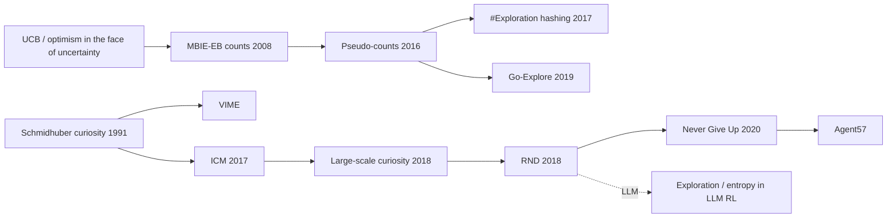

# Curiosity & Intrinsic Motivation: Count-Based Bonuses, ICM, RND, Go-Explore
> When rewards are sparse, pay the agent for *novelty*: a bonus that is large in rarely visited or poorly predicted states drives directed exploration until the real reward is found. **Family:** Exploration → Intrinsic motivation (count-based / prediction-error / archive-based)  ·  **Year / origin:** Count bonuses: MBIE-EB (Strehl & Littman, 2008), pseudo-counts (Bellemare et al., 2016, DeepMind); ICM: Pathak, Agrawal, Efros & Darrell, ICML 2017 (UC Berkeley); RND: Burda, Edwards, Storkey & Klimov, 2018 / ICLR 2019 (OpenAI); Go-Explore: Ecoffet et al., 2019 (Uber AI Labs)  ·  **On/Off-policy:** Bonus is algorithm-agnostic (used with PPO, A3C, DQN, R2D2)  ·  **Action space:** Any

---

## 1. What is it?

Most RL algorithms explore by **dithering**: ε-greedy, Gaussian action noise, or an entropy bonus. Dithering performs a random walk. If the first reward is hundreds of correct steps away (Montezuma's Revenge, a long corridor, a maze, a theorem whose first proof step is non-obvious), a random walk essentially never finds it, and with zero reward there is zero gradient.

**Intrinsic motivation** adds an exploration bonus $r^{\text{int}}_t$ to the task reward:
$$r_t = r^{\text{ext}}_t + \beta\, r^{\text{int}}_t,$$
where $r^{\text{int}}$ is high in states that are *novel* or *surprising*. The agent then actively seeks out unexplored regions, and its exploration is **directed** rather than random. Four main designs:

* **Count-based:** $r^{\text{int}} = 1/\sqrt{N(s)}$ (or $N(s,a)$). Provably efficient in tabular MDPs (MBIE-EB, UCB-style). For large state spaces, use **pseudo-counts** from a density model (Bellemare et al., 2016) or hash-based counts (Tang et al., 2017).
* **Prediction error / curiosity (ICM):** learn a forward model of the dynamics in a learned feature space and reward its prediction error. The features are trained with an **inverse model** (predict the action from consecutive states), so they ignore parts of the observation the agent cannot affect (leaves blowing in the wind).
* **Random Network Distillation (RND):** a fixed random network $f$ maps observations to features; a predictor $\hat f$ is trained to imitate it on visited states. The error $\|\hat f(s)-f(s)\|^2$ is high on unfamiliar states, which acts like a learned, generalizing count. RND avoids learning a dynamics model and the problems that come with stochastic transitions. It was the first method reported to exceed average human performance on Montezuma's Revenge without demonstrations or privileged state.
* **Go-Explore:** keep an explicit **archive** of discovered "cells" (downsampled states). Repeatedly *return* to a promising cell (by restoring the simulator state or with a goal-conditioned policy), then *explore* from it. This addresses "detachment" (forgetting frontiers) and "derailment" (failing to get back to them). It reported large score gains on Montezuma's Revenge and Pitfall.

## 2. Family & lineage



* **Parents:** optimism under uncertainty (UCB, R-max, optimistic initial values: Sutton & Barto §2.6–2.7), Schmidhuber's curiosity (1991), information-gain methods (VIME, Houthooft et al., 2016).
* **Siblings:** Bayesian/posterior sampling exploration (bootstrapped DQN, Osband et al., 2016), noisy networks (parameter noise), maximum-entropy RL (SAC; not directed exploration).
* **Descendants:** "Large-Scale Study of Curiosity-Driven Learning" (Burda et al., 2019), Never Give Up (episodic + lifelong novelty, Badia et al., 2020), Agent57 (Badia et al., 2020, above human baseline on all 57 Atari games), Go-Explore (Nature 2021 version: "First return, then explore"), skill-discovery methods (DIAYN), and exploration techniques for LLM RL.

## 3. Core idea & intuition

**Novelty as reward.** Imagine exploring a new city with no map. A tourist who wanders randomly keeps re-visiting the same few streets near the hotel. A curious tourist deliberately heads for streets they haven't seen. Count-based bonuses formalize "I've been here 20 times, it's boring; that street I've never seen is exciting". As every street becomes familiar, the bonus fades and the agent goes back to the task reward.

**Prediction error as a proxy for counts.** In big state spaces (pixels) no state repeats exactly, so you can't count. But a neural network trained on visited data has **low error on inputs similar to its training data and high error on unfamiliar ones**. Any trained predictor's error is therefore a soft, generalizing novelty count. The key design question is *what* to predict:

| Predict... | Problem |
|---|---|
| next raw observation (pixels) | dominated by unpredictable, irrelevant detail |
| next state in *inverse-model features* (ICM) | features keep only what the agent controls, but the forward model is still confused by truly stochastic transitions |
| output of a fixed random network (RND) | deterministic target, so the error goes to zero with familiarity regardless of dynamics noise |

**The noisy-TV problem.** If the environment contains a source of irreducible randomness (a TV showing static, a coin flip), a forward-model curiosity agent keeps getting high prediction error there, so it sits and watches TV forever. ICM partially fixes this (the TV isn't controllable, so inverse features ignore it). RND avoids it if the TV's observations become familiar, though an agent that can *change channels* can still get stuck. Burda et al. (2019) demonstrate the problem explicitly.

**Two value heads.** RND separates extrinsic and intrinsic returns with two value heads. The intrinsic return is treated as **non-episodic** (dying doesn't end curiosity, which prevents the agent from learning to die to restart near the start), with different discounts per head. Our demo uses the same idea with two Q-tables.

**The optimism connection.** Count bonuses are a form of *optimism in the face of uncertainty*: unknown things are assumed to be good until proven otherwise. In a small table, simply initializing values optimistically already gives directed exploration (Sutton & Barto §2.6). Our demo shows this: optimism alone solves the corridor. Learned bonuses exist for state spaces too large to enumerate.

## 4. Math / formal details

**Augmented objective.**
$$J(\pi) = \mathbb{E}_\pi\Big[\sum_t \gamma_E^t\, r^{\text{ext}}_t\Big] + \beta\,\mathbb{E}_\pi\Big[\sum_t\gamma_I^t\, r^{\text{int}}_t\Big].$$

**Count-based (MBIE-EB, Strehl & Littman, 2008).** Bonus $\beta/\sqrt{N(s,a)}$ added to the empirical reward in a model-based planner; PAC-MDP sample-complexity guarantees in finite MDPs. Deep version with **pseudo-counts** (Bellemare et al., 2016): for a density model $\rho_n$ trained on visited states, with recoding probability $\rho'_n(s)$ (density after one more update on $s$),
$$\hat N_n(s) = \frac{\rho_n(s)\,(1-\rho'_n(s))}{\rho'_n(s)-\rho_n(s)},\qquad r^{\text{int}} = \frac{\beta}{\sqrt{\hat N_n(s)+0.01}}.$$

**ICM (Pathak et al., 2017).** Encoder $\phi$, inverse model $g$, forward model $f$:
$$\hat a_t = g\big(\phi(s_t),\phi(s_{t+1});\theta_I\big),\quad L_I = \mathrm{CE}(\hat a_t, a_t);\qquad \hat\phi(s_{t+1}) = f\big(\phi(s_t),a_t;\theta_F\big),\quad L_F = \tfrac12\|\hat\phi(s_{t+1})-\phi(s_{t+1})\|_2^2,$$
$$r^{\text{int}}_t = \frac{\eta}{2}\,\|\hat\phi(s_{t+1})-\phi(s_{t+1})\|_2^2,\qquad \min_{\theta_P,\theta_I,\theta_F}\; -\lambda\,\mathbb{E}_{\pi_{\theta_P}}\Big[\sum_t r_t\Big] + (1-\beta)L_I + \beta L_F,$$
with the forward loss not back-propagated into $\phi$ (so features are shaped only by the inverse task). The paper used $\beta=0.2$, $\lambda=0.1$.

**RND (Burda et al., 2018).** Fixed random target $f:\mathcal{O}\to\mathbb{R}^k$, predictor $\hat f_\theta$:
$$r^{\text{int}}_t = \big\|\hat f_\theta(o_{t+1}) - f(o_{t+1})\big\|^2,\qquad \min_\theta\;\mathbb{E}_{o\sim\text{visited}}\big\|\hat f_\theta(o)-f(o)\big\|^2.$$
Practical details from the paper: observations are whitened (running mean/std, clipped) before both networks; intrinsic rewards are divided by a running estimate of the std of the *intrinsic return*; separate value heads $V_E, V_I$ with $\gamma_E = 0.999$, $\gamma_I = 0.99$; PPO with advantage $A = 2A_E + A_I$ (reported coefficients); the predictor is trained on only a fraction of each batch so it doesn't learn too fast.

**Why RND ≈ counts.** For a finite set of inputs and a sufficiently expressive predictor trained by SGD, the expected squared error on an input decays roughly with how often that input (and similar inputs) appeared in training. That is a generalizing count with a built-in similarity metric given by the networks' inductive bias.

**Go-Explore.** Archive $\mathcal{A}$ of cells $c=\text{cell}(s)$, each with (best score, trajectory to reach it, visit counts). Select a cell with probability decreasing in its visit counts (e.g. $\propto 1/\sqrt{N_c+1}$), return to it, explore randomly for $k$ steps, add or update cells. Then *robustify* the best trajectory into a policy with imitation learning (the "backward algorithm", learning from progressively earlier starting points).

## 5. Algorithm (pseudocode)

```text
RL with an intrinsic bonus (RND flavour, two value heads)
Input: policy pi, value heads V_E, V_I, target f (frozen random), predictor f_hat, coefficient beta
 1. initialise observation normaliser with a few random steps
 2. for iteration = 1 .. N do
 3.     collect a rollout with pi: (o_t, a_t, r_ext_t, o_{t+1}, done_t)
 4.     r_int_t <- || f_hat(norm(o_{t+1})) - f(norm(o_{t+1})) ||^2
 5.     r_int_t <- r_int_t / running_std(intrinsic returns)
 6.     A_E <- GAE(r_ext, V_E, gamma_E, episodic)          # resets at episode end
 7.     A_I <- GAE(r_int, V_I, gamma_I, non-episodic)      # no reset at episode end
 8.     A   <- c_E * A_E + c_I * A_I
 9.     PPO update of pi with A; regress V_E, V_I onto their returns
10.     train f_hat to minimise || f_hat(o) - f(o) ||^2 on (a fraction of) the batch
11. end for

ICM: replace step 4 by  r_int = eta/2 * || F(phi(o_t), a_t) - phi(o_{t+1}) ||^2  and step 10 by
     minimising (1 - b) * InverseLoss + b * ForwardLoss.
Count-based: r_int = 1 / sqrt(N(cell(o_{t+1}))) with a table or hash of cells.
```

## 6. Python implementation

A 30×4 corridor with the only reward (+1) at the far corner and an 80-step limit. A random walk essentially never reaches it. To keep everything fast and the comparison clean, the agent is **two-headed Q-learning with replay**, which mirrors RND's two value heads:

* $Q_{\text{ext}}$: episodic task value; $Q_{\text{int}}$: non-episodic novelty value, **initialized optimistically**. That is the tabular stand-in for a neural $Q_{\text{int}}$ generalizing to untried actions; with a zero-initialized table, untried actions always look *worse* than tried ones that once paid a bonus.
* Behavior: ε-greedy on $Q_{\text{ext}} + \beta Q_{\text{int}}$. Evaluation: greedy on $Q_{\text{ext}}$ only.
* Intrinsic rewards are **recomputed at replay time**, so familiar states stop paying, which is crucial.
* Bonus modules: a count table, and ICM and RND implemented as small PyTorch networks on a one-hot observation.

Runnable version: [`code/curiosity_icm_rnd.py`](../../code/curiosity_icm_rnd.py)

```python
"""
Exploration bonuses on a sparse-reward corridor: none vs. count-based vs. ICM vs. RND.

Environment: a 30 x 4 corridor. Start at the left end, a single reward +1 at the far right
corner, 80-step time limit.  A random walk essentially never reaches the reward.

Agent: Q-learning with a replay buffer and TWO value tables, as in RND's two value heads:
    Q_ext  learns the extrinsic (task) return (episodic),
    Q_int  learns the intrinsic (novelty) return (non-episodic), initialised optimistically,
           which is the tabular stand-in for a neural Q_int generalising to unseen actions,
    behaviour = epsilon-greedy on  Q_ext + BETA * Q_int ;  evaluation = greedy on Q_ext.
The intrinsic reward modules are small PyTorch networks (count-based is a table):

  * count-based : r_int = 1 / sqrt(N(s'))                          (MBIE-EB style)
  * ICM         : r_int = 1/2 || f_fwd(phi(s), a) - phi(s') ||^2   (Pathak et al., 2017)
  * RND         : r_int = || f_pred(s') - f_target(s') ||^2        (Burda et al., 2018)

Run:  python3 code/curiosity_icm_rnd.py    (roughly 30-90 s on CPU)
"""
import numpy as np
import torch
import torch.nn as nn
import torch.nn.functional as F

torch.set_num_threads(1)

LX, LY, HORIZON = 30, 4, 80
MOVES = np.array([[1, 0], [0, 1], [-1, 0], [0, -1]])
N_STATES, N_ACT = LX * LY, 4
OBS_DIM = LX + LY                     # observation = one-hot(x) ++ one-hot(y)
GOAL = (LX - 1, LY - 1)


class Corridor:
    def reset(self):
        self.pos, self.t = np.array([0, 0]), 0
        return tuple(self.pos)

    def step(self, a):
        self.pos = np.clip(self.pos + MOVES[a], 0, [LX - 1, LY - 1])
        self.t += 1
        s = tuple(self.pos)
        r = 1.0 if s == GOAL else 0.0
        return s, r, (r > 0) or self.t >= HORIZON, r > 0


def obs(cells):
    """Batch of cells -> float tensor of one-hot features [B, LX+LY]."""
    cells = np.asarray(cells).reshape(-1, 2)
    return torch.tensor(np.concatenate([np.eye(LX)[cells[:, 0]], np.eye(LY)[cells[:, 1]]], 1),
                        dtype=torch.float32)


def mlp(i, o, h=64):
    return nn.Sequential(nn.Linear(i, h), nn.ReLU(), nn.Linear(h, o))


# ----------------------------------------------------------------------------
# Intrinsic-reward modules.  bonus(S, A, S2) -> array of CURRENT novelty for a batch;
# update(S, A, S2) trains the module; observe(s2) lets the count table count.
# ----------------------------------------------------------------------------
class NoBonus:
    def observe(self, s2):
        pass

    def bonus(self, S, A, S2):
        return np.zeros(len(S2))

    def update(self, S, A, S2):
        pass


class CountBonus(NoBonus):
    def __init__(self):
        self.n = np.zeros((LX, LY))

    def observe(self, s2):
        self.n[s2] += 1

    def bonus(self, S, A, S2):
        S2 = np.asarray(S2)
        return 1.0 / np.sqrt(np.maximum(self.n[S2[:, 0], S2[:, 1]], 1))


class RND(NoBonus):
    """A fixed, randomly initialised target network f and a trained predictor f_hat.
    Prediction error is high on rarely-seen inputs and decays as they become familiar."""

    def __init__(self, k=16, lr=1e-3):
        self.target, self.pred = mlp(OBS_DIM, k), mlp(OBS_DIM, k)
        for p in self.target.parameters():
            p.requires_grad_(False)
        self.opt = torch.optim.Adam(self.pred.parameters(), lr=lr)

    def error(self, S2):
        x = obs(S2)
        return ((self.pred(x) - self.target(x)) ** 2).sum(-1)

    def bonus(self, S, A, S2):
        with torch.no_grad():
            return self.error(S2).numpy()

    def update(self, S, A, S2):
        loss = self.error(S2).mean()
        self.opt.zero_grad(); loss.backward(); self.opt.step()


class ICM(NoBonus):
    """Features phi trained by an inverse model (predict a from s, s'); the curiosity
    reward is the error of a forward model that predicts phi(s') from phi(s) and a."""

    def __init__(self, k=16, lr=1e-3, beta=0.2):
        self.phi, self.inv, self.fwd = mlp(OBS_DIM, k), mlp(2 * k, N_ACT), mlp(k + N_ACT, k)
        self.beta = beta
        params = [*self.phi.parameters(), *self.inv.parameters(), *self.fwd.parameters()]
        self.opt = torch.optim.Adam(params, lr=lr)

    def losses(self, S, A, S2):
        f, f2 = self.phi(obs(S)), self.phi(obs(S2))
        a1h = F.one_hot(torch.as_tensor(A), N_ACT).float()
        fwd_err = 0.5 * ((self.fwd(torch.cat([f, a1h], -1)) - f2.detach()) ** 2).sum(-1)
        inv_loss = F.cross_entropy(self.inv(torch.cat([f, f2], -1)), torch.as_tensor(A))
        return fwd_err, inv_loss

    def bonus(self, S, A, S2):
        with torch.no_grad():
            return self.losses(S, A, S2)[0].numpy()

    def update(self, S, A, S2):
        fwd_err, inv_loss = self.losses(S, A, S2)
        loss = (1 - self.beta) * inv_loss + self.beta * fwd_err.mean()
        self.opt.zero_grad(); loss.backward(); self.opt.step()


# ----------------------------------------------------------------------------
# Agent: two-headed Q-learning with replay
# ----------------------------------------------------------------------------
def run(bonus_mod, episodes=250, beta=1.0, eps=0.1, alpha=0.5, gamma=0.98, replay_k=8, seed=0, q_int_init=None):
    rng = np.random.default_rng(seed)
    torch.manual_seed(seed)
    if q_int_init is None:
        q_int_init = 1.0 / (1 - gamma)  # optimistic: 'every untried action is maximally novel forever'
    Qe, Qi = np.zeros((LX, LY, N_ACT)), np.full((LX, LY, N_ACT), q_int_init)
    buf, visited, first_goal, int_scale = [], np.zeros((LX, LY), bool), None, None
    env = Corridor()
    for ep in range(episodes):
        s, done = env.reset(), False
        while not done:
            q = Qe[s] + beta * Qi[s]
            a = int(rng.integers(N_ACT)) if rng.random() < eps else int(rng.choice(np.flatnonzero(q == q.max())))
            s2, r, done, term = env.step(a)
            bonus_mod.observe(s2)
            buf.append((s, a, r, s2, term))
            visited[s2] = True
            if r > 0 and first_goal is None:
                first_goal = ep
            # replay: online transition + a few random old ones (fast reward propagation).
            # Intrinsic rewards are recomputed NOW, so familiar states stop paying a bonus.
            batch = [buf[-1]] + [buf[i] for i in rng.integers(len(buf), size=replay_k)]
            S, A, R, S2, Tm = zip(*batch)
            r_int = bonus_mod.bonus(list(S), list(A), list(S2))
            if int_scale is None and r_int.max() > 0:
                int_scale = float(r_int.max())     # fixed normaliser: first bonus seen ~ 1
            r_int = r_int / int_scale if int_scale else r_int
            for (bs, ba, br, bs2, bt), bri in zip(batch, r_int):
                Qe[bs][ba] += alpha * (br + gamma * (1 - bt) * Qe[bs2].max() - Qe[bs][ba])
                Qi[bs][ba] += alpha * (bri + gamma * Qi[bs2].max() - Qi[bs][ba])  # non-episodic intrinsic
            if len(buf) % 16 == 0:  # train the bonus network on recent transitions
                S, A, _, S2, _ = zip(*buf[-64:])
                bonus_mod.update(list(S), list(A), list(S2))
            s = s2
    # greedy evaluation on the EXTRINSIC value only
    s, done, solved, steps = env.reset(), False, False, 0
    while not done:
        s, r, done, term = env.step(int(Qe[s].argmax()))
        solved, steps = solved or term, steps + 1
    return visited.mean(), first_goal, solved, steps


if __name__ == "__main__":
    print(f"{LX}x{LY} corridor, reward only at the far corner, horizon {HORIZON}, 250 episodes")
    print(f"{'bonus':<19}{'cells visited':>15}{'first reward (episode)':>24}{'greedy solves':>15}{'steps':>7}")
    variants = [("none (eps-greedy)", NoBonus(), 0.0),       # beta = 0: Q_int ignored
                ("optimism only", NoBonus(), 1.0),           # optimistic Q_int, zero bonus
                ("count", CountBonus(), 1.0),
                ("ICM", ICM(), 1.0),
                ("RND", RND(), 1.0)]
    for name, mod, beta in variants:
        cov, fg, solved, steps = run(mod, beta=beta)
        print(f"{name:<19}{100*cov:>14.0f}%{str(fg):>24}{('yes' if solved else 'no'):>15}{steps:>7}")
    print("\nEpsilon-greedy dithering almost never finds the reward. Directed exploration (optimism,\n"
          "counts, RND) sweeps the corridor; once the reward is found, the separate extrinsic Q-table\n"
          f"lets the greedy policy exploit it (optimal path = {LX - 1 + LY - 1} steps). In a small table,\n"
          "optimism ~ counts is enough; learned bonuses (RND/ICM) exist for spaces too big to count.\n"
          "ICM's forward model generalises across this simple deterministic grid, so its bonus fades fast.")
```

Example output from our run (CPU, ~20 s):

```text
30x4 corridor, reward only at the far corner, horizon 80, 250 episodes
bonus                cells visited  first reward (episode)  greedy solves  steps
none (eps-greedy)              77%                    None             no     80
optimism only                 100%                      10            yes     32
count                         100%                      23            yes     32
ICM                            83%                    None             no     80
RND                           100%                      23            yes     32
```

Honest reading:

* **Dithering fails**: ε-greedy never sees the reward in 250 episodes.
* **Optimism, counts and RND all solve it** and the greedy policy takes the optimal 32-step path. In a tiny table, optimism alone is the fastest; that's the classical result that counts ≈ optimism. RND matches the count bonus, which illustrates that it behaves like a learned count.
* **ICM fails here.** On this simple deterministic grid, its forward model generalizes across cells ("moving right shifts the x one-hot") and its bonus fades everywhere before the frontier is reached. ICM was designed for high-dimensional observations with distractors, where its inverse-model features matter. Picking the bonus to match the problem matters.
* During development, two implementation details mattered more than the choice of bonus: (1) storing bonuses in the replay buffer instead of recomputing them made agents loop around the start; (2) a zero-initialized $Q_{\text{int}}$ made all bonuses *anti*-exploratory.

**Link to LLM RL: exploration and entropy collapse.** In RL fine-tuning of LLMs (RLHF, RLVR with GRPO/PPO), "exploration" means sampling diverse reasoning paths. A widely reported failure is **entropy collapse**: token-level policy entropy drops quickly, the model becomes over-confident, samples within a group become near-identical (so group-relative advantages vanish), and improvement plateaus. Mitigations used in practice include asymmetric "clip-higher" ratios (DAPO), entropy or KL-covariance regularization, higher sampling temperature, filtering prompts whose samples are all correct or all wrong, and diversity- or novelty-style bonuses. A related debate concerns whether RLVR mostly *sharpens* the base model's existing distribution (pass@1 rises, while pass@k for large k may not) rather than discovering new strategies. That is exactly the exploration question this page is about. A minimal entropy-monitoring helper as used in such trainers:

```python
import torch

def token_entropy(logits, mask):
    """Mean per-token policy entropy over response tokens: watch this during LLM RL.
    logits [B, T, V], mask [B, T] (1 on generated tokens)."""
    logp = torch.log_softmax(logits.float(), dim=-1)
    ent = -(logp.exp() * logp).sum(-1)                     # [B, T]
    return (ent * mask).sum() / mask.sum().clamp(min=1)

logits = torch.randn(2, 6, 50); mask = torch.ones(2, 6)
print(f"entropy = {token_entropy(logits, mask):.3f} nats (uniform would be {torch.log(torch.tensor(50.)):.3f})")
```

## 7. Practical tips & hyperparameters

* **Normalize everything.** Whiten observations for the bonus networks and scale intrinsic rewards by a running std of intrinsic returns. Without this, β is meaningless and changes over training.
* **β (intrinsic coefficient):** RND reported extrinsic:intrinsic advantage weights of 2:1. In general, tune so the bonus matters early but the task reward dominates once found.
* **Non-episodic intrinsic returns** (RND) avoid the agent learning that dying/resetting is a cheap way to get back to novel start states, but they can make the agent risk-seeking. Use separate value heads and discounts.
* **Recompute or decay bonuses.** Stale bonuses in replay buffers keep paying for states that are no longer novel.
* **Predictor learning speed:** if the RND predictor learns too fast, novelty vanishes before the policy can exploit it. Train it on a subset of each batch (RND used a fraction) or use a lower learning rate.
* **Beware noisy TVs:** stochastic or uncontrollable observation components attract prediction-error bonuses. Use ICM-style controllable features, RND, or episodic novelty (NGU).
* **Episodic vs lifelong novelty:** NGU combines a per-episode novelty (k-NN in an embedding) with RND's lifelong novelty. This helps in procedurally generated or "come back next episode" settings.
* **Deterministic, resettable simulators** make Go-Explore's "return" step trivial (restore state), which is often the most effective exploration strategy when available.
* **Debug signals:** coverage (unique cells/states visited), bonus magnitude over time (should decay in explored areas), and time to first extrinsic reward.

## 8. Pros and cons

| Pros | Cons |
|---|---|
| Turns undirected dithering into directed exploration | Adds hyperparameters (β, normalization, discounts) and extra networks |
| Plug-in: works with almost any RL algorithm | Can distract from the task (bonus hacking, noisy-TV traps) |
| RND is simple, cheap and robust to stochastic dynamics | Prediction-error bonuses depend heavily on representation |
| Large gains on hard-exploration benchmarks (Montezuma, Pitfall) | Non-stationary rewards complicate value learning |
| Count/optimism methods have theory in tabular MDPs | Go-Explore's best version relies on simulator state restoration |

## 9. When to use / when not to use

**Use intrinsic bonuses when**
* rewards are sparse or deceptive and dithering never finds them;
* you need broad state coverage (e.g. pre-training an exploratory policy, collecting diverse offline data);
* you can't shape the reward safely by hand.

**Avoid / reconsider when**
* rewards are dense and informative: bonuses just add noise;
* the environment has lots of uncontrollable randomness and you can't use RND/episodic novelty;
* exploration is unsafe in the real world: curiosity will seek out exactly the unusual states you'd rather avoid;
* you have demonstrations: imitation or demo-seeded replay is usually a cheaper way past hard exploration.

## 10. Key papers, books & repos

* Schmidhuber. **A Possibility for Implementing Curiosity and Boredom in Model-Building Neural Controllers.** SAB 1991.
* Strehl & Littman. **An Analysis of Model-Based Interval Estimation for Markov Decision Processes** (MBIE-EB). JCSS 2008.
* Bellemare, Srinivasan, Ostrovski, Schaul, Saxton, Munos. **Unifying Count-Based Exploration and Intrinsic Motivation.** NeurIPS 2016.
* Tang et al. **#Exploration: A Study of Count-Based Exploration for Deep Reinforcement Learning.** NeurIPS 2017.
* Houthooft et al. **VIME: Variational Information Maximizing Exploration.** NeurIPS 2016.
* Pathak, Agrawal, Efros, Darrell. **Curiosity-driven Exploration by Self-supervised Prediction** (ICM). ICML 2017. arXiv:1705.05363.
* Burda, Edwards, Pathak, Storkey, Darrell, Efros. **Large-Scale Study of Curiosity-Driven Learning.** ICLR 2019. arXiv:1808.04355.
* Burda, Edwards, Storkey, Klimov. **Exploration by Random Network Distillation.** ICLR 2019. arXiv:1810.12894.
* Badia et al. **Never Give Up: Learning Directed Exploration Strategies.** ICLR 2020; Badia et al. **Agent57: Outperforming the Atari Human Benchmark.** ICML 2020.
* Ecoffet, Huizinga, Lehman, Stanley, Clune. **Go-Explore: a New Approach for Hard-Exploration Problems.** arXiv:1901.10995, 2019; **First return, then explore.** Nature 2021.
* Osband, Blundell, Pritzel, Van Roy. **Deep Exploration via Bootstrapped DQN.** NeurIPS 2016.
* Yu et al. **DAPO: An Open-Source LLM Reinforcement Learning System at Scale.** arXiv 2025 (clip-higher against entropy collapse).
* Cui et al. **The Entropy Mechanism of Reinforcement Learning for Reasoning Language Models.** arXiv 2025 (analysis of entropy collapse in LLM RL; covariance-based regularizers).
* Sutton & Barto (2nd ed., 2018): Ch. 2.6 (optimistic initial values), 2.7 (UCB), 8.3 (Dyna-Q+ exploration bonus $\kappa\sqrt{\tau}$), 17.4 (designing reward signals / intrinsic motivation).
* Repos: `pathak22/noreward-rl` (ICM), `openai/large-scale-curiosity`, `openai/random-network-distillation`, `uber-research/go-explore`, `vwxyzjn/cleanrl` (`ppo_rnd_envpool.py`), `volcengine/verl` and `huggingface/trl` (entropy logging/regularization knobs for LLM RL).

## 11. For business users

**What it does.** Some problems give feedback only at the very end, such as "the whole assembly works" or "the customer finally converts". A learning system trying random things almost never gets there, so it never learns. Curiosity methods give the system a small internal reward for **trying genuinely new things**, so it explores systematically instead of repeating itself, until it stumbles on what actually succeeds.

**Analogy.** A new employee told only "increase sales" might keep calling the same three customers. A curious employee deliberately tries new segments, channels and pitches, and gets bored of what they already know. They find the winning approach far sooner. Once they find it, they focus on it.

**Use cases.** Game testing (automatically exploring levels to find bugs and unreachable areas); robotics skill discovery in simulation; automated software/GUI testing and fuzzing-style exploration; scientific search (materials, molecules) where hits are rare; keeping LLM reasoning training from collapsing into one narrow style of answer.

**Value / ROI.** Solves problems that standard trial-and-error learning can't solve at all in reasonable time, and produces broad coverage (useful for testing and data collection).

**Risks.** "Curious" systems seek out unusual situations, which is bad in the physical world without safety limits. They can get fascinated by meaningless randomness. Extra tuning is needed so curiosity fades once the goal is found.

**Costs.** Small extra compute (a second network) and engineering for tuning; most valuable in simulators.

**Questions to ask your team.**
* Is our reward sparse enough that standard exploration fails? What's the evidence?
* Are we exploring in simulation or the real world? What are the safety limits?
* How do we measure exploration (coverage) separately from task success?
* In LLM RL: are we tracking entropy and sample diversity, and what do we do if they collapse?

## 12. For kids (ages ~8–12)

**The Curious Kitten.** A kitten named Pixel lives in a big house. Somewhere, in the farthest room, there's a treat, but Pixel doesn't know where. A bored kitten would just walk in little circles near its bed and never find it.

But Pixel is **curious**! Every time Pixel sees a room it has never seen before, it feels a little "ooh, new!" happy feeling. Rooms it has visited a hundred times feel boring. So Pixel keeps heading toward places it hasn't explored... down the hall... up the stairs... into the farthest room... TREAT! Now Pixel remembers where the treat is and goes straight there every time.

**Try it yourself.** Play "hot or new". Hide a coin in one of 20 cups in a long row. A friend starts at one end. Version 1: they flip a coin at each step to decide left or right. Version 2: they must always move toward cups they haven't checked yet. Which version finds the coin faster?

**Recap.**
1. Some treasures are too far away to find by wandering randomly.
2. Liking "new" places makes you explore on purpose.
3. Once the treasure is found, the "new" feeling fades and you go straight for the treasure.

## 13. Related methods

* [Multi-armed bandits](../01-foundations-tabular/multi-armed-bandits.md): UCB and optimistic initialization, the roots of count bonuses.
* [Dyna-Q](../01-foundations-tabular/dyna-q.md): Dyna-Q+ uses a time-since-visit exploration bonus.
* [PPO](../03-policy-gradient/ppo.md): the RL algorithm RND and ICM were mostly used with.
* [DQN](../02-deep-value-based/dqn.md) / [Rainbow](../02-deep-value-based/rainbow-dqn.md): ε-greedy and noisy-net baselines.
* [Hierarchical RL](hierarchical-rl.md): temporally extended actions also help exploration.
* [World Models / Dreamer](../05-model-based/world-models-dreamer.md): model-based uncertainty for exploration (e.g. Plan2Explore).
* [GRPO](../10-llm-reasoning-rl/grpo.md), [DAPO / Dr. GRPO](../10-llm-reasoning-rl/dapo-dr-grpo.md), [RLVR](../10-llm-reasoning-rl/rlvr.md): where entropy collapse and exploration matter for LLMs.
* [SAC](../04-off-policy-actor-critic/sac.md): entropy regularization (undirected) vs. novelty bonuses (directed).

[← Back to overview](../../RL_Methods_Overview.md)
