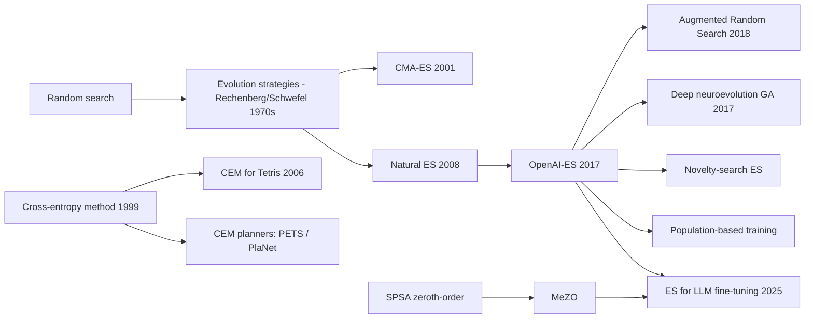

# Evolution Strategies & Black-Box Policy Search (CEM, OpenAI-ES / NES, CMA-ES)
> Optimize policy parameters directly from episode returns: sample perturbed parameter vectors, evaluate them, and move the search distribution toward the better ones. No value functions and no backpropagation through the policy or the environment. **Family:** Policy search → Derivative-free / zeroth-order optimization (evolutionary methods)  ·  **Year / origin:** CEM: Rubinstein, 1999 (applied to RL by Szita & Lőrincz, 2006); CMA-ES: Hansen & Ostermeier, 2001; NES: Wierstra et al., 2008/2014; OpenAI-ES: Salimans, Ho, Chen, Sidor & Sutskever, arXiv 2017 (OpenAI)  ·  **On/Off-policy:** On-policy (each candidate is evaluated by fresh rollouts)  ·  **Action space:** Any (the policy is a black box)

---

## 1. What is it?

Most of this knowledge base optimizes policies with **gradients of the policy's log-probabilities** (policy gradients) or **value functions** (Q-learning, actor-critic). Evolution strategies (ES) and related **black-box** methods take a different stance: treat the whole episode as a function $F(\theta)$ (parameters → return) and optimize it *without looking inside*:

1. Sample a population of parameter vectors around the current search distribution.
2. Run each one for an episode (or a few) and record the total return (its **fitness**).
3. Update the search distribution toward high-fitness samples.

Three representative algorithms:

* **Cross-Entropy Method (CEM):** keep the top-$k$ "elite" samples and refit a Gaussian (mean and per-dimension std) to them. Very simple and very effective in low dimension. It is famous in RL for Tetris (Szita & Lőrincz, 2006) and is widely used inside model-based planners (PETS, PlaNet).
* **OpenAI-ES / Natural Evolution Strategies (NES):** estimate the gradient of the *smoothed* objective $\mathbb{E}_{\epsilon}[F(\theta+\sigma\epsilon)]$ with Gaussian perturbations, then take gradient steps (e.g. Adam). Salimans et al. (2017) showed this scales almost linearly across **over a thousand CPU workers**, because workers only exchange scalar returns and random seeds, and reported ES to be competitive with RL baselines on MuJoCo and Atari in wall-clock time.
* **CMA-ES (Covariance Matrix Adaptation):** adapt a full covariance matrix and a global step size using evolution paths. It is the gold standard for black-box optimization in tens to a few hundred dimensions (e.g. the controller in Ha & Schmidhuber's *World Models* was trained with CMA-ES).

**Why use them for RL?** They don't care about reward sparsity within an episode, horizon length, discounting, non-differentiable components, or whether actions are discrete. They are trivially parallel, and they explore in *parameter space*, which gives temporally consistent behavior. The cost is **sample inefficiency** in high dimensions: the gradient estimate's variance grows with the number of parameters.

**ES for LLM fine-tuning.** Zeroth-order methods have recently been applied to large language models. MeZO (Malladi et al., NeurIPS 2023) fine-tuned LMs with a memory-efficient zeroth-order SGD (SPSA-style two-point estimates) using only forward passes. In 2025, Qiu et al. ("Evolution Strategies at Scale: LLM Fine-Tuning Beyond Reinforcement Learning") reported that a plain ES variant can fine-tune the **full parameters of billion-parameter LLMs** with modest population sizes, and compared it favorably with RL fine-tuning (PPO/GRPO) on reasoning benchmarks in terms of sample efficiency, robustness and stability, as reported by the authors. Treat these as emerging results.

## 2. Family & lineage



* **Parents:** random search, classical evolution strategies (Rechenberg, Schwefel), genetic algorithms, SPSA (simultaneous perturbation stochastic approximation, Spall, 1992), the cross-entropy method for rare-event simulation (Rubinstein).
* **Siblings:** REINFORCE (likelihood-ratio gradients in *action* space vs. ES's in *parameter* space), Augmented Random Search (ARS, Mania et al., 2018: linear policies, competitive on MuJoCo), deep neuroevolution genetic algorithms (Such et al., 2017), PEPG, Bayesian optimization (for very few parameters).
* **Descendants:** novelty-search ES (NS-ES, Conti et al., 2018), guided ES, persistent ES for unrolled computation graphs, population-based training of hyperparameters (Jaderberg et al., 2017), and ES/zeroth-order fine-tuning of LLMs.

## 3. Core idea & intuition

**Hot-and-cold with a crowd.** You're blindfolded on a hilly field and want to reach the top. Send 50 friends to random spots around you; each shouts their altitude. Step in the direction where the friends stood higher. That's ES. You never measured a slope directly, but the crowd's altitudes give a *smoothed* gradient.

Three ways to use the crowd:

* **CEM:** "Move to the average position of the 10 highest friends, and spread the next crowd as widely as those 10 were spread."
* **OpenAI-ES:** "Weight each friend's direction by how high they were (by rank), add it all up, and take a step of fixed size."
* **CMA-ES:** "Also learn the *shape* of the crowd. If the ridge runs diagonally, stretch the crowd along the ridge, and grow or shrink the crowd depending on whether recent steps kept pointing the same way."

**Parameter-space vs action-space exploration.** Policy gradients add noise to *actions* at every step and must figure out which of thousands of noisy actions mattered (credit assignment, variance growing with horizon). ES adds noise to the *parameters* once per episode, so behavior is consistent within the episode and variance doesn't depend on horizon length, but it grows with the number of parameters. That is why ES shines for long horizons, sparse or delayed rewards, and compact policies, and struggles for million-parameter networks without massive parallelism.

**Why the LLM results are interesting.** LLM fine-tuning with RL has a long-horizon, sparse-reward flavor (one reward per long response), and RL there brings its own instabilities (entropy collapse, reward hacking at the token level). ES sidesteps token-level credit assignment entirely, and inference-only evaluation is cheap in memory. The surprise in the 2025 work was that ES did not need astronomically many samples at billion-parameter scale, as reported by the authors.

## 4. Math / formal details

**Objective.** Return $F(\theta)=\mathbb{E}[\sum_t r_t\mid\pi_\theta]$; we may only *evaluate* $F$ (noisily).

**Gaussian smoothing and the ES gradient.** Define $J(\theta)=\mathbb{E}_{\epsilon\sim\mathcal{N}(0,I)}[F(\theta+\sigma\epsilon)]$. By the log-likelihood trick on the search distribution $\mathcal{N}(\theta,\sigma^2I)$:
$$\nabla_\theta J(\theta) = \frac{1}{\sigma}\,\mathbb{E}_{\epsilon\sim\mathcal{N}(0,I)}\big[F(\theta+\sigma\epsilon)\,\epsilon\big]\;\approx\;\frac{1}{n\sigma}\sum_{i=1}^n F_i\,\epsilon_i .$$
**Antithetic (mirrored) sampling** uses pairs $\pm\epsilon_i$:
$$\hat g = \frac{1}{2n\sigma}\sum_{i=1}^{n}\big[F(\theta+\sigma\epsilon_i)-F(\theta-\sigma\epsilon_i)\big]\epsilon_i,$$
which cancels the even-order terms of the Taylor expansion and reduces variance. **Fitness shaping**: replace $F_i$ by centered ranks $u_i\in[-0.5,0.5]$, which makes the update invariant to monotone transformations of the reward and robust to outliers. Salimans et al. also used weight decay, and **virtual batch normalization** for Atari.

**Natural ES view.** For a search distribution $p_\psi(\theta)$, NES follows the natural gradient $F_\psi^{-1}\nabla_\psi\mathbb{E}_{p_\psi}[F(\theta)]$ (with $F_\psi$ the Fisher matrix). With fixed isotropic $\sigma$ the natural gradient for the mean coincides (up to scale) with the plain gradient above.

**Communication trick.** All workers share the random-number generator seeds. A worker broadcasts only its scalar return $F_i$; every worker reconstructs all $\epsilon_i$ locally and applies the identical update. Bandwidth is $O(n)$ scalars per iteration, independent of parameter count.

**CEM.** Search distribution $\mathcal{N}(\mu,\mathrm{diag}(\sigma^2))$. Sample $\theta_i$, keep the elite set $\mathcal{E}$ (top $\rho$ fraction), refit
$$\mu\leftarrow\frac1{|\mathcal{E}|}\sum_{i\in\mathcal{E}}\theta_i,\qquad \sigma^2\leftarrow\frac{1}{|\mathcal{E}|}\sum_{i\in\mathcal{E}}(\theta_i-\mu)^2 + Z_t,$$
where the added noise $Z_t$ (Szita & Lőrincz's trick) prevents premature collapse of the variance. Smoothed updates $\mu\leftarrow\alpha\mu_{\text{new}}+(1-\alpha)\mu$ are also common.

**CMA-ES** (Hansen's $(\mu/\mu_w,\lambda)$ version). Sample $y_k\sim\mathcal{N}(0,C)$, $x_k=m+\sigma y_k$, $k=1..\lambda$; rank by fitness; with recombination weights $w_i$ (log-decreasing, $\sum w_i=1$, effective size $\mu_{\text{eff}}=1/\sum w_i^2$) and $\langle y\rangle_w=\sum_{i=1}^{\mu}w_i y_{i:\lambda}$:
$$m\leftarrow m+\sigma\langle y\rangle_w$$
$$p_\sigma\leftarrow(1-c_\sigma)p_\sigma+\sqrt{c_\sigma(2-c_\sigma)\mu_{\text{eff}}}\;C^{-1/2}\langle y\rangle_w,\qquad \sigma\leftarrow\sigma\exp\!\Big(\frac{c_\sigma}{d_\sigma}\Big(\frac{\|p_\sigma\|}{\mathbb{E}\|\mathcal{N}(0,I)\|}-1\Big)\Big)$$
$$p_c\leftarrow(1-c_c)p_c+h_\sigma\sqrt{c_c(2-c_c)\mu_{\text{eff}}}\;\langle y\rangle_w$$
$$C\leftarrow(1-c_1-c_\mu)C + c_1\big(p_cp_c^\top + (1-h_\sigma)c_c(2-c_c)C\big) + c_\mu\sum_{i=1}^{\mu}w_i\,y_{i:\lambda}y_{i:\lambda}^\top .$$
The rank-one term ($c_1$) learns the direction of consistent progress; the rank-$\mu$ term ($c_\mu$) learns the covariance of successful steps; step-size control (cumulative step-size adaptation) lengthens $\sigma$ when consecutive steps are correlated and shortens it when they cancel. Default population $\lambda=4+\lfloor3\ln n\rfloor$. Cost per generation is $O(n^2)$ memory and up to $O(n^3)$ for the eigendecomposition, which is why CMA-ES is limited to modest $n$ (sep-CMA and low-rank variants extend it).

## 5. Algorithm (pseudocode)

```text
OpenAI-ES (one worker's view; all workers run this in lock-step with shared seeds)
Input: initial theta, noise std sigma, learning rate alpha, half-population n
 1. for generation g = 1 .. G do
 2.     sample eps_1..eps_n ~ N(0, I) using the shared seed for generation g
 3.     evaluate F_i+ = F(theta + sigma eps_i),  F_i- = F(theta - sigma eps_i)   (in parallel)
 4.     u <- centered_ranks([F_1+..F_n+, F_1-..F_n-])
 5.     g_hat <- 1/(2 n sigma) * sum_i (u_i+ - u_i-) eps_i  - weight_decay * theta
 6.     theta <- Adam_step(theta, g_hat)             # gradient ASCENT
 7. end for

CEM
 1. mu, std <- initial mean, initial std
 2. repeat: sample N candidates ~ N(mu, std^2); evaluate; keep top-k (elite)
 3.         mu <- mean(elite); std <- std(elite) + extra_noise
 4. until converged

CMA-ES: see the update equations in Section 4 (mean, two evolution paths, covariance, step size).
```

## 6. Python implementation

A vectorized NumPy CartPole (classic physics constants, 500-step limit) and a 49-parameter MLP policy (4 → 8 → 1, `tanh`, push right if output > 0). We implement CEM, OpenAI-ES (mirrored sampling, centered ranks, Adam) and a compact CMA-ES following Hansen's tutorial. All candidates in a generation are evaluated on the same 3 start states (common random numbers), so ranking reflects parameters, not luck.

Runnable version: [`code/evolution-strategies.py`](../../code/evolution-strategies.py)

```python
"""
Black-box policy search on a NumPy CartPole: Cross-Entropy Method (CEM),
OpenAI-style Evolution Strategies (Salimans et al., 2017) and CMA-ES (Hansen).

The policy is a tiny MLP (4 -> 8 -> 1, 49 parameters). None of the methods uses
gradients of the policy or the environment - only episode returns ("fitness").

Run:  python3 code/evolution-strategies.py     (roughly 10-40 s on CPU)
"""
import numpy as np

# ----------------------------------------------------------------------------
# 1) Vectorised CartPole (same physics constants as the classic Barto et al. task)
# ----------------------------------------------------------------------------
G, MC, MP, L, F_MAG, TAU = 9.8, 1.0, 0.1, 0.5, 10.0, 0.02
X_LIM, TH_LIM, MAX_STEPS = 2.4, 12 * 2 * np.pi / 360, 500


def cartpole_returns(params, n_episodes=3, seed=0):
    """Evaluate a batch of parameter vectors [P, D]; returns mean episode length [P].
    All candidates use the SAME start states (common random numbers -> fair ranking)."""
    P = params.shape[0]
    rng = np.random.default_rng(seed)
    s = np.repeat(rng.uniform(-0.05, 0.05, (1, n_episodes, 4)), P, 0)  # [P, E, 4]
    alive = np.ones((P, n_episodes), bool)
    ret = np.zeros((P, n_episodes))
    W1, b1, W2, b2 = unpack(params)
    for _ in range(MAX_STEPS):
        h = np.tanh(np.einsum("ped,phd->peh", s, W1) + b1[:, None, :])
        out = np.einsum("peh,ph->pe", h, W2) + b2[:, None]
        force = np.where(out > 0, F_MAG, -F_MAG)
        x, xd, th, thd = s[..., 0], s[..., 1], s[..., 2], s[..., 3]
        ct, st = np.cos(th), np.sin(th)
        temp = (force + MP * L * thd ** 2 * st) / (MC + MP)
        thacc = (G * st - ct * temp) / (L * (4.0 / 3.0 - MP * ct ** 2 / (MC + MP)))
        xacc = temp - MP * L * thacc * ct / (MC + MP)
        s = np.stack([x + TAU * xd, xd + TAU * xacc, th + TAU * thd, thd + TAU * thacc], -1)
        ret += alive
        alive &= (np.abs(s[..., 0]) < X_LIM) & (np.abs(s[..., 2]) < TH_LIM)
        if not alive.any():
            break
    return ret.mean(1)


HID = 8
D = 4 * HID + HID + HID + 1  # 49 parameters


def unpack(p):
    P = p.shape[0]
    i = 0
    W1 = p[:, i:i + 4 * HID].reshape(P, HID, 4); i += 4 * HID
    b1 = p[:, i:i + HID]; i += HID
    W2 = p[:, i:i + HID]; i += HID
    b2 = p[:, i]
    return W1, b1, W2, b2


# ----------------------------------------------------------------------------
# 2) Cross-Entropy Method: sample, keep the elite, refit a diagonal Gaussian
# ----------------------------------------------------------------------------
def cem(gens=30, pop=50, elite_frac=0.2, init_std=1.0, extra_std=0.05, seed=0):
    rng = np.random.default_rng(seed)
    mu, std = np.zeros(D), np.full(D, init_std)
    n_elite, hist = int(pop * elite_frac), []
    for g in range(gens):
        X = mu + std * rng.standard_normal((pop, D))
        f = cartpole_returns(X, seed=g)
        elite = X[np.argsort(-f)[:n_elite]]
        mu, std = elite.mean(0), elite.std(0) + extra_std  # extra noise avoids premature collapse
        hist.append(f.max())
    return mu, hist


# ----------------------------------------------------------------------------
# 3) OpenAI-ES: antithetic Gaussian perturbations, centred ranks, Adam on the mean
# ----------------------------------------------------------------------------
def centered_ranks(f):
    r = np.empty_like(f)
    r[np.argsort(f)] = np.arange(len(f))
    return r / (len(f) - 1) - 0.5


def openai_es(gens=30, half_pop=25, sigma=0.1, lr=0.05, wd=0.005, seed=0):
    rng = np.random.default_rng(seed)
    theta, m, v, hist = np.zeros(D), np.zeros(D), np.zeros(D), []
    for g in range(gens):
        eps = rng.standard_normal((half_pop, D))
        eps = np.concatenate([eps, -eps])                    # mirrored sampling
        f = cartpole_returns(theta + sigma * eps, seed=g)
        grad = (centered_ranks(f) @ eps) / (len(f) * sigma)  # ES gradient estimate of E[F(theta + sigma eps)]
        grad -= wd * theta
        m = 0.9 * m + 0.1 * grad                             # Adam (ascent)
        v = 0.999 * v + 0.001 * grad ** 2
        theta += lr * (m / (1 - 0.9 ** (g + 1))) / (np.sqrt(v / (1 - 0.999 ** (g + 1))) + 1e-8)
        hist.append(f.max())
    return theta, hist


# ----------------------------------------------------------------------------
# 4) CMA-ES (compact (mu/mu_w, lambda) version following Hansen's tutorial)
# ----------------------------------------------------------------------------
def cma_es(gens=60, sigma=0.5, seed=0):
    rng = np.random.default_rng(seed)
    n = D
    lam = 4 + int(3 * np.log(n))
    mu_ = lam // 2
    w = np.log(mu_ + 0.5) - np.log(np.arange(1, mu_ + 1))
    w /= w.sum()
    mueff = 1 / (w ** 2).sum()
    cc = (4 + mueff / n) / (n + 4 + 2 * mueff / n)
    cs = (mueff + 2) / (n + mueff + 5)
    c1 = 2 / ((n + 1.3) ** 2 + mueff)
    cmu = min(1 - c1, 2 * (mueff - 2 + 1 / mueff) / ((n + 2) ** 2 + mueff))
    damps = 1 + 2 * max(0, np.sqrt((mueff - 1) / (n + 1)) - 1) + cs
    chiN = np.sqrt(n) * (1 - 1 / (4 * n) + 1 / (21 * n ** 2))
    mean, pc, ps, C = np.zeros(n), np.zeros(n), np.zeros(n), np.eye(n)
    hist = []
    for g in range(gens):
        evals, B = np.linalg.eigh(C)
        Dg = np.sqrt(np.maximum(evals, 1e-20))
        z = rng.standard_normal((lam, n))
        y = z * Dg @ B.T                                  # y ~ N(0, C)
        X = mean + sigma * y
        f = cartpole_returns(X, seed=g)
        idx = np.argsort(-f)[:mu_]                        # maximise fitness
        y_w = w @ y[idx]
        mean = mean + sigma * y_w
        C_inv_sqrt = B @ np.diag(1 / Dg) @ B.T
        ps = (1 - cs) * ps + np.sqrt(cs * (2 - cs) * mueff) * C_inv_sqrt @ y_w
        hsig = np.linalg.norm(ps) / np.sqrt(1 - (1 - cs) ** (2 * (g + 1))) / chiN < 1.4 + 2 / (n + 1)
        pc = (1 - cc) * pc + hsig * np.sqrt(cc * (2 - cc) * mueff) * y_w
        C = ((1 - c1 - cmu) * C + c1 * (np.outer(pc, pc) + (1 - hsig) * cc * (2 - cc) * C)
             + cmu * (y[idx].T * w) @ y[idx])
        sigma *= np.exp((cs / damps) * (np.linalg.norm(ps) / chiN - 1))
        hist.append(f.max())
    return mean, hist, lam


if __name__ == "__main__":
    print(f"CartPole (max {MAX_STEPS} steps), MLP policy with {D} parameters\n")
    results = {}
    th, h = cem()
    results["CEM (pop 50, 30 gens)"] = (th, h, 50 * 30)
    th, h = openai_es()
    results["OpenAI-ES (pop 50, 30 gens)"] = (th, h, 50 * 30)
    th, h, lam = cma_es()
    results[f"CMA-ES (pop {lam}, 60 gens)"] = (th, h, lam * 60)
    print(f"{'method':<30}{'candidates':>11}{'best fit @10%':>15}{'@50%':>7}{'@100%':>7}{'final mean (20 eps)':>21}")
    for name, (th, h, n_eval) in results.items():
        final = cartpole_returns(th[None], n_episodes=20, seed=999)[0]
        q = lambda frac: h[max(0, int(len(h) * frac) - 1)]
        print(f"{name:<30}{n_eval:>11}{q(0.1):>15.0f}{q(0.5):>7.0f}{q(1.0):>7.0f}{final:>21.1f}")
    print("\nFitness = mean episode length over 3 start states (500 = balanced the whole time).")
```

Example output from our run (CPU, ~5 s):

```text
CartPole (max 500 steps), MLP policy with 49 parameters

method                         candidates  best fit @10%   @50%  @100%  final mean (20 eps)
CEM (pop 50, 30 gens)                1500            122    500    500                500.0
OpenAI-ES (pop 50, 30 gens)          1500             44    142    500                482.6
CMA-ES (pop 15, 60 gens)              900             89    500    500                500.0
```

* All three solve CartPole without a single gradient through the policy.
* CMA-ES needs the fewest evaluations (900) here: in 49 dimensions its covariance learning pays off.
* OpenAI-ES is slowest per sample in this small problem. Its advantages, linear scaling to huge worker counts and parameter counts where CMA-ES's $O(n^2)$ is impossible, don't show up at this size.
* The final mean (evaluation on 20 *new* start states) checks for overfitting to the 3 training start states.

**Zeroth-order fine-tuning step for big models (MeZO/ES-style, memory-light).** The key engineering trick is that you never store $\epsilon$: you regenerate it from a seed, so memory equals inference memory. Tiny runnable sketch:

```python
import torch

@torch.no_grad()
def zo_step(model, loss_fn, sigma=1e-3, lr=1e-4, seed=0):
    """Two-point (antithetic) zeroth-order step; perturbations regenerated from `seed`."""
    def perturb(scale):
        g = torch.Generator().manual_seed(seed)
        for p in model.parameters():
            p.add_(scale * sigma * torch.randn(p.shape, generator=g))
    perturb(+1); l_plus = loss_fn(model)
    perturb(-2); l_minus = loss_fn(model)
    perturb(+1)                                         # back to theta
    coeff = (l_plus - l_minus) / (2 * sigma)            # directional derivative estimate
    g = torch.Generator().manual_seed(seed)
    for p in model.parameters():
        p.sub_(lr * coeff * torch.randn(p.shape, generator=g))
    return float(l_plus + l_minus) / 2

torch.manual_seed(0)
model = torch.nn.Linear(4, 1); X = torch.randn(256, 4); y = X @ torch.tensor([1., -2., 0.5, 3.]) + 0.1
loss_fn = lambda m: float(((m(X).squeeze(-1) - y) ** 2).mean())
for t in range(3000):
    loss = zo_step(model, loss_fn, sigma=1e-2, lr=2e-3, seed=t)
print(f"loss after zeroth-order training: {loss:.4f}")
```

## 7. Practical tips & hyperparameters

* **OpenAI-ES:** σ ≈ 0.02–0.1 (on normalized parameters), Adam lr ≈ 0.01–0.05, population from tens (small problems) to thousands (large networks), mirrored sampling and centered ranks always, small weight decay (~0.005).
* **Observation normalization** (running mean/std computed across workers) was important in Salimans et al.'s MuJoCo experiments; ARS also relies on it.
* **CEM:** elite fraction 10–20%, add a small extra noise to the std each generation (or anneal it) to prevent collapse; population ≥ 5–10× the number of elite samples.
* **CMA-ES:** use a mature library (`pycma`) rather than your own code for real work; initial σ ≈ 1/4–1/2 of the expected parameter range; use IPOP/BIPOP restarts for multimodal problems; above a few thousand dimensions switch to separable/low-rank variants or OpenAI-ES.
* **Common random numbers** (same seeds/start states for all candidates in a generation) reduce ranking noise dramatically for noisy fitness.
* **Episode budget:** if the policy is large (≥10⁵ parameters) and you can't parallelize massively, policy gradients or off-policy RL will be more sample-efficient.
* **Evaluate the mean, not the best sample.** The best sample of a generation is optimistically biased (winner's curse).
* **For LLMs:** keep perturbations seed-reproducible (no stored noise), use small σ relative to weight scale, and use rank-based or normalized rewards across the population. Results at scale are recent, so validate carefully against an RL baseline on your task.

## 8. Pros and cons

| Pros | Cons |
|---|---|
| No backprop, no value function: works with any (non-differentiable) policy or simulator | Sample-inefficient in high dimensions (variance grows with #parameters) |
| Invariant to reward scale, horizon length, delayed/sparse rewards within an episode | Ignores the temporal structure (which step mattered) that RL exploits |
| Embarrassingly parallel; tiny communication (seeds + scalars) | Needs many full episodes; poor fit for expensive real-world rollouts |
| Parameter-space exploration gives consistent behavior | CMA-ES's $O(n^2)$ memory limits it to modest dimensions |
| Robust and easy to implement; few hyperparameters | Can get stuck on deceptive objectives (novelty search helps) |

## 9. When to use / when not to use

**Use black-box policy search when**
* the policy or simulator is non-differentiable, or you can't (or don't want to) compute policy gradients;
* you have lots of parallel CPU and cheap simulations;
* the policy is compact (linear, small MLP, a handful of controller gains) and you want robustness and simplicity (CMA-ES/CEM);
* rewards are extremely delayed or the horizon is very long;
* tuning hyperparameters, controllers, or a few "knobs" of a larger system;
* (emerging) memory-light fine-tuning of large models where backprop is expensive.

**Avoid / reconsider when**
* the policy is a large network and samples are expensive (use PPO/SAC);
* you need sample efficiency on real hardware;
* per-step credit assignment matters a lot (dense rewards, long episodes with informative intermediate signals): RL exploits that structure, ES discards it.

## 10. Key papers, books & repos

* Salimans, Ho, Chen, Sidor, Sutskever. **Evolution Strategies as a Scalable Alternative to Reinforcement Learning.** arXiv:1703.03864, 2017.
* Wierstra, Schaul, Glasmachers, Sun, Peters, Schmidhuber. **Natural Evolution Strategies.** JMLR 2014 (first version 2008).
* Hansen & Ostermeier. **Completely Derandomized Self-Adaptation in Evolution Strategies** (CMA-ES). *Evolutionary Computation* 9(2), 2001.
* Hansen. **The CMA Evolution Strategy: A Tutorial.** arXiv:1604.00772, 2016.
* Rubinstein. **The Cross-Entropy Method for Combinatorial and Continuous Optimization.** *Methodology and Computing in Applied Probability*, 1999; de Boer, Kroese, Mannor, Rubinstein. **A Tutorial on the Cross-Entropy Method.** *Annals of OR*, 2005.
* Szita & Lőrincz. **Learning Tetris Using the Noisy Cross-Entropy Method.** *Neural Computation*, 2006.
* Mania, Guy, Recht. **Simple Random Search Provides a Competitive Approach to Reinforcement Learning** (ARS). NeurIPS 2018.
* Such et al. **Deep Neuroevolution: Genetic Algorithms Are a Competitive Alternative for Training Deep Neural Networks for RL.** arXiv:1712.06567, 2017.
* Conti et al. **Improving Exploration in Evolution Strategies for Deep RL via a Population of Novelty-Seeking Agents.** NeurIPS 2018.
* Ha & Schmidhuber. **World Models.** arXiv:1803.10122, 2018 (CMA-ES-trained controller).
* Malladi et al. **Fine-Tuning Language Models with Just Forward Passes** (MeZO). NeurIPS 2023.
* Qiu et al. **Evolution Strategies at Scale: LLM Fine-Tuning Beyond Reinforcement Learning.** arXiv, 2025.
* Sutton & Barto (2nd ed., 2018): §1.4 discusses evolutionary methods vs. value-function methods; Ch. 13 (policy gradient) for the action-space counterpart.
* Repos: `openai/evolution-strategies-starter`, `CMA-ES/pycma`, `RobertTLange/evosax` (JAX ES library), `nnaisense/evotorch`, `hardmaru/estool`, `modestyachts/ARS`.

## 11. For business users

**What it does.** Evolution strategies improve a system by **trying many slightly different versions of it, keeping what works best, and repeating**, much like breeding better crops. It needs no understanding of the system's internals, only a score for each version.

**Analogy.** A bakery tweaking a recipe: bake 50 batches with small random variations (a little more sugar, a little less flour), have customers score them, then base the next 50 batches on the best-rated ones. After a few rounds, the recipe is much better, and nobody needed a theory of baking chemistry.

**Use cases.** Tuning controllers and parameters of simulations (robots, HVAC, manufacturing lines); game AI and procedural content; hyperparameter search for ML models; optimizing systems with non-differentiable parts (rule engines, simulators); planning inside model-based controllers (CEM); emerging use for fine-tuning large language models with lower memory needs.

**Value / ROI.** Simple, robust, and extremely parallel, so it turns spare compute into results quickly. It works where gradient-based learning can't be applied.

**Risks.** It needs many evaluations, so it's impractical when each trial is slow or expensive in the real world. It scales poorly to very many knobs unless massive compute is available. The best-looking variant in a round may be lucky, so re-test before deploying.

**Costs.** Mostly compute (many parallel simulations). Engineering effort is low.

**Questions to ask your team.**
* How expensive is one evaluation, and how many can we run in parallel?
* How many parameters are we optimizing (tens? millions?)?
* Have we compared against a gradient-based RL baseline on sample efficiency and final quality?
* Are we re-evaluating the chosen solution on fresh scenarios to rule out luck?

## 12. For kids (ages ~8–12)

**The Paper-Airplane Contest.** You want to make the farthest-flying paper airplane. You don't know the science, but you can experiment!

1. Fold 10 airplanes, each a tiny bit different (wings a bit wider, nose a bit pointier...).
2. Throw them all. Measure how far each one flew.
3. Keep the 2 best designs. Fold 10 new planes that are small changes of those winners.
4. Repeat!

After a few rounds, your planes fly way farther, and you never needed a physics book. That's **evolution strategies**: try lots of variations, keep the winners, make new variations of the winners.

**Try it yourself.** Do exactly the contest above with 6 planes per round for 3 rounds. Write down the best distance each round. Does it go up?

**Recap.**
1. Make many slightly different versions.
2. Test them and keep the best ones.
3. Make new versions of the best ones, and repeat!

## 13. Related methods

* [REINFORCE](../03-policy-gradient/reinforce.md): the likelihood-ratio gradient in action space vs. ES's in parameter space.
* [PPO](../03-policy-gradient/ppo.md) and [SAC](../04-off-policy-actor-critic/sac.md): sample-efficient gradient-based alternatives.
* [MBPO / PETS](../05-model-based/mbpo-pets.md): use CEM as the planner inside a learned model.
* [World Models / Dreamer](../05-model-based/world-models-dreamer.md): World Models trained its controller with CMA-ES.
* [Curiosity / ICM / RND](curiosity-icm-rnd.md): novelty-search ES combines ES with novelty bonuses.
* [Multi-agent RL](multi-agent-rl.md): population-based and league training.
* [GRPO](../10-llm-reasoning-rl/grpo.md) and [RLVR](../10-llm-reasoning-rl/rlvr.md): the RL fine-tuning methods ES-for-LLMs is compared against; GRPO's group-relative ranking of samples resembles ES's fitness shaping.
* [Multi-armed bandits](../01-foundations-tabular/multi-armed-bandits.md): the simplest black-box optimization setting.

[← Back to overview](../../RL_Methods_Overview.md)
