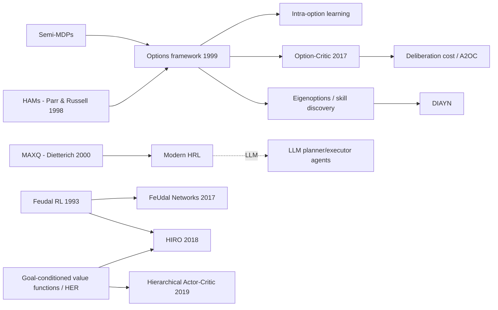

# Hierarchical RL: Options, Option-Critic, Feudal RL / FuN, HIRO
> Act at several time scales: a high-level policy picks temporally extended behaviors ("options", sub-goals), and low-level policies execute them, which speeds up credit assignment and exploration over long horizons. **Family:** Temporal abstraction → Options / Semi-MDPs → (learned options: Option-Critic) and goal-conditioned hierarchies (Feudal, FuN, HIRO, HAC)  ·  **Year / origin:** Options framework: Sutton, Precup & Singh, *Artificial Intelligence* 1999 (UMass / AT&T Labs); Option-Critic: Bacon, Harb & Precup, AAAI 2017 (McGill); Feudal RL: Dayan & Hinton, NIPS 1992 (proceedings 1993); HIRO: Nachum, Gu, Lee & Levine, NeurIPS 2018 (Google Brain)  ·  **On/Off-policy:** Both (SMDP Q-learning and intra-option learning are off-policy; option-critic is on-policy actor-critic; HIRO is off-policy TD3-based)  ·  **Action space:** Any; options are discrete choices over (possibly continuous) low-level controllers

---

## 1. What is it?

Flat RL chooses one primitive action per time step. For long tasks such as "make breakfast", "navigate a building" or "solve a multi-step proof", this means credit for success has to travel back through thousands of tiny decisions, and random exploration at the level of individual muscle twitches rarely produces coherent behavior.

**Hierarchical RL (HRL)** introduces **temporal abstraction**: decisions that last for many steps.

* **Options framework** (Sutton, Precup & Singh, 1999). An *option* $o=\langle\mathcal{I}_o,\pi_o,\beta_o\rangle$ is a closed-loop sub-policy with an initiation set, an intra-option policy, and a termination condition. "Go to the door", "pick up the cup" and "walk to the hallway" are options. An MDP plus a set of options forms a **semi-Markov decision process (SMDP)**, so all the usual tools (value iteration, Q-learning) carry over with variable-duration actions. Primitive actions are just one-step options.
* **Option-Critic** (Bacon, Harb & Precup, 2017). *Learn* the options themselves, both intra-option policies and terminations, end-to-end with policy-gradient theorems, given only the number of options.
* **Feudal RL** (Dayan & Hinton, 1993) and **FeUdal Networks (FuN)** (Vezhnevets et al., 2017). A manager sets goals for a worker at a coarser time scale. FuN's manager emits a direction in a learned latent space every $c$ steps, and the worker is rewarded for moving in that direction.
* **HIRO** (Nachum et al., 2018). Goal-conditioned two-level hierarchy for continuous control. The high level outputs a desired *state change* every $c$ steps, the low level is rewarded for achieving it, both are trained off-policy (TD3), and high-level transitions are **relabeled** with goals that better explain what the changing low-level policy actually did.

HRL sits in the taxonomy as an orthogonal axis: any base learner (Q-learning, actor-critic, PPO) can be made hierarchical. It is covered in Sutton & Barto **Ch. 17.2 ("Temporal Abstraction via Options")**.

## 2. Family & lineage



* **Parents:** semi-Markov decision processes, macro-actions, Hierarchies of Abstract Machines (Parr & Russell, 1998), MAXQ value decomposition (Dietterich, 2000), Feudal RL.
* **Siblings:** goal-conditioned RL (UVFA, Schaul et al., 2015; HER, Andrychowicz et al., 2017), skill discovery (DIAYN, Eysenbach et al., 2019; eigenoptions, Machado et al., 2017), h-DQN (Kulkarni et al., 2016).
* **Descendants:** option-critic variants (deliberation cost, interest functions), HAC (Levy et al., 2019, multi-level hindsight), HIRO and its relatives, Director (Hafner et al., 2022, hierarchy in a world model), and LLM agents that decompose tasks into tool calls or sub-tasks.

## 3. Core idea & intuition

**Think in chunks.** You don't plan a trip to another city one footstep at a time. You plan "taxi → airport → flight → train", and each chunk has its own detailed controller. Chunks give:

1. **Shorter effective horizons.** A 1,000-step task may be 10 high-level decisions. Credit assignment (and discounting) operates over 10 steps instead of 1,000.
2. **Better exploration.** Random choices among *options* produce coherent, far-reaching behavior (walk to another room) instead of jitter.
3. **Transfer.** "Open door" is reusable across many tasks.

**The four-rooms example** (Sutton et al., 1999, also our demo). A gridworld has four rooms connected by hallways. Give the agent eight "go to hallway X" options plus the primitives. SMDP Q-learning with options learns much faster early on, because a single backup moves value across a whole room. Late in learning, flat Q-learning can catch up or slightly surpass it, since the fixed hallway options aren't always the exactly optimal way to the goal and some steps are taken inside sub-optimal options. That trade-off ("abstractions speed learning but can restrict optimality") is the core tension of HRL. It is why the framework always keeps primitive actions available and why *intra-option* and *interruption* techniques exist.

**Learning the hierarchy is the hard part.** Hand-designed options work great but need domain knowledge. Learning options end-to-end (option-critic) tends to degenerate: options terminate every step (the hierarchy collapses into a flat policy) or one option does everything. Deliberation costs, entropy regularization, and goal-conditioned formulations (HIRO, HAC) are the main remedies.

## 4. Math / formal details

**Options.** An option $o=\langle\mathcal{I}_o,\pi_o,\beta_o\rangle$: initiation set $\mathcal{I}_o\subseteq\mathcal{S}$, intra-option policy $\pi_o(a|s)$, termination probability $\beta_o(s)\in[0,1]$. A policy over options $\mu(o|s)$ picks options in states where they are available.

**SMDP Bellman equation.** Let $k$ be the (random) duration of option $o$ started in $s$. Define the discounted reward and the multi-time model
$$r(s,o) = \mathbb{E}\big[r_{t+1}+\gamma r_{t+2}+\dots+\gamma^{k-1}r_{t+k}\mid \mathcal{E}(o,s,t)\big],\qquad p(s'|s,o) = \sum_{k=1}^\infty\gamma^k\Pr(s_{t+k}=s',\,\text{terminate at }k\mid s,o).$$
Then
$$Q^*_{\mathcal{O}}(s,o) = r(s,o) + \sum_{s'}p(s'|s,o)\max_{o'\in\mathcal{O}_{s'}}Q^*_{\mathcal{O}}(s',o').$$

**SMDP Q-learning.** After executing $o$ from $s$ for $k$ steps, receiving discounted return $R=\sum_{i=0}^{k-1}\gamma^i r_{t+i+1}$, and landing in $s'$:
$$Q(s,o)\leftarrow Q(s,o)+\alpha\Big[R + \gamma^k\max_{o'\in\mathcal{O}_{s'}}Q(s',o') - Q(s,o)\Big].$$

**Intra-option Q-learning** (off-policy, learns about *all consistent* options from every primitive step). For every Markov option $o$ whose policy would have taken $a_t$ in $s_t$:
$$Q(s_t,o)\leftarrow Q(s_t,o)+\alpha\big[r_{t+1}+\gamma U(s_{t+1},o) - Q(s_t,o)\big],\quad U(s',o) = (1-\beta_o(s'))Q(s',o)+\beta_o(s')\max_{o'}Q(s',o').$$

**Option-Critic (Bacon et al., 2017).** Parameterize intra-option policies $\pi_{\omega,\theta}(a|s)$ and terminations $\beta_{\omega,\vartheta}(s)$. With option-value $Q_\Omega(s,\omega)$, state-option-action value $Q_U(s,\omega,a)$, and $U(\omega,s') = (1-\beta_{\omega}(s'))Q_\Omega(s',\omega) + \beta_\omega(s')V_\Omega(s')$:

* **Intra-option policy gradient theorem:**
$$\frac{\partial Q_\Omega(s_0,\omega_0)}{\partial\theta} = \sum_{s,\omega}\mu_\Omega(s,\omega\mid s_0,\omega_0)\sum_a\frac{\partial\pi_{\omega,\theta}(a|s)}{\partial\theta}Q_U(s,\omega,a).$$
* **Termination gradient theorem:**
$$\frac{\partial U(\omega_0,s_1)}{\partial\vartheta} = -\sum_{s',\omega}\mu_\Omega(s',\omega\mid s_1,\omega_0)\,\frac{\partial\beta_{\omega,\vartheta}(s')}{\partial\vartheta}\,A_\Omega(s',\omega),\qquad A_\Omega(s',\omega) = Q_\Omega(s',\omega)-V_\Omega(s').$$
Intuition: lengthen an option when it is better than average ($A_\Omega>0$, so lower $\beta$), and terminate when it is worse. Adding a **deliberation cost** $\xi$ to the advantage ($A_\Omega + \xi$) discourages switching too often (Harb et al., 2018).

$\mu_\Omega$ is the discounted state-option occupancy along trajectories starting at $(s_0,\omega_0)$.

**Feudal Networks (FuN).** The manager emits a goal direction $g_t$ in latent space every $c$ steps, trained with the *transition policy gradient* $\nabla g_t\, A^M_t\, d_{\cos}(s_{t+c}-s_t, g_t)$. The worker gets an intrinsic reward $\frac1c\sum_{i=1}^c d_{\cos}(s_t-s_{t-i}, g_{t-i})$ in addition to the environment reward.

**HIRO.** High-level policy $\mu^{hi}$ outputs goal $g_t\in\mathbb{R}^{d}$ (a desired change in state) every $c$ steps, with goal transition $g_{t+1}=s_t+g_t-s_{t+1}$ in between. Low-level reward $r^{lo}(s_t,g_t,a_t,s_{t+1}) = -\|s_t+g_t-s_{t+1}\|_2$. **Off-policy correction:** when replaying a stored high-level transition, replace $g_t$ with the candidate $\tilde g_t$ (from a set including the original goal, the achieved delta $s_{t+c}-s_t$, and samples around it) that maximizes the likelihood of the logged low-level actions under the *current* low-level policy:
$$\tilde g_t = \arg\max_{\tilde g}\; -\tfrac12\sum_{i=t}^{t+c-1}\big\|a_i - \mu^{lo}(s_i,\tilde g_i)\big\|_2^2 .$$

## 5. Algorithm (pseudocode)

```text
SMDP Q-learning with options (used in the demo)
Input: options O (each with initiation set I_o, policy pi_o, termination beta_o), primitives A
 1. Q(s, o) <- 0 for all s, o available in s
 2. for each episode:
 3.     s <- start state
 4.     while not terminal:
 5.         choose o from O_s (primitives + options with s in I_o), eps-greedy on Q(s, .)
 6.         R <- 0; k <- 0
 7.         repeat                                   # execute option until it terminates
 8.             a <- pi_o(s); take a; observe r, s'
 9.             R <- R + gamma^k * r;  k <- k + 1;  s_prev <- s; s <- s'
10.         until terminal or beta_o(s) fires
11.         Q(s_start, o) += alpha * [ R + gamma^k * max_{o'} Q(s, o') - Q(s_start, o) ]

Option-Critic (one step, actor-critic form)
 1. in state s with current option w: sample a ~ pi_w(.|s); step -> r, s'
 2. delta  <- r + gamma * U(w, s') - Q_U(s, w, a)              # critic TD error
 3. Q_U(s, w, a) += alpha_c * delta
 4. theta  += alpha_theta * grad log pi_w(a|s) * Q_U(s, w, a)  # intra-option policy gradient
 5. vartheta -= alpha_beta * grad beta_w(s') * (Q_Omega(s', w) - V_Omega(s') + xi)   # termination gradient
 6. if option terminates at s' (prob beta_w(s')): pick new w ~ eps-greedy(Q_Omega(s', .))
```

## 6. Python implementation

The classic four-rooms gridworld from Sutton, Precup & Singh (1999): 104 free cells, moves fail with probability 1/3 (going in a random other direction instead), γ = 0.99, and reward +1 only at the goal. We give the agent **8 hallway options** (two per room, "go to hallway A/B", each a shortest-path policy restricted to its room) plus the 4 primitives, and compare against flat Q-learning, averaged over 20 seeds. Pure NumPy.

Runnable version: [`code/hierarchical-rl.py`](../../code/hierarchical-rl.py)

```python
"""
Options framework (Sutton, Precup & Singh, 1999) in the classic Four-Rooms domain.

Compares
  * flat Q-learning over the 4 primitive actions, and
  * SMDP Q-learning over primitives + 8 hand-designed "hallway" options
    (each room has two options: "go to hallway A" / "go to hallway B").
Pure NumPy, runs in seconds.

Run:  python3 code/hierarchical-rl.py
"""
from collections import deque

import numpy as np

LAYOUT = """
wwwwwwwwwwwww
w     w     w
w     w     w
w           w
w     w     w
w     w     w
ww wwww     w
w     www www
w     w     w
w     w     w
w           w
w     w     w
wwwwwwwwwwwww
"""
GRID = [list(r) for r in LAYOUT.strip("\n").split("\n")]
H, W = len(GRID), len(GRID[0])
FREE = [(r, c) for r in range(H) for c in range(W) if GRID[r][c] != "w"]
IDX = {cell: i for i, cell in enumerate(FREE)}
MOVES = [(-1, 0), (1, 0), (0, -1), (0, 1)]  # up, down, left, right
GOAL = (9, 9)          # inside the bottom-right room
GAMMA, SLIP, MAX_STEPS = 0.99, 1 / 3, 1000


# ----------------------------------------------------------------------------
# Environment (as in Sutton et al. 1999: with prob 1/3 the move goes a random other way)
# ----------------------------------------------------------------------------
def move(cell, a, rng=None):
    if rng is not None and rng.random() < SLIP:
        a = rng.choice([b for b in range(4) if b != a])
    nr, nc = cell[0] + MOVES[a][0], cell[1] + MOVES[a][1]
    return (nr, nc) if GRID[nr][nc] != "w" else cell


# ----------------------------------------------------------------------------
# Rooms, hallways and hallway options
# ----------------------------------------------------------------------------
HALLWAYS = [(3, 6), (6, 2), (7, 9), (10, 6)]


def room_of(cell):
    if cell in HALLWAYS:
        return None
    r, c = cell
    return (0 if r < 7 else 2) + (0 if c < 6 else 1) if not (r == 6 and c > 6) else 1


ROOM_HALLS = {room: [h for h in HALLWAYS
                     if any(room_of(move(h, a)) == room for a in range(4))] for room in range(4)}


class Option:
    """Markov option <I, pi, beta>: initiation set = cells of `room`;
    policy = shortest path (inside the room) to `target` hallway; terminates at the
    target or whenever the agent is outside the room."""

    def __init__(self, room, target):
        self.room, self.target = room, target
        dist = {target: 0}
        q = deque([target])
        while q:  # BFS backwards from the hallway, restricted to this room
            cur = q.popleft()
            for a in range(4):
                nb = move(cur, a)
                if nb not in dist and room_of(nb) == room:
                    dist[nb] = dist[cur] + 1
                    q.append(nb)
        self.policy = {}
        for cell in dist:
            if cell == target:
                continue
            self.policy[cell] = min(range(4), key=lambda a: dist.get(move(cell, a), 1e9))

    def can_start(self, cell):
        return room_of(cell) == self.room

    def terminates(self, cell):
        return cell == self.target or room_of(cell) != self.room


OPTIONS = [Option(room, h) for room in range(4) for h in ROOM_HALLS[room]]
N_PRIM = 4


def available(cell, use_options):
    acts = list(range(N_PRIM))
    if use_options:
        acts += [N_PRIM + i for i, o in enumerate(OPTIONS) if o.can_start(cell)]
    return acts


def execute(cell, choice, rng):
    """Run a primitive or an option to termination.
    Returns next cell, discounted cumulative reward, number of steps k, done flag."""
    if choice < N_PRIM:
        nxt = move(cell, choice, rng)
        return nxt, float(nxt == GOAL), 1, nxt == GOAL
    opt, G, k = OPTIONS[choice - N_PRIM], 0.0, 0
    while True:
        cell = move(cell, opt.policy[cell], rng)
        G += (GAMMA ** k) * float(cell == GOAL)
        k += 1
        if cell == GOAL:
            return cell, G, k, True
        if opt.terminates(cell):
            return cell, G, k, False


# ----------------------------------------------------------------------------
# SMDP Q-learning:  Q(s,o) <- Q(s,o) + alpha [ R + gamma^k max_o' Q(s',o') - Q(s,o) ]
# (with options disabled this is ordinary one-step Q-learning)
# ----------------------------------------------------------------------------
def smdp_q_learning(use_options, episodes=200, alpha=0.125, eps=0.1, seed=0):
    rng = np.random.default_rng(seed)
    Q = np.zeros((len(FREE), N_PRIM + len(OPTIONS)))
    steps_per_episode = []
    starts = [c for c in FREE if c != GOAL]
    for _ in range(episodes):
        cell, done, steps = starts[rng.integers(len(starts))], False, 0
        while not done and steps < MAX_STEPS:
            acts = available(cell, use_options)
            q = Q[IDX[cell], acts]
            choice = acts[rng.integers(len(acts))] if rng.random() < eps else acts[int(rng.choice(np.flatnonzero(q == q.max())))]
            nxt, R, k, done = execute(cell, choice, rng)
            target = R if done else R + GAMMA ** k * Q[IDX[nxt], available(nxt, use_options)].max()
            Q[IDX[cell], choice] += alpha * (target - Q[IDX[cell], choice])
            cell, steps = nxt, steps + k
        steps_per_episode.append(steps)
    return np.array(steps_per_episode), Q


if __name__ == "__main__":
    print(f"Four-rooms: {len(FREE)} free cells, {len(OPTIONS)} hallway options, goal at {GOAL}")
    n_seeds = 20
    flat = np.mean([smdp_q_learning(False, seed=s)[0] for s in range(n_seeds)], 0)
    opts = np.mean([smdp_q_learning(True, seed=s)[0] for s in range(n_seeds)], 0)
    print(f"\nMean primitive steps per episode (avg over {n_seeds} seeds)")
    print(f"{'episodes':<12}{'flat Q-learning':>18}{'primitives + options':>24}")
    for lo, hi in [(0, 10), (10, 25), (25, 50), (50, 100), (100, 200)]:
        print(f"{lo:>3}-{hi:<8}{flat[lo:hi].mean():>18.1f}{opts[lo:hi].mean():>24.1f}")
    _, Q = smdp_q_learning(True, seed=0)
    start = (2, 2)
    acts = available(start, True)
    best = acts[int(np.argmax(Q[IDX[start], acts]))]
    name = ["up", "down", "left", "right"][best] if best < N_PRIM else f"option -> hallway {OPTIONS[best - N_PRIM].target}"
    print(f"\nGreedy choice in the top-left room at {start}: {name}")
    print("Options let credit jump across whole rooms in a single backup, so early learning is faster.")
```

Example output from our run (~5 s):

```text
Four-rooms: 104 free cells, 8 hallway options, goal at (9, 9)

Mean primitive steps per episode (avg over 20 seeds)
episodes       flat Q-learning    primitives + options
  0-10                   357.5                    89.5
 10-25                   164.4                    44.2
 25-50                    64.9                    39.1
 50-100                   40.1                    38.6
100-200                   30.9                    33.5

Greedy choice in the top-left room at (2, 2): option -> hallway (3, 6)
```

* **Early learning is ~4× faster with options**: one backup carries value across a whole room.
* **Late in training, flat Q-learning is slightly better** (30.9 vs 33.5 steps). The hand-designed options aren't always the optimal way to the goal, and ε-exploration over options occasionally commits the agent to a long detour. This is the expected price of fixed abstractions; intra-option learning and interrupting options when another option has higher value (Sutton et al. §5) reduce it.

**Option-critic in PyTorch (loss terms only).** Illustrative and tested on random tensors; plug into any actor-critic loop:

```python
import torch

def option_critic_losses(logits_w, a, q_u_sa, beta_next, q_omega_next, v_omega_next, xi=0.01):
    """logits_w: [B, A] intra-option policy logits for the CURRENT option w
    a: [B] actions; q_u_sa: [B] critic estimate Q_U(s, w, a) (treated as constant)
    beta_next: [B] termination prob beta_w(s') (with grad); q_omega_next, v_omega_next: [B] (no grad)"""
    logp = torch.log_softmax(logits_w, -1).gather(1, a[:, None]).squeeze(1)
    policy_loss = -(logp * q_u_sa.detach()).mean()                     # intra-option PG
    adv = (q_omega_next - v_omega_next).detach() + xi                    # + deliberation cost
    termination_loss = (beta_next * adv).mean()                          # termination gradient
    entropy = -(torch.softmax(logits_w, -1) * torch.log_softmax(logits_w, -1)).sum(-1).mean()
    return policy_loss - 0.01 * entropy, termination_loss

B, A = 8, 4
logits = torch.randn(B, A, requires_grad=True); beta = torch.rand(B, requires_grad=True)
lp, lt = option_critic_losses(logits, torch.randint(0, A, (B,)), torch.randn(B), beta, torch.randn(B), torch.randn(B))
(lp + lt).backward(); print(f"policy loss {lp.item():.3f}, termination loss {lt.item():.3f}")
```

## 7. Practical tips & hyperparameters

* **Start with hand-designed or pre-trained skills** if you can (scripted primitives, motion primitives, goal-reaching policies). Learning everything end-to-end is the hardest version of HRL.
* **Always keep primitive actions available** (or allow interruption) so abstractions can't make the optimal policy unreachable.
* **High-level step size $c$** (HIRO/FuN): typical values are about 10 (HIRO) and on the order of 10 (FuN horizon). Too small and the hierarchy is pointless; too large and the low level can't achieve the goals.
* **Option collapse:** in option-critic, monitor average option duration. If ~1 step, add a deliberation cost ξ or regularize β; if one option is always picked, add entropy on the policy over options.
* **Goal spaces:** raw-state deltas (HIRO) are simple but assume a meaningful metric. Learned latent goals (FuN) are more general but can drift. Consider normalizing goal dimensions.
* **Non-stationarity:** the high level sees a changing low-level policy. Off-policy correction (HIRO) or hindsight relabeling (HAC) is essential for off-policy hierarchies.
* **Evaluate on long-horizon, sparse-reward tasks** (AntMaze, four-rooms, key-door): on dense, short tasks a flat agent will usually win.
* **Debug signals:** option durations, option usage histograms, success of low-level goal reaching, and value estimates per option.

## 8. Pros and cons

| Pros | Cons |
|---|---|
| Faster credit assignment over long horizons | Designing or discovering good options/goals is hard |
| Coherent, temporally extended exploration | Fixed abstractions can make the optimal policy unreachable or slower |
| Reusable skills transfer across tasks | Learned hierarchies tend to collapse (degenerate terminations) |
| Interpretable structure (which sub-goal is active) | Non-stationarity between levels complicates off-policy learning |
| SMDP theory: standard RL tools carry over | Often no gain on short or dense-reward tasks; more hyperparameters |

## 9. When to use / when not to use

**Use HRL when**
* tasks are long-horizon with sparse rewards and natural sub-structure (navigation through rooms, multi-stage manipulation, crafting games);
* you have reusable skills (from scripts, demonstrations, or pre-training) to compose;
* you need interpretable decompositions or task transfer.

**Avoid / reconsider when**
* the task is short or rewards are dense: flat PPO/SAC is simpler and usually better;
* you can't define or learn meaningful sub-goals: a poorly chosen hierarchy hurts;
* a strong world model + planning (MuZero, Dreamer) or exploration bonuses already solve the horizon problem.

## 10. Key papers, books & repos

* Sutton, Precup, Singh. **Between MDPs and semi-MDPs: A Framework for Temporal Abstraction in Reinforcement Learning.** *Artificial Intelligence* 112(1–2), 1999.
* Precup. **Temporal Abstraction in Reinforcement Learning.** PhD thesis, UMass Amherst, 2000 (intra-option learning).
* Parr & Russell. **Reinforcement Learning with Hierarchies of Machines.** NeurIPS 1998.
* Dietterich. **Hierarchical Reinforcement Learning with the MAXQ Value Function Decomposition.** JAIR 2000.
* Dayan & Hinton. **Feudal Reinforcement Learning.** NIPS 1992 (published 1993).
* Bacon, Harb, Precup. **The Option-Critic Architecture.** AAAI 2017. arXiv:1609.05140.
* Harb, Bacon, Klissarov, Precup. **When Waiting is Not an Option: Learning Options with a Deliberation Cost.** AAAI 2018.
* Vezhnevets et al. **FeUdal Networks for Hierarchical Reinforcement Learning.** ICML 2017.
* Kulkarni, Narasimhan, Saeedi, Tenenbaum. **Hierarchical Deep RL: Integrating Temporal Abstraction and Intrinsic Motivation** (h-DQN). NeurIPS 2016.
* Nachum, Gu, Lee, Levine. **Data-Efficient Hierarchical Reinforcement Learning** (HIRO). NeurIPS 2018.
* Levy, Konidaris, Platt, Saenko. **Learning Multi-Level Hierarchies with Hindsight** (HAC). ICLR 2019.
* Eysenbach, Gupta, Ibarz, Levine. **Diversity is All You Need** (DIAYN). ICLR 2019.
* Zhou et al. **ArCHer: Training Language Model Agents via Hierarchical Multi-Turn RL.** ICML 2024 (utterance-level critic + token-level policy).
* Sutton & Barto (2nd ed., 2018): **Ch. 17.2 "Temporal Abstraction via Options"**; background in Ch. 3 (MDPs), Ch. 6 (Q-learning), Ch. 8 (planning models, as option models generalize them).
* Repos: `jeanharb/option_critic` (original Theano), `lweitkamp/option-critic-pytorch`, `tensorflow/models` (`research/efficient-hrl`, HIRO), `andrew-j-levy/Hierarchical-Actor-Critc-HAC-`.

## 11. For business users

**What it does.** Hierarchical RL organizes an AI's decisions like a company org chart. A "manager" makes big-picture choices ("go to the loading dock", "handle the refund"), and "workers" handle the detailed steps of each choice. Learning becomes much faster for long, multi-step jobs, and skills can be reused across tasks.

**Analogy.** A general contractor doesn't decide every nail. They decide "foundation, then framing, then plumbing", and specialist crews execute each stage with their own expertise. If a new house design comes in, the same crews (skills) are reused in a new order.

**Use cases.** Warehouse and service robots that chain skills (navigate → pick → place); game AI with strategic and tactical layers; process automation where workflows decompose into reusable sub-procedures; LLM-based agents that plan sub-tasks and call tools (a planner/executor split is a hierarchy).

**Value / ROI.** Learns long tasks that flat approaches struggle with, reuses skills across products, and gives readable structure ("which sub-goal is it pursuing?") that helps debugging and trust.

**Risks.** A badly chosen hierarchy can lock in sub-optimal behavior. Learning hierarchies automatically is still research-grade and finicky. There are more components to monitor.

**Costs.** Engineering effort to define or learn skills; potentially pre-training of low-level skills in simulation.

**Questions to ask your team.**
* Does the task naturally break into reusable sub-tasks? Who defines them?
* Do we already have skills (scripts, controllers, tools) we can compose instead of learning from scratch?
* How do we check that the hierarchy isn't preventing better solutions?
* For LLM agents: are sub-tasks evaluated separately from the overall outcome?

## 12. For kids (ages ~8–12)

**The Big-Chore Boss.** Cleaning your whole room sounds HUGE. So you become the "boss" and split it into mini-jobs: 1) put toys in the box, 2) put clothes in the basket, 3) make the bed. Then the "helper" you does each mini-job step by step: pick up a car, drop it in the box, pick up a block...

The boss only has to make 3 decisions, not 300! And next time, at Grandma's house, you can reuse the "put toys in the box" mini-job — you already know how.

In our computer game, a robot in a house with four rooms learns way faster when it can choose "walk to the doorway" as one big move, instead of thinking about every single tiny step.

**Try it yourself.** Write a big goal (like "make a sandwich") at the top of a page. Below, write 3–4 mini-jobs. Under each mini-job, write the tiny steps. Count: how many choices does the boss make, and how many does the helper make?

**Recap.**
1. Big jobs are easier when split into mini-jobs.
2. A boss picks mini-jobs; a helper does the tiny steps.
3. Mini-jobs can be reused for new big jobs!

## 13. Related methods

* [Q-learning](../01-foundations-tabular/q-learning.md): SMDP Q-learning generalizes it to variable-length actions.
* [Dyna-Q](../01-foundations-tabular/dyna-q.md) and [dynamic programming](../01-foundations-tabular/dynamic-programming.md): option models generalize one-step models for planning.
* [Actor-critic (A2C/A3C)](../03-policy-gradient/actor-critic-a2c-a3c.md): basis of option-critic.
* [TD3](../04-off-policy-actor-critic/td3.md): HIRO's low- and high-level learners.
* [Curiosity / ICM / RND](curiosity-icm-rnd.md): another answer to long-horizon exploration; h-DQN combines both.
* [World Models / Dreamer](../05-model-based/world-models-dreamer.md): hierarchy inside a learned model (Director).
* [Agentic multi-turn RL](../10-llm-reasoning-rl/agentic-multi-turn-rl.md): LLM agents with turn-level (option-like) decisions.
* [Multi-agent RL](multi-agent-rl.md): feudal manager-worker setups resemble two-agent cooperative systems.

[← Back to overview](../../RL_Methods_Overview.md)
