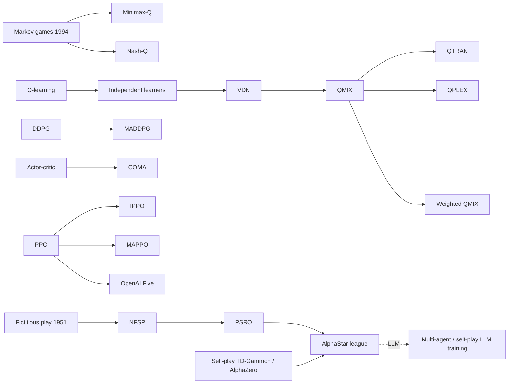

# Multi-Agent Reinforcement Learning (MARL): Markov Games, IQL, CTDE, MADDPG, VDN/QMIX, MAPPO, Self-Play & Leagues
> Several learning agents share an environment, cooperatively, competitively or mixed. Each agent's world is non-stationary because the others are learning too, and the solution concepts become equilibria rather than optima. **Family:** Multi-agent RL → (cooperative: value factorization / centralized critics) · (competitive: self-play, population/league training)  ·  **Year / origin:** Markov games: Littman, ICML 1994; MADDPG: Lowe et al., NeurIPS 2017 (OpenAI/McGill/Berkeley); VDN: Sunehag et al., 2017 (DeepMind); QMIX: Rashid et al., ICML 2018 (Oxford); MAPPO: Yu et al., 2021 / NeurIPS 2022 D&B; AlphaStar: Vinyals et al., Nature 2019 (DeepMind); OpenAI Five: Berner et al., 2019 (OpenAI)  ·  **On/Off-policy:** Both (QMIX/VDN/MADDPG off-policy; MAPPO/IPPO/OpenAI Five on-policy)  ·  **Action space:** Discrete (VDN/QMIX), continuous (MADDPG), any (MAPPO)

---

## 1. What is it?

Single-agent RL assumes the environment is stationary. Put several learners together (robots in a warehouse, units in StarCraft, players in Dota, trading agents, LLM agents debating) and that assumption breaks. From agent $i$'s point of view, the other agents *are* part of the environment, and they keep changing their behavior. MARL studies how to learn in this setting.

Key formalisms and ideas:

* **Markov (stochastic) games** (Shapley 1953; Littman 1994): states, one action per agent, joint transition, one reward per agent. Fully cooperative games (shared reward) are often modeled as **Dec-POMDPs** (each agent sees only a local observation).
* **Independent learners** (Tan, 1993; "IQL", independent Q-learning; IPPO): every agent runs single-agent RL and treats others as environment. It's simple and scalable, surprisingly strong in practice (IPPO), but has no convergence guarantees, and coordination problems arise because each agent's value estimates average over the others' exploration.
* **Centralized Training, Decentralized Execution (CTDE):** during training use extra information (global state, other agents' actions); at execution each agent acts on its own observation. Two big families:
  * **Centralized critics:** MADDPG (one centralized Q per agent that sees all actions), COMA (counterfactual baseline), **MAPPO** (PPO with a centralized value function; a strong, simple cooperative baseline).
  * **Value factorization:** learn a joint $Q_{tot}$ that decomposes into per-agent utilities, so greedy decentralized action selection is consistent with the joint greedy action. **VDN**: $Q_{tot}=\sum_i Q_i$. **QMIX**: $Q_{tot}=f(Q_1..Q_n; s)$ monotonic in each $Q_i$, which is strictly more expressive.
* **Self-play and population training** (competitive games): train against copies of yourself (TD-Gammon, AlphaGo/AlphaZero), past versions (fictitious self-play), or a **league** of diverse agents and exploiters (AlphaStar). **OpenAI Five** scaled PPO self-play to 5v5 Dota 2 and defeated the reigning world champion team (OG) in April 2019.

## 2. Family & lineage



* **Parents:** game theory (Nash equilibria, fictitious play by Brown, 1951), single-agent Q-learning, actor-critic, PPO.
* **Siblings:** opponent modeling (LOLA, Foerster et al., 2018), communication learning (DIAL/RIAL, CommNet), mean-field MARL, counterfactual regret minimization (CFR) for imperfect-information games (poker: Libratus, Pluribus).
* **Descendants:** QTRAN, QPLEX, Weighted QMIX (beyond monotonic factorization), MAPPO/HAPPO, PSRO and league training, population-based training, multi-agent LLM systems (debate, self-play games for LLMs).

## 3. Core idea & intuition

**Non-stationarity.** Imagine learning to pass a soccer ball while your teammate is also learning to receive it. Every time you adapt, they've changed. Independent learning can oscillate, and each agent may settle into a "safe" action because exploratory mistakes of the *other* agent make good coordinated actions look bad (*relative overgeneralization*).

**CTDE fixes the learning problem without breaking deployment.** During training, a centralized critic sees everything ("what did everyone do, what was the global state?") and gives each agent an accurate, stationary learning signal. At test time each agent only needs its own policy.

**Value factorization in one picture.** We want $\arg\max_{\mathbf a}Q_{tot}(s,\mathbf a)$ to equal "each agent takes $\arg\max_{a_i}Q_i(o_i,a_i)$" (the **IGM**, Individual-Global-Max, property), so agents can act independently but jointly optimally.
* VDN gets IGM by summation: easy, but can only represent additive team values.
* QMIX gets IGM by **monotonic mixing** ($\partial Q_{tot}/\partial Q_i\ge0$) with state-dependent mixing weights from a hypernetwork. That's strictly more expressive, and our demo reproduces the QMIX paper's two-step game where that extra expressiveness is decisive.

**Self-play and why averaging matters.** In zero-sum games, "best-respond to my current self" can cycle forever (rock → paper → scissors → rock...). Best-responding to the **average** of past selves (fictitious play) converges, in average strategy, to a Nash equilibrium in two-player zero-sum games. AlphaStar's league generalizes this: main agents train against a mix of past agents (prioritized fictitious self-play), while dedicated *exploiter* agents hunt for their weaknesses. That keeps the population robust instead of chasing its own tail.

## 4. Math / formal details

**Markov game.** $\mathcal{G}=\langle\mathcal{N},\mathcal{S},\{\mathcal{A}^i\},P,\{r^i\},\gamma\rangle$ with agents $i\in\mathcal{N}=\{1..n\}$, joint action $\mathbf{a}=(a^1..a^n)$, transition $P(s'|s,\mathbf a)$, rewards $r^i(s,\mathbf a)$. Agent $i$'s value under joint policy $\boldsymbol\pi=(\pi^1..\pi^n)$:
$$V^i_{\boldsymbol\pi}(s)=\mathbb{E}_{\boldsymbol\pi}\Big[\sum_t\gamma^t r^i(s_t,\mathbf a_t)\,\Big|\,s_0=s\Big].$$
A **Nash equilibrium** is $\boldsymbol\pi^*$ with $V^i_{(\pi^{i*},\boldsymbol\pi^{-i*})}(s)\ge V^i_{(\pi^i,\boldsymbol\pi^{-i*})}(s)$ for all $i,\pi^i,s$. **Cooperative** = all $r^i$ equal; **zero-sum** = two agents with $r^1=-r^2$. In zero-sum games, minimax-Q (Littman 1994) solves $V(s)=\max_{\pi\in\Delta(\mathcal{A}^1)}\min_{a^2}\sum_{a^1}\pi(a^1)Q(s,a^1,a^2)$ by an LP at each state.

**Dec-POMDP** (cooperative, partial observability): add observation functions $O^i(o^i|s)$; each agent conditions on its action-observation history $\tau^i$.

**Independent Q-learning.** Each agent updates $Q^i(o^i,a^i)\leftarrow Q^i + \alpha[r + \gamma\max_{a'}Q^i(o'^i,a') - Q^i]$. Because other agents' policies change, the "environment" seen by agent $i$ is non-stationary and the target is biased (it averages over others' current behavior).

**VDN** (Sunehag et al., 2017):
$$Q_{tot}(\boldsymbol\tau,\mathbf a) = \sum_{i=1}^n Q_i(\tau^i,a^i;\theta_i),\qquad \mathcal{L}=\mathbb{E}\Big[\big(r+\gamma\max_{\mathbf a'}Q_{tot}(\boldsymbol\tau',\mathbf a') - Q_{tot}(\boldsymbol\tau,\mathbf a)\big)^2\Big],$$
where $\max_{\mathbf a'}Q_{tot}=\sum_i\max_{a'^i}Q_i$, which is computable in $O(n|\mathcal{A}|)$.

**QMIX** (Rashid et al., 2018):
$$Q_{tot}(\boldsymbol\tau,\mathbf a,s) = f_{\text{mix}}\big(Q_1(\tau^1,a^1),\dots,Q_n(\tau^n,a^n);\,s\big),\qquad \frac{\partial Q_{tot}}{\partial Q_i}\ge0\;\;\forall i,$$
enforced by non-negative mixing weights $W_1=|h_1(s)|,\ W_2=|h_2(s)|$ produced by hypernetworks of the global state: $Q_{tot}=W_2^\top\mathrm{ELU}(W_1^\top\mathbf{Q}+b_1(s))+b_2(s)$. Monotonicity implies IGM: $\arg\max_{\mathbf a}Q_{tot}=(\arg\max_{a^1}Q_1,\dots,\arg\max_{a^n}Q_n)$. It **cannot** represent non-monotonic payoffs, where an agent's best action depends on the other agent's choice in a way that flips the ordering (e.g. the climbing game); QTRAN, QPLEX and Weighted QMIX address this.

**MADDPG** (Lowe et al., 2017). Deterministic actors $\mu_i(o^i;\theta_i)$; centralized critics $Q_i^{\mu}(\mathbf x,a^1..a^n)$ with $\mathbf x$ = global information:
$$\nabla_{\theta_i}J(\mu_i)=\mathbb{E}_{\mathbf x,\mathbf a\sim\mathcal{D}}\Big[\nabla_{\theta_i}\mu_i(o^i)\,\nabla_{a^i}Q_i^{\mu}(\mathbf x,a^1..a^n)\big|_{a^i=\mu_i(o^i)}\Big],$$
$$\mathcal{L}(\phi_i)=\mathbb{E}\big[(Q_i^\mu(\mathbf x,\mathbf a)-y)^2\big],\quad y=r^i+\gamma Q_i^{\mu'}(\mathbf x',a'^1..a'^n)\big|_{a'^j=\mu'_j(o'^j)}.$$
Works for cooperative, competitive and mixed settings (each agent has its own reward and critic). It also proposes policy ensembles and inferring other agents' policies.

**COMA** (Foerster et al., 2018): centralized critic with a counterfactual baseline $A^i(s,\mathbf a)=Q(s,\mathbf a)-\sum_{a'^i}\pi^i(a'^i|\tau^i)Q(s,(\mathbf a^{-i},a'^i))$ for per-agent credit assignment.

**MAPPO** (Yu et al.): each agent's actor is a PPO policy $\pi_\theta(a^i|o^i)$ (often parameter-shared, with agent id), with the clipped objective; the critic $V_\phi(s)$ takes the global state (or agent-specific global features). Reported key implementation factors include value normalization, input design for the critic, few PPO epochs, and moderate clipping.

**Fictitious play.** Each player best-responds to the empirical average of the opponents' past strategies: $\pi^i_{t+1}\in\mathrm{BR}(\bar\pi^{-i}_t)$, $\bar\pi_t=\frac1t\sum_{k\le t}\pi_k$. In two-player zero-sum games the averages converge to a Nash equilibrium (Robinson, 1951). **Exploitability** $\sum_i\max_{\pi'^i}V^i(\pi'^i,\bar\pi^{-i})$ (for zero-sum, the best response's gain) measures distance to Nash. PSRO (Lanctot et al., 2017) generalizes this with deep-RL best responses and a meta-game solver.

**AlphaStar league** (Vinyals et al., 2019): main agents trained with prioritized fictitious self-play (PFSP: opponents sampled with probability weighted toward those the agent struggles against), plus main-exploiters (target the current main agents) and league-exploiters (target the whole league); policies initialized by supervised learning on human replays, then RL (V-trace, UPGO, with a KL to the human policy).

## 5. Algorithm (pseudocode)

```text
QMIX / VDN (CTDE value factorisation, episodic replay)
 1. initialise agent utility net Q_theta(o^i, id_i, .) (shared), mixer f_psi(., s), targets
 2. loop:
 3.     run an episode: each agent acts eps-greedy on its own Q_i(o^i, .); store (s, o, a, r, s', o')
 4.     sample a batch of transitions
 5.     q_i     <- Q_theta(o^i)[a^i]              for each agent i
 6.     q_i'    <- max_a Q_target(o'^i)[a]        (decentralised greedy, IGM)
 7.     Q_tot   <- f_psi([q_1..q_n], s)           (VDN: sum)
 8.     y       <- r + gamma * (1 - done) * f_target([q_1'..q_n'], s')
 9.     minimise (Q_tot - y)^2 w.r.t. theta, psi;  periodically update targets

MAPPO
 1. collect rollouts with decentralised actors pi(a^i | o^i)
 2. compute GAE advantages per agent using a centralised critic V(s)
 3. PPO-clip update of the shared actor; value regression (with value normalisation) of V

League / fictitious self-play (competitive)
 1. population P <- {initial agent (e.g. supervised on human data)}
 2. loop:
 3.     for each learner: sample opponent from P (uniformly, or PFSP-weighted by win rate)
 4.     play games, update learner with RL
 5.     periodically freeze a copy of each learner into P; add exploiters that train only vs main agents
```

## 6. Python implementation

Two parts:

* **Part A (cooperative CTDE, PyTorch).** The **two-step game** from the QMIX paper. In state 1, agent 1's action chooses which matrix game is played next. Game 2A pays 7 for every joint action; game 2B pays `[[0,1],[1,8]]`. Optimal team return is 8. IQL, VDN and QMIX are trained on the *same* uniformly random joint-action data with shared-parameter agent networks.
* **Part B (competitive self-play, NumPy).** Rock-paper-scissors: naive "best-respond to my latest self" vs fictitious play.

Runnable version: [`code/multi_agent_rl.py`](../../code/multi_agent_rl.py)

```python
"""
Multi-agent RL in miniature.

Part A (cooperative, CTDE value factorisation, PyTorch):
  The two-step cooperative game from the QMIX paper (Rashid et al., 2018).
    step 1 (state s1): agent 1's action picks the next state: a1=0 -> 2A, a1=1 -> 2B.
    state 2A: every joint action pays 7.
    state 2B: payoff [[0, 1], [1, 8]]  (only joint action (1,1) pays 8).
  Optimal team return is 8 (go to 2B and coordinate on (1,1)).
  We train, from the same uniformly-random joint-action data:
    * IQL  : independent Q-learners, each treating the other as part of the environment
    * VDN  : Q_tot = Q_1 + Q_2                       (Sunehag et al., 2017)
    * QMIX : Q_tot = f_mix(Q_1, Q_2; s), monotonic  (weights from a hypernetwork, |w| >= 0)

Part B (competitive, self-play, NumPy):
  Rock-paper-scissors. Naive "best-respond to the latest self" cycles forever, while
  fictitious play (best-respond to the AVERAGE of past selves, the idea behind leagues and
  PSRO-style population training) converges in average strategy to the Nash equilibrium.

Run:  python3 code/multi_agent_rl.py     (about 20-60 s on CPU)
"""
import numpy as np
import torch
import torch.nn as nn
import torch.nn.functional as F

torch.set_num_threads(1)

# ============================================================================
# Part A: two-step cooperative game
# ============================================================================
S1, S2A, S2B, TERMINAL = 0, 1, 2, 3
PAYOFF_2B = np.array([[0.0, 1.0], [1.0, 8.0]])


def env_step(state, a1, a2):
    """Returns (next_state, team_reward, done)."""
    if state == S1:
        return (S2A if a1 == 0 else S2B), 0.0, False
    if state == S2A:
        return TERMINAL, 7.0, True
    return TERMINAL, float(PAYOFF_2B[a1, a2]), True


def collect_uniform(n_episodes, rng):
    data = []
    for _ in range(n_episodes):
        s, done = S1, False
        while not done:
            a1, a2 = rng.integers(2), rng.integers(2)
            s2, r, done = env_step(s, a1, a2)
            data.append((s, a1, a2, r, s2, float(done)))
            s = s2
    return [torch.tensor(np.array(x)) for x in zip(*data)]


def onehot_state(s):
    return F.one_hot(s.long(), 4).float()


class AgentQ(nn.Module):
    """Per-agent utility Q_i(o_i, .). Each agent observes the state + its own id."""

    def __init__(self, h=32):
        super().__init__()
        self.net = nn.Sequential(nn.Linear(4 + 2, h), nn.ReLU(), nn.Linear(h, 2))

    def forward(self, s, agent_id):
        idv = F.one_hot(torch.full_like(s, agent_id).long(), 2).float()
        return self.net(torch.cat([onehot_state(s), idv], -1))


class QMixer(nn.Module):
    """Monotonic mixing network: weights produced by hypernetworks of the state and
    passed through abs() so dQ_tot/dQ_i >= 0 (Rashid et al., 2018)."""

    def __init__(self, n_agents=2, embed=8):
        super().__init__()
        self.n, self.e = n_agents, embed
        self.hyper_w1 = nn.Linear(4, n_agents * embed)
        self.hyper_b1 = nn.Linear(4, embed)
        self.hyper_w2 = nn.Linear(4, embed)
        self.hyper_b2 = nn.Sequential(nn.Linear(4, embed), nn.ReLU(), nn.Linear(embed, 1))

    def forward(self, qs, s):              # qs: [B, n_agents]
        st = onehot_state(s)
        w1 = self.hyper_w1(st).abs().view(-1, self.n, self.e)
        h = F.elu(torch.bmm(qs.unsqueeze(1), w1).squeeze(1) + self.hyper_b1(st))
        w2 = self.hyper_w2(st).abs()
        return (h * w2).sum(-1) + self.hyper_b2(st).squeeze(-1)


def train(method, data, steps=3000, gamma=0.99, lr=5e-3, seed=0):
    torch.manual_seed(seed)
    agents = AgentQ()                          # parameter sharing (agent id in the input)
    mixer = QMixer() if method == "qmix" else None
    params = list(agents.parameters()) + (list(mixer.parameters()) if mixer else [])
    opt = torch.optim.Adam(params, lr=lr)
    s, a1, a2, r, s2, d = data
    for _ in range(steps):
        q1, q2 = agents(s, 0), agents(s, 1)
        q1a, q2a = q1.gather(1, a1[:, None]).squeeze(1), q2.gather(1, a2[:, None]).squeeze(1)
        with torch.no_grad():  # decentralised greedy maxima at s' (the IGM property)
            n1, n2 = agents(s2, 0).max(1).values, agents(s2, 1).max(1).values
        if method == "iql":    # each agent regresses its OWN Q onto the team reward
            loss = F.mse_loss(q1a, r + gamma * (1 - d) * n1) + F.mse_loss(q2a, r + gamma * (1 - d) * n2)
        else:
            if method == "vdn":
                q_tot = q1a + q2a
                with torch.no_grad():
                    nxt = n1 + n2
            else:
                q_tot = mixer(torch.stack([q1a, q2a], 1), s)
                with torch.no_grad():
                    nxt = mixer(torch.stack([n1, n2], 1), s2)
            loss = F.mse_loss(q_tot, r + gamma * (1 - d) * nxt)  # ONE team TD error (CTDE)
        opt.zero_grad(); loss.backward(); opt.step()
    return agents


@torch.no_grad()
def greedy_return(agents):
    s, done, G, path = S1, False, 0.0, []
    while not done:
        st = torch.tensor([s])
        a1, a2 = int(agents(st, 0).argmax()), int(agents(st, 1).argmax())
        path.append(("s1", "2A", "2B")[s] + f":({a1},{a2})")
        s, r, done = env_step(s, a1, a2)
        G += r
    return G, " -> ".join(path)


# ============================================================================
# Part B: self-play on rock-paper-scissors
# ============================================================================
RPS = np.array([[0, -1, 1], [1, 0, -1], [-1, 1, 0]], float)  # row player's payoff


def exploitability(p):
    """How much a best-responder gains against mixed strategy p (0 at Nash)."""
    return float((RPS @ p).max())


def naive_self_play(iters=12):
    p = np.array([1.0, 0, 0])
    seq = []
    for _ in range(iters):
        br = np.eye(3)[(RPS @ p).argmax()]  # best response to the CURRENT self
        p = br
        seq.append("RPS"[int(br.argmax())])
    return "".join(seq), exploitability(p)


def fictitious_play(iters=3000):
    counts = np.array([1.0, 0, 0])
    for _ in range(iters):
        avg = counts / counts.sum()
        counts += np.eye(3)[(RPS @ avg).argmax()]  # best response to the AVERAGE past self
    avg = counts / counts.sum()
    return avg, exploitability(avg)


if __name__ == "__main__":
    rng = np.random.default_rng(0)
    data = collect_uniform(2000, rng)
    print("Part A - two-step cooperative game (optimal team return = 8)")
    print(f"{'method':<8}{'greedy return':>15}   greedy joint actions")
    for m in ["iql", "vdn", "qmix"]:
        G, path = greedy_return(train(m, data))
        print(f"{m.upper():<8}{G:>15.1f}   {path}")

    print("\nPart B - self-play on rock-paper-scissors")
    seq, ex = naive_self_play()
    print(f"naive self-play (latest self)  : {seq} ... cycles; exploitability {ex:.2f}")
    avg, ex = fictitious_play()
    print(f"fictitious play (average self) : avg strategy {np.round(avg, 3)}; exploitability {ex:.3f}")
```

Example output from our run (CPU, ~40 s):

```text
Part A - two-step cooperative game (optimal team return = 8)
method    greedy return   greedy joint actions
IQL                 7.0   s1:(0,1) -> 2A:(0,0)
VDN                 7.0   s1:(0,1) -> 2A:(1,1)
QMIX                8.0   s1:(1,1) -> 2B:(1,1)

Part B - self-play on rock-paper-scissors
naive self-play (latest self)  : PSRPSRPSRPSR ... cycles; exploitability 1.00
fictitious play (average self) : avg strategy [0.335 0.337 0.328]; exploitability 0.007
```

* **Part A** reproduces the qualitative result of Rashid et al. (2018). Under uniform exploration, the value of state 2B for agent 1 is dragged down by agent 2's random choices (the average payoff of 2B is 2.5 vs. 7 for 2A), so IQL and VDN pick the "safe" 2A. QMIX's state-conditioned, non-linear (but monotonic) mixing can represent that the *coordinated* 2B outcome is worth 8 and picks it.
* **Part B**: the latest-self best-response dynamics cycle (P → S → R → ...) and stay maximally exploitable, while averaging over the history converges to the uniform Nash equilibrium. This is the conceptual reason leagues and PSRO keep populations of past agents.

**Link to multi-agent LLM RL.** Multi-agent ideas are increasingly used with language models:
* **Debate** (Irving, Christiano & Amodei, 2018) frames oversight as a zero-sum game between two models judged by a human. Multi-agent debate at inference (Du et al., 2023) improves factuality and reasoning.
* **Self-play fine-tuning**: SPIN (Chen et al., 2024) treats the previous model as the opponent the new model must be distinguishable from. Self-play on language games and zero-sum text games has been used to train reasoning, and proposer–solver self-play (one model invents tasks, another solves them) appears in recent RLVR work.
* **CICERO** (Meta FAIR, *Science* 2022) combined a language model with strategic planning (piKL, regularized toward human-like play) to reach human-level performance in the negotiation game Diplomacy.
* The same issues reappear: non-stationary opponents, cycling, exploitability, and credit assignment across agents and turns.

## 7. Practical tips & hyperparameters

* **Try strong simple baselines first.** IPPO/MAPPO with parameter sharing (agent-id one-hot in the input) is a robust default for cooperative tasks; QMIX is the standard value-based CTDE baseline (SMAC). Report both.
* **Parameter sharing** speeds learning dramatically for homogeneous agents. Add agent ids, or use separate heads, when roles differ.
* **QMIX settings** commonly used on SMAC (pymarl defaults, roughly): RMSprop lr 5e-4, ε annealed 1.0 → 0.05 over ~50k steps, target update every 200 episodes, mixing embed dim 32, GRU agent networks for partial observability. Treat these as starting points.
* **MAPPO tips (reported by Yu et al.)**: value normalization (PopArt or running stats), a centralized value input that includes agent-specific features, fewer PPO epochs (≈5–15) and clipping ≈0.2 or lower on hard tasks, and avoiding overly large mini-batch splits.
* **Non-stationarity in replay:** old transitions reflect old teammate/opponent policies. Keep buffers modest, or use importance weighting / fingerprints (Foerster et al., 2017).
* **Credit assignment:** with a shared team reward, per-agent signals are weak. Use value factorization, counterfactual baselines (COMA), or difference rewards.
* **Competitive training:** evaluate against a *fixed* pool of diverse opponents and track exploitability or Elo, because self-play win rate alone (≈50% by construction) tells you nothing. Keep past checkpoints in the opponent pool to avoid forgetting and cycling.
* **Reward shaping vs team spirit:** OpenAI Five blended individual and team rewards with a "team spirit" coefficient annealed toward fully shared rewards.
* **Debug signals:** per-agent returns, action entropy per agent (has one agent gone lazy?), win rates vs. fixed benchmarks, and mixing-network weights (QMIX).

## 8. Pros and cons

| Pros | Cons |
|---|---|
| Models real multi-actor systems (fleets, games, markets, teams) | Non-stationarity breaks single-agent convergence guarantees |
| CTDE gives stable training while keeping decentralized execution | Joint action space explodes exponentially with agent count |
| Value factorization (VDN/QMIX) scales greedy action selection linearly | Factorizations have representational limits (monotonicity) |
| Self-play generates an automatic curriculum of ever-stronger opponents | Self-play can cycle or overfit to its own quirks; needs leagues/populations |
| Landmark results: AlphaStar, OpenAI Five, CICERO, poker AIs | Very compute-hungry at scale; evaluation is hard (no single "score") |

## 9. When to use / when not to use

**Use MARL when**
* several decision-makers act simultaneously and their interactions matter (multi-robot coordination, traffic signals, multiplayer games, auctions, network routing);
* you need decentralized execution (communication limits) but can train centrally in simulation;
* the task is a competitive game where a self-improving curriculum helps.

**Avoid / reconsider when**
* one central controller can choose all actions (then it's a single-agent problem with a big action space, possibly factorized);
* other agents are fixed or scripted: treat them as part of the environment and use single-agent RL;
* you need guarantees in general-sum settings: equilibrium selection is unresolved, so consider mechanism design or game-theoretic solvers (CFR) instead.

## 10. Key papers, books & repos

* Littman. **Markov Games as a Framework for Multi-Agent Reinforcement Learning.** ICML 1994.
* Tan. **Multi-Agent Reinforcement Learning: Independent vs. Cooperative Agents.** ICML 1993.
* Claus & Boutilier. **The Dynamics of Reinforcement Learning in Cooperative Multiagent Systems.** AAAI 1998.
* Lowe, Wu, Tamar, Harb, Abbeel, Mordatch. **Multi-Agent Actor-Critic for Mixed Cooperative-Competitive Environments** (MADDPG). NeurIPS 2017. arXiv:1706.02275.
* Foerster, Farquhar, Afouras, Nardelli, Whiteson. **Counterfactual Multi-Agent Policy Gradients** (COMA). AAAI 2018.
* Sunehag et al. **Value-Decomposition Networks for Cooperative Multi-Agent Learning.** arXiv:1706.05296, 2017 (AAMAS 2018).
* Rashid, Samvelyan, de Witt, Farquhar, Foerster, Whiteson. **QMIX: Monotonic Value Function Factorisation for Deep Multi-Agent Reinforcement Learning.** ICML 2018. arXiv:1803.11485.
* Samvelyan et al. **The StarCraft Multi-Agent Challenge** (SMAC). AAMAS 2019.
* Yu, Velu, Vinitsky, Gao, Wang, Bayen, Wu. **The Surprising Effectiveness of PPO in Cooperative Multi-Agent Games** (MAPPO). NeurIPS 2022 Datasets & Benchmarks. arXiv:2103.01955.
* de Witt et al. **Is Independent Learning All You Need in the StarCraft Multi-Agent Challenge?** (IPPO). arXiv:2011.09533, 2020.
* Heinrich & Silver. **Deep Reinforcement Learning from Self-Play in Imperfect-Information Games** (NFSP). arXiv:1603.01121, 2016.
* Lanctot et al. **A Unified Game-Theoretic Approach to Multiagent Reinforcement Learning** (PSRO). NeurIPS 2017.
* Vinyals et al. **Grandmaster Level in StarCraft II using Multi-Agent Reinforcement Learning** (AlphaStar). *Nature* 575, 2019.
* Berner et al. (OpenAI). **Dota 2 with Large Scale Deep Reinforcement Learning** (OpenAI Five). arXiv:1912.06680, 2019.
* Irving, Christiano, Amodei. **AI Safety via Debate.** arXiv:1805.00899, 2018.
* Du, Li, Torralba, Tenenbaum, Mordatch. **Improving Factuality and Reasoning in Language Models through Multiagent Debate.** arXiv:2305.14325, 2023.
* Chen, Deng, Yuan, Ji, Gu. **Self-Play Fine-Tuning Converts Weak Language Models to Strong Language Models** (SPIN). ICML 2024.
* Meta FAIR Diplomacy Team et al. **Human-level play in the game of Diplomacy by combining language models with strategic reasoning** (CICERO). *Science* 2022.
* Books: Albrecht, Christianos, Schäfer. **Multi-Agent Reinforcement Learning: Foundations and Modern Approaches.** MIT Press, 2024. Oliehoek & Amato. **A Concise Introduction to Decentralized POMDPs.** Springer, 2016. Sutton & Barto (2nd ed.) has little on MARL; self-play appears in Ch. 16 (TD-Gammon §16.1, AlphaGo/AlphaGo Zero §16.6).
* Repos: `oxwhirl/pymarl` and `oxwhirl/smac`, `uoe-agents/epymarl`, `marlbenchmark/on-policy` (MAPPO), `openai/maddpg`, `Farama-Foundation/PettingZoo`, `google-deepmind/open_spiel` (fictitious play, NFSP, PSRO, CFR).

## 11. For business users

**What it does.** Multi-agent RL trains several AI decision-makers that share an environment, whether as teammates (robots in one warehouse, traffic lights across a city) or as competitors (players in a game, bidders in an auction). Each learns its own behavior while accounting for the others.

**Analogy.** A football team practicing together: each player only sees part of the field during a match, but in practice sessions the coach watches everyone and gives feedback that makes the team coordinate. Or a chess club where you improve by playing against stronger and stronger versions of yourself and your club-mates.

**Use cases.** Warehouse robot fleets avoiding congestion; adaptive traffic-signal control; multi-drone coordination; game AI (teammates and opponents that adapt); market and auction simulation; network/load-balancing control; stress-testing a strategy against adaptive adversaries; multi-agent LLM systems (agents that debate, negotiate, or check each other).

**Value / ROI.** Coordinated behavior that a single central controller can't achieve (communication limits, scale), and robust strategies discovered through self-play rather than hand-crafted rules.

**Risks.** Training is unstable and compute-hungry. Agents can learn brittle conventions that break when one agent is replaced (including by a human). In competitive settings, a strategy that beats its training partners may still be exploitable. Emergent behavior can be surprising, so test with diverse partners.

**Costs.** Simulators that model all agents; large compute for self-play at scale; careful evaluation against fixed benchmark opponents.

**Questions to ask your team.**
* Could one central controller solve this instead (simpler)?
* Will our agents work with *new* partners, including humans or older versions?
* How do we measure robustness: against which fixed opponents or scenarios?
* What communication is available between agents at run time?

## 12. For kids (ages ~8–12)

**The Robot Soccer Team.** Two robot friends, Bip and Bop, are learning to play soccer together. At first, Bip learns to pass to the left, but Bop is still learning and runs to the right. Oops! Every time one changes, the other has to change too. Confusing!

So their coach (who can see the whole field during practice) tells them how their *team* did, and helps each one understand how their move helped the team. During real games, the coach is quiet, and Bip and Bop play on their own. They've learned to work together!

And to get really good at rock-paper-scissors, a robot shouldn't just copy whatever beat it last time (it'll go round and round in circles!). It should remember *all* the games it has played and mix up its choices. Then nobody can trick it!

**Try it yourself.** Play rock-paper-scissors 20 times with a friend. Keep a tally of what your friend picks. If they pick "rock" a lot, which choice should you make more? Now try being "unpredictable" yourself by picking each one about equally. Can your friend still beat you on purpose?

**Recap.**
1. When many robots learn at once, each one keeps changing the game for the others.
2. A coach who sees everything during practice helps them learn teamwork.
3. Practicing against all your old selves (not just the latest one) makes you hard to beat.

## 13. Related methods

* [Q-learning](../01-foundations-tabular/q-learning.md) and [DQN](../02-deep-value-based/dqn.md): base learners for IQL/VDN/QMIX.
* [DDPG](../04-off-policy-actor-critic/ddpg.md): base of MADDPG.
* [PPO](../03-policy-gradient/ppo.md): base of IPPO/MAPPO and OpenAI Five.
* [MCTS / AlphaZero](../05-model-based/mcts-alphazero.md): self-play with search in two-player games.
* [GAIL](../07-imitation-inverse-rl/gail.md): adversarial (two-player) training dynamics.
* [Hierarchical RL](hierarchical-rl.md): feudal manager/worker structures.
* [Online / iterative self-play preference optimization](../09-llm-preference-alignment/online-iterative-self-play-po.md): self-play for LLM alignment.
* [Self-rewarding / TTRL](../10-llm-reasoning-rl/self-rewarding-ttrl.md) and [Agentic multi-turn RL](../10-llm-reasoning-rl/agentic-multi-turn-rl.md): LLM agents interacting with themselves and others.
* [Evolution strategies](evolution-strategies.md): population-based training ideas.

[← Back to overview](../../RL_Methods_Overview.md)
