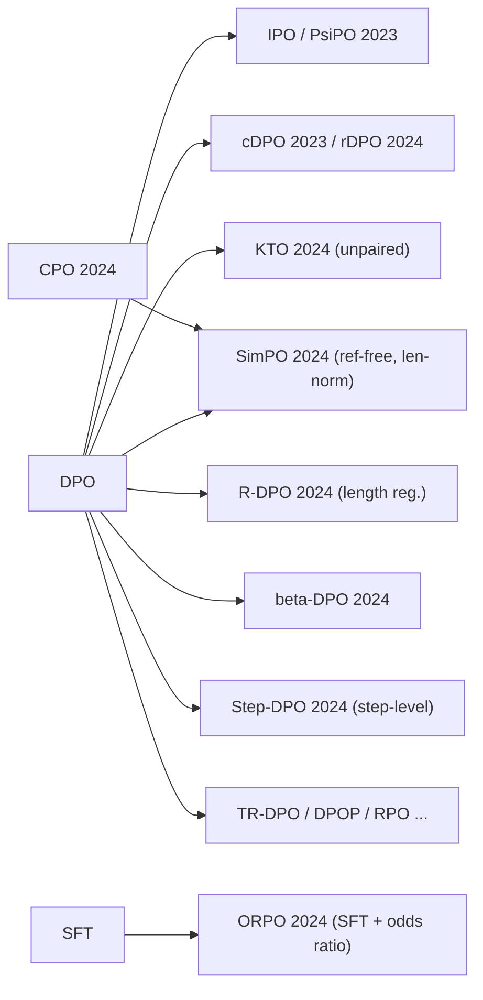

# DPO Variants (IPO, cDPO/rDPO, KTO, ORPO, SimPO, R-DPO, β-DPO, Step-DPO)

> A family of direct preference objectives that keep DPO's "no reward model, no RL loop" simplicity while fixing specific weaknesses: over-fitting to deterministic preferences (IPO), label noise (cDPO/rDPO), the need for paired data (KTO), the need for a reference model and an SFT stage (ORPO, SimPO), length exploitation (SimPO, R-DPO), a fixed β (β-DPO), and coarse credit on long reasoning (Step-DPO). **Family:** LLM post-training → Preference alignment → Direct preference optimization  ·  **Year / origin:** 2023–2024 (DeepMind, Stanford, Contextual AI, KAIST, Princeton, CUHK and others; details per method below)  ·  **On/Off-policy:** Offline by default; all can be run iteratively/online  ·  **Action space:** Discrete tokens

## 1. What is it?

[DPO](dpo.md) minimizes $-\log\sigma(\beta h)$, where $h$ is the difference of policy-to-reference log-ratios between the chosen and rejected responses. Practitioners quickly found failure modes:

| Problem | Symptom | Variant(s) |
|---|---|---|
| Deterministic / near-certain preferences | Margin $h\to\infty$; KL regularization effectively vanishes; over-fitting | **IPO** (bounded squared loss) |
| Noisy / flipped labels | DPO confidently learns wrong pairs | **cDPO** (label smoothing), **rDPO** (unbiased noise-corrected loss) |
| Only thumbs-up / thumbs-down data, no pairs | Cannot form $(y_w,y_l)$ | **KTO** (prospect-theory, unpaired) |
| Need SFT + frozen reference = 2 stages, 2 models | Memory and pipeline cost | **ORPO** (single stage, reference-free), **SimPO** (reference-free) |
| Length bias | Outputs get longer; win-rates inflated by verbosity | **SimPO** (length-normalized reward), **R-DPO** (explicit length term) |
| One β does not fit all data | Some batches need more or less conservatism | **β-DPO** (batch-adaptive β) |
| Long chain-of-thought | One wrong step spoils the whole sample; sequence-level credit is coarse | **Step-DPO** (step-level pairs) |

All are offline, supervised-style losses on preference data. They differ only in how they turn log-probs into a loss.

## 2. Family & lineage

- **Parent:** DPO (Rafailov et al., 2023), itself derived from KL-regularized [RLHF](rlhf-ppo.md) + [Bradley–Terry](reward-modeling.md).
- **Generalization:** ΨPO (Azar et al., 2023) shows that DPO and RLHF are special cases of maximizing $\mathbb{E}[\Psi(p^*(y\succ y'))]$ with a KL penalty. IPO is $\Psi=\text{identity}$.
- **HALOs:** Ethayarajh et al. (2024) frame DPO, KTO and others as "human-aware loss functions" implementing a value function with a reference point.
- **Reference-free branch:** CPO (Xu et al., 2024, contrastive preference optimization for translation), ORPO, SimPO.
- **Siblings not covered in depth:** SLiC-HF (hinge), RRHF, NCA, BCO, EXO, DPO-Positive / Smaug (penalize lowering chosen likelihood), TR-DPO (periodically update the reference), RPO / iterative RPO (add an NLL term on chosen), APO. Many are available as `loss_type` options in TRL.
- **Online descendants:** [online/iterative DPO, SPIN, SPPO](online-iterative-self-play-po.md).



## 3. Core idea & intuition

Write $h=\log\frac{\pi_\theta(y_w)}{\pi_{\text{ref}}(y_w)}-\log\frac{\pi_\theta(y_l)}{\pi_{\text{ref}}(y_l)}$ for the DPO margin.

- **IPO: "aim for a target margin, not infinity."** DPO's logistic loss always rewards a bigger margin. If a pair is labelled the same way every time, the optimal implicit reward gap is infinite and β stops constraining anything. IPO uses a squared loss toward a finite target $1/(2\tau)$, so it stops pushing once the margin is "enough".
- **cDPO / rDPO: "maybe the label is wrong."** cDPO mixes in the flipped-label loss with weight ε (label smoothing). rDPO goes further and *debiases* the loss, so its expectation under noisy labels equals the clean-label loss.
- **KTO: "thumbs up / thumbs down is enough."** Based on Kahneman–Tversky prospect theory: humans judge outcomes relative to a reference point and are loss-averse. A desirable response should have implicit reward above a reference level $z_0$ (an estimate of the current policy-to-reference KL); an undesirable one should fall below it. No pairs needed, and imbalanced data is handled with weights.
- **ORPO: "do SFT and preference learning in one pass."** Add to the NLL loss a term that increases the *odds* of the chosen response relative to the rejected one. The odds ratio contrasts responses without any reference model.
- **SimPO: "use the quantity you generate with."** Decoding effectively ranks by *average* log-likelihood, so SimPO uses $\frac{\beta}{|y|}\log\pi_\theta(y)$ as the reward: length-normalized and reference-free. A margin γ demands that winners beat losers by a clear gap.
- **R-DPO: "explain length away."** Put $\alpha(|y_w|-|y_l|)$ into the sigmoid. When the winner is simply longer, part of the margin is already accounted for, so the model gets less gradient for learning "be long".
- **β-DPO: "adapt the leash to the data."** Raise β for batches with large implicit-reward gaps (easy, informative pairs) and lower it for small gaps, relative to a running baseline. The paper also filters outlier pairs.
- **Step-DPO: "find the first wrong step."** For math reasoning, build pairs that share the same correct prefix and differ only in the next step (correct vs. erroneous), then apply plain DPO to that step.

## 4. Math / formal details

**Common notation:**
- $x$ is a prompt; $y_w, y_l$ the chosen/rejected responses; $|y|$ the number of response tokens.
- $\ell_\theta(y)=\log\pi_\theta(y\mid x)$ (summed); $\ell_{\text{ref}}$ the same under the reference.
- $h=(\ell_\theta(y_w)-\ell_{\text{ref}}(y_w))-(\ell_\theta(y_l)-\ell_{\text{ref}}(y_l))$; $\sigma$ the logistic function.

**DPO:** $\mathcal{L}=-\log\sigma(\beta h)$.

**ΨPO / IPO** (Azar et al., 2023). The general objective, for a behaviour policy $\mu$ and the true preference probability $p^*$:
$$\max_\pi\;\mathbb{E}_{x,\,y\sim\pi,\,y'\sim\mu}\big[\Psi\big(p^*(y\succ y'\mid x)\big)\big]-\tau\,\mathrm{KL}(\pi\|\pi_{\text{ref}}).$$
DPO/RLHF correspond to $\Psi(q)=\log\frac{q}{1-q}$ under BT. Choosing $\Psi(q)=q$ and using a sampled empirical version gives **IPO**:
$$\mathcal{L}_{\text{IPO}}=\Big(h-\frac{1}{2\tau}\Big)^2.$$
(TRL computes $h$ with *length-averaged* log-probs for IPO; the paper states it with sequence log-likelihoods.)

**cDPO** (Mitchell, 2023 note), assuming labels flipped with probability ε:
$$\mathcal{L}_{\text{cDPO}}=-(1-\varepsilon)\log\sigma(\beta h)-\varepsilon\log\sigma(-\beta h).$$

**rDPO** (Chowdhury, Kini, Natarajan, 2024), an unbiased estimator of the clean loss under flip rate $\varepsilon<\tfrac12$:
$$\mathcal{L}_{\text{rDPO}}=\frac{(1-\varepsilon)\big(-\log\sigma(\beta h)\big)-\varepsilon\big(-\log\sigma(-\beta h)\big)}{1-2\varepsilon}.$$

**KTO** (Ethayarajh et al., 2024). For single examples $(x,y)$ labelled desirable ($\mathcal{D}$) or undesirable ($\mathcal{U}$), with $r_\theta(x,y)=\ell_\theta(y)-\ell_{\text{ref}}(y)$ and reference point $z_0=\mathrm{KL}(\pi_\theta(y'\mid x)\|\pi_{\text{ref}}(y'\mid x))$ (estimated on mismatched prompt/response pairs in a batch, clamped at 0, no gradient):
$$v(x,y)=\begin{cases}\lambda_D\,\sigma\big(\beta(r_\theta(x,y)-z_0)\big)&y\in\mathcal{D}\\ \lambda_U\,\sigma\big(\beta(z_0-r_\theta(x,y))\big)&y\in\mathcal{U}\end{cases},\qquad \mathcal{L}_{\text{KTO}}=\mathbb{E}\big[\lambda_y-v(x,y)\big].$$
The paper recommends choosing $\lambda_D,\lambda_U$ so that $\frac{\lambda_D n_D}{\lambda_U n_U}\in[1,\tfrac43]$.

**ORPO** (Hong, Lee, Thorne, 2024). With the length-normalized likelihood $P_\theta(y\mid x)=\exp\big(\tfrac{1}{|y|}\ell_\theta(y)\big)$ and $\text{odds}_\theta(y)=\frac{P_\theta(y)}{1-P_\theta(y)}$:
$$\mathcal{L}_{\text{ORPO}}=\underbrace{-\tfrac{1}{|y_w|}\ell_\theta(y_w)}_{\text{SFT NLL}}\;-\;\lambda\log\sigma\Big(\log\frac{\text{odds}_\theta(y_w)}{\text{odds}_\theta(y_l)}\Big).$$
There is no reference model. It is applied directly to a base model, with no separate SFT stage. In TRL, λ is the `beta` argument (default 0.1).

**SimPO** (Meng, Xia, Chen, 2024):
$$\mathcal{L}_{\text{SimPO}}=-\log\sigma\Big(\frac{\beta}{|y_w|}\ell_\theta(y_w)-\frac{\beta}{|y_l|}\ell_\theta(y_l)-\gamma\Big).$$
Reported good settings: β ≈ 2–2.5 and $\gamma/\beta\approx 0.5$. Because β multiplies an *average* log-prob, its scale differs from DPO's β.

**R-DPO** (Park, Rafailov, Ermon, Finn, 2024). Adding a length penalty $-\alpha|y|$ to the RLHF reward and redoing the DPO derivation gives
$$\mathcal{L}_{\text{R-DPO}}=-\log\sigma\big(\beta h+\alpha(|y_w|-|y_l|)\big).$$

**β-DPO** (Wu et al., 2024), batch-level calibration:
$$\beta_{\text{batch}}=\beta_0\Big(1+\alpha\big(\mathbb{E}_{i\in\text{batch}}[M_i]-M_0\big)\Big),$$
with $M_i$ the implicit reward discrepancy of pair $i$ and $M_0$ a moving-average threshold, plus margin-guided filtering of outlier pairs. The code implements a simplified version without the filtering.

**Step-DPO** (Lai et al., 2024). For a solution $s_1..s_K$ whose first erroneous step is $k$, set $x'=(x,s_{1..k-1})$, $y_w=s_k^{\text{correct}}$, $y_l=s_k^{\text{wrong}}$, and apply $\mathcal{L}_{\text{DPO}}(x',y_w,y_l)$.

## 5. Algorithm (pseudocode)

```text
Input: preference data (pairs; or unpaired labels for KTO), policy pi_theta, optional reference pi_ref
1. if method needs a reference (DPO, IPO, cDPO, rDPO, KTO, R-DPO, beta-DPO, Step-DPO):
       pi_ref <- frozen SFT model; precompute ref log-probs (summed, and lengths |y|)
   else (ORPO, SimPO): no reference; ORPO may start from the BASE model (no SFT stage)
2. for each minibatch:
3.     compute summed log-probs l_theta(y_w), l_theta(y_l) and lengths |y_w|, |y_l|
4.     compute the margin quantity:
          DPO/cDPO/rDPO/IPO/R-DPO/beta-DPO : h = (l_theta(y_w)-l_ref(y_w)) - (l_theta(y_l)-l_ref(y_l))
          SimPO : m = beta*l_theta(y_w)/|y_w| - beta*l_theta(y_l)/|y_l| - gamma
          ORPO  : log odds ratio from mean log-probs  (+ NLL on y_w)
          KTO   : r = l_theta(y) - l_ref(y) per example, z0 = clamp(mean KL on mismatched pairs, 0), detached
5.     loss = method-specific function (Section 4)
6.     gradient step; log margins, accuracy, mean response length
7. evaluate with a length-aware metric (e.g., length-controlled win rate) + gold/human judgements
```

## 6. Python implementation

Runnable version: [`code/dpo-variants.py`](../../code/dpo-variants.py)

One function per loss, all with the same tensor conventions as TRL (summed log-probs, response lengths), followed by a head-to-head comparison. A tiny GRU LM generates EOS-terminated sequences. True quality is the fraction of "good" tokens, which is **independent of length**. The simulated annotators are **biased toward longer answers** and **20% of labels are flipped**. Every method trains for the same number of steps from the same SFT model on the same pairs.

```python
"""
DPO variants: one loss function per method + a side-by-side comparison on a toy task.

Losses implemented (all on [B] tensors of SUMMED log-probs and response lengths):
  dpo, cdpo (label smoothing), robust_dpo (Chowdhury et al.), ipo, kto (unpaired),
  orpo (reference-free, odds ratio + NLL), simpo (reference-free, length-normalized, margin),
  r_dpo (explicit length regularization), beta_dpo (batch-adaptive beta, simplified).

Toy task: unconditional generation of variable-length sequences (EOS-terminated, max 10).
  Gold quality = fraction of response tokens in {1,2,3}  (length-neutral!).
  Simulated annotators are BIASED toward longer answers and 20% of labels are flipped.
  So a good method should raise quality WITHOUT simply inflating length.

Run: python3 code/dpo-variants.py     (CPU, ~1 min)
"""
import copy
import torch
import torch.nn as nn
import torch.nn.functional as F

torch.manual_seed(0)
torch.set_num_threads(1)

# ----------------------------------------------------------------------------------
# (a) Loss functions.  pc/pr = policy logp(chosen/rejected), rc/rr = reference logp,
#     lc/lr = lengths (#tokens).  h = (pc - rc) - (pr - rr) is the DPO log-ratio margin.
# ----------------------------------------------------------------------------------

def dpo(pc, pr, rc, rr, beta=0.1, **_):
    return -F.logsigmoid(beta * ((pc - rc) - (pr - rr))).mean()


def cdpo(pc, pr, rc, rr, beta=0.1, eps=0.2, **_):
    """Conservative DPO: assume each label is flipped w.p. eps -> label smoothing."""
    z = beta * ((pc - rc) - (pr - rr))
    return (-(1 - eps) * F.logsigmoid(z) - eps * F.logsigmoid(-z)).mean()


def robust_dpo(pc, pr, rc, rr, beta=0.1, eps=0.2, **_):
    """rDPO (Chowdhury et al. 2024): unbiased loss under flip rate eps < 0.5."""
    z = beta * ((pc - rc) - (pr - rr))
    return ((-(1 - eps) * F.logsigmoid(z) + eps * F.logsigmoid(-z)) / (1 - 2 * eps)).mean()


def ipo(pc, pr, rc, rr, tau=0.1, lc=None, lr=None, length_norm=True, **_):
    """IPO (Azar et al. 2023): squared loss regressing the log-ratio margin to 1/(2 tau).
    TRL averages log-probs over tokens for IPO (length_norm=True); the paper uses sums."""
    if length_norm:
        h = (pc - rc) / lc - (pr - rr) / lr
    else:
        h = (pc - rc) - (pr - rr)
    return ((h - 1 / (2 * tau)) ** 2).mean()


def kto(p_logp, r_logp, desirable, z_ref, beta=0.1, lam_d=1.0, lam_u=1.0, **_):
    """KTO (Ethayarajh et al. 2024): UNPAIRED examples, each labelled desirable or not.
    r = log pi/ref (implicit reward); z_ref = detached, clamped estimate of KL(pi||ref) that
    acts as the prospect-theory 'reference point'.  Loss = lambda_y - v(x,y)."""
    r = p_logp - r_logp
    v_d = lam_d * torch.sigmoid(beta * (r - z_ref))
    v_u = lam_u * torch.sigmoid(beta * (z_ref - r))
    lam = torch.where(desirable, torch.full_like(r, lam_d), torch.full_like(r, lam_u))
    return (lam - torch.where(desirable, v_d, v_u)).mean()


def orpo(pc, pr, lc, lr, lam=0.5, **_):
    """ORPO (Hong et al. 2024): NLL(chosen) + lam * -log sigmoid(log odds_c - log odds_r).
    p(y) is the length-normalized likelihood exp(mean token logp); odds = p / (1 - p).
    No reference model."""
    mc, mr = pc / lc, pr / lr                                   # mean token log-probs (<0)
    log_odds = (mc - torch.log1p(-torch.exp(mc).clamp(max=1 - 1e-6))) - \
               (mr - torch.log1p(-torch.exp(mr).clamp(max=1 - 1e-6)))
    return (-mc - lam * F.logsigmoid(log_odds)).mean()


def simpo(pc, pr, lc, lr, beta=2.0, gamma=1.0, **_):
    """SimPO (Meng et al. 2024): reward = beta * average log-prob (no reference model),
    with a target margin gamma:  -log sigmoid(beta*pc/|yc| - beta*pr/|yr| - gamma)."""
    return -F.logsigmoid(beta * pc / lc - beta * pr / lr - gamma).mean()


def r_dpo(pc, pr, rc, rr, lc, lr, beta=0.1, alpha=0.3, **_):
    """R-DPO (Park et al. 2024): DPO with an explicit length term,
    -log sigmoid(beta*h + alpha*(|yc| - |yr|)): pairs where the winner is merely longer
    already get a large margin, so they contribute less gradient (length is 'explained')."""
    return -F.logsigmoid(beta * ((pc - rc) - (pr - rr)) + alpha * (lc - lr)).mean()


class BetaDPO:
    """beta-DPO (Wu et al. 2024), simplified: beta_batch = beta0 * (1 + a * (M_batch - M0)),
    where M is the batch-mean implicit reward margin and M0 an EMA of it. (The paper also
    filters outlier pairs by margin; omitted here.)"""
    def __init__(self, beta0=0.1, a=0.5, momentum=0.9):
        self.beta0, self.a, self.m, self.M0 = beta0, a, momentum, None

    def __call__(self, pc, pr, rc, rr, **_):
        h = (pc - rc) - (pr - rr)
        M = (self.beta0 * h).detach().mean()
        self.M0 = M if self.M0 is None else self.m * self.M0 + (1 - self.m) * M
        beta = (self.beta0 * (1 + self.a * (M - self.M0))).clamp(min=1e-3)
        return -F.logsigmoid(beta * h).mean()

# Step-DPO (Lai et al. 2024) reuses `dpo` unchanged: the "prompt" is question + the verified
# correct reasoning prefix, and chosen/rejected are a single correct vs first-wrong step.

# ----------------------------------------------------------------------------------
# (b) Toy environment and model
# ----------------------------------------------------------------------------------
V, EOS, BOS, LMAX, H = 10, 0, 10, 10, 64      # tokens 1..9 content, 0 = EOS, 10 = BOS
GOOD = torch.tensor([1, 2, 3])


class TinyLM(nn.Module):
    def __init__(self):
        super().__init__()
        self.emb, self.gru, self.head = nn.Embedding(V + 1, H), nn.GRU(H, H, batch_first=True), nn.Linear(H, V)

    def forward(self, x):
        return self.head(self.gru(self.emb(x))[0])


def seq_logp(model, y, mask):
    """Summed log-prob of y (incl. EOS) given BOS."""
    inp = torch.cat([torch.full((y.size(0), 1), BOS), y[:, :-1]], 1)
    lp = torch.log_softmax(model(inp), -1).gather(-1, y[..., None]).squeeze(-1)
    return (lp * mask).sum(1)


@torch.no_grad()
def generate(model, n):
    tok, h, out = torch.full((n, 1), BOS), None, []
    for _ in range(LMAX):
        x, h = model.gru(model.emb(tok), h)
        tok = torch.distributions.Categorical(logits=model.head(x[:, -1])).sample()[:, None]
        out.append(tok)
    y = torch.cat(out, 1)
    is_eos = (y == EOS).int()
    # mask = tokens up to and including the first EOS
    mask = ((is_eos.cumsum(1) - is_eos) == 0).float()
    return y, mask


def quality(y, mask):
    content = mask * (y != EOS).float()
    good = (torch.isin(y, GOOD).float() * content).sum(1)
    return good / content.sum(1).clamp(min=1)


def length(mask):
    return mask.sum(1)


def make_sft_model():
    """SFT on uniform random content with lengths 2..6."""
    m = TinyLM()
    opt = torch.optim.Adam(m.parameters(), lr=3e-3)
    for _ in range(300):
        L = torch.randint(2, 7, (128,))
        y = torch.randint(1, V, (128, LMAX))
        y[torch.arange(128), L] = EOS
        mask = (torch.arange(LMAX)[None] <= L[:, None]).float()
        loss = -seq_logp(m, y, mask).mean()
        opt.zero_grad(); loss.backward(); opt.step()
    return m


def make_pairs(model, n=6000, len_bias=1.0, flip=0.2):
    ya, ma = generate(model, n)
    yb, mb = generate(model, n)
    logit = 6.0 * (quality(ya, ma) - quality(yb, mb)) + len_bias * (length(ma) - length(mb))
    a_wins = torch.rand(n) < torch.sigmoid(logit)
    a_wins ^= torch.rand(n) < flip                               # label noise
    w = a_wins[:, None]
    return (torch.where(w, ya, yb), torch.where(w, ma, mb),
            torch.where(w, yb, ya), torch.where(w, mb, ma))


def train(name, loss_fn, sft_model, data, ref_lp, steps=300, bs=128, lr=1e-3):
    yc, mc, yr, mr = data
    rc_all, rr_all = ref_lp
    policy = copy.deepcopy(sft_model)
    opt = torch.optim.Adam(policy.parameters(), lr=lr)
    n = yc.size(0)
    for _ in range(steps):
        i = torch.randint(0, n, (bs,))
        pc, pr = seq_logp(policy, yc[i], mc[i]), seq_logp(policy, yr[i], mr[i])
        lc, lr_ = length(mc[i]), length(mr[i])
        if name == "KTO":
            # break the pairing: half of the batch from chosen (desirable), half from rejected
            j = torch.randint(0, n, (bs,))
            p_lp = torch.cat([pc, seq_logp(policy, yr[j], mr[j])])
            r_lp = torch.cat([rc_all[i], rr_all[j]])
            desirable = torch.cat([torch.ones(bs, dtype=torch.bool), torch.zeros(bs, dtype=torch.bool)])
            z_ref = (p_lp - r_lp).mean().clamp(min=0).detach()   # crude batch KL estimate
            loss = loss_fn(p_lp, r_lp, desirable, z_ref)
        else:
            loss = loss_fn(pc=pc, pr=pr, rc=rc_all[i], rr=rr_all[i], lc=lc, lr=lr_)
        opt.zero_grad(); loss.backward(); opt.step()
    y, m = generate(policy, 2000)
    return quality(y, m).mean().item(), length(m).mean().item()


def main():
    sft_model = make_sft_model()
    data = make_pairs(sft_model)
    ref = copy.deepcopy(sft_model).eval()
    with torch.no_grad():
        ref_lp = (seq_logp(ref, data[0], data[1]), seq_logp(ref, data[2], data[3]))
    y, m = generate(sft_model, 2000)
    lc, lr = length(data[1]), length(data[3])
    print(f"pairs where chosen is longer / shorter: {(lc > lr).float().mean():.2f} / {(lc < lr).float().mean():.2f}")
    print(f"{'method':<11}{'gold quality':>13}{'avg length':>12}")
    print(f"{'SFT (ref)':<11}{quality(y, m).mean():>13.3f}{length(m).mean():>12.2f}")
    methods = {
        "DPO": dpo, "cDPO": cdpo, "rDPO": robust_dpo, "IPO": ipo, "KTO": kto,
        "ORPO": orpo, "SimPO": simpo, "R-DPO": r_dpo, "beta-DPO": BetaDPO(),
    }
    for name, fn in methods.items():
        torch.manual_seed(1)
        q, L = train(name, fn, sft_model, data, ref_lp)
        print(f"{name:<11}{q:>13.3f}{L:>12.2f}")


if __name__ == "__main__":
    main()
```

Output (CPU, ~45 s):

```text
pairs where chosen is longer / shorter: 0.52 / 0.28
method      gold quality  avg length
SFT (ref)          0.316        4.79
DPO                0.778        6.62
cDPO               0.696        6.58
rDPO               0.765        6.47
IPO                0.797        7.07
KTO                0.593        5.75
ORPO               0.417        4.84
SimPO              0.625        7.16
R-DPO              0.883        5.30
beta-DPO           0.778        6.61
```

How to read this toy. The data's length bias makes DPO and most variants **lengthen** responses (4.8 → 6.5–7 tokens). R-DPO's explicit length term removes most of that drift *and* reaches the best gold quality, because the policy stops learning "be long" from the length-biased pairs. ORPO starts from SFT here and uses a small λ, so in 300 steps it mostly does SFT on chosen responses. Do **not** read this as a benchmark ranking: each method's ranking flips with hyperparameters, model scale and data. The published papers report their own comparisons, which disagree with each other in places.

**With Hugging Face TRL** (requires GPU + library; not run here). Note that newer TRL releases (v1.x) keep `DPOTrainer` in the stable API and move several of these trainers (e.g., ORPO, CPO, KTO) under `trl.experimental`; adjust the imports to your installed version.

```python
# requires GPU + trl; not run here
from trl import DPOConfig, DPOTrainer
# IPO / cDPO / rDPO are loss types of DPOTrainer:
ipo_args  = DPOConfig(output_dir="ipo",  loss_type="ipo", beta=0.1)          # beta plays the role of tau
cdpo_args = DPOConfig(output_dir="cdpo", loss_type="sigmoid", label_smoothing=0.1)
rdpo_args = DPOConfig(output_dir="rdpo", loss_type="robust", label_smoothing=0.1)

# KTO: dataset with columns prompt / completion / label (True = desirable)
from trl.experimental.kto import KTOConfig, KTOTrainer       # older TRL: from trl import KTOConfig, KTOTrainer
kto_args = KTOConfig(output_dir="kto", beta=0.1, desirable_weight=1.0, undesirable_weight=1.0)

# ORPO: reference-free, start from a BASE model
from trl.experimental.orpo import ORPOConfig, ORPOTrainer    # older TRL: from trl import ORPOConfig, ORPOTrainer
orpo_args = ORPOConfig(output_dir="orpo", beta=0.1)          # beta = lambda (odds-ratio weight)

# SimPO is implemented through CPOTrainer
from trl.experimental.cpo import CPOConfig, CPOTrainer       # older TRL: from trl import CPOConfig, CPOTrainer
simpo_args = CPOConfig(output_dir="simpo", loss_type="simpo", cpo_alpha=0.0,
                       beta=2.0, simpo_gamma=1.0)
# trainer = CPOTrainer(model=model, args=simpo_args, train_dataset=pairs, processing_class=tok)
```

## 7. Practical tips & hyperparameters

| Method | Key knobs (reported/typical) | Needs ref? | Paired? |
|---|---|---|---|
| DPO | β 0.05–0.5 | yes | yes |
| IPO | τ 0.01–1 (TRL's `beta`); length-averaged log-probs | yes | yes |
| cDPO / rDPO | ε 0.05–0.2 (your estimated flip rate) | yes | yes |
| KTO | β ≈ 0.1; $\lambda_D n_D / (\lambda_U n_U)\in[1, 4/3]$ | yes | **no** |
| ORPO | λ ≈ 0.1–1; start from a base model | **no** | yes |
| SimPO | β ≈ 2–2.5, γ/β ≈ 0.5; low LR (e.g. 3e-7 – 1e-6) | **no** | yes |
| R-DPO | α tuned so the length term is comparable to βh | yes | yes |
| β-DPO | β₀ ≈ 0.1, α ≈ 0.5; momentum for $M_0$ | yes | yes |
| Step-DPO | same as DPO, data pipeline is the hard part | yes | yes (step pairs) |

- **Pick the variant by the failure mode you see**, not by leaderboard claims. Is length creeping? Use SimPO / R-DPO. Is the data noisy? cDPO / rDPO. Only binary feedback? KTO. Is memory tight? SimPO / ORPO.
- **Reference-free methods lose the KL anchor.** Monitor generation quality and diversity closely; SimPO in particular is sensitive to the learning rate.
- **KTO with a mismatched-pair KL estimate:** use large enough batches, since the KL estimate is noisy at small batch sizes. KTO can also skip SFT in some reported settings.
- **Length-normalization changes the β scale.** β for SimPO (≈2) is not comparable with DPO's (≈0.1).
- **Always report length** alongside win rates. Length-controlled AlpacaEval was introduced partly because of these effects.
- **Step-DPO data:** locate the first wrong step (via a verifier, a PRM, or a strong model) and sample correct continuations from the model itself (in-distribution) rather than from another model.

## 8. Pros and cons

| Pros | Cons |
|---|---|
| Each variant targets a concrete DPO weakness with a small code change | Zoo of methods with overlapping claims; results are sensitive to tuning |
| Reference-free variants (ORPO, SimPO) save memory and a pipeline stage | Reference-free means no explicit KL anchor, so they can drift and degrade |
| KTO unlocks abundant thumbs-up/down data | Theory often relies on idealized assumptions (BT, known noise rate) |
| Length-aware variants reduce verbosity gaming | Still offline: no exploration unless used iteratively |
| All are cheap, stable, and widely implemented (TRL, OpenRLHF, LLaMA-Factory) | Gains over well-tuned DPO are sometimes small or dataset-specific |

## 9. When to use / when not to use

**Use a variant when**
- You see its specific failure mode in a DPO baseline.
- Your data format demands it (unpaired → KTO; step labels → Step-DPO).
- Memory or pipeline simplicity is critical (ORPO/SimPO).

**Stick with plain DPO when**
- You have no clear failure mode. DPO with good on-policy data and a tuned β is a strong baseline.

**Move to online RL when**
- Rewards are verifiable or you can afford fresh labels: [online/iterative PO](online-iterative-self-play-po.md), [GRPO](../10-llm-reasoning-rl/grpo.md).

## 10. Key papers, books & repos

- Azar, Rowland, Piot, Guo, Calandriello, Valko, Munos (2023). *A General Theoretical Paradigm to Understand Learning from Human Preferences* (ΨPO / IPO). arXiv:2310.12036.
- Mitchell (2023). *A note on DPO with noisy preferences & relationship to IPO* (cDPO), technical note.
- Chowdhury, Kini, Natarajan (2024). *Provably Robust DPO: Aligning Language Models with Noisy Feedback.* ICML. arXiv:2403.00409.
- Ethayarajh, Xu, Muennighoff, Jurafsky, Kiela (2024). *KTO: Model Alignment as Prospect Theoretic Optimization.* arXiv:2402.01306.
- Hong, Lee, Thorne (2024). *ORPO: Monolithic Preference Optimization without Reference Model.* arXiv:2403.07691.
- Meng, Xia, Chen (2024). *SimPO: Simple Preference Optimization with a Reference-Free Reward.* NeurIPS. arXiv:2405.14734.
- Park, Rafailov, Ermon, Finn (2024). *Disentangling Length from Quality in Direct Preference Optimization* (R-DPO). arXiv:2403.19159.
- Wu et al. (2024). *β-DPO: Direct Preference Optimization with Dynamic β.* NeurIPS. arXiv:2407.08639.
- Lai et al. (2024). *Step-DPO: Step-wise Preference Optimization for Long-chain Reasoning of LLMs.* arXiv:2406.18629.
- Xu et al. (2024). *Contrastive Preference Optimization: Pushing the Boundaries of LLM Performance in Machine Translation* (CPO). arXiv:2401.08417.
- Dubois et al. (2024). *Length-Controlled AlpacaEval: A Simple Way to Debias Automatic Evaluators.* arXiv:2404.04475.
- Repos: [huggingface/trl](https://github.com/huggingface/trl), [princeton-nlp/SimPO](https://github.com/princeton-nlp/SimPO), [ContextualAI/HALOs](https://github.com/ContextualAI/HALOs) (KTO), [xfactlab/orpo](https://github.com/xfactlab/orpo), [OpenRLHF/OpenRLHF](https://github.com/OpenRLHF/OpenRLHF).

## 11. For business users

**What it does.** These are "flavours" of DPO, the simple way of teaching an AI from examples of better and worse answers. Each flavour fixes a specific practical problem:
- the AI getting wordier (SimPO, R-DPO);
- labels that are sometimes wrong (cDPO/rDPO);
- having only "👍/👎" feedback instead of side-by-side comparisons (KTO);
- wanting one training step instead of two, to save hardware (ORPO, SimPO);
- teaching step-by-step math more precisely (Step-DPO).

**Business analogy.** Think of a coaching method with different "modes". One mode is for noisy reviewer feedback, one for when you only have star ratings, one that stops the employee padding reports to look thorough, and one that corrects the exact line of a calculation where they went wrong.

**Use cases.**
- Using thumbs-up/down from your product directly (KTO).
- Controlling verbosity in customer-facing bots (SimPO/R-DPO).
- Cost-constrained fine-tuning (ORPO).
- Math tutoring assistants (Step-DPO).

**Value / ROI.** Pick the cheapest method that matches your data. Thumbs-up/down data is usually much cheaper to collect than full comparisons.

**Risks.**
- Choosing by hype rather than by the actual problem.
- Methods without a "reference anchor" can drift.
- Improvements on public leaderboards may not transfer to your domain.

**Costs.** Similar to DPO: modest GPU time; data is the main cost.

**Questions to ask your team.**
1. What specific problem did plain DPO show?
2. Are we measuring answer length and quality separately?
3. What kind of feedback data do we actually have: pairs or thumbs?
4. How do we know any gain isn't just tuning luck?

## 12. For kids (ages ~8–12)

**Different ways to learn from "better or worse".** Imagine learning to bake cookies with different helpers.
- **Thumbs helper** only says 👍 or 👎 for each cookie, never "this one beats that one". You can still learn (KTO)!
- **Calm helper** says "this cookie is good enough, stop obsessing" (IPO).
- **Not-so-sure helper** admits "I might be wrong sometimes", so you don't over-believe them (cDPO).
- **Fair-size helper** reminds you "bigger isn't always better", so you don't just make giant cookies (SimPO, R-DPO).
- **Step helper** watches you bake and says "the problem was step 3, too much salt!" (Step-DPO).

**Try it yourself.** Draw five smiley faces. Give each a 👍 or 👎 (no comparing!). Then draw a new face that has what all the 👍 ones share. Did one-at-a-time ratings work?

**Recap.**
1. There are many ways to learn from feedback.
2. Each one fixes a different problem.
3. Pick the helper that fits the feedback you have.

## 13. Related methods

- [DPO](dpo.md) · [Online / iterative / self-play PO](online-iterative-self-play-po.md) · [RLHF with PPO](rlhf-ppo.md) · [Reward modeling](reward-modeling.md)
- [RLAIF / Constitutional AI](rlaif-constitutional-ai.md) · [Safety RL & reward hacking](safety-rl-reward-hacking.md) · [Rubric & generative rewards](rubric-generative-rewards.md)
- [Process reward models & PRIME](../10-llm-reasoning-rl/process-reward-prime.md) (step-level signals) · [GRPO](../10-llm-reasoning-rl/grpo.md) · [DAPO / Dr. GRPO](../10-llm-reasoning-rl/dapo-dr-grpo.md) (length-bias fixes in RL)

[← Back to overview](../../RL_Methods_Overview.md)
