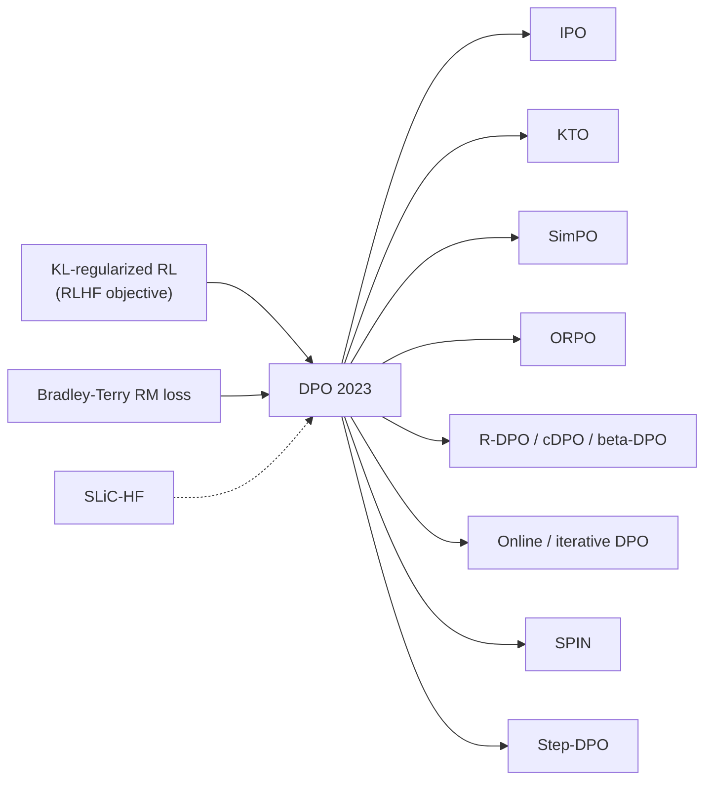

# Direct Preference Optimization (DPO)

> Solve the KL-regularized RLHF objective without a separate reward model or an RL loop. Optimal policies and rewards are related in closed form, so you can fit the policy directly to preference pairs with a single classification-style loss. **Family:** LLM post-training → Preference alignment → Direct (RL-free) preference optimization  ·  **Year / origin:** Rafailov, Sharma, Mitchell, Ermon, Manning, Finn 2023 (Stanford), NeurIPS 2023  ·  **On/Off-policy:** Off-policy / offline (fixed preference dataset); online/iterative variants exist  ·  **Action space:** Discrete tokens (sequence-level loss)

## 1. What is it?

Classic [RLHF](rlhf-ppo.md) trains a reward model, then runs PPO with four networks, many hyperparameters and expensive sampling. **DPO** notices that the KL-regularized objective has an analytic optimal policy, $\pi^*\propto\pi_{\text{ref}}\,e^{r/\beta}$. Inverting that relation expresses the reward through the policy: $r=\beta\log\frac{\pi}{\pi_{\text{ref}}}+\text{const}$. Substituting it into the Bradley–Terry likelihood gives a loss that trains the **policy itself as the reward model**:
$$\mathcal{L}_{\text{DPO}}=-\log\sigma\!\Big(\beta\log\tfrac{\pi_\theta(y_w\mid x)}{\pi_{\text{ref}}(y_w\mid x)}-\beta\log\tfrac{\pi_\theta(y_l\mid x)}{\pi_{\text{ref}}(y_l\mid x)}\Big).$$

All you need is the policy being trained, a frozen reference (usually the SFT model; its log-probs can be precomputed), and a dataset of $(x, y_w, y_l)$ triples. There is no sampling during training, no critic and no reward model.

Where it sits: DPO is not RL in the "interact with an environment" sense. It is **offline**, maximum-likelihood preference fitting that targets the *same optimum* as KL-regularized RL under the BT assumption. It made preference tuning accessible to anyone who can run SFT. Zephyr (Tunstall et al., 2023) popularized it for open models, and it became a standard stage in many open post-training pipelines (e.g., Llama 3, Tülu 3).

## 2. Family & lineage

- **Parents:** KL-regularized RL / [RLHF-PPO](rlhf-ppo.md) (same objective); [Bradley–Terry reward modeling](reward-modeling.md) (same likelihood); earlier "RL as inference" results showing that the optimum of KL-regularized control is an exponentially tilted prior.
- **Siblings:** SLiC-HF (Zhao et al., 2023, calibration with ranking hinge loss), RRHF (Yuan et al., 2023), [best-of-n / rejection-sampling fine-tuning](reward-modeling.md).
- **Descendants:** IPO, cDPO/rDPO, KTO, ORPO, SimPO, R-DPO, β-DPO, Step-DPO ([DPO variants](dpo-variants.md)); online/iterative DPO, SPIN, SPPO ([online & self-play PO](online-iterative-self-play-po.md)); the token-level "Q-function" interpretation (Rafailov et al., 2024).



## 3. Core idea & intuition

- **"Your language model is secretly a reward model"** (the paper's subtitle). Any policy $\pi_\theta$ defines an *implicit reward* $\hat r_\theta(x,y)=\beta\log\frac{\pi_\theta(y\mid x)}{\pi_{\text{ref}}(y\mid x)}$. Training that implicit reward with the BT loss *is* training the policy.
- **Push up the winner, push down the loser, relative to the reference.** The gradient raises $\log\pi_\theta(y_w)$ and lowers $\log\pi_\theta(y_l)$. Each pair is weighted by how *wrong* the current implicit reward is: pairs already ranked correctly by a large margin get little weight.
- **$\beta$ is the KL leash.** Large $\beta$ keeps the policy near the reference (small moves already produce large implicit-reward margins). Small $\beta$ allows big departures. It plays the same role as the KL coefficient in PPO-RLHF.
- **Why it can go wrong.**
  - DPO only sees the responses in the dataset. Probability mass removed from $y_l$ can flow to *unseen* responses, good or bad.
  - Both chosen and rejected log-probs often *decrease* during training ("likelihood displacement"). Our toy shows the chosen implicit reward going negative.
  - With near-deterministic preferences, the loss keeps pushing the margin to infinity and the KL regularization becomes ineffective. This was IPO's motivation.
  - DPO is off-policy: data from a different model than the one being trained gives weaker signal than on-policy samples (motivating [online/iterative DPO](online-iterative-self-play-po.md)).

## 4. Math / formal details

**Notation.** $x$ is a prompt; $y_w, y_l$ the preferred/dispreferred responses; $\pi_\theta$ the policy; $\pi_{\text{ref}}$ the reference; $r$ a reward; $\beta>0$; $\sigma$ the logistic function; $\log\pi(y\mid x)=\sum_t\log\pi(y_t\mid x,y_{<t})$.

**Step 1 — KL-regularized RL objective.**
$$\max_\pi\;\mathbb{E}_{x\sim\mathcal{D},y\sim\pi(\cdot\mid x)}[r(x,y)]-\beta\,\mathrm{KL}\big(\pi(\cdot\mid x)\|\pi_{\text{ref}}(\cdot\mid x)\big).$$

**Step 2 — closed-form optimum.** For each $x$, rewrite the objective as $-\beta\,\mathrm{KL}\big(\pi\,\|\,\tfrac{1}{Z(x)}\pi_{\text{ref}}e^{r/\beta}\big)+\beta\log Z(x)$. It is maximized by
$$\pi_r(y\mid x)=\frac{1}{Z(x)}\pi_{\text{ref}}(y\mid x)\exp\!\Big(\tfrac{1}{\beta}r(x,y)\Big),\quad Z(x)=\sum_y\pi_{\text{ref}}(y\mid x)e^{r(x,y)/\beta}.$$

**Step 3 — invert for the reward.**
$$r(x,y)=\beta\log\frac{\pi_r(y\mid x)}{\pi_{\text{ref}}(y\mid x)}+\beta\log Z(x).$$

**Step 4 — plug into Bradley–Terry.** $Z(x)$ cancels in the difference:
$$P(y_w\succ y_l\mid x)=\sigma\big(r(x,y_w)-r(x,y_l)\big)=\sigma\Big(\beta\log\tfrac{\pi^*(y_w\mid x)}{\pi_{\text{ref}}(y_w\mid x)}-\beta\log\tfrac{\pi^*(y_l\mid x)}{\pi_{\text{ref}}(y_l\mid x)}\Big).$$

**Step 5 — maximum likelihood over a parametric policy:**
$$\boxed{\mathcal{L}_{\text{DPO}}(\theta)=-\mathbb{E}_{(x,y_w,y_l)\sim\mathcal{D}}\Big[\log\sigma\big(\beta\,h_\theta(x,y_w,y_l)\big)\Big],\quad h_\theta=\log\tfrac{\pi_\theta(y_w\mid x)}{\pi_{\text{ref}}(y_w\mid x)}-\log\tfrac{\pi_\theta(y_l\mid x)}{\pi_{\text{ref}}(y_l\mid x)}.}$$

**Gradient.** With $\hat r_\theta=\beta\log\frac{\pi_\theta}{\pi_{\text{ref}}}$:
$$\nabla_\theta\mathcal{L}_{\text{DPO}}=-\beta\,\mathbb{E}\Big[\underbrace{\sigma\big(\hat r_\theta(x,y_l)-\hat r_\theta(x,y_w)\big)}_{\text{weight: high when ranking is wrong}}\big(\nabla_\theta\log\pi_\theta(y_w\mid x)-\nabla_\theta\log\pi_\theta(y_l\mid x)\big)\Big].$$

**Equivalence and reparameterization.** Every reward function equivalence class (rewards differing by a function of $x$ only) corresponds to exactly one optimal policy of the form above. Fitting $\pi_\theta$ with $\mathcal{L}_{\text{DPO}}$ therefore loses no generality relative to fitting a BT reward and running exact KL-regularized RL, *assuming* infinite data and coverage. Part A of the code verifies this numerically in a tabular case.

**Conservative DPO (label smoothing).** If labels are flipped with probability $\varepsilon$:
$\mathcal{L}=-(1-\varepsilon)\log\sigma(\beta h)-\varepsilon\log\sigma(-\beta h)$ (see [DPO variants](dpo-variants.md)).

**Token-level view.** Rafailov et al. (2024) show that DPO, viewed in the token MDP, learns a policy whose log-ratios behave like an optimal soft advantage/Q-function under the KL-regularized objective, which gives some token-level credit assignment.

**Logged metrics (TRL):** `rewards/chosen` $=\beta(\log\pi_\theta(y_w)-\log\pi_{\text{ref}}(y_w))$, `rewards/rejected`, `rewards/margins`, `rewards/accuracies` (fraction with chosen > rejected).

## 5. Algorithm (pseudocode)

```text
Input: SFT model pi_sft, preference data D = {(x, y_w, y_l)}, beta (e.g. 0.1)
1. pi_ref <- freeze(pi_sft);  pi_theta <- pi_sft
2. (optional) precompute ref_w = log pi_ref(y_w|x), ref_l = log pi_ref(y_l|x) for all of D
3. for epoch in 1..E (usually 1-3):
4.     for minibatch B in D:
5.         pol_w = sum_t log pi_theta(y_w,t | x, y_w,<t)   (mask out prompt + padding)
6.         pol_l = sum_t log pi_theta(y_l,t | x, y_l,<t)
7.         h = (pol_w - ref_w) - (pol_l - ref_l)
8.         loss = mean( -log sigmoid(beta * h) )
9.         gradient step (AdamW, lr ~ 5e-7 .. 1e-6 for 7B-class models, warmup + cosine/linear decay)
10.        log implicit rewards beta*(pol - ref), margins, accuracies
11. return pi_theta
```

## 6. Python implementation

Runnable version: [`code/dpo.py`](../../code/dpo.py)

The file contains the `dpo_loss` function (same semantics as TRL's), a masked `sequence_logps` helper, **Part A**, which checks numerically that DPO recovers $\pi^*=\pi_{\text{ref}}e^{r/\beta}/Z$ on a 6-response tabular problem, and **Part B**, which runs offline DPO on a tiny GRU LM with preference pairs labelled by a hidden gold reward.

@@CODE@@

Output (CPU, ~15 s):

```text
Part A  pi_ref : ['0.204', '0.336', '0.124', '0.167', '0.046', '0.124']
        pi_DPO : ['0.286', '0.173', '0.023', '0.012', '0.471', '0.035']
        pi*    : ['0.286', '0.173', '0.023', '0.012', '0.471', '0.035']
        max |pi_DPO - pi*| = 4.32e-07

Part B  SFT gold reward: 0.473
  step  100  loss 0.525  reward acc 0.82  margin 0.48  chosen -0.57  rejected -1.04  gold(sample) 0.962
  ...
  step  600  loss 0.510  reward acc 0.72  margin 1.06  chosen -2.39  rejected -3.45  gold(sample) 1.000
```

Two things to notice. Part A confirms the derivation exactly. In Part B, **both implicit rewards are negative and decreasing**: the policy lowers the probability of the *chosen* responses too. Those responses come from the noisy SFT model, so they are imperfect, while the policy moves mass to the *unseen* perfect sequences. This "likelihood displacement" is common in real DPO runs and is benign here only because the unseen mass goes somewhere good.

**With Hugging Face TRL** (requires GPU + library; not run here):

```python
# pip install trl -- requires GPU; not run here
from datasets import load_dataset
from trl import DPOConfig, DPOTrainer
from transformers import AutoModelForCausalLM, AutoTokenizer

name = "Qwen/Qwen2.5-0.5B-Instruct"                     # an SFT/instruct model
model = AutoModelForCausalLM.from_pretrained(name)
tok = AutoTokenizer.from_pretrained(name)
ds = load_dataset("trl-lib/ultrafeedback_binarized", split="train")  # prompt/chosen/rejected
args = DPOConfig(
    output_dir="dpo-out",
    beta=0.1,                    # KL strength
    loss_type="sigmoid",         # standard DPO; others: "ipo", "robust", "hinge", ...
    label_smoothing=0.0,         # >0 => cDPO
    learning_rate=5e-7, num_train_epochs=1,
    per_device_train_batch_size=4, gradient_accumulation_steps=16,
    max_length=1024, bf16=True,
    precompute_ref_log_probs=False,  # True: compute reference log-probs once, then drop ref from memory
)
trainer = DPOTrainer(model=model, ref_model=None,       # None => a frozen copy of `model` is used
                     args=args, train_dataset=ds, processing_class=tok)
trainer.train()
```

## 7. Practical tips & hyperparameters

| Knob | Typical | Notes |
|---|---|---|
| $\beta$ | 0.01–0.5, default 0.1 | Lower means more aggressive; tune jointly with LR |
| Learning rate | 5e-7 – 1e-6 (7B full FT); ~5e-6 – 5e-5 for LoRA | Too high quickly degrades generations even as loss falls |
| Epochs | 1–3 | Overfitting shows as rising accuracy but worse generations |
| Batch size | 32–128 pairs | |
| Reference | SFT model that generated (or is close to) the data | A mismatched reference hurts |

- **Do SFT first, on in-distribution data.** DPO works best when the chosen responses are reasonably likely under $\pi_{\text{ref}}$. Zephyr used SFT then DPO. Some recipes first SFT on the chosen responses.
- **On-policy data helps.** Preference pairs sampled from your own SFT model, then labelled, usually beat pairs from other models (Tajwar et al. 2024; Xu et al. 2024). Better still, iterate ([online DPO](online-iterative-self-play-po.md)).
- **Monitor `rewards/chosen`.** If it falls steeply, the model may be losing probability on good responses. Remedies: add an NLL term on chosen (RPO / `rpo_alpha` in TRL), raise $\beta$, lower the LR, or use length-normalized variants.
- **Length exploitation.** DPO tends to lengthen outputs when chosen responses are longer. Consider [R-DPO or SimPO](dpo-variants.md), length-controlled evaluation (e.g., length-controlled AlpacaEval), or balancing data.
- **Noisy labels:** use label smoothing (cDPO) or the robust loss; filter low-margin pairs.
- **Memory:** precompute reference log-probs, or use LoRA so the reference is "adapter off" (TRL does this automatically with PEFT).
- **Evaluate generations, not just loss:** win rate vs. reference with a judge, held-out benchmark scores, response-length statistics.

## 8. Pros and cons

| Pros | Cons |
|---|---|
| Simple: one loss, two forward passes per pair, no sampling during training | Offline: cannot explore or correct its own new mistakes (unless made iterative) |
| Stable and cheap compared to PPO; easy to reproduce | Sensitive to the data distribution vs. the reference; likelihood displacement |
| Same optimum as KL-regularized RLHF under BT assumptions | Over-fits deterministic preferences (KL control weakens); length exploitation |
| Implicit reward is available for analysis and reranking | Typically underperforms well-tuned online RL on hard reasoning tasks (reported by several comparisons, e.g. Xu et al. 2024) |
| Excellent library support (TRL, OpenRLHF, LLaMA-Factory, axolotl) | Needs paired data (see KTO for unpaired) |

## 9. When to use / when not to use

**Use DPO when**
- You have a preference dataset (human or AI-labelled) and want a reliable, low-cost alignment step after SFT.
- You need fast iteration on style, tone, helpfulness or safety.
- You lack the infrastructure for online RL.

**Prefer something else when**
- The task has verifiable rewards and benefits from exploration (math, code): use [GRPO](../10-llm-reasoning-rl/grpo.md) / [RLVR](../10-llm-reasoning-rl/rlvr.md).
- Labels are unpaired thumbs-up/down: use KTO.
- You can afford fresh labels each round: use [online/iterative DPO](online-iterative-self-play-po.md).
- Preferences are intransitive or highly noisy: use IPO / SPPO / Nash methods.

## 10. Key papers, books & repos

- Rafailov, Sharma, Mitchell, Ermon, Manning, Finn (2023). *Direct Preference Optimization: Your Language Model is Secretly a Reward Model.* NeurIPS. arXiv:2305.18290.
- Rafailov, Hejna, Park, Finn (2024). *From r to Q\*: Your Language Model is Secretly a Q-Function.* arXiv:2404.12358.
- Tunstall et al. (2023). *Zephyr: Direct Distillation of LM Alignment.* arXiv:2310.16944.
- Zhao et al. (2023). *SLiC-HF: Sequence Likelihood Calibration with Human Feedback.* arXiv:2305.10425.
- Azar et al. (2023). *A General Theoretical Paradigm to Understand Learning from Human Preferences* (IPO). arXiv:2310.12036.
- Xu et al. (2024). *Is DPO Superior to PPO for LLM Alignment? A Comprehensive Study.* arXiv:2404.10719.
- Tajwar et al. (2024). *Preference Fine-Tuning of LLMs Should Leverage Suboptimal, On-Policy Data.* arXiv:2404.14367.
- Razin et al. (2024). *Unintentional Unalignment: Likelihood Displacement in Direct Preference Optimization.* arXiv:2410.08847.
- Grattafiori et al. / Llama Team (2024). *The Llama 3 Herd of Models.* arXiv:2407.21783 (DPO in post-training).
- Lambert et al. (2024). *Tülu 3: Pushing Frontiers in Open Language Model Post-Training.* arXiv:2411.15124.
- Repos: [huggingface/trl](https://github.com/huggingface/trl) (`DPOTrainer`), [eric-mitchell/direct-preference-optimization](https://github.com/eric-mitchell/direct-preference-optimization) (reference implementation), [OpenRLHF/OpenRLHF](https://github.com/OpenRLHF/OpenRLHF), [huggingface/alignment-handbook](https://github.com/huggingface/alignment-handbook).

## 11. For business users

**What it does.** DPO teaches an AI model your preferences straight from examples of "this answer is better than that one". There is no separate scoring model and no complicated trial-and-error training loop. It is roughly as easy to run as ordinary fine-tuning.

**Business analogy.** Classic RLHF is like hiring a full-time critic, then having your writer practise endlessly while the critic scores each draft. DPO is like handing the writer a binder of before/after examples marked "better/worse" and letting them study it directly. It is cheaper and faster. The trade-off is that the writer can only learn from what's in the binder.

**Use cases.**
- Aligning chatbots to company tone and policy.
- Reducing unwanted behaviours (rambling, unsafe answers).
- Domain assistants trained on expert-ranked answers.
- Quick product iterations.

**Value / ROI.** Much lower compute and engineering cost than PPO-based RLHF. Training is stable, so results are predictable. Small teams can do it with open-source tools.

**Risks.**
- Quality is capped by the preference data: biased or narrow data gives biased behaviour.
- The model can learn superficial cues, such as "longer is better".
- It does not explore new solutions by itself.

**Costs.**
- Preference data collection (human or AI-labelled).
- A few GPU-hours to GPU-days depending on model size.

**Questions to ask your team.**
1. Where did the preference pairs come from? Our own model or another one?
2. Did responses get longer after DPO?
3. How do we measure improvement beyond training loss?
4. Would online/iterative DPO or RL give us more for our use case?

## 12. For kids (ages ~8–12)

**The sticker book.** You're learning to draw cats. Your art teacher gives you a sticker book. Each page has two cat drawings: one with a ⭐ ("better!") and one without. You don't need the teacher standing next to you. You just study the pages: "Ah, the starred cats have whiskers and round eyes." You draw more like the starred ones and less like the others. And you keep your own drawing style. You don't suddenly start drawing like a totally different person!

**Try it yourself.** Make three pairs of paper airplanes, two different designs in each pair. Fly both and put a star on the one that flew farther. Look at all the starred planes: what do they have in common? Fold a new plane using what you learned.

**Recap.**
1. Look at pairs: better vs. worse.
2. Do more of the better, less of the worse.
3. Don't forget your own style while you learn.

## 13. Related methods

- [DPO variants (IPO, KTO, ORPO, SimPO, …)](dpo-variants.md) · [Online / iterative / self-play PO](online-iterative-self-play-po.md)
- [RLHF with PPO](rlhf-ppo.md) · [Reward modeling](reward-modeling.md) · [RLAIF / Constitutional AI](rlaif-constitutional-ai.md)
- [Safety RL & reward hacking](safety-rl-reward-hacking.md) · [Rubric & generative rewards](rubric-generative-rewards.md)
- [GRPO](../10-llm-reasoning-rl/grpo.md) · [RLVR](../10-llm-reasoning-rl/rlvr.md) · [Behavior cloning](../07-imitation-inverse-rl/behavior-cloning-dagger.md) · [Offline RL (CQL)](../06-offline-rl/cql.md)

[← Back to overview](../../RL_Methods_Overview.md)
