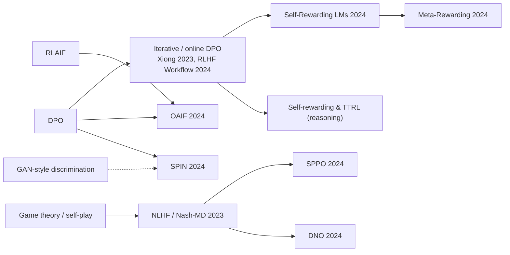

# Online, Iterative & Self-Play Preference Optimization (Online/Iterative DPO, OAIF, Self-Rewarding LMs, SPIN, NLHF / Nash-MD, SPPO)

> Turn offline preference optimization into a loop. Sample from the *current* model, get fresh preference labels (from humans, a reward model, an AI judge, the model itself, or a ground-truth dataset), update, and repeat. Game-theoretic versions seek the Nash equilibrium of a preference game instead of maximizing a scalar reward. **Family:** LLM post-training → Preference alignment → Online / self-play direct preference optimization  ·  **Year / origin:** Xiong et al. 2023 (iterative DPO theory/practice); Guo et al. 2024 (OAIF, Google DeepMind); Yuan et al. 2024 (Self-Rewarding LMs, Meta); Chen et al. 2024 (SPIN, UCLA); Munos et al. 2023 (NLHF, Google DeepMind); Wu et al. 2024 (SPPO, UCLA)  ·  **On/Off-policy:** On-policy or "batch on-policy" (data regenerated each iteration)  ·  **Action space:** Discrete tokens

## 1. What is it?

Plain [DPO](dpo.md) learns from a fixed dataset that some *other* policy generated. This causes three problems:

1. **Distribution shift.** As the policy improves, the dataset's responses become unrepresentative of what the policy actually produces. Gradients then come from irrelevant regions.
2. **No exploration.** The model never gets feedback on its own new behaviours.
3. **No self-correction.** Mistakes the policy develops are never labelled.

Online/iterative methods fix this by **regenerating data from the current policy** each round (or each step) and labelling it. That brings back the main advantage of on-policy RLHF while keeping DPO's simple loss.

| Method | Who labels | Loss | Key idea |
|---|---|---|---|
| **Iterative / online DPO** (Xiong et al.; Dong et al. "RLHF Workflow") | Reward model or human | DPO | Sample n per prompt, best-vs-worst pair, DPO, repeat |
| **OAIF** (Guo et al., 2024) | LLM annotator, online | DPO / IPO / SLiC | Fresh AI preference for 2 on-policy samples at every step |
| **Self-Rewarding LMs** (Yuan et al., 2024) | **The model itself** (LLM-as-a-judge prompt) | DPO | The model improves as both policy and judge over iterations |
| **SPIN** (Chen et al., 2024) | Nobody: ground-truth SFT data vs. own samples | DPO-shaped logistic | Self-play: distinguish human data from your previous self |
| **NLHF / Nash-MD** (Munos et al., 2023) | Preference model $P(y\succ y')$ | Mirror descent on a game | Find the Nash equilibrium; handles intransitive preferences |
| **SPPO** (Wu et al., 2024) | Preference model (e.g. PairRM) | Squared regression | Multiplicative-weights self-play toward the Nash policy |

## 2. Family & lineage

- **Parents:** [DPO](dpo.md) (losses), [RLHF-PPO](rlhf-ppo.md) (on-policy data), Anthropic's iterated online RLHF (Bai et al., 2022), [RLAIF](rlaif-constitutional-ai.md) (AI labels), rejection-sampling fine-tuning, game theory and self-play ([multi-agent RL](../08-exploration-hierarchical-multiagent/multi-agent-rl.md); [AlphaZero](../05-model-based/mcts-alphazero.md)-style self-play), GAN-like discrimination (SPIN).
- **Siblings:** online IPO / IPO-MD (Calandriello et al., 2024), Direct Nash Optimization (DNO; Rosset et al., 2024), XPO (exploratory preference optimization; Xie et al., 2024), Meta-Rewarding LMs (Wu et al., 2024), iterative RPO (Pang et al., 2024).
- **Descendants / cousins:** [self-rewarding & test-time RL](../10-llm-reasoning-rl/self-rewarding-ttrl.md), [GRPO](../10-llm-reasoning-rl/grpo.md) (fully online, scalar rewards), [on-policy distillation](../10-llm-reasoning-rl/on-policy-distillation.md).



## 3. Core idea & intuition

- **Learn from your own mistakes, not someone else's.** A pair "your answer vs. your other answer" is much more informative for *you* than a pair written by a different model.
- **Best-vs-worst of n is a cheap, strong signal.** Sample $n$ (e.g. 4–8) responses, score them with an RM or judge, and pair the top and bottom. This is rejection sampling turned into contrastive data.
- **Reset the reference each round.** In iterative DPO, $\pi_{\text{ref}}$ is typically the start-of-round policy. Each round then takes a KL-bounded step, like a trust region in [TRPO](../03-policy-gradient/trpo.md).
- **Self-rewarding: one model, two jobs.** The model answers prompts, and then, given a judging prompt, scores its own answers (Yuan et al. used an additive 5-point rubric). Better answering data and better judging feed each other. The risk is a closed loop that amplifies the model's own biases.
- **SPIN: "can you tell me apart from the human?"** The new model is trained to assign higher implicit reward to human SFT responses than to responses from its previous version. When the model's distribution equals the data distribution, it cannot tell the two apart and the gradient vanishes. Self-play without any new labels.
- **Nash: preferences are a tournament, not a ruler.** Human preferences can be intransitive (A≻B, B≻C, C≻A), and populations disagree. A scalar BT reward cannot represent that. NLHF looks for the policy that no other policy beats more often than not. In rock-paper-scissors this is the uniform mix, which Part B of the code shows.
- **SPPO = multiplicative weights.** Increase each response's log-probability in proportion to how often it beats the current policy, minus ½. Iterating this self-play update converges (on average) to the Nash equilibrium.

## 4. Math / formal details

**Notation.** $\pi_t$ is the policy at iteration $t$; $\pi_{\text{ref}}$ the reference; $r(x,y)$ a reward model; $P(y\succ y'\mid x)$ a general preference model; $\beta,\eta,\tau>0$; $h_\theta$ the DPO log-ratio margin.

**Iterative DPO.** At iteration $t$, for prompts $x$ sample $y_{1..n}\sim\pi_t(\cdot\mid x)$, set $y_w=\arg\max_i r(x,y_i)$ and $y_l=\arg\min_i r(x,y_i)$, then
$$\pi_{t+1}=\arg\min_\theta\;\mathbb{E}\Big[-\log\sigma\Big(\beta\log\tfrac{\pi_\theta(y_w)}{\pi_t(y_w)}-\beta\log\tfrac{\pi_\theta(y_l)}{\pi_t(y_l)}\Big)\Big].$$
(Some recipes keep $\pi_{\text{ref}}=\pi_{\text{SFT}}$ fixed instead.) Xiong et al. analyse this under a KL-constrained objective. They show that online exploration, e.g. sampling one response from $\pi_t$ and an "exploratory" one from a perturbed policy, gives finite-sample guarantees that offline data with poor coverage cannot.

**OAIF.** At each gradient step, sample $y_1,y_2\sim\pi_\theta$, ask the LLM annotator which is better, and apply DPO/IPO/SLiC to that single fresh pair.

**Self-Rewarding LMs.** Iterations $M_0\to M_1\to M_2\to M_3$. $M_t$ generates candidates and scores them with an LLM-as-a-judge prompt. The highest- and lowest-scoring candidates form DPO pairs (ties dropped), and $M_{t+1}=\text{DPO}(M_t;\text{pairs})$. Seed data includes instruction-following (IFT) and evaluation (EFT) examples, so the model can judge.

**SPIN.** With $p_{\text{data}}$ the SFT data distribution and $\pi_t$ the opponent (previous iterate):
$$\mathcal{L}_{\text{SPIN}}(\theta)=\mathbb{E}_{x,\,y\sim p_{\text{data}},\,y'\sim\pi_t}\Big[\ell\Big(\lambda\log\tfrac{\pi_\theta(y\mid x)}{\pi_t(y\mid x)}-\lambda\log\tfrac{\pi_\theta(y'\mid x)}{\pi_t(y'\mid x)}\Big)\Big],\quad \ell(z)=\log(1+e^{-z}).$$
The global optimum is reached when $\pi_\theta=p_{\text{data}}$. It is DPO with chosen = human data and rejected = self-generated.

**NLHF.** Define $P(\pi\succ\pi')=\mathbb{E}_{x,\,y\sim\pi,\,y'\sim\pi'}[P(y\succ y'\mid x)]$ and the KL-regularized symmetric game
$$\pi^*=\arg\max_\pi\min_{\pi'}\;P(\pi\succ\pi')-\tau\,\mathrm{KL}(\pi\|\mu)+\tau\,\mathrm{KL}(\pi'\|\mu).$$
**Nash-MD** iterates mirror descent against a *geometric mixture* of the current policy and the reference, $\pi_t^\mu(y)\propto\pi_t(y)^{1-\eta\tau}\mu(y)^{\eta\tau}$:
$$\pi_{t+1}(y)\propto\pi_t^\mu(y)\exp\big(\eta\,P(y\succ\pi_t^\mu)\big).$$
Munos et al. prove last-iterate convergence to the regularized Nash equilibrium in the tabular case.

**SPPO.** The exact multiplicative-weights update
$$\pi_{t+1}(y\mid x)\propto\pi_t(y\mid x)\exp\big(\eta\,P(y\succ\pi_t\mid x)\big)$$
is approximated by regression on samples $y\sim\pi_t$:
$$\mathcal{L}_{\text{SPPO}}(\theta)=\mathbb{E}_{x,\,y\sim\pi_t}\Big[\Big(\log\tfrac{\pi_\theta(y\mid x)}{\pi_t(y\mid x)}-\eta\big(\hat P(y\succ\pi_t\mid x)-\tfrac12\big)\Big)^2\Big],$$
where $\hat P(y\succ\pi_t)$ is estimated by comparing $y$ against other samples from $\pi_t$ using the preference model. The "−½" approximates the log-partition function. In zero-sum games the time-averaged iterate approaches the Nash equilibrium.

## 5. Algorithm (pseudocode)

```text
# ---- Iterative / online DPO (best-vs-worst) ----
1. pi_0 <- SFT model
2. for t = 0..T-1:
3.     sample prompts X_t (fresh each round, or a held-out pool)
4.     for x in X_t: sample y_1..y_n ~ pi_t(.|x); score with judge / RM / human
5.         pair (y_best, y_worst); drop ties / low-margin pairs
6.     pi_ref <- pi_t (or keep pi_SFT)
7.     pi_{t+1} <- DPO(pi_t, pairs, pi_ref, beta)   (1-2 epochs)
8.     evaluate on held-out prompts (win rate, length, safety)

# ---- Self-Rewarding variant ----
4'.    score y_i with the model itself using an LLM-as-a-judge prompt (average several judge samples)

# ---- SPIN ----
4''.   for (x, y_human) in SFT data: sample y_self ~ pi_t(.|x)
7''.   pi_{t+1} <- argmin  -log sigmoid(lam*[log pi/pi_t (y_human) - log pi/pi_t (y_self)])

# ---- SPPO ----
4'''.  for x: sample K responses from pi_t; P_hat(y_k > pi_t) = mean_j P(y_k > y_j) via preference model
7'''.  pi_{t+1} <- argmin  ( log pi/pi_t (y_k) - eta*(P_hat - 1/2) )^2
```

## 6. Python implementation

Runnable version: [`code/online_iterative_self_play_po.py`](../../code/online_iterative_self_play_po.py)

There are three parts.
- **Part A** compares offline DPO with 4-round iterative online DPO on a tiny GRU LM, using the *same labelling budget* (2000 prompts, best-vs-worst of 4 samples judged by a noisy toy judge).
- **Part B** runs SPPO on an intransitive "rock-paper-scissors + dominated option" preference and shows that a Bradley–Terry reward fit to the same data collapses to a tie.
- **Part C** runs SPIN converging to the data distribution.

```python
"""
Online / iterative / self-play preference optimization.

Part A  Offline DPO vs ITERATIVE ONLINE DPO (same total labelling budget) on a tiny GRU LM.
        Online: each round, sample K responses per prompt from the CURRENT policy, a toy judge
        scores them, best-vs-worst becomes a DPO pair (rejection-sampling style pairs as in
        Xiong et al. / "RLHF Workflow"), the reference is reset to the round's start policy.
Part B  SPPO on an INTRANSITIVE preference (rock-paper-scissors + a dominated response):
        no Bradley-Terry reward can represent it; SPPO's self-play update approaches the
        Nash equilibrium (averaged iterate).
Part C  SPIN: self-play fine-tuning where 'chosen' = human SFT data, 'rejected' = the model's
        own samples; the fixed point is pi = p_data.

Run: python3 code/online_iterative_self_play_po.py     (CPU, ~1 min)
"""
import copy
import torch
import torch.nn as nn
import torch.nn.functional as F

torch.manual_seed(0)
torch.set_num_threads(1)

# ----------------------------------------------------------------------------------
# (a) Losses
# ----------------------------------------------------------------------------------

def dpo_loss(pc, pr, rc, rr, beta=0.1):
    return -F.logsigmoid(beta * ((pc - rc) - (pr - rr))).mean()


def spin_loss(p_real, p_synth, ref_real, ref_synth, beta=0.1):
    """SPIN (Chen et al. 2024): DPO-shaped logistic loss with chosen = ground-truth SFT
    response, rejected = response generated by the previous iterate (which is also the ref)."""
    return dpo_loss(p_real, p_synth, ref_real, ref_synth, beta)


def sppo_loss(logp, logp_prev, win_prob, eta=1.0):
    """SPPO (Wu et al. 2024): regress log(pi/pi_t)(y) onto eta * (P(y > pi_t) - 1/2).
    win_prob: estimated probability that y beats a sample from the current policy pi_t."""
    return ((logp - logp_prev - eta * (win_prob - 0.5)) ** 2).mean()

# ----------------------------------------------------------------------------------
# Part A: offline vs iterative online DPO
# ----------------------------------------------------------------------------------
V, T, H = 10, 8, 64


class TinyLM(nn.Module):
    def __init__(self):
        super().__init__()
        self.emb, self.gru, self.head = nn.Embedding(V, H), nn.GRU(H, H, batch_first=True), nn.Linear(H, V)

    def forward(self, x):
        return self.head(self.gru(self.emb(x))[0])


def logps(m, p, y):
    inp = torch.cat([p[:, None], y[:, :-1]], 1)
    return torch.log_softmax(m(inp), -1).gather(-1, y[..., None]).squeeze(-1).sum(1)


@torch.no_grad()
def generate(m, p):
    tok, h, out = p[:, None], None, []
    for _ in range(T):
        x, h = m.gru(m.emb(tok), h)
        tok = torch.distributions.Categorical(logits=m.head(x[:, -1])).sample()[:, None]
        out.append(tok)
    return torch.cat(out, 1)


def gold(p, y):
    """Length of the correct prefix of the counting sequence p+1, p+2, ... (normalized)."""
    ok = (y == (p[:, None] + torch.arange(1, T + 1)[None]) % V).int()
    return ok.cumprod(1).sum(1).float() / T


def judge(p, y):
    """Toy AI judge = noisy gold score (an LLM judge is a noisy proxy of human preference)."""
    return gold(p, y) + 0.05 * torch.randn(p.size(0))


def make_sft():
    m = TinyLM()
    opt = torch.optim.Adam(m.parameters(), lr=3e-3)
    for _ in range(300):
        p = torch.randint(0, V, (128,))
        tgt = (p[:, None] + torch.arange(1, T + 1)[None]) % V
        demo = torch.where(torch.rand(tgt.shape) < 0.5, tgt, torch.randint(0, V, tgt.shape))
        loss = -logps(m, p, demo).mean()
        opt.zero_grad(); loss.backward(); opt.step()
    return m


def collect_pairs(policy, n_prompts, K=4):
    """Sample K responses per prompt, judge them, pair best vs worst."""
    p = torch.randint(0, V, (n_prompts,)).repeat_interleave(K)
    y = generate(policy, p)
    s = judge(p, y).view(n_prompts, K)
    y = y.view(n_prompts, K, T)
    best, worst = s.argmax(1), s.argmin(1)
    ar = torch.arange(n_prompts)
    keep = s[ar, best] > s[ar, worst]                         # drop ties
    return p.view(n_prompts, K)[:, 0][keep], y[ar, best][keep], y[ar, worst][keep]


def dpo_train(policy, ref, data, epochs=6, bs=64, beta=0.1, lr=1e-3):
    p, yc, yr = data
    steps = epochs * max(1, p.size(0) // bs)              # fixed #epochs over the pairs
    with torch.no_grad():
        rc, rr = logps(ref, p, yc), logps(ref, p, yr)
    opt = torch.optim.Adam(policy.parameters(), lr=lr)
    for _ in range(steps):
        i = torch.randint(0, p.size(0), (bs,))
        loss = dpo_loss(logps(policy, p[i], yc[i]), logps(policy, p[i], yr[i]), rc[i], rr[i], beta)
        opt.zero_grad(); loss.backward(); opt.step()


def eval_gold(m):
    q = torch.randint(0, V, (2000,))
    return gold(q, generate(m, q)).mean().item()


def part_a(budget=2000, rounds=4):
    sft = make_sft()
    print(f"Part A  SFT gold: {eval_gold(sft):.3f}")
    # Offline: all prompts' pairs collected once from the SFT model
    off = copy.deepcopy(sft)
    dpo_train(off, copy.deepcopy(sft).eval(), collect_pairs(sft, budget))
    print(f"        offline DPO  ({budget} prompts labelled once)          gold: {eval_gold(off):.3f}")
    # Online iterative: same budget split across rounds, fresh samples from current policy
    on = copy.deepcopy(sft)
    for r in range(rounds):
        ref = copy.deepcopy(on).eval()                      # reference = start-of-round policy
        dpo_train(on, ref, collect_pairs(on, budget // rounds))
        print(f"        online iterative DPO round {r + 1}/{rounds}                   gold: {eval_gold(on):.3f}")

# ----------------------------------------------------------------------------------
# Part B: SPPO on intransitive preferences (tabular policy over 4 responses)
# ----------------------------------------------------------------------------------

def part_b(iters=300, K=256, eta=0.3):
    # P[i, j] = Pr(response i preferred to response j). A>B>C>A cycle; D loses to all.
    P = torch.tensor([[0.5, 0.8, 0.2, 0.9],
                      [0.2, 0.5, 0.8, 0.9],
                      [0.8, 0.2, 0.5, 0.9],
                      [0.1, 0.1, 0.1, 0.5]])
    theta = torch.log(torch.tensor([0.1, 0.2, 0.3, 0.4]))  # start far from Nash
    avg = torch.zeros(4)
    for t in range(iters):
        prev = torch.log_softmax(theta, 0).detach()
        y = torch.distributions.Categorical(logits=prev).sample((K,))
        opp = torch.distributions.Categorical(logits=prev).sample((K, 8))
        win = torch.bernoulli(P[y[:, None], opp]).mean(1)   # empirical P(y > pi_t)
        theta = theta.clone().requires_grad_(True)
        opt = torch.optim.SGD([theta], lr=0.5)
        for _ in range(50):
            loss = sppo_loss(torch.log_softmax(theta, 0)[y], prev[y], win, eta)
            opt.zero_grad(); loss.backward(); opt.step()
        theta = theta.detach()
        avg += torch.softmax(theta, 0) / iters
    print("\nPart B  SPPO on rock-paper-scissors + dominated D (Nash = [1/3, 1/3, 1/3, 0])")
    print("        last iterate :", [f"{v:.2f}" for v in torch.softmax(theta, 0).tolist()])
    print("        average iter.:", [f"{v:.2f}" for v in avg.tolist()])
    # A Bradley-Terry reward fitted to the same P cannot express the cycle:
    r = torch.zeros(4, requires_grad=True)
    opt = torch.optim.Adam([r], lr=0.05)
    for _ in range(1000):
        pred = torch.sigmoid(r[:, None] - r[None, :])
        loss = F.binary_cross_entropy(pred, P)
        opt.zero_grad(); loss.backward(); opt.step()
    r = r.detach() - r.detach().mean()
    print("        best-fit BT rewards:", [f"{v:+.2f}" for v in r.tolist()],
          "-> A,B,C tie; BT predicts P(A>B)=0.5, truth is 0.8")

# ----------------------------------------------------------------------------------
# Part C: SPIN (tabular, 6 responses)
# ----------------------------------------------------------------------------------

def part_c(iters=5, n=2000, beta=2.0):
    p_data = torch.tensor([0.40, 0.30, 0.15, 0.10, 0.04, 0.01])        # human SFT data
    theta = torch.zeros(6)                                              # weak model: uniform
    print("\nPart C  SPIN: total-variation distance to the data distribution")
    for t in range(iters + 1):
        pi = torch.softmax(theta, 0)
        print(f"        iter {t}: TV(pi, p_data) = {0.5 * (pi - p_data).abs().sum():.3f}")
        if t == iters:
            break
        prev = torch.log_softmax(theta, 0).detach()
        real = torch.distributions.Categorical(probs=p_data).sample((n,))
        synth = torch.distributions.Categorical(logits=prev).sample((n,))
        theta = theta.clone().requires_grad_(True)
        opt = torch.optim.Adam([theta], lr=0.05)
        for _ in range(100):
            lp = torch.log_softmax(theta, 0)
            loss = spin_loss(lp[real], lp[synth], prev[real], prev[synth], beta)
            opt.zero_grad(); loss.backward(); opt.step()
        theta = theta.detach()


if __name__ == "__main__":
    part_a()
    part_b()
    part_c()
```

Output (CPU, ~12 s):

```text
Part A  SFT gold: 0.142
        offline DPO  (2000 prompts labelled once)          gold: 0.835
        online iterative DPO round 1/4                   gold: 0.424
        online iterative DPO round 2/4                   gold: 0.895
        online iterative DPO round 3/4                   gold: 0.989
        online iterative DPO round 4/4                   gold: 0.996

Part B  SPPO on rock-paper-scissors + dominated D (Nash = [1/3, 1/3, 1/3, 0])
        last iterate : ['0.28', '0.56', '0.16', '0.00']
        average iter.: ['0.31', '0.35', '0.33', '0.02']
        best-fit BT rewards: ['+0.55', '+0.55', '+0.55', '-1.65'] -> A,B,C tie; BT predicts P(A>B)=0.5, truth is 0.8

Part C  SPIN: total-variation distance to the data distribution
        iter 0: TV(pi, p_data) = 0.367
        ...
        iter 5: TV(pi, p_data) = 0.010
```

Takeaways:
- In Part A, after one round the online learner has used only a quarter of the labels, which is why it trails at first. Later rounds label the policy's *own, improved* samples, and the comparisons get sharper (perfect vs. nearly perfect), so it overtakes offline DPO.
- In Part B, the last SPPO iterate still cycles, as multiplicative weights does in zero-sum games, but the average iterate is close to the Nash mix and the dominated option D is eliminated. The BT model cannot express the cycle at all.
- In Part C, SPIN needs no labels and still recovers the data distribution through self-play.

**With Hugging Face TRL** (requires GPU + library; not run here). TRL ships online preference trainers that sample from the policy during training and label with a judge or a reward model. In TRL v1.x several of these live under `trl.experimental`; adjust the imports to your version.

```python
# requires GPU + trl; not run here
from datasets import load_dataset
from transformers import AutoModelForCausalLM, AutoModelForSequenceClassification, AutoTokenizer
from trl.experimental.online_dpo import OnlineDPOConfig, OnlineDPOTrainer  # older TRL: from trl import ...

name = "Qwen/Qwen2.5-0.5B-Instruct"
model = AutoModelForCausalLM.from_pretrained(name)
tok = AutoTokenizer.from_pretrained(name)
rm = AutoModelForSequenceClassification.from_pretrained("my-org/reward-model", num_labels=1)
prompts = load_dataset("trl-lib/ultrafeedback-prompt", split="train")       # prompt-only dataset
args = OnlineDPOConfig(output_dir="online-dpo", beta=0.1, max_new_tokens=256,
                       learning_rate=5e-7, per_device_train_batch_size=4)
trainer = OnlineDPOTrainer(model=model, reward_model=rm,          # or judge=<a pairwise judge>
                           reward_processing_class=AutoTokenizer.from_pretrained("my-org/reward-model"),
                           args=args, train_dataset=prompts, processing_class=tok)
trainer.train()
# Related TRL trainers (same pattern): NashMDTrainer (Nash-MD), XPOTrainer (exploratory PO).
```

## 7. Practical tips & hyperparameters

- **Rounds:** 3–5 iterations are typical (Self-Rewarding used 3; SPIN and SPPO reported gains for ~3 iterations, with diminishing or negative returns later).
- **Samples per prompt:** $n=4$–8 for best-vs-worst. More samples mean sharper pairs but more generation cost.
- **Fresh prompts per round** avoid over-fitting to the same prompts. Keep a fixed held-out evaluation set.
- **Reference choice:** resetting $\pi_{\text{ref}}=\pi_t$ each round lets the policy move further overall. Keeping $\pi_{\text{SFT}}$ anchors it more strongly. Watch cumulative KL from SFT either way.
- **Judge quality and bias:** online methods amplify *judge* biases fast (length, position, self-preference). Use length controls, swap A/B order, mix judges, and periodically audit with humans.
- **Self-rewarding loops can collapse:** monitor judge agreement with a fixed external judge or human labels, and stop when judging accuracy stops improving (the motivation for Meta-Rewarding).
- **SPIN** depends on high-quality SFT data. It cannot exceed the data distribution, so gains saturate once the model matches the SFT data.
- **SPPO/Nash methods** need a *pairwise* preference model (e.g., PairRM) and $O(K^2)$ comparisons per prompt for $\hat P$. Use $K\approx 5$.
- **Debug signals:** per-round win rate vs. the previous round (should be > 50%), length drift, diversity/entropy, reward-model score vs. a held-out gold judge (to detect over-optimization).

## 8. Pros and cons

| Pros | Cons |
|---|---|
| On-policy data fixes DPO's distribution shift; typically beats offline DPO (reported by OAIF, RLHF Workflow and others) | Needs generation infrastructure and a labeller in the loop (more compute than offline DPO) |
| Keeps DPO's simple, stable loss; no critic | Labeller (RM/judge) gets exploited faster; reward hacking returns |
| Self-rewarding / SPIN reduce or remove the need for new human labels | Closed loops can amplify biases or collapse |
| Nash methods handle intransitive and diverse preferences | Nash methods need pairwise preference models and many comparisons |
| Natural fit for continual improvement of deployed models | More hyperparameters (rounds, n, reference schedule) |

## 9. When to use / when not to use

**Use when**
- Offline DPO has plateaued.
- You have a reasonable judge or RM, or human labelling capacity each round.
- You want PPO-like gains without PPO's complexity.
- Preferences are contested or intransitive (Nash/SPPO).
- You have good SFT data but no preference labels (SPIN).

**Avoid when**
- The labeller is weak or easy to game and you cannot audit it.
- Compute for repeated generation is unavailable.
- The reward is verifiable; then go fully online with [GRPO](../10-llm-reasoning-rl/grpo.md) / [RLVR](../10-llm-reasoning-rl/rlvr.md), which is simpler.

## 10. Key papers, books & repos

- Xiong, Dong, Ye, Wang, Zhong, Ji, Jiang, Zhang (2023/2024). *Iterative Preference Learning from Human Feedback: Bridging Theory and Practice for RLHF under KL-Constraint.* ICML 2024. arXiv:2312.11456.
- Dong et al. (2024). *RLHF Workflow: From Reward Modeling to Online RLHF.* TMLR. arXiv:2405.07863.
- Guo et al. (2024). *Direct Language Model Alignment from Online AI Feedback* (OAIF). Google DeepMind. arXiv:2402.04792.
- Yuan, Pang, Cho, Li, Sukhbaatar, Xu, Weston (2024). *Self-Rewarding Language Models.* Meta. arXiv:2401.10020.
- Wu et al. (2024). *Meta-Rewarding Language Models: Self-Improving Alignment with LLM-as-a-Meta-Judge.* arXiv:2407.19594.
- Chen, Deng, Yuan, Ji, Gu (2024). *Self-Play Fine-Tuning Converts Weak Language Models to Strong Language Models* (SPIN). ICML. arXiv:2401.01335.
- Munos et al. (2023). *Nash Learning from Human Feedback.* Google DeepMind. ICML 2024. arXiv:2312.00886.
- Wu, Sun, Yuan, Ji, Yang, Gu (2024). *Self-Play Preference Optimization for Language Model Alignment* (SPPO). arXiv:2405.00675.
- Rosset et al. (2024). *Direct Nash Optimization: Teaching Language Models to Self-Improve with General Preferences.* arXiv:2404.03715.
- Calandriello et al. (2024). *Human Alignment of Large Language Models through Online Preference Optimisation.* arXiv:2403.08635.
- Xie et al. (2024). *Exploratory Preference Optimization* (XPO). arXiv:2405.21046.
- Pang et al. (2024). *Iterative Reasoning Preference Optimization.* arXiv:2404.19733.
- Repos: [huggingface/trl](https://github.com/huggingface/trl) (OnlineDPO, NashMD, XPO trainers), [RLHFlow/Online-RLHF](https://github.com/RLHFlow/Online-RLHF), [uclaml/SPIN](https://github.com/uclaml/SPIN), [uclaml/SPPO](https://github.com/uclaml/SPPO), [OpenRLHF/OpenRLHF](https://github.com/OpenRLHF/OpenRLHF).

## 11. For business users

**What it does.** Instead of training once on an old pile of examples, the AI repeatedly drafts new answers, gets them graded (by people, by a grading model, or even by itself), and learns from that fresh feedback. Round after round, it learns from *its own current* mistakes.

**Business analogy.** One-time training is like a single workshop. Iterative training is like weekly coaching on the employee's actual recent work. Self-play methods are like a chess player studying games against their past self. The "Nash" methods are like designing a product that holds up against *every* competitor, rather than maximizing a single score.

**Use cases.**
- Continuous improvement of a deployed assistant using fresh traffic and judges.
- Bootstrapping quality when labels are scarce (self-rewarding, SPIN).
- Handling diverse customer preferences where no single "best" exists (Nash-style).

**Value / ROI.** Usually better results than one-shot preference training for a moderate extra compute cost. Self-rewarding and self-play reduce human labelling.

**Risks.**
- The AI can learn to please its grader rather than users. If it grades itself, errors can snowball.
- Requires monitoring each round.

**Costs.**
- Repeated generation and grading compute.
- An evaluation pipeline.
- Human audits.

**Questions to ask your team.**
1. Who or what grades each round, and how do we audit it?
2. What stops the loop from drifting (length, tone, made-up facts)?
3. How many rounds before gains flatten?
4. Do we track win rate against the previous version?

## 12. For kids (ages ~8–12)

**Racing your own ghost.** In some racing video games you can race against a "ghost": a see-through car that replays your best lap. Every time you beat your ghost, the new lap becomes the ghost, and you race again. You don't need a coach; *you* are the opponent! That's self-play. And if you have a friend who says which lap looked cooler, that's online feedback.

**Rock-paper-scissors twist.** If you always play rock, a friend will learn to play paper. The best strategy is to mix all three evenly. Some AI methods learn exactly that kind of "can't-be-beaten" mix.

**Try it yourself.** Throw a paper ball into a bin from 3 steps away, 5 times. Count your hits. That's your "ghost" score. Try to beat it in the next round of 5. Change one thing each round (arm angle, spin). Did beating your own ghost make you better?

**Recap.**
1. Practise on your *own* newest tries.
2. Your past self can be your opponent.
3. Sometimes the best plan is a good mix.

## 13. Related methods

- [DPO](dpo.md) · [DPO variants](dpo-variants.md) · [RLHF with PPO](rlhf-ppo.md) · [Reward modeling](reward-modeling.md)
- [RLAIF / Constitutional AI](rlaif-constitutional-ai.md) · [Rubric & generative rewards](rubric-generative-rewards.md) · [Safety RL & reward hacking](safety-rl-reward-hacking.md)
- [Self-rewarding & TTRL](../10-llm-reasoning-rl/self-rewarding-ttrl.md) · [GRPO](../10-llm-reasoning-rl/grpo.md) · [On-policy distillation](../10-llm-reasoning-rl/on-policy-distillation.md)
- [Multi-agent RL (self-play)](../08-exploration-hierarchical-multiagent/multi-agent-rl.md) · [MCTS / AlphaZero](../05-model-based/mcts-alphazero.md)

[← Back to overview](../../RL_Methods_Overview.md)
