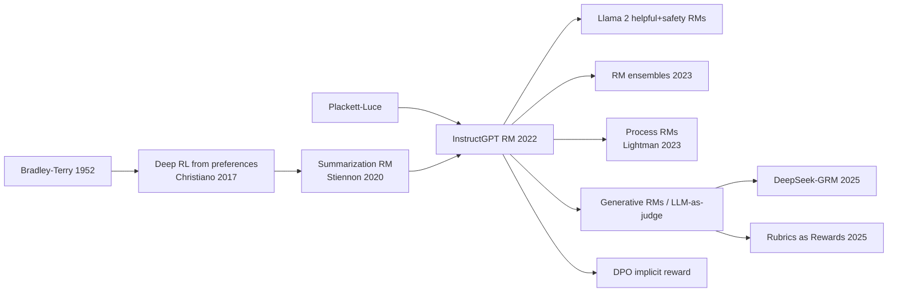

# Reward Modeling for RLHF (RM, Bradley–Terry RM, ORM/PRM, Generative RM)

> Learning a scalar "how good is this response?" function from human (or AI) comparisons, which then serves as the reward for RL, for best-of-n reranking, or for evaluation. **Family:** LLM post-training → Preference alignment → Reward learning (preference-based inverse RL)  ·  **Year / origin:** Bradley & Terry (1952) for the statistical model; Christiano et al. 2017 for deep RL from preferences; Stiennon et al. 2020 and Ouyang et al. 2022 (OpenAI) for LLM RMs  ·  **On/Off-policy:** Supervised / offline (trained on a fixed comparison dataset; refreshed iteratively in practice)  ·  **Action space:** N/A (scores whole responses or steps)

## 1. What is it?

A **reward model (RM)** is a neural network $r_\phi(x,y)$ that maps a prompt $x$ and a response $y$ to a scalar. Most RMs are trained on **pairwise preferences**: annotators see two responses and choose the better one. The model is fit so that preferred responses score higher, almost always via the **Bradley–Terry (BT)** model:
$$P(y_w \succ y_l \mid x)=\sigma\big(r_\phi(x,y_w)-r_\phi(x,y_l)\big).$$

Why comparisons instead of absolute scores? People are much more consistent at saying "A is better than B" than at giving "A deserves 7.3/10". Comparisons are invariant to each annotator's personal scale.

Where it sits. Reward modeling is a form of **preference-based inverse RL**: inferring the reward from human choices instead of hand-writing it ([inverse RL](../07-imitation-inverse-rl/inverse-rl.md)). In the [RLHF pipeline](rlhf-ppo.md) it is stage 2. Its quality caps everything downstream, because RL will optimize *exactly* what the RM rewards, flaws included.

Types you will meet:

| Type | Scores | Trained on | Used for |
|---|---|---|---|
| **Outcome RM (ORM)**, a scalar BT RM | Whole response | Pairwise preferences | RLHF (PPO), best-of-n, rejection sampling |
| **Process RM (PRM)** | Each reasoning step | Step-level correctness labels | Math/code search, dense RL rewards (see [PRM & PRIME](../10-llm-reasoning-rl/process-reward-prime.md)) |
| **Generative RM / LLM-as-judge** | Text critique, then a score or verdict | Instruction-tuned judges, critique data | Non-verifiable tasks, rubric grading (see [rubric & generative rewards](rubric-generative-rewards.md)) |
| **Implicit RM** | $\beta\log\frac{\pi_\theta}{\pi_\text{ref}}$ | Comes free with [DPO](dpo.md) | Ranking, iterative DPO |
| **Multi-objective RM** | A vector (helpfulness, safety, verbosity, …) | Attribute ratings | Steerable or constrained RL ([Safe RLHF](safety-rl-reward-hacking.md)) |

## 2. Family & lineage

- **Statistics roots:** Thurstone (1927, comparative judgement), Bradley & Terry (1952, paired comparisons), Plackett–Luce (rankings), Elo ratings.
- **RL roots:** preference-based RL; Christiano et al. 2017 trained deep RMs from human clip comparisons for Atari/MuJoCo.
- **LLM RMs:** Ziegler et al. 2019 → Stiennon et al. 2020 (summarization RM) → InstructGPT (6B RM; labelers rank 4–9 responses per prompt, giving all $\binom{K}{2}$ pairs) → Anthropic "preference models" (Askell et al. 2021; Bai et al. 2022) → Llama 2 (separate helpfulness and safety RMs, margin loss).
- **Descendants:** RM ensembles (Coste et al. 2023; Eisenstein et al. 2023); PRMs (Uesato et al. 2022; Lightman et al. 2023); generative verifiers / GenRM (Zhang et al. 2024); LLM-as-a-judge (Zheng et al. 2023); DeepSeek-GRM (Liu et al. 2025); rubric rewards (Gunjal et al. 2025); the *implicit* reward in DPO.



## 3. Core idea & intuition

- **Learn a ruler from "which is longer?" questions.** If you only ask "is A longer than B?" for many pairs, you can still recover the length of every stick, up to where you put the zero. BT does exactly this for "quality": rewards are identified only up to an additive constant per prompt.
- **A reward model is a classifier in disguise.** For a pair, $\sigma(r_w-r_l)$ is the predicted probability that the human chose $w$. Training is logistic regression on reward differences.
- **Architecture:** take an LLM (often the SFT model or a sibling), drop the LM head, and add a linear "value head" that reads the hidden state of the **last token** and outputs one number.
- **Accuracy ceilings are low.** Humans disagree with each other a lot; InstructGPT reported inter-labeler agreement in the low 70s %. A held-out RM accuracy of ~65–75% on human preference data is normal, not a bug.
- **Goodhart's law is the central danger.** An RM is accurate on the distribution it was trained on (SFT samples). RL moves the policy *off* that distribution, toward regions where the RM is extrapolating. Proxy reward keeps rising while true quality peaks and then falls. This is **reward over-optimization** (Gao et al., 2022), and the toy below reproduces it.
- **Ensembles help with uncertainty.** Several RMs trained with different seeds agree in-distribution and disagree off-distribution. Optimizing a pessimistic aggregate ($\text{mean}-k\cdot\text{std}$, or the minimum) discourages exploiting any single model's quirks. Members that share a pretrained backbone still share errors, so ensembles mitigate hacking rather than eliminate it (Eisenstein et al., 2023).

## 4. Math / formal details

**Data:** $\mathcal{D}=\{(x^{(i)},y_w^{(i)},y_l^{(i)})\}$, with $y_w$ preferred over $y_l$. $r_\phi(x,y)\in\mathbb{R}$ is the RM and $\sigma$ the logistic function.

**Bradley–Terry negative log-likelihood:**
$$\mathcal{L}_{\text{BT}}(\phi)=-\mathbb{E}_{(x,y_w,y_l)\sim\mathcal{D}}\Big[\log\sigma\big(r_\phi(x,y_w)-r_\phi(x,y_l)\big)\Big].$$

**Rankings of $K$ responses (InstructGPT):** use all $\binom{K}{2}$ pairs from one ranking in the same batch, so the prompt's forward passes are shared and the model does not overfit from seeing correlated pairs in different batches:
$$\mathcal{L}=-\frac{1}{\binom{K}{2}}\mathbb{E}\sum_{(y_w,y_l)}\log\sigma(r_\phi(x,y_w)-r_\phi(x,y_l)).$$
Equivalently, one can use the **Plackett–Luce** likelihood $\prod_{k}\frac{e^{r(y_{(k)})}}{\sum_{j\ge k}e^{r(y_{(j)})}}$.

**Margin loss (Llama 2):** $-\log\sigma(r_w-r_l-m(\text{rating}))$, where the margin $m$ grows with how strongly annotators preferred $y_w$.

**Soft labels:** when labels are probabilities $p=P(y_a\succ y_b)$ (e.g., from an AI labeler), use binary cross-entropy $-[p\log\sigma(\Delta)+(1-p)\log\sigma(-\Delta)]$ with $\Delta=r_a-r_b$.

**Regularizers:** a centring penalty $\eta\,(r_w+r_l)^2$ pins the free constant; weight decay; usually 1 epoch, since RMs overfit fast (InstructGPT and Stiennon et al. trained ~1 epoch).

**Reward normalization before RL:** $\tilde r=(r-\mu)/\sigma$ with statistics over SFT samples, or shift so that reference responses score 0 (Stiennon et al.).

**Ensembles:** with members $r_1,\dots,r_M$:
$$r_{\text{mean}}=\tfrac1M\textstyle\sum_m r_m,\quad r_{\text{UWO}}=r_{\text{mean}}-k\cdot\mathrm{std}_m(r_m),\quad r_{\text{WCO}}=\min_m r_m$$
(uncertainty-weighted and worst-case optimization, Coste et al. 2023).

**Over-optimization scaling laws** (Gao, Schulman & Hilton, 2022). A large "gold" RM plays the human, and smaller proxy RMs are trained on its labels. With $d=\sqrt{\mathrm{KL}(\pi\|\pi_{\text{init}})}$, the gold reward follows
$$R_{\text{BoN}}(d)=d(\alpha_{\text{BoN}}-\beta_{\text{BoN}}d),\qquad R_{\text{RL}}(d)=d(\alpha_{\text{RL}}-\beta_{\text{RL}}\log d),$$
so it rises, peaks, and declines as optimization pressure grows. The coefficients improve smoothly with proxy-RM size and data. For best-of-$n$ the KL is analytic: $\mathrm{KL}_{\text{BoN}}=\log n-\frac{n-1}{n}$.

**Process RM:** for a solution split into steps $s_1..s_K$, a PRM predicts $p_k=P(\text{step }k\text{ correct}\mid x,s_{\le k})$, trained with cross-entropy on step labels. The solution score is usually $\min_k p_k$ or $\prod_k p_k$ (Lightman et al. 2023).

**Generative RM:** the judge LLM $J$ produces a critique $c\sim J(\cdot\mid x,y,\text{principles})$ and a score $s=f(c)$, or a pairwise verdict. Scores can be averaged over $k$ samples for inference-time scaling (DeepSeek-GRM).

## 5. Algorithm (pseudocode)

```text
Input: SFT model pi_sft, prompts X, annotators (human or AI)
1.  for each prompt x in X:  sample K responses y_1..y_K ~ pi_sft(.|x)  (mix models/temperatures for diversity)
2.  annotators rank or compare them -> pairs (x, y_w, y_l) (+ optional strength/margin)
3.  init r_phi = backbone(pi_sft or similar) + scalar head on the last token
4.  for 1 epoch over pairs (all pairs of one prompt in the same batch):
5.      loss = -log sigmoid(r(x,y_w) - r(x,y_l) - margin) + eta*(r_w + r_l)^2
6.      AdamW step (lr ~ 1e-6 .. 1e-5 for 7B-class models)
7.  validate: held-out pairwise accuracy, RewardBench-style category accuracy,
              calibration, length-correlation check
8.  (optional) train M members with different seeds/data orders -> ensemble
9.  before RL: compute mean/std of r on SFT samples for normalization
10. during RL: periodically sample policy outputs, relabel with humans/gold judge,
               retrain RM on the new on-policy pairs (iterated RLHF, Bai et al. 2022)
```

## 6. Python implementation

Runnable version: [`code/reward_modeling.py`](../../code/reward_modeling.py)

The file implements the BT loss (with optional margin and centring), soft-label BT, the pessimistic ensemble aggregate, and a **Goodhart demo**. The RM is trained on preference data covering short responses (length 3–8). Best-of-$n$ then searches over a policy that can also write longer responses (up to 12), which the true reward penalizes but the RM never saw.

@@CODE@@

Output (CPU, ~15 s):

```text
held-out pairwise accuracy (in-distribution): 0.735  (noisy labels => ceiling < 1)

Best-of-n with a SINGLE proxy RM  (watch gold peak then fall = Goodhart)
   n   KL(nats)  proxy   gold   avg_len
   1     0.00     0.18    0.71     7.4
   4     0.64     1.79    2.08     8.2
  16     1.84     2.86    2.55     9.2
  64     3.17     3.74    2.98     9.6
 256     4.55     4.48    3.03    10.1
1024     5.93     5.04    2.98    10.6

Best-of-n with a 5-member ENSEMBLE, score = mean - 2*std (pessimism off-distribution)
   n   KL(nats)  proxy   gold   avg_len
   1     0.00    -0.36    0.94     7.5
   4     0.64     0.99    1.87     8.1
  16     1.84     2.13    2.92     8.7
  64     3.17     2.88    3.53     9.1
 256     4.55     3.51    3.97     9.4
1024     5.93     4.07    4.12     9.8
```

Proxy reward rises monotonically. Gold reward for the single RM flattens and starts to fall as best-of-$n$ selects ever-longer answers. The pessimistic ensemble keeps length closer to the training range and reaches higher gold reward. This is a toy: in real systems ensembles help but do not fully solve over-optimization.

**With a real library** (requires GPU + library; not run here). TRL's `RewardTrainer` expects a dataset with `chosen` / `rejected` columns (plain text or conversational):

```python
# pip install trl  -- requires GPU; not run here
from datasets import load_dataset
from transformers import AutoModelForSequenceClassification, AutoTokenizer
from trl import RewardConfig, RewardTrainer

base = "Qwen/Qwen2.5-0.5B-Instruct"
tok = AutoTokenizer.from_pretrained(base)
model = AutoModelForSequenceClassification.from_pretrained(base, num_labels=1)  # scalar head
model.config.pad_token_id = tok.pad_token_id
ds = load_dataset("trl-lib/ultrafeedback_binarized", split="train")  # chosen / rejected pairs
args = RewardConfig(output_dir="rm-out", per_device_train_batch_size=8, num_train_epochs=1,
                    learning_rate=1e-5, max_length=1024, center_rewards_coefficient=1e-2)
RewardTrainer(model=model, args=args, processing_class=tok, train_dataset=ds).train()
```

## 7. Practical tips & hyperparameters

- **One epoch** (sometimes 2) at LR ~1e-6–1e-5 for 7B-class backbones. RMs overfit quickly; watch validation accuracy per epoch.
- **RM size matters.** Gao et al. found larger proxy RMs over-optimize more slowly. A common rule of thumb is an RM at least as capable as the policy.
- **Diverse response sources.** Comparisons only between near-identical samples teach little. Mix models, temperatures, and policy checkpoints. Iteratively add *on-policy* samples from the current RL policy (Bai et al. 2022's weekly "online" RLHF).
- **Check spurious correlations:** length (Singhal et al., 2023), lists/markdown, hedging, sycophantic agreement. Plot reward vs. length on held-out data. Debias via length-matched pairs, length penalties, or regression of length out of the reward.
- **Separate RMs for conflicting goals** (helpfulness vs. harmlessness, Llama 2), then combine them with a rule (e.g., use the safety RM when the prompt is risky) or with constraints ([Safe RLHF](safety-rl-reward-hacking.md)).
- **Evaluation.** Use **RewardBench** (Lambert et al., 2024: chat, chat-hard, safety, reasoning subsets) and its 2025 successor RewardBench 2, but remember benchmark accuracy does not always predict downstream RLHF gains. Also run best-of-n with the RM and have humans or a strong judge rate the winners.
- **Calibration.** $\sigma(r_w-r_l)$ should match empirical win rates. Badly calibrated RMs make $\beta$ hard to tune.
- **Signals that the RM is being exploited during RL:** proxy reward up but human or gold-judge win-rate flat or down; length or format drift; very high reward on outputs that read oddly.

## 8. Pros and cons

| Pros | Cons |
|---|---|
| Turns cheap relative judgements into a dense, reusable scalar signal | Proxy, not truth: over-optimization and reward hacking are guaranteed under enough pressure |
| Can be inspected, ensembled, calibrated, combined with rules and costs | Inherits annotator biases (length, sycophancy, confident tone) |
| Enables best-of-n, rejection sampling, PPO and evaluation from the same model | BT assumes transitive, scalar preferences; real preferences can be intransitive or plural ([NLHF](online-iterative-self-play-po.md)) |
| Generative and process RMs extend to reasoning and non-verifiable tasks | Needs fresh on-policy data as the policy drifts; costly human labels |

## 9. When to use / when not to use

**Use an explicit RM when**
- You will run online RL (PPO/GRPO/RLOO) or best-of-n / rejection sampling.
- You need a reusable judge for many policies or checkpoints.
- You need to combine multiple objectives or constraints.

**Prefer alternatives when**
- The task has a verifiable answer: use a verifier ([RLVR](../10-llm-reasoning-rl/rlvr.md)) instead of a learned RM.
- You only have a fixed preference set and want simplicity: [DPO](dpo.md) skips the explicit RM.
- Criteria are rich but describable: use rubric-based LLM judges ([rubric rewards](rubric-generative-rewards.md)).
- Preferences are strongly intransitive or pluralistic: use preference-model / Nash approaches ([NLHF, SPPO](online-iterative-self-play-po.md)).

## 10. Key papers, books & repos

- Bradley & Terry (1952). *Rank Analysis of Incomplete Block Designs: I. The Method of Paired Comparisons.* Biometrika.
- Christiano et al. (2017). *Deep RL from Human Preferences.* arXiv:1706.03741.
- Stiennon et al. (2020). *Learning to Summarize from Human Feedback.* arXiv:2009.01325.
- Askell et al. (2021). *A General Language Assistant as a Laboratory for Alignment.* Anthropic. arXiv:2112.00861.
- Ouyang et al. (2022). *InstructGPT.* arXiv:2203.02155.
- Bai et al. (2022). *Training a Helpful and Harmless Assistant with RLHF.* arXiv:2204.05862.
- Gao, Schulman, Hilton (2022). *Scaling Laws for Reward Model Overoptimization.* arXiv:2210.10760.
- Touvron et al. (2023). *Llama 2.* arXiv:2307.09288 (margin loss, helpfulness and safety RMs).
- Coste, Anwar, Kirk, Krueger (2023). *Reward Model Ensembles Help Mitigate Overoptimization.* arXiv:2310.02743.
- Eisenstein et al. (2023). *Helping or Herding? Reward Model Ensembles Mitigate but do not Eliminate Reward Hacking.* arXiv:2312.09244.
- Singhal, Goyal, Xu, Durrett (2023). *A Long Way to Go: Investigating Length Correlations in RLHF.* arXiv:2310.03716.
- Uesato et al. (2022). *Solving Math Word Problems with Process- and Outcome-based Feedback.* arXiv:2211.14275.
- Lightman et al. (2023). *Let's Verify Step by Step.* arXiv:2305.20050 (PRM800K).
- Zheng et al. (2023). *Judging LLM-as-a-Judge with MT-Bench and Chatbot Arena.* arXiv:2306.05685.
- Zhang et al. (2024). *Generative Verifiers: Reward Modeling as Next-Token Prediction.* arXiv:2408.15240.
- Lambert et al. (2024). *RewardBench: Evaluating Reward Models for Language Modeling.* arXiv:2403.13787.
- Liu et al. (2025). *Inference-Time Scaling for Generalist Reward Modeling* (DeepSeek-GRM). arXiv:2504.02495.
- Repos: [huggingface/trl](https://github.com/huggingface/trl) (`RewardTrainer`), [OpenRLHF/OpenRLHF](https://github.com/OpenRLHF/OpenRLHF) (`train_rm`), [allenai/reward-bench](https://github.com/allenai/reward-bench), [openai/prm800k](https://github.com/openai/prm800k), [anthropics/hh-rlhf](https://github.com/anthropics/hh-rlhf).

## 11. For business users

**What it does.** A reward model is an automated "taste tester". You show people pairs of AI answers, they pick the better one, and a model learns to predict their choices. It can then grade millions of answers instantly, which lets you improve the AI or pick the best of several drafts.

**Business analogy.** It is like building an automated grader from a panel of expert judges' past decisions. The grader is fast and cheap, but it only knows what the judges saw. Show it something radically new and it can be confidently wrong. Employees who are paid only by the grader will learn its blind spots.

**Use cases.**
- Training chat assistants (RLHF).
- Re-ranking several candidate answers before showing one.
- Automatic quality monitoring.
- A/B evaluation of model versions.
- Separate "safety graders" for risky topics.

**Value / ROI.** Labels are collected once and reused many times. Best-of-n reranking with a good RM can deliver quality gains without retraining the main model.

**Risks.**
- "Teaching to the test": the AI learns to look good to the grader, for example by being longer, more flattering, or more confident, without actually being better.
- Biased labelers produce biased graders.

**Costs.**
- Human comparison labels (often the biggest cost).
- GPU training.
- An ongoing refresh as your AI changes.

**Questions to ask your team.**
1. How often does the grader agree with fresh human judgements on *current* model outputs?
2. Does the grader just prefer longer answers?
3. Do we use several graders or only one?
4. What checks catch the AI gaming the grader?

## 12. For kids (ages ~8–12)

**The cookie contest robot.** Grandma judges a cookie contest, but she can only taste a few cookies. So she trains a robot. She shows it pairs of cookies and says "this one is better." Soon the robot can guess which cookie Grandma would like! But one day someone bakes a giant cookie covered in 100 sprinkles. The robot never saw anything like it and thinks "sprinkles = amazing!" Grandma tastes it: way too sweet. Yuck. The robot was fooled because it only knew normal cookies. That's why we ask *several* robots, and if they disagree, we stay careful.

**Try it yourself.** Ask a family member to pick between two snacks, five times, with different pairs. Can you guess their favourite snack from the choices alone? Now invent a "weird" snack they never saw. Can your guess still be trusted?

**Recap.**
1. Comparing two things is easier than giving scores.
2. A robot judge learns from those comparisons.
3. Robot judges get fooled by weird new things, so be careful.

## 13. Related methods

- [RLHF with PPO](rlhf-ppo.md) · [RLAIF / Constitutional AI](rlaif-constitutional-ai.md) · [DPO](dpo.md) (implicit reward) · [DPO variants](dpo-variants.md)
- [Rubric & generative rewards](rubric-generative-rewards.md) · [Safety RL & reward hacking](safety-rl-reward-hacking.md) · [Online / iterative / self-play PO](online-iterative-self-play-po.md)
- [Process reward models & PRIME](../10-llm-reasoning-rl/process-reward-prime.md) · [RLVR](../10-llm-reasoning-rl/rlvr.md) · [Self-rewarding & TTRL](../10-llm-reasoning-rl/self-rewarding-ttrl.md)
- [Inverse RL](../07-imitation-inverse-rl/inverse-rl.md) · [GAIL](../07-imitation-inverse-rl/gail.md)

[← Back to overview](../../RL_Methods_Overview.md)
