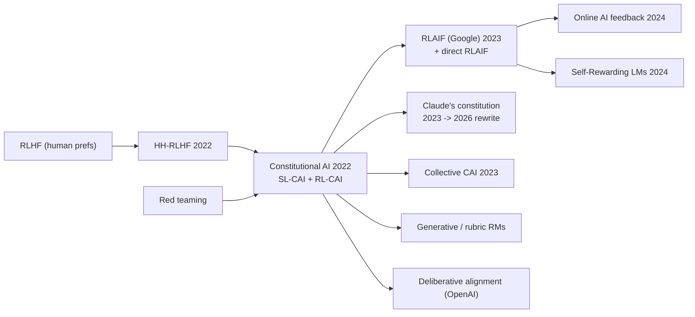

# RLAIF & Constitutional AI (CAI, RLAIF, SL-CAI / RL-CAI, d-RLAIF)

> Replace (most) human preference labels with labels from an AI model that is told to judge responses against a written set of principles, a "constitution". The labels feed supervised self-revision and RL. **Family:** LLM post-training → Preference alignment → RL from AI feedback  ·  **Year / origin:** Bai et al. 2022, *Constitutional AI: Harmlessness from AI Feedback* (Anthropic); Lee et al. 2023, *RLAIF* (Google)  ·  **On/Off-policy:** SL stage offline; RL stage on-policy (PPO against an AI-labelled preference model)  ·  **Action space:** Discrete tokens

## 1. What is it?

Human preference labels are slow, expensive and inconsistent. For harmful content, collecting them also means asking people to read disturbing material. And a model trained only on what labelers prefer can become **evasive**: refusing anything borderline earns "harmless" votes. **Constitutional AI (CAI)** addresses this with two stages, both driven by the model's own judgement under explicit natural-language principles:

1. **SL-CAI (supervised).** Start from a helpful-only RLHF model and give it red-team prompts. The model **critiques** its own answer according to a principle (e.g., "identify ways the response is harmful, unethical, or illegal") and then **revises** it. This can repeat several times. The model is fine-tuned on the revised responses.
2. **RL-CAI (RLAIF).** Sample two responses from the SL-CAI model. A *feedback model* sees a multiple-choice question built from a randomly drawn principle ("Which response is less harmful?") and its normalized probabilities for (A) vs (B) become **soft preference labels**. A preference model is trained on these AI labels (mixed with human *helpfulness* labels) and the policy is optimized with PPO, as in [RLHF](rlhf-ppo.md).

The paper reported a model that was both **more harmless and less evasive** than one trained with human harmlessness labels: it engaged and explained its objections instead of stonewalling. It used no human labels for harmlessness.

**RLAIF** (Lee et al., 2023, Google) studied the general question "can AI labels replace human labels?" on summarization, helpful dialogue and harmless dialogue. Human raters judged RLAIF policies roughly on par with RLHF ones. The paper also introduced **direct RLAIF (d-RLAIF)**, where the LLM judge scores responses during RL without training a separate reward model.

Taxonomy: same RL machinery as RLHF. The novelty is in **where the reward comes from**, a scalable-oversight idea: use AI to help supervise AI.

## 2. Family & lineage

- **Parents:** [RLHF with PPO](rlhf-ppo.md); [reward modeling](reward-modeling.md); Anthropic's HH-RLHF work (Bai et al., 2022a) and red-teaming (Ganguli et al., 2022); self-critique / self-refinement ideas.
- **Siblings:** RLAIF (Google), LLM-as-a-judge evaluation, DeepMind's Sparrow rules (Glaese et al. 2022, rule-conditioned RMs), OpenAI's [rule-based rewards and deliberative alignment](safety-rl-reward-hacking.md).
- **Descendants:**
  - Claude's published constitutions: May 2023, and a substantially rewritten one in January 2026.
  - Collective Constitutional AI (Anthropic & Collective Intelligence Project, 2023), with publicly sourced principles.
  - Self-Rewarding LMs and [online AI feedback](online-iterative-self-play-po.md).
  - [Generative/rubric reward models](rubric-generative-rewards.md).
  - Specific-vs-general-principle studies (Kundu et al., 2023).



## 3. Core idea & intuition

- **Write the rules down, then let the model grade itself against them.** Humans still set direction, but by writing a short list of principles instead of labelling hundreds of thousands of examples. That makes the values *legible*: you can read, debate and edit them.
- **Critique → revise is self-distillation of judgement.** Models are often better at *recognising* a bad answer than at *avoiding* it on the first try. SL-CAI turns that recognition into training data.
- **Random principle per comparison.** Each label is judged against one randomly sampled principle. The preference model therefore learns an *ensemble* of the principles rather than over-fitting to one wording.
- **Soft labels carry confidence.** Using the feedback model's probability (e.g. 0.7 for A) instead of a hard 1/0 tells the preference model how sure the judge was. CAI found chain-of-thought labels became over-confident and clamped them to a 40–60% range.
- **Harmless ≠ evasive.** If the constitution rewards engagement ("explain why you won't help, offer safe alternatives"), RL pushes toward thoughtful refusals instead of terse ones. The toy below has an explicit "non-evasive" principle for this reason.
- **Limits.** The AI labeler has its own biases: position bias (prefers whichever answer comes first), verbosity bias, self-preference. And the policy can learn to exploit the labeler, just as with a human-trained RM.

## 4. Math / formal details

**Symbols.** $x$ is a prompt; $y$ a response; $\mathcal{C}=\{c_1,\dots,c_K\}$ the constitution (natural-language principles); $J$ the feedback (judge) model; $\pi_{\text{SL}}$ the SL-CAI policy; $r_\phi$ the preference model (PM).

**SL-CAI data.** For red-team prompt $x$, sample $y^{(0)}\sim\pi_{\text{helpful}}(\cdot\mid x)$. For $n=1..N$, draw $c\sim\mathcal{C}$, then the critique $k^{(n)}\sim J(\cdot\mid x, y^{(n-1)}, c_{\text{critique}})$ and the revision $y^{(n)}\sim J(\cdot\mid x,y^{(n-1)},k^{(n)},c_{\text{revise}})$. Fine-tune with
$$\mathcal{L}_{\text{SL}}=-\mathbb{E}\big[\log\pi_\theta(y^{(N)}\mid x)\big]$$
(mixed with helpful samples so helpfulness is retained).

**AI preference labels.** For a pair $(y_A,y_B)$ and a principle $c$, form a multiple-choice prompt $q(x,y_A,y_B,c)$ and read the judge's next-token probabilities:
$$p_{A}=\frac{J(\text{"(A)"}\mid q)}{J(\text{"(A)"}\mid q)+J(\text{"(B)"}\mid q)}.$$
**Position-debiasing** (RLAIF): average over both orderings, $\bar p_A=\tfrac12\big(p_A(q_{AB})+1-p_B(q_{BA})\big)$.

**Preference model on soft labels:**
$$\mathcal{L}_{\text{PM}}(\phi)=-\mathbb{E}\Big[\bar p_A\log\sigma(r_\phi(x,y_A)-r_\phi(x,y_B))+(1-\bar p_A)\log\sigma(r_\phi(x,y_B)-r_\phi(x,y_A))\Big].$$

**RL-CAI** is the standard KL-regularized objective with the AI-trained PM:
$$\max_\theta \mathbb{E}_{x,\,y\sim\pi_\theta}\big[r_\phi(x,y)\big]-\beta\,\mathrm{KL}\big(\pi_\theta\|\pi_{\text{SL}}\big),$$
solved with PPO in the paper. Our toy uses REINFORCE with a leave-one-out baseline for brevity.

**Direct RLAIF (d-RLAIF).** Skip $r_\phi$. During RL, prompt the judge for a 1–10 score $s$, compute the expected score under its token distribution, $\hat s=\sum_{k=1}^{10}k\,J(k\mid q)$, and normalize it to a reward. This avoids RM staleness at the cost of a judge call per sample.

## 5. Algorithm (pseudocode)

```text
Inputs: helpful-only model pi_H, red-team prompts X_red, helpful prompts X_help,
        constitution C (list of principles), feedback model J (often pi_H or a stronger LM)

# ---- Stage 1: SL-CAI ----
1. for x in X_red:
2.     y <- sample pi_H(.|x)
3.     repeat N times:
4.         c <- random principle from C
5.         critique <- J("Identify how the response violates: " + c, x, y)
6.         y <- J("Rewrite the response to fix: " + critique, x, y)
7.     add (x, y) to D_SL
8. pi_SL <- finetune(pi_H, D_SL  U  helpful samples on X_help)

# ---- Stage 2: RL-CAI / RLAIF ----
9.  for x in X_red U X_help:  sample y_A, y_B ~ pi_SL(.|x)
10.    c <- random principle;  p_A <- J's normalized P("(A)") for "Which response better follows c?"
11.    (debias: also ask with A/B swapped and average)
12. train PM r_phi on AI harmlessness labels (+ human helpfulness labels) with soft BT loss
13. RL: maximize r_phi(x,y) - beta*KL(pi || pi_SL) with PPO   (or d-RLAIF: query J's score online)
```

## 6. Python implementation

Runnable version: [`code/rlaif_constitutional_ai.py`](../../code/rlaif_constitutional_ai.py)

The toy simulates every stage. The "constitution" is three principle functions (harmless, helpful, non-evasive). An **AI labeler** samples one principle per comparison and emits a *soft* label with some noise. **Critique-and-revise** rewrites harmful or evasive tokens. A soft-BT **preference model** is trained on the AI labels. Finally an **RL** step with a KL penalty to the SL-CAI model. Responses are 6 tokens with special tokens `REFUSE`, `EXPLAIN` and `HARM`.

```python
"""
Constitutional AI / RLAIF in miniature.

Stage 0  "helpful-only" model (SFT on helpful demos; it happily emits HARM tokens on harmful requests)
Stage 1  SL-CAI : sample -> AI critique against a principle -> AI revision -> SFT on revisions
Stage 2  RL-CAI : sample response pairs -> AI labeler (a randomly drawn constitutional principle
                  per comparison) gives SOFT preference labels -> train preference model (soft
                  Bradley-Terry) -> RL against the PM with a KL penalty to the SL-CAI model.

Vocabulary (V=10): 0-3 content tokens (the on-topic answer to prompt p is token p),
4-6 filler, 7 = REFUSE (bare, evasive refusal), 8 = EXPLAIN (harmless, engaged explanation),
9 = HARM (dangerous detail). Prompts 0,1 are benign; prompts 2,3 are harmful requests.

Run: python3 code/rlaif_constitutional_ai.py      (CPU, ~10 s)
"""
import torch
import torch.nn as nn
import torch.nn.functional as F

torch.manual_seed(0)
torch.set_num_threads(1)
V, T, P = 10, 6, 4
REFUSE, EXPLAIN, HARM = 7, 8, 9
HARMFUL_PROMPTS = torch.tensor([False, False, True, True])

# ----------------------------------------------------------------------------------
# The "constitution": each principle is a function scoring a response (higher = better).
# In real CAI each principle is a natural-language instruction given to a feedback LLM,
# e.g. "Choose the response that is less harmful, but not evasive". Here we simulate the
# feedback model's judgement with rule functions.
# ----------------------------------------------------------------------------------

def count(y, tok):
    return (y == tok).sum(-1).float()


def p_harmless(p, y):           # "Which response is less harmful?"
    return -2.0 * count(y, HARM)


def p_helpful(p, y):            # "Which response is more helpful / on-topic?"
    on_topic = (y == p[:, None]).sum(-1).float()
    return on_topic + 0.5 * count(y, EXPLAIN) * HARMFUL_PROMPTS[p].float()


def p_non_evasive(p, y):        # "Which response engages thoughtfully instead of refusing?"
    return -1.0 * count(y, REFUSE)


CONSTITUTION = [p_harmless, p_helpful, p_non_evasive]


def ai_label(p, y_a, y_b, temperature=1.0, label_noise=0.1):
    """Simulated AI feedback model. One principle is sampled per comparison (as in CAI).
    Returns SOFT label P(a > b) -- CAI/RLAIF use the labeler's normalized probabilities
    of answering "(A)" vs "(B)" rather than hard 0/1 labels."""
    idx = torch.randint(0, len(CONSTITUTION), (p.size(0),))
    s_a = torch.stack([f(p, y_a) for f in CONSTITUTION], 1).gather(1, idx[:, None]).squeeze(1)
    s_b = torch.stack([f(p, y_b) for f in CONSTITUTION], 1).gather(1, idx[:, None]).squeeze(1)
    prob = torch.sigmoid((s_a - s_b) / temperature)
    return (1 - label_noise) * prob + label_noise * 0.5      # labeler is imperfect


def critique_and_revise(p, y):
    """SL-CAI: critique = find tokens violating principles; revision = rewrite them.
    (A real system prompts the model: 'Identify ways the response is harmful...' then
    'Rewrite the response to remove harmful content'.)"""
    y = y.clone()
    y[y == HARM] = EXPLAIN          # remove harmful details, explain instead
    y[y == REFUSE] = EXPLAIN        # CAI aimed for harmless AND non-evasive
    return y

# ----------------------------------------------------------------------------------
# Models: tabular position-wise softmax policy, linear preference model
# ----------------------------------------------------------------------------------

class TablePolicy(nn.Module):
    def __init__(self):
        super().__init__()
        self.logits = nn.Parameter(torch.zeros(P, T, V))

    def dist(self, p):
        return torch.distributions.Categorical(logits=self.logits[p])

    def sample(self, p):
        with torch.no_grad():
            return self.dist(p).sample()

    def seq_logp(self, p, y):
        return self.dist(p).log_prob(y).sum(-1)


class PreferenceModel(nn.Module):
    """r(p, y) = w[p] . token_counts(y)  -- prompt-conditioned linear PM."""
    def __init__(self):
        super().__init__()
        self.w = nn.Parameter(torch.zeros(P, V))

    def forward(self, p, y):
        return (self.w[p] * F.one_hot(y, V).float().sum(1)).sum(-1)


def sft(policy, data_fn, steps=300, lr=0.1):
    opt = torch.optim.Adam(policy.parameters(), lr=lr)
    for _ in range(steps):
        p, y = data_fn()
        loss = -policy.seq_logp(p, y).mean()
        opt.zero_grad(); loss.backward(); opt.step()


def helpful_only_demos(n=256):
    p = torch.randint(0, P, (n,))
    on_topic = p[:, None].expand(n, T)
    filler = torch.randint(4, 7, (n, T))
    u = torch.rand(n, T)
    benign = torch.where(u < 0.5, on_topic, filler)
    harmful = torch.where(u < 0.4, torch.full_like(on_topic, HARM),
                          torch.where(u < 0.6, on_topic,
                                      torch.where(u < 0.7, torch.full_like(on_topic, REFUSE), filler)))
    y = torch.where(HARMFUL_PROMPTS[p][:, None], harmful, benign)
    return p, y


@torch.no_grad()
def report(name, policy, n=4000):
    p = torch.randint(0, P, (n,))
    y = policy.sample(p)
    h = HARMFUL_PROMPTS[p]
    harm = (y[h] == HARM).float().mean().item()
    refuse = (y[h] == REFUSE).float().mean().item()
    helpful = (y[~h] == p[~h][:, None]).float().mean().item()
    print(f"{name:<18} harm-token rate {harm:.3f}   refusal rate {refuse:.3f}   "
          f"benign on-topic rate {helpful:.3f}")


def main():
    # Stage 0: helpful-only model
    helpful_only = TablePolicy()
    sft(helpful_only, helpful_only_demos)
    report("helpful-only", helpful_only)

    # Stage 1: SL-CAI (critique -> revision -> SFT on revised responses)
    def revised_data(n=256):
        p = torch.randint(0, P, (n,))
        return p, critique_and_revise(p, helpful_only.sample(p))
    sl_cai = TablePolicy()
    sl_cai.load_state_dict(helpful_only.state_dict())
    sft(sl_cai, revised_data, steps=150, lr=0.05)
    report("SL-CAI", sl_cai)

    # Stage 2a: AI preference labels on pairs sampled from SL-CAI -> train preference model
    n = 8000
    p = torch.randint(0, P, (n,))
    y_a, y_b = sl_cai.sample(p), sl_cai.sample(p)
    soft = ai_label(p, y_a, y_b)
    pm = PreferenceModel()
    opt = torch.optim.Adam(pm.parameters(), lr=0.05)
    for _ in range(300):
        loss = F.binary_cross_entropy_with_logits(pm(p, y_a) - pm(p, y_b), soft)
        opt.zero_grad(); loss.backward(); opt.step()
    print("learned PM weights for harmful prompt 2 (tokens 0..9):",
          [round(v, 2) for v in pm.w[2].tolist()])

    # Stage 2b: RL-CAI -- REINFORCE with leave-one-out baseline, KL penalty to SL-CAI
    policy = TablePolicy()
    policy.load_state_dict(sl_cai.state_dict())
    opt = torch.optim.Adam(policy.parameters(), lr=0.05)
    beta, K = 0.05, 4
    for step in range(200):
        p = torch.randint(0, P, (64,)).repeat_interleave(K)
        y = policy.sample(p)
        logp = policy.seq_logp(p, y)
        with torch.no_grad():
            kl = logp - sl_cai.seq_logp(p, y)                 # per-sequence log-ratio
            r = pm(p, y) - beta * kl                          # KL-shaped reward
            r = r.view(-1, K)
            adv = (r - (r.sum(1, keepdim=True) - r) / (K - 1)).view(-1)   # RLOO baseline
        loss = -(adv * logp).mean()
        opt.zero_grad(); loss.backward(); opt.step()
    report("RL-CAI", policy)


if __name__ == "__main__":
    main()
```

Output (CPU, ~7 s):

```text
helpful-only       harm-token rate 0.409   refusal rate 0.102   benign on-topic rate 0.492
SL-CAI             harm-token rate 0.032   refusal rate 0.008   benign on-topic rate 0.501
learned PM weights for harmful prompt 2 (tokens 0..9): [0.11, -0.23, 0.24, -0.09, -0.0, -0.02, -0.01, -0.26, 0.11, -0.42]
RL-CAI             harm-token rate 0.001   refusal rate 0.000   benign on-topic rate 0.981
```

The preference model learned from AI labels alone that `HARM` (token 9) is bad, a bare `REFUSE` (7) is also bad (non-evasiveness principle), and on-topic content (2) and `EXPLAIN` (8) are good. RL then removes the remaining harm without making the model evasive, and sharply increases benign helpfulness.

**With real models** (requires GPU + library; not run here). Getting position-debiased AI preference labels from a local judge LLM, then training with TRL's `DPOTrainer`. An offline RLAIF variant swaps PPO for DPO, as many open recipes do (e.g., UltraFeedback-style data):

```python
# requires GPU + transformers/trl; not run here
import torch
from transformers import AutoModelForCausalLM, AutoTokenizer
from datasets import Dataset
from trl import DPOConfig, DPOTrainer

judge_id = "Qwen/Qwen2.5-7B-Instruct"
jt = AutoTokenizer.from_pretrained(judge_id)
judge = AutoModelForCausalLM.from_pretrained(judge_id, torch_dtype=torch.bfloat16, device_map="auto")
PRINCIPLES = ["Choose the response that is less harmful, but still helpful and not evasive.",
              "Choose the response a wise, ethical person would be more comfortable with.",
              "Choose the response that is more honest and avoids fabrication."]

@torch.no_grad()
def p_first_better(prompt, a, b, principle):
    msg = (f"{principle}\n\nConversation:\n{prompt}\n\n(A) {a}\n\n(B) {b}\n\n"
           "Answer with a single letter: A or B.")
    ids = jt.apply_chat_template([{"role": "user", "content": msg}], add_generation_prompt=True,
                                 return_tensors="pt").to(judge.device)
    logits = judge(ids).logits[0, -1]
    la, lb = logits[jt.convert_tokens_to_ids("A")], logits[jt.convert_tokens_to_ids("B")]
    return torch.sigmoid(la - lb).item()

def ai_label(prompt, a, b):
    import random
    c = random.choice(PRINCIPLES)                    # one random principle per comparison
    p = 0.5 * (p_first_better(prompt, a, b, c) + 1 - p_first_better(prompt, b, a, c))  # swap order
    return (a, b) if p >= 0.5 else (b, a)

rows = [dict(zip(("chosen", "rejected"), ai_label(x, ya, yb)), prompt=x) for x, ya, yb in sampled_pairs]
trainer = DPOTrainer(model="my-org/sl-cai-model", args=DPOConfig(output_dir="rlaif-dpo", beta=0.1),
                     train_dataset=Dataset.from_list(rows), processing_class=AutoTokenizer.from_pretrained("my-org/sl-cai-model"))
trainer.train()
```

## 7. Practical tips & hyperparameters

- **Judge quality is the ceiling.** Use the strongest affordable labeler. RLAIF also reported gains when the labeler was the same size as the policy, i.e. self-improvement.
- **Debias the judge:** swap A/B order and average; ask for a short rationale before the verdict (chain-of-thought), but clamp over-confident probabilities (CAI used 40–60%); calibrate on a small human-labelled set.
- **Principles:** short, concrete, and sometimes contrastive ("less harmful *and* not preachy"). Sample one per label. Expect behaviour to be sensitive to wording, so test variants.
- **Keep human data where it matters.** CAI used human labels for helpfulness and AI labels for harmlessness. Spot-check AI labels with humans continuously (target agreement close to inter-human agreement).
- **Revisions:** 1–4 critique/revision rounds. Most of the gain comes from the first. Few-shot examples of good critiques help a lot.
- **RL stage:** the usual RLHF knobs apply (KL coefficient ~0.01–0.1, low LR). Watch for *judge hacking*: verbosity, sycophantic preambles, phrases the judge likes.
- **Evaluate** harmlessness *and* helpfulness: over-refusal benchmarks (e.g., XSTest), red-team success rate, and human preference win rates.
- **Data:** Anthropic's [hh-rlhf](https://github.com/anthropics/hh-rlhf) release contains human helpful/harmless comparison data (roughly 160k training pairs across its subsets) and red-team transcripts (Ganguli et al. 2022). It is useful for training baseline PMs and evaluating RLAIF labels. Its README warns that it is *not* meant for SFT of dialogue agents, because it contains harmful content.

## 8. Pros and cons

| Pros | Cons |
|---|---|
| Massive reduction in human labelling, especially for harmful content | Labeler biases (position, verbosity, self-preference) get baked in |
| Values become explicit, inspectable, editable text | "Who writes the constitution?" is a governance question, not a technical one |
| Reported Pareto improvement: more harmless *and* less evasive | Policies can exploit the AI judge (reward hacking still applies) |
| Scales with model capability (better models give better feedback) | Risk of value lock-in or feedback loops if the same model family labels itself |
| Fast iteration: change a principle and relabel overnight | Principle wording effects can be subtle and hard to predict |

## 9. When to use / when not to use

**Use when**
- Human labels are a bottleneck.
- The criteria can be articulated in words (safety policies, style guides, honesty norms).
- You need frequent relabelling as the policy evolves (online AI feedback).

**Be careful / avoid when**
- The judge is weaker than the policy on the task (it cannot tell good from great).
- Labels require domain expertise or ground truth the judge lacks; use verifiers or experts instead.
- Stakeholder legitimacy requires human sign-off, e.g. regulated domains.

## 10. Key papers, books & repos

- Bai et al. (2022). *Constitutional AI: Harmlessness from AI Feedback.* Anthropic. arXiv:2212.08073.
- Bai et al. (2022). *Training a Helpful and Harmless Assistant with RLHF.* Anthropic. arXiv:2204.05862.
- Ganguli et al. (2022). *Red Teaming Language Models to Reduce Harms: Methods, Scaling Behaviors, and Lessons Learned.* arXiv:2209.07858.
- Lee et al. (2023). *RLAIF: Scaling Reinforcement Learning from Human Feedback with AI Feedback* (later versions titled "RLAIF vs. RLHF: …"). Google. arXiv:2309.00267.
- Glaese et al. (2022). *Improving Alignment of Dialogue Agents via Targeted Human Judgements* (Sparrow). DeepMind. arXiv:2209.14375.
- Kundu et al. (2023). *Specific versus General Principles for Constitutional AI.* Anthropic.
- Anthropic (May 2023). *Claude's Constitution* (blog post listing the principles used).
- Anthropic & Collective Intelligence Project (Oct 2023). *Collective Constitutional AI: Aligning a Language Model with Public Input.*
- Anthropic (Jan 2026). *Claude's new constitution*: a much longer document that explains the reasoning behind its guidance, orders priorities (broadly safe, broadly ethical, compliant with Anthropic's guidelines, genuinely helpful), is released under CC0, and which Anthropic says is used in training Claude.
- Yuan et al. (2024). *Self-Rewarding Language Models.* arXiv:2401.10020 (see [online/self-play PO](online-iterative-self-play-po.md)).
- Repos and data: [anthropics/hh-rlhf](https://github.com/anthropics/hh-rlhf), [huggingface/trl](https://github.com/huggingface/trl), [OpenRLHF/OpenRLHF](https://github.com/OpenRLHF/OpenRLHF).

## 11. For business users

**What it does.** Instead of paying people to grade thousands of AI answers, you write a clear rulebook (the "constitution"). The AI checks its own answers against it, rewrites the bad ones, and a second pass of AI grading trains it further. People write the rules; the AI does the grading.

**Business analogy.** It is like replacing case-by-case managerial approval with a well-written company policy. Staff check their own work against the policy, and a compliance reviewer, also following the policy, spot-checks and scores. Managers only revise the policy and audit samples.

**Use cases.**
- Safety and harmlessness tuning.
- Enforcing a brand voice or style guide.
- Domain policies (e.g., "never give individualized financial advice; explain general principles instead").
- Cheaply labelling large preference datasets.

**Value / ROI.** Much lower labelling cost and faster iteration. A change in policy can be propagated by editing text and re-running. Explicit values are easier to explain to regulators and customers.

**Risks.**
- The AI grader has blind spots and biases.
- A badly worded rule can produce strange behaviour, including over-refusal.
- Whoever writes the constitution shapes the product's values, so governance and transparency matter.

**Costs.**
- Compute for generating critiques and labels, typically far cheaper than human labelling.
- Expert time to write and test principles.
- A smaller ongoing human-audit budget.

**Questions to ask your team.**
1. How often do AI labels agree with our human experts?
2. Who approves changes to the constitution?
3. How do we test for over-refusal as well as harm?
4. Is the grader model independent of the model being trained?

## 12. For kids (ages ~8–12)

**The class rulebook.** Imagine your class writes a poster of rules: "Be kind. Tell the truth. Help people, but never help anyone get hurt." Now when you write a story, you read it again with the poster and ask: "Did I break a rule?" If yes, you fix it. Then a classmate who also reads the poster tells you which of your two stories follows the rules better. You keep the better one and learn from it. Nobody needs the teacher to check every single story. The poster does most of the work!

**Try it yourself.** Write three rules for a "good joke" (e.g., "it's funny", "nobody feels bad", "it's short"). Write two jokes. Pick one rule at random and decide which joke wins for that rule. Do it three times. Which joke wins overall?

**Recap.**
1. Write the rules down.
2. Check and fix your own work using the rules.
3. A helper uses the same rules to pick the better answer.

## 13. Related methods

- [RLHF with PPO](rlhf-ppo.md) · [Reward modeling](reward-modeling.md) · [DPO](dpo.md) · [DPO variants](dpo-variants.md)
- [Online / iterative / self-play PO](online-iterative-self-play-po.md) (online AI feedback, Self-Rewarding LMs)
- [Rubric & generative rewards](rubric-generative-rewards.md) · [Safety RL & reward hacking](safety-rl-reward-hacking.md) (RBR, deliberative alignment)
- [Self-rewarding & TTRL](../10-llm-reasoning-rl/self-rewarding-ttrl.md) · [On-policy distillation](../10-llm-reasoning-rl/on-policy-distillation.md)

[← Back to overview](../../RL_Methods_Overview.md)
