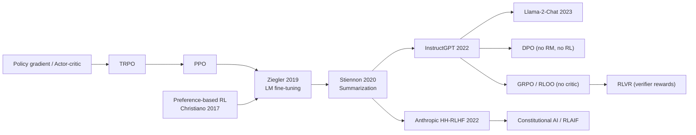

# RLHF with PPO (RLHF, PPO-RLHF, InstructGPT-style RLHF)

> The classic three-stage recipe for aligning language models with human preferences: supervised fine-tuning (SFT), then a reward model trained on human comparisons, then PPO against that reward with a per-token KL penalty to the frozen SFT model. **Family:** LLM post-training → Preference alignment → Reward-model-based online RL (actor-critic)  ·  **Year / origin:** Christiano et al. 2017 (OpenAI/DeepMind) for deep RL from preferences; Ziegler et al. 2019, Stiennon et al. 2020 and Ouyang et al. 2022 (OpenAI) for LMs; Bai et al. 2022 (Anthropic)  ·  **On/Off-policy:** On-policy (PPO on fresh rollouts)  ·  **Action space:** Discrete (one token from a vocabulary of ~32k–256k per step)

## 1. What is it?

Pretrained language models predict internet text. They do not, by default, follow instructions, stay honest, or avoid harm. Writing a reward function for "a good answer" by hand is impossible, but people *can* compare two answers and say which one is better. **Reinforcement Learning from Human Feedback (RLHF)** uses those comparisons:

1. **SFT.** Fine-tune the pretrained model on human-written demonstrations of good responses. This gives the policy initialization and the *reference model* $\pi_{\text{ref}}$.
2. **Reward model (RM).** Collect prompts, sample several responses, have humans rank them, and train a model $r_\phi(x, y)$ so that preferred responses score higher (Bradley–Terry loss; see [reward-modeling.md](reward-modeling.md)).
3. **RL with PPO.** Treat generation as an episodic MDP. The state is the prompt plus the tokens so far, the action is the next token, and the episode ends at EOS. Optimize the policy with PPO to maximize the RM score minus a KL penalty that keeps it close to $\pi_{\text{ref}}$.

Where it sits in the RL taxonomy: it is **model-free, on-policy, actor-critic policy-gradient RL** ([PPO](../03-policy-gradient/ppo.md)), with an *unusual MDP*. Transitions are deterministic (append the token), the reward is sparse (one scalar at the end), and the reward function is itself a learned neural network.

What it improved over its predecessors. Before RLHF, LMs were steered by prompting or by SFT on demonstrations alone. SFT can only imitate. RLHF optimizes a preference signal directly, so it can push the model beyond the demonstrators' average quality and penalize behaviours that are hard to demonstrate but easy to recognise as bad. InstructGPT reported that labelers preferred outputs of a 1.3B-parameter RLHF model to those of the 175B GPT-3, despite the 100× size gap (Ouyang et al., 2022).

## 2. Family & lineage

- **Parents:** policy gradient / [actor-critic](../03-policy-gradient/actor-critic-a2c-a3c.md), [TRPO](../03-policy-gradient/trpo.md) → [PPO](../03-policy-gradient/ppo.md) (Schulman et al., 2017); preference-based RL (Christiano et al., 2017, which learned Atari/MuJoCo behaviours from about 1 hour of human comparisons); [inverse RL](../07-imitation-inverse-rl/inverse-rl.md) (learning rewards from humans).
- **Direct line:** Ziegler et al. 2019 (fine-tuning GPT-2 from human preferences, adaptive KL controller) → Stiennon et al. 2020 (TL;DR summarization) → InstructGPT (Ouyang et al., 2022) and Anthropic's HH-RLHF (Bai et al., 2022) → ChatGPT, Claude, Llama-2-Chat (Touvron et al., 2023, which used separate helpfulness and safety RMs plus rejection sampling followed by PPO).
- **Siblings:** [RLAIF / Constitutional AI](rlaif-constitutional-ai.md) (AI-generated preference labels), [Safe RLHF](safety-rl-reward-hacking.md) (constrained), best-of-n / rejection-sampling fine-tuning.
- **Descendants and simplifications:** [DPO](dpo.md) and its [variants](dpo-variants.md), which drop the RM and the RL loop. Critic-free policy-gradient methods ([GRPO](../10-llm-reasoning-rl/grpo.md), [RLOO / ReMax / REINFORCE++](../10-llm-reasoning-rl/rloo-remax-reinforcepp.md)). Value-based LLM PPO revivals ([VAPO](../10-llm-reasoning-rl/value-based-llm-rl-vapo.md)). [RLVR](../10-llm-reasoning-rl/rlvr.md), which keeps the PPO/GRPO machinery but swaps the learned RM for a verifier.



## 3. Core idea & intuition

**"Learn what people like, then practice getting it, without forgetting how to talk."**

- **The reward model is a stand-in for the human.** Asking a person to rate every one of millions of RL samples is too slow, so we train a model to predict their judgements once and query it cheaply.
- **The RM is only trustworthy near the data it was trained on.** If the policy drifts far from the SFT distribution, it finds outputs the RM scores highly but humans would hate: gibberish that triggers the RM, excessive length, flattery. This is **reward over-optimization**, Goodhart's law in practice (Gao et al., 2022).
- **The KL penalty is a leash.** Each token pays $\beta \log\frac{\pi_\theta(y_t\mid\cdot)}{\pi_{\text{ref}}(y_t\mid\cdot)}$. The policy may move only where the RM's gain is worth the divergence. The optimum of the KL-regularized objective is a tilted reference distribution, $\pi^*(y\mid x)\propto \pi_{\text{ref}}(y\mid x)\,e^{r(x,y)/\beta}$. This is the fact that [DPO](dpo.md) later exploits.
- **Why PPO?** The policy is huge, so stability matters more than sample efficiency. PPO's clipped ratio limits how far each update moves the policy from the one that generated the data. The critic (value network) supplies per-token baselines, which reduces gradient variance when the reward arrives only at the end.
- **Four models in memory.** The **actor** $\pi_\theta$ is trained. The **critic** $V_\psi$ is trained and is often initialized from the RM. The **reward model** $r_\phi$ is frozen. The **reference** $\pi_{\text{ref}}$ is the frozen SFT model. This 4× memory footprint is the main engineering pain and the main motivation for DPO and GRPO.

## 4. Math / formal details

**Notation.** $x$ is a prompt from dataset $\mathcal{D}$. $y=(y_1,\dots,y_T)$ is a response. The state is $s_t=(x,y_{<t})$ and the action is $a_t=y_t$. $\pi_\theta$ is the policy (actor), $\pi_{\text{ref}}$ the frozen SFT model, $r_\phi(x,y)\in\mathbb{R}$ the reward model, $V_\psi(s_t)$ the critic, $\beta>0$ the KL coefficient.

**RLHF objective** (Stiennon et al., 2020; Ouyang et al., 2022):
$$
\max_\theta\; \mathbb{E}_{x\sim\mathcal{D},\,y\sim\pi_\theta(\cdot\mid x)}\Big[r_\phi(x,y)\Big] \;-\; \beta\, \mathbb{E}_{x}\Big[\mathrm{KL}\big(\pi_\theta(\cdot\mid x)\,\|\,\pi_{\text{ref}}(\cdot\mid x)\big)\Big] \;+\; \gamma_{\text{ptx}}\,\mathbb{E}_{x\sim\mathcal{D}_{\text{pretrain}}}\big[\log \pi_\theta(x)\big]
$$
The last term ("PPO-ptx", InstructGPT) mixes in pretraining gradients to reduce the *alignment tax*, i.e. regressions on standard NLP benchmarks. Many later recipes omit it.

**Closed-form optimum** (ignoring ptx, for any fixed $r$):
$$
\pi^*(y\mid x)=\frac{1}{Z(x)}\pi_{\text{ref}}(y\mid x)\exp\!\Big(\tfrac{1}{\beta}r(x,y)\Big),\qquad Z(x)=\sum_y \pi_{\text{ref}}(y\mid x)e^{r(x,y)/\beta}.
$$

**Token-level reward shaping.** The sequence-level KL is estimated by the sum of per-token log-ratios on the sampled response. It is distributed over tokens as a dense penalty, and the RM score is added at the final token:
$$
r_t = -\beta\,\underbrace{\big(\log\pi_{\theta_{\text{old}}}(y_t\mid s_t)-\log\pi_{\text{ref}}(y_t\mid s_t)\big)}_{\text{k1 KL estimate}} \;+\; \mathbb{1}[t=T]\; r_\phi(x,y).
$$

**Adaptive KL controller** (Ziegler et al., 2019). Choose a target KL $\text{KL}_{\text{targ}}$ and update
$$\beta \leftarrow \beta\big(1+K_\beta\, e_t\big),\qquad e_t=\mathrm{clip}\Big(\tfrac{\mathrm{KL}_t-\mathrm{KL}_{\text{targ}}}{\mathrm{KL}_{\text{targ}}},-0.2,0.2\Big).$$

**GAE on tokens.** With discount $\gamma$ (usually 1 in RLHF) and $\lambda\in[0,1]$:
$$
\delta_t = r_t + \gamma V_\psi(s_{t+1}) - V_\psi(s_t),\qquad \hat A_t=\sum_{l\ge 0}(\gamma\lambda)^l\delta_{t+l},\qquad \hat R_t=\hat A_t+V_\psi(s_t),
$$
with $V_\psi(s_{T+1})=0$. Advantages are then **whitened** (normalized to zero mean, unit variance) over all valid tokens in the batch.

**PPO losses** (per valid token, averaged with a mask). With $\rho_t(\theta)=\exp(\log\pi_\theta(y_t\mid s_t)-\log\pi_{\theta_\text{old}}(y_t\mid s_t))$:
$$
\mathcal{L}^{\text{clip}}(\theta)=-\mathbb{E}_t\Big[\min\big(\rho_t\hat A_t,\;\mathrm{clip}(\rho_t,1-\epsilon,1+\epsilon)\hat A_t\big)\Big],
$$
$$
\mathcal{L}^{V}(\psi)=\tfrac12\,\mathbb{E}_t\Big[\max\big((V_\psi(s_t)-\hat R_t)^2,\;(V^{\text{clip}}_\psi(s_t)-\hat R_t)^2\big)\Big],\quad V^{\text{clip}}=V_{\text{old}}+\mathrm{clip}(V_\psi-V_\text{old},-\epsilon_v,\epsilon_v).
$$

**Reward normalization / whitening.** The RM's scale is arbitrary, since BT is invariant to adding a constant. Practitioners therefore normalize scores. Stiennon et al. shift the RM so reference summaries average 0; TRL/OpenRLHF offer running mean/std normalization of rewards. Without this, $\beta$ and the learning rate are not transferable between RMs.

**Empirical scaling.** Bai et al. (2022) observed that RM reward grows roughly linearly in $\sqrt{\mathrm{KL}(\pi\|\pi_{\text{ref}})}$ during RLHF. Gao et al. (2022) fit functional forms for the *gold* reward as the KL grows, showing it eventually turns down; see [reward-modeling.md](reward-modeling.md).

## 5. Algorithm (pseudocode)

```text
Input: pretrained LM, demonstrations D_demo, comparison data D_pref, prompt set D_prompt
1.  SFT: pi_sft <- argmax E_{(x,y)~D_demo} log pi(y|x)
2.  pi_ref <- freeze(copy(pi_sft));  pi_theta <- pi_sft
3.  RM:  r_phi <- argmin E_{(x,y_w,y_l)~D_pref} -log sigmoid(r(x,y_w) - r(x,y_l))
4.  Critic V_psi <- init from r_phi (or from pi_sft with a scalar head)
5.  for iteration = 1..N:
6.      sample a batch of prompts x ~ D_prompt
7.      roll out y ~ pi_theta(.|x)  (usually with a fast inference engine, e.g. vLLM)
8.      compute logp_old = log pi_theta(y_t|s_t), logp_ref = log pi_ref(y_t|s_t), V_old = V_psi(s_t)
9.      score = r_phi(x, y)   (optionally normalize; penalize missing EOS)
10.     r_t = -beta*(logp_old - logp_ref);  r_T += score
11.     A_t, R_t <- GAE(r, V_old, gamma=1, lambda=0.95);  whiten A over valid tokens
12.     for epoch = 1..K (e.g. 1-4):
13.         for each minibatch:
14.             recompute logp_new, V_new
15.             L = clipped policy loss(logp_new, logp_old, A) + c_v * clipped value loss(V_new, V_old, R)
16.             (optional) L += -gamma_ptx * pretraining log-likelihood
17.             gradient step on actor and critic
18.     update beta with the adaptive KL controller (if used)
```

## 6. Python implementation

Runnable version: [`code/rlhf_ppo.py`](../../code/rlhf_ppo.py)

The file contains (a) reusable functions on `[batch, tokens]` tensors: token-level reward shaping, masked whitening, GAE, the clipped policy and value losses, and an adaptive KL controller; these mirror TRL's `PPOTrainer` and OpenRLHF. It also contains (b) a toy with all four models: a GRU actor, a GRU critic, a frozen reference, and a reward model. The reward model is a scripted scorer here; [reward-modeling.md](reward-modeling.md) trains a real one. Task: given prompt token $p$, emit the "counting" continuation $p{+}1, p{+}2,\dots$ (mod 10).

@@CODE@@

Typical output (CPU, ~30 s):

```text
iter   1  RM score 0.560  seq-KL(pi||ref)  0.000  kl_coef 0.0494  clipfrac 0.714
iter  15  RM score 0.987  seq-KL(pi||ref)  3.178  kl_coef 0.0560  clipfrac 0.042
...
iter 150  RM score 1.000  seq-KL(pi||ref)  3.575  kl_coef 0.3120  clipfrac 0.000
final RM score (1000 prompts): actor 1.000  vs  SFT/ref 0.549
```

Notice the adaptive controller raising `kl_coef` because the observed KL (≈3.5 nats) sits above the 1.0 target. In a real run this is the signal that the policy is drifting faster than you budgeted.

**With a real library** (requires GPU + library; not run here). OpenRLHF's Ray-based PPO puts the actor, critic, RM, reference and vLLM generation engines on separate GPU groups:

```bash
# OpenRLHF (pip install openrlhf[vllm]); flags follow the project's README examples (model/data names are placeholders)
ray start --head --num-gpus 8
ray job submit --address="http://127.0.0.1:8265" -- python3 -m openrlhf.cli.train_ppo_ray \
   --ref_num_nodes 1 --ref_num_gpus_per_node 2 \
   --reward_num_nodes 1 --reward_num_gpus_per_node 2 \
   --critic_num_nodes 1 --critic_num_gpus_per_node 2 \
   --actor_num_nodes 1 --actor_num_gpus_per_node 2 \
   --vllm_num_engines 2 --vllm_tensor_parallel_size 1 \
   --pretrain my-org/llama-3-8b-sft \
   --reward_pretrain my-org/llama-3-8b-rm \
   --prompt_data my-org/prompts --input_key context_messages --apply_chat_template \
   --micro_train_batch_size 8 --train_batch_size 128 --micro_rollout_batch_size 16 --rollout_batch_size 1024 \
   --max_epochs 1 --prompt_max_len 1024 --generate_max_len 1024 \
   --actor_learning_rate 5e-7 --critic_learning_rate 9e-6 --init_kl_coef 0.01 \
   --normalize_reward --zero_stage 3 --bf16 --gradient_checkpointing --save_path ./ckpt/llama3-8b-rlhf
```

In Hugging Face TRL, PPO was moved out of the stable API into `trl.experimental` in the 2025 TRL releases; check your installed version. The stable 1.x API centres on SFT, DPO, GRPO, RLOO and reward modeling. The trainer's shape is:

```python
# requires GPU + library; not run here. Import path depends on TRL version:
#   older TRL (0.12-0.2x):  from trl import PPOConfig, PPOTrainer
#   newer TRL:              from trl.experimental.ppo import PPOConfig, PPOTrainer
from transformers import AutoModelForCausalLM, AutoModelForSequenceClassification, AutoTokenizer
from trl.experimental.ppo import PPOConfig, PPOTrainer

sft = "my-org/llama-sft"; rm_path = "my-org/llama-rm"
tok = AutoTokenizer.from_pretrained(sft, padding_side="left")
policy = AutoModelForCausalLM.from_pretrained(sft)
ref = AutoModelForCausalLM.from_pretrained(sft)
reward = AutoModelForSequenceClassification.from_pretrained(rm_path, num_labels=1)
value = AutoModelForSequenceClassification.from_pretrained(rm_path, num_labels=1)  # critic init from RM
args = PPOConfig(output_dir="ppo-out", learning_rate=1e-6, kl_coef=0.05, cliprange=0.2,
                 vf_coef=0.1, num_ppo_epochs=4, whiten_rewards=False, missing_eos_penalty=1.0,
                 response_length=256, total_episodes=100_000)
trainer = PPOTrainer(args=args, processing_class=tok, model=policy, ref_model=ref,
                     reward_model=reward, value_model=value, train_dataset=prompt_dataset)
trainer.train()
```

## 7. Practical tips & hyperparameters

Typical ranges reported in public recipes (InstructGPT, Stiennon et al., the "N implementation details" study by Huang et al. 2024, OpenRLHF defaults):

| Knob | Typical value | Notes |
|---|---|---|
| KL coefficient $\beta$ | 0.01–0.1 (fixed) or adaptive with target KL | Too low leads to reward hacking; too high means nothing changes |
| Actor LR | ~1e-6 – 5e-6 (7B-class); smaller for bigger models | Much lower than SFT LR |
| Critic LR | ~5e-6 – 1e-5 | Often ~2–10× the actor LR |
| PPO clip $\epsilon$ | 0.2 | Value clip often 0.2 too |
| PPO epochs per batch | 1–4 | More epochs means more off-policy drift |
| $\gamma$, $\lambda$ | 1.0, 0.95 | Episodic, no discounting |
| Rollout batch | 512–1024+ prompts | Large batches stabilize |
| Response length cap | 256–2048 tokens | Penalize truncated outputs that lack EOS |

Pitfalls and debugging signals:

- **Watch KL, not just reward.** RM reward rising while KL explodes (tens of nats) usually means hacking. Sample and *read* outputs often.
- **Length creep.** RMs often prefer longer answers, so plot mean response length. Mitigations: length penalties, length-balanced RM data, [R-DPO](dpo-variants.md)-style controls.
- **Initialize the critic from the RM** (InstructGPT practice) or warm it up for a few steps before updating the actor. A random critic gives garbage advantages.
- **EOS handling.** Responses without EOS give the RM out-of-distribution input. Assign a fixed penalty score (TRL `missing_eos_penalty`, a trick from Huang et al. 2024).
- **Use the same tokenizer and chat template** for policy, reference and RM. Score the RM on exactly the text it was trained on.
- **Generation engine mismatch.** If rollouts come from vLLM/SGLang and training recomputes log-probs in FSDP/Megatron, small numerical differences make the "on-policy" ratio ≠ 1. Recompute `logp_old` with the training engine, or use importance-sampling corrections.
- **Reward normalization.** Normalize RM scores (running mean/std) and clip extreme values. Optionally whiten the token rewards as well as the advantages.
- **Healthy dashboard:** clipfrac roughly 0.05–0.2, approx-KL per step small (<0.05), value loss decreasing, entropy decaying slowly rather than collapsing.

## 8. Pros and cons

| Pros | Cons |
|---|---|
| Optimizes the actual preference signal on the policy's *own* samples (on-policy), so it can correct its own mistakes | Four large models in memory (actor, critic, RM, reference); complex distributed systems |
| A separate RM can be reused, inspected, ensembled and combined with other rewards (safety, rules) | Sensitive to many hyperparameters; known to be finicky to reproduce |
| Per-token credit assignment via the critic and GAE | RM over-optimization / reward hacking; requires KL tuning and monitoring |
| Extends naturally to any scalar reward (verifiers, rubrics, safety costs) | Human comparison data is expensive and noisy; inherits labeler biases (e.g., sycophancy) |
| Historically the recipe behind InstructGPT, early ChatGPT, Claude and Llama-2-Chat | Generation (rollouts) dominates wall-clock cost |

## 9. When to use / when not to use

**Use it when**
- You have (or can build) a good reward model and the compute to run on-policy RL at scale.
- You want to combine several reward signals (helpfulness RM + safety RM + rule-based penalties) and keep a learned value baseline.
- Long responses with dense credit assignment matter, and you can afford a critic. Value-based PPO variants such as [VAPO](../10-llm-reasoning-rl/value-based-llm-rl-vapo.md) are competitive for long chain-of-thought.

**Avoid it / consider alternatives when**
- You only have a static preference dataset and modest compute: try [DPO](dpo.md) or its [variants](dpo-variants.md).
- The reward is verifiable (math, code): [GRPO](../10-llm-reasoning-rl/grpo.md) / [RLVR](../10-llm-reasoning-rl/rlvr.md) remove the critic and the learned RM.
- Memory is tight: critic-free methods ([RLOO/ReMax/REINFORCE++](../10-llm-reasoning-rl/rloo-remax-reinforcepp.md)) halve the trained-model footprint.
- Your RM is weak or tiny relative to the policy: the policy will exploit it.

## 10. Key papers, books & repos

- Christiano, Leike, Brown, Martic, Legg, Amodei (2017). *Deep Reinforcement Learning from Human Preferences.* NeurIPS. arXiv:1706.03741.
- Ziegler, Stiennon, Wu, Brown, Radford, Amodei, Christiano, Irving (2019). *Fine-Tuning Language Models from Human Preferences.* arXiv:1909.08593.
- Stiennon, Ouyang, Wu, Ziegler, Lowe, Voss, Radford, Amodei, Christiano (2020). *Learning to Summarize from Human Feedback.* NeurIPS. arXiv:2009.01325.
- Ouyang et al. (2022). *Training Language Models to Follow Instructions with Human Feedback* (InstructGPT). NeurIPS. arXiv:2203.02155.
- Bai et al. (2022). *Training a Helpful and Harmless Assistant with Reinforcement Learning from Human Feedback.* Anthropic. arXiv:2204.05862.
- Schulman, Wolski, Dhariwal, Radford, Klimov (2017). *Proximal Policy Optimization Algorithms.* arXiv:1707.06347.
- Schulman, Moritz, Levine, Jordan, Abbeel (2016). *High-Dimensional Continuous Control Using Generalized Advantage Estimation.* ICLR. arXiv:1506.02438.
- Touvron et al. (2023). *Llama 2: Open Foundation and Fine-Tuned Chat Models.* arXiv:2307.09288.
- Zheng et al. (2023). *Secrets of RLHF in Large Language Models Part I: PPO.* arXiv:2307.04964.
- Huang, Noukhovitch, Hosseini, Rasul, Wang, Tunstall (2024). *The N+ Implementation Details of RLHF with PPO: A Case Study on TL;DR Summarization.* arXiv:2403.17031.
- Gao, Schulman, Hilton (2022). *Scaling Laws for Reward Model Overoptimization.* arXiv:2210.10760.
- Casper et al. (2023). *Open Problems and Fundamental Limitations of Reinforcement Learning from Human Feedback.* arXiv:2307.15217.
- Sutton & Barto, *Reinforcement Learning: An Introduction* (2nd ed., 2018), Ch. 13 (policy gradient, actor-critic).
- Repos: [openai/lm-human-preferences](https://github.com/openai/lm-human-preferences), [openai/summarize-from-feedback](https://github.com/openai/summarize-from-feedback), [huggingface/trl](https://github.com/huggingface/trl), [OpenRLHF/OpenRLHF](https://github.com/OpenRLHF/OpenRLHF), [volcengine/verl](https://github.com/volcengine/verl), [anthropics/hh-rlhf](https://github.com/anthropics/hh-rlhf) (data).

## 11. For business users

**What it does.** RLHF turns a raw text predictor into a useful assistant. People compare pairs of answers, a "taste model" learns their preferences, and the AI then practises thousands of times, getting a score from the taste model each time. A built-in leash stops it from changing so much that it forgets how to write normally.

**Business analogy.** Think of training a new customer-service hire. First they shadow experts (SFT). Then a senior manager's preferences are captured in a scoring guide (reward model). Finally the new hire handles practice calls, gets scored, and improves (RL), while a rule says "don't deviate wildly from the company style" (the KL leash).

**Real-world use cases.** General chat assistants (the InstructGPT/ChatGPT lineage, Claude, Llama-2-Chat), summarization, customer-support tone and policy adherence, brand voice, and reducing harmful or off-policy outputs.

**Value / ROI.** A smaller RLHF-tuned model can beat a much larger untuned one on what users actually prefer (InstructGPT's headline result), so serving costs drop. Behaviour becomes more predictable and on-brand.

**Risks.**
- The model can learn to please the scorer instead of the user: flattery, verbosity, confident-sounding wrong answers.
- Human labelers' biases get baked in.
- The training stack is expensive and complex.

**Costs.**
- Human comparison data, often tens of thousands of labelled comparisons.
- GPU time for four models during RL.
- Specialized ML engineering.

**Questions to ask your team.**
1. Who labels our preferences, and how consistent are they?
2. How do we detect when the model is "gaming" the reward model?
3. Did we consider DPO (cheaper) or verifier-based RL for tasks with checkable answers?
4. What do we measure besides the reward score (human evals, safety tests, length)?

## 12. For kids (ages ~8–12)

**The puppy and the treat-judge.** You are teaching a puppy tricks. First you show it the trick a few times (that's copying). Then, since you can't watch every practice, you teach your little brother exactly what *you* like, so he can hand out treats. Now the puppy practises all day and your brother gives treats for good tries. But a puppy might find a sneaky way to get treats, like sitting extra cute without doing the trick! So there's a rule: "Keep doing tricks the normal way you learned. No weird stuff."

**Try it yourself.** Write two answers to "How do I make a sandwich?" Ask a friend which is better and why. Write down their reasons as a little scoring list. Now write a third answer that tries to get a perfect score. Is it actually better, or did you just game the list?

**Recap.**
1. Show good examples first.
2. Teach a judge what people like.
3. Practise to get points, but don't get weird.

## 13. Related methods

- [Reward modeling](reward-modeling.md) · [RLAIF / Constitutional AI](rlaif-constitutional-ai.md) · [DPO](dpo.md) · [DPO variants](dpo-variants.md)
- [Online / iterative / self-play PO](online-iterative-self-play-po.md) · [Rubric & generative rewards](rubric-generative-rewards.md) · [Safety RL & reward hacking](safety-rl-reward-hacking.md)
- [PPO](../03-policy-gradient/ppo.md) · [TRPO](../03-policy-gradient/trpo.md) · [Actor-critic](../03-policy-gradient/actor-critic-a2c-a3c.md) · [Inverse RL](../07-imitation-inverse-rl/inverse-rl.md)
- [GRPO](../10-llm-reasoning-rl/grpo.md) · [RLOO / ReMax / REINFORCE++](../10-llm-reasoning-rl/rloo-remax-reinforcepp.md) · [VAPO](../10-llm-reasoning-rl/value-based-llm-rl-vapo.md) · [RLVR](../10-llm-reasoning-rl/rlvr.md)

[← Back to overview](../../RL_Methods_Overview.md)
