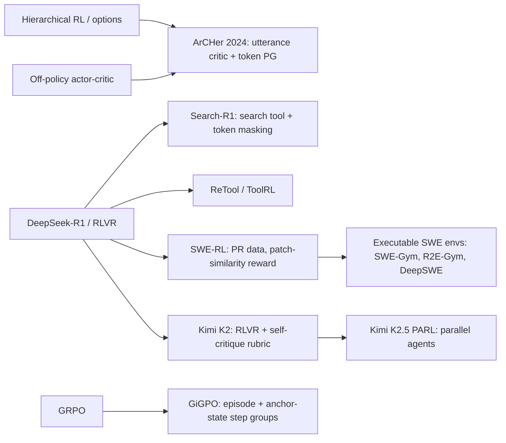

# Agentic, multi-turn and tool-use RL for LLMs (ArCHer, Search-R1, ReTool, SWE-RL, GiGPO, PARL)

> Train LLMs as **agents** that act over many turns: call tools (search, code interpreters, shells, browsers), read observations, and finally answer or finish a task, with RL on the outcome of the whole interaction. The core problems are long-horizon **credit assignment**, **masking environment tokens**, and **rollout infrastructure**. **Family:** LLM post-training → RL for reasoning → multi-step / partially observable MDPs (hierarchical, turn-level policy gradient)  ·  **Year / origin:** ArCHer (Zhou et al., 2024); Search-R1 (Jin et al., 2025); SWE-RL (Wei et al., Meta, 2025); GiGPO (Feng et al., 2025); Kimi K2 / K2.5 (Moonshot, 2025–2026); OpenAI Deep Research / Codex (2025)  ·  **On/Off-policy:** mostly on-policy (GRPO/PPO); ArCHer uses an off-policy critic  ·  **Action space:** discrete tokens, grouped into turns / tool calls

## 1. What is it?

Single-turn RLVR ([rlvr.md](rlvr.md)) is a contextual bandit: prompt in, one completion out, one reward. **Agentic RL** is a genuine sequential decision problem:

$$\text{prompt}\to\text{(think, act}_1)\to\text{obs}_1\to\text{(think, act}_2)\to\text{obs}_2\to\cdots\to\text{final answer / task done}\to R$$

Actions are tool calls (`search("...")`, `python(code)`, `bash(cmd)`, `click(x,y)`, file edits), and observations are tool outputs (retrieved documents, stdout, test results, screenshots). New issues compared with single-turn RL:

1. **Environment tokens are not actions.** Tool outputs are appended to the context but were not generated by the policy. They must be **masked out of the loss** (Search-R1's "retrieved token masking"). Otherwise the model is trained to "predict" search results, which is meaningless and destabilizing.
2. **Credit assignment across turns.** A 50-turn software-engineering episode with one terminal reward ("tests pass") has to work out which turn mattered. Options include hierarchical critics (ArCHer), turn-level advantages, step-level grouping (GiGPO) and process rewards.
3. **Infrastructure.** Rollouts require sandboxes (Docker containers, browsers, search APIs), are slow and highly variable in length, and fail sometimes. That pushes toward **asynchronous** rollout/training pipelines and partial-rollout handling.
4. **Exploration and shortcuts.** Agents find "gamble" strategies (guess without searching, special-case tests). Our toy demo shows a policy that settles into such a shortcut.

Landmarks:

- **ArCHer (Zhou et al., ICML 2024)**: hierarchical multi-turn RL. A high-level **off-policy, utterance-level critic** trained with TD learning estimates the value of each turn. A low-level token policy is trained with policy gradient, using the turn-level advantage as its reward. It was reported to be far more sample-efficient than on-policy token-level methods on multi-turn tasks.
- **Search-R1 (Jin et al., 2025)**: R1-style RL in which the model interleaves `<search>query</search>`, receives `<information>…</information>` from a retriever, and answers. Rewards are outcome-only (exact match), trained with PPO or GRPO, with **loss masking of retrieved tokens**. Related: R1-Searcher, ReSearch, DeepResearcher.
- **ReTool (Feng et al., ByteDance, 2025)** and **ToolRL (Qian et al., 2025)**: RL with a code interpreter interleaved in reasoning (ReTool), and a study of reward design for general tool calls (ToolRL: format + correctness of tool names and parameters).
- **SWE-RL (Wei et al., Meta, 2025)**: RL for software engineering using GitHub PR data. The reward is rule-based **patch similarity** (sequence similarity between generated and oracle patch), or −1 for bad format. Llama3-SWE-RL-70B reported 41.0% on SWE-bench Verified. Later work trains in executable environments with real test feedback (e.g. SWE-Gym, R2E-Gym, DeepSWE, SkyRL).
- **GiGPO (Feng et al., 2025, "Group-in-Group Policy Optimization")**: GRPO for agents with two levels of grouping. Episode-level relative advantages come from complete trajectories. Step-level relative advantages come from **anchor states**: the same environment state reached in different trajectories of the same group. This gives per-step credit without a critic or extra rollouts. It was evaluated on ALFWorld and WebShop (reported gains over GRPO).
- **Kimi K2 (Moonshot, 2025)**: an open MoE agentic model whose RL combines verifiable rewards (RLVR on math/code/agentic tasks) with a **self-critique rubric reward** (the model judges its own outputs against rubrics) for non-verifiable tasks. **Kimi K2.5 (2026)** reports **Parallel-Agent RL (PARL)**, which trains an orchestrator to decompose tasks and run sub-agents in parallel ("agent swarm"); see arXiv 2602.02276. We describe it at a high level only.
- **OpenAI Deep Research (Feb 2025)** and **Codex (codex-1, May 2025)** were described by OpenAI as trained with end-to-end RL on browsing/reasoning tasks and on real-world coding tasks respectively. Details are not public.
- **Surveys (2026)**, e.g. on credit assignment for LLM agents (arXiv 2604.09459), organize the growing zoo of turn-level, step-level and process-based methods.

## 2. Family & lineage



- **Parents:** [hierarchical RL](../08-exploration-hierarchical-multiagent/hierarchical-rl.md), actor-critic ([actor-critic-a2c-a3c.md](../03-policy-gradient/actor-critic-a2c-a3c.md)), [GRPO](grpo.md)/[PPO](../03-policy-gradient/ppo.md), RLVR.
- **Siblings:** [process rewards](process-reward-prime.md) (per-step credit), [VAPO](value-based-llm-rl-vapo.md) (critics), [GSPO-token](gspo-sapo-gmpo-cispo.md) (per-turn advantages with sequence ratios), [multi-agent RL](../08-exploration-hierarchical-multiagent/multi-agent-rl.md).
- **Infrastructure:** `volcengine/verl` (multi-turn rollout, tool and sandbox integration, `verl-agent`), `OpenRLHF/OpenRLHF` (agent/async modes), and asynchronous systems such as AReaL, slime, SkyRL and rLLM. Their common pattern: an inference engine (vLLM/SGLang) produces rollouts while the trainer updates, with bounded staleness.

## 3. Core idea & intuition

- **One trajectory, many decisions.** The policy is still a token-level LM, but rewards and environment dynamics live at the *turn* level. It is natural to compute advantages per turn and broadcast them to the turn's tokens.
- **Mask what you didn't say.** The loss mask is 1 on agent-generated tokens and 0 on prompt and tool-output tokens. The policy is only responsible for its own choices.
- **Group-relative, now per state.** GRPO compares whole trajectories of the same task. GiGPO adds a finer comparison: if several trajectories pass through the *same state* (same page, same observation, same turn), compare the returns of the different actions taken there. That gives a cheap, critic-free per-step advantage.
- **Hierarchy (ArCHer).** Learn "how good is it to say this utterance now" with a turn-level Q/V critic using off-policy TD over many past trajectories, then let token-level PG optimize each utterance toward high critic value.
- **Shortcuts are the default.** If a policy can get partial reward by guessing, it will, and once its entropy collapses it may never discover the reliable strategy. Curricula, SFT on good trajectories, rewards that penalize unjustified answers, and exploration bonuses are all used in practice.

## 4. Math / formal details

**Turn-level MDP.** State $s_k$ = full context before turn $k$ (prompt + previous actions + observations); action $a_k$ = token sequence of turn $k$; observation $o_k\sim P(\cdot|s_k,a_k)$; reward $r_k$ (often 0 except at the end); $s_{k+1}=(s_k,a_k,o_k)$.

**Flattened token view and masking.** The trajectory is a token string $z=(z_1,\dots,z_N)$ with mask $m_n=1$ iff $z_n$ was generated by the policy. The policy-gradient loss is
$$
\mathcal L(\theta)=-\frac{1}{\sum_n m_n}\sum_n m_n\,\hat A_n\,\log\pi_\theta(z_n\mid z_{<n})\quad(\text{or the PPO-clipped version})
$$
where $\hat A_n$ is the advantage of the turn containing token $n$.

**Episode-level GRPO.** $G$ rollouts of the same task with returns $R^{(i)}=\sum_k r^{(i)}_k$: $\ \hat A^E_i=\frac{R^{(i)}-\text{mean}(R)}{\text{std}(R)}$, shared by all turns.

**GiGPO step-level advantage.** For each anchor state $\tilde s$ appearing in several trajectories of the group, collect the pairs $\{(i,k): s^{(i)}_k=\tilde s\}$ with discounted returns $G^{(i)}_k=\sum_{k'\ge k}\gamma^{k'-k}r^{(i)}_{k'}$, and set
$$
\hat A^S_{i,k}=\frac{G^{(i)}_k-\text{mean}_{\tilde s}(G)}{F_\text{norm}},\qquad \hat A_{i,k}=\hat A^E_i+\omega\,\hat A^S_{i,k}
$$
with $F_\text{norm}$ = std or 1 (our demo shows why "1" can be safer when returns differ only by tiny costs).

**ArCHer (sketch).** Utterance-level critic $Q_\phi(s_k,a_k)$ trained by TD from a replay buffer, $\mathcal L_Q=\big(Q_\phi(s_k,a_k)-r_k-\gamma V_{\bar\phi}(s_{k+1})\big)^2$. The token policy maximizes $\mathbb E\big[\hat A(s_k,a_k)\sum_{t\in a_k}\log\pi_\theta(a_{k,t}|s_k,a_{k,<t})\big]$ with $\hat A=Q_\phi-V_\phi$.

## 5. Algorithm (pseudocode)

```text
Agentic GRPO / GiGPO with tool environments
Input: policy π_θ (SFT'd on tool format), env factory (sandbox/search/code), G, max_turns
1. for step = 1..N:
2.     sample tasks; for each task create G environment instances with the SAME seed
3.     roll out each instance (async workers):
4.         for turn k < max_turns:
5.             a_k ~ π_θ(·|context)          # e.g. "<search>query</search>" or a tool call
6.             if a_k is final answer: break
7.             o_k = env.execute(a_k)         # sandbox; timeouts → error observation
8.             context += a_k (mask=1) + o_k (mask=0)
9.     reward = verifier(final answer / tests) − costs
10.    advantages: episode-level group-relative (GRPO); GiGPO adds anchor-state step-level terms
11.    PPO/GRPO update on agent tokens only (loss mask), token-level aggregation
12.    (async) trainer pushes new weights to inference workers; drop rollouts beyond staleness bound
```

## 6. Python implementation

Runnable version: [`code/agentic-multi-turn-rl.py`](../../code/agentic-multi-turn-rl.py)

Toy environment: a **two-hop lookup** tool. The question key $q$ points to another key $k_2$, which holds the answer value. The agent can `SEARCH(key)` (costs 0.01) or `ANSWER(v)`. The code shows:

- `build_token_sequence_and_mask`: flattening and **masking of tool outputs**;
- episode-level GRPO advantages;
- **GiGPO-style** anchor-state step advantages (mean-centred or std-normalized);
- a masked PG loss;
- a "cold-start" SFT warm start on *one-hop* demonstrations only, followed by RL on two-hop tasks.

```python
"""Agentic / multi-turn tool-use RL in miniature.

Environment ("two-hop lookup"): a hidden table maps keys -> entries. The question names key q.
table[q] is a pointer KEY(k2); table[k2] holds VAL(v). The agent must SEARCH(q), read the pointer,
SEARCH(k2), read the value, then ANSWER(v). Up to 4 turns. Reward 1 for the right answer, minus a
small cost per search. Without using the tool the agent can only guess (1/6).

(a) Reusable pieces:
    - build_token_sequence_and_mask : flatten a multi-turn trajectory into one token stream with a
      loss mask that is 1 on agent-generated tokens and 0 on prompt / tool-output tokens
      (Search-R1's "retrieved token masking"; every agent-RL framework does this).
    - episode_group_advantages      : GRPO-style trajectory-level advantages.
    - gigpo_advantages              : GiGPO-style episode advantages + step-level advantages from
      'anchor states' (identical states encountered by different rollouts of the same task).
    - masked_pg_loss                : PG loss over agent tokens only.
(b) Train the same tiny policy with episode-level GRPO vs. GiGPO-style advantages.

Run:  python3 code/agentic-multi-turn-rl.py     (CPU, ~1 min)
"""
import copy
import random
from collections import defaultdict

import torch
import torch.nn as nn

torch.set_num_threads(1)

N_KEYS = 4
MAX_TURNS = 4
SEARCH_COST = 0.01
# action tokens: SEARCH_0..5, ANSWER_0..5 ; observation tokens: KEY_0..5, VAL_0..5 ; NONE
N_ACT = 2 * N_KEYS
OBS_NONE = 2 * N_KEYS
VOCAB_NAMES = ([f"SEARCH_{i}" for i in range(N_KEYS)] + [f"ANSWER_{i}" for i in range(N_KEYS)] +
               [f"<obs>KEY_{i}</obs>" for i in range(N_KEYS)] + [f"<obs>VAL_{i}</obs>" for i in range(N_KEYS)])


class TwoHopLookupEnv:
    def __init__(self, seed, hops=2):
        rng = random.Random(seed)
        self.q = rng.randrange(N_KEYS)
        self.k2 = rng.choice([k for k in range(N_KEYS) if k != self.q])
        self.v = rng.randrange(N_KEYS)
        self.table = {}
        for k in range(N_KEYS):                         # distractor entries
            self.table[k] = ("KEY", rng.randrange(N_KEYS)) if rng.random() < 0.5 else ("VAL", rng.randrange(N_KEYS))
        if hops == 2:
            self.table[self.q] = ("KEY", self.k2)
            self.table[self.k2] = ("VAL", self.v)
        else:                                           # one-hop task: the entry holds the value
            self.table[self.q] = ("VAL", self.v)

    def step(self, action):
        """Returns (obs_token or None, reward, done)."""
        if action < N_KEYS:                             # SEARCH(key)
            kind, x = self.table[action]
            obs = x if kind == "KEY" else N_KEYS + x    # obs id in 0..11
            return obs, -SEARCH_COST, False
        answer = action - N_KEYS
        return None, float(answer == self.v), True


def state_features(q, last_obs, turn):
    return torch.cat([nn.functional.one_hot(torch.tensor(q), N_KEYS),
                      nn.functional.one_hot(torch.tensor(last_obs), 2 * N_KEYS + 1),
                      nn.functional.one_hot(torch.tensor(turn), MAX_TURNS)]).float()


N_FEAT = N_KEYS + 2 * N_KEYS + 1 + MAX_TURNS


@torch.no_grad()
def rollout(policy, env):
    """One episode. Returns list of turns: dict(state_key, feat, action, obs, reward)."""
    turns, last_obs = [], OBS_NONE
    for turn in range(MAX_TURNS):
        f = state_features(env.q, last_obs, turn)
        a = torch.distributions.Categorical(logits=policy(f)).sample().item()
        if turn == MAX_TURNS - 1 and a < N_KEYS:       # forced to stop: searching on last turn = fail
            turns.append(dict(state=(env.q, last_obs, turn), feat=f, action=a, obs=None, reward=-SEARCH_COST))
            break
        obs, r, done = env.step(a)
        turns.append(dict(state=(env.q, last_obs, turn), feat=f, action=a, obs=obs, reward=r))
        if done:
            break
        last_obs = obs
    return turns


# ----------------------------------------------------------------------------------------
# (a) Masking and advantages
# ----------------------------------------------------------------------------------------
def build_token_sequence_and_mask(prompt_tokens, turns, obs_offset=N_ACT):
    """Flatten [prompt][act_1][obs_1][act_2][obs_2]... into token ids + loss mask.
    In a real LLM each act/obs is many tokens; the rule is the same: mask = 1 only for tokens the
    policy generated, 0 for prompt and tool/environment output (which the policy did not choose)."""
    tokens, mask = list(prompt_tokens), [0] * len(prompt_tokens)
    for t in turns:
        tokens.append(t["action"])
        mask.append(1)
        if t["obs"] is not None:
            tokens.append(obs_offset + t["obs"])
            mask.append(0)
    return tokens, mask


def discounted_returns(rewards, gamma):
    out, g = [], 0.0
    for r in reversed(rewards):
        g = r + gamma * g
        out.append(g)
    return out[::-1]


def episode_group_advantages(episodes, G, eps=1e-6):
    """GRPO for agents: one scalar per trajectory = (R - mean_group)/std_group, broadcast to all turns."""
    R = torch.tensor([sum(t["reward"] for t in ep) for ep in episodes]).view(-1, G)
    A = ((R - R.mean(1, keepdim=True)) / (R.std(1, keepdim=True) + eps)).view(-1)
    return [[A[i].item()] * len(ep) for i, ep in enumerate(episodes)]


def gigpo_advantages(episodes, G, gamma=0.95, omega=1.0, eps=1e-6, step_norm="mean"):
    """GiGPO-style (Feng et al. 2025): A = A_episode + omega * A_step.
    Step level: within each group (same task), turns that start from the SAME environment state
    (an 'anchor state') form a step-group; their discounted returns-from-here are normalised
    against each other. Anchor groups of size 1 get A_step = 0.
    step_norm="mean" only centres the returns; "std" also divides by the std -- beware: then tiny
    return differences (e.g. one extra search costing 0.01) are blown up to +-1."""
    A_ep = episode_group_advantages(episodes, G, eps)
    A = [list(a) for a in A_ep]
    for g0 in range(0, len(episodes), G):
        buckets = defaultdict(list)                    # anchor state -> [(ep idx, turn idx, return)]
        for i in range(g0, g0 + G):
            rets = discounted_returns([t["reward"] for t in episodes[i]], gamma)
            for j, t in enumerate(episodes[i]):
                buckets[t["state"]].append((i, j, rets[j]))
        for items in buckets.values():
            if len(items) < 2:
                continue
            r = torch.tensor([x[2] for x in items])
            a_step = r - r.mean()
            if step_norm == "std":
                a_step = a_step / (r.std() + eps)
            for (i, j, _), a in zip(items, a_step.tolist()):
                A[i][j] += omega * a
    return A


def masked_pg_loss(logp, adv, mask):
    """logp/adv/mask: [N_turns_total] for agent tokens; tool tokens never enter (mask=0)."""
    return -(logp * adv * mask).sum() / mask.sum().clamp(min=1)


# ----------------------------------------------------------------------------------------
# (b) Training
# ----------------------------------------------------------------------------------------
def sft_warm_start(policy, steps=40, lr=3e-3, n_two_hop_demos=0):
    """'Cold-start' SFT. By default only ONE-HOP demonstrations (search q -> read value -> answer):
    the agent learns the tool format but has never seen a pointer (KEY) observation.
    n_two_hop_demos > 0 adds a few full two-hop demonstrations per batch."""
    opt = torch.optim.Adam(policy.parameters(), lr=lr)
    for _ in range(steps):
        feats, acts = [], []
        for _ in range(64):
            env = TwoHopLookupEnv(random.randrange(10 ** 9), hops=1)
            feats += [state_features(env.q, OBS_NONE, 0), state_features(env.q, N_KEYS + env.v, 1)]
            acts += [env.q, N_KEYS + env.v]
        for _ in range(n_two_hop_demos):
            env = TwoHopLookupEnv(random.randrange(10 ** 9), hops=2)
            feats += [state_features(env.q, OBS_NONE, 0), state_features(env.q, env.k2, 1),
                      state_features(env.q, N_KEYS + env.v, 2)]
            acts += [env.q, env.k2, N_KEYS + env.v]
        loss = nn.functional.cross_entropy(policy(torch.stack(feats)), torch.tensor(acts))
        opt.zero_grad()
        loss.backward()
        opt.step()


def train(adv_mode, iters=300, n_tasks=16, G=8, lr=5e-3, seed=0, kl_coef=0.0, n_two_hop_demos=0):
    torch.manual_seed(seed)
    random.seed(seed)
    policy = nn.Sequential(nn.Linear(N_FEAT, 64), nn.Tanh(), nn.Linear(64, N_ACT))
    sft_warm_start(policy, n_two_hop_demos=n_two_hop_demos)
    ref = copy.deepcopy(policy)                         # SFT policy as KL anchor
    opt = torch.optim.Adam(policy.parameters(), lr=lr)
    log = []
    for it in range(iters):
        episodes = []
        for _ in range(n_tasks):
            task_seed = random.randrange(10 ** 9)
            for _ in range(G):                          # G rollouts of the SAME task -> a group
                episodes.append(rollout(policy, TwoHopLookupEnv(task_seed, hops=2)))
        if adv_mode == "grpo":
            adv = episode_group_advantages(episodes, G)
        else:
            adv = gigpo_advantages(episodes, G, step_norm="std" if adv_mode == "gigpo-std" else "mean")
        feats = torch.stack([t["feat"] for ep in episodes for t in ep])
        acts = torch.tensor([t["action"] for ep in episodes for t in ep])
        A = torch.tensor([a for ep_a in adv for a in ep_a])
        logp = torch.log_softmax(policy(feats), -1).gather(1, acts[:, None]).squeeze(1)
        loss = masked_pg_loss(logp, A, torch.ones_like(A))
        if kl_coef > 0:   # exact KL(pi || pi_sft) over the action vocabulary at visited states
            lp_all = torch.log_softmax(policy(feats), -1)
            with torch.no_grad():
                lr_all = torch.log_softmax(ref(feats), -1)
            loss = loss + kl_coef * (lp_all.exp() * (lp_all - lr_all)).sum(-1).mean()
        opt.zero_grad()
        loss.backward()
        opt.step()
        success = sum(ep[-1]["reward"] > 0.5 for ep in episodes) / len(episodes)
        log.append((success, sum(len(ep) for ep in episodes) / len(episodes)))
    return policy, log


if __name__ == "__main__":
    env = TwoHopLookupEnv(seed=3)
    demo = [dict(action=env.q, obs=env.k2), dict(action=env.k2, obs=N_KEYS + env.v),
            dict(action=N_KEYS + env.v, obs=None)]
    toks, mask = build_token_sequence_and_mask([], demo)
    print("ideal trajectory  :", " ".join(VOCAB_NAMES[t] for t in toks))
    print("loss mask         :", mask, "(tool outputs are masked out)\n")
    print("one-hop SFT warm start, then RL on two-hop tasks (pointer observations never seen in SFT)")
    print("success rate (mean turns) by training phase; reliable strategy = ~1.0 success with 3 turns")
    trained = None
    runs = [("grpo", "grpo", 2, 0), ("gigpo", "gigpo", 2, 0), ("gigpo-std", "gigpo-std", 1, 0)]
    for label, mode, n_seeds, demos in runs:
        res = []
        for s in range(n_seeds):
            pol, lg = train(mode, seed=s, n_two_hop_demos=demos)
            res.append(lg)
            if label == "gigpo" and s == 0:
                trained = pol
        cells = []
        for sl in [slice(0, 20), slice(100, 150), slice(-20, None)]:
            succ = sum(sum(x[0] for x in r[sl]) / len(r[sl]) for r in res) / n_seeds
            turns = sum(sum(x[1] for x in r[sl]) / len(r[sl]) for r in res) / n_seeds
            cells.append(f"{succ:.3f} ({turns:.2f})")
        print(f"  {label:24s} seeds={n_seeds} its 0-20: {cells[0]} | its 100-150: {cells[1]} | last 20: {cells[2]}")
    policy = trained
    print("\nInspecting the 'gigpo' agent (seed 0): does it SEARCH the question key first?")
    with torch.no_grad():
        probs = [torch.softmax(policy(state_features(q, OBS_NONE, 0)), -1) for q in range(N_KEYS)]
    print("P(first action = SEARCH(q)) per question key:", [round(p_[q].item(), 2) for q, p_ in enumerate(probs)])
    print("-> typically NOT: RL found a 'gamble' shortcut (search one fixed key; if it holds a value,\n"
          "   answer it, otherwise fall back to the chain), a local optimum below the reliable strategy.")
    for task in range(5):
        env = TwoHopLookupEnv(seed=task)
        ep = rollout(policy, env)
        toks, mask = build_token_sequence_and_mask([], ep)
        print(f"trained agent, new task (q={env.q}, k2={env.k2}, answer={env.v}):",
              " ".join(VOCAB_NAMES[t] for t in toks), "| reward", round(sum(t["reward"] for t in ep), 2))
```

What the output shows (~75 s):

- The ideal trajectory `SEARCH_q <obs>KEY_k2</obs> SEARCH_k2 <obs>VAL_v</obs> ANSWER_v` and its mask `[1, 0, 1, 0, 1]`.
- RL raises success from ≈0.30 to ≈0.75 for both GRPO and mean-centred GiGPO (GiGPO slightly ahead mid-training). **Std-normalized** step advantages do worse (≈0.59). The returns at an anchor state often differ only by one search cost (0.01), and dividing by a tiny std blows that up to ±1, which pushes the agent to stop searching.
- **The learned policy is a shortcut, not the intended strategy.** It almost never searches the question key first. Instead it searches one fixed key. If that key happens to hold a value it answers (right whenever that key is $k_2$, wrong if it was a distractor value); otherwise it falls back to following pointers. That gamble gets ≈0.75–0.8 success. The reliable 3-turn strategy would get ≈0.98, but the early policy never explores it enough. The printed example trajectories include both lucky and failed gambles. This mirrors real agent RL, where tool-skipping, guessing and test-special-casing are common. Remedies include multi-hop SFT data, curricula, rewards for justified answers, and entropy or exploration control.

**With real libraries** (requires GPU + library; not run here):

```python
# TRL GRPOTrainer with tools (requires GPU; recent TRL versions accept Python functions as tools;
# the API is evolving - check docs). Tool outputs are inserted into the context and masked out.
from trl import GRPOConfig, GRPOTrainer

def search(query: str) -> str:
    """Search the knowledge base and return the top passage."""
    return my_retriever(query)          # your retriever / web API (placeholder)

def exact_match_reward(completions, answer, **kwargs):
    return [float(answer_of(c) == a) for c, a in zip(completions, answer)]   # answer_of: placeholder parser

trainer = GRPOTrainer(model="Qwen/Qwen2.5-3B-Instruct", reward_funcs=exact_match_reward,
                      tools=[search],                       # multi-turn tool calling during rollout
                      args=GRPOConfig(output_dir="agent", num_generations=8, max_completion_length=2048),
                      train_dataset=my_qa_dataset)          # placeholder dataset with an "answer" column
trainer.train()
```

```bash
# verl multi-turn / tool RL (not run here): enable multi-turn SGLang rollout with a tool config
python -m verl.trainer.main_ppo algorithm.adv_estimator=grpo \
  actor_rollout_ref.rollout.name=sglang actor_rollout_ref.rollout.multi_turn.enable=True \
  actor_rollout_ref.rollout.multi_turn.tool_config_path=tools/search_tool.yaml ...
# GiGPO is implemented in the verl-agent project (langfengQ/verl-agent).
```

## 7. Practical tips & hyperparameters

- **Always mask tool outputs** (and system/prompt tokens) from the loss. Verify by logging the mask fraction per trajectory.
- **Cold start:** SFT on a few hundred to a few thousand high-quality tool-use trajectories before RL (format, when to call tools). Without it, early RL wastes rollouts on malformed calls.
- **Rewards:** outcome (EM/F1, tests pass) plus small format terms. Avoid rewarding tool calls *per se* (agents spam them). A small per-call cost discourages spamming, but it can also kill exploration. Our std-normalized GiGPO run shows how cost differences get amplified.
- **Turn budget and context length:** cap the turns, truncate or summarize long observations, and penalize or mask overlong trajectories (see DAPO's overlong handling).
- **Async rollouts:** environment latency varies wildly (tests can take minutes). Use asynchronous workers with a staleness bound and importance correction (TIS/clipping) for slightly stale samples.
- **Sandbox hygiene:** containers per rollout, no network unless needed, deterministic seeds for GRPO groups, timeouts that return an error observation instead of crashing.
- **Monitor:** success rate, turns per episode, tool-call distribution, entropy at the first turn, the fraction of answers without any tool use (a shortcut detector), reward per tool type.

## 8. Pros and cons

| Pros | Cons |
|---|---|
| Unlocks real tasks (search, coding, browsing, ops) | Expensive, slow, flaky rollouts (sandboxes, APIs) |
| Outcome rewards from real environments (tests, task success) | Long-horizon credit assignment is hard |
| Group-based methods (GRPO/GiGPO) work without critics | Shortcut and reward-hacking behaviours are common |
| Loss masking is simple and effective | Context grows with observations; memory/latency issues |
| Async infra makes it scale | Off-policyness from async pipelines needs correction |
| Strong reported results (SWE-bench, deep research) | Many details of frontier systems are not public |

## 9. When to use / when not to use

**Use** when the task needs interaction (information gathering, code execution, multi-step tool workflows), when success can be checked by the environment, and when single-turn prompting plus SFT is not enough.

**Avoid** (or start smaller) when you lack a reliable, fast environment; when the task is solvable in one turn; or when there are no safe sandboxes (RL agents *will* try unexpected actions). Prefer SFT or on-policy distillation from a strong agent if one exists.

## 10. Key papers, books & repos

- Zhou, Zanette, Pan, Levine, Kumar, *ArCHer: Training Language Model Agents via Hierarchical Multi-Turn RL*, ICML 2024 — arXiv 2402.19446.
- Jin et al., *Search-R1: Training LLMs to Reason and Leverage Search Engines with Reinforcement Learning*, 2025 — arXiv 2503.09516.
- Feng et al., *ReTool: Reinforcement Learning for Strategic Tool Use in LLMs*, 2025 — arXiv 2504.11536.
- Qian et al., *ToolRL: Reward is All Tool Learning Needs*, 2025 — arXiv 2504.13958.
- Wei et al., *SWE-RL: Advancing LLM Reasoning via Reinforcement Learning on Open Software Evolution*, Meta, 2025 — arXiv 2502.18449.
- Feng et al., *Group-in-Group Policy Optimization for LLM Agent Training* (GiGPO), 2025 — arXiv 2505.10978.
- Kimi Team, *Kimi K2: Open Agentic Intelligence*, 2025 — arXiv 2507.20534; Kimi K2.5 / PARL, 2026 — arXiv 2602.02276.
- OpenAI, *Introducing deep research* (Feb 2025) and *Introducing Codex* (May 2025) — blog posts.
- A 2026 survey on credit assignment for LLM agents — arXiv 2604.09459.
- Sheng et al., *HybridFlow* (verl), 2024 — arXiv 2409.19256; Hu et al., *OpenRLHF*, 2024 — arXiv 2405.11143.
- Sutton & Barto (2018), Ch. 17.6 (options / temporal abstraction) and Ch. 13 (policy gradient).
- Repos: `volcengine/verl`, `langfengQ/verl-agent`, `PeterGriffinJin/Search-R1`, `facebookresearch/swe-rl`, `OpenRLHF/OpenRLHF`, `huggingface/trl`, `MoonshotAI/Kimi-K2`.

## 11. For business users

**What it does.** Agentic RL trains AI assistants that *do* things over several steps: search the web or internal documents, run code, edit files, use business tools. They learn by practising whole tasks in a safe sandbox and being rewarded when the task succeeds (the tests pass, the right answer is found).

**Analogy.** Training a new employee by letting them handle real tickets in a staging environment, with a supervisor who only says "resolved" or "not resolved" at the end. The employee has to figure out which actions along the way made the difference.

**Use cases.** Coding agents that fix bugs against test suites; research assistants that search and cite sources; customer-support agents that look up orders and take actions; data-analysis agents that write and run queries.

**Value.** Automates multi-step work, not just single answers. RL-trained agents are reported to be markedly better at real-world tasks (e.g. software-engineering benchmarks) than prompting alone.

**Risks.** Agents find shortcuts (guessing, gaming tests). Actions in real systems can cause damage without sandboxing. Training is complex and expensive.

**Costs.** Sandbox infrastructure (containers, API quotas), long training runs, engineering for reliability and monitoring.

**Questions to ask your team.**
- What is our sandbox, and could the agent take harmful actions during training?
- How do we detect shortcuts (answering without using tools, special-casing tests)?
- What is the success metric, and is it checked on tasks the agent never trained on?
- Would distilling from an existing strong agent be cheaper?

## 12. For kids (ages ~8–12)

Imagine a treasure hunt. The first clue says "look under the red chair". Under the chair is a note: "now look in the blue box". In the blue box is the treasure! To win you have to *use* each clue to find the next one. A computer agent learns the same way. It tries hunts again and again and gets a gold star only when it finds the treasure. Sometimes it learns a lazy trick, like always checking the blue box first without reading the clue. That works sometimes, but not always!

**Try it yourself:** Hide a toy and make a 2-clue hunt for a friend. Then make one where the lazy trick ("always check the same spot") fails. Does your friend learn to read the clues?

**Recap:**
1. The agent takes several steps and uses tools.
2. It only gets a reward at the end.
3. Watch out for lazy tricks that only work sometimes.

## 13. Related methods

- [RLVR](rlvr.md), [GRPO](grpo.md) — the single-turn base recipe.
- [GSPO-token & CISPO/TIS](gspo-sapo-gmpo-cispo.md) — per-turn advantages and async off-policy corrections.
- [Process rewards & PRIME](process-reward-prime.md) — step-level rewards.
- [VC-PPO & VAPO](value-based-llm-rl-vapo.md) — critics for long horizons.
- [On-policy distillation](on-policy-distillation.md) — distilling strong agents.
- [Hierarchical RL](../08-exploration-hierarchical-multiagent/hierarchical-rl.md), [Multi-agent RL](../08-exploration-hierarchical-multiagent/multi-agent-rl.md), [Actor-critic](../03-policy-gradient/actor-critic-a2c-a3c.md).
- [Rubric & generative rewards](../09-llm-preference-alignment/rubric-generative-rewards.md), [Reward hacking & safety](../09-llm-preference-alignment/safety-rl-reward-hacking.md).

[← Back to overview](../../RL_Methods_Overview.md)
