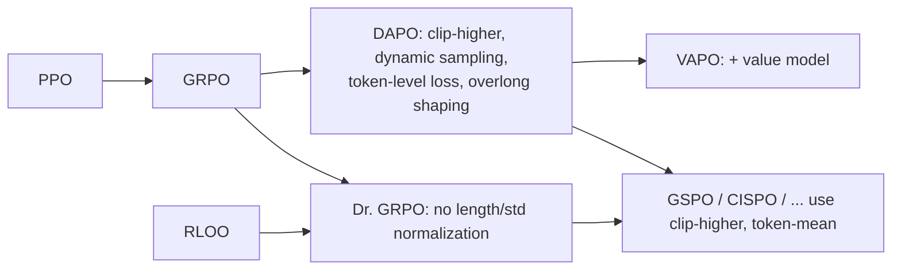

# DAPO and Dr. GRPO (fixing GRPO for long chain-of-thought RL)

> Two 2025 papers that dissected GRPO for R1-Zero-style reasoning RL. **DAPO** adds four engineering fixes: Clip-Higher, dynamic sampling, token-level loss and overlong reward shaping. **Dr. GRPO** ("GRPO Done Right") shows that GRPO's per-sequence length normalization and per-group std normalization introduce biases, and removes them. **Family:** LLM post-training → RL for reasoning → critic-free PPO-style (GRPO descendants)  ·  **Year / origin:** DAPO: Yu et al., ByteDance Seed & Tsinghua AIR, Mar 2025 (arXiv 2503.14476); Dr. GRPO: Liu et al., Sea AI Lab / NUS, Mar 2025 (arXiv 2503.20783)  ·  **On/Off-policy:** on-policy with minibatch reuse  ·  **Action space:** discrete tokens

## 1. What is it?

When the community tried to reproduce DeepSeek-R1-Zero with plain GRPO, runs often showed **entropy collapse** (the policy becomes deterministic early and stops exploring), **reward noise from truncated answers**, **wasted batches** (groups where every sample is right or every sample is wrong), and **response lengths that blow up without accuracy gains**.

**DAPO — Decoupled Clip and Dynamic sAmpling Policy Optimization.** It was trained on Qwen2.5-32B base and reported 50 points on AIME 2024, beating DeepSeek-R1-Zero-Qwen-32B (47) with half the training steps. It was released open-source on verl with the DAPO-Math-17K dataset. Four techniques:

1. **Clip-Higher:** decouple the clip range into $\epsilon_\text{low}=0.2$ and a larger $\epsilon_\text{high}=0.28$. With symmetric clipping, a token with probability 0.01 can grow to at most 0.012 in one update, while a 0.9 token can reach 1.0. The upper clip throttles the growth of rare "exploration" tokens, and raising it prevents entropy collapse.
2. **Dynamic sampling:** over-sample and drop groups with accuracy exactly 0 or 1 (they have zero advantage). Keep sampling until the batch is full of informative groups.
3. **Token-level policy-gradient loss:** average the loss over *all tokens in the batch*, not per sequence first. Each token then counts equally, so long sequences get proportionally more weight. Repetitive or gibberish patterns in long outputs are properly penalized.
4. **Overlong reward shaping:** truncated samples are not automatically "wrong reasoning". DAPO either masks them out of the loss (**overlong filtering**) or applies a soft, length-proportional penalty inside a buffer zone before the hard limit (**soft overlong punishment**).

DAPO also **removes the KL penalty**, since the policy is expected to move far from the base model in long-CoT RLVR.

**Dr. GRPO — from "Understanding R1-Zero-Like Training: A Critical Perspective".** This analysis paper reports three findings. (i) Base models such as Qwen2.5 already show "aha"-style self-reflection before any RL, so the "aha moment" is not purely emergent. (ii) Prompt templates strongly affect R1-Zero-style results. (iii) GRPO's objective is **biased**:
- **Response-length bias:** dividing each sequence's loss by $|o_i|$ means that, for a *wrong* answer (negative advantage), a longer response gets a smaller per-token penalty, while a *correct* short answer gets a larger per-token reward. The optimization therefore favors short correct answers and long wrong answers, so wrong responses grow longer and longer.
- **Question-difficulty bias:** dividing by the group std up-weights prompts where almost all samples agree (very easy or very hard), relative to medium-difficulty prompts.

Dr. GRPO removes both terms: advantage $=r_i-\text{mean}(\mathbf r)$, and the loss is summed over tokens and divided by a **constant** (e.g. the max generation length) instead of $|o_i|$. Their minimalist recipe (Oat-Zero-7B) reported strong AIME 2024 results with better token efficiency, because incorrect responses no longer grow.

## 2. Family & lineage



- **Parent:** [GRPO](grpo.md). Dr. GRPO's advantage is RLOO up to a constant ([rloo-remax-reinforcepp.md](rloo-remax-reinforcepp.md)).
- **Siblings:** [VAPO](value-based-llm-rl-vapo.md) (same ByteDance Seed team; adds a critic but keeps Clip-Higher and token-level loss); [GSPO / CISPO](gspo-sapo-gmpo-cispo.md).
- **Descendants:** most 2025–2026 RLVR recipes (verl `loss_agg_mode`, TRL `loss_type`) expose DAPO/Dr. GRPO aggregation as standard options. Clip-Higher and dynamic sampling are now defaults in many open recipes.

## 3. Core idea & intuition

- **Clip-Higher = let underdogs grow.** PPO's clip is multiplicative, so in absolute terms it constrains low-probability tokens much more than high-probability ones. Exploration lives in low-probability tokens ("wait", "alternatively"). Raising only the *upper* bound for positive-advantage tokens keeps them growing without loosening the lower bound, which could collapse probabilities.
- **Dynamic sampling = don't pay for silent groups.** As training progresses, more prompts become always-solved. Their groups produce zero gradient but still cost generation. Filtering keeps the effective batch size constant.
- **Token-level loss = every token is a vote.** With per-sequence averaging, a 10,000-token rambling wrong answer and a 100-token wrong answer contribute the same total gradient. Per token, the long one is barely penalized.
- **Overlong shaping = don't punish good-but-unfinished reasoning too hard.** A truncated response may contain correct reasoning. A hard 0 reward injects noise, so either ignore it or penalize it smoothly.
- **Dr. GRPO = make the estimator match the true policy gradient.** The true gradient of $\mathbb{E}[r]$ has no $1/|o|$ and no $1/\text{std}$. Those factors change *what* is optimized, not just the variance.

## 4. Math / formal details

Notation as in [GRPO](grpo.md): $G$ samples $o_i$ for prompt $q$, rewards $R_i$, ratio $r_{i,t}(\theta)=\frac{\pi_\theta(o_{i,t}|q,o_{i,<t})}{\pi_{\theta_\text{old}}(o_{i,t}|q,o_{i,<t})}$.

**DAPO objective (maximize):**
$$
\mathcal{J}_\text{DAPO}(\theta)=\mathbb{E}\left[\frac{1}{\sum_{i=1}^G|o_i|}\sum_{i=1}^G\sum_{t=1}^{|o_i|}\min\Big(r_{i,t}\hat A_{i,t},\ \text{clip}\big(r_{i,t},1-\epsilon_\text{low},1+\epsilon_\text{high}\big)\hat A_{i,t}\Big)\right]
$$
$$
\text{s.t. } 0<\big|\{o_i:\ \text{is\_equivalent}(a, o_i)\}\big|<G,\qquad \hat A_{i,t}=\frac{R_i-\text{mean}(\{R_i\})}{\text{std}(\{R_i\})}
$$
The constraint is dynamic sampling. Note the $\frac{1}{\sum_i|o_i|}$ token-level normalizer.

**Soft overlong punishment** (added to the task reward; $L_\text{max}$ max length, $L_\text{cache}$ buffer):
$$
R_\text{length}(y)=\begin{cases}0,&|y|\le L_\text{max}-L_\text{cache}\\[2pt]\dfrac{(L_\text{max}-L_\text{cache})-|y|}{L_\text{cache}},&L_\text{max}-L_\text{cache}<|y|\le L_\text{max}\\[6pt]-1,&|y|>L_\text{max}\end{cases}
$$
DAPO reported $L_\text{max}=20480$ with a 4096-token buffer.

**Dr. GRPO objective:**
$$
\mathcal{J}_\text{Dr.GRPO}(\theta)=\mathbb{E}\left[\frac1G\sum_{i=1}^G\frac{1}{L}\sum_{t=1}^{|o_i|}\min\Big(r_{i,t}\tilde A_{i},\ \text{clip}(r_{i,t},1-\epsilon,1+\epsilon)\tilde A_{i}\Big)\right],\qquad \tilde A_i=R_i-\text{mean}(\{R_j\})
$$
with $L$ a constant (e.g. the generation budget). Compare GRPO, which uses $\frac{1}{|o_i|}$ inside and divides $\tilde A$ by the std.

**Why $1/|o_i|$ biases length.** For an on-policy step ($r=1$), the gradient w.r.t. token $t$ of sequence $i$ is $\frac{\hat A_i}{G\,|o_i|}\nabla\log\pi(o_{i,t})$. The per-token weight is $\propto 1/|o_i|$. Viewed as an objective, the estimator ascends $\mathbb{E}\big[(R-b)/|o|\big]$. With $R\in\{0,1\}$ and $b\approx p$, this rewards making correct answers short (large $1/|o|$ on the positive term) and wrong answers long (small $1/|o|$ on the negative term).

**Aggregation modes (as named in verl):**

| `loss_agg_mode` | Formula | Used by |
|---|---|---|
| `token-mean` | $\sum_{i,t}\ell_{i,t}/\sum_i|o_i|$ | DAPO, VAPO (verl default) |
| `seq-mean-token-mean` | $\frac1G\sum_i\frac{1}{|o_i|}\sum_t\ell_{i,t}$ | original GRPO |
| `seq-mean-token-sum-norm` | $\frac1G\sum_i\frac{1}{L}\sum_t\ell_{i,t}$ | Dr. GRPO |

`token-mean` still depends on the *batch's* total length, so it is not exactly unbiased either. It does treat tokens within a batch equally.

## 5. Algorithm (pseudocode)

```text
DAPO
Input: policy π_θ, verifier R, prompts D, G, ε_low=0.2, ε_high=0.28, L_max, L_cache
1. for step = 1..N:
2.     buffer ← ∅
3.     while |buffer| < B groups:                       # dynamic sampling
4.         sample prompts; for each sample G outputs from π_old
5.         R_i = accuracy(o_i) + R_length(o_i)          # soft overlong punishment
6.         keep only groups with 0 < #correct < G
7.     Â_i = (R_i − mean)/std  (per group)
8.     for minibatches:
9.         ρ = π_θ/π_old per token
10.        L = −Σ_{i,t} min(ρ·Â, clip(ρ, 1−ε_low, 1+ε_high)·Â) / Σ_i |o_i|   # token-mean, no KL
11.        update θ

Dr. GRPO: same loop without the filter; Â_i = R_i − mean_group(R); 
          L = −(1/G) Σ_i Σ_t min(...)/L_const
```

## 6. Python implementation

Runnable version: [`code/dapo-dr-grpo.py`](../../code/dapo-dr-grpo.py)

The file implements `aggregate_loss` (all aggregation modes), `clipped_pg_per_token` with decoupled clip, `dr_grpo_advantages`, `dynamic_sampling_keep` and `overlong_reward_shaping`, plus four demos:

1. An analytic per-token gradient weight for a group of short/long × right/wrong answers under each aggregation.
2. The std bias.
3. A *length-bias probe*: the reward depends only on the first token, and the rest is free filler until EOS.
4. Full GRPO / Dr. GRPO / DAPO recipes on a variable-length "digits before EOS sum to target" task.

```python
"""DAPO and Dr. GRPO -- loss aggregation modes, Clip-Higher, dynamic sampling, overlong shaping.

(a) Tensor functions: `aggregate_loss` (token-mean / seq-mean-token-mean / seq-mean-token-sum-norm),
    `clipped_pg_per_token` with decoupled eps_low / eps_high, `dr_grpo_advantages`,
    `dynamic_sampling_keep`, `overlong_reward_shaping`.
(b) Demo 1: analytic per-token gradient weights showing the length bias of 1/|o_i| normalisation.
    Demo 2: std-normalisation bias (easy/hard prompts get up-weighted).
    Demo 3: tiny variable-length toy task trained with GRPO, Dr. GRPO and DAPO settings.

Run:  python3 code/dapo-dr-grpo.py     (CPU, ~1 min)
"""
import torch
import torch.nn as nn

torch.set_num_threads(1)


# ----------------------------------------------------------------------------------------
# (a) Loss pieces
# ----------------------------------------------------------------------------------------
def aggregate_loss(per_token: torch.Tensor, mask: torch.Tensor, mode: str, max_len: int = None):
    """Reduce a [B, T] per-token loss to a scalar.
    token-mean               : sum_{i,t} l / sum_i |o_i|                 (DAPO; verl default)
    seq-mean-token-mean      : 1/B sum_i (1/|o_i|) sum_t l               (original GRPO)
    seq-mean-token-sum-norm  : 1/B sum_i sum_t l / L_max  (constant)     (Dr. GRPO)
    seq-mean-token-sum       : 1/B sum_i sum_t l
    """
    if mode == "token-mean":
        return (per_token * mask).sum() / mask.sum().clamp(min=1)
    if mode == "seq-mean-token-mean":
        return ((per_token * mask).sum(1) / mask.sum(1).clamp(min=1)).mean()
    if mode == "seq-mean-token-sum-norm":
        L = max_len if max_len is not None else mask.shape[1]
        return ((per_token * mask).sum(1) / L).mean()
    if mode == "seq-mean-token-sum":
        return (per_token * mask).sum(1).mean()
    raise ValueError(mode)


def clipped_pg_per_token(logp, logp_old, adv, eps_low=0.2, eps_high=0.28):
    """PPO/GRPO per-token surrogate with DAPO's *Clip-Higher*: ratio clipped to
    [1-eps_low, 1+eps_high] with eps_high > eps_low so low-probability tokens with A>0 can grow."""
    if adv.dim() == 1:
        adv = adv.unsqueeze(1).expand_as(logp)
    ratio = torch.exp(logp - logp_old)
    return -torch.min(ratio * adv, ratio.clamp(1 - eps_low, 1 + eps_high) * adv)


def grpo_advantages(rewards, G, eps=1e-6):
    r = rewards.view(-1, G)
    return ((r - r.mean(1, keepdim=True)) / (r.std(1, keepdim=True) + eps)).view(-1)


def dr_grpo_advantages(rewards, G):
    """Dr. GRPO: A_i = r_i - mean(r_group). No division by the group std."""
    r = rewards.view(-1, G)
    return (r - r.mean(1, keepdim=True)).view(-1)


def dynamic_sampling_keep(rewards, G):
    """DAPO dynamic sampling: keep only groups whose accuracy is strictly between 0 and 1
    (all-correct or all-wrong groups have zero advantage -> zero gradient). Returns [B] bool."""
    r = rewards.view(-1, G)
    acc = (r > 0).float().mean(1)
    keep = (acc > 0) & (acc < 1)
    return keep.repeat_interleave(G)


def overlong_reward_shaping(lengths, max_len, cache_len):
    """DAPO soft overlong punishment, added to the task reward:
    0 if L <= L_max - L_cache;  (L_max - L_cache - L)/L_cache inside the buffer;  -1 beyond L_max."""
    lengths = lengths.float()
    expected = max_len - cache_len
    pen = torch.where(lengths <= expected, torch.zeros_like(lengths), (expected - lengths) / cache_len)
    return torch.where(lengths > max_len, torch.full_like(lengths, -1.0), pen)


# ----------------------------------------------------------------------------------------
# (b) Demo 1 + 2: analytic biases
# ----------------------------------------------------------------------------------------
def demo_length_bias():
    print("Demo 1: per-token gradient weight |dLoss/dlogp_t| for one group (G=4, L_max=16)")
    lengths = torch.tensor([4, 16, 4, 16])
    rewards = torch.tensor([1., 1., 0., 0.])          # short+long correct, short+long wrong
    T = int(lengths.max())
    mask = (torch.arange(T)[None] < lengths[:, None]).float()
    adv = dr_grpo_advantages(rewards, 4)
    for mode in ["seq-mean-token-mean", "token-mean", "seq-mean-token-sum-norm"]:
        logp = torch.zeros(4, T, requires_grad=True)
        per_tok = -(logp * adv[:, None])               # on-policy REINFORCE form
        aggregate_loss(per_tok, mask, mode, max_len=T).backward()
        w = logp.grad.abs().max(1).values
        print(f"  {mode:24s} short-correct {w[0]:.4f} long-correct {w[1]:.4f} "
              f"short-wrong {w[2]:.4f} long-wrong {w[3]:.4f}")
    print("  -> with 1/|o_i| a long WRONG answer is penalised 4x less per token than a short one,\n"
          "     so wrong answers drift longer; token-sum-norm / token-mean treat tokens equally.\n")


def demo_std_bias():
    print("Demo 2: total gradient mass sum_i |A_i| of one group (G=8) vs. group accuracy")
    for n_correct in [1, 2, 4, 6, 7]:
        r = torch.zeros(8)
        r[:n_correct] = 1
        g, d = grpo_advantages(r, 8).abs().sum(), dr_grpo_advantages(r, 8).abs().sum()
        print(f"  {n_correct}/8 correct: GRPO {g:.2f} | Dr. GRPO {d:.2f} | GRPO/Dr ratio (=1/std) {g/d:.2f}")
    print("  -> dividing by std up-weights nearly-solved / nearly-unsolved prompts relative to\n"
          "     prompts of medium difficulty (a question-level difficulty bias).\n")


# ----------------------------------------------------------------------------------------
# (b) Demo 3: variable-length toy task
# ----------------------------------------------------------------------------------------
VOCAB = 5            # digits 0..3 and EOS(=4)
EOS, MAXLEN, MAX_T = 4, 12, 9


class TinyGRUPolicy(nn.Module):
    def __init__(self, n_prompts, vocab, hidden=64):
        super().__init__()
        self.V = vocab
        self.prompt_emb = nn.Embedding(n_prompts, hidden)
        self.tok_emb = nn.Embedding(vocab + 1, hidden)
        self.gru = nn.GRUCell(hidden, hidden)
        self.head = nn.Linear(hidden, vocab)

    def forward(self, prompts, tokens):
        B, T = tokens.shape
        h = torch.tanh(self.prompt_emb(prompts))
        inp = torch.full((B,), self.V, dtype=torch.long)
        out = []
        for t in range(T):
            h = self.gru(self.tok_emb(inp), h)
            out.append(self.head(h))
            inp = tokens[:, t]
        return torch.stack(out, 1)

    def token_logp(self, prompts, tokens):
        return torch.log_softmax(self(prompts, tokens), -1).gather(-1, tokens.unsqueeze(-1)).squeeze(-1)

    @torch.no_grad()
    def sample(self, prompts, T):
        B = prompts.shape[0]
        h = torch.tanh(self.prompt_emb(prompts))
        inp = torch.full((B,), self.V, dtype=torch.long)
        toks, masks = [], []
        alive = torch.ones(B, dtype=torch.bool)
        for _ in range(T):
            h = self.gru(self.tok_emb(inp), h)
            inp = torch.distributions.Categorical(logits=self.head(h)).sample()
            inp = torch.where(alive, inp, torch.full_like(inp, EOS))
            toks.append(inp)
            masks.append(alive.float())
            alive = alive & (inp != EOS)
        return torch.stack(toks, 1), torch.stack(masks, 1), alive    # alive = truncated


def task_reward(prompts, toks, mask, truncated):
    """Digits before EOS must sum to the prompt id; truncated answers count as wrong."""
    digits = toks.clone()
    digits[digits == EOS] = 0
    s = (digits * mask).sum(1)
    return ((s == prompts) & ~truncated).float()


def first_token_reward(prompts, toks, mask, truncated):
    """Length-bias probe: correct iff the FIRST token equals prompt % 4 (and not truncated).
    Everything after the first token is free 'filler' -- length does not affect correctness."""
    return ((toks[:, 0] == prompts % 4) & ~truncated & (toks[:, 0] != EOS)).float()


def train(cfg, steps=250, n_prompts=32, G=8, lr=3e-3, mu=2, seed=0, reward=task_reward,
          track_len=False):
    torch.manual_seed(seed)
    pol = TinyGRUPolicy(MAX_T + 1, VOCAB)
    wrong_lens, right_lens = [], []
    opt = torch.optim.Adam(pol.parameters(), lr=lr)
    for step in range(steps):
        prompts = torch.randint(0, MAX_T + 1, (n_prompts,)).repeat_interleave(G)
        toks, mask, trunc = pol.sample(prompts, MAXLEN)
        acc = reward(prompts, toks, mask, trunc)
        if track_len:
            L = mask.sum(1)
            if (acc == 0).any():
                wrong_lens.append(L[acc == 0].mean().item())
            if (acc == 1).any():
                right_lens.append(L[acc == 1].mean().item())
        r = acc.clone()
        if cfg.get("overlong"):
            r = r + overlong_reward_shaping(mask.sum(1), MAXLEN, cache_len=4)
        adv = dr_grpo_advantages(r, G) if cfg["adv"] == "dr" else grpo_advantages(r, G)
        if cfg.get("dynamic"):                   # (real DAPO keeps sampling until batch is full)
            keep = dynamic_sampling_keep(acc, G)
            if keep.sum() == 0:
                continue
            prompts, toks, mask, adv = prompts[keep], toks[keep], mask[keep], adv[keep]
        with torch.no_grad():
            logp_old = pol.token_logp(prompts, toks)
        for _ in range(mu):
            logp = pol.token_logp(prompts, toks)
            per_tok = clipped_pg_per_token(logp, logp_old, adv, 0.2, cfg.get("eps_high", 0.2))
            loss = aggregate_loss(per_tok, mask, cfg["agg"], max_len=MAXLEN)
            opt.zero_grad()
            loss.backward()
            opt.step()
    if track_len:
        return wrong_lens, right_lens
    with torch.no_grad():   # evaluation
        prompts = torch.arange(MAX_T + 1).repeat_interleave(64)
        toks, mask, trunc = pol.sample(prompts, MAXLEN)
        acc = reward(prompts, toks, mask, trunc)
    return acc.mean().item(), mask.sum(1).mean().item(), trunc.float().mean().item()


if __name__ == "__main__":
    demo_length_bias()
    demo_std_bias()
    print("overlong shaping (L_max=12, cache=4) for L=6,9,12,13:",
          overlong_reward_shaping(torch.tensor([6, 9, 12, 13]), 12, 4).tolist(), "\n")
    print("Demo 3: length-bias probe -- reward depends only on the first token, rest is filler.")
    print("  Mean length of WRONG vs CORRECT samples during training (initial mean length ~4.5):")
    for name, cfg in [("GRPO-style 1/|o_i| (seq-mean-token-mean)", dict(adv="dr", agg="seq-mean-token-mean")),
                      ("Dr. GRPO constant norm (seq-mean-token-sum-norm)",
                       dict(adv="dr", agg="seq-mean-token-sum-norm"))]:
        wl, rl = [], []
        for s in range(3):
            w, r = train(cfg, steps=60, lr=1e-3, seed=s, reward=first_token_reward, track_len=True)
            wl += w[-20:]
            rl += r[-20:]
        print(f"  {name:50s} len(wrong) {sum(wl)/len(wl):.2f} | len(correct) {sum(rl)/len(rl):.2f}")
    print()
    print("Demo 4: full recipes on 'digits before EOS sum to target' (avg over 2 seeds)")
    configs = {
        "GRPO     (std adv, seq-mean-token-mean)": dict(adv="std", agg="seq-mean-token-mean"),
        "Dr. GRPO (mean adv, seq-mean-token-sum-norm)": dict(adv="dr", agg="seq-mean-token-sum-norm"),
        "DAPO     (clip-higher, dyn. sampling, token-mean, overlong)":
            dict(adv="std", agg="token-mean", eps_high=0.28, dynamic=True, overlong=True),
    }
    for name, cfg in configs.items():
        res = [train(cfg, seed=s) for s in range(2)]
        a, L, tr = [sum(x[i] for x in res) / len(res) for i in range(3)]
        print(f"  {name:60s} acc {a:.3f} | mean len {L:.2f} | truncated {tr:.3f}")
```

Typical output (~70 s):

- **Demo 1:** under `seq-mean-token-mean` a 16-token answer receives 4× less gradient per token (0.0078) than a 4-token answer (0.0312), whether it is right or wrong. The other two modes treat all tokens equally.
- **Demo 2:** GRPO's std division multiplies a 1/8-correct group's gradient mass by 2.83 but a 4/8 group's by only 1.87.
- **Demo 3:** with $1/|o_i|$ normalization the *wrong* samples end up longer than the correct ones (≈3.9 vs 3.6 tokens). With Dr. GRPO's constant normalizer they don't (≈3.6 vs 3.9). The effect is small on this toy but has the direction the paper describes.
- **Demo 4:** all three recipes solve the easy task (accuracy ≈0.90–0.95). The toy is too short for overlong shaping or Clip-Higher to matter much. Their benefits show up on 10k-token responses.

**With real libraries** (requires GPU + library; not run here):

```python
# TRL (not run here): DAPO-style settings in GRPOConfig
from trl import GRPOConfig
cfg = GRPOConfig(output_dir="dapo", loss_type="dapo",      # token-level normalization
                 epsilon=0.2, epsilon_high=0.28,            # Clip-Higher
                 beta=0.0,                                  # no KL
                 mask_truncated_completions=True,           # overlong filtering
                 num_generations=16, max_completion_length=8192)
cfg_dr = GRPOConfig(output_dir="drgrpo", loss_type="dr_grpo", scale_rewards=False)  # Dr. GRPO
# (scale_rewards took a bool in 2025 releases and a string such as "none"/"group"/"batch" later)
```

```bash
# verl (not run here): DAPO recipe knobs
actor_rollout_ref.actor.clip_ratio_low=0.2 actor_rollout_ref.actor.clip_ratio_high=0.28 \
actor_rollout_ref.actor.loss_agg_mode=token-mean algorithm.use_kl_in_reward=False \
actor_rollout_ref.actor.use_kl_loss=False algorithm.filter_groups.enable=True \
reward_model.overlong_buffer.enable=True reward_model.overlong_buffer.len=4096
# Dr. GRPO: loss_agg_mode=seq-mean-token-sum-norm and algorithm.norm_adv_by_std_in_grpo=False
```

## 7. Practical tips & hyperparameters

- **Clip-Higher:** $\epsilon_\text{high}\in[0.26, 0.3]$. Too high causes instability. Monitor **entropy**: it should decline slowly, not collapse in the first few hundred steps.
- **Dynamic sampling** costs extra generation, roughly 1.2–2× depending on how many groups get filtered. The DAPO paper reported it still reaches a given accuracy faster in wall-clock terms. Track the "kept fraction".
- **Token-level loss** is now the safest default for long CoT. If you use Dr. GRPO's constant normalizer, set the constant to the generation budget.
- **Overlong:** choose either filtering (mask truncated samples) or soft punishment. Make sure truncated samples aren't silently scored as plain failures.
- **No KL** for pure RLVR from a base model. Keep a KL if you start from a chat model and must retain its behaviour.
- **Length as a diagnostic:** if mean length grows while accuracy is flat, suspect the length bias (incorrect responses lengthening) and switch to token-level or constant normalization.
- Group size 16 and 512 prompts × 16 samples per batch were reported for DAPO; learning rate 1e-6.

## 8. Pros and cons

| Pros | Cons |
|---|---|
| Clip-Higher prevents entropy collapse cheaply | Extra hyperparameter $\epsilon_\text{high}$; too large is unstable |
| Dynamic sampling keeps every batch informative | Extra rollouts; variable batch-building time |
| Token-level / constant normalization removes length bias | Long responses get more total gradient (by design) — can amplify noise in very long outputs |
| Overlong shaping reduces reward noise from truncation | Shaping can discourage legitimately long solutions |
| Dr. GRPO is a tiny code change with a clear theory | Removing std normalization changes the effective learning rate; retune LR |
| Fully open (code, data) | Gains reported mainly on math with Qwen2.5 bases |

## 9. When to use / when not to use

**Use** DAPO-style settings for long-CoT RLVR from base or reasoning models, especially when you see entropy collapse, flat accuracy with rising length, or many all-correct groups. Use Dr. GRPO's unbiased normalization whenever response length is a cost or should not drift.

**Not necessary** for short-response RL (classification-like outputs, short answers), where length bias is negligible, or for RLHF with reward models, where KL regularization is important and dynamic sampling is less relevant (rewards are continuous and rarely tie).

## 10. Key papers, books & repos

- Yu et al., *DAPO: An Open-Source LLM Reinforcement Learning System at Scale*, ByteDance Seed & Tsinghua AIR, 2025 — arXiv 2503.14476.
- Liu et al., *Understanding R1-Zero-Like Training: A Critical Perspective* (Dr. GRPO), 2025 — arXiv 2503.20783.
- Shao et al., *DeepSeekMath* (GRPO), 2024 — arXiv 2402.03300.
- Yue et al., *VAPO*, 2025 — arXiv 2504.05118 (reuses Clip-Higher and token-level loss).
- Repos: `BytedTsinghua-SIA/DAPO`, `volcengine/verl` (`recipe/dapo`), `sail-sg/understand-r1-zero`, `huggingface/trl`.

## 11. For business users

**What it does.** DAPO and Dr. GRPO are "bug fixes" for the most popular reasoning-training recipe (GRPO). They make training more stable, stop wasting compute on questions the model already always gets right or always gets wrong, and prevent answers from getting needlessly long.

**Analogy.** A coaching program that (1) stops drilling exercises every athlete already aces, (2) gives a fair hearing to unusual but promising techniques, and (3) stops accidentally rewarding athletes who ramble when they're wrong.

**Use cases.** Any team training reasoning models (math, code, analytics) with automatic graders.

**Value.** Reported faster convergence (fewer training steps for the same accuracy) and shorter, cheaper answers at inference time. Shorter answers directly reduce serving cost.

**Risks.** These are tuning choices. Wrong settings can destabilize training. Most published evidence is on math benchmarks with specific model families.

**Costs.** Little extra engineering (configuration flags in common libraries). Dynamic sampling adds some generation compute.

**Questions to ask your team.**
- Is answer length drifting up during training, and does accuracy justify it?
- What fraction of training questions are always or never solved?
- Which loss aggregation mode are we using, and why?

## 12. For kids (ages ~8–12)

Imagine a spelling game where you score points for correct words. The old rule had a sneaky problem: if you got a word wrong, writing a *really long* wrong answer made the penalty smaller. So players started writing super-long wrong answers! The new rule counts every letter the same, so rambling doesn't help. The coach also stopped practising words everyone always spells right, because that doesn't teach anything.

**Try it yourself:** Make 10 flash cards of math facts. Sort them into "always right", "always wrong" and "sometimes right". Practise only the "sometimes" pile for a week. Does it shrink faster than practising everything?

**Recap:**
1. Count every word fairly, long or short.
2. Practise the questions that are "sometimes right".
3. Give new ideas room to grow.

## 13. Related methods

- [GRPO](grpo.md) — the baseline being fixed.
- [RLOO, ReMax, REINFORCE++](rloo-remax-reinforcepp.md) — Dr. GRPO's advantage is RLOO-like.
- [GSPO, SAPO, GMPO, CISPO](gspo-sapo-gmpo-cispo.md) — further ratio/clipping redesigns.
- [VC-PPO & VAPO](value-based-llm-rl-vapo.md) — DAPO's tricks plus a critic.
- [RLVR](rlvr.md) — the training setting.
- [PPO](../03-policy-gradient/ppo.md), [Reward hacking & safety](../09-llm-preference-alignment/safety-rl-reward-hacking.md).

[← Back to overview](../../RL_Methods_Overview.md)
