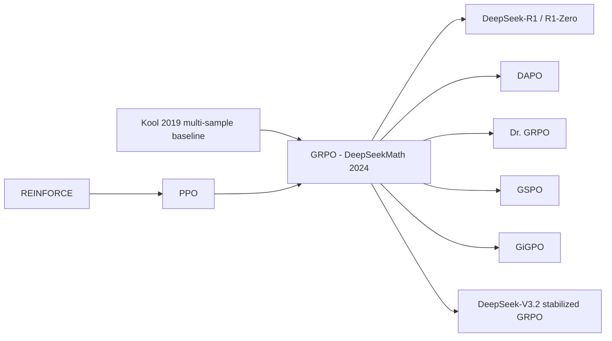

# Group Relative Policy Optimization (GRPO)

> PPO without a value network: sample a *group* of completions per prompt, use each completion's reward standardized against its group as the advantage, and optimize a clipped surrogate with a KL penalty added directly to the loss. **Family:** LLM post-training → RL for reasoning → critic-free policy gradient (PPO-style)  ·  **Year / origin:** Shao et al., *DeepSeekMath*, DeepSeek-AI, Feb 2024 (arXiv 2402.03300)  ·  **On/Off-policy:** on-policy with a few PPO-style off-policy minibatch reuses  ·  **Action space:** discrete tokens

## 1. What is it?

PPO for LLMs ([rlhf-ppo.md](../09-llm-preference-alignment/rlhf-ppo.md)) needs four models: policy, reference, reward model and a **value network (critic)** that is usually as large as the policy. The critic is costly in memory and compute. It is also hard to train when the reward arrives only at the end of a sequence: the value must be predicted at every token from a single terminal scalar.

**GRPO** removes the critic. For each prompt $q$ it samples a group of $G$ outputs $\{o_1,\dots,o_G\}$, scores them, and sets the advantage of every token of $o_i$ to the **group-normalized reward**
$$\hat A_{i,t}=\frac{r_i-\text{mean}(\mathbf r)}{\text{std}(\mathbf r)}.$$
The group mean is a Monte-Carlo estimate of the prompt's value $V(q)$, so it plays the role of the critic's baseline at zero extra parameters. Everything else is PPO: importance ratios, clipping, a few minibatch epochs. One more difference: GRPO adds the KL to the reference policy **as a loss term** (using the "k3" estimator) instead of subtracting it from the reward.

GRPO was introduced for DeepSeekMath-RL (7B) and became the workhorse of open reasoning RL after **DeepSeek-R1** (2025) used it for R1-Zero and R1. It was also used in **Qwen3**'s reasoning-RL stage (reported) and in countless replications. Its simplicity also exposed several biases, fixed by DAPO, Dr. GRPO, GSPO and others.

## 2. Family & lineage

- **Parents:** PPO (Schulman et al., 2017), REINFORCE with baseline, and RLOO-style multi-sample baselines (Kool et al., 2019).
- **Siblings:** RLOO, ReMax, REINFORCE++ ([rloo-remax-reinforcepp.md](rloo-remax-reinforcepp.md)) — all critic-free; they differ in the baseline/normalization.
- **Descendants:** DAPO and Dr. GRPO ([dapo-dr-grpo.md](dapo-dr-grpo.md)); GSPO, GMPO, SAPO, CISPO ([gspo-sapo-gmpo-cispo.md](gspo-sapo-gmpo-cispo.md)); GiGPO for agents ([agentic-multi-turn-rl.md](agentic-multi-turn-rl.md)); DeepSeek-V3.2's stabilized GRPO.



## 3. Core idea & intuition

- **Relative grading.** Grade each answer relative to classmates answering the *same* question, not on an absolute scale. A score of 0.6 means little by itself; being the best of 8 attempts at the same prompt is informative. This also normalizes away prompt difficulty.
- **No critic needed.** With rewards only at the end of the sequence, a learned per-token value function adds noise and memory. Averaging $G$ samples gives a simple, unbiased estimate of $V(q)$ (strictly, the leave-one-out version is unbiased; see RLOO).
- **Trust region from PPO.** Clipping the ratio $\pi_\theta/\pi_{\theta_\text{old}}$ to $[1-\epsilon, 1+\epsilon]$ keeps the updates small when the same batch is reused for several gradient steps.
- **KL as a regularizer in the loss.** PPO-RLHF puts $-\beta\log\frac{\pi}{\pi_\text{ref}}$ into the per-token reward, which then flows into the advantages. GRPO keeps the advantage purely reward-based and adds $\beta\,\mathbb{D}_\text{KL}$ to the loss with the low-variance, always-positive **k3** estimator.

**Outcome vs process supervision.** With *outcome* supervision every token of $o_i$ gets the same $\hat A_i$. With *process* supervision a PRM scores each reasoning step. Step rewards are normalized across the group, and a token's advantage is the sum of normalized rewards of the steps at or after it:
$$\hat A_{i,t}=\sum_{\text{index}(j)\ge t}\tilde r_i^{\text{index}(j)}.$$
DeepSeekMath found process supervision slightly better in their setting. Later reasoning work (R1) dropped PRMs because they were hackable and costly at scale.

**Iterative GRPO.** As the policy improves, a fixed reward model becomes stale. DeepSeekMath periodically retrains the reward model on new policy samples (with a replay of ~10% historical data) and resets the reference model to the current policy.

**Where GRPO was used / changed later:**
- **DeepSeek-R1-Zero / R1** (2025): GRPO with rule-based rewards; $G=16$ reported.
- **Qwen3** (2025): reasoning RL with GRPO on a few thousand query–verifier pairs (reported). Later Qwen3 releases switched to GSPO.
- **DeepSeek-V3.2** (Dec 2025, arXiv 2512.02556) reports several stabilizers for scaled-up GRPO, applied in a **single mixed RL stage** that merges reasoning, agent and human-alignment training:
  - an **unbiased KL estimate**: the k3 term is corrected with the importance ratio $\pi_\theta/\pi_\text{old}$, because tokens come from $\pi_\text{old}$, not $\pi_\theta$;
  - **off-policy sequence masking**: drop negative-advantage sequences whose divergence between the behaviour and current policy exceeds a threshold;
  - **domain-specific KL strength** (weak or even zero KL for some domains such as math);
  - MoE-specific fixes ("keep routing": reuse the inference-time expert routing in training) and "keep sampling mask" (reuse top-p/top-k truncation masks).

## 4. Math / formal details

Symbols: $q$ prompt; $o_i$ the $i$-th of $G$ sampled outputs; $o_{i,t}$ its $t$-th token; $\pi_\theta$ current policy, $\pi_{\theta_\text{old}}$ behaviour policy that sampled the batch, $\pi_\text{ref}$ frozen reference (SFT model); $r_i$ scalar reward; $\epsilon$ clip range; $\beta$ KL coefficient.

**Ratio:** $\rho_{i,t}(\theta)=\dfrac{\pi_\theta(o_{i,t}\mid q,o_{i,<t})}{\pi_{\theta_\text{old}}(o_{i,t}\mid q,o_{i,<t})}$.

**Advantage (outcome supervision):** $\hat A_{i,t}=\dfrac{r_i-\text{mean}(r_1..r_G)}{\text{std}(r_1..r_G)}$ for all $t$.

**GRPO objective (maximize):**
$$
\mathcal{J}_\text{GRPO}(\theta)=\mathbb{E}_{q,\{o_i\}\sim\pi_{\theta_\text{old}}}\left[\frac1G\sum_{i=1}^G\frac{1}{|o_i|}\sum_{t=1}^{|o_i|}\Big(\min\big(\rho_{i,t}\hat A_{i,t},\ \text{clip}(\rho_{i,t},1-\epsilon,1+\epsilon)\hat A_{i,t}\big)-\beta\,\mathbb{D}_\text{KL}^{(i,t)}\Big)\right]
$$

**k3 KL estimator** (per token, unbiased for $\mathbb{D}_\text{KL}(\pi_\theta\|\pi_\text{ref})$ when $o\sim\pi_\theta$, always $\ge0$):
$$
\mathbb{D}_\text{KL}^{(i,t)}=\frac{\pi_\text{ref}(o_{i,t}|\cdot)}{\pi_\theta(o_{i,t}|\cdot)}-\log\frac{\pi_\text{ref}(o_{i,t}|\cdot)}{\pi_\theta(o_{i,t}|\cdot)}-1
$$
DeepSeek-V3.2's correction multiplies this by $\rho_{i,t}$ since tokens are drawn from $\pi_{\theta_\text{old}}$. (The gradient of k3 is a biased estimate of the true reverse-KL gradient in general; several 2025 analyses discuss which estimator to use "in reward" vs "in loss".)

**Unified view (from DeepSeekMath).** SFT, rejection-sampling FT, DPO, PPO and GRPO all have gradients of the form $\mathbb{E}\big[\,GC(q,o,t)\,\nabla\log\pi_\theta(o_t|q,o_{<t})\big]$. They differ only in the data source (offline vs online samples) and in the **gradient coefficient** $GC$: 1 for SFT, $\mathbb{1}[\text{correct}]$ for RFT, $\hat A_{i,t}+\beta(\frac{\pi_\text{ref}}{\pi_\theta}-1)$ for GRPO.

**Aggregation bias.** The $\frac{1}{|o_i|}$ factor ("seq-mean-token-mean") weights tokens of short sequences more. Dividing by std up-weights prompts with low reward variance. Both biases are analyzed in [dapo-dr-grpo.md](dapo-dr-grpo.md).

## 5. Algorithm (pseudocode)

```text
Input: initial policy π_θ (SFT or base), reward function(s) r, prompts D, group size G,
       clip ε, KL coef β, inner iterations μ
1. π_ref ← π_θ (frozen)
2. for step = 1..N do
3.     π_old ← π_θ
4.     sample a batch of prompts q_1..q_B
5.     for each q_b: sample G outputs o_{b,1..G} ~ π_old(·|q_b)
6.     compute rewards r_{b,i}; Â_{b,i} = (r_{b,i} − mean_i r_{b,·}) / (std_i r_{b,·} + 1e-6)
7.     store log π_old(o_{b,i,t}) and log π_ref(o_{b,i,t}) for every token
8.     for μ inner iterations (or minibatches) do
9.         ρ = exp(log π_θ − log π_old)
10.        L = − mean_i mean_t [ min(ρ·Â, clip(ρ,1−ε,1+ε)·Â) − β·k3(π_θ, π_ref) ]
11.        θ ← θ − η ∇_θ L
12.    (iterative GRPO: periodically retrain reward model and set π_ref ← π_θ)
```

## 6. Python implementation

Runnable version: [`code/grpo.py`](../../code/grpo.py)

`group_relative_advantages`, `k3_kl` and `grpo_loss` operate on `[B, T]` tensors of per-token log-probs and a mask, the same shapes TRL/verl/OpenRLHF use. `grpo_loss` supports both the original "seq-mean-token-mean" aggregation and "token-mean". It also has an optional V3.2-style importance-corrected KL, and `off_policy_sequence_mask` sketches V3.2's sequence masking. The toy task: a GRU emits 4 digits in {0..3} that must sum to a target in 0..12.

```python
{{CODE}}
```

Typical output (~7 s on CPU): train reward goes from ~0.09 to ~0.85, and greedy accuracy over all 13 targets reaches ~0.85. **Target 0** (only `[0,0,0,0]` works; random success 1/256) is never solved: every group for it scores all zeros, so the group-normalized advantage is exactly zero and the prompt gives *no gradient*. This is the failure mode that DAPO's dynamic sampling and curriculum design address.

**With TRL** (requires GPU + library; not run here):

```python
# pip install trl   (GPU required; not run here)
import re
from datasets import load_dataset
from trl import GRPOConfig, GRPOTrainer

# placeholder name: any dataset with a "prompt" column and a "solution" (final answer) column
dataset = load_dataset("your-org/math-prompts-with-answers", split="train")

def format_reward(completions, **kwargs):
    pattern = r"^<think>.*?</think>\s*<answer>.*?</answer>$"
    texts = [c[0]["content"] if isinstance(c, list) else c for c in completions]  # chat or plain
    return [1.0 if re.match(pattern, t, re.S) else 0.0 for t in texts]

def accuracy_reward(completions, solution, **kwargs):   # dataset column "solution" -> kwarg
    texts = [c[0]["content"] if isinstance(c, list) else c for c in completions]
    return [1.0 if s.strip() in t else 0.0 for t, s in zip(texts, solution)]  # use math-verify in practice

config = GRPOConfig(
    output_dir="grpo-demo",
    num_generations=8,              # G
    max_completion_length=2048,
    learning_rate=1e-6,
    beta=0.04,                      # KL coef (recent TRL defaults to 0.0)
    epsilon=0.2,                    # clip range (epsilon_high is also available, DAPO-style)
    loss_type="grpo",               # also e.g. "bnpo", "dr_grpo", "dapo" (newer default) and others
    scale_rewards=True,             # divide by group std (False = Dr. GRPO style; newer versions take strings)
    use_vllm=True,
)
trainer = GRPOTrainer(model="Qwen/Qwen2.5-0.5B-Instruct",
                      reward_funcs=[format_reward, accuracy_reward],
                      args=config, train_dataset=dataset)
trainer.train()
```

TRL's `loss_type` options have grown over releases. Versions from 2025 include `"grpo"`, `"bnpo"`, `"dr_grpo"` and `"dapo"`, and later versions add more (for example `"cispo"` and `"sapo"`). Defaults have changed too, so check the documentation of your installed version. In **verl**, set `algorithm.adv_estimator=grpo`, `actor_rollout_ref.actor.use_kl_loss=True`, `actor_rollout_ref.actor.kl_loss_type=low_var_kl` (k3) and `actor_rollout_ref.rollout.n=8`.

## 7. Practical tips & hyperparameters

- **Group size** $G$: 4–64. 8–16 is typical (R1: 16). Larger $G$ means a better baseline and more prompts with nonzero variance, at a linear generation cost.
- **Clip** $\epsilon$: 0.2 (DAPO uses asymmetric 0.2/0.28). **KL** $\beta$: 0.001–0.04, often 0 for pure RLVR.
- **Learning rate:** 1e-6 to 3e-6 for full fine-tuning of 1–70B models; 1e-5 to 1e-4 for LoRA.
- **Inner updates:** 1–4 minibatch steps per batch. With exactly one step per batch the ratio is 1 and clipping is inactive (pure policy gradient).
- **Zero-variance groups** waste compute: filter them (DAPO dynamic sampling) or increase $G$.
- **Watch:** entropy (collapse = premature convergence), response length, clip fraction (~0.1–0.3% typical for token-level), KL, the fraction of all-correct/all-wrong groups.
- **Length bias:** with `seq-mean-token-mean`, wrong long answers are under-penalized. Prefer `token-mean` or Dr. GRPO's constant normalizer for long-CoT training.
- **Numerics:** compute log-probs in fp32. Inference-engine (vLLM) and trainer log-probs differ slightly; consider truncated importance sampling ([gspo-sapo-gmpo-cispo.md](gspo-sapo-gmpo-cispo.md)).

## 8. Pros and cons

| Pros | Cons |
|---|---|
| No critic: roughly halves model memory vs PPO | Needs $G$ samples per prompt (generation-heavy) |
| Simple, few hyperparameters | Zero gradient when all samples tie (too easy / too hard prompts) |
| Group normalization handles prompt-difficulty scale | Length and std normalization biases (see Dr. GRPO) |
| Works well with sparse, binary verifiable rewards | Sequence-level advantage: coarse credit assignment within long CoT |
| Proven at scale (DeepSeek-R1, Qwen3, many open replications) | Token-level ratios can be unstable for MoE / long sequences (GSPO motivation) |

## 9. When to use / when not to use

**Use when:** rewards are per-sequence (verifiers, reward models), you can afford several samples per prompt, and memory for a critic is a concern. It is the default starting point for RLVR.

**Avoid / modify when:** rewards are dense and per-step (a critic or GAE can exploit that); episodes are multi-turn with long horizons (consider step-level variants like GiGPO, or critics); you train large MoE models (consider GSPO); responses are very long (use token-level aggregation, Clip-Higher, and overlong handling from DAPO).

## 10. Key papers, books & repos

- Shao et al., *DeepSeekMath: Pushing the Limits of Mathematical Reasoning in Open Language Models*, 2024 — arXiv 2402.03300 (introduces GRPO).
- DeepSeek-AI, *DeepSeek-R1*, 2025 — arXiv 2501.12948; *Nature* 2025.
- DeepSeek-AI, *DeepSeek-V3.2*, 2025 — arXiv 2512.02556 (scaled, stabilized GRPO; mixed RL stage).
- Qwen Team, *Qwen3 Technical Report*, 2025 — arXiv 2505.09388.
- Schulman et al., *Proximal Policy Optimization Algorithms*, 2017 — arXiv 1707.06347.
- J. Schulman, *Approximating KL Divergence* (blog note, 2020) — k1/k2/k3 estimators.
- Liu et al., *Understanding R1-Zero-Like Training: A Critical Perspective* (Dr. GRPO), 2025 — arXiv 2503.20783.
- Sutton & Barto (2018), Ch. 13.4 (REINFORCE with baseline).
- Repos: `deepseek-ai/DeepSeek-Math`, `deepseek-ai/DeepSeek-R1`, `huggingface/trl` (`GRPOTrainer`), `volcengine/verl`, `OpenRLHF/OpenRLHF`, `huggingface/open-r1`.

## 11. For business users

**What it does.** GRPO is the training method behind many recent "reasoning" models. For each question the model writes several answers. An automatic checker or scorer grades them, and the model is pushed toward the answers that beat their siblings. It needs no second "critic" AI, which makes it cheaper and simpler than the older approach.

**Analogy.** A teacher who grades on a curve *per exam question*. Students aren't compared with a fixed bar but with classmates answering the same question, so hard and easy questions are treated fairly.

**Use cases.** Training math, coding, data-analysis or tool-using assistants where answers can be checked; fine-tuning a model on company-specific tasks with a scoring function (SQL that executes correctly, forms that validate).

**Value.** Roughly half the GPU memory of classic PPO-based RLHF, and fewer moving parts. It is widely supported in open-source tools (TRL, verl, OpenRLHF), so teams can start quickly.

**Risks.** It optimizes only what the scorer measures. Prompts that are always solved or never solved teach nothing, which wastes compute. Long training can make answers longer and slower.

**Costs.** Dominated by generating several long answers per question on GPUs.

**Questions to ask your team.**
- How many answers per question (group size) are we sampling, and what fraction of groups give no learning signal?
- What is our scorer, and how did we test it for loopholes?
- Are we tracking answer length and cost per query as training progresses?

## 12. For kids (ages ~8–12)

Imagine your class gets the same riddle, and eight friends each write an answer. Instead of the teacher saying "7 out of 10" to everyone, she says: "Your answer was *better than the average of your group*, keep doing that!" or "Yours was below the group average, try something different." Nobody needs a special judge who predicts scores ahead of time. You just compare with your group. GRPO teaches a computer this way: it writes several answers, compares them with each other, and learns from the best ones.

**Try it yourself:** With 3 friends, each draw a cat in 30 seconds. Vote on which drawings look most like a cat. Next round, everyone borrows one idea from the winning drawing. Do the drawings get better?

**Recap:**
1. Make several tries at the same question.
2. Compare the tries with each other.
3. Do more of what beat the group average.

## 13. Related methods

- [RLVR](rlvr.md) — the reward setup GRPO is most used with.
- [RLOO, ReMax, REINFORCE++](rloo-remax-reinforcepp.md) — alternative critic-free baselines.
- [DAPO & Dr. GRPO](dapo-dr-grpo.md) — bias fixes and stability tricks for GRPO.
- [GSPO, SAPO, GMPO, CISPO](gspo-sapo-gmpo-cispo.md) — redesigned ratios/clipping.
- [VC-PPO & VAPO](value-based-llm-rl-vapo.md) — the critic-based alternative.
- [Process rewards & PRIME](process-reward-prime.md) — GRPO with process supervision.
- [Agentic multi-turn RL](agentic-multi-turn-rl.md) — GiGPO and multi-turn variants.
- [PPO](../03-policy-gradient/ppo.md), [RLHF with PPO](../09-llm-preference-alignment/rlhf-ppo.md), [DPO](../09-llm-preference-alignment/dpo.md).

[← Back to overview](../../RL_Methods_Overview.md)
