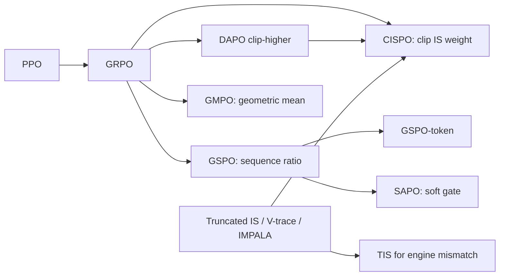

# Importance-ratio and clipping redesigns: GSPO, GSPO-token, SAPO, GMPO, CISPO (+ TIS)

> A 2025 family of fixes to *how* PPO/GRPO's importance ratio is formed and clipped for LLMs. **GSPO** uses one length-normalized sequence ratio. **GMPO** optimizes a geometric mean of token ratios. **SAPO** replaces hard clipping with a smooth gate. **CISPO** clips the importance *weight* but never drops a token's gradient. **TIS** corrects for the inference-engine vs trainer mismatch. **Family:** LLM post-training → RL for reasoning → PPO/GRPO surrogate redesign  ·  **Year / origin:** GSPO: Zheng et al., Qwen/Alibaba, Jul 2025 (arXiv 2507.18071); GMPO: Zhao et al., Jul 2025 (arXiv 2507.20673); CISPO: MiniMax-M1 report, Jun 2025 (arXiv 2506.13585); SAPO: Qwen, Nov 2025 (arXiv 2511.20347); TIS: Yao et al. blog, 2025  ·  **On/Off-policy:** on-policy with off-policy minibatch reuse (all are importance-sampling corrections)  ·  **Action space:** discrete tokens

## 1. What is it?

GRPO and PPO compute a **per-token** ratio $r_{i,t}=\pi_\theta(o_{i,t})/\pi_{\theta_\text{old}}(o_{i,t})$ and clip it to $[1-\epsilon,1+\epsilon]$. For long chain-of-thought and Mixture-of-Experts (MoE) models this caused trouble:

- **Noise accumulates.** The advantage is per *sequence*, but the off-policy correction is per *token*. Each token's ratio is a single-sample importance weight, which is very noisy. Over 10k+ tokens the noise accumulates, and for MoE models expert routing can change between $\pi_\text{old}$ and $\pi_\theta$, making token ratios swing wildly. Qwen reported irreversible collapse in large MoE RL runs that needed "Routing Replay" hacks.
- **Rare tokens lose their gradient.** Hard clipping zeroes the gradient of tokens whose ratio left the trust region. Those are often *rare, high-impact* tokens ("However", "Wait", "Recheck"). MiniMax called them **fork tokens**, and they matter most for reflective reasoning.
- **Engine mismatch.** Rollouts come from a fast inference engine (vLLM/SGLang) but the loss uses the trainer's (FSDP/Megatron) log-probs. Kernels and precision differ, so even "on-policy" training is silently off-policy.

The redesigns:

| Method | Ratio | Clipping/weighting | Key claim |
|---|---|---|---|
| **GSPO** | sequence-level $s_i=\big(\frac{\pi_\theta(o_i)}{\pi_\text{old}(o_i)}\big)^{1/|o_i|}$ | clip $s_i$ (tiny ranges, ~3–4e-4) | matches sequence-level reward; stabilizes MoE RL without Routing Replay; used for the later Qwen3 models (reported) |
| **GSPO-token** | $s_{i,t}=\text{sg}[s_i]\cdot\frac{\pi_\theta(o_{i,t})}{\text{sg}[\pi_\theta(o_{i,t})]}$ | same | allows per-token advantages (multi-turn) with GSPO's ratio value |
| **GMPO** | geometric mean of token ratios | token-wise clipping in log space, wider range (e.g. $(e^{-0.4},e^{0.4})$) | robust to outlier tokens; allows more exploration |
| **SAPO** | token-level | smooth sigmoid gate $f(r)=\frac{4}{\tau}\sigma(\tau(r-1))$; $\tau_\text{neg}>\tau_\text{pos}$ | soft trust region: no hard cut-off, gradients decay smoothly |
| **CISPO** | token-level | clip the **IS weight** with stop-gradient; REINFORCE-style $\text{sg}(\hat r)\,A\,\nabla\log\pi$ | no token ever loses its gradient; reported ~2× speedup vs DAPO in a controlled study |
| **TIS** | $\pi_\text{trainer}/\pi_\text{engine}$ | truncate at $C$ (e.g. 2) | corrects rollout-engine vs trainer mismatch |

## 2. Family & lineage



- **Parents:** PPO's clipped surrogate; truncated importance sampling as in Retrace, IMPALA's V-trace and ACER.
- **Siblings:** [DAPO](dapo-dr-grpo.md) (Clip-Higher), [GRPO](grpo.md), DeepSeek-V3.2's off-policy sequence masking.
- **Descendants / related:** masked importance sampling (MIS) variants that drop rather than truncate badly mismatched tokens or sequences; precision-based fixes for the mismatch (e.g. using FP16 instead of BF16, reported in late-2025 work).

## 3. Core idea & intuition

- **GSPO: "the unit of reward is the unit of correction."** Rewards are per sequence, so importance-weight per sequence too. The raw sequence likelihood ratio is a product of thousands of terms and explodes. Taking the $|o_i|$-th root (a geometric mean) keeps it near 1 and comparable across lengths. Because $s_i$ is a geometric mean, its natural scale is tiny, so GSPO's clip ranges are ~$10^{-4}$, not 0.2. The GSPO paper reported clipping a much larger fraction of tokens than GRPO while training *more* efficiently. This suggests GRPO's token-level gradients carry a lot of noise.
- **GMPO: "a few outlier tokens shouldn't dominate."** The arithmetic mean of token objectives is sensitive to extreme ratios. A geometric mean is not, so you can afford a wider trust region (more exploration) without instability.
- **SAPO: "trust regions need not be cliffs."** Hard clipping gives full gradient inside the region and zero outside. SAPO's sigmoid gate gives the full gradient at $r=1$ and decays smoothly as $r$ drifts away. Negative-advantage tokens decay faster ($\tau_\text{neg}>\tau_\text{pos}$) because pushing a token *down* spreads probability over the whole vocabulary and is more destabilizing.
- **CISPO: "bound the step size, not the participation."** PPO's clip removes tokens from the gradient. CISPO keeps every token but caps how strongly it is up-weighted: $\text{sg}(\min(r,1+\epsilon_\text{high}))$. Fork tokens with large ratios still contribute, just with a bounded weight.
- **TIS: "you aren't sampling from the policy you think you are."** Multiply by $\min(\pi_\text{trainer}/\pi_\text{engine}, C)$ so the gradient estimates the correct on-policy quantity, truncated for variance.

## 4. Math / formal details

Notation: prompt $x$, $G$ samples $y_i$, tokens $y_{i,t}$, advantage $\hat A_i$ (group-normalized), token ratio $r_{i,t}(\theta)=\frac{\pi_\theta(y_{i,t}|x,y_{i,<t})}{\pi_{\theta_\text{old}}(y_{i,t}|x,y_{i,<t})}$, $\text{sg}$ = stop-gradient.

**GSPO.**
$$
s_i(\theta)=\Big(\frac{\pi_\theta(y_i|x)}{\pi_{\theta_\text{old}}(y_i|x)}\Big)^{\frac{1}{|y_i|}}=\exp\Big(\frac{1}{|y_i|}\sum_t\log r_{i,t}(\theta)\Big)
$$
$$
\mathcal J_\text{GSPO}=\mathbb E\Big[\frac1G\sum_{i}\min\big(s_i\hat A_i,\ \text{clip}(s_i,1-\epsilon_l,1+\epsilon_h)\hat A_i\big)\Big],\qquad
\nabla\mathcal J\propto \frac1G\sum_i s_i\hat A_i\cdot\frac{1}{|y_i|}\sum_t\nabla\log\pi_\theta(y_{i,t})
$$
(for unclipped terms). All tokens of a sequence share one weight $s_i$. Compare GRPO, where each token has its own $r_{i,t}$.

**GSPO-token.** $s_{i,t}=\text{sg}[s_i]\cdot\pi_\theta(y_{i,t})/\text{sg}[\pi_\theta(y_{i,t})]$, which is numerically equal to $s_i$. With objective $\frac1G\sum_i\frac{1}{|y_i|}\sum_t\min(s_{i,t}\hat A_{i,t},\text{clip}(s_{i,t})\hat A_{i,t})$, the gradient is $s_i\hat A_{i,t}\nabla\log\pi(y_{i,t})$. It is identical to GSPO when $\hat A_{i,t}=\hat A_i$.

**GMPO** (log-space clipping; $\text{sgn}=\text{sign}(\hat A_i)$):
$$
\mathcal J_\text{GMPO}=\mathbb E\Big[\frac1G\sum_i \hat A_i\cdot\exp\Big(\frac1{|y_i|}\sum_t \text{sgn}\cdot\min\big(\text{sgn}\log r_{i,t},\ \text{clip}(\text{sgn}\log r_{i,t},-\epsilon_1,\epsilon_2)\big)\Big)\Big]
$$
i.e. $\hat A_i\big(\prod_t \tilde r_{i,t}\big)^{1/|y_i|}$ with per-token pessimistic clipping.

**SAPO** (with $\tau_{i,t}=\tau_\text{pos}$ if $\hat A_{i,t}>0$ else $\tau_\text{neg}$):
$$
\mathcal J_\text{SAPO}=\mathbb E\Big[\frac1G\sum_i\frac1{|y_i|}\sum_t f_{i,t}(r_{i,t})\hat A_{i,t}\Big],\qquad f(r)=\frac{4}{\tau}\sigma\big(\tau(r-1)\big)
$$
$f'(r)=4\sigma(1-\sigma)$, which is 1 at $r=1$ and decays smoothly. The gradient w.r.t. $\log\pi$ carries an extra factor $r$, as in PPO. Reported defaults are $\tau_\text{pos}=1.0$, $\tau_\text{neg}=1.05$.

**CISPO** (token-level normalization over the batch):
$$
\mathcal J_\text{CISPO}=\mathbb E\Big[\frac{1}{\sum_i|y_i|}\sum_{i,t}\text{sg}\big(\hat r_{i,t}\big)\,\hat A_{i,t}\,\log\pi_\theta(y_{i,t}|x,y_{i,<t})\Big],\qquad \hat r_{i,t}=\text{clip}\big(r_{i,t},1-\epsilon^{IS}_\text{low},1+\epsilon^{IS}_\text{high}\big)
$$
MiniMax reported effectively no lower bound (large $\epsilon_\text{low}$) and tuned only $\epsilon_\text{high}$. A token mask can recover PPO-style trust-region behaviour as a special case.

**Truncated IS (training–inference mismatch).** Tokens are sampled from $\pi_\text{engine}$, the loss uses $\pi_\text{trainer,old}$:
$$
\nabla \approx \mathbb E_{y\sim\pi_\text{engine}}\Big[\min\Big(\frac{\pi_\text{trainer,old}(y_t)}{\pi_\text{engine}(y_t)},C\Big)\nabla\,\ell_\text{PPO}(y_t)\Big]
$$

## 5. Algorithm (pseudocode)

```text
Common loop (GRPO-style), swap only the surrogate:
1. sample G responses per prompt with the inference engine; keep engine log-probs ℓ_eng
2. recompute old log-probs with the trainer: ℓ_old (no grad); compute group advantages Â
3. (TIS) w_t = min(exp(ℓ_old − ℓ_eng), C)        # optional mismatch correction
4. for each minibatch:
     ℓ = log π_θ(y_t)
     GRPO : per-token r = exp(ℓ−ℓ_old);  loss = −min(rÂ, clip(r,1±ε)Â)
     GSPO : s_i = exp(mean_t(ℓ−ℓ_old));   loss = −min(s_iÂ_i, clip(s_i, 1−3e-4, 1+4e-4)Â_i)
     GMPO : loss = −Â_i·exp(mean_t sgn·min(sgn·(ℓ−ℓ_old), clip(sgn·(ℓ−ℓ_old), −ε, ε)))
     SAPO : loss = −(4/τ)σ(τ(r−1))·Â,  τ = τ_pos if Â>0 else τ_neg
     CISPO: loss = −sg(min(r, 1+ε_high))·Â·ℓ
     multiply per-token loss by w_t (TIS), aggregate (token-mean or per-sequence), step
```

## 6. Python implementation

Runnable version: [`code/gspo-sapo-gmpo-cispo.py`](../../code/gspo-sapo-gmpo-cispo.py)

Each objective is a function of `(logp, logp_old, adv, mask)`, plus `tis_weight`. Demo 1 prints the per-token gradient weight $-\partial L/\partial\log\pi$ as a function of the ratio $r$ for $A=\pm1$, which directly shows where each method stops learning. Demo 2 contrasts token- and sequence-level ratios with one outlier token. Demo 3 trains a toy GRU with each objective, using 4 off-policy minibatch steps per batch and a deliberately mismatched "inference engine" (noisy logits during sampling), with and without TIS.

```python
"""Importance-ratio / clipping redesigns for LLM RL: GSPO, GSPO-token, SAPO, GMPO, CISPO, (+TIS).

(a) Each objective as a loss function on tensors (logp, logp_old: [B,T], adv: [B] or [B,T], mask).
(b) Demo 1: per-token gradient weight dLoss/dlogp as a function of the ratio r (A = +1 / -1).
    Demo 2: token-level vs sequence-level ratios when one token is an outlier.
    Demo 3: short toy training run with each objective (4 off-policy minibatch steps per batch),
            with the rollout sampled from a slightly *mismatched* "inference engine" and an
            optional truncated-importance-sampling (TIS) correction.

Run:  python3 code/gspo-sapo-gmpo-cispo.py      (CPU, ~1-2 min)
"""
import torch
import torch.nn as nn

torch.set_num_threads(1)


def _expand(adv, like):
    return adv.unsqueeze(1).expand_as(like) if adv.dim() == 1 else adv


def token_mean(x, mask):
    return (x * mask).sum() / mask.sum().clamp(min=1)


# ----------------------------------------------------------------------------------------
# (a) Objectives (all return a scalar loss to MINIMISE)
# ----------------------------------------------------------------------------------------
def ppo_token_loss(logp, logp_old, adv, mask, eps_low=0.2, eps_high=0.2):
    """Baseline: GRPO/PPO token-level ratio with hard clipping (eps_high > eps_low = DAPO)."""
    adv = _expand(adv, logp)
    ratio = torch.exp(logp - logp_old)
    pg = -torch.min(ratio * adv, ratio.clamp(1 - eps_low, 1 + eps_high) * adv)
    return token_mean(pg, mask)


def gspo_loss(logp, logp_old, adv, mask, eps_low=3e-4, eps_high=4e-4):
    """GSPO (Zheng et al. 2025): ONE length-normalised ratio per sequence,
    s_i = (pi(y_i|x)/pi_old(y_i|x))^(1/|y_i|) = exp(mean_t log r_it), clipped at the sequence level.
    Clip ranges are tiny (order 1e-4) because s_i is a geometric mean and stays near 1."""
    log_s = ((logp - logp_old) * mask).sum(1) / mask.sum(1).clamp(min=1)
    s = torch.exp(log_s)
    pg = -torch.min(s * adv, s.clamp(1 - eps_low, 1 + eps_high) * adv)
    return pg.mean()


def gspo_token_loss(logp, logp_old, adv_tok, mask, eps_low=3e-4, eps_high=4e-4):
    """GSPO-token: s_it = sg[s_i] * pi(y_it)/sg[pi(y_it)] -- numerically equal to s_i, but each token
    can carry its own advantage A_it (e.g. multi-turn / process rewards)."""
    adv_tok = _expand(adv_tok, logp)
    log_s = ((logp - logp_old) * mask).sum(1, keepdim=True) / mask.sum(1, keepdim=True).clamp(min=1)
    s_tok = torch.exp(log_s.detach() + logp - logp.detach())
    pg = -torch.min(s_tok * adv_tok, s_tok.clamp(1 - eps_low, 1 + eps_high) * adv_tok)
    return ((pg * mask).sum(1) / mask.sum(1).clamp(min=1)).mean()


def sapo_loss(logp, logp_old, adv, mask, tau_pos=1.0, tau_neg=1.05):
    """SAPO (Qwen, 2025): replace the hard clip with a smooth sigmoid gate on the ratio,
    f(r) = (4/tau) * sigmoid(tau * (r - 1)), tau = tau_pos if A>0 else tau_neg.
    df/dr = 4 sigma (1 - sigma): equals 1 on-policy (r=1) and decays smoothly off-policy.
    tau_neg > tau_pos makes negative-advantage tokens decay faster."""
    adv = _expand(adv, logp)
    ratio = torch.exp(logp - logp_old)
    tau = torch.where(adv > 0, torch.full_like(adv, tau_pos), torch.full_like(adv, tau_neg))
    gate = (4.0 / tau) * torch.sigmoid(tau * (ratio - 1.0))
    return token_mean(-gate * adv, mask)


def gmpo_loss(logp, logp_old, adv, mask, eps=0.4):
    """GMPO (Zhao et al. 2025): maximise the GEOMETRIC mean of token-level clipped ratios,
    A_i * exp( mean_t  sgn(A) * min(sgn(A) log r_t, clip(sgn(A) log r_t, -eps, eps)) ).
    Clipping happens in log space, which tolerates a wider range, e.g. (e^-0.4, e^0.4)."""
    sgn = torch.sign(adv).unsqueeze(1)
    log_r = logp - logp_old
    signed = sgn * log_r
    signed_min = torch.min(signed, signed.clamp(-eps, eps))
    log_ratio_seq = (sgn * signed_min * mask).sum(1) / mask.sum(1).clamp(min=1)
    return (-adv * torch.exp(log_ratio_seq)).mean()


def cispo_loss(logp, logp_old, adv, mask, eps_high=0.28, eps_low=None):
    """CISPO (MiniMax-M1, 2025): clip the importance-sampling WEIGHT (stop-gradient) instead of
    the update, so every token -- including rare, low-probability 'fork' tokens -- keeps a gradient:
    loss = - sg(clip(r, 1-eps_low, 1+eps_high)) * A * logp   (token-level mean).
    MiniMax report effectively no lower bound (eps_low large), only an upper cap."""
    adv = _expand(adv, logp)
    ratio = torch.exp(logp - logp_old)
    lo = 0.0 if eps_low is None else 1 - eps_low
    w = ratio.clamp(lo, 1 + eps_high).detach()
    return token_mean(-w * adv * logp, mask)


def tis_weight(logp_old_trainer, logp_rollout, cap=2.0):
    """Truncated importance sampling for training-inference mismatch: tokens were sampled by the
    inference engine (e.g. vLLM, distribution pi_rollout) but the loss uses the trainer's (e.g. FSDP)
    pi_old. Per-token weight min(pi_old / pi_rollout, C), detached; multiply into the per-token loss."""
    return torch.exp(logp_old_trainer - logp_rollout).clamp(max=cap).detach()


# ----------------------------------------------------------------------------------------
# (b) Demo 1: gradient weight vs ratio for a single token
# ----------------------------------------------------------------------------------------
def demo_gradient_weights():
    ratios = [0.5, 0.7, 0.95, 1.0, 1.1, 1.25, 1.5, 2.0]
    objectives = {
        "PPO/GRPO clip 0.2": lambda lp, lo, a, m: ppo_token_loss(lp, lo, a, m),
        "DAPO clip-higher": lambda lp, lo, a, m: ppo_token_loss(lp, lo, a, m, 0.2, 0.28),
        "CISPO (cap 1.28)": lambda lp, lo, a, m: cispo_loss(lp, lo, a, m, eps_high=0.28),
        "SAPO tau=1/1.05": lambda lp, lo, a, m: sapo_loss(lp, lo, a, m),
        "SAPO tau=8 (sharp)": lambda lp, lo, a, m: sapo_loss(lp, lo, a, m, 8.0, 8.4),
        "GMPO eps=0.4 (1 tok)": lambda lp, lo, a, m: gmpo_loss(lp, lo, a, m),
    }
    print("Demo 1: per-token gradient weight -dLoss/dlogp  (0 = token gets NO gradient)")
    print(" " * 25 + "".join(f"r={r:<5}" for r in ratios))
    for A in [1.0, -1.0]:
        for name, fn in objectives.items():
            row = []
            for r in ratios:
                logp = torch.tensor([[0.0]], requires_grad=True)
                logp_old = torch.tensor([[-torch.log(torch.tensor(r)).item()]])
                fn(logp, logp_old, torch.tensor([A]), torch.ones(1, 1)).backward()
                row.append(-logp.grad.item())
            print(f"A={A:+.0f} {name:21s}" + "".join(f"{g:+6.2f} " for g in row))
        print()


# Demo 2: one outlier token in a long sequence
def demo_sequence_ratio():
    torch.manual_seed(0)
    print("Demo 2: sequence of 200 tokens, small noise on log-ratios + ONE outlier token (r=3)")
    log_r = 0.02 * torch.randn(1, 200)
    log_r[0, 57] = torch.log(torch.tensor(3.0))
    r_tok = torch.exp(log_r)
    clipped = ((r_tok - 1).abs() > 0.2).float().mean().item()
    s = torch.exp(log_r.mean()).item()
    print(f"  token ratios: min {r_tok.min():.3f} max {r_tok.max():.3f}, clipped fraction (eps=0.2) "
          f"{clipped:.3f}\n  GSPO sequence ratio s_i = {s:.4f} -> the outlier moves s_i by only "
          f"~log(3)/200,\n  yet with eps ~4e-4 GSPO clips this whole sequence (GSPO clips whole sequences, not tokens).\n")


# ----------------------------------------------------------------------------------------
# Demo 3: toy training with each objective
# ----------------------------------------------------------------------------------------
VOCAB, LENGTH, MAX_T = 4, 5, 15


class TinyGRUPolicy(nn.Module):
    def __init__(self, n_prompts, vocab, hidden=64):
        super().__init__()
        self.V = vocab
        self.prompt_emb = nn.Embedding(n_prompts, hidden)
        self.tok_emb = nn.Embedding(vocab + 1, hidden)
        self.gru = nn.GRUCell(hidden, hidden)
        self.head = nn.Linear(hidden, vocab)

    def forward(self, prompts, tokens):
        B, T = tokens.shape
        h = torch.tanh(self.prompt_emb(prompts))
        inp = torch.full((B,), self.V, dtype=torch.long)
        out = []
        for t in range(T):
            h = self.gru(self.tok_emb(inp), h)
            out.append(self.head(h))
            inp = tokens[:, t]
        return torch.stack(out, 1)

    def token_logp(self, prompts, tokens, logit_noise=0.0):
        logits = self(prompts, tokens)
        if logit_noise > 0:      # crude stand-in for inference-engine numerics (bf16 kernels...)
            logits = logits + logit_noise * torch.randn_like(logits)
        return torch.log_softmax(logits, -1).gather(-1, tokens.unsqueeze(-1)).squeeze(-1)

    @torch.no_grad()
    def sample(self, prompts, T, logit_noise=0.0):
        B = prompts.shape[0]
        h = torch.tanh(self.prompt_emb(prompts))
        inp = torch.full((B,), self.V, dtype=torch.long)
        toks, lps = [], []
        for _ in range(T):
            h = self.gru(self.tok_emb(inp), h)
            logits = self.head(h) + logit_noise * torch.randn(B, self.V)
            dist = torch.distributions.Categorical(logits=logits)
            inp = dist.sample()
            toks.append(inp)
            lps.append(dist.log_prob(inp))
        return torch.stack(toks, 1), torch.stack(lps, 1)   # tokens and *rollout-engine* logprobs


def train(loss_name, use_tis=False, steps=120, n_prompts=32, G=8, minibatches=4, lr=3e-3,
          noise=0.5, seed=0):
    torch.manual_seed(seed)
    pol = TinyGRUPolicy(MAX_T + 1, VOCAB)
    opt = torch.optim.Adam(pol.parameters(), lr=lr)
    for step in range(steps):
        prompts = torch.randint(0, MAX_T + 1, (n_prompts,)).repeat_interleave(G)
        toks, logp_rollout = pol.sample(prompts, LENGTH, logit_noise=noise)
        mask = torch.ones_like(toks, dtype=torch.float)
        r = (toks.sum(1) == prompts).float()
        rg = r.view(-1, G)
        adv = ((rg - rg.mean(1, keepdim=True)) / (rg.std(1, keepdim=True) + 1e-6)).view(-1)
        with torch.no_grad():
            logp_old = pol.token_logp(prompts, toks)            # trainer-side old logprobs
            w = tis_weight(logp_old, logp_rollout) if use_tis else torch.ones_like(logp_old)
        perm = torch.randperm(len(prompts))
        for mb in perm.chunk(minibatches):                      # off-policy minibatch updates
            logp = pol.token_logp(prompts[mb], toks[mb])
            m = mask[mb] * w[mb]                                # TIS weight folded into the mask
            args = (logp, logp_old[mb], adv[mb], m)
            loss = {"GRPO": ppo_token_loss, "GSPO": gspo_loss, "GSPO-token": gspo_token_loss,
                    "SAPO": sapo_loss, "GMPO": gmpo_loss, "CISPO": cispo_loss}[loss_name](*args)
            opt.zero_grad()
            loss.backward()
            torch.nn.utils.clip_grad_norm_(pol.parameters(), 1.0)
            opt.step()
    with torch.no_grad():
        p = torch.arange(MAX_T + 1).repeat_interleave(32)
        t, _ = pol.sample(p, LENGTH)
        return (t.sum(1) == p).float().mean().item()


if __name__ == "__main__":
    demo_gradient_weights()
    demo_sequence_ratio()
    print("Demo 3: sampling accuracy after 120 steps (4 minibatch updates/batch, mismatched rollout "
          "engine, logit noise 0.5; mean of 2 seeds)")
    for name in ["GRPO", "GSPO", "GSPO-token", "SAPO", "GMPO", "CISPO"]:
        accs = [train(name, seed=s) for s in range(2)]
        line = f"  {name:11s} acc {sum(accs)/2:.3f}"
        if name in ("GRPO", "CISPO"):
            accs_tis = [train(name, use_tis=True, seed=s) for s in range(2)]
            line += f"   | with TIS (cap 2) {sum(accs_tis)/2:.3f}"
        print(line)
```

What the output shows (~40 s):

- **Demo 1.** PPO/GRPO gives **zero** gradient for $A>0$ once $r>1.2$ and for $A<0$ once $r<0.8$. DAPO extends the positive side to 1.28. **CISPO is never zero**: its weight saturates at 1.28 for large ratios, and for $r<1$ it equals $r$. SAPO with the reported $\tau\approx1$ decays very gently (still ≈1.5 at $r=2$). With a sharper $\tau=8$ it behaves like a smooth version of the PPO clip. Single-token GMPO with log-space $\epsilon=0.4$ cuts off at $e^{0.4}\approx1.49$.
- **Demo 2.** One token with $r=3$ among 200 changes the GSPO sequence ratio only to ≈1.005. That is already outside GSPO's tiny ~4e-4 range, so GSPO clips the *whole* sequence. This is a very different philosophy from clipping individual tokens.
- **Demo 3.** On this toy, GSPO/GSPO-token reached the highest accuracy (≈0.8), the others ≈0.6–0.75. TIS helped GRPO slightly. Toy rankings are noisy and should not be read as benchmark results.

**With TRL** (requires GPU + library; not run here):

```python
from trl import GRPOConfig
gspo = GRPOConfig(output_dir="gspo", importance_sampling_level="sequence",   # GSPO
                  loss_type="grpo", epsilon=3e-4, epsilon_high=4e-4, beta=0.0)
# CISPO / SAPO are available as loss_type values in recent TRL releases (check your version), e.g.
cispo = GRPOConfig(output_dir="cispo", loss_type="cispo")   # set the IS-weight cap per the docs
# Training-inference mismatch: recent TRL versions expose a vLLM importance-sampling correction
# (truncated IS with a cap); verl has rollout-correction / TIS options. See the docs of your version.
```

## 7. Practical tips & hyperparameters

- **GSPO:** clip ranges ~$3\times10^{-4}$ (low) / $4\times10^{-4}$ (high), as reported. Do not reuse 0.2. Expect a much higher clip fraction than with GRPO (the paper reported roughly two orders of magnitude more clipped tokens); that is normal. Especially useful for **MoE** models.
- **GMPO:** wider clip in log space (reported $(e^{-0.4},e^{0.4})$). Monitor entropy, since wider clipping means more exploration but also possible instability.
- **SAPO:** $\tau_\text{pos}=1.0$, $\tau_\text{neg}=1.05$ reported. Reversing the order ($\tau_\text{neg}<\tau_\text{pos}$) was reported to be unstable. The gate only matters when there is off-policy reuse; with one update per batch, $r\equiv1$.
- **CISPO:** cap only the upper IS weight. Combine with token-level normalization. Because no token is dropped, gradient norms can be larger, so use gradient clipping.
- **TIS:** cap $C\approx2$. Log the token-level mismatch $|\log\pi_\text{engine}-\log\pi_\text{trainer}|$. If it is large, check sampling settings (top-p/top-k masks must match), precision (BF16 vs FP16/FP32 for log-prob recomputation) and MoE routing.
- **Diagnostics:** gradient norm spikes, entropy, clip fraction per method, and *per-length-bucket* KL between $\pi_\theta$ and $\pi_\text{old}$.

## 8. Pros and cons

| Method | Pros | Cons |
|---|---|---|
| GSPO | Theoretically aligned with sequence rewards; robust for MoE; simple | Coarse: one bad token can clip a whole sequence; tiny clip ranges are unintuitive |
| GSPO-token | Allows token/turn-level advantages | Same coarse weighting |
| GMPO | Robust to outlier tokens; wider trust region | Less adopted; extra hyperparameters |
| SAPO | Smooth, no gradient cliffs; asymmetric control | Gate shape/temperature tuning; gains are mostly in off-policy regimes |
| CISPO | Keeps gradients on rare fork tokens; reported faster convergence | Larger update variance; relies on weight cap and token-level normalization |
| TIS | Cheap correction of a real systems bug | Truncation biases the estimator; doesn't fix the root cause |

## 9. When to use / when not to use

- **GSPO:** large MoE models, long responses, instability with token-level GRPO, sequence-level rewards.
- **CISPO:** long-CoT RL where reflective behaviours (rare tokens) matter, and when you see entropy collapse under PPO-style clipping.
- **SAPO / GMPO:** when you reuse rollouts for several updates (more off-policy) and want a softer or more robust trust region.
- **TIS:** essentially always when rollouts come from a separate inference engine. It is cheap insurance.
- **Not needed:** short responses, strictly on-policy single-step updates (ratio ≡ 1), or small dense models where GRPO/DAPO are already stable.

## 10. Key papers, books & repos

- Zheng et al. (Qwen), *Group Sequence Policy Optimization*, 2025 — arXiv 2507.18071.
- Zhao et al., *Geometric-Mean Policy Optimization*, 2025 — arXiv 2507.20673 (ICLR 2026).
- MiniMax, *MiniMax-M1: Scaling Test-Time Compute Efficiently with Lightning Attention*, 2025 — arXiv 2506.13585 (CISPO).
- Qwen Team, *Soft Adaptive Policy Optimization (SAPO)*, 2025 — arXiv 2511.20347.
- Yao et al., *Your Efficient RL Framework Secretly Brings You Off-Policy RL Training* (blog, 2025) — truncated importance sampling for engine mismatch.
- Espeholt et al., *IMPALA* (V-trace truncated IS), ICML 2018 — arXiv 1802.01561; Munos et al., *Retrace*, NeurIPS 2016.
- Yu et al., *DAPO*, 2025 — arXiv 2503.14476.
- Repos: `huggingface/trl`, `volcengine/verl`, `MiniMax-AI/MiniMax-M1`, `QwenLM` (GSPO/SAPO documentation), `callsys/GMPO`.

## 11. For business users

**What it does.** When an AI model trains on its own answers, the math has to correct for the fact that the answers were produced by a slightly older version of the model, and often by a different serving system. These methods change that correction step so training doesn't crash and doesn't ignore rare but important "aha" words.

**Analogy.** A budget controller who has to approve spending changes. The old rule rejected any line item that changed by more than 20% (PPO clipping). GSPO judges the whole project instead of each line. SAPO phases in scrutiny gradually rather than with a hard cut-off. CISPO approves every item but caps how much any one can grow.

**Use cases.** Training large reasoning models, especially Mixture-of-Experts architectures; stabilizing long training runs; RL pipelines where generation and training run on different software stacks.

**Value.** Fewer failed or diverged training runs (each can cost days of GPU time) and faster convergence (reported by the authors).

**Risks.** These are deep technical choices. Benefits vary by model and task, and much of the evidence comes from the authors' own models.

**Costs.** Mostly configuration changes in existing libraries; no extra hardware.

**Questions to ask your team.**
- Have we had training collapses, and which surrogate/clipping were we using?
- Do we measure the log-prob mismatch between our inference engine and trainer?
- Are we on an MoE model, where sequence-level methods like GSPO are reported to help most?

## 12. For kids (ages ~8–12)

Imagine a teacher helping you improve an essay. One teacher circles every single word and says "don't change any word too much!" That's slow and fussy. Another teacher looks at the *whole essay* and says "overall, change it just a little" (GSPO). A third teacher says "you can change any word, but don't go crazy with any of them" (CISPO), so even small special words like "wait" or "however" still get attention.

**Try it yourself:** Write a 3-sentence story. Change it in two ways: (a) change only one word per sentence; (b) change the whole story but keep the same idea. Which version improved more?

**Recap:**
1. Learning from old tries needs a "how much to trust it" number.
2. New methods compute that number more carefully.
3. Then training doesn't crash and special words still get learned.

## 13. Related methods

- [GRPO](grpo.md) — the token-ratio baseline.
- [DAPO & Dr. GRPO](dapo-dr-grpo.md) — Clip-Higher and loss aggregation.
- [VC-PPO & VAPO](value-based-llm-rl-vapo.md) — critic-based alternative.
- [RLOO, ReMax, REINFORCE++](rloo-remax-reinforcepp.md) — REINFORCE-style estimators (CISPO is REINFORCE-like with capped IS weights).
- [Agentic multi-turn RL](agentic-multi-turn-rl.md) — GSPO-token for per-turn advantages.
- [PPO](../03-policy-gradient/ppo.md), [TRPO](../03-policy-gradient/trpo.md).

[← Back to overview](../../RL_Methods_Overview.md)
