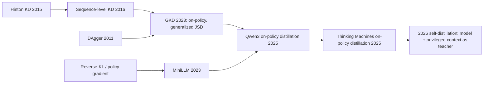

# On-Policy Distillation (GKD, MiniLLM, reverse-KL distillation on student rollouts)

> Let the **student** generate, and have the **teacher** grade every token: minimize a per-token divergence (usually reverse KL) between student and teacher *on the student's own samples*. It combines RL's on-policy relevance with distillation's dense, per-token supervision. **Family:** LLM post-training → knowledge distillation ∩ on-policy RL (imitation learning à la DAgger)  ·  **Year / origin:** GKD: Agarwal et al., Google DeepMind (arXiv 2023, ICLR 2024); MiniLLM: Gu et al. (ICLR 2024); used in Qwen3 (2025); popularized by Thinking Machines Lab's "On-Policy Distillation" (Oct 2025)  ·  **On/Off-policy:** on-policy (student samples)  ·  **Action space:** discrete tokens

## 1. What is it?

Classic **knowledge distillation** for LLMs is *off-policy*: generate text with the teacher and fine-tune the student on it (sequence-level KD / SFT), or match teacher logits on a fixed dataset. The student only ever sees *teacher* prefixes. At inference it must continue from its *own* prefixes, which contain its own mistakes. This is **exposure bias** (train/test mismatch), the same problem DAgger fixes for imitation learning ([behavior-cloning-dagger.md](../07-imitation-inverse-rl/behavior-cloning-dagger.md)).

**RL** fixes the mismatch by training on the student's own samples, but its signal is sparse: one scalar per (long) episode, roughly $O(1)$ bits per episode.

**On-policy distillation** gets the best of both. The student samples a completion. The teacher computes its log-probabilities for every token of that completion, and the student is pushed to reduce the per-token divergence. Every token gets a graded signal: "how likely would the teacher have been to write this here?"

- **GKD (Generalized Knowledge Distillation, Agarwal et al.)** trains on a mixture of fixed data and student-generated sequences with a general divergence, including the **generalized Jensen–Shannon divergence** $\text{JSD}(\beta)$, which interpolates between forward and reverse KL. On-policy data with mode-seeking divergences worked best on summarization, translation and arithmetic reasoning (reported).
- **MiniLLM (Gu et al.)** argued that **reverse KL** $\text{KL}(p_s\|p_t)$ is the right objective for generative distillation, because it is mode-seeking: the student shouldn't spread mass over regions the teacher thinks are unlikely. MiniLLM optimizes it with policy-gradient techniques.
- **Qwen3 (2025)** distills its flagship into small models in two phases, off-policy then **on-policy distillation** (the student generates, logits are aligned with the teacher's). It reported that on-policy distillation beat RL for small models at roughly a tenth of the GPU hours.
- **Thinking Machines Lab, "On-Policy Distillation" (Oct 2025)**, built on their Tinker API. It frames the method as RL with a **dense reward** $r_t=-(\log p_s(x_t)-\log p_t(x_t))$ (the per-token reverse KL on the sampled token, no discounting), reproduces Qwen3-style reasoning distillation, and reports large compute savings relative to RL. It also shows a use for *continual learning*: restoring instruction-following after mid-training on new documents, by distilling from an earlier checkpoint of the model itself.
- **"LoRA Without Regret" (Thinking Machines Lab, Sept 2025)** is a companion finding. For RL (and so RL-like on-policy distillation), LoRA matches full fine-tuning even at **very low rank, down to rank 1**, because policy-gradient updates carry few bits per episode. For SFT, LoRA works well when applied to all layers (MLP included) with a ~10× higher learning rate, but falls behind once the dataset exceeds LoRA's capacity.

**2026 "self-distillation" line.** Several papers make the *model itself*, given privileged context, act as the teacher. Examples: *Reinforcement Learning via Self-Distillation* (arXiv 2601.20802) and *Self-Distilled RLVR* (arXiv 2604.03128). As we understand them, the model conditioned on extra information (environment feedback such as error messages, or a reference solution) produces token-level targets for the same model without that information. This turns sparse RLVR outcomes into dense distillation signals. We describe them only at this high level; consult the papers for the exact objectives.

## 2. Family & lineage



- **Parents:** knowledge distillation (Hinton et al., 2015), sequence-level KD (Kim & Rush, 2016), DAgger (Ross et al., 2011), KL-regularized policy gradient.
- **Siblings:** RLHF/RLVR (sparse rewards; [rlvr.md](rlvr.md)); DeepSeek-R1-style *off-policy* distillation (SFT on teacher traces); DPO-style preference distillation.
- **Descendants:** self-distillation methods (2026); distillation stages inside frontier post-training pipelines (e.g. DeepSeek-V3.2's specialist distillation).

## 3. Core idea & intuition

- **Dense, on-policy feedback.** RL tells the student "your 2,000-token answer was wrong". The teacher tells it, token by token, "this step was fine, *this* token is where you went off the rails". It is like a chess coach commenting on every move of a game *you* played, not on grandmaster games you'll never reproduce.
- **Reverse KL is mode-seeking.** $\text{KL}(p_s\|p_t)=\mathbb E_{x\sim p_s}[\log p_s(x)-\log p_t(x)]$ punishes the student for putting mass where the teacher puts little, but doesn't force it to cover every teacher mode. That suits a smaller student, which can't represent everything the teacher does and is better off being reliably good at one way of solving. Forward KL (SFT on teacher samples) is mode-covering and can make the student spread mass and hallucinate in between modes.
- **Unhackable "reward".** The per-token reward is a divergence to a fixed teacher, minimized exactly when the student matches the teacher. There is no reward model to exploit.
- **Cheap per step.** One teacher forward pass (prefill) per student sample, no teacher sampling. TML emphasizes that a student needs far fewer episodes than RL because each episode carries many more bits.

## 4. Math / formal details

Student $\pi_\theta$, teacher $\pi_T$, prompt $x$, student sample $y\sim\pi_\theta(\cdot|x)$, prefix $c_t=(x,y_{<t})$.

**Per-token reverse KL (full-vocabulary form):**
$$
\mathcal L_\text{RKL}(\theta)=\mathbb E_{x,\ y\sim\pi_\theta}\Big[\frac1{|y|}\sum_t\sum_{v\in\mathcal V}\pi_\theta(v|c_t)\big(\log\pi_\theta(v|c_t)-\log\pi_T(v|c_t)\big)\Big]
$$
The gradient is taken through the per-position distributions, with the sampled prefixes treated as data (GKD does this; it ignores the dependence of the prefix distribution on θ).

**Sampled-token form (RL view, TML/Tinker).** Define the per-token reward and use the policy-gradient loss
$$
A_t = -\big(\log\pi_\theta(y_t|c_t)-\log\pi_T(y_t|c_t)\big),\qquad \mathcal L=-\mathbb E\Big[\sum_t \text{sg}(A_t)\,\log\pi_\theta(y_t|c_t)\Big]
$$
(with importance weights $\pi_\theta/\pi_{\theta_\text{old}}$ for off-policy minibatches). Since $\mathbb E_{y_t\sim\pi_\theta}\big[\nabla\log\pi_\theta(y_t)\,(\log\pi_\theta(y_t)-\log\pi_T(y_t))\big]=\nabla\,\text{KL}(\pi_\theta(\cdot|c_t)\|\pi_T(\cdot|c_t))$, this is an unbiased single-sample estimate of the per-position reverse-KL gradient. It only needs the teacher's log-prob of the *sampled* token, which matters when teacher and student don't share a tokenizer, or when full logits are too expensive to move. "Discount 0" means each token's advantage is its own reward, with no return-to-go.

**Generalized JSD (GKD):**
$$
\text{JSD}_\beta(p_T\|p_s)=\beta\,\text{KL}\big(p_T\,\|\,m\big)+(1-\beta)\,\text{KL}\big(p_s\,\|\,m\big),\quad m=\beta p_T+(1-\beta)p_s
$$
As $\beta\to0$ its gradient behaves like forward KL; as $\beta\to1$ like reverse KL (up to scale). GKD also mixes the data source: with probability $\lambda$ use student samples (on-policy), otherwise fixed data or teacher samples.

**Forward KL / SFT (off-policy baseline):** $\mathcal L_\text{SFT}=-\mathbb E_{y\sim\pi_T}\big[\sum_t\log\pi_\theta(y_t|c_t)\big]$.

## 5. Algorithm (pseudocode)

```text
Input: student π_θ (e.g. small SFT model), teacher π_T (frozen, larger/stronger), prompts D
1. for step = 1..N:
2.     sample prompts x_1..x_B; student generates y_b ~ π_θ(·|x_b)      (inference engine)
3.     teacher prefill: compute log π_T(y_{b,t} | x_b, y_{b,<t}) for all tokens  (or full logits)
4.     student: log π_θ(y_{b,t} | ·)  (and log π_θ_old if reusing rollouts)
5.     A_{b,t} = −(log π_θ_old(y_{b,t}) − log π_T(y_{b,t}))                 # per-token reverse KL
6.     loss = −mean_{b,t} [ ratio_{b,t} · A_{b,t} ]   (or full-vocab KL / JSD_β if logits available)
7.     update θ (LoRA is fine for this RL-like objective)
8. (optional) mix with an outcome reward: A_{b,t} += λ · Â_b(verifier)
```

## 6. Python implementation

Runnable version: [`code/on-policy-distillation.py`](../../code/on-policy-distillation.py)

The file implements the **sampled-token reverse-KL policy-gradient loss**, the **full-vocabulary reverse KL**, and **GKD's generalized JSD**. It also includes a numerical check that the sampled estimator's gradient matches the exact reverse-KL gradient. The toy teacher is a near-oracle for "4 digits in 0..4 summing to a target" (99.5% accurate, with a mild preference for small digits). The student is a tiny GRU trained from scratch for 150 steps with five methods. We report task accuracy and reverse KL to the teacher on the student's own samples.

```python
"""On-policy distillation: per-token reverse KL to a teacher on STUDENT samples (Thinking Machines /
Qwen3 style), GKD's generalized JSD, MiniLLM-style reverse KL -- vs. off-policy SFT and plain RL.

(a) Loss functions on tensors:
    - sampled_reverse_kl_pg_loss : per-token reward -(log p_s - log p_t) on the sampled token, used as
      a dense advantage in a policy-gradient loss (what the Tinker / TML recipe does).
    - full_reverse_kl_loss       : exact sum_v p_s (log p_s - log p_t) per position (needs teacher logits
      over the whole vocabulary).
    - generalized_jsd_loss       : GKD's JSD_beta (beta=0 -> forward KL, beta=1 -> reverse KL limits).
(b) Toy: teacher = a near-oracle policy for "4 digits in 0..4 that sum to a target"; the student is a
    tiny GRU trained from scratch with each method for the same number of steps.

Run:  python3 code/on-policy-distillation.py     (CPU, ~1 min)
"""
import math

import torch
import torch.nn as nn
import torch.nn.functional as F

torch.set_num_threads(1)

VOCAB, LENGTH, MAX_T = 5, 4, 16


# ----------------------------------------------------------------------------------------
# (a) Losses
# ----------------------------------------------------------------------------------------
def sampled_reverse_kl_pg_loss(student_logp, teacher_logp, mask, student_logp_old=None):
    """student_logp, teacher_logp: [B,T] log-probs of the SAMPLED tokens (sampled from the student).
    Per-token advantage A_t = -(log p_s(x_t) - log p_t(x_t)) (detached, no discounting); loss is the
    usual (importance-weighted) policy-gradient loss. Its expectation is the gradient of the
    per-token reverse KL KL(p_s || p_t) on the student's own distribution."""
    adv = -(student_logp - teacher_logp).detach()
    if student_logp_old is None:
        weight = torch.ones_like(student_logp)
    else:                        # off-policy minibatches: importance ratio as in PPO (no clipping here)
        weight = torch.exp(student_logp - student_logp_old)
        return -(weight * adv * mask).sum() / mask.sum()
    return -(student_logp * adv * mask).sum() / mask.sum()


def full_reverse_kl_loss(student_logits, teacher_logits, mask):
    """Exact per-position reverse KL over the vocabulary, on student-generated prefixes."""
    ls, lt = F.log_softmax(student_logits, -1), F.log_softmax(teacher_logits, -1)
    kl = (ls.exp() * (ls - lt)).sum(-1)
    return (kl * mask).sum() / mask.sum()


def generalized_jsd_loss(student_logits, teacher_logits, mask, beta=0.5):
    """GKD (Agarwal et al.): JSD_beta(p_t || p_s) = beta KL(p_t || m) + (1-beta) KL(p_s || m),
    m = beta p_t + (1-beta) p_s. Small beta behaves like forward KL, beta near 1 like reverse KL
    (up to scaling). Computed per position over the vocabulary."""
    ls, lt = F.log_softmax(student_logits, -1), F.log_softmax(teacher_logits, -1)
    log_m = torch.logsumexp(torch.stack([lt + math.log(beta), ls + math.log(1 - beta)]), 0)
    jsd = beta * (lt.exp() * (lt - log_m)).sum(-1) + (1 - beta) * (ls.exp() * (ls - log_m)).sum(-1)
    return (jsd * mask).sum() / mask.sum()


# ----------------------------------------------------------------------------------------
# (b) Teacher, student, task
# ----------------------------------------------------------------------------------------
def teacher_logits(prompts, tokens, total_len=LENGTH):
    """Near-oracle teacher: at each step, digits that keep the target reachable get logit 0, the
    rest -8. Prefers smaller digits slightly (a 'style' the student should also pick up)."""
    B, T = tokens.shape
    out = []
    partial = torch.zeros(B, dtype=torch.long)
    digits = torch.arange(VOCAB)
    for t in range(T):
        remaining = prompts[:, None] - partial[:, None] - digits[None]      # after choosing digit
        slots = total_len - t - 1
        ok = (remaining >= 0) & (remaining <= (VOCAB - 1) * slots)
        out.append(torch.where(ok, -0.2 * digits.float()[None], torch.full((B, VOCAB), -8.0)))
        partial = partial + tokens[:, t]
    return torch.stack(out, 1)


@torch.no_grad()
def teacher_sample(prompts, T):
    toks = torch.zeros(prompts.shape[0], 0, dtype=torch.long)
    for t in range(T):
        pad = torch.cat([toks, torch.zeros(prompts.shape[0], 1, dtype=torch.long)], 1)
        logits = teacher_logits(prompts, pad)[:, t]
        toks = torch.cat([toks, torch.distributions.Categorical(logits=logits).sample()[:, None]], 1)
    return toks


class TinyGRUPolicy(nn.Module):
    def __init__(self, n_prompts, vocab, hidden=64):
        super().__init__()
        self.V = vocab
        self.prompt_emb = nn.Embedding(n_prompts, hidden)
        self.tok_emb = nn.Embedding(vocab + 1, hidden)
        self.gru = nn.GRUCell(hidden, hidden)
        self.head = nn.Linear(hidden, vocab)

    def forward(self, prompts, tokens):
        B, T = tokens.shape
        h = torch.tanh(self.prompt_emb(prompts))
        inp = torch.full((B,), self.V, dtype=torch.long)
        out = []
        for t in range(T):
            h = self.gru(self.tok_emb(inp), h)
            out.append(self.head(h))
            inp = tokens[:, t]
        return torch.stack(out, 1)

    @torch.no_grad()
    def sample(self, prompts, T):
        B = prompts.shape[0]
        h = torch.tanh(self.prompt_emb(prompts))
        inp = torch.full((B,), self.V, dtype=torch.long)
        toks = []
        for _ in range(T):
            h = self.gru(self.tok_emb(inp), h)
            inp = torch.distributions.Categorical(logits=self.head(h)).sample()
            toks.append(inp)
        return torch.stack(toks, 1)


def gather(logits, toks):
    return F.log_softmax(logits, -1).gather(-1, toks.unsqueeze(-1)).squeeze(-1)


def train(method, steps=150, B=256, lr=3e-3, seed=0, log_every=50):
    torch.manual_seed(seed)
    st = TinyGRUPolicy(MAX_T + 1, VOCAB)
    opt = torch.optim.Adam(st.parameters(), lr=lr)
    hist = []
    for step in range(steps + 1):
        prompts = torch.randint(0, MAX_T + 1, (B,))
        mask = torch.ones(B, LENGTH)
        if method == "SFT on teacher samples (off-policy)":
            toks = teacher_sample(prompts, LENGTH)
            loss = -(gather(st(prompts, toks), toks) * mask).mean()        # forward-KL / NLL
        else:
            toks = st.sample(prompts, LENGTH)                              # ON-POLICY: student samples
            s_logits = st(prompts, toks)
            t_logits = teacher_logits(prompts, toks)
            if method == "on-policy reverse KL (sampled-token reward)":
                loss = sampled_reverse_kl_pg_loss(gather(s_logits, toks), gather(t_logits, toks), mask)
            elif method == "on-policy reverse KL (full vocab)":
                loss = full_reverse_kl_loss(s_logits, t_logits, mask)
            elif method == "GKD on-policy JSD(beta=0.5)":
                loss = generalized_jsd_loss(s_logits, t_logits, mask, beta=0.5)
            elif method == "RL with 0/1 outcome reward (GRPO-ish)":
                r = (toks.sum(1) == prompts).float()
                # per-prompt baseline is unavailable with 1 sample/prompt -> batch-mean baseline
                adv = (r - r.mean()) / (r.std() + 1e-6)
                loss = -(gather(s_logits, toks) * adv[:, None]).mean()
        opt.zero_grad()
        loss.backward()
        opt.step()
        if step % log_every == 0:
            with torch.no_grad():
                p = torch.arange(MAX_T + 1).repeat_interleave(64)
                tk = st.sample(p, LENGTH)
                acc = (tk.sum(1) == p).float().mean().item()
                rkl = full_reverse_kl_loss(st(p, tk), teacher_logits(p, tk), torch.ones_like(tk).float()).item()
            hist.append((step, acc, rkl))
    return hist


if __name__ == "__main__":
    with torch.no_grad():
        p = torch.arange(MAX_T + 1).repeat_interleave(64)
        tk = teacher_sample(p, LENGTH)
        print(f"teacher accuracy: {(tk.sum(1) == p).float().mean():.3f}\n")
    # sanity: the sampled-token estimator's expected gradient matches the exact reverse-KL gradient
    torch.manual_seed(1)
    logits = torch.randn(1, 1, VOCAB, requires_grad=True)
    t_log = torch.randn(1, 1, VOCAB)
    full_reverse_kl_loss(logits, t_log, torch.ones(1, 1)).backward()
    g_exact = logits.grad.clone()
    logits.grad = None
    xs = torch.distributions.Categorical(logits=logits.detach()).sample((20000,)).view(-1, 1)
    lp = F.log_softmax(logits, -1).expand(20000, 1, VOCAB)
    sampled_reverse_kl_pg_loss(lp.gather(-1, xs[..., None]).squeeze(-1),
                               F.log_softmax(t_log, -1).expand(20000, 1, VOCAB).gather(-1, xs[..., None]).squeeze(-1),
                               torch.ones(20000, 1)).backward()
    print("gradient check (exact vs sampled-token estimator, 20k samples):")
    print("  exact  :", [round(x, 3) for x in g_exact.flatten().tolist()])
    print("  sampled:", [round(x, 3) for x in logits.grad.flatten().tolist()], "\n")

    methods = ["SFT on teacher samples (off-policy)", "on-policy reverse KL (sampled-token reward)",
               "on-policy reverse KL (full vocab)", "GKD on-policy JSD(beta=0.5)",
               "RL with 0/1 outcome reward (GRPO-ish)"]
    print(f"{'method':46s} " + " | ".join(f"step {s:3d}: acc / revKL" for s in (0, 50, 100, 150)))
    for m in methods:
        h = train(m)
        print(f"{m:46s} " + " | ".join(f"     {a:.3f} / {k:.3f}  " for _, a, k in h))
```

What the output shows (~10 s):

- The **gradient check** matches to 3 decimals (exact vs 20k-sample estimate).
- After 150 steps: **on-policy full-vocab reverse KL ≈ 0.94** and **GKD JSD ≈ 0.93** accuracy, with the lowest reverse KL to the teacher (≈0.1). The **sampled-token** version (≈0.79) is noisier but needs only the teacher's log-prob of one token per position. **SFT on teacher samples** ≈ 0.81. **RL with 0/1 reward** ≈ 0.70 and plateaus: it finds *some* correct answers but its KL to the teacher *grows* (≈1.5), since nothing asks it to imitate the teacher's style.
- On this tiny task the student rarely reaches states the teacher never visits, so off-policy SFT is competitive. On-policy distillation's advantage grows with sequence length, where student errors compound.

**With TRL** (requires GPU + library; not run here):

```python
# TRL GKDTrainer: on-policy distillation with generalized JSD (requires GPU; not run here)
from datasets import load_dataset
from trl import GKDConfig, GKDTrainer

ds = load_dataset("trl-lib/chatbot_arena_completions", split="train")  # conversational "messages"
args = GKDConfig(output_dir="gkd", lmbda=1.0,   # fraction of student-generated (on-policy) batches
                 beta=1.0,                       # JSD interpolation; 1.0 ~ reverse KL
                 max_new_tokens=256, temperature=0.9)
trainer = GKDTrainer(model="Qwen/Qwen2.5-0.5B-Instruct", teacher_model="Qwen/Qwen2.5-7B-Instruct",
                     args=args, train_dataset=ds)
trainer.train()
# Thinking Machines' Tinker cookbook implements the sampled-token reverse-KL variant as an RL loop;
# recent TRL versions also ship on-policy distillation utilities (check docs of your version).
```

## 7. Practical tips & hyperparameters

- **Tokenizer:** full-vocab KL requires a shared tokenizer. The sampled-token variant needs only $\log\pi_T(y_t)$, but the student's tokens must still be scored by the teacher, so either share the tokenizer or re-tokenize carefully.
- **Start from an SFT'd student.** On-policy distillation is most efficient once the student is in the right ballpark. Qwen3 used an off-policy phase first.
- **Sampling temperature ~1** for student rollouts (you want the student's true distribution). Clip extreme per-token rewards if teacher log-probs can be very negative.
- **LoRA works well** for this RL-like objective (even low rank, per "LoRA Without Regret"). Use a higher LR than for full fine-tuning.
- **Mixing with RL:** add an outcome reward when the teacher is imperfect, or when you want to *exceed* it.
- **Monitor:** per-token reverse KL on student samples (it should fall steadily), task accuracy, response length (the student inherits the teacher's verbosity), and teacher-forced KL on held-out teacher samples.
- **Cost model:** one teacher prefill per sample (cheap, parallel) vs RL's need for many more episodes. TML reported order-of-magnitude savings on their reasoning-distillation example.

## 8. Pros and cons

| Pros | Cons |
|---|---|
| Dense per-token signal → far fewer episodes than RL | Needs a strong teacher, and caps the student near the teacher |
| Fixes exposure bias of off-policy SFT | Teacher inference at training time (serving a big model) |
| Reverse KL is mode-seeking, good for small students | Mode-seeking can reduce diversity |
| Hard to "hack": the target is a fixed distribution | Full-vocab variants need a shared tokenizer and logits transfer |
| Works with LoRA, cheap to iterate | Inherits teacher biases, verbosity, and errors |
| Useful for continual learning / regression repair | Less studied for multi-turn agents than single-turn tasks |

## 9. When to use / when not to use

**Use** when a stronger model (or an earlier checkpoint) exists and you want a smaller or specialized model; when RL is too expensive or too sparse; to restore behaviours lost during fine-tuning; or for the final polish after SFT on teacher traces.

**Don't use** when no better teacher exists and you want to exceed the frontier (use RL with verifiers), when licensing forbids training on the teacher's outputs, or when the teacher can't be run at training-time scale.

## 10. Key papers, books & repos

- Agarwal et al., *On-Policy Distillation of Language Models: Learning from Self-Generated Mistakes* (GKD), ICLR 2024 — arXiv 2306.13649.
- Gu et al., *MiniLLM: Knowledge Distillation of Large Language Models*, ICLR 2024 — arXiv 2306.08543.
- Hinton, Vinyals, Dean, *Distilling the Knowledge in a Neural Network*, 2015 — arXiv 1503.02531; Kim & Rush, *Sequence-Level Knowledge Distillation*, EMNLP 2016.
- Ross, Gordon, Bagnell, *A Reduction of Imitation Learning and Structured Prediction to No-Regret Online Learning* (DAgger), AISTATS 2011.
- Qwen Team, *Qwen3 Technical Report*, 2025 — arXiv 2505.09388 (strong-to-weak, off- then on-policy distillation).
- Thinking Machines Lab, *On-Policy Distillation* (blog, Oct 2025) and *LoRA Without Regret* (blog, Sept 2025).
- *Reinforcement Learning via Self-Distillation*, 2026 — arXiv 2601.20802; *Self-Distilled RLVR*, 2026 — arXiv 2604.03128 (high-level description only here).
- DeepSeek-AI, *DeepSeek-R1*, 2025 — arXiv 2501.12948 (off-policy distillation into small models).
- Repos: `huggingface/trl` (`GKDTrainer`), `thinking-machines-lab/tinker-cookbook`, `microsoft/LMOps` (MiniLLM).

## 11. For business users

**What it does.** You have a big, expensive, smart AI model and want a small, cheap one that behaves almost as well. On-policy distillation lets the small model try tasks itself while the big model "grades" every word it writes. The small model learns from its *own* mistakes with detailed feedback, not just by copying the big model's polished answers.

**Analogy.** An apprentice who does the job while the master watches and comments on every move. That is far more effective than the apprentice only reading the master's finished reports (classic distillation) or only hearing "pass/fail" at the end of the day (RL).

**Use cases.** Shrinking a reasoning model for on-device or low-latency serving; creating domain specialists from a general model; repairing behaviours (e.g. instruction-following) lost after fine-tuning on company documents.

**Value.** Reported large compute savings versus RL for the same quality (Qwen3, Thinking Machines). Much cheaper inference after distillation.

**Risks.** The student inherits the teacher's flaws and biases, and its quality is capped near the teacher's. Check the licence terms of the teacher model.

**Costs.** Running the teacher during training (prefill only), plus modest GPU time for the student, often with LoRA.

**Questions to ask your team.**
- Do we have the rights and infrastructure to run the teacher during training?
- How close does the student get to the teacher on our own evaluation set?
- Is on-policy distillation cheaper than RL or SFT for our target quality?

## 12. For kids (ages ~8–12)

You're learning to ride a bike. Method 1: watch videos of a champion cyclist. Helpful, but when *you* wobble, the video doesn't help! Method 2: ride yourself, and someone only tells you at the end "you fell" or "you made it". Method 3: you ride while a coach jogs next to you saying "lean a bit left… good… pedal faster… great!". Method 3 is on-policy distillation: you do it yourself, and an expert helps with *every* little moment.

**Try it yourself:** Draw a star with your eyes closed while a friend gives tiny hints ("up… stop… now right"). Then try with only a "good/bad" at the end. Which star looks better?

**Recap:**
1. The learner does the task itself.
2. An expert comments on every step.
3. The learner fixes its own mistakes fast.

## 13. Related methods

- [RLVR](rlvr.md) — sparse-reward alternative; R1 distilled into small models off-policy.
- [GRPO](grpo.md), [RLOO/REINFORCE++](rloo-remax-reinforcepp.md) — the PG machinery reused with per-token rewards.
- [TTRL & self-rewarding RL](self-rewarding-ttrl.md) — learning without external teachers or labels.
- [Behavior cloning & DAgger](../07-imitation-inverse-rl/behavior-cloning-dagger.md) — the imitation-learning root of on-policy correction.
- [RLHF with PPO](../09-llm-preference-alignment/rlhf-ppo.md), [RLAIF / Constitutional AI](../09-llm-preference-alignment/rlaif-constitutional-ai.md).

[← Back to overview](../../RL_Methods_Overview.md)
