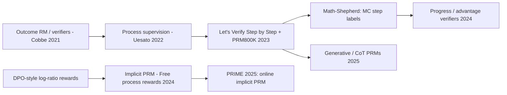

# Process reward models: PRM800K, Math-Shepherd, PRIME (implicit PRMs)

> Score each *step* of a reasoning chain instead of only the final answer, and use the step scores to rerank samples (best-of-N) or as dense RL rewards. Step labels can come from humans (PRM800K), from Monte-Carlo rollouts (Math-Shepherd), or **implicitly from outcome labels** (PRIME). **Family:** LLM post-training → reward modeling for reasoning → process supervision / dense credit assignment  ·  **Year / origin:** Uesato et al. (DeepMind, 2022); Lightman et al., *Let's Verify Step by Step* (OpenAI, 2023); Wang et al., Math-Shepherd (2023); Cui et al., PRIME (2025)  ·  **On/Off-policy:** PRM training is supervised/offline; PRM-based RL is on-policy  ·  **Action space:** discrete tokens, grouped into reasoning steps

## 1. What is it?

An **outcome reward model (ORM)** or verifier says whether the final answer is right. A **process reward model (PRM)** says, for each intermediate step $s_k$ of a solution, whether that step is correct or on track. Process supervision promises three things:

- **Better credit assignment.** In a 30-step solution with one mistake at step 12, an outcome reward punishes all 30 steps equally. A PRM pinpoints step 12.
- **Better reranking.** For best-of-N, choosing the solution whose *weakest step* is strongest beats majority voting and ORMs. Lightman et al. (2023) reported that a PRM trained on human step labels solved 78.2% of a representative MATH test subset with best-of-1860, outperforming an ORM and majority voting.
- **Safer reasoning ("alignment tax" argument).** Rewarding correct *process* rather than lucky answers encourages human-endorsed reasoning.

The key works:

- **Uesato et al. (2022)** compared process- and outcome-based feedback on GSM8K. Final-answer accuracy was similar, but process supervision reduced reasoning errors in correct-answer solutions.
- **Let's Verify Step by Step (Lightman et al., OpenAI, 2023)** released **PRM800K**: ~800k human step-level labels (positive / neutral / negative) on model-generated MATH solutions, collected with active learning (showing labelers convincing wrong-answer solutions).
- **Math-Shepherd (Wang et al., 2023)** removed the human labelers. The label of step $k$ is estimated by **Monte-Carlo rollouts**: complete the solution $N$ times from step $k$ and check final answers. **Hard estimation (HE)** = 1 if any completion is correct; **soft estimation (SE)** = fraction correct. It was used both for verification (reranking) and for step-by-step PPO.
- **PRIME (Cui et al., 2025, *Process Reinforcement through Implicit Rewards*)** removed step labels entirely. Building on *"Free Process Rewards without Process Labels"* (Yuan et al., 2024), train a language model $\pi_\phi$ as an ORM with the reward parameterization $r_\phi(y)=\beta\log\frac{\pi_\phi(y)}{\pi_\text{ref}(y)}$. Its token-level log-ratios are then *implicit process rewards*. PRIME updates this implicit PRM **online** with the policy's own outcome labels (so it doesn't go stale and is harder to hack) and combines dense and outcome rewards via RLOO. Eurus-2-7B-PRIME was reported to beat its SFT starting point substantially on math benchmarks with a fraction of the data of comparable models.

**Why DeepSeek-R1 did not use PRMs.** The R1 paper lists PRMs (and MCTS) under "unsuccessful attempts". Three reasons: (1) it is hard to define what a "step" is in free-form reasoning; (2) judging intermediate correctness is hard, since automated labels are noisy and human labels don't scale; (3) a model-based PRM invites **reward hacking** and requires retraining, adding pipeline complexity. PRMs remained useful for reranking but brought limited benefit relative to cost in large-scale RL. Later analyses (e.g. Qwen's 2025 study of PRM development, and ProcessBench) found MC-estimated labels noisy and often worse than LLM-as-judge labels. That motivated **generative PRMs** that write out a verification chain-of-thought.

## 2. Family & lineage



- **Parents:** outcome verifiers (Cobbe et al., 2021, GSM8K), reward modeling ([reward-modeling.md](../09-llm-preference-alignment/reward-modeling.md)), MC value estimation ([monte-carlo.md](../01-foundations-tabular/monte-carlo.md)). A PRM with soft MC labels is essentially a learned **value function** $V^\pi(\text{prefix})$.
- **Siblings:** critics in PPO ([value-based-llm-rl-vapo.md](value-based-llm-rl-vapo.md)), MCTS-guided reasoning ([mcts-alphazero.md](../05-model-based/mcts-alphazero.md)), Step-DPO ([dpo-variants.md](../09-llm-preference-alignment/dpo-variants.md)), rubric/generative verifiers ([rubric-generative-rewards.md](../09-llm-preference-alignment/rubric-generative-rewards.md)).
- **Descendants:** PRIME; "process advantage verifiers" (Setlur et al., 2024, which reward the *progress* a step makes under a prover policy); generative PRMs; PRM-guided test-time search (beam search, lookahead).

## 3. Core idea & intuition

- **A step is good if it keeps the problem solvable.** Math-Shepherd operationalizes this as "do completions from here reach the right answer?" That is exactly a Monte-Carlo estimate of the value of the prefix under the completer policy, so a PRM is a learned value function over reasoning prefixes.
- **The weakest link decides.** A solution is only as good as its worst step, so aggregate step scores with **min** or **product** (Lightman et al. used the product of step-correctness probabilities).
- **Dense rewards from differences.** For RL, a useful step reward is the *change* in PRM score: $r_k = \text{PRM}(\text{prefix}_k)-\text{PRM}(\text{prefix}_{k-1})$. This is a potential-based shaping signal (it sums to final minus initial score), which limits reward hacking compared to rewarding raw PRM scores at each step.
- **Implicit PRM = "a DPO model is secretly a Q-function".** If $\pi_\phi$ is trained so that $\beta\log\frac{\pi_\phi(y)}{\pi_\text{ref}(y)}$ predicts the outcome, then the partial sums $\beta\sum_{t\le k}\log\frac{\pi_\phi(y_t)}{\pi_\text{ref}(y_t)}$ behave like (soft) Q-values of prefixes. The per-token terms become process rewards for free. PRIME trains this model online from the policy's outcome labels, so it tracks the current policy's distribution.

## 4. Math / formal details

**Notation.** Problem $x$, solution $y=(s_1,\dots,s_K)$ of $K$ steps (each step = a span of tokens), final answer $a(y)$, reference $a^*$; completer policy $\pi$.

**MC step labels (Math-Shepherd).** Sample $N$ completions $\{y^{(j)}_{>k}\}$ from prefix $s_{\le k}$:
$$
\text{SE}(s_k)=\frac{1}{N}\sum_{j=1}^N\mathbb 1\big[a(s_{\le k},y^{(j)}_{>k})=a^*\big],\qquad \text{HE}(s_k)=\mathbb 1[\text{SE}(s_k)>0]
$$
SE is an unbiased estimate of $V^\pi(s_{\le k})=P_\pi(\text{correct}\mid s_{\le k})$.

**PRM training.** Binary cross-entropy per step:
$$
\mathcal L_\text{PRM}=-\sum_k\Big[c_k\log p_\psi(s_{\le k})+(1-c_k)\log\big(1-p_\psi(s_{\le k})\big)\Big]
$$
with $c_k$ = human label, HE or SE. In practice $p_\psi$ is read from the logit of a special token (e.g. "+"/"−") placed at each step boundary.

**Solution score.** $\text{score}(y)=\min_k p_\psi(s_{\le k})$ or $\prod_k p_\psi(s_{\le k})$.

**Process rewards for RL (GRPO process supervision).** Normalize step rewards across the group, $\tilde r_i^{k}=\frac{r_i^k-\text{mean}(\mathbf R)}{\text{std}(\mathbf R)}$, then advantage of token $t$: $\hat A_{i,t}=\sum_{k:\ \text{end}(k)\ge t}\tilde r_i^k$.

**Implicit PRM (PRIME).** Parameterize the outcome reward as
$$
r_\phi(y)=\beta\log\frac{\pi_\phi(y|x)}{\pi_\text{ref}(y|x)}=\sum_t\underbrace{\beta\log\frac{\pi_\phi(y_t|x,y_{<t})}{\pi_\text{ref}(y_t|x,y_{<t})}}_{r_\phi(y_t)\ \text{(process reward)}}
$$
and train with cross-entropy on outcome labels $o\in\{0,1\}$: $\mathcal L_\text{CE}=-\big[o\log\sigma(r_\phi(y))+(1-o)\log(1-\sigma(r_\phi(y)))\big]$.

**PRIME advantages** (RLOO for both parts, $K$ samples per prompt):
$$
\hat A^\text{out}_i = r_o(y_i)-\frac{1}{K-1}\sum_{j\ne i}r_o(y_j),\qquad
\hat A^\text{proc}_{i,t}=\sum_{s\ge t}\Big(r_\phi(y_{i,s})-\frac{1}{K-1}\sum_{j\ne i}\frac{r_\phi(y_j)}{|y_j|}\Big)
$$
$\hat A_{i,t}=\hat A^\text{out}_i+\hat A^\text{proc}_{i,t}$, then a PPO-clip policy update. Each iteration also takes one CE step on $\pi_\phi$ with the fresh rollouts and outcome labels.

## 5. Algorithm (pseudocode)

```text
A) Math-Shepherd PRM
1. for each problem x: sample solutions y ~ π; split into steps s_1..s_K
2. for each prefix s_≤k: sample N completions; SE_k = fraction correct; HE_k = [SE_k > 0]
3. train PRM p_ψ(prefix) with BCE on (prefix, label) pairs
4. use: best-of-N with score = min_k p_ψ(s_≤k); or RL with step rewards Δp_ψ

B) PRIME (online implicit PRM)
1. π_θ ← SFT model; π_φ ← SFT model (implicit PRM); π_ref ← SFT model (frozen)
2. for step = 1..N:
3.     sample K responses per prompt from π_θ; outcome labels o_i from the verifier
4.     (optional) filter prompts by accuracy (keep medium difficulty)
5.     update π_φ with CE on (y_i, o_i) using r_φ(y) = β·Σ_t log π_φ/π_ref
6.     process rewards r_φ(y_t) = β·log π_φ(y_t)/π_ref(y_t)
7.     advantages: RLOO(outcome) + return-to-go of RLOO-baselined process rewards
8.     PPO-clip update of π_θ
```

## 6. Python implementation

Runnable version: [`code/process-reward-prime.py`](../../code/process-reward-prime.py)

Toy "reasoning" problem: reach a target with 6 steps of −1/+1/+2. A step is **valid** if the target is still reachable afterwards (ground truth, used only for evaluation). The code implements Math-Shepherd MC labels, PRM training, min/product aggregation, PRM "progress" rewards, and PRIME's implicit PRM (token rewards, CE loss, RLOO-based advantages). It then runs:

1. MC label quality and PRM accuracy against the ground-truth step validity;
2. best-of-8 with random / majority / PRM selection;
3. whether an implicit PRM trained *only on outcome labels* assigns lower reward to steps that break solvability;
4. a short outcome-only vs PRIME-style RL comparison.

```python
"""Process reward models: Math-Shepherd-style MC step labels, PRM training, PRM-guided best-of-N,
and PRIME-style implicit PRM (process rewards learned from outcome labels only).

Toy "reasoning" task: a problem is (start s0, target T). A solution is K=6 steps, each step
adds -1, +1 or +2. The final answer s0 + sum(steps) is correct iff it equals T. A step is
"valid" if the target is still reachable afterwards (ground truth we use only for evaluation).

(a) Functions: mc_step_labels, train_prm, prm aggregation (min / product), PRM step advantages,
    implicit_prm_token_rewards, implicit_prm_ce_loss, prime_advantages.
(b) Demos: PRM accuracy vs ground-truth step validity, best-of-N selection, implicit-PRM
    credit assignment, and a short outcome-only vs PRIME-style RL comparison.

Run:  python3 code/process-reward-prime.py      (CPU, ~1 min)
"""
import copy

import torch
import torch.nn as nn

torch.manual_seed(0)
torch.set_num_threads(1)

STEPS = torch.tensor([-1, 1, 2])
K = 6                       # steps per solution
D_MIN, D_MAX = -K, 2 * K    # remaining distance T - s range


# ---------------------------- toy problem utilities ----------------------------------------
def reachable_table():
    """reach[m][d] = can a remaining distance d be covered with exactly m steps?"""
    reach = [{0}]
    for m in range(1, K + 1):
        reach.append({d + s for d in reach[m - 1] for s in STEPS.tolist()})
    return reach


REACH = reachable_table()


def feat(dist, step):
    """State features: one-hot remaining distance (T - s) and step index."""
    return torch.cat([nn.functional.one_hot(dist - D_MIN, D_MAX - D_MIN + 1),
                      nn.functional.one_hot(step, K + 1)], -1).float()


N_FEAT = (D_MAX - D_MIN + 1) + (K + 1)


def mlp(out):
    return nn.Sequential(nn.Linear(N_FEAT, 64), nn.Tanh(), nn.Linear(64, out))


def sample_problems(n):
    """Problems whose initial distance d0 = T - s0 is solvable in K steps."""
    solvable = [d for d in range(D_MIN, D_MAX + 1) if d in REACH[K]]
    return torch.tensor(solvable)[torch.randint(len(solvable), (n,))]


@torch.no_grad()
def complete(policy, dist, step):
    """Roll out the policy from (dist, step) to the end. Returns final distances, actions, feats."""
    dist = dist.clone()
    acts, feats = [], []
    for t in range(int(step[0]), K):
        f = feat(dist.clamp(D_MIN, D_MAX), torch.full_like(dist, t))
        a = torch.distributions.Categorical(logits=policy(f)).sample()
        acts.append(a)
        feats.append(f)
        dist = dist - STEPS[a]
    return dist, acts, feats


def solve(policy, d0):
    """Full solution. Returns actions [B,K], feats [B,K,F], per-step distances [B,K+1], correct [B]."""
    dist_final, acts, feats = complete(policy, d0, torch.zeros_like(d0))
    acts = torch.stack(acts, 1)
    dists = torch.cat([d0[:, None], d0[:, None] - STEPS[acts].cumsum(1)], 1)
    return acts, torch.stack(feats, 1), dists, (dist_final == 0).float()


def step_valid(dists):
    """Ground-truth validity of each step k=1..K: is the target still reachable afterwards?"""
    B = dists.shape[0]
    v = torch.zeros(B, K)
    for k in range(1, K + 1):
        v[:, k - 1] = torch.tensor([int(d) in REACH[K - k] for d in dists[:, k].tolist()]).float()
    return v


# ----------------------------------------------------------------------------------------
# (a1) Math-Shepherd: Monte-Carlo step labels  +  PRM training
# ----------------------------------------------------------------------------------------
def mc_step_labels(policy, dists, n_rollouts=8):
    """For every prefix (after step k), run n_rollouts completions with the policy.
    soft label = fraction of completions reaching the right answer; hard label = any correct."""
    B = dists.shape[0]
    soft = torch.zeros(B, K)
    for k in range(1, K + 1):
        d = dists[:, k].repeat_interleave(n_rollouts)
        if k == K:
            ok = (d == 0).float()
        else:
            final, _, _ = complete(policy, d, torch.full_like(d, k))
            ok = (final == 0).float()
        soft[:, k - 1] = ok.view(B, n_rollouts).mean(1)
    return soft, (soft > 0).float()


def train_prm(dists, labels, iters=400):
    """PRM: classifier on the prefix state after each step -> P(prefix leads to a correct answer)."""
    prm = mlp(1)
    opt = torch.optim.Adam(prm.parameters(), lr=3e-3)
    steps = torch.arange(1, K + 1).expand(dists.shape[0], K)
    X = feat(dists[:, 1:].clamp(D_MIN, D_MAX).reshape(-1), steps.reshape(-1))
    y = labels.reshape(-1)
    for _ in range(iters):
        loss = nn.functional.binary_cross_entropy_with_logits(prm(X).squeeze(-1), y)
        opt.zero_grad()
        loss.backward()
        opt.step()
    return prm


@torch.no_grad()
def prm_step_scores(prm, dists):
    steps = torch.arange(1, K + 1).expand(dists.shape[0], K)
    X = feat(dists[:, 1:].clamp(D_MIN, D_MAX).reshape(-1), steps.reshape(-1))
    return torch.sigmoid(prm(X)).view(-1, K)


def aggregate_prm(step_scores, how="min"):
    """Solution score from step scores: min (weakest step) or product (Lightman et al. used the
    product of step correctness probabilities)."""
    return step_scores.min(1).values if how == "min" else step_scores.prod(1)


def prm_step_advantages(step_scores, prev_score):
    """A dense 'progress' signal for RL: r_k = PRM(prefix_k) - PRM(prefix_{k-1})."""
    s = torch.cat([prev_score[:, None], step_scores], 1)
    return s[:, 1:] - s[:, :-1]


# ----------------------------------------------------------------------------------------
# (a2) PRIME: implicit PRM from outcome labels
# ----------------------------------------------------------------------------------------
def implicit_prm_token_rewards(logp_phi, logp_ref, beta=0.5):
    """Implicit process reward of token/step t: r_t = beta * log pi_phi(y_t|y_<t) / pi_ref(y_t|y_<t).
    Their sum is the sequence-level implicit reward r_phi(y) = beta * log pi_phi(y)/pi_ref(y)."""
    return beta * (logp_phi - logp_ref)


def implicit_prm_ce_loss(logp_phi, logp_ref, outcome, mask, beta=0.5):
    """Train pi_phi with cross-entropy on OUTCOME labels: sigma(r_phi(y)) should predict correctness."""
    r_seq = (implicit_prm_token_rewards(logp_phi, logp_ref, beta) * mask).sum(1)
    return nn.functional.binary_cross_entropy_with_logits(r_seq, outcome)


def prime_advantages(outcome, proc_rewards, mask, G, proc_coef=1.0):
    """PRIME-style advantages (sketch): leave-one-out (RLOO) baseline for both the outcome reward
    and the implicit process rewards, process part turned into a return-to-go, then summed."""
    r = outcome.view(-1, G)
    a_out = (r - (r.sum(1, keepdim=True) - r) / (G - 1)).view(-1, 1) * mask
    seq_mean = (proc_rewards * mask).sum(1) / mask.sum(1)
    sm = seq_mean.view(-1, G)
    baseline = ((sm.sum(1, keepdim=True) - sm) / (G - 1)).view(-1, 1)
    proc = (proc_rewards - baseline) * mask
    a_proc = torch.flip(torch.cumsum(torch.flip(proc, [1]), 1), [1])     # return-to-go
    return a_out + proc_coef * a_proc


def logp_of(model, feats, acts):
    return torch.log_softmax(model(feats), -1).gather(-1, acts.unsqueeze(-1)).squeeze(-1)


# ----------------------------------------------------------------------------------------
# (b) Demos
# ----------------------------------------------------------------------------------------
def make_base_policy():
    """A weak 'base model': briefly trained to imitate random valid steps (so it is OK but flawed)."""
    pol = mlp(3)
    opt = torch.optim.Adam(pol.parameters(), lr=3e-3)
    for _ in range(60):
        d = torch.randint(D_MIN, D_MAX + 1, (512,))
        k = torch.randint(0, K, (512,))
        good = torch.stack([torch.tensor([int(dd - s) in REACH[K - kk - 1] for s in STEPS.tolist()])
                            for dd, kk in zip(d.tolist(), k.tolist())]).float()
        target = (good + 0.25) / (good + 0.25).sum(1, keepdim=True)   # soft, deliberately noisy
        loss = -(target * torch.log_softmax(pol(feat(d, k)), -1)).sum(1).mean()
        opt.zero_grad()
        loss.backward()
        opt.step()
    return pol


def rl(policy0, mode, iters=80, n=64, G=8, lr=2e-3, seed=0, phi_init=None, proc_coef=0.2):
    torch.manual_seed(seed)
    pol = copy.deepcopy(policy0)
    ref = copy.deepcopy(policy0)
    # implicit PRM: initialised from the reference (PRIME) or from a warmed-up implicit PRM
    prm_phi = copy.deepcopy(phi_init if phi_init is not None else policy0)
    opt = torch.optim.Adam(pol.parameters(), lr=lr)
    opt_phi = torch.optim.Adam(prm_phi.parameters(), lr=1e-3)
    accs = []
    for _ in range(iters):
        d0 = sample_problems(n).repeat_interleave(G)
        acts, feats, dists, correct = solve(pol, d0)
        mask = torch.ones_like(acts, dtype=torch.float)
        if mode == "outcome":
            r = correct.view(-1, G)
            adv = (r - (r.sum(1, keepdim=True) - r) / (G - 1)).view(-1, 1) * mask   # RLOO
        else:
            # online implicit-PRM update on the fresh outcome labels, then dense rewards
            lp_phi = logp_of(prm_phi, feats, acts)
            with torch.no_grad():
                lp_ref = logp_of(ref, feats, acts)
            l_phi = implicit_prm_ce_loss(lp_phi, lp_ref, correct, mask)
            opt_phi.zero_grad()
            l_phi.backward()
            opt_phi.step()
            with torch.no_grad():
                proc = implicit_prm_token_rewards(logp_of(prm_phi, feats, acts), lp_ref)
            adv = prime_advantages(correct, proc, mask, G, proc_coef)
        loss = -(logp_of(pol, feats, acts) * adv).sum() / mask.sum()
        opt.zero_grad()
        loss.backward()
        opt.step()
        accs.append(correct.mean().item())
    return accs


if __name__ == "__main__":
    base = make_base_policy()
    d0 = sample_problems(400)
    acts, feats, dists, correct = solve(base, d0)
    print(f"base policy accuracy: {correct.mean():.3f}")

    # --- Math-Shepherd MC labels + PRM
    soft, hard = mc_step_labels(base, dists, n_rollouts=8)
    valid = step_valid(dists)
    print(f"MC hard labels agree with ground-truth step validity on {(hard == valid).float().mean():.3f} "
          f"of steps (false 'bad' labels come from unlucky rollouts)")
    prm = train_prm(dists, hard)          # Math-Shepherd "hard estimation" labels
    test_d0 = sample_problems(300)
    _, _, tdists, tcorrect = solve(base, test_d0)
    tscores = prm_step_scores(prm, tdists)
    tvalid = step_valid(tdists)
    print(f"PRM step classification accuracy (score>0.5 vs validity) on fresh solutions: "
          f"{((tscores > 0.5).float() == tvalid).float().mean():.3f}")
    first_bad = (tvalid == 0).float().argmax(1)
    has_bad = (tvalid == 0).any(1)
    pred_bad = (tscores < 0.5).float().argmax(1)
    print(f"PRM localises the FIRST invalid step exactly in "
          f"{(pred_bad[has_bad] == first_bad[has_bad]).float().mean():.3f} of flawed solutions")

    # --- best-of-N with different selectors
    N = 8
    bo_d0 = sample_problems(300).repeat_interleave(N)
    _, _, bdists, bcorrect = solve(base, bo_d0)
    sc = prm_step_scores(prm, bdists)
    finals = (bo_d0 - bdists[:, -1]).view(-1, N)      # "answer" = distance actually covered
    bc = bcorrect.view(-1, N)
    sel = {"random pick": torch.zeros(len(bc), dtype=torch.long),
           "majority vote on answer": torch.stack([(row == row.mode().values).float().argmax()
                                                  for row in finals]),
           "PRM (min over steps)": aggregate_prm(sc, "min").view(-1, N).argmax(1),
           "PRM (product)": aggregate_prm(sc, "prod").view(-1, N).argmax(1)}
    print(f"\nbest-of-{N} accuracy (pass@{N} upper bound {bc.max(1).values.mean():.3f}):")
    for name, idx in sel.items():
        print(f"  {name:24s} {bc.gather(1, idx[:, None]).mean():.3f}")
    adv = prm_step_advantages(sc[:2], torch.full((2,), 0.5))
    print("PRM progress rewards for two solutions:", [[round(x, 2) for x in r] for r in adv.tolist()])

    # --- PRIME: implicit PRM trained only on outcome labels gives step-level credit
    ref = copy.deepcopy(base)
    phi = copy.deepcopy(base)
    opt = torch.optim.Adam(phi.parameters(), lr=1e-3)
    for _ in range(300):
        dd = sample_problems(256)
        a, f, _, c = solve(base, dd)
        with torch.no_grad():
            lr_ = logp_of(ref, f, a)
        loss = implicit_prm_ce_loss(logp_of(phi, f, a), lr_, c, torch.ones_like(lr_))
        opt.zero_grad()
        loss.backward()
        opt.step()
    with torch.no_grad():
        tok_r = implicit_prm_token_rewards(logp_of(phi, feats, acts), logp_of(ref, feats, acts))
    # step that breaks validity = first invalid step
    v = valid
    breaking = (v == 0) & torch.cat([torch.ones(v.shape[0], 1), v[:, :-1]], 1).bool()
    keeping = (v == 1)
    print(f"\nimplicit PRM (trained on outcome labels only): mean step reward on steps that keep the "
          f"target reachable {tok_r[keeping].mean():+.4f} vs. steps that break it {tok_r[breaking].mean():+.4f}")

    # --- short RL comparison
    print("\nRL from the base policy, mean of 2 seeds (train accuracy):")
    # Honest finding on this toy: the outcome reward (K=6 steps, G=8) is already informative, and the
    # online implicit PRM is noisy, so adding its dense rewards does not help and a large weight hurts.
    runs = {"outcome-only RLOO": dict(mode="outcome"),
            "PRIME-style, proc_coef 0.05": dict(mode="prime", proc_coef=0.05),
            "PRIME-style, proc_coef 0.2": dict(mode="prime", proc_coef=0.2),
            "PRIME-style, warmed-up phi, proc_coef 0.2": dict(mode="prime", phi_init=phi)}
    for name, kw in runs.items():
        curves = [rl(base, seed=s, **kw) for s in range(2)]
        print(f"  {name:44s} first10 {sum(sum(c[:10]) / 10 for c in curves) / 2:.3f} | "
              f"last10 {sum(sum(c[-10:]) / 10 for c in curves) / 2:.3f}")
```

What the output shows (~10 s):

- **MC hard labels** agree with true step validity ~85% of the time. Errors come from unlucky rollouts by a weak completer, which is the label noise that later papers criticize.
- **PRM** classifies ~90% of steps correctly and localizes the *first* bad step in ~55% of flawed solutions.
- **Best-of-8:** random ≈0.12 and majority vote ≈0.11 (the base policy's answers are spread out), while the PRM reaches ≈0.47, essentially the pass@8 ceiling.
- **Implicit PRM** (outcome labels only): steps that break solvability get much lower reward (≈−1.04) than steps that keep it (≈−0.38). Process credit really does emerge from outcome supervision.
- **RL comparison, an honest negative result on this toy:** adding PRIME-style dense rewards does *not* beat outcome-only RLOO (0.66 vs 0.68 with a small weight), and a large weight hurts (0.42; 0.27 with a warmed-up PRM). With only 6 steps and 8 samples per prompt, the outcome signal is already informative, while the online implicit PRM adds noise and bias. PRIME's reported gains are on long, hard math problems where outcome rewards are sparse. The general lesson, consistent with DeepSeek-R1's experience: dense learned rewards must earn their keep.

**With real libraries** (requires GPU + library; not run here):

```python
# TRL PRMTrainer: step-level classification (requires GPU; not run here)
from datasets import load_dataset
from transformers import AutoModelForTokenClassification, AutoTokenizer
from trl import PRMConfig, PRMTrainer

model_id = "Qwen/Qwen2.5-0.5B"
model = AutoModelForTokenClassification.from_pretrained(model_id, num_labels=2)
tok = AutoTokenizer.from_pretrained(model_id)
ds = load_dataset("trl-lib/math_shepherd", split="train")   # columns: prompt, completions (steps), labels
trainer = PRMTrainer(model=model, args=PRMConfig(output_dir="prm", step_separator="\n"),
                     processing_class=tok, train_dataset=ds)
trainer.train()
# PRIME: see the PRIME-RL/PRIME repository (built on verl) for the online implicit-PRM recipe.
```

## 7. Practical tips & hyperparameters

- **Step segmentation:** newline or "Step k:" markers. Inconsistent segmentation hurts PRMs. For long free-form CoT, segment by paragraphs or reflection markers.
- **MC labels:** $N=8$–$16$ completions per step. Use a reasonably strong completer: a weak completer under-labels good steps (false negatives). HE is more forgiving; SE is better calibrated. Consider consensus filtering with an LLM judge.
- **Aggregation:** min or product for reranking; last-step score is a weaker ORM-like alternative.
- **Using PRMs in RL:** prefer **differences** (progress) or PRIME-style implicit rewards updated online over raw step scores. Combine with the outcome verifier and cap the process-reward weight. Watch for hacking: many short "safe" steps, or repeating verified steps.
- **PRIME:** β ≈ 0.05 (reported), implicit PRM initialized from the SFT/policy model, online CE updates each iteration, prompt filtering by accuracy, RLOO with $K=4$.
- **Evaluate PRMs** on step-level benchmarks (e.g. ProcessBench, PRM800K test), not just by best-of-N on one dataset.

## 8. Pros and cons

| Pros | Cons |
|---|---|
| Fine-grained credit assignment for long reasoning | Human step labels are expensive (PRM800K-scale effort) |
| Strong best-of-N / search reranking | MC labels are noisy and compute-heavy (N rollouts per step) |
| Can catch "right answer, wrong reasoning" | "Step" is ill-defined for free-form long CoT |
| Implicit PRMs need only outcome labels | Learned dense rewards are hackable; need refreshing as the policy shifts |
| Enables test-time search (beam/lookahead) | Large-scale RL results (R1) found limited benefit vs cost |

## 9. When to use / when not to use

**Use** for reranking and test-time search (best-of-N, beam search over steps), for domains with clear step structure (math derivations, proofs, multi-step tool calls), for diagnosing *where* models fail, and when outcome rewards are very sparse (implicit PRMs).

**Avoid** as the main RL reward for large-scale long-CoT RLVR unless you can keep the PRM fresh and hard to hack. Outcome verifiers plus good RL algorithms are simpler and often as good. PRMs also add little when tasks are short.

## 10. Key papers, books & repos

- Cobbe et al., *Training Verifiers to Solve Math Word Problems* (GSM8K), 2021 — arXiv 2110.14168.
- Uesato et al., *Solving Math Word Problems with Process- and Outcome-Based Feedback*, DeepMind, 2022 — arXiv 2211.14275.
- Lightman et al., *Let's Verify Step by Step*, OpenAI, 2023 — arXiv 2305.20050 (PRM800K).
- Wang et al., *Math-Shepherd: Verify and Reinforce LLMs Step-by-step without Human Annotations*, ACL 2024 — arXiv 2312.08935.
- Yuan et al., *Free Process Rewards without Process Labels*, 2024 — arXiv 2412.01981 (implicit PRM).
- Cui et al., *Process Reinforcement through Implicit Rewards* (PRIME), 2025 — arXiv 2502.01456.
- Setlur et al., *Rewarding Progress: Scaling Automated Process Verifiers for LLM Reasoning*, 2024 — arXiv 2410.08146.
- DeepSeek-AI, *DeepSeek-R1*, 2025 — arXiv 2501.12948 ("Unsuccessful attempts": PRM, MCTS).
- Zhang et al. (Qwen), *The Lessons of Developing Process Reward Models in Mathematical Reasoning*, 2025; Zheng et al., *ProcessBench*, 2024.
- Repos: `openai/prm800k`, `PRIME-RL/PRIME`, `huggingface/trl` (`PRMTrainer`), `volcengine/verl`.

## 11. For business users

**What it does.** Instead of only checking whether an AI's final answer is right, a process reward model grades each step of its reasoning, like a teacher marking each line of a math solution. It can be used to pick the best of several AI answers, or to train the AI to reason more carefully.

**Analogy.** Auditing a financial report line by line rather than only checking the bottom-line total. You catch where the error entered, not just that there is one.

**Use cases.** Choosing the most reliable answer among several generated ones (higher accuracy at a fixed model size); quality control for multi-step workflows (calculations, data pipelines, agent tool calls); training data filtering (keep solutions whose every step is sound).

**Value.** Higher accuracy at inference time without changing the base model; better explainability of failures.

**Risks.** Step-by-step graders can be wrong or gamed. Building them with human labels is expensive. Large-scale training gains are less proven than final-answer grading.

**Costs.** Human labeling (if used), or extra compute for automatic labeling (many simulated completions per step); serving an extra model for reranking.

**Questions to ask your team.**
- Do we need step-level grading, or is checking the final answer enough?
- How were step labels produced, and how accurate are they on a held-out sample?
- Are we using the PRM for reranking (lower risk) or as an RL reward (higher hacking risk)?

## 12. For kids (ages ~8–12)

When you solve a math problem, your teacher could just look at the final answer, or she could look at *every line* of your work and put a ✓ or ✗ next to each one. The second way helps you much more, because you can see exactly where you went wrong! A process reward model is a computer teacher that puts ✓ and ✗ next to each step of a computer's thinking.

**Try it yourself:** Solve 23 + 48 + 19 in three steps and write each step on a line. Swap with a friend and mark each *line* with ✓ or ✗. Did you find the exact step where a mistake happened?

**Recap:**
1. Check every step, not just the answer.
2. Find where a mistake started.
3. Use the step marks to pick the best solution.

## 13. Related methods

- [RLVR](rlvr.md) — outcome-only verifiable rewards.
- [GRPO](grpo.md) — supports outcome and process supervision.
- [VC-PPO & VAPO](value-based-llm-rl-vapo.md) — critics as learned token-level value functions.
- [RLOO, ReMax, REINFORCE++](rloo-remax-reinforcepp.md) — PRIME uses RLOO.
- [Agentic multi-turn RL](agentic-multi-turn-rl.md) — step/turn-level credit for agents.
- [Reward modeling](../09-llm-preference-alignment/reward-modeling.md), [Rubric & generative rewards](../09-llm-preference-alignment/rubric-generative-rewards.md), [DPO variants (Step-DPO)](../09-llm-preference-alignment/dpo-variants.md), [Reward hacking](../09-llm-preference-alignment/safety-rl-reward-hacking.md).
- [MCTS / AlphaZero](../05-model-based/mcts-alphazero.md), [Monte Carlo methods](../01-foundations-tabular/monte-carlo.md).

[← Back to overview](../../RL_Methods_Overview.md)
