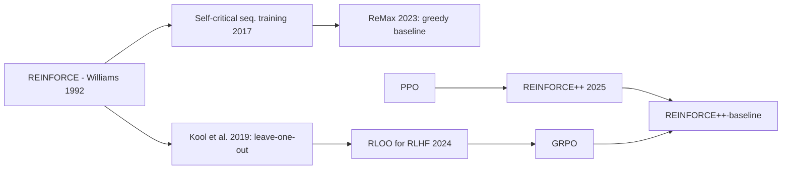

# REINFORCE-style critic-free LLM RL: RLOO, ReMax, REINFORCE++

> Three ways to get a good baseline for REINFORCE on LLMs without a value network: **RLOO** uses the mean reward of the *other* samples for the same prompt, **ReMax** uses the reward of the *greedy* completion, and **REINFORCE++** uses a token-level KL-shaped return normalized across the *whole batch*. **Family:** LLM post-training → critic-free policy gradient (REINFORCE with baseline)  ·  **Year / origin:** RLOO: Kool et al. 2019 (estimator), Ahmadian et al., Cohere, 2024 (for RLHF); ReMax: Li et al., 2023; REINFORCE++: Hu et al., OpenRLHF, 2025  ·  **On/Off-policy:** on-policy (REINFORCE++ adds PPO-style clipping for minibatch reuse)  ·  **Action space:** discrete tokens

## 1. What is it?

Vanilla REINFORCE has high variance. PPO reduces it with a learned critic (GAE), at the cost of a second large network that is hard to train with sparse terminal rewards. A wave of 2023–2025 work argued that for LLM fine-tuning **the critic is unnecessary**. The policy starts from a strong pretrained model, and the "environment" is deterministic given the text, so simple Monte-Carlo baselines suffice.

- **RLOO (REINFORCE Leave-One-Out).** Sample $k$ completions per prompt. The baseline for completion $i$ is the average reward of the other $k-1$. The baseline is independent of $y_i$, so the estimator stays **unbiased**, and you get it "for free" from the samples you already drew (Kool, van Hoof & Welling, 2019: *"Buy 4 REINFORCE samples, get a baseline for free!"*). Ahmadian et al. (Cohere, 2024, *"Back to Basics"*) showed that RLOO, which treats the whole completion as one action, matched or beat PPO, DPO and RAFT on RLHF benchmarks with less compute (reported).
- **ReMax.** Sample one completion and also decode the **greedy** completion. Baseline = reward of the greedy output (the idea of *self-critical sequence training* from image captioning). It needs only 2 generations per prompt, no critic, and reported large memory savings and speedups over PPO.
- **REINFORCE++.** Keep PPO's useful tricks (token-level KL penalty in the reward, ratio clipping, minibatches) but drop the critic. Normalize advantages **globally across the batch** instead of per prompt. The authors argue that per-prompt (GRPO-style) normalization overfits to individual prompts and is less stable, while global normalization is unbiased with respect to prompts. The **REINFORCE++-baseline** variant first subtracts the group mean reward (like RLOO/GRPO), then normalizes globally. It is the recommended variant for RLVR-style group sampling.

## 2. Family & lineage



- **Parents:** REINFORCE with baseline (Williams, 1992; Sutton & Barto Ch. 13.4), self-critical sequence training (Rennie et al., 2017), PPO.
- **Siblings:** [GRPO](grpo.md) (group mean *and* std), [Dr. GRPO](dapo-dr-grpo.md) (group mean only, which is RLOO up to a factor $\frac{k}{k-1}$).
- **Descendants / users:** TRL's `RLOOTrainer`; OpenRLHF and verl implement `rloo`, `reinforce_plus_plus`, `reinforce_plus_plus_baseline` and `remax` advantage estimators.

## 3. Core idea & intuition

All policy-gradient estimators have the form $\nabla J=\mathbb{E}\big[(R-b)\nabla\log\pi(y)\big]$. Any baseline $b$ that does not depend on the sampled $y$ keeps the estimator unbiased, and a good $b \approx \mathbb{E}[R\mid x]$ reduces variance. The three methods answer "what is $b$?" differently:

| Method | Baseline $b$ for sample $y_i$ of prompt $x$ | Extra cost | Bias |
|---|---|---|---|
| RLOO | $\frac1{k-1}\sum_{j\ne i}R(x,y_j)$ | none (uses the $k$ samples) | unbiased |
| GRPO | $\text{mean}_j R(x,y_j)$, then divide by std | none | slightly biased (includes $y_i$; std scaling) |
| ReMax | $R(x,\hat y_{\text{greedy}})$ | one greedy decode per prompt | unbiased (greedy is independent of the sample) |
| REINFORCE++ | none per prompt; whiten returns over the batch | none | no per-prompt baseline; normalization shifts and scales |

**Intuition for ReMax:** "Did this random attempt beat my best guess?" If yes, reinforce it. If it was worse than greedy, discourage it. As the policy sharpens, the greedy and sampled outputs converge and the gradients shrink naturally.

**Intuition for global normalization (REINFORCE++):** per-prompt std normalization amplifies tiny reward differences on prompts where all samples are almost equal, which is noisy. Batch-level whitening keeps advantage magnitudes comparable across prompts.

## 4. Math / formal details

Notation: prompt $x$; completions $y_1..y_k\sim\pi_\theta(\cdot|x)$; scalar reward $R_i=R(x,y_i)$; tokens $y_{i,t}$; mask $m_{i,t}$.

**RLOO.**
$$
\hat A_i^\text{RLOO}=R_i-\frac{1}{k-1}\sum_{j\ne i}R_j=\frac{k}{k-1}\Big(R_i-\bar R\Big),\qquad
\nabla J\approx\frac1k\sum_i \hat A_i\,\nabla\log\pi_\theta(y_i|x)
$$
(The sequence log-prob is $\log\pi(y|x)=\sum_t\log\pi(y_t|x,y_{<t})$.) In RLHF form, $R_i$ already includes the sequence-level KL penalty, $R_i = r_\phi(x,y_i)-\beta\log\frac{\pi_\theta(y_i|x)}{\pi_\text{ref}(y_i|x)}$.

**ReMax.**
$$
\hat A_i^\text{ReMax}=R(x,y_i)-R(x,\hat y),\qquad \hat y=\arg\max \text{decoding of }\pi_\theta(\cdot|x)
$$

**REINFORCE++.** Per-token reward with a KL penalty and terminal outcome reward:
$$
r_{i,t} = -\beta\,\text{KL}_{i,t} + \mathbb{1}[t=|y_i|]\,R_i,\qquad \text{KL}_{i,t}=\log\frac{\pi_{\theta_\text{old}}(y_{i,t}|\cdot)}{\pi_\text{ref}(y_{i,t}|\cdot)}
$$
Return-to-go $G_{i,t}=\sum_{s\ge t}\gamma^{s-t}r_{i,s}$ (usually $\gamma=1$), then **global** normalization over all valid tokens $\mathcal{B}$ in the batch:
$$
\hat A_{i,t}=\frac{G_{i,t}-\mu_\mathcal{B}}{\sigma_\mathcal{B}},\qquad \mu_\mathcal{B}=\text{mean}_{(i,t)\in\mathcal B}G_{i,t}
$$
The loss is PPO's clipped surrogate with these advantages. For **REINFORCE++-baseline**, replace $R_i$ by $R_i-\text{mean}_{j\in\text{group}}R_j$ before computing returns. In some versions the KL term moves into the loss (as in GRPO) for reasoning tasks.

**Variance reduction.** For a binary reward with success probability $p$ on a prompt, REINFORCE without a baseline has gradient variance driven by $\mathbb{E}[R^2]=p$. With the optimal constant baseline $b=p$ it is driven by $\text{Var}(R)=p(1-p)$. That is a large reduction when $p$ is near 0 or 1, which is the typical case on easy prompts.

## 5. Algorithm (pseudocode)

```text
RLOO (k samples per prompt)
1. for each batch of prompts x_1..x_B:
2.     sample y_{b,1..k} ~ π_θ(·|x_b); compute R_{b,i} (reward − β·seq-KL if RLHF)
3.     A_{b,i} = R_{b,i} − (Σ_j R_{b,j} − R_{b,i}) / (k−1)
4.     loss = − mean_{b,i} A_{b,i} · Σ_t log π_θ(y_{b,i,t})  (or PPO-clipped version)
5.     gradient step

ReMax
1. for each prompt x: sample y ~ π_θ(·|x) and greedy-decode ŷ; A = R(x,y) − R(x,ŷ)
2. loss = − A · log π_θ(y|x); gradient step

REINFORCE++ (‑baseline)
1. sample (k ≥ 1) completions per prompt; compute R_i (‑baseline: R_i ← R_i − group mean)
2. per-token reward r_t = −β·KL_t, plus R_i at the last token; G_t = return-to-go
3. A_t = (G_t − mean_batch G) / std_batch G         ← global, not per prompt
4. PPO-clip loss with A_t over a few minibatches
```

## 6. Python implementation

Runnable version: [`code/rloo-remax-reinforcepp.py`](../../code/rloo-remax-reinforcepp.py)

`rloo_advantages`, `remax_advantages` and `reinforce_pp_advantages` (with an optional group baseline) operate on tensors. The toy trains a GRU policy to output 5 digits in {0..3} summing to a target (reward 1 if exact, 0.5 if off by one) with each estimator, using 2 seeds.

```python
"""Critic-free REINFORCE-style estimators for LLM RL: RLOO, ReMax, REINFORCE++ (+ baseline variant).

(a) Advantage estimators on tensors (sequence rewards [B], per-token KL [B,T], masks [B,T]).
(b) A toy demo that trains the same tiny GRU policy with each estimator on a verifiable task
    ("emit 5 digits in 0..3 whose sum equals the target") and prints learning curves.

Run:  python3 code/rloo-remax-reinforcepp.py     (CPU, ~1 min)
"""
import copy

import torch
import torch.nn as nn

torch.set_num_threads(1)


# ----------------------------------------------------------------------------------------
# (a) Advantage estimators
# ----------------------------------------------------------------------------------------
def rloo_advantages(rewards: torch.Tensor, k: int) -> torch.Tensor:
    """RLOO (Kool et al. 2019; Ahmadian et al. 2024): baseline for sample i = mean reward of
    the OTHER k-1 samples of the same prompt.  A_i = r_i - (sum_j r_j - r_i)/(k-1)
    which equals k/(k-1) * (r_i - mean).  rewards: [n_prompts*k], groups contiguous."""
    r = rewards.view(-1, k)
    baseline = (r.sum(1, keepdim=True) - r) / (k - 1)
    return (r - baseline).view(-1)


def remax_advantages(rewards: torch.Tensor, greedy_rewards: torch.Tensor) -> torch.Tensor:
    """ReMax (Li et al. 2023): baseline = reward of the GREEDY (argmax) completion for the same
    prompt.  rewards: [B]; greedy_rewards: [B] (repeat the per-prompt greedy reward)."""
    return rewards - greedy_rewards


def reinforce_pp_advantages(rewards: torch.Tensor, kl: torch.Tensor, mask: torch.Tensor,
                            beta: float = 0.01, gamma: float = 1.0,
                            group_size: int = None, eps: float = 1e-8) -> torch.Tensor:
    """REINFORCE++ (Hu et al. 2025, OpenRLHF).
    Token reward: r_t = -beta * KL_t, plus the scalar outcome reward on the LAST valid token.
    Return-to-go G_t = sum_{s>=t} gamma^(s-t) r_s, then *global batch* normalisation
    (whitening over every valid token in the batch) instead of a per-prompt baseline.
    If group_size is given -> 'REINFORCE++-baseline': subtract the group mean of the outcome
    reward first, then whiten globally (this is the variant suggested for RLVR-style tasks)."""
    B, T = mask.shape
    outcome = rewards.clone()
    if group_size is not None:
        g = outcome.view(-1, group_size)
        outcome = (g - g.mean(1, keepdim=True)).view(-1)
    token_r = -beta * kl * mask
    last = (mask.cumsum(1) == mask.sum(1, keepdim=True)) & (mask > 0)    # last valid token
    token_r = token_r + last.float() * outcome.unsqueeze(1)
    ret = torch.zeros_like(token_r)
    running = torch.zeros(B)
    for t in reversed(range(T)):
        running = token_r[:, t] + gamma * running * mask[:, t]
        ret[:, t] = running
    valid = mask.bool()
    mean, std = ret[valid].mean(), ret[valid].std()
    return ((ret - mean) / (std + eps)) * mask                    # [B, T]


def pg_loss(logp, adv, mask, logp_old=None, clip_eps=0.2):
    """Token-level REINFORCE loss; with logp_old gives the PPO-clipped version (as OpenRLHF does)."""
    if adv.dim() == 1:
        adv = adv.unsqueeze(1).expand_as(logp)
    if logp_old is None:
        per_tok = -logp * adv
    else:
        ratio = torch.exp(logp - logp_old)
        per_tok = -torch.min(ratio * adv, ratio.clamp(1 - clip_eps, 1 + clip_eps) * adv)
    return (per_tok * mask).sum() / mask.sum()


# ----------------------------------------------------------------------------------------
# (b) Toy policy and task
# ----------------------------------------------------------------------------------------
VOCAB, LENGTH, MAX_T = 4, 5, 15


class TinyGRUPolicy(nn.Module):
    def __init__(self, n_prompts, vocab, hidden=64):
        super().__init__()
        self.V = vocab
        self.prompt_emb = nn.Embedding(n_prompts, hidden)
        self.tok_emb = nn.Embedding(vocab + 1, hidden)
        self.gru = nn.GRUCell(hidden, hidden)
        self.head = nn.Linear(hidden, vocab)

    def forward(self, prompts, tokens):
        B, T = tokens.shape
        h = torch.tanh(self.prompt_emb(prompts))
        inp = torch.full((B,), self.V, dtype=torch.long)
        out = []
        for t in range(T):
            h = self.gru(self.tok_emb(inp), h)
            out.append(self.head(h))
            inp = tokens[:, t]
        return torch.stack(out, 1)

    def token_logp(self, prompts, tokens):
        return torch.log_softmax(self(prompts, tokens), -1).gather(-1, tokens.unsqueeze(-1)).squeeze(-1)

    @torch.no_grad()
    def sample(self, prompts, T, greedy=False):
        B = prompts.shape[0]
        h = torch.tanh(self.prompt_emb(prompts))
        inp = torch.full((B,), self.V, dtype=torch.long)
        toks = []
        for _ in range(T):
            h = self.gru(self.tok_emb(inp), h)
            logits = self.head(h)
            inp = logits.argmax(-1) if greedy else torch.distributions.Categorical(logits=logits).sample()
            toks.append(inp)
        return torch.stack(toks, 1)


def reward_fn(prompts, toks):
    # dense-ish verifiable reward: 1 if exact, 0.5 if off by one, else 0
    d = (toks.sum(1) - prompts).abs()
    return (d == 0).float() + 0.5 * (d == 1).float()


def train(method, steps=200, n_prompts=32, k=4, lr=3e-3, seed=0):
    torch.manual_seed(seed)
    policy = TinyGRUPolicy(MAX_T + 1, VOCAB)
    ref = copy.deepcopy(policy).eval()
    opt = torch.optim.Adam(policy.parameters(), lr=lr)
    curve = []
    for step in range(steps):
        base = torch.randint(0, MAX_T + 1, (n_prompts,))
        prompts = base.repeat_interleave(k)
        toks = policy.sample(prompts, LENGTH)
        mask = torch.ones_like(toks, dtype=torch.float)
        r = reward_fn(prompts, toks)
        if method == "RLOO":
            adv = rloo_advantages(r, k)
        elif method == "ReMax":
            # one extra greedy rollout per prompt -> the baseline
            g = reward_fn(base, policy.sample(base, LENGTH, greedy=True)).repeat_interleave(k)
            adv = remax_advantages(r, g)
        elif method.startswith("REINFORCE++"):
            with torch.no_grad():
                kl = policy.token_logp(prompts, toks) - ref.token_logp(prompts, toks)  # k1 per token
            adv = reinforce_pp_advantages(r, kl, mask, beta=0.01,
                                          group_size=k if method.endswith("baseline") else None)
        elif method == "REINFORCE (no baseline)":
            adv = r
        logp = policy.token_logp(prompts, toks)
        loss = pg_loss(logp, adv, mask)
        opt.zero_grad()
        loss.backward()
        opt.step()
        curve.append(r.mean().item())
    with torch.no_grad():
        allp = torch.arange(MAX_T + 1)
        exact = (policy.sample(allp, LENGTH, greedy=True).sum(1) == allp).float().mean().item()
    return curve, exact


if __name__ == "__main__":
    r = torch.tensor([1., 0., 0., 1., 0., 0., 0., 0.])
    print("rewards              :", r.tolist())
    print("RLOO advantages (k=4):", [round(x, 3) for x in rloo_advantages(r, 4).tolist()])
    print("ReMax (greedy r=0.5) :", remax_advantages(r, torch.full_like(r, 0.5)).tolist())
    m = torch.tensor([[1., 1., 1., 0.], [1., 1., 1., 1.]])
    print("REINFORCE++ token adv:\n", reinforce_pp_advantages(torch.tensor([1., 0.]),
                                                             torch.zeros(2, 4), m).round(decimals=3))
    print()
    methods = ["REINFORCE (no baseline)", "RLOO", "ReMax", "REINFORCE++", "REINFORCE++-baseline"]
    for meth in methods:
        curves, exacts = [], []
        for seed in range(2):
            c, e = train(meth, seed=seed)
            curves.append(c)
            exacts.append(e)
        first = sum(sum(c[:20]) / 20 for c in curves) / len(curves)
        last = sum(sum(c[-20:]) / 20 for c in curves) / len(curves)
        print(f"{meth:24s} mean reward first20={first:.3f} last20={last:.3f} "
              f"| greedy exact-match over targets={sum(exacts)/len(exacts):.3f}")
```

Typical output (~20 s): all baselines beat no-baseline REINFORCE at the end of training. RLOO and ReMax are the strongest here (last-20 mean reward ≈ 0.82–0.83 vs 0.77 without a baseline), and REINFORCE++ variants are in between. On a toy this small the differences are modest and seed-dependent. The printed advantage tables show the mechanics. RLOO gives ±0.667 (= $\frac{4}{3}\cdot 0.5$) inside a 2-of-4-correct group and 0 for an all-zero group. ReMax gives every sample in an all-zero group a negative advantage (when the greedy completion scored 0.5). REINFORCE++ produces token-level advantages that are whitened over the batch.

**With libraries** (requires GPU + library; not run here):

```python
# TRL RLOO (requires GPU; not run here). Recent TRL versions give RLOOTrainer a GRPOTrainer-like API.
from datasets import load_dataset
from trl import RLOOConfig, RLOOTrainer

def reward_len(completions, **kwargs):                  # toy reward: prefer ~50-character answers
    return [-abs(50 - len(c)) / 50 for c in completions]

ds = load_dataset("trl-lib/tldr", split="train")
args = RLOOConfig(output_dir="rloo", num_generations=4, learning_rate=1e-6)
RLOOTrainer(model="Qwen/Qwen2.5-0.5B-Instruct", reward_funcs=reward_len,
            args=args, train_dataset=ds).train()
```

```bash
# OpenRLHF REINFORCE++-baseline (requires GPU + Ray; not run here; flags abbreviated)
python -m openrlhf.cli.train_ppo_ray --pretrain Qwen/Qwen2.5-7B-Instruct \
   --advantage_estimator reinforce_baseline --n_samples_per_prompt 8 \
   --use_kl_loss --kl_estimator k2 --init_kl_coef 1e-3 --remote_rm_url http://localhost:5000/get_reward
# verl: algorithm.adv_estimator=rloo | remax | reinforce_plus_plus | reinforce_plus_plus_baseline
```

(The `RLOOTrainer` interface changed substantially across TRL releases. Older versions required an explicit reward model and a policy/ref model pair, so match the docs of your installed version.)

## 7. Practical tips & hyperparameters

- **RLOO:** $k=2$–$8$. Even $k=2$ helps a lot. Cohere reported $k=4$ as a good trade-off. RLOO is equivalent to "Dr. GRPO" advantages up to the constant $\frac{k}{k-1}$.
- **ReMax:** the greedy rollout costs one extra generation per prompt, but greedy decoding is cheap with KV cache. It works best with dense or continuous rewards (reward models). With binary verifiers, greedy and sampled outputs often tie, giving zero advantage.
- **REINFORCE++:** KL coefficient ~1e-3 to 1e-2. Clip 0.2. Use the **-baseline** variant for group-sampled RLVR, because pure global normalization without a per-prompt baseline is noisier when prompts differ widely in difficulty.
- **KL placement:** "KL in reward" (classic RLHF/REINFORCE++) vs "KL in loss" (GRPO). The choice changes which estimator is appropriate (k1 in reward vs k2/k3 in loss). Several 2025 papers analyze the bias of each combination.
- **Debug signals:** advantage mean should be ≈0 and std ≈1 after whitening. A spike in the fraction of zero-advantage samples means the prompt set is too easy or too hard.

## 8. Pros and cons

| Pros | Cons |
|---|---|
| No critic: less memory, simpler code | Sequence-level credit: no per-token value |
| RLOO / ReMax baselines are unbiased | RLOO/GRPO need $k$ samples per prompt; ReMax needs a greedy pass |
| REINFORCE++ global normalization is robust to per-prompt noise | Without a per-prompt baseline (pure REINFORCE++), variance across prompts remains |
| Well supported in TRL, OpenRLHF, verl | Differences between estimators are often small and task-dependent |
| Strong results vs PPO for RLHF (reported) | ReMax's baseline degenerates when greedy = sampled |

## 9. When to use / when not to use

- **RLOO:** default critic-free choice when you sample several completions per prompt anyway. It is unbiased and simple.
- **ReMax:** when generation budget is tight (1 sample + 1 greedy) and the reward is continuous (reward model scores).
- **REINFORCE++(-baseline):** when you want PPO-like stability (clipping, minibatches, token-level KL) without a critic, especially in OpenRLHF / verl pipelines.
- **Not ideal:** long multi-turn agent episodes where per-step credit matters (use GAE critics or step-level methods like GiGPO), or when samples per prompt are expensive and rewards are binary (ReMax ties).

## 10. Key papers, books & repos

- Williams, *Simple Statistical Gradient-Following Algorithms for Connectionist RL*, Machine Learning, 1992.
- Kool, van Hoof, Welling, *Buy 4 REINFORCE Samples, Get a Baseline for Free!*, ICLR 2019 workshop (DeepRLStructPred).
- Rennie et al., *Self-Critical Sequence Training for Image Captioning*, CVPR 2017.
- Ahmadian et al., *Back to Basics: Revisiting REINFORCE Style Optimization for Learning from Human Feedback in LLMs*, ACL 2024 — arXiv 2402.14740.
- Li et al., *ReMax: A Simple, Effective, and Efficient Reinforcement Learning Method for Aligning Large Language Models*, ICML 2024 — arXiv 2310.10505.
- Hu et al., *REINFORCE++* (OpenRLHF), 2025 — arXiv 2501.03262.
- Hu et al., *OpenRLHF: An Easy-to-use, Scalable and High-performance RLHF Framework*, 2024 — arXiv 2405.11143.
- Sutton & Barto (2018), Ch. 13.3–13.4.
- Repos: `huggingface/trl` (`RLOOTrainer`), `OpenRLHF/OpenRLHF`, `volcengine/verl`.

## 11. For business users

**What it does.** These are lightweight recipes for improving an AI model from feedback scores. The model tries answers. Each try is compared with a simple yardstick: its siblings (RLOO), its own "best guess" (ReMax), or the batch average (REINFORCE++). The model moves toward tries that beat the yardstick. Unlike classic RLHF, there is no second large "critic" model to train and host.

**Analogy.** A chef tasting several versions of a dish and keeping what beats the average version (RLOO). Or comparing each experiment with the house recipe (ReMax).

**Use cases.** Aligning chat assistants with a reward model; RL on verifiable tasks; any fine-tuning where GPU memory is the bottleneck.

**Value.** Lower memory and simpler pipelines than PPO, with comparable or better quality reported in several studies. Fewer hyperparameters to tune.

**Risks.** Same as any reward optimization: the model exploits flaws in the scoring function. Gains depend on the quality of the reward.

**Costs.** Mainly generation compute (several samples per prompt).

**Questions to ask your team.**
- Why this baseline over GRPO/PPO? Did we compare on our task?
- How many samples per prompt, and how much of the batch gives no signal?
- How do we guard against reward hacking?

## 12. For kids (ages ~8–12)

You and three friends each throw a paper airplane. How do you know if *your* throw was good? Compare it with how far *the others'* planes flew on average. If yours flew farther, remember what you did! That's RLOO. Another way: compare with your "usual, careful" throw. If a wild new throw beats your usual one, keep the new trick. That's ReMax.

**Try it yourself:** Throw a crumpled paper ball into a basket 5 times from the same spot. After each throw, compare it with your average so far. Change only one thing each time. Which change helped?

**Recap:**
1. Try something a few times.
2. Compare each try with a "normal" try.
3. Keep the changes that beat normal.

## 13. Related methods

- [GRPO](grpo.md) — group mean + std normalization.
- [DAPO & Dr. GRPO](dapo-dr-grpo.md) — Dr. GRPO is essentially RLOO-style centering.
- [RLVR](rlvr.md) — the reward setting these estimators are often used with.
- [VC-PPO & VAPO](value-based-llm-rl-vapo.md) — the critic-based alternative.
- [RLHF with PPO](../09-llm-preference-alignment/rlhf-ppo.md), [Reward modeling](../09-llm-preference-alignment/reward-modeling.md).
- [REINFORCE](../03-policy-gradient/reinforce.md), [Actor-critic](../03-policy-gradient/actor-critic-a2c-a3c.md), [PPO](../03-policy-gradient/ppo.md).

[← Back to overview](../../RL_Methods_Overview.md)
