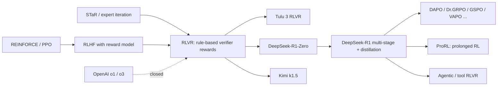

# RL with Verifiable Rewards (RLVR, "R1-Zero-style" reasoning RL)

> Train a language model with reinforcement learning where the reward comes from a **program that checks the answer** (a math answer checker, unit tests, a compiler, a constraint checker) instead of a learned reward model, so that long chain-of-thought reasoning emerges from optimizing correctness. **Family:** LLM post-training → RL for reasoning → outcome-reward policy optimization  ·  **Year / origin:** term coined in Tülu 3 (Lambert et al., AI2, 2024); popularized by DeepSeek-R1 / R1-Zero (DeepSeek-AI, Jan 2025; Nature, 2025) and OpenAI o1 (2024)  ·  **On/Off-policy:** on-policy (or nearly on-policy with PPO-style reuse)  ·  **Action space:** discrete tokens (vocabulary), sequence-level episodes

## 1. What is it?

**RLVR** is not one algorithm but a *training recipe*: take a pretrained (or instruction-tuned) LLM, give it prompts whose answers can be checked automatically, sample several completions per prompt, score each one with a deterministic **verifier**, and update the policy with a policy-gradient method ([PPO](../03-policy-gradient/ppo.md), [GRPO](grpo.md), [RLOO/REINFORCE++](rloo-remax-reinforcepp.md), [DAPO](dapo-dr-grpo.md), ...).

The problem it solves: classic [RLHF](../09-llm-preference-alignment/rlhf-ppo.md) optimizes a *learned* reward model, which is cheap to query but easy to **reward-hack** — the policy finds outputs the reward model likes that humans don't. For tasks with an objective ground truth (math, code, logic puzzles, formal proofs, instruction constraints such as "answer in exactly 3 bullet points"), a verifier gives a reward that is far harder to game. That lets you run RL **much longer and harder** than RLHF, and long RL runs are what produce *reasoning behaviour*: longer chains of thought, self-verification, backtracking ("wait, let me re-check").

Milestones:

- **OpenAI o1** (Sept 2024, "Learning to Reason with LLMs"): the closed system that showed large-scale RL on chains of thought yields models whose accuracy improves with both *train-time RL compute* and *test-time thinking compute*. o3 (announced Dec 2024) continued the line. Details of the training are not public.
- **Tülu 3** (Lambert et al., AI2, Nov 2024): open post-training recipe that named the stage "Reinforcement Learning with Verifiable Rewards" — PPO on GSM8K/MATH/IFEval-style prompts with a binary "is it correct / does it satisfy the constraint" reward, after SFT and DPO.
- **DeepSeek-R1-Zero** (Jan 2025): pure RL (GRPO) *directly on the base model* DeepSeek-V3-Base, no SFT, with only two rule-based rewards: **accuracy** (final answer matches) and **format** (reasoning inside `<think>...</think>`). The model's responses grew from hundreds to thousands of tokens and its AIME 2024 pass@1 rose from 15.6% to 71.0% (reported), with an "**aha moment**" in which the model spontaneously re-evaluates its own approach mid-solution.
- **DeepSeek-R1**: fixes R1-Zero's poor readability and language mixing with a multi-stage pipeline (Section 3) and **distills** the reasoning into small dense models (Qwen2.5 / Llama 1.5B–70B).
- **Kimi k1.5** (Moonshot AI, Jan 2025): concurrent report of long-context RL (up to 128k tokens) without MCTS, value functions or PRMs, plus "long2short" methods to compress reasoning.

Where it sits in the RL taxonomy: model-free, policy-based, on-policy; episodic with a **single terminal reward** (a contextual bandit over whole sequences, or a token-level MDP with sparse terminal reward).

## 2. Family & lineage

- **Parents:** REINFORCE / policy gradient ([reinforce.md](../03-policy-gradient/reinforce.md)), PPO, RLHF; expert iteration / STaR-style rejection-sampling fine-tuning (train on your own verified-correct samples), which is the "offline" cousin of RLVR.
- **Siblings:** RLHF with learned reward models; rubric / generative-judge rewards for non-verifiable tasks ([rubric-generative-rewards.md](../09-llm-preference-alignment/rubric-generative-rewards.md)); process supervision ([process-reward-prime.md](process-reward-prime.md)).
- **Descendants / refinements:** algorithmic fixes (GRPO → DAPO, Dr. GRPO, GSPO, CISPO, VAPO ...), prolonged RL (ProRL), agentic RLVR with tools ([agentic-multi-turn-rl.md](agentic-multi-turn-rl.md)), label-free variants ([self-rewarding-ttrl.md](self-rewarding-ttrl.md)), distillation of RLVR-trained teachers ([on-policy-distillation.md](on-policy-distillation.md)).



## 3. Core idea & intuition

1. **Reward = a check, not an opinion.** For a math problem, extract the final answer from the completion and compare it with the reference after normalization (`\frac{1}{2}` ≡ `0.5` ≡ `1/2`). For code, run the program against unit tests in a sandbox. For instruction following, check the constraint programmatically.
2. **Sample a group, reinforce what works.** For each prompt sample $G$ completions. Those that pass get a positive advantage, those that fail a negative one. Because the reward is binary and the baseline is the group mean, the model learns "be more like the completions that got it right *on this problem*".
3. **Reasoning emerges because it helps.** Nobody rewards long chains of thought directly. But on hard problems, completions that spend more tokens checking intermediate results are more often correct, so RL slowly shifts probability mass toward such behaviour. In R1-Zero, the average response length grew steadily during training.
4. **Format reward keeps outputs parseable.** A small reward for the `<think>…</think><answer>…</answer>` structure ensures the verifier can find the answer.

**DeepSeek-R1's four-stage pipeline** (as described in the paper):

1. *Cold start:* SFT on a few thousand curated long-CoT examples (readable format) to stabilize early RL.
2. *Reasoning-oriented RL:* GRPO with accuracy + format rewards, plus a **language-consistency reward** (fraction of target-language words) to stop language mixing.
3. *Rejection sampling + SFT:* sample from the RL checkpoint, keep correct/readable outputs (reported as ~600k reasoning samples), add ~200k non-reasoning samples (writing, QA, ...), and fine-tune the base model again.
4. *RL for all scenarios:* a second RL stage mixing rule-based rewards (reasoning) and reward models (helpfulness, harmlessness).

**Distillation:** fine-tuning small Qwen2.5 / Llama models on ~800k R1-generated samples gave strong small reasoners. The paper reported that distilling from R1 beat running large-scale RL directly on a 32B base. In other words, RL discovers the behaviour and SFT copies it cheaply.

**The "boundary" debate.** Does RLVR teach *new* reasoning or only sharpen what the base model could already do?

- Yue et al. (2025), *"Does Reinforcement Learning Really Incentivize Reasoning Capacity in LLMs Beyond the Base Model?"*, measured **pass@k** for large $k$. RLVR models win at small $k$ (pass@1), but base models catch up and overtake at large $k$ (e.g. 256). Their conclusion: current RLVR mostly *re-weights* reasoning paths already in the base model's distribution and narrows coverage. DeepSeekMath had earlier noted that RL improved Maj@K but not Pass@K.
- **ProRL** (NVIDIA, 2025, *"Prolonged Reinforcement Learning Expands Reasoning Boundaries in LLMs"*) countered that with much longer, stabilized training (KL control, periodic **reference-policy resets**, diverse tasks; thousands of steps on a 1.5B model) RL *does* expand pass@k on tasks where the base model was weak.
- The emerging consensus is nuanced. Short RL runs mostly sharpen. Long, diverse, entropy-preserving RL can extend coverage, especially where the base model is weak. Distillation from a stronger teacher reliably adds new capability.

Our toy demo shows the sharpening effect: after RL, pass@1 equals pass@8. The policy became nearly deterministic, so prompts it never solves stay unsolved.

## 4. Math / formal details

**Setting.** Prompt $q\sim\mathcal{D}$, completion $o=(o_1,\dots,o_{|o|})\sim\pi_\theta(\cdot\mid q)$, verifier $v(q,o)\in\{0,1\}$ (or $[0,1]$ for fraction of tests passed).

**Reward.** A typical R1-style reward:
$$
r(q,o) = \underbrace{\mathbb{1}[\text{equiv}(\text{extract}(o),\,a^*(q))]}_{\text{accuracy}} + \lambda_{\text{fmt}}\,\underbrace{\mathbb{1}[o \text{ matches the format regex}]}_{\text{format}} \;(+\;\lambda_{\text{lang}} r_{\text{lang}})
$$
where $a^*(q)$ is the reference answer and $\text{equiv}$ checks symbolic or numeric equivalence. For code, $r = \frac{\#\text{tests passed}}{\#\text{tests}}$ or $\mathbb{1}[\text{all pass}]$.

**Objective.** KL-regularized expected reward:
$$
J(\theta)=\mathbb{E}_{q\sim\mathcal{D},\,o\sim\pi_\theta(\cdot|q)}\big[r(q,o)\big]-\beta\,\mathbb{D}_{\text{KL}}\big(\pi_\theta(\cdot|q)\,\|\,\pi_{\text{ref}}(\cdot|q)\big)
$$
Many RLVR recipes (DAPO, Dr. GRPO, ORZ) set $\beta=0$ because the verifier is hard to hack and the policy *should* move far from the base model.

**Gradient with a group baseline** (the GRPO/RLOO family). With $G$ samples $o_1..o_G$ for prompt $q$:
$$
\nabla_\theta J \approx \frac{1}{G}\sum_{i=1}^{G} \hat A_i \sum_{t=1}^{|o_i|}\nabla_\theta\log\pi_\theta(o_{i,t}\mid q,o_{i,<t}),\qquad \hat A_i=\frac{r_i-\operatorname{mean}(r_{1..G})}{\operatorname{std}(r_{1..G})+\epsilon}
$$
If all $G$ samples have the same reward, $\hat A_i = 0$ and the prompt contributes no gradient. This is why curriculum and difficulty filtering matter.

**pass@k** (Chen et al., 2021, unbiased estimator from $n$ samples with $c$ correct):
$$
\text{pass@}k = 1-\binom{n-c}{k}\Big/\binom{n}{k}
$$

## 5. Algorithm (pseudocode)

```text
Input: base/SFT policy π_θ, reference π_ref (optional), prompt set D with reference answers / tests,
       verifier v, group size G, batch size B
1. for iteration = 1, 2, ... do
2.     sample B prompts q_1..q_B from D (optionally filter by difficulty: base pass-rate not 0 or 1)
3.     for each q_b: sample G completions o_{b,1..G} ~ π_θ(·|q_b)   (vLLM / SGLang inference engine)
4.     for each completion: r = accuracy(extract(o), a*) + λ_fmt·format(o)  (code: run tests in sandbox)
5.     compute advantages (group-normalized, RLOO, or GAE with a critic)
6.     for a few minibatch epochs: update θ with the clipped policy-gradient loss (+ β·KL to π_ref)
7.     log: mean reward, response length, entropy, pass@1 on a held-out set, clip fraction
8. end for
Multi-stage (DeepSeek-R1): cold-start SFT → reasoning RL → rejection-sampling SFT → all-scenario RL
```

## 6. Python implementation

Runnable version: [`code/rlvr.py`](../../code/rlvr.py)

The file contains (a) a small **verifier library** (boxed-answer extraction with brace matching, LaTeX/number normalization, symbolic-ish equivalence via `Fraction`, R1 format regex, a subprocess unit-test runner with timeout, and the unbiased pass@k estimator) and (b) a **toy RLVR loop**. A tiny GRU "LM" emits tokens from a 14-token vocabulary. The tokens are detokenized into text like `<answer>7</answer>`, and the *text* is scored by the verifier for prompts "a+b". The demo prints pass@1/pass@8 before and after RL.

```python
{{CODE}}
```

Typical output (CPU, ~10 s): verifier checks pass; the unit-test runner gives 1.00 / 0.33 / 0.00 for correct / wrong / infinite-loop code; reward rises from 0 to ~1.0; **pass@1 ≈ pass@8 ≈ 0.68 after RL**. The policy became nearly deterministic: it reliably solves the prompts it learned and never samples a correct answer on the rest. This is a miniature version of the "RLVR sharpens rather than expands" observation.

**With a real library** (requires GPU + library; not run here). In TRL, an RLVR reward is just a Python function passed to `GRPOTrainer`:

```python
# pip install trl math-verify   (requires GPU; not run here)
from datasets import load_dataset
from math_verify import parse, verify            # Hugging Face's math answer verifier
from trl import GRPOConfig, GRPOTrainer

ds = load_dataset("openai/gsm8k", "main", split="train")
ds = ds.map(lambda x: {"prompt": x["question"] + "\nPut the final answer in \\boxed{}.",
                       "answer": x["answer"].split("####")[-1].strip()})

def accuracy_reward(completions, answer, **kwargs):
    # completions: list[str] (standard format); extra dataset columns arrive as kwargs
    return [1.0 if verify(parse(a), parse(c)) else 0.0 for c, a in zip(completions, answer)]

args = GRPOConfig(output_dir="qwen-rlvr", num_generations=8, max_completion_length=1024,
                  learning_rate=1e-6, beta=0.0, use_vllm=True, bf16=True)
GRPOTrainer(model="Qwen/Qwen2.5-1.5B-Instruct", reward_funcs=[accuracy_reward],
            args=args, train_dataset=ds).train()
```

In **verl** the equivalent is a `reward_model.reward_manager` plus a `compute_score(data_source, solution_str, ground_truth)` function. verl ships rule-based scorers for GSM8K, MATH and others, and sandbox integrations for code.

## 7. Practical tips & hyperparameters

- **Verifier quality is everything.** False negatives (correct answer marked wrong because of formatting) silently cap learning. False positives (e.g. accepting any output containing the right number) get exploited. Test the verifier on a few hundred real model outputs before training. Use robust tools (`math-verify`, SymPy) and canonical answer formats (`\boxed{}`).
- **Difficulty filtering:** keep prompts whose base-model pass rate is strictly between 0 and 1 (e.g. 10–90%). All-correct/all-wrong groups give zero gradient with group baselines (see DAPO's dynamic sampling).
- **Group size** $G$: 8–16 typical (R1 used 16). **Learning rate:** ~1e-6 (full fine-tune), higher for LoRA. **Temperature:** 0.6–1.0 for rollouts. Too low kills exploration.
- **Max response length:** large (8k–32k+) for reasoning. Truncated responses should usually get reward 0 or an overlong penalty.
- **KL:** often $\beta = 0$ for pure RLVR; keep a small KL if you care about preserving general chat ability.
- **Monitor:** mean reward, response length (should grow on hard tasks), **policy entropy** (collapse → stagnation), fraction of truncated responses, held-out pass@1 *and* pass@k.
- **Code sandboxing:** run untrusted code in containers/gVisor/Firecracker with no network, CPU/memory/time limits. Watch for reward hacking such as editing tests, `sys.exit(0)`, or special-casing test inputs.
- **Base model matters:** Qwen2.5 models respond to RLVR much more readily than some other families. Several 2025 papers found Qwen2.5-Math improves even with weak or spurious rewards, so validate conclusions across model families.

## 8. Pros and cons

| Pros | Cons |
|---|---|
| Reward is hard to hack, so very long RL runs become possible | Only works where answers can be checked automatically |
| No reward-model training or serving cost | Sparse binary reward: no signal on prompts that are too hard or too easy |
| Produces emergent long-CoT reasoning, self-verification | Long rollouts dominate compute (generation can be 70–90% of the step time) |
| Simple to implement: a Python function + GRPO/PPO | May mostly sharpen existing abilities (pass@k debate) |
| Scales with compute (train-time and test-time) | Verifier bugs (false positives/negatives) are silent failure modes |
| Distillable into small models | Can harm general/chat abilities if not mixed with other data |

## 9. When to use / when not to use

**Use when:** the task has a checkable outcome (math, code with tests, SQL with execution, formal proofs, structured extraction with a schema, puzzles, instruction constraints); you have a base model that already solves some fraction of prompts; you want the model to "think longer" productively.

**Do not use (alone) when:** quality is subjective (creative writing, helpfulness). Use reward models, rubrics or preference optimization there. Also avoid it when the base model solves ~0% of prompts (start with SFT / distillation or a curriculum), or when you need a small model quickly and a strong teacher exists (distill instead; see [on-policy-distillation.md](on-policy-distillation.md)).

## 10. Key papers, books & repos

- Lambert et al., *Tülu 3: Pushing Frontiers in Open Language Model Post-Training*, AI2, 2024 — arXiv 2411.15124 (coins "RLVR").
- DeepSeek-AI, *DeepSeek-R1: Incentivizing Reasoning Capability in LLMs via Reinforcement Learning*, 2025 — arXiv 2501.12948; peer-reviewed version in *Nature* (2025).
- Shao et al., *DeepSeekMath*, 2024 — arXiv 2402.03300 (GRPO; observation that RL improves Maj@K more than Pass@K).
- OpenAI, *Learning to Reason with LLMs* (o1 blog post), Sept 2024; OpenAI o1 System Card, 2024.
- Kimi Team, *Kimi k1.5: Scaling Reinforcement Learning with LLMs*, 2025 — arXiv 2501.12599.
- Yue et al., *Does Reinforcement Learning Really Incentivize Reasoning Capacity in LLMs Beyond the Base Model?*, 2025 — arXiv 2504.13837.
- Liu et al. (NVIDIA), *ProRL: Prolonged Reinforcement Learning Expands Reasoning Boundaries in Large Language Models*, 2025 — arXiv 2505.24864.
- Chen et al., *Evaluating Large Language Models Trained on Code* (Codex, pass@k estimator), 2021 — arXiv 2107.03374.
- Zelikman et al., *STaR: Bootstrapping Reasoning With Reasoning*, NeurIPS 2022.
- Sutton & Barto, *Reinforcement Learning: An Introduction* (2nd ed., 2018), Ch. 13 (policy gradient methods).
- Repos: `deepseek-ai/DeepSeek-R1`, `huggingface/open-r1`, `huggingface/trl`, `huggingface/Math-Verify`, `volcengine/verl`, `OpenRLHF/OpenRLHF`, `allenai/open-instruct` (Tülu 3 code).

## 11. For business users

**What it does.** RLVR trains an AI model by letting it attempt thousands of problems that have checkable answers, such as math, code with tests, or forms that must validate. A program checks every attempt automatically, and the model is nudged toward whatever worked. No human has to grade each answer. Models trained this way learn to "think before answering": they work through intermediate steps and catch their own mistakes.

**Analogy.** A sales trainee practising with a flight simulator that instantly says "deal closed" or "deal lost", rather than a manager giving vague feedback. Thousands of rounds against an honest scorekeeper beat a few rounds of opinion.

**Use cases.** Coding assistants trained against test suites; text-to-SQL checked by executing queries; financial or engineering calculators with known answers; document extraction checked against schemas; compliance rules checked by a rules engine.

**Value / ROI.** Large accuracy gains on reasoning-heavy tasks. It reuses assets you may already have, such as test suites, validators and historical answer keys. The resulting "reasoning" model can be distilled into smaller, cheaper models for production.

**Risks.** The model optimizes exactly what the checker checks. Loopholes get exploited, for example code that special-cases the tests. Reasoning models are slower and costlier per query because they generate long thoughts. Gains may not transfer to tasks without checkers.

**Costs.** GPU-heavy: generating long answers is most of the cost. Expect a dedicated RL infrastructure (inference engine + trainer + sandbox) and engineering time to build verifiers.

**Questions to ask your team.**
- What fraction of our target tasks have an automatic correctness check, and how often is that check wrong?
- What does the base model score today? (RLVR needs some initial successes.)
- How will we detect reward hacking and measure gains on held-out, real-world tasks?
- Is distilling from an existing reasoning model cheaper than running RL ourselves?

## 12. For kids (ages ~8–12)

Imagine you have a big book of maze puzzles, and the back of the book tells you if you found the exit. Nobody explains *how* to solve mazes. You just try, and each time you find out "yes, exit!" or "no, dead end". After hundreds of mazes you start doing clever things on your own: you look ahead, you go back when you're stuck, and you double-check before saying "done!". That's what RLVR does with a computer brain. It tries lots of puzzles, a checker says right or wrong, and it slowly learns to think more carefully.

**Try it yourself:** Ask a friend to think of a number from 1 to 50 and only answer "higher", "lower" or "yes!". Play 5 rounds. Did you invent a smart strategy, like always guessing the middle, even though nobody taught you?

**Recap:**
1. The computer tries many problems.
2. A checker says right or wrong.
3. It keeps the ways of thinking that got things right.

## 13. Related methods

- [GRPO](grpo.md) — the most common optimizer used for RLVR.
- [RLOO, ReMax, REINFORCE++](rloo-remax-reinforcepp.md) — other critic-free estimators.
- [DAPO & Dr. GRPO](dapo-dr-grpo.md) — fixes that make long RLVR runs stable.
- [GSPO, SAPO, GMPO, CISPO](gspo-sapo-gmpo-cispo.md) — ratio/clipping redesigns.
- [VC-PPO & VAPO](value-based-llm-rl-vapo.md) — RLVR with a critic.
- [Process rewards & PRIME](process-reward-prime.md) — denser rewards for reasoning steps.
- [On-policy distillation](on-policy-distillation.md) — cheaper alternative when a teacher exists.
- [Agentic multi-turn RL](agentic-multi-turn-rl.md) — RLVR with tools and environments.
- [TTRL & self-rewarding RL](self-rewarding-ttrl.md) — RLVR without labels.
- [RLHF with PPO](../09-llm-preference-alignment/rlhf-ppo.md), [Reward modeling](../09-llm-preference-alignment/reward-modeling.md), [Reward hacking & safety](../09-llm-preference-alignment/safety-rl-reward-hacking.md).
- [PPO](../03-policy-gradient/ppo.md), [REINFORCE](../03-policy-gradient/reinforce.md).

[← Back to overview](../../RL_Methods_Overview.md)
