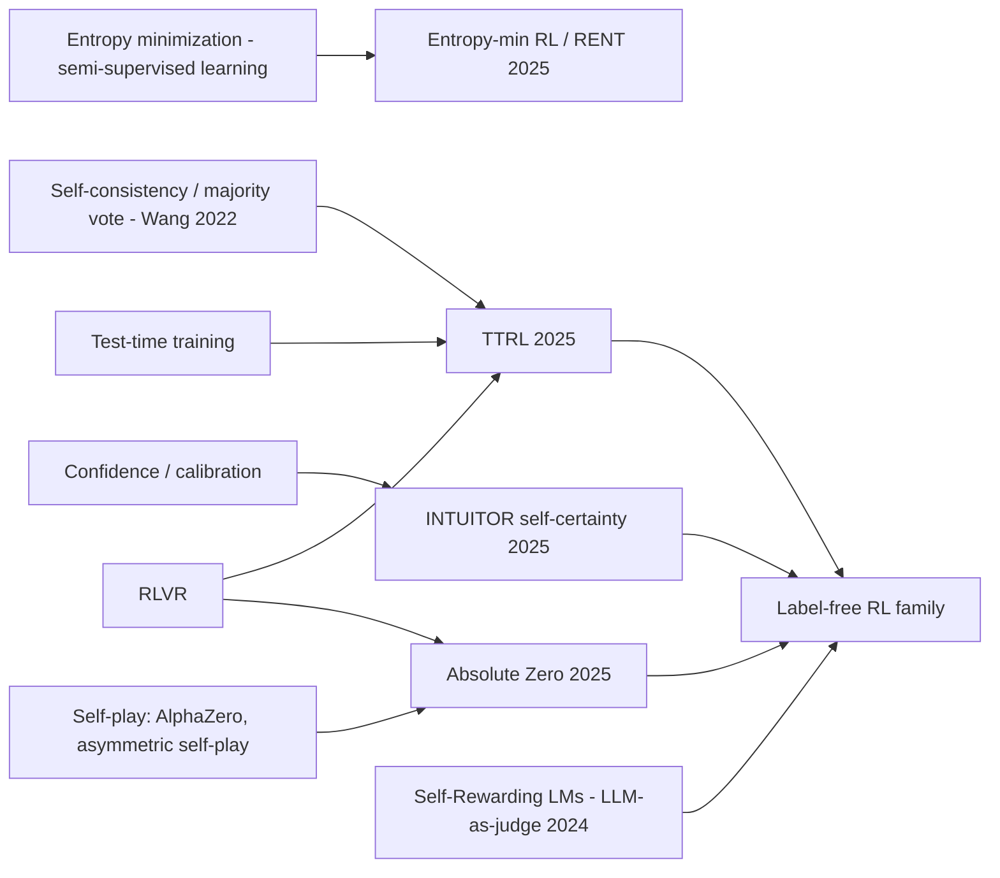

# Label-free RL for LLMs: TTRL, INTUITOR / self-certainty, entropy minimization, Absolute Zero

> Reinforcement learning for reasoning **without ground-truth labels**. The reward comes from the model itself: agreement with its own majority vote (TTRL), its own confidence (INTUITOR's self-certainty, entropy minimization), or tasks it proposes and checks with a code executor (Absolute Zero). It works surprisingly well in some settings, and it carries real risks of collapse and self-reinforced errors. **Family:** LLM post-training → RL for reasoning → intrinsic / self-supervised rewards (RL from internal feedback)  ·  **Year / origin:** TTRL (Zuo et al., Tsinghua, Apr 2025); INTUITOR (Zhao et al., UC Berkeley, May 2025); entropy minimization (several 2025 papers); Absolute Zero (Zhao et al., Tsinghua et al., May 2025)  ·  **On/Off-policy:** on-policy (GRPO/PPO)  ·  **Action space:** discrete tokens

## 1. What is it?

[RLVR](rlvr.md) needs a reference answer or test for every prompt. Labels are expensive, and at **test time** (a new batch of unlabeled problems) they don't exist at all. Label-free methods substitute a self-generated signal:

- **TTRL — Test-Time Reinforcement Learning (Zuo et al., 2025).** For each unlabeled prompt, sample $N$ answers, take the **majority-vote answer as a pseudo-label**, and give reward 1 to samples that agree with it. Then run GRPO/PPO on the test set itself. The insight: majority voting (self-consistency) is usually more accurate than a single sample, so training single samples toward the vote "distills" maj@N into pass@1. The paper reported large gains on AIME 2024 for Qwen2.5-Math-7B and noted that performance can even exceed the initial maj@N ceiling (reported).
- **RLIF / INTUITOR (Zhao, Kang, Levine, Song, 2025, *Learning to Reason without External Rewards*).** Use **self-certainty**, the average KL divergence from a uniform distribution to the model's next-token distribution over the response, as the reward in GRPO. Confident responses are rewarded. It was reported to match GRPO with gold rewards on in-domain math and to generalize better to code in their setup.
- **Entropy minimization (several 2025 works).** Directly reward low token entropy (or minimize entropy as a loss, or sharpen logits at inference). Examples: *The Unreasonable Effectiveness of Entropy Minimization in LLM Reasoning* (Agarwal et al.), one-shot entropy minimization, and RENT (rewarding confidence). Reported results showed sizable gains on math/code for models with strong latent ability (notably Qwen2.5).
- **Absolute Zero (Zhao et al., 2025, *Absolute Zero: Reinforced Self-play Reasoning with Zero Data*).** One model plays two roles. As **proposer** it writes new tasks (Python programs with inputs/outputs, for deduction, abduction and induction). As **solver** it solves them. A **code executor** validates tasks and verifies answers, so there is no human data at all. The proposer is rewarded for **learnability**: $r=1-\bar s$ if the solver's success rate $\bar s$ is strictly between 0 and 1, else 0. The resulting Absolute Zero Reasoner (AZR) was reported to be competitive with models trained on curated human data in math and coding.
- **Self-play proposer–solver variants** (e.g. R-Zero's challenger/solver, and self-play on games such as SPIRAL) extend the idea to other domains.

**Risks.** All these rewards are functions of the model's own beliefs, so they reinforce whatever the model already believes. They help when the model is *more often right than wrong* and its confidence is *calibrated*. They hurt (confident wrong answers get amplified) when it isn't, and long training can **collapse** to degenerate, over-confident or trivially agreeable outputs. Several 2025 results also showed that even *random* or *spurious* rewards improved some Qwen2.5-Math models, but not other model families. Gains from weak signals can therefore reflect the base model's pretraining (e.g. "elicitation") more than the reward itself, so conclusions must be checked across model families.

## 2. Family & lineage



- **Parents:** self-consistency decoding (Wang et al., 2022), entropy minimization from semi-supervised learning (Grandvalet & Bengio, 2004), test-time training, self-play ([mcts-alphazero.md](../05-model-based/mcts-alphazero.md), [online-iterative-self-play-po.md](../09-llm-preference-alignment/online-iterative-self-play-po.md)), RLVR.
- **Siblings:** Self-Rewarding Language Models (Yuan et al., 2024; the model judges its own responses and is trained with iterative DPO); RLAIF ([rlaif-constitutional-ai.md](../09-llm-preference-alignment/rlaif-constitutional-ai.md)); curiosity / intrinsic motivation ([curiosity-icm-rnd.md](../08-exploration-hierarchical-multiagent/curiosity-icm-rnd.md)), which is in a sense the *opposite*: it rewards novelty rather than certainty.
- **Descendants:** hybrids that combine a few labels with self-rewards, confidence-calibrated rewards, and co-evolving proposer–solver systems.

## 3. Core idea & intuition

- **The crowd of your own samples is smarter than one sample.** If 10 of 16 samples say "42", "42" is probably right. Training each sample to agree with the crowd makes the model's *first* answer as good as its majority vote. That is the TTRL effect.
- **Confidence as a proxy for correctness.** In models trained on lots of math, confident reasoning paths are more often correct. Rewarding confidence (self-certainty, low entropy) selects those paths. INTUITOR's KL-from-uniform measure is less prone to the length and verbosity exploits that plain log-likelihood rewards suffer from (reported).
- **The ceiling.** You can sharpen what the model already "knows" but cannot correct systematic misconceptions. If the model's majority is wrong on a problem, TTRL trains it to be *more* wrong there. Our toy demo shows exactly this: overall accuracy rises, while accuracy on "misconception" prompts collapses toward zero.
- **Learnability for self-proposed curricula.** A task that is always solved or never solved gives no learning signal. Absolute Zero's proposer reward targets the frontier of the solver's ability, and the executor keeps the tasks grounded in reality.

## 4. Math / formal details

Prompt $x$; $G$ samples $y_i\sim\pi_\theta(\cdot|x)$ with extracted answers $a_i$; token distributions $p_{i,t}=\pi_\theta(\cdot|x,y_{i,<t})$ over vocabulary size $V$.

**TTRL (majority-vote pseudo-label):**
$$
\hat a(x)=\arg\max_a\sum_{i=1}^G\mathbb 1[a_i=a],\qquad r_i=\mathbb 1[a_i=\hat a(x)]
$$
These rewards are used with GRPO/PPO as if they were verifier rewards. TTRL's analysis notes that the reward can be correct even when the label is wrong (a sample disagreeing with a wrong majority is "correctly" told it disagrees), which makes the signal denser than label accuracy alone suggests.

**Self-certainty (INTUITOR):**
$$
\text{SC}(y_i)=\frac{1}{|y_i|}\sum_t \text{KL}\big(U\,\|\,p_{i,t}\big)=\frac{1}{|y_i|}\sum_t\Big(-\log V-\frac1V\sum_{j=1}^V\log p_{i,t}(j)\Big)
$$
used as $r_i$ (group-normalized in GRPO). Note that the KL runs from the uniform distribution to $p$: mass-covering, it penalizes putting near-zero probability on many tokens less than entropy does.

**Entropy-minimization reward:** $r_i=-\frac{1}{|y_i|}\sum_t H(p_{i,t})$, with $H(p)=-\sum_j p(j)\log p(j)$. The direct loss variant minimizes $\mathbb E[H]$ by gradient descent on sampled tokens.

**Absolute Zero proposer reward** (solver success rate $\bar s_\tau$ on proposed task $\tau$, estimated with $n$ solver rollouts):
$$
r^\text{propose}(\tau)=\begin{cases}1-\bar s_\tau,&0<\bar s_\tau<1\\0,&\text{otherwise}\end{cases},\qquad r^\text{solve}=\mathbb 1[\text{executor verifies answer}]
$$
Both roles are trained jointly, with task-relative REINFORCE++ advantages per role and task type in the paper.

## 5. Algorithm (pseudocode)

```text
TTRL (unlabeled prompts D_test)
1. for step = 1..N:
2.     sample prompts x from D_test; G samples each from π_θ
3.     â(x) = majority vote over extracted answers;  r_i = [a_i == â(x)]
4.     GRPO/PPO update with r_i  (optionally: sample more votes than training rollouts)

INTUITOR / entropy-min
3'.    r_i = self_certainty(y_i)  or  −mean token entropy(y_i)   (computed with the current/old policy)

Absolute Zero (one model, two roles)
1. for step = 1..N:
2.     PROPOSE: generate tasks (program, input) of types {deduction, abduction, induction},
              conditioned on examples from a task buffer; validate with the code executor
3.     SOLVE:   for each valid task, n solver attempts; executor checks answers → r_solve
4.     r_propose = 1 − mean(r_solve) if 0 < mean(r_solve) < 1 else 0
5.     update the shared policy on both roles; add valid tasks to the buffer
```

## 6. Python implementation

Runnable version: [`code/self-rewarding-ttrl.py`](../../code/self-rewarding-ttrl.py)

It implements `majority_vote_rewards`, `self_certainty`, `negative_entropy` and `azr_proposer_reward`. The toy "pretrained model" answers each of 40 prompts by first choosing a **reasoning path** (4 options), then an **answer** (8 options):

- path 0 is careful and right;
- path 1 is weakly right;
- path 2 is a diffuse guess;
- path 3 is **confidently wrong**.

On 25% of prompts (the "misconceptions") the wrong path is especially confident. The model is trained by GRPO for 150 steps with ground-truth reward vs each label-free reward, and we track the *true* accuracy.

```python
"""Label-free RL for LLMs: TTRL (majority-vote pseudo-labels), INTUITOR-style self-certainty reward,
entropy-minimisation reward, and Absolute-Zero-style proposer 'learnability' reward.

(a) Reward functions on tensors / lists:
    - majority_vote_rewards(answers, G)          : TTRL
    - self_certainty(logits, mask)                : INTUITOR, mean_t KL(Uniform || p_t)
    - negative_entropy(logits, mask)              : entropy-minimisation reward
    - azr_proposer_reward(solve_rate)             : Absolute Zero proposer reward
(b) Toy: a tabular "pretrained" model answers each prompt by first picking a reasoning path
    (4 options) and then an answer (8 options). Some paths are confident & right, one is
    diffuse, one is CONFIDENTLY WRONG; on 25% of prompts the model holds a misconception.
    We train with ground-truth reward vs. each label-free reward and track TRUE accuracy.

Run:  python3 code/self-rewarding-ttrl.py     (CPU, ~10-30 s)
"""
import math
from collections import Counter

import torch
import torch.nn.functional as F

torch.set_num_threads(1)


# ----------------------------------------------------------------------------------------
# (a) Label-free rewards
# ----------------------------------------------------------------------------------------
def majority_vote_rewards(answers, G):
    """TTRL: for each prompt, the most frequent answer among its G samples is the pseudo-label;
    reward 1 for samples agreeing with it. answers: list (len n*G) of hashable answers."""
    rewards, labels = [], []
    for g in range(0, len(answers), G):
        grp = answers[g:g + G]
        maj = Counter(grp).most_common(1)[0][0]
        labels.append(maj)
        rewards += [1.0 if a == maj else 0.0 for a in grp]
    return torch.tensor(rewards), labels


def self_certainty(logits, mask):
    """INTUITOR (Zhao et al. 2025): average over response tokens of KL(U || p_t)
    = -log V - (1/V) sum_j log p_t(j). Higher = more confident. logits [B,T,V], mask [B,T]."""
    V = logits.shape[-1]
    logp = F.log_softmax(logits, -1)
    kl_u = -math.log(V) - logp.mean(-1)
    return (kl_u * mask).sum(1) / mask.sum(1).clamp(min=1)


def negative_entropy(logits, mask):
    """Entropy-minimisation reward: -mean_t H(p_t)."""
    logp = F.log_softmax(logits, -1)
    H = -(logp.exp() * logp).sum(-1)
    return -(H * mask).sum(1) / mask.sum(1).clamp(min=1)


def azr_proposer_reward(solve_rate: torch.Tensor) -> torch.Tensor:
    """Absolute Zero proposer reward: tasks that are always or never solved teach nothing;
    r = 1 - mean_solve_rate if 0 < rate < 1 else 0."""
    return torch.where((solve_rate > 0) & (solve_rate < 1), 1 - solve_rate, torch.zeros_like(solve_rate))


# ----------------------------------------------------------------------------------------
# (b) Toy "pretrained" model: path -> answer
# ----------------------------------------------------------------------------------------
N_PROMPTS, N_PATHS, N_ANS = 40, 4, 8


def make_model(seed=0):
    g = torch.Generator().manual_seed(seed)
    truth = torch.randint(0, N_ANS, (N_PROMPTS,), generator=g)
    wrong = (truth + torch.randint(1, N_ANS, (N_PROMPTS,), generator=g)) % N_ANS
    misconception = torch.rand(N_PROMPTS, generator=g) < 0.25
    path_logits = torch.zeros(N_PROMPTS, N_PATHS)
    ans_logits = 0.3 * torch.randn(N_PROMPTS, N_PATHS, N_ANS, generator=g)
    idx = torch.arange(N_PROMPTS)
    ans_logits[idx, 0, truth] += torch.where(misconception, 1.0, 3.0)     # path 0: careful, right
    ans_logits[idx, 1, truth] += 1.2                                      # path 1: weakly right
    #                                                                       path 2: diffuse guess
    ans_logits[idx, 3, wrong] += torch.where(misconception, 3.5, 2.0)     # path 3: confidently WRONG
    return truth, misconception, path_logits.requires_grad_(), ans_logits.requires_grad_()


def sample(path_logits, ans_logits, prompts):
    paths = torch.distributions.Categorical(logits=path_logits[prompts]).sample()
    answers = torch.distributions.Categorical(logits=ans_logits[prompts, paths]).sample()
    return paths, answers


def response_logits(path_logits, ans_logits, prompts, paths):
    """Per-token logits of the 2-token response [path, answer], padded to a common vocab so we
    can compute self-certainty / entropy with a mask (-inf padding gives zero prob)."""
    V = max(N_PATHS, N_ANS)
    pad = lambda x: F.pad(x, (0, V - x.shape[-1]), value=-30.0)
    return torch.stack([pad(path_logits[prompts]), pad(ans_logits[prompts, paths])], 1)


def train(reward_type, steps=150, n=20, G=16, lr=5.0, seed=0):
    truth, misc, path_logits, ans_logits = make_model()
    torch.manual_seed(seed)
    opt = torch.optim.SGD([path_logits, ans_logits], lr=lr)
    hist = []
    for step in range(steps + 1):
        prompts = torch.randint(0, N_PROMPTS, (n,)).repeat_interleave(G)
        paths, answers = sample(path_logits.detach(), ans_logits.detach(), prompts)
        if reward_type == "ground truth":
            r = (answers == truth[prompts]).float()
        elif reward_type == "TTRL majority vote":
            r, _ = majority_vote_rewards(answers.tolist(), G)
        else:
            with torch.no_grad():
                lg = response_logits(path_logits, ans_logits, prompts, paths)
                m = torch.ones(lg.shape[:2])
                r = self_certainty(lg, m) if reward_type == "self-certainty" else negative_entropy(lg, m)
        rg = r.view(-1, G)
        adv = ((rg - rg.mean(1, keepdim=True)) / (rg.std(1, keepdim=True) + 1e-6)).view(-1)
        logp = (F.log_softmax(path_logits[prompts], -1).gather(1, paths[:, None]).squeeze(1) +
                F.log_softmax(ans_logits[prompts, paths], -1).gather(1, answers[:, None]).squeeze(1))
        loss = -(logp * adv).mean()
        opt.zero_grad()
        loss.backward()
        opt.step()
        if step % 50 == 0:
            hist.append(evaluate(truth, misc, path_logits.detach(), ans_logits.detach()))
    return hist


@torch.no_grad()
def evaluate(truth, misc, path_logits, ans_logits, k=16):
    """True accuracy of single samples, overall and on misconception prompts; maj@k accuracy."""
    prompts = torch.arange(N_PROMPTS).repeat_interleave(k)
    _, ans = sample(path_logits, ans_logits, prompts)
    correct = (ans == truth[prompts]).float().view(N_PROMPTS, k)
    _, labels = majority_vote_rewards(ans.tolist(), k)
    maj_acc = (torch.tensor(labels) == truth).float().mean().item()
    return correct.mean().item(), correct[misc].mean().item(), maj_acc


if __name__ == "__main__":
    r, labels = majority_vote_rewards([3, 3, 5, 3, 1, 1, 2, 2], G=4)
    print("majority-vote rewards:", r.tolist(), "pseudo-labels:", labels)
    peaked = torch.tensor([[[5.0, 0, 0, 0]]])
    flat = torch.zeros(1, 1, 4)
    m = torch.ones(1, 1)
    print(f"self-certainty peaked {self_certainty(peaked, m).item():.3f} vs flat "
          f"{self_certainty(flat, m).item():.3f}; neg-entropy peaked "
          f"{negative_entropy(peaked, m).item():.3f} vs flat {negative_entropy(flat, m).item():.3f}")
    print("AZR proposer reward for solve rates 0, .25, .5, 1:",
          azr_proposer_reward(torch.tensor([0.0, 0.25, 0.5, 1.0])).tolist(), "\n")

    print(f"{'reward':20s} " + " | ".join(f"step {s:3d}: acc / acc(misconc.) / maj@16" for s in (0, 50, 100, 150)))
    for rt in ["ground truth", "TTRL majority vote", "self-certainty", "negative entropy"]:
        h = train(rt)
        print(f"{rt:20s} " + " | ".join(f"      {a:.3f} / {b:.3f} / {c:.3f}      " for a, b, c in h))
```

What the output shows (~5 s):

- **Ground truth** reward: accuracy 0.27 → 0.93, misconception prompts 0.17 → 0.92, maj@16 → 1.0.
- **TTRL majority vote**: overall accuracy rises to ≈0.63 with no labels, and single-sample accuracy approaches the base model's maj@16 (≈0.63–0.68), the "distill majority vote into pass@1" effect. But maj@16 itself doesn't improve, and on **misconception prompts accuracy drops from 0.17 to ≈0.08**, because the model is trained to agree with its own wrong majority.
- **Self-certainty / entropy minimization**: ≈0.50 overall, and misconception accuracy collapses to ≈0.03. Confidence rewards favour the *confidently wrong* path wherever it is the most confident one.
- The lesson: label-free RL can harvest "free" gains when the model is mostly right, but it **cannot fix confident mistakes, and amplifies them**.

**With TRL** (requires GPU + library; not run here). TTRL is just a different reward function; self-certainty needs the policy's logits, so it is usually implemented inside the trainer (as in the INTUITOR code release) rather than as an external reward function.

```python
# TTRL-style majority-vote reward for TRL's GRPOTrainer (requires GPU; not run here)
from collections import Counter
from math_verify import parse
from trl import GRPOConfig, GRPOTrainer

G = 16
def majority_vote_reward(completions, **kwargs):
    # completions arrive grouped: G consecutive completions per prompt
    answers = [str(parse(c)) for c in completions]
    rewards = []
    for g in range(0, len(answers), G):
        group = answers[g:g + G]
        maj = Counter(group).most_common(1)[0][0]
        rewards += [1.0 if a == maj else 0.0 for a in group]
    return rewards

trainer = GRPOTrainer(model="Qwen/Qwen2.5-Math-1.5B", reward_funcs=majority_vote_reward,
                      args=GRPOConfig(output_dir="ttrl", num_generations=G, beta=0.0),
                      train_dataset=unlabeled_test_prompts)   # placeholder: "prompt" column only
trainer.train()
```

(Check that your trainer version keeps the G completions of a prompt contiguous within the reward call. TRL's GRPOTrainer does this by design, but a custom sampler may not.)

## 7. Practical tips & hyperparameters

- **Know the base model's calibration.** Before label-free RL, measure on a labeled dev set how often the majority vote is right (label accuracy) and how confidence correlates with correctness. If maj@N ≈ pass@1, there is little to gain.
- **TTRL:** vote with more samples (e.g. 64) than you train on (e.g. 16 to 32). Use a low learning rate and few epochs. Stop early: label accuracy, entropy and answer diversity should be tracked, and a rapid entropy drop signals collapse.
- **Self-certainty / entropy rewards:** combine with a KL to the reference model or with a few labeled prompts. Pure confidence rewards eventually reward degenerate repetition or terse outputs, so watch response length and n-gram repetition.
- **Absolute Zero:** the code executor must be sandboxed (time, memory, no network). Filter proposed tasks for determinism (run twice). Keep a diverse task buffer to avoid curriculum collapse.
- **Validate across model families.** Effects observed on Qwen2.5-Math may not transfer (see the spurious-reward findings).
- **Evaluation hygiene:** TTRL trains on test prompts by design. Report it as test-time adaptation, never compare it directly with methods that don't see the test set, and keep a separate held-out set to measure generalization.

## 8. Pros and cons

| Pros | Cons |
|---|---|
| No labels or verifiers needed (TTRL, INTUITOR) | Amplifies confident mistakes and misconceptions |
| Test-time adaptation to new distributions (TTRL) | Collapse risk: entropy goes to 0, outputs degenerate |
| Self-certainty works beyond domains with answer checkers | Gains bounded by what the model already "knows" |
| Absolute Zero generates unlimited grounded tasks | Absolute Zero needs an executor and careful sandboxing |
| Cheap to try: just a different reward function | Results vary strongly by base model (e.g. Qwen vs Llama) |
| Useful as a prior or regularizer combined with sparse labels | Risky evaluation practices (training on test prompts) |

## 9. When to use / when not to use

**Use** when labels are unavailable but the model is already decent (majority vote usually right), for test-time adaptation to a new batch of problems of a known type, as a complement to a small amount of labeled data, or (Absolute Zero) when an executor can generate and check tasks in code-like domains.

**Avoid** when the model is weak or miscalibrated in the target domain, in safety-critical settings (confidently wrong answers get reinforced), and as a replacement for verifiers when they exist, since real labels are strictly more informative.

## 10. Key papers, books & repos

- Zuo et al., *TTRL: Test-Time Reinforcement Learning*, 2025 — arXiv 2504.16084.
- Zhao, Kang, Levine, Song, *Learning to Reason without External Rewards* (INTUITOR), 2025 — arXiv 2505.19590.
- Agarwal et al., *The Unreasonable Effectiveness of Entropy Minimization in LLM Reasoning*, 2025 — arXiv 2505.15134.
- Zhao et al., *Absolute Zero: Reinforced Self-play Reasoning with Zero Data*, 2025 — arXiv 2505.03335.
- Wang et al., *Self-Consistency Improves Chain of Thought Reasoning in Language Models*, ICLR 2023 — arXiv 2203.11171.
- Yuan et al., *Self-Rewarding Language Models*, 2024 — arXiv 2401.10020.
- Shao et al., *Spurious Rewards: Rethinking Training Signals in RLVR*, 2025 (random/spurious rewards help some Qwen models).
- Grandvalet & Bengio, *Semi-supervised Learning by Entropy Minimization*, NeurIPS 2004.
- Repos: `PRIME-RL/TTRL`, `sunblaze-ucb/Intuitor`, `LeapLabTHU/Absolute-Zero-Reasoner`, `huggingface/trl`, `volcengine/verl`.

## 11. For business users

**What it does.** These methods let an AI model improve on a kind of task *without anyone providing correct answers*. The model answers each question many times and treats its most common answer as "probably right" (TTRL), or rewards itself for answers it is confident about (INTUITOR), or invents its own practice problems and checks them by running code (Absolute Zero).

**Analogy.** A study group without an answer key. Members compare answers and adopt the consensus. That works well when most members are usually right, and badly when the whole group shares the same misconception.

**Use cases.** Adapting a model to a new batch of unlabeled problems (e.g. a new product's support questions with checkable but unlabeled answers); bootstrapping in domains where labeling is expensive; generating practice tasks for code models.

**Value.** Avoids labeling costs, with reported significant gains in some math and code settings.

**Risks.** It can make the model *more confidently wrong* on exactly the cases it already gets wrong. That is dangerous where errors are costly. Results depend heavily on the starting model. Training on test questions can inflate reported metrics.

**Costs.** Many samples per question (voting), plus standard RL compute. Absolute Zero also needs a secure code-execution sandbox.

**Questions to ask your team.**
- On a small labeled sample, how often is the model's majority answer correct?
- How will we detect and stop collapse or over-confidence?
- Are we evaluating on data the model did not train on?
- Would labeling a few hundred examples give a safer signal?

## 12. For kids (ages ~8–12)

Imagine your class gets riddles but the teacher lost the answer sheet. So everyone writes an answer, and the class picks the answer most people wrote. Then everyone practises giving that answer. If most of the class was right, everybody gets better! But if most of the class made the *same mistake*, now everyone learns the mistake even more. That's why computers that grade themselves have to be careful.

**Try it yourself:** Ask 5 people "How many legs does a spider have?" and take the most common answer. Then ask a trickier one, like "How many hearts does an octopus have?" Was the most common answer right both times? (Look it up!)

**Recap:**
1. No answer key? Use the most common answer.
2. That helps when most answers are right.
3. It spreads mistakes when most are wrong.

## 13. Related methods

- [RLVR](rlvr.md) — the labeled counterpart these methods try to replace.
- [GRPO](grpo.md), [RLOO/REINFORCE++](rloo-remax-reinforcepp.md) — the optimizers used (AZR uses REINFORCE++-style advantages).
- [On-policy distillation](on-policy-distillation.md) — self-distillation as another label-light approach.
- [Process rewards & PRIME](process-reward-prime.md) — implicit rewards from outcome labels.
- [Online / iterative self-play PO](../09-llm-preference-alignment/online-iterative-self-play-po.md), [RLAIF / Constitutional AI](../09-llm-preference-alignment/rlaif-constitutional-ai.md), [Reward hacking & safety](../09-llm-preference-alignment/safety-rl-reward-hacking.md).
- [Curiosity (ICM/RND)](../08-exploration-hierarchical-multiagent/curiosity-icm-rnd.md), [MCTS / AlphaZero self-play](../05-model-based/mcts-alphazero.md).

[← Back to overview](../../RL_Methods_Overview.md)
