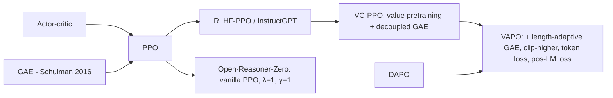

# Bringing critics back: VC-PPO and VAPO (value-based RL for long chain-of-thought)

> Make PPO's learned value function work for long chain-of-thought (CoT) reasoning. **VC-PPO** pretrains the critic and decouples GAE's λ between actor and critic. **VAPO** adds length-adaptive GAE and DAPO-style tricks, and reported state-of-the-art AIME results with fewer, more stable steps than critic-free methods. **Family:** LLM post-training → RL for reasoning → actor-critic (PPO with GAE)  ·  **Year / origin:** VC-PPO: Yuan et al., ByteDance Seed, Mar 2025 (arXiv 2503.01491); VAPO: Yue et al., ByteDance Seed, Apr 2025 (arXiv 2504.05118)  ·  **On/Off-policy:** on-policy (PPO minibatch reuse)  ·  **Action space:** discrete tokens

## 1. What is it?

After DeepSeek-R1, most reasoning RL went critic-free ([GRPO](grpo.md), [DAPO](dapo-dr-grpo.md)). A critic has real advantages, though. It gives **token-level credit assignment**: which tokens moved the solution closer to success. Its advantages are **lower-variance**, and it does not need many samples per prompt. Its weakness is that vanilla PPO **collapses on long CoT**. ByteDance Seed's diagnosis (VC-PPO) identified two causes:

1. **Value initialization bias.** The critic is usually initialized from the reward model or the policy. A reward model was trained to score *complete* responses at the EOS token, so its predictions on partial prefixes are systematically biased (often too optimistic). With GAE, this bias leaks into the advantages of the early tokens, so many tokens get advantages of the wrong sign. That pushes the policy toward shorter outputs and the CoT collapses.
2. **Reward signal decay.** With $\lambda<1$ (typical 0.95), the terminal reward's influence on token $t$ decays as $\lambda^{T-t}$. For $T=1000$, $0.95^{999}\approx 5\times10^{-23}$. Early tokens learn only from the (biased) critic.

**VC-PPO fixes:** (a) **value pretraining**: before RL, train the critic on rollouts of the *fixed initial policy* with Monte-Carlo targets ($\lambda=1$) until the value loss converges; (b) **decoupled GAE**: $\lambda_\text{critic}=1$ (unbiased MC-style value targets, no reward decay) while the actor keeps $\lambda_\text{actor}=0.95$ (lower variance).

**VAPO (Value-based Augmented PPO)** builds on VC-PPO and DAPO with seven modifications:

1. value pretraining;
2. decoupled GAE;
3. **length-adaptive GAE**, $\lambda_\text{actor}=1-\frac{1}{\alpha\,l}$, with $l$ the response length;
4. Clip-Higher;
5. token-level policy-gradient loss;
6. a **positive-example LM loss** (an extra NLL term on correct samples);
7. group sampling (several samples per prompt).

On Qwen2.5-32B it reported AIME 2024 ≈ 60 within ~5,000 steps, ahead of DAPO and DeepSeek-R1-Zero-Qwen-32B in their comparison, with no training crashes across runs (reported).

## 2. Family & lineage



- **Parents:** PPO with GAE ([ppo.md](../03-policy-gradient/ppo.md), [actor-critic-a2c-a3c.md](../03-policy-gradient/actor-critic-a2c-a3c.md)); RLHF-PPO ([rlhf-ppo.md](../09-llm-preference-alignment/rlhf-ppo.md)).
- **Siblings:** critic-free GRPO/DAPO; Open-Reasoner-Zero (2025), which reported that vanilla PPO with GAE ($\gamma=\lambda=1$) and no KL scales well for R1-Zero-style training; implicit process rewards ([PRIME](process-reward-prime.md)), another route to token-level credit.
- **Descendants:** value-model-based variants in 2025–2026 frameworks (verl's `gae` estimator with decoupled λ), and critics for multi-turn agents (e.g. ArCHer's utterance-level critic, see [agentic-multi-turn-rl.md](agentic-multi-turn-rl.md)).

## 3. Core idea & intuition

- **A critic says "how good is this half-written solution?"** If it's well calibrated, a token's advantage $\delta_t=V(s_{t+1})-V(s_t)$ tells you whether *that* token improved the odds. That is much finer than GRPO's "this whole 8k-token answer was right".
- **But a miscalibrated critic is worse than none.** If $V$ starts near 1 everywhere (an optimistic reward model), then for a failed sample every intermediate $\delta_t\approx0$ and the final $\delta_T=0-1=-1$. Discounted by $\lambda^{T-t}$, early tokens get small negative advantages, and even *successful* samples get negative early advantages. Our demo shows exactly this. Hence: **pretrain the value function** on the initial policy's own rollouts before letting it steer the actor.
- **Different jobs need different λ.** The critic must learn from the true outcome, so $\lambda=1$ avoids decay and gives unbiased targets. The actor wants low-variance advantages, so $\lambda<1$ is fine there.
- **Length-adaptive λ.** For short responses use smaller λ (variance reduction). For long responses push λ toward 1 so the terminal reward still reaches early tokens. VAPO sets $\lambda=1-1/(\alpha l)$ so that the "effective horizon" $\frac{1}{1-\lambda}=\alpha l$ scales with length.
- **Positive-example LM loss.** Extra imitation of the policy's own correct samples. It exploits the rare successes more strongly, like self-imitation learning.

## 4. Math / formal details

Token-level MDP: state $s_t=(x,y_{<t})$, action $a_t=y_t$, reward $r_t=0$ for $t<T$ and $r_T=R(x,y)$ (optionally a per-token KL penalty), $\gamma=1$.

**TD error and GAE:**
$$
\delta_t=r_t+\gamma V_\phi(s_{t+1})-V_\phi(s_t),\qquad \hat A_t^{(\lambda)}=\sum_{l=0}^{T-t-1}(\gamma\lambda)^l\delta_{t+l}
$$
With $\lambda=1$, $\gamma=1$: $\hat A_t=R-V(s_t)$ (Monte Carlo). With $\lambda=0$: $\hat A_t=\delta_t$ (one-step TD).

**Decoupled GAE:**
$$
\hat A^\text{actor}_t=\hat A_t^{(\lambda_\text{actor})},\qquad \hat R_t^\text{critic}=\hat A_t^{(\lambda_\text{critic})}+V_\phi(s_t),\quad\lambda_\text{critic}=1
$$
Critic loss (optionally clipped): $\mathcal L_V=\frac12\,\mathbb E\big[(V_\phi(s_t)-\hat R_t^\text{critic})^2\big]$.

**Length-adaptive λ (VAPO):**
$$
\lambda_\text{policy}(l)=1-\frac{1}{\alpha\,l},\qquad \text{e.g. }\alpha=0.05 \text{ (reported)}\Rightarrow \lambda(100)=0.8,\ \lambda(1000)=0.98,\ \lambda(8000)=0.9975
$$

**Actor loss** (token-level, Clip-Higher):
$$
\mathcal L_\text{PPO}=-\frac{1}{\sum_i|y_i|}\sum_{i,t}\min\Big(\rho_{i,t}\hat A_{i,t},\ \text{clip}(\rho_{i,t},1-\epsilon_\text{low},1+\epsilon_\text{high})\hat A_{i,t}\Big)
$$
**Positive-example LM loss:** $\mathcal L_\text{NLL}=-\frac{1}{\sum_{y_i\in\mathcal T}|y_i|}\sum_{y_i\in\mathcal T}\sum_t\log\pi_\theta(y_{i,t}|\cdot)$ over correct samples $\mathcal T$. Total loss: $\mathcal L=\mathcal L_\text{PPO}+\mu\,\mathcal L_\text{NLL}$ ($\mu=0.1$ reported).

**Signal decay.** The weight of the terminal TD error in $\hat A_0$ is $(\gamma\lambda)^{T-1}$. Demo 1 in the code prints it for several λ and T.

## 5. Algorithm (pseudocode)

```text
Input: policy π_θ (SFT / base), critic V_φ (init from RM or policy), verifier R, prompts D
0. Value pretraining: repeat K times
       sample responses with the FIXED initial π_θ; compute MC returns (λ=1); regress V_φ
1. for step = 1..N:
2.     sample prompts; G responses each (group sampling) from π_old
3.     rewards R at the last token (verifier); values V_φ(s_t) for all tokens (no grad)
4.     λ_actor(l) = 1 − 1/(α·l) per response;  Â = GAE(λ_actor);  R̂ = GAE(λ=1) + V
5.     for minibatch epochs:
6.         L_actor = token-mean clipped surrogate with (ε_low, ε_high)
7.                   + μ · NLL on correct responses
8.         L_critic = ½ (V_φ − R̂)²  (optionally clipped)
9.         update θ, φ
```

## 6. Python implementation

Runnable version: [`code/value-based-llm-rl-vapo.py`](../../code/value-based-llm-rl-vapo.py)

`compute_gae` supports a per-sequence λ tensor, so length-adaptive λ works with variable lengths. The file also implements `length_adaptive_lambda`, `ppo_actor_loss` (Clip-Higher, token-mean), a clipped `value_loss` and `positive_lm_loss`. The toy is a 32-token binary sequence with reward 1 iff exactly $k$ ones were emitted, given only at the end. The actor and critic are MLPs over a Markov state (target, position, count-so-far). To mimic VC-PPO's diagnosis, the critic's output bias is initialized to +1 ("every prefix will succeed", like an optimistic reward model).

```python
"""Value-based LLM RL: token-level PPO with a critic, VC-PPO / VAPO tricks.

(a) Tensor functions: token-level GAE with per-sequence lambda, length-adaptive lambda (VAPO),
    PPO actor loss (Clip-Higher, token-mean), clipped value loss, positive-example LM loss.
(b) Demo 1: how fast a terminal reward decays to early tokens with lambda < 1.
    Demo 2: a long-ish binary-token toy task ("emit exactly k ones in 32 tokens"; reward only at
            the end) trained with (i) naive PPO (biased critic init, shared lambda=0.95) and
            (ii) VAPO-style PPO (value pretraining, decoupled lambda: critic 1.0 / actor
            length-adaptive, Clip-Higher, token-level loss, positive-example LM loss).

Run:  python3 code/value-based-llm-rl-vapo.py     (CPU, ~1 min)
"""
import torch
import torch.nn as nn

torch.set_num_threads(1)


# ----------------------------------------------------------------------------------------
# (a) Pieces
# ----------------------------------------------------------------------------------------
def compute_gae(token_rewards, values, mask, gamma=1.0, lam=0.95):
    """Token-level GAE. token_rewards, values, mask: [B, T]; lam: float or [B] tensor
    (per-sequence lambda). V after the last valid token is 0 (episode ends at EOS).
    delta_t = r_t + gamma V_{t+1} - V_t ;  A_t = delta_t + gamma*lam*A_{t+1}."""
    B, T = token_rewards.shape
    lam = torch.as_tensor(lam, dtype=values.dtype).expand(B) if not torch.is_tensor(lam) or lam.dim() == 0 else lam
    adv = torch.zeros_like(values)
    next_v = torch.zeros(B)
    next_a = torch.zeros(B)
    for t in reversed(range(T)):
        m = mask[:, t]
        delta = token_rewards[:, t] + gamma * next_v - values[:, t]
        a = delta + gamma * lam * next_a
        adv[:, t] = a * m
        next_v = torch.where(m > 0, values[:, t], next_v * 0)   # padding positions reset
        next_a = torch.where(m > 0, a, next_a * 0)
    returns = adv + values * mask
    return adv, returns


def length_adaptive_lambda(lengths, alpha=0.05):
    """VAPO: lambda_policy = 1 - 1/(alpha * l). Long sequences get lambda -> 1 (less bias),
    short ones a smaller lambda (less variance). alpha=0.05 in the paper (lengths ~1e2-1e4);
    clamp for tiny toy lengths."""
    return (1.0 - 1.0 / (alpha * lengths.float())).clamp(0.0, 1.0)


def ppo_actor_loss(logp, logp_old, adv, mask, eps_low=0.2, eps_high=0.28):
    ratio = torch.exp(logp - logp_old)
    pg = -torch.min(ratio * adv, ratio.clamp(1 - eps_low, 1 + eps_high) * adv)
    return (pg * mask).sum() / mask.sum()                      # token-level mean


def value_loss(v, v_old, returns, mask, clip=0.2):
    v_clip = v_old + (v - v_old).clamp(-clip, clip)
    l = torch.max((v - returns) ** 2, (v_clip - returns) ** 2)
    return 0.5 * (l * mask).sum() / mask.sum()


def positive_lm_loss(logp, mask, outcome):
    """VAPO's extra NLL on correct (reward=1) samples (weight ~0.1 in the paper)."""
    pos = (outcome > 0).float().unsqueeze(1) * mask
    return -(logp * pos).sum() / pos.sum().clamp(min=1)


# ----------------------------------------------------------------------------------------
# (b) Toy environment: emit L binary tokens, reward 1 iff exactly k of them are 1
# ----------------------------------------------------------------------------------------
L = 32
K_MAX = L
CRITIC_INIT_BIAS = 1.0   # VC-PPO observation: a critic initialised from a reward model is biased
                         # (here: it starts out believing every prefix will succeed)


def features(k, pos, count):
    """Markov state = (target k, position, ones so far); one-hot concatenated."""
    return torch.cat([nn.functional.one_hot(k, K_MAX + 1), nn.functional.one_hot(pos, L),
                      nn.functional.one_hot(count, L + 1)], -1).float()


def mlp(out):
    return nn.Sequential(nn.Linear(K_MAX + 1 + L + L + 1, 64), nn.Tanh(), nn.Linear(64, 64), nn.Tanh(),
                         nn.Linear(64, out))


@torch.no_grad()
def rollout(actor, k):
    B = k.shape[0]
    count = torch.zeros(B, dtype=torch.long)
    toks, feats = [], []
    for t in range(L):
        f = features(k, torch.full((B,), t), count)
        a = torch.distributions.Categorical(logits=actor(f)).sample()
        toks.append(a)
        feats.append(f)
        count = count + a
    toks, feats = torch.stack(toks, 1), torch.stack(feats, 1)          # [B,L], [B,L,F]
    outcome = (count == k).float()
    return toks, feats, outcome


def logp_of(actor, feats, toks):
    return torch.log_softmax(actor(feats), -1).gather(-1, toks.unsqueeze(-1)).squeeze(-1)


def run(vapo: bool, iters=150, B=256, seed=0, epochs=2):
    torch.manual_seed(seed)
    actor, critic = mlp(2), mlp(1)
    with torch.no_grad():
        critic[-1].bias.fill_(CRITIC_INIT_BIAS)
    opt_a = torch.optim.Adam(actor.parameters(), lr=1e-3)
    opt_c = torch.optim.Adam(critic.parameters(), lr=3e-3)
    mask = torch.ones(B, L)

    def token_rewards(outcome):
        r = torch.zeros(B, L)
        r[:, -1] = outcome                         # outcome reward on the last token only
        return r

    if vapo:   # --- value pretraining: fit critic to MC returns (lambda=1) of the FIXED initial policy
        for _ in range(150):
            k = torch.randint(0, K_MAX + 1, (B,))
            toks, feats, outcome = rollout(actor, k)
            with torch.no_grad():
                v = critic(feats).squeeze(-1)
            _, ret = compute_gae(token_rewards(outcome), v, mask, lam=1.0)
            vl = 0.5 * ((critic(feats).squeeze(-1) - ret) ** 2).mean()
            opt_c.zero_grad()
            vl.backward()
            opt_c.step()

    accs = []
    for it in range(iters):
        k = torch.randint(0, K_MAX + 1, (B,))
        toks, feats, outcome = rollout(actor, k)
        with torch.no_grad():
            v_old = critic(feats).squeeze(-1)
            logp_old = logp_of(actor, feats, toks)
        r = token_rewards(outcome)
        if vapo:   # decoupled GAE: actor uses length-adaptive lambda, critic uses lambda = 1
            lam_actor = length_adaptive_lambda(mask.sum(1), alpha=2.0)  # alpha rescaled for L=32
            adv, _ = compute_gae(r, v_old, mask, lam=lam_actor)
            _, ret = compute_gae(r, v_old, mask, lam=1.0)
            eps_high = 0.28
        else:      # naive PPO: same lambda for both
            adv, ret = compute_gae(r, v_old, mask, lam=0.95)
            eps_high = 0.2
        if it == 0:   # diagnostics on the very first PPO batch
            diag = {"V(t=0) - success_rate": (v_old[:, 0].mean() - outcome.mean()).item(),
                    "mean A on failed samples, t=0": adv[outcome == 0, 0].mean().item(),
                    "mean A on successful samples, t=0": adv[outcome == 1, 0].mean().item()}
        for _ in range(epochs):
            logp = logp_of(actor, feats, toks)
            loss = ppo_actor_loss(logp, logp_old, adv, mask, 0.2, eps_high)
            if vapo:
                loss = loss + 0.1 * positive_lm_loss(logp, mask, outcome)
            opt_a.zero_grad()
            loss.backward()
            opt_a.step()
            vl = value_loss(critic(feats).squeeze(-1), v_old, ret, mask)
            opt_c.zero_grad()
            vl.backward()
            opt_c.step()
        accs.append(outcome.mean().item())
    return accs, diag


if __name__ == "__main__":
    print("Demo 1: weight of a terminal reward reaching token 0 through GAE (perfect-critic-free "
          "view: (gamma*lambda)^(T-1))")
    for lam in [0.9, 0.95, 0.99, 1.0]:
        print(f"  lambda={lam:<5} T=16: {lam**15:.3f}   T=1000: {lam**999:.2e}   T=8000: {lam**7999:.2e}")
    print("  length-adaptive lambda (alpha=0.05) for l = 100, 1000, 8000:",
          [round(x, 4) for x in length_adaptive_lambda(torch.tensor([100, 1000, 8000])).tolist()])

    # GAE sanity check: lambda=1 and zero values -> advantage = return-to-go
    a, _ = compute_gae(torch.tensor([[0., 0., 1.]]), torch.zeros(1, 3), torch.ones(1, 3), lam=1.0)
    assert torch.allclose(a, torch.ones(1, 3))
    print("\nDemo 2: 'exactly k ones in 32 tokens', reward only at the end (mean of 2 seeds)")
    for name, flag in [("naive PPO (biased critic init, lambda=0.95 shared)", False),
                       ("VAPO-style (value pretrain, decoupled/adaptive lambda, ...)", True)]:
        res = [run(flag, seed=s) for s in range(2)]
        curves = [c for c, _ in res]
        print(f"  {name}\n    first-batch diagnostics: " +
              ", ".join(f"{k} = {v:+.3f}" for k, v in res[0][1].items()))
        first = sum(sum(c[:10]) / 10 for c in curves) / 2
        mid = sum(sum(c[40:60]) / 20 for c in curves) / 2
        last = sum(sum(c[-10:]) / 10 for c in curves) / 2
        print(f"    success rate: first10 {first:.3f} | it40-60 {mid:.3f} | last10 {last:.3f}")
```

What the output shows (~55 s):

- **Demo 1:** with λ=0.95 only $5.6\times10^{-23}$ of the terminal signal reaches token 0 of a 1000-token answer; λ=1 keeps all of it.
- **Demo 2, first-batch diagnostics.** With the biased critic, $V(t{=}0)$ overestimates the success rate by ≈+0.99, and at $t=0$ even **successful** samples get a *negative* mean advantage (≈−0.04). That is the sign-flip pathology VC-PPO describes. After value pretraining the bias is ≈0, and successful samples get a clearly positive early advantage (≈+0.5) while failures get ≈0.
- **Success rates** on this short (32-token) toy end up similar for both variants (≈0.24–0.26 after 150 iterations). The critic self-corrects quickly at this scale. The papers' gains appear at thousands of tokens, where the bias and decay cannot be outgrown. We report this honestly instead of tuning the toy to "win".

**With verl** (requires GPU + library; not run here):

```bash
python -m verl.trainer.main_ppo \
  algorithm.adv_estimator=gae \
  algorithm.lam=0.95 algorithm.gamma=1.0 \
  critic.model.path=Qwen/Qwen2.5-7B critic.optim.lr=2e-6 \
  actor_rollout_ref.actor.clip_ratio_low=0.2 actor_rollout_ref.actor.clip_ratio_high=0.28 \
  actor_rollout_ref.actor.loss_agg_mode=token-mean actor_rollout_ref.rollout.n=4 \
  trainer.critic_warmup=50      # train the critic alone for the first steps (value pretraining)
# Decoupled / length-adaptive λ: implemented in the VAPO/VC-PPO recipes; check your verl version
```

## 7. Practical tips & hyperparameters

- **Value pretraining:** run until value loss and explained variance plateau (reported: dozens to ~100 steps). Use the *initial* policy's rollouts, $\lambda=1$, and no actor updates.
- **λ:** critic 1.0. Actor 0.95, or length-adaptive with $\alpha\approx0.05$ for responses of hundreds to thousands of tokens. **γ = 1** for single-turn reasoning.
- **Critic learning rate** higher than the actor's (e.g. 2e-6 vs 1e-6). The critic is often the same size as, or smaller than, the policy.
- **Positive LM loss** weight ~0.1. Too large becomes plain SFT and reduces exploration.
- **Diagnostics:** value explained variance; the mean advantage at early tokens for successful vs failed samples (should be +/−); the correlation of $V(s_0)$ with the empirical pass rate; response length (collapse to short answers = critic bias).
- **Memory:** a critic doubles the trainable model memory. Consider a smaller critic or LoRA critics.

## 8. Pros and cons

| Pros | Cons |
|---|---|
| Token-level credit assignment, lower-variance advantages | Extra model to train, store and serve (memory ~2×) |
| Fewer samples per prompt needed than GRPO | Critic must be pretrained / calibrated or PPO collapses on long CoT |
| Reported more stable and sample-efficient than DAPO (VAPO) | More hyperparameters (λs, α, critic LR, warm-up) |
| Natural for multi-step / multi-turn settings | Value prediction for long, open-ended text is genuinely hard |
| Works with dense rewards (KL, process signals) | Benefits shrink on short responses |

## 9. When to use / when not to use

**Use** when you need fine-grained credit assignment (very long CoT, multi-turn agents), when generating many samples per prompt is too expensive, or when critic-free runs are unstable or plateau.

**Avoid** when memory is tight, responses are short (GRPO/RLOO baselines are near-optimal), or you can't afford value pretraining and careful monitoring.

## 10. Key papers, books & repos

- Yuan et al., *What's Behind PPO's Collapse in Long-CoT? Value Optimization Holds the Secret* (VC-PPO), 2025 — arXiv 2503.01491.
- Yue et al., *VAPO: Efficient and Reliable Reinforcement Learning for Advanced Reasoning Tasks*, 2025 — arXiv 2504.05118.
- Schulman et al., *High-Dimensional Continuous Control Using Generalized Advantage Estimation*, ICLR 2016 — arXiv 1506.02438.
- Schulman et al., *PPO*, 2017 — arXiv 1707.06347; Ouyang et al., *InstructGPT*, 2022 — arXiv 2203.02155.
- Hu et al., *Open-Reasoner-Zero*, 2025 — arXiv 2503.24290 (vanilla PPO with GAE λ=1, γ=1 for R1-Zero-style training).
- Oh et al., *Self-Imitation Learning*, ICML 2018 (related to the positive-example LM loss).
- Sutton & Barto (2018), Ch. 12 (eligibility traces / λ-returns) and Ch. 13.5 (actor-critic).
- Repos: `volcengine/verl`, `OpenRLHF/OpenRLHF`, `Open-Reasoner-Zero/Open-Reasoner-Zero`.

## 11. For business users

**What it does.** Most recent reasoning-model training grades only the final answer. VAPO-style methods add a "coach" model that predicts, while the answer is being written, how likely it is to end up correct. That lets training reward or penalize the specific *parts* of the reasoning that helped or hurt. The catch is that the coach must be trained first, or its bad early advice derails training.

**Analogy.** A chess student reviewing games with a coach who evaluates every move, rather than only being told "you won" or "you lost". But a coach who arrives with wrong opinions does more harm than good, so the coach first watches many games before giving advice (value pretraining).

**Use cases.** Long, multi-step reasoning (math proofs, long code generation); multi-step agents where knowing *which step* failed matters.

**Value.** Reported faster and more reliable training (fewer crashed runs) and higher accuracy on hard math benchmarks.

**Risks.** More complex pipeline; extra hardware for the coach model; more tuning knobs.

**Costs.** About double the model memory during training; extra warm-up time.

**Questions to ask your team.**
- Do we need step-level credit, or is final-answer grading enough for our task length?
- How do we verify the critic is calibrated before RL starts?
- What is the memory/compute budget for a critic?

## 12. For kids (ages ~8–12)

Imagine building a tall LEGO tower and only finding out at the very end whether it stood up. That's hard: which brick was the problem? Now imagine a helper who looks at your tower *while you build* and says "looking wobbly!" or "nice and steady!". That helper makes learning much faster. But if the helper always says "great!" even when it isn't, you learn the wrong lessons. So first the helper watches lots of towers being built and learns to guess correctly.

**Try it yourself:** Build a tower of 10 blocks. After each block, guess "will it stand at the end?" (yes/no). Do this 5 times. Do your guesses get better?

**Recap:**
1. A helper guesses "how well is it going?" at every step.
2. The helper must practise guessing first.
3. Then it can tell you which steps helped.

## 13. Related methods

- [GRPO](grpo.md) and [DAPO & Dr. GRPO](dapo-dr-grpo.md) — critic-free counterparts; VAPO reuses DAPO's tricks.
- [RLOO, ReMax, REINFORCE++](rloo-remax-reinforcepp.md) — other critic-free baselines.
- [Process rewards & PRIME](process-reward-prime.md) — dense credit via process reward models.
- [Agentic multi-turn RL](agentic-multi-turn-rl.md) — critics (ArCHer) for multi-turn agents.
- [PPO](../03-policy-gradient/ppo.md), [Actor-critic (A2C/A3C)](../03-policy-gradient/actor-critic-a2c-a3c.md), [TD learning](../01-foundations-tabular/td-learning.md).
- [RLHF with PPO](../09-llm-preference-alignment/rlhf-ppo.md).

[← Back to overview](../../RL_Methods_Overview.md)
